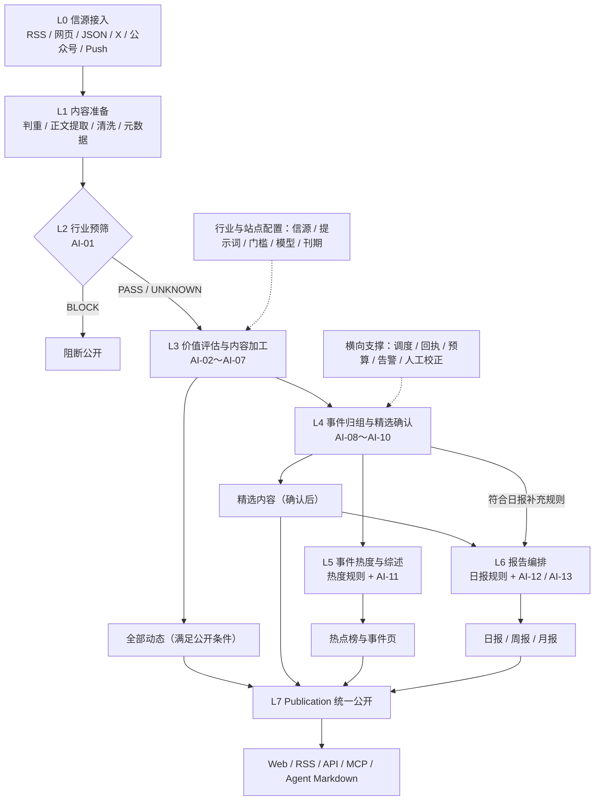
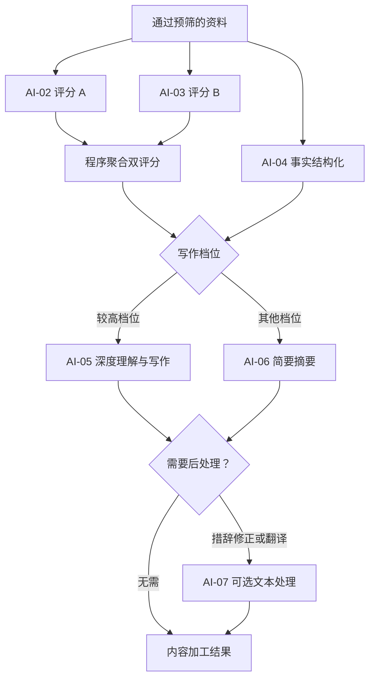
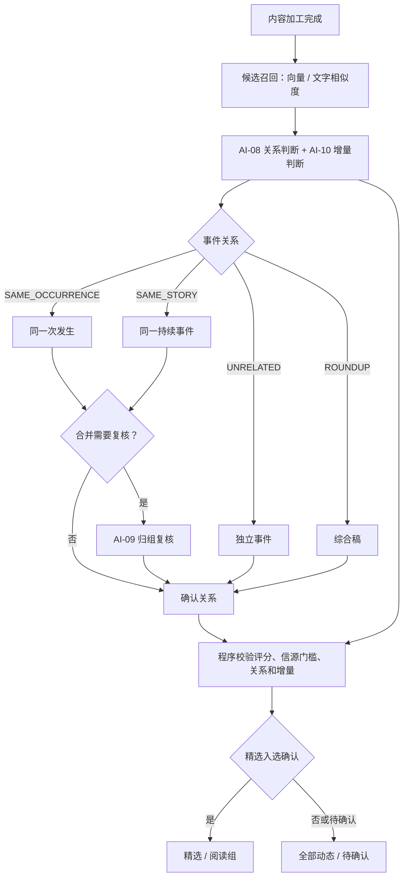
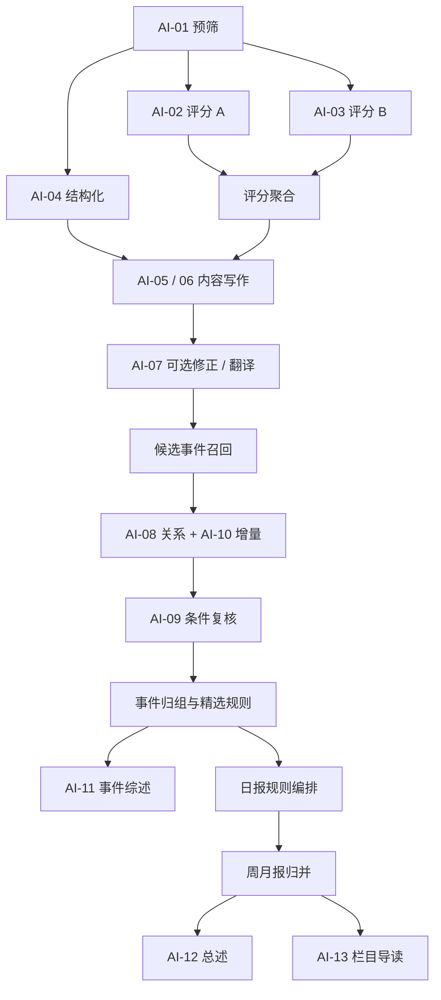

# AIHOT 业务处理架构与 AI 任务拆解 V2.0

> **研究对象：** [KKKKhazix/AIHOT](https://github.com/KKKKhazix/AIHOT)  
> **整理日期：** 2026-10-16  
> **分析重点：** L0–L7 业务流水线、AI Task、任务依赖、Prompt/模块映射、规则与模型协作  
> **结论等级：** 基于项目公开文档及 RiskHot 项目已存档分析，**尚未完成逐行源码审计**。

## 1. 文档定位与核验说明

本文件延续《AIHOT 业务处理架构》中的八阶段业务模型，将“业务阶段”进一步分解为“处理步骤—AI 任务—确定性规则—业务产物—执行依赖”。AI-01～AI-13 是本分析为便于讨论而编制的**逻辑任务编号**，不表示原仓库具有同名函数、13 个独立 Worker，或单篇资料固定进行 13 次 LLM 请求。

**证据分级：**

- **文档可确认**：原始分析文档明确记载的阶段、职责、主要行为、Prompt 文件名和代码模块归属。
- **架构拆解**：把组合调用拆成独立业务责任，便于在 Task / Strategy / Run 框架下讨论。
- **待源码核验**：真实函数入口、精确调用次数、模型客户端、异步调度、数据库写入、重试与缓存等实现细节。

本稿优先保证业务语义清晰。涉及评分阈值、热点窗口、半衰期等的配置，均按公开文档或既有分析记录描述；实际部署可以调整。

## 2. L0–L7 总体业务处理架构

### 2.1 阶段职责与 AI 边界

| 阶段 | 阶段名称 | 核心步骤 | 主要执行方式 | AI 任务 |
|---|---|---|---|---|
| L0 | 信源接入 | 拉取、接收推送、分级、记录原始内容 | 接口 / 程序 / 配置 | 无常规 AI 任务确认 |
| L1 | 内容准备 | 判重、正文提取、清洗、元数据补齐 | 程序及外部提取器 | 无常规 AI 任务确认 |
| L2 | 行业预筛 | 行业相关性判断 | LLM + 路由规则 | AI-01 |
| L3 | 价值评估与内容加工 | 双评分、结构化、写作、修正、翻译 | LLM + 聚合规则 | AI-02～AI-07 |
| L4 | 事件归组与精选确认 | 候选召回、关系判断、复核、增量、入选 | 检索 + LLM + 规则 | AI-08～AI-10 |
| L5 | 事件热度与综述 | 热度证据聚合、衰减、综述 | 算法 + LLM | AI-11 |
| L6 | 报告编排 | 日报选编、周期归并、总述与导读 | 规则 + LLM | AI-12、AI-13 |
| L7 | 统一公开与交付 | 公开范围、撤回、全文权限、多渠道读取 | 权限与查询规则 | 无常规在线 AI 任务确认 |

**关键边界：** `editorial` 内容参与内容展示及精选；`hot_signal` 只提供热度证据；`isolated` 不公开。文章、一次发生、持续事件分别保持独立粒度。

## 3. AI 任务总清单

| 编号 | 所属阶段 | 逻辑 AI 任务 | 主要输入 | 主要输出 | 执行说明 |
|---|---|---|---|---|---|
| AI-01 | L2 | 行业相关性预筛 | 标题、正文、行业上下文 | PASS / BLOCK / UNKNOWN | 预筛分支 |
| AI-02 | L3 | 价值评分 A | 完整材料、评分标准 | 0–100 分 | 可与 AI-03、AI-04 并行 |
| AI-03 | L3 | 价值评分 B | 同一材料、同一标准 | 0–100 分 | 独立重复判断 |
| AI-04 | L3 | 新闻事实结构化 | 材料、抽取规则 | 分类、主体、事实、出处、条件 | 可复用结构化产物 |
| AI-05 | L3 | 深度内容理解与写作 | 结构化事实、评分档位 | 标题、摘要、推荐理由 | 较高评分档位 |
| AI-06 | L3 | 简要摘要 | 普通文章 | 简短标题、摘要 | 与 AI-05 分流 |
| AI-07 | L3 | 措辞修正 / 翻译 | 生成文本或外文正文 | 修正稿 / 译文 | 两个可选能力，建议正式设计再拆分 |
| AI-08 | L4 | 事件关系判断 | 当前新闻、候选事件/报道 | 关系分类 | 可能联合输出增量判断 |
| AI-09 | L4 | 事件归组复核 | 待合并候选及依据 | 复核结论 | 条件触发 |
| AI-10 | L4 | 精选信息增量判断 | 当前报道、已入选相关报道 | 有无新增重要事实 | 可与 AI-08 共用模型调用 |
| AI-11 | L5 | 事件综述生成 | 事件与报道证据集合 | 事件综述 | 与热度数值计算分离 |
| AI-12 | L6 | 周月报总述生成 | 规则选定的周期条目 | 周期总述 | 条目锁定后生成 |
| AI-13 | L6 | 周月报栏目导读 | 已编排的栏目内容 | 栏目导读 | 按栏目生成 |

**任务粒度提醒：** AI-02/03 代表同一业务评分任务的两次独立执行；AI-08/10 是可以由同一次 LLM 响应完成的两种业务判断；AI-07 适合按实际触发条件继续拆分。因此正式落地时，Task 数量、Prompt 数量、模型调用次数可以不同。

## 4. 分阶段详细处理

### 4.1 L0 信源接入

**输入：** 外部新闻、网页、RSS、JSON、X 内容、公众号内容和推送记录。  
**处理链：** 信源读取 → 抓取调度 → 信源等级配置 → 原始资料留存。  
**主要产物：** 带来源标识的原始内容及元数据。  
**代码范围（文档映射）：** `packages/backend/src/sources/`、`sources/collect.ts`。  
**AI 任务：** 无已确认的常规 LLM 调用。

信源等级 T1、T1_5、T2 等会影响后续内容精选门槛。来自 `hot_signal` 的记录可进入热度证据处理，但不直接进入精选路径。

### 4.2 L1 内容准备

**处理链：** 原始资料入库 → URL/内容判重 → 正文提取与清洗 → 元数据补齐 → 完整性检查 → 待分析资料。  
**代码范围（文档映射）：** `packages/backend/src/content/`。  
**AI 任务：** 当前证据没有明确的常规正文提取 LLM 任务；先归入程序与外部提取能力。

特殊处理包括：普通文章仅有标题时等待补材料；无文字或纯链接的 X 原帖有独立的原样展示规则；没有可信发布时间的资料暂不公开；新修订的内容允许重入分析。

### 4.3 L2 行业相关性预筛（AI-01）

| 契约元素 | 分析定义 |
|---|---|
| 任务 | AI-01 Industry Prefilter |
| 业务目标 | 将行业相关性判断前置，阻断明显无关资料 |
| 输入 | 当前资料版本、标题、正文、目标行业上下文 |
| Prompt | `industry/prompts/prefilter.md` |
| 输出 | `PASS`、`BLOCK` 或 `UNKNOWN` |
| 业务路由 | BLOCK 阻断公开；PASS 和 UNKNOWN 继续下游 |
| 代码归属 | `editorial/analyze.ts`（模块级映射） |

`UNKNOWN` 被保留进入后续加工，避免过早过滤潜在价值内容。异常状态与 UNKNOWN 的具体区分方式需要源码确认。

### 4.4 L3 价值评估与内容加工（AI-02～AI-07）

#### AI-02 / AI-03：双评分

同一材料按照 `selection-score.md` 中同一评分标准独立评分两次，输出单次 0–100 分。用于展示的聚合分数：

`S = floor((S_A + S_B) / 2)`

示例行业信源精选门槛：T1 为 60、T1_5 为 65、T2 为 76。实际资格校验需要结合双评分和信源门槛，再进入事件归组及精选确认。门槛由行业配置决定。

#### AI-04：新闻事实结构化

使用 `structure.md`，主要抽取分类、主体、事件事实、时间、来源/出处和适用前提。结构化信息会被内容写作、事件关系判断和报告编排复用。

#### AI-05 / AI-06：按价值档位选择写作策略

- **AI-05：** `content-understanding.md`，面向较高价值资料，生成标题、摘要、推荐理由等。
- **AI-06：** `summarize-*.md`，面向一般资料，生成简洁摘要。
- `understandFloor` 是写作策略的分流门槛，**与精选门槛具有不同含义**。

#### AI-07：可选文本处理

措辞修正使用 `mend-wording.md`，根据行业词表识别需要修复的特定表述。外文翻译是另一条按条件触发的文本处理路径。两者在正式任务设计中宜独立登记，便于配置各自的模型、Prompt、重试与成本限制。翻译的实际源码入口有待确认。

### 4.5 L4 事件归组与精选确认（AI-08～AI-10）

**候选召回：** 先以向量或文字相似度获取候选事件与报道，再交给语义判断。若未配置向量能力，可以采用文字重合度回退，具体实现以代码为准。

**AI-08 事件关系判断：**

| 关系值 | 业务含义 | 处理原则 |
|---|---|---|
| `SAME_OCCURRENCE` | 同一次真实发生 | 可以归入相同新闻发生粒度 |
| `SAME_STORY` | 同一持续事件的后续 | 维护持续事件及进展关系 |
| `UNRELATED` | 独立事件 | 保持独立身份 |
| `ROUNDUP` | 多事件综合稿 | 不能简单当成单一新闻发生 |

**AI-09 事件归组复核：** 对符合条件的待合并关系再次判断，防止错误合并。公开文档提及 `GROUP_REVIEW_MODEL` 独立配置；复核的真实调用点与策略需要进一步核查。

**AI-10 信息增量判断：** 对照现有精选/相关报道，判断新报道是否引入重要且未覆盖的事实。它与 AI-08 在业务语义上独立，底层调用可以合并。

**精选确认：** 由程序综合评分门槛、信源等级、事件关系、信息增量和处理状态。关系判断失败或尚待确认时，不自动放行精选。网页可将同一新闻的多篇精选报道折叠成阅读组，机器出口可以选择代表报道。

**代码范围（文档映射）：** `events/relate.ts`、`events/group.ts`、`industry/prompts/group-*.md`。

### 4.6 L5 事件热度与综述（AI-11）

本阶段包含两条分工明确的路径：

| 子流程 | 执行方式 | 业务产物 |
|---|---|---|
| 事件热度 | 独立来源/参与方去重 + 时间衰减 | 热度分数、热点排序、新增/上升趋势 |
| 事件综述 | AI-11，`story-digest.md` | 事件背景、核心事实和进展的自然语言综述 |

已有公开描述中的热度计算窗口为 48 小时、半衰期为 24 小时。同源重复采集不会简单按资料条数累计热度，来自 `hot_signal` 的独立参与方也可以提供热度证据。

**AI-11 业务契约：** 输入为同一事件下的相关报道、事实、进展与出处，输出供事件页阅读的综述。项目文档记录了事件综述评测能力。  
**代码范围（文档映射）：** `packages/backend/src/events/`。

### 4.7 L6 报告编排（AI-12 / AI-13）

| 步骤 | 主要机制 |
|---|---|
| 日报候选选取 | 按公开范围和日报补充规则选材 |
| 日报去重、排序、栏目编排 | 确定性规则 |
| 周报/月报归并 | 以历史日报为输入，按事件汇编 |
| 周期报告总述 | AI-12：`report-period.md` |
| 周期栏目导读 | AI-13：`report-period-sections.md` |
| 文本事实检查 | 程序检查生成内容是否引入未经依据支持的实体或数字 |

该设计先锁定报告条目，再让模型撰写总述与栏目导读。AI 生成内容不得擅自增删报告条目。默认日报的具体出刊时间由站点配置决定；旧公开材料提及每天 08:00 的示例安排。

**代码范围（文档映射）：** `packages/backend/src/reports/`。

### 4.8 L7 统一公开与交付

由 `publication` 统一处理发布范围、撤回、全文权限和多渠道读取。公开渠道包括 Web、RSS、API、MCP、Agent Markdown。页面主要读取预先计算好的内容，模型执行由 Worker 侧承担。

**代码范围（文档映射）：** `publication/`、`publication/scope.ts`。  
**AI 任务：** 暂无已确认的常规在线生成任务。

## 5. AI 任务执行依赖与工作流特征

此图为正常处理路径的**逻辑 DAG**；并行、跳过、重试、失败和特殊内容分支需在实际实现中表达。

| 执行模式 | 案例 | 需要记录的执行信息 |
|---|---|---|
| 串行依赖 | 预筛 → 内容加工 → 归组 | 前驱任务结果与版本 |
| 并行任务 | 双评分、事实结构化 | 独立结果、聚合规则 |
| 条件执行 | 修正、翻译、归组复核 | 条件命中依据 |
| 规则驱动 AI | 周月报条目锁定后写总述 | 条目快照与输入范围 |
| 失败保守处理 | 关系判断失败阻止精选确认 | 失败状态、原因、恢复回执 |

## 6. AI 任务与源码资产映射

> 点击下表的提示词文件名可打开本文同级 `prompts/` 目录中的文件。链接采用相对路径，适用于当前 Obsidian 知识库。任务与调用关系依据此前核验的 AIHOT 提交 `c8704e5313e6b051560365226b3919d7e0ada5ea`；AI 编号为业务分析编号，不必对应独立模型调用。

代码位置以下均省略 `packages/backend/src/` 前缀。

| AI 任务 | 提示词文件（点击打开） | 代码位置 | 对应关系 |
|---|---|---|---|
| AI-01 行业相关性预筛 | [prefilter.md](prompts/prefilter.md) | `editorial/analyze.ts`、`editorial/writing.ts` | 判断 PASS / BLOCK / UNKNOWN。 |
| AI-02 内容价值评分 A | [selection-score.md](prompts/selection-score.md) | `editorial/analyze.ts` | 第一次独立评分；与 AI-03 共用评分提示词。 |
| AI-03 内容价值评分 B | [selection-score.md](prompts/selection-score.md) | `editorial/analyze.ts` | 第二次独立评分；源码中两次评分顺序执行。 |
| AI-04 新闻事实结构化 | [structure.md](prompts/structure.md) | `editorial/analyze.ts`、`editorial/vocabulary.ts` | 抽取分类、主体、事实及条件。 |
| AI-05 内容理解与写作 | [understand.md](prompts/understand.md) [content-understanding.md](prompts/content-understanding.md) | `editorial/analyze.ts`、`editorial/writing.ts` | understand.md 是组合入口，包含 content-understanding.md 及共享规则。 |
| AI-06 简要摘要生成 | [summarize-article.md](prompts/summarize-article.md) [summarize-article-empty.md](prompts/summarize-article-empty.md) [summarize-short-post.md](prompts/summarize-short-post.md) [summarize-short-post-quoted.md](prompts/summarize-short-post-quoted.md) [summarize-long-post.md](prompts/summarize-long-post.md) [summarize-long-post-quoted.md](prompts/summarize-long-post-quoted.md) | `editorial/analyze.ts`、`editorial/writing.ts` | 按文章、短帖、长帖分流；另含正文缺失与引用内容片段，共 6 个文件。 |
| AI-07 措辞修正 / 翻译 | [mend-wording.md](prompts/mend-wording.md) [translate-body.md](prompts/translate-body.md) [translate-post.md](prompts/translate-post.md) | `editorial/analyze.ts`、`editorial/wording.ts`、`editorial/translate.ts` | 措辞修正与全文翻译为两个可选操作；翻译分正文与帖子模板。 |
| AI-08 事件关系判断 | [group-batch.md](prompts/group-batch.md) [group-pair.md](prompts/group-pair.md) [group-signal.md](prompts/group-signal.md) [group-definitions.md](prompts/group-definitions.md) [group-method.md](prompts/group-method.md) | `events/relate.ts`、`events/group.ts`、`events/consolidate.ts` | 分别覆盖批量判断、成对判断、热度信号；definitions / method 为共享定义和方法，共 5 个文件。 |
| AI-09 事件归组复核 | [group-pair.md](prompts/group-pair.md) [group-definitions.md](prompts/group-definitions.md) [group-method.md](prompts/group-method.md) | `events/group.ts`、`events/consolidate.ts`、`editorial/models.ts` | 复核复用成对关系提示词；GROUP_REVIEW_MODEL 是模型配置变量，不是文件。 |
| AI-10 精选信息增量判断 | [group-batch.md](prompts/group-batch.md) | `events/group.ts`、`events/relate.ts` | 与 AI-08 的批量关系判断同次调用，输出 selection.addsValue 和 reason。 |
| AI-11 事件综述生成 | [story-digest.md](prompts/story-digest.md) | `events/digest.ts` | 依据事件报道证据生成或更新综述。 |
| AI-12 周月报总述生成 | [report-period.md](prompts/report-period.md) [report-period-no-sections.md](prompts/report-period-no-sections.md) | `reports/compose.ts` | 生成 overview；无符合条件的栏目时拼入 no-sections 分支。 |
| AI-13 周月报栏目导读 | [report-period-sections.md](prompts/report-period-sections.md) [report-period.md](prompts/report-period.md) | `reports/compose.ts` | sections 模板拼入 report-period；与 AI-12 同次调用，按栏目条目门槛生成导读。 |

### 共享提示词与规则

以下文件由主提示词引用，或由写作模块装配到任务输入中；它们不是新增的 AI 任务。

| 提示词文件（点击打开） | 主要用途 |
|---|---|
| [identity-context.md](prompts/identity-context.md) | AI-06 等写作输入中的已核验身份上下文。 |
| [safety.md](prompts/safety.md) | 结构化、摘要和翻译模板中的输入安全约束。 |
| [rules-domain.md](prompts/rules-domain.md) | 内容理解及摘要的领域规则。 |
| [rules-anti-hallucination.md](prompts/rules-anti-hallucination.md) | 内容理解及摘要的防幻觉规则。 |
| [rules-self-contained-title.md](prompts/rules-self-contained-title.md) | 内容理解及摘要的标题完整性规则。 |
| [rules-answer-first-summary.md](prompts/rules-answer-first-summary.md) | 内容理解、文章摘要及长帖摘要的结论优先规则。 |

## 7. 对 RiskHot 的可借鉴架构机制

| 机制 | AIHOT 表现 | RiskHot 可吸收的设计要点 |
|---|---|---|
| 不同任务配置不同模型/Prompt | 预筛、评分、抽取、归组、综述分别配置 | Task 与 Strategy 分离 |
| 同一任务多次推理 | 双评分 | 多执行节点和结果聚合策略 |
| 条件性验证 | 事件关系复核 | Verifier 作为可配置执行步骤 |
| 业务层门槛控制 | 精选需评分和归组确认 | LLM 输出通过应用规则才能正式入库 |
| 可复用结构化结果 | 事实结果服务多个下游 | 固定任务输出 Schema 与版本 |
| 提示词版本与回执 | 文档描述哈希、结果复用 | Prompt 版本、输入快照、执行回执 |
| 高成本操作离线执行 | Worker 生产内容，读取侧复用 | 异步 AI Run 与查询职责分离 |
| 专项评测 | 评分、关系、综述评测 | 面向 Task 的专属评测集 |

### 7.1 Task / Strategy / Run 与业务流水线的对应

**业务流水线（Pipeline）** 负责跨业务阶段的处理次序、状态推进和数据依赖，例如“资料预筛成功后才允许内容加工”。

**AI Task** 定义一项稳定的业务认知职责：输入是什么、必须判断什么、输出结构和业务含义是什么。例如“事件关系判断”。

**AI Strategy** 为某个 Task 选择实现方案：模型、Prompt、Skill、Tool、上下文、并发、重试、Verifier、成本及路由。例如“事件关系判断采用召回 + 主模型 + 条件复核”。

**AI Run** 记录一次真实执行：输入版本、策略版本、调用步骤、Token、费用、耗时、输出、验证与失败信息。

这四个概念可以形成清晰关系：

`业务流水线节点 → AI Task → 已选 AI Strategy → 一个或多个 AI Run`。

上述关系是**对 RiskHot 的设计建议**，不表示 AIHOT 仓库已经完整采用同名分层。

## 8. 后续源码审计清单

若需要将本文升级为“源码级实现架构”，建议按以下顺序核验：

1. `editorial/analyze.ts` 的任务编排、并发和写库路径；追踪预筛、评分、结构化及写作调用。
2. LLM 客户端封装；确认真实 Prompt 装配、模型配置、JSON Schema 校验、错误分类与 Token 回执。
3. `events/relate.ts` 与 `events/group.ts`；验证事件关系和增量是否同次调用，以及复核触发条件。
4. 热度窗口、来源去重与半衰期的计算代码；区分计算规则与 LLM 输入。
5. `reports/` 中日报与周期报告的具体规则、模型调用、生成校验及回退。
6. Job / Worker / Queue / 数据库迁移；确认任务幂等、回执缓存、重试、调度与预算控制。

## 9. 参考资料

1. [AIHOT README](https://github.com/KKKKhazix/AIHOT/blob/main/README.md)
2. [系统架构文档](https://github.com/KKKKhazix/AIHOT/blob/main/docs/architecture.md)
3. [信源文档](https://github.com/KKKKhazix/AIHOT/blob/main/docs/sources.md)
4. [精选与校准](https://github.com/KKKKhazix/AIHOT/blob/main/docs/selection.md)
5. [事件归组与关系评测](https://github.com/KKKKhazix/AIHOT/blob/main/docs/grouping.md)
6. [行业定制](https://github.com/KKKKhazix/AIHOT/blob/main/docs/customize.md)
7. [事件综述评测](https://github.com/KKKKhazix/AIHOT/blob/main/docs/story-digest-evaluation.md)
8. RiskHot 项目存档：`aihot/AIHOT_business_architecture.md`（2026-10-08 整理）

---

*本文件的 AI Task 编号与部分内部依赖图为分析性归纳。公开仓库的 main 分支可能变化；若需要精确实现审计，应固定 commit hash 后复核源码。*
