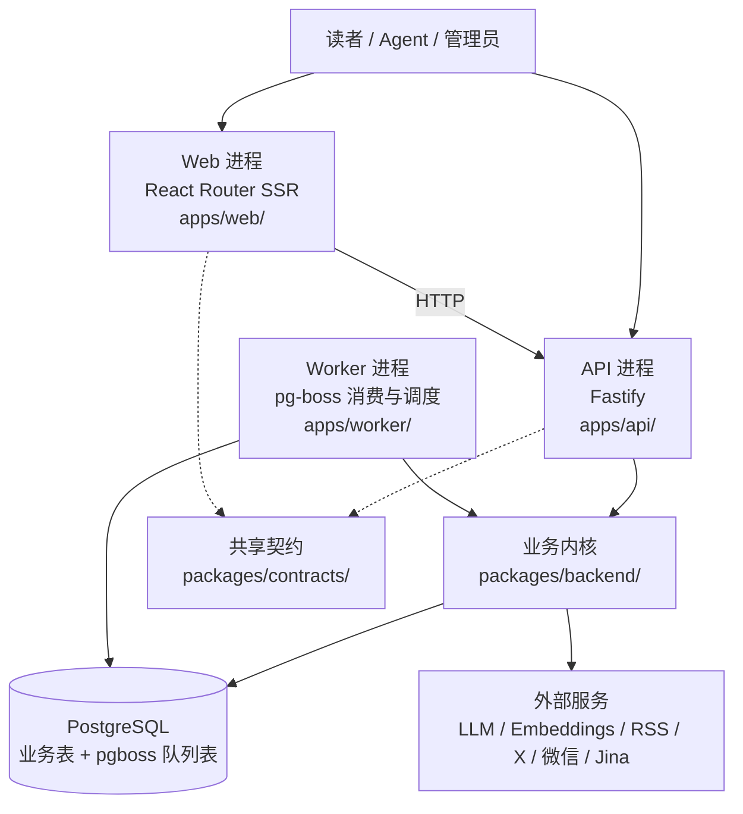
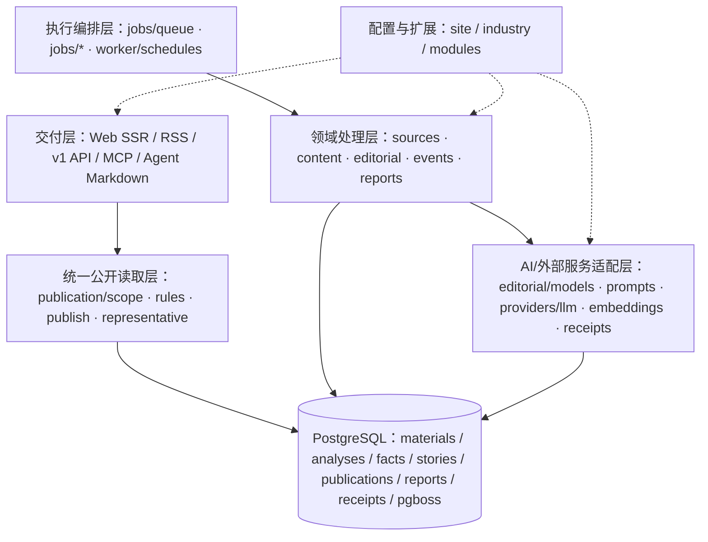
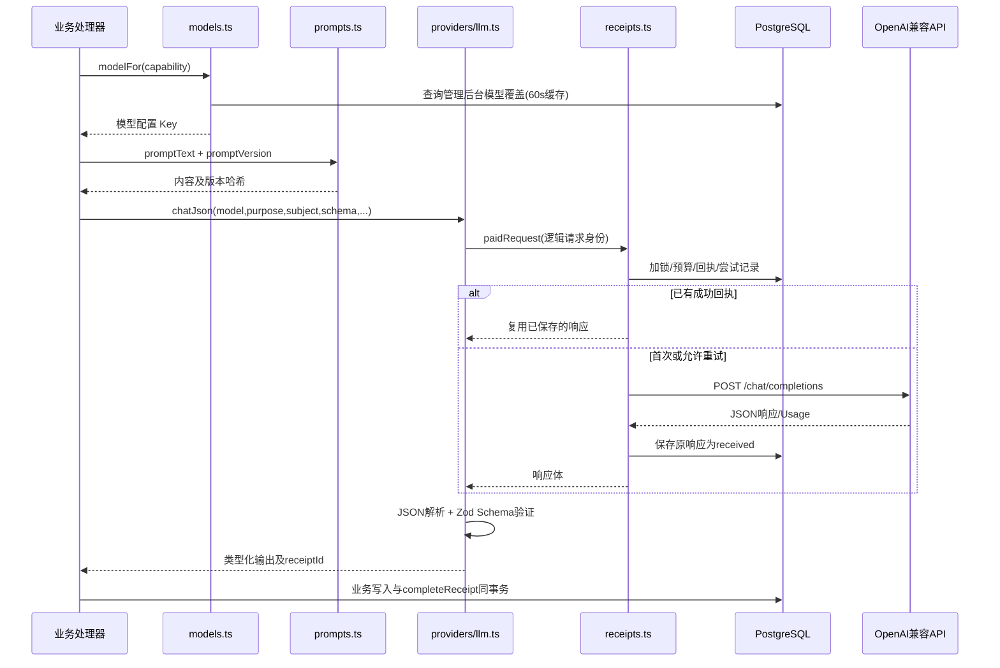
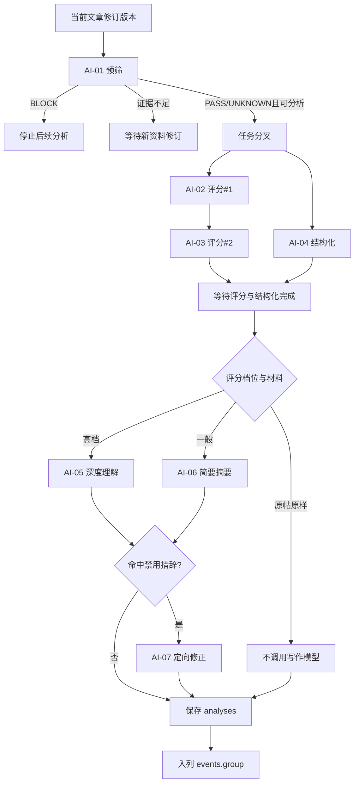
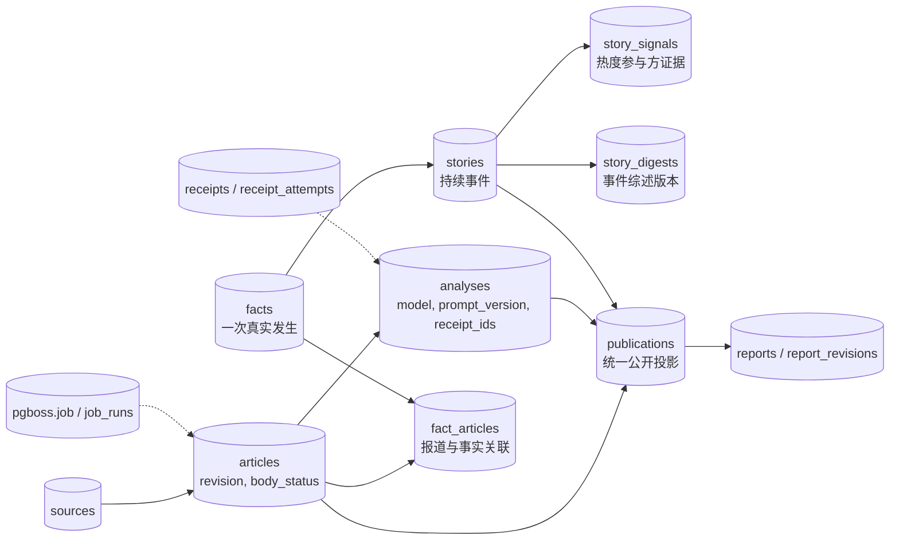
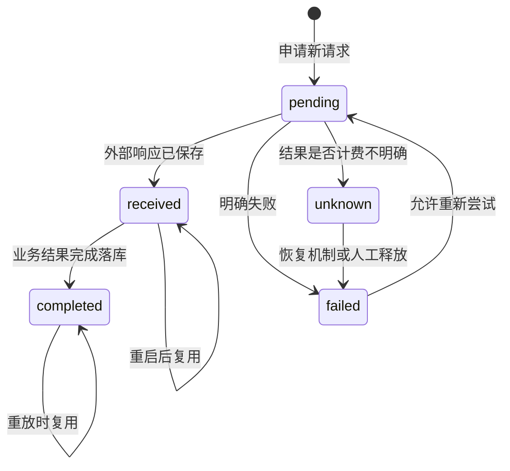

# AIHOT 系统技术架构总览 V1.0

> **文档类型**：现状技术架构 / 源码研究报告  
> **关联文档**：《AIHOT 业务处理架构与 AI 任务拆解 V2.0》  
> **研究对象**：[KKKKhazix/AIHOT](https://github.com/KKKKhazix/AIHOT)  
> **固定提交**：`c8704e5313e6b051560365226b3919d7e0ada5ea`（快照获取于 2026-10-16）  
> **出具日期**：2026-10-16  
> **分析重点**：三进程、系统分层、模块/数据依赖、调度、LLM 能力、数据模型、可靠性与公开发布  
> **性质**：AIHOT 实现研究；文末的 RiskHot 借鉴意见单列，不改变现有 RiskHot 领域设计。

## 0. 阅读范围与证据等级

本报告基于 RiskHot 本地已校验的 AIHOT 源码快照：

`aihot/AIHOT_source_snapshot/2026-10-16_c8704e5313e6/`

该快照记录 **103 个上游文件**，包含 56 个 TypeScript 文件、29 个 Prompt 文件，以及 README、架构、信源、精选等说明；文件原始字节、Git blob SHA-1 和 SHA-256 已校验。快照是用于 AI 处理主链的**源码参考子集**，未包含完整可运行工程，不含完整 `apps/api/`、`apps/web/`、`database/migrations/`、Dockerfile 与 docker-compose 的内容。未在本次研究中安装依赖、启动服务、执行模型调用或运行完整测试。

全文证据标记：**[C]**＝当前快照的 TypeScript 源码直接验证；**[D]**＝固定版本仓库 README / 架构及业务文档描述，当前快照缺少相应源码；**[I]**＝结合代码绘制的逻辑关系或设计判断，需在完整仓库进一步核验。表中路径均为原仓库根目录相对路径；关键条目附固定提交行号链接。

## 1. 架构结论摘要

AIHOT 采用 **Node.js 24 + TypeScript 的模块化单体业务内核、三进程部署形态**：对外由 Fastify API 和 React Router SSR Web 提供接口及页面，后台由 Node Worker 消费 PostgreSQL 上的 pg-boss 队列并执行定时任务。核心领域模块共享 `packages/backend/`，通过数据库状态、队列和版本化结果协作。**[C/D]**

其核心设计要点：

1. **读写与推理解耦**：模型调用由 Worker 发起；Web 经 HTTP 读取 API，公开查询依赖已计算的 `publication` 数据。[D]
2. **持久化任务控制**：pg-boss 队列以 PostgreSQL 为存储，任务载荷由 `JobData` 类型统一约束；部分队列串行、部分并行。[C]
3. **AI 能力层有独立契约**：业务能力路由到模型、Prompt 组合、结构化输出 Schema、持久化付费回执。[C]
4. **业务事实与公开投影分离**：原始材料、分析、事实/事件、归组判断与最终 `publications` 分别保存；撤回和公开资格由 publication 统一执行。[C]
5. **精细化可靠性**：材料修订号、乐观/行锁、事务内队列/回执、支付幂等、未知结果恢复、人工覆盖、按规则回退。[C]
6. **定制边界明确**：`site/` 负责站点、模型和展示；`industry/` 负责信源、分类、提示词和阈值；`modules/` 通过定义明确的插口扩展。[C/D]

## 2. 系统运行与部署架构

### 2.1 三个独立进程

| 进程 | 技术/入口 | 核心职责 | 访问边界 | 证据 |
|---|---|---|---|---|
| Web | React Router SSR，`apps/web/` | 网站、运营后台、页面路由与服务端渲染 | 经 HTTP 请求 API；不直接读数据库 | [D] |
| API | Fastify，`apps/api/` | 站点 API、公开 v1、RSS、MCP、管理接口、入库入口、图片/分享图 | 调用 backend 业务模块及 publication | [D] |
| Worker | `apps/worker/src/main.ts` | 注册任务队列、调度器和业务处理器，生命周期管理 | backend + PostgreSQL + 外部服务 | [C] |
| PostgreSQL | `postgres`（postgres.js） | 业务数据、事实分析、版本、回执、任务队列、运行记录 | API / Worker 后端持久层 | [C] |

源码入口：[worker/main.ts L3–29](https://github.com/KKKKhazix/AIHOT/blob/c8704e5313e6b051560365226b3919d7e0ada5ea/apps/worker/src/main.ts#L3-L29)、[架构说明 L14–38](https://github.com/KKKKhazix/AIHOT/blob/c8704e5313e6b051560365226b3919d7e0ada5ea/docs/architecture.md#L14-L38)。

### 2.2 逻辑分层

**说明 [I]**：本图表达职责及依赖方向，省略了 API 对部分业务写入模块的直接调用、同一个领域模块内部的双向业务协作；代码包的物理划分与图中的逻辑分层存在多对多关系。`jobs/*` 负责调度与任务生命周期，`editorial/`、`events/` 持有业务判断规则。

## 3. Monorepo 工程模块及边界

| 原仓库位置 | 分层/职责 | 主要使用方 | 证据 |
|---|---|---|---|
| `apps/web/` | React Router SSR 页面，前端 UI、管理页 | 最终读者、管理员 | [D] |
| `apps/api/` | Fastify HTTP 入口，RSS、v1、MCP、入库 | Web、Agent、外部客户端 | [D] |
| `apps/worker/` | pg-boss Worker、cron 调度、恢复与心跳 | 后台处理 | [C] |
| `packages/backend/src/sources/` | 六类采集适配器、抓取计划 | 采集任务 | [D] |
| `packages/backend/src/content/` | 统一材料入口、身份、修订、正文抽取 | 采集/入库/重试 | [C]（入口） |
| `packages/backend/src/editorial/` | 预筛、评分、结构化、写作、Prompt 与模型路由 | 内容分析任务 | [C] |
| `packages/backend/src/events/` | 召回、归组、跨事件合并、热度、综述 | 归组/事件任务 | [C] |
| `packages/backend/src/reports/` | 日报选编、周期汇编、模型导读 | 定时出刊 | [C] |
| `packages/backend/src/publication/` | 公开数据投影、代表报道、阅读权限、索引 | Web/RSS/API/MCP | [C] |
| `packages/backend/src/providers/` | LLM、Embedding、外部付费服务、回执与预算 | 各业务 AI 任务 | [C] |
| `packages/backend/src/jobs/` | 有类型的任务定义、消费者、重试、补偿入口 | Worker 与业务模块 | [C] |
| `packages/contracts/` | 跨进程 DTO、时间、分类、模块契约 | Web/API/backend | [C/D] |
| `industry/`、`site/` | 行业 KnowHow、信源、模型预设、站点属性 | 业务引擎 | [C] |
| `modules/` | 可选业务功能扩展；可带 HTTP、队列、调度、Agent 工具等 | API、Worker、Web | [C/D] |
| `database/migrations/` | 表结构增量迁移 | 部署 | [D] |

模块扩展通过 `ServerModule` 的 HTTP、模型能力、队列、定时任务、领域钩子与 Agent Ability 插口接入；站点通过 `site/modules` 的声明清单安装。源码：[backend/modules.ts L1–20](https://github.com/KKKKhazix/AIHOT/blob/c8704e5313e6b051560365226b3919d7e0ada5ea/packages/backend/src/modules.ts#L1-L20)、[L199–241](https://github.com/KKKKhazix/AIHOT/blob/c8704e5313e6b051560365226b3919d7e0ada5ea/packages/backend/src/modules.ts#L199-L241)。

## 4. L0–L7 技术映射：业务阶段到实现模块

| 业务阶段 | 技术流程/入口 | AI 调用 | 持久化与输出 | 状态 |
|---|---|---|---|---|
| L0 信源接入 | `sources/collect.ts`；RSS/网页/JSON/X/微信/推送 | 常规流程无 LLM | 信源及采集记录、原始材料 | [C/D] |
| L1 内容准备 | `content/materials.ts` → `extract.ts` | 未核验独立正文抽取 LLM | `articles` 修订号、正文状态 | [C] |
| L2 行业预筛 | `editorial/analyze.ts:runPrefilter` | AI-01 | `analyses` 的 `relevance` 与凭据 | [C] |
| L3 价值与加工 | `runScores` + `runStructure` → `runUnderstand/runSummarize` → `mendWording`；按需翻译 | AI-02～07 | 分数、事实、摘要、模型/Prompt/回执 | [C] |
| L4 事件归组 | `events/recall` → `group` → 可选 `consolidate` → `publish` | AI-08～10 | `facts`/`stories`/关联与决策记录 | [C] |
| L5 热度与综述 | `events/hot.ts` 规则计算；`events/digest.ts` 模型生成 | AI-11（综述） | `hot_rankings`、`story_digests` | [C] |
| L6 日周月报 | `reports/edition.ts` 规则选编；`compose.ts` 周期写作 | AI-12/13 同次请求 | `reports`、`report_revisions` | [C] |
| L7 统一交付 | `publication/publish.ts`/`scope.ts` → API/RSS/MCP/Web | 读取路径不调 LLM | `publications`、`selected_ledger` | [C/D] |

*L0 的具体采集器、L7 的 HTTP 路由与 Web 请求具体实现依据仓库文档，因参考快照未包含其全部源码，仅标记为 [D]。*

## 5. AI 技术架构（重点）

### 5.1 AI 能力调用的共享技术链

**[C] 关键实现**：

- `modelFor()` 的优先级：**后台 `settings.models.*` > 环境变量 > `site/models.ts` 默认 > 内建 default**；后台覆盖值缓存 60 秒，新调用读取新选择，旧结论不会自动回溯。[models.ts L56–96](https://github.com/KKKKhazix/AIHOT/blob/c8704e5313e6b051560365226b3919d7e0ada5ea/packages/backend/src/editorial/models.ts#L56-L96)
- `prompts.ts` 支持 `{{变量}}` 与 `{{> prompt-name}}` 递归包含，缺变量/缺文件报错，循环引用拒绝；**依赖文件内容共同参与版本 SHA-256 哈希**。[prompts.ts L1–71](https://github.com/KKKKhazix/AIHOT/blob/c8704e5313e6b051560365226b3919d7e0ada5ea/packages/backend/src/editorial/prompts.ts#L1-L71)
- `chatJson()` 统一请求 OpenAI 兼容 `/chat/completions`，要求注册模型、允许调用及凭据，执行 JSON 解析与 Zod 验证；不可用输出标记回执失败，保留错误恢复路径。[llm.ts L129–212](https://github.com/KKKKhazix/AIHOT/blob/c8704e5313e6b051560365226b3919d7e0ada5ea/packages/backend/src/providers/llm.ts#L129-L212)
- 请求逻辑身份包括模型、Prompt 版本、系统/用户输入哈希、采样参数和额外模型参数，便于响应复用与精确计费。[llm.ts L154–163](https://github.com/KKKKhazix/AIHOT/blob/c8704e5313e6b051560365226b3919d7e0ada5ea/packages/backend/src/providers/llm.ts#L154-L163)
- `CAPABILITIES` 是 **11 类模型能力配置键**（prefilter、score、understand、summarize、wording、structure、group、groupReview、digest、report、translate）；逻辑 AI-01～13 的编号数量与实际 Capability 数量、模型请求数量均可不同。[models.ts L24–37](https://github.com/KKKKhazix/AIHOT/blob/c8704e5313e6b051560365226b3919d7e0ada5ea/packages/backend/src/editorial/models.ts#L24-L37)

### 5.2 AI-01～AI-13 的真实调用映射

| V2.0 逻辑编号 | 业务 AI 任务 | Capability / Purpose | 真实执行入口和粒度 | 证据 |
|---|---|---|---|---|
| AI-01 | 行业预筛 | `prefilter` / `prefilter_article` | `runPrefilter`，一次条件调用 | [C] |
| AI-02 | 评分 A | `score` / `score_article` | `runScores` 循环第 1 次 | [C] |
| AI-03 | 评分 B | `score` / `score_article` | 同循环第 2 次，**顺序执行** | [C] |
| AI-04 | 事实结构化 | `structure` / `structure_article` | `runStructure`，与整个 `runScores` 并行 | [C] |
| AI-05 | 深度理解写作 | `understand` / `understand_article` | `runUnderstand`，含可选首图与文本回退 | [C] |
| AI-06 | 分类摘要 | `summarize` / `summarize_article` | `runSummarize`，按正文/长短帖分流 | [C] |
| AI-07 | 措辞修正及翻译 | `wording` / `mend_wording`；`translate` / `translate_body` | 两种条件处理，分别配置和调度 | [C] |
| AI-08 | 新闻/事实关系 | `group` / `group_article` | `judgeBatch` 返回 `decisions[]` | [C] |
| AI-09 | 归组复核 | `groupReview` / `group_review`、`group_story_review` | `confirmMerge`/`consolidate`，条件触发 | [C] |
| AI-10 | 精选信息增量 | 同 AI-08 | 同次 `group_article` 响应中的 `selection.addsValue` | [C] |
| AI-11 | 事件综述 | `digest` / `story_digest` | `composeStoryDigest`，有输入哈希与版本 | [C] |
| AI-12 | 周月报总述 | `report` / `report_weekly`、`report_monthly` | `composePeriod` 一次请求的 `overview` | [C] |
| AI-13 | 栏目导读 | 同 AI-12 | 同次响应的 `sections`，满足栏目门槛才使用 | [C] |

**独立于 13 个文本 AI 逻辑编号的可选能力**：`providers/embeddings.ts` 请求 `/embeddings`，按文本哈希复用向量，优先提供语义候选召回；未配置 Embedding 服务时，`events/recall.ts` 使用字符 bigram 重合度回退。向量数据保存于 PostgreSQL `real[]` 字段，本次快照中没有证据表明依赖 pgvector 扩展。[embeddings.ts L1–21](https://github.com/KKKKhazix/AIHOT/blob/c8704e5313e6b051560365226b3919d7e0ada5ea/packages/backend/src/providers/embeddings.ts#L1-L21)、[recall.ts L1–15](https://github.com/KKKKhazix/AIHOT/blob/c8704e5313e6b051560365226b3919d7e0ada5ea/packages/backend/src/events/recall.ts#L1-L15)。

### 5.3 内容分析的实际依赖与时序

**[C] 顺序校正**：`runAnalysis` 在预筛通过后先启动 `runStructure()` 的 Promise，随即等待 `runSelectionScores()`；内部的两次评分在 `for` 循环中逐次 `await`，再 `await structure`，写作等待评分与结构化均结束。已完成的原帖可跳过写作。`analyzeArticle` 先校验文章修订是否过期，再在同一事务写入 `analyses` 与完成付费回执；旧修订结果留痕而不会更新新修订状态。[analyze.ts L458–482](https://github.com/KKKKhazix/AIHOT/blob/c8704e5313e6b051560365226b3919d7e0ada5ea/packages/backend/src/editorial/analyze.ts#L458-L482)、[L538–573](https://github.com/KKKKhazix/AIHOT/blob/c8704e5313e6b051560365226b3919d7e0ada5ea/packages/backend/src/editorial/analyze.ts#L538-L573)。

### 5.4 事件归组的 AI + 检索 + 程序判断

1. `recall.ts` 在最近 **14 天**的事实报道中召回候选；支持向量相似度与字符重合度、同 URL、X 回复/引用补充。[C]
2. `judgeBatch()` 同时输出**候选关系判定**和**精选信息增量**；输出必须对每个候选恰好作出一次判断（Zod/规则共同校验）。[C]
3. 关系四类：`SAME_OCCURRENCE` / `SAME_STORY` / `UNRELATED` / `ROUNDUP`；对低相似度的合并按阈值调用 `groupReview` 再确认；对独立 story 的合并还需按事件根事实再次审查。[C]
4. `facts` 记录一次发生，`stories` 表示持续事件，`fact_articles` 记录报道归属；综合稿仅能以 mention 关联，人工归属/standalone 覆盖自动决定。[C]
5. 归组消费者 `localConcurrency=1` 保证单 Worker 内归组串行，减少相同事实并发创建冲突；写入时仍有行锁与修订检查，不能仅依赖串行性防止跨进程冲突。[C/I]

关键代码：[group.ts L1–45](https://github.com/KKKKhazix/AIHOT/blob/c8704e5313e6b051560365226b3919d7e0ada5ea/packages/backend/src/events/group.ts#L1-L45)、[group.ts L77–100](https://github.com/KKKKhazix/AIHOT/blob/c8704e5313e6b051560365226b3919d7e0ada5ea/packages/backend/src/events/group.ts#L77-L100)、[relate.ts L71–89](https://github.com/KKKKhazix/AIHOT/blob/c8704e5313e6b051560365226b3919d7e0ada5ea/packages/backend/src/events/relate.ts#L71-L89)、[consolidate.ts L87–115](https://github.com/KKKKhazix/AIHOT/blob/c8704e5313e6b051560365226b3919d7e0ada5ea/packages/backend/src/events/consolidate.ts#L87-L115)。

## 6. Worker 调度与任务执行技术架构

### 6.1 持久任务队列

核心 `JobData` 类型列举了以下队列；它们由 `jobs/queue.ts` 统一约束生产者和消费者的载荷格式。[C]

| 队列名 | 工作内容 | 典型重试配置 | 消费并发（已查明） |
|---|---|---|---|
| `content.analyze` | 内容分析 | 4 次，退避，单任务有效期 600 s | 6 |
| `content.extract-body` | 正文抽取 | 2 次，延迟 120 s | 4（定义处） |
| `events.group` | 归组、信息增量、身份复核 | 4 次，退避，600 s | **1** |
| `events.digest` | 事件综述 | 3 次，900 s | 3 |
| `sources.fetch` | 常规信源抓取 | 无自动重试，600 s | 待核验 |
| `sources.fetch-x` | X 抓取分片 | 无自动重试，900 s | 待核验 |
| `sources.mp` | 公众号抓取/核对 | 3 次，延迟 60 s | 待核验 |
| `notify.selected` | 精选通知 | 无自动重试，300 s | 待核验 |
| `publication.republish-source` | 信源更改后公开投影重算 | 2 次，3600 s | 1 |
| `media.prepare` | 图片/媒体准备 | 1 次，600 s | 待核验 |

任务可通过 `enqueue(..., tx)` 与业务写入放在 **同一数据库事务**，减少“业务状态已更新、任务没有写入队列”的不一致窗口。单一队列或定时器的并发/重试约束不代表全系统对外部 API 的总并发上限。[queue.ts L16–57](https://github.com/KKKKhazix/AIHOT/blob/c8704e5313e6b051560365226b3919d7e0ada5ea/packages/backend/src/jobs/queue.ts#L16-L57)、[L131–168](https://github.com/KKKKhazix/AIHOT/blob/c8704e5313e6b051560365226b3919d7e0ada5ea/packages/backend/src/jobs/queue.ts#L131-L168)。

### 6.2 关键定时任务（Asia/Shanghai）

| 任务 | Cron / 周期 | 功能 | 证据 |
|---|---|---|---|
| `sources.schedule` | 每分钟（采集打开后） | 到期信源调度 | [C] |
| `content.sweep` | 每 5 分钟 | 未处理与待重试资料恢复入队 | [C] |
| `content.translate` | 每 5 分钟 | 符合条件的全文翻译 | [C] |
| `hot.rank` | 每 5 分钟 | 热度排名重新计算 | [C] |
| `hot.snapshot` | 每小时第 2 分钟 | 热度快照 | [C] |
| `stories.links` | 每小时第 12 分钟 | 事件关联刷新 | [C] |
| `reports.compose` | 每小时 00/30 分钟 | 日周月报到期检查和补刊 | [C] |
| `ops.recover`、`ops.alerts` | 每 10 分钟 | 停顿恢复、未知回执、告警 | [C] |
| `sources.mp-reconcile` | 每 15 分钟（按配置） | 微信公众号信源核对 | [C] |
| `ops.retention` | 每天 03:30 | 清理与隐私保留策略 | [C] |

这些定时任务由 `registerSchedules()` 建为 `cron.*` pg-boss singleton 队列，结果存入 `job_runs`；支持 `missed: once` 补执行，未指定时采用 `skip`。已停用计时器对应队列清理，历史运行记录仍保留。[schedules.ts L25–77](https://github.com/KKKKhazix/AIHOT/blob/c8704e5313e6b051560365226b3919d7e0ada5ea/apps/worker/src/schedules.ts#L25-L77)。

### 6.3 状态与恢复路径

**[C]** 内容分析对不同失败类型分开处理：`ReceiptBusyError`/`BudgetExceededError` 进入等待与重试；`ReceiptUnknownError` 让当前分析中止并等待恢复机制释放回执；`ModelOutputError` 连续输出失败有独立上限；进程关闭通过 AbortSignal 避免新外部调用并执行 Worker graceful drain。消费者还有入队修复扫描及管理后台重跑能力。

源码：[jobs/content.ts L123–184](https://github.com/KKKKhazix/AIHOT/blob/c8704e5313e6b051560365226b3919d7e0ada5ea/packages/backend/src/jobs/content.ts#L123-L184)、[queue.ts L81–117](https://github.com/KKKKhazix/AIHOT/blob/c8704e5313e6b051560365226b3919d7e0ada5ea/packages/backend/src/jobs/queue.ts#L81-L117)。

## 7. 数据与存储架构

### 7.1 持久化技术和核心实体

数据库客户端采用 `postgres`（postgres.js），配置连接池及 PostgreSQL 查询计划模式；pg-boss 同库使用 `pgboss` schema。业务记录由模块 SQL 读写。[C]

**[C/I]** 图中表名来自已核验的 SQL 查询和 INSERT；箭头表达主要业务引用关系，具体数据库外键、字段类型、物理索引、分区与完整迁移顺序尚需完整 `database/migrations/` 文件复核。`reports` 的条目来源于 published/publication 数据，并不意味着存在图示所有方向的显式外键。

| 数据对象 | 主要作用 | 核对位置 |
|---|---|---|
| `sources`、`articles` | 采集来源、原始材料版本、参与类别、正文状态 | `content/materials.ts`、`jobs/content.ts` |
| `analyses` | 预筛/评分/写作/事实提取聚合结果，含模型、Prompt 版本和回执 | `editorial/analyze.ts` |
| `facts`、`stories`、`fact_articles` | 一次发生、持续事件、报道关联 | `events/group.ts` |
| `grouping_decisions`、`grouping_overrides` | 归组判断历史及人工覆盖 | `events/group.ts` |
| `story_signals`、`hot_rankings` | 独立参与方热度证据、定时热榜 | `events/hot.ts` |
| `story_digests` | 事件综述版本、输入哈希、结果回执 | `events/digest.ts` |
| `publications`、`selected_ledger` | 统一公开范围、精选席位及机器端增量同步 | `publication/publish.ts` |
| `reports`、`report_revisions` | 刊期结果、历史修订 | `reports/compose.ts` |
| `receipts`、`receipt_attempts`、`budgets` | 付费请求去重、状态、预算审计 | `providers/receipts.ts` |
| `embeddings` | 文本向量和输入内容哈希 | `providers/embeddings.ts` |
| `pgboss.job`、`job_runs` | 持久任务、定时运行记录 | `jobs/queue.ts` |

### 7.2 版本与一致性

- **原始材料**：`contentHash` 决定修订，可信发布时间/过期入库判定统一由 `materials.ts` 实现；发现时已经超过 48 小时的历史资料不会进入当日热度和新事件的常规路径。[C]
- **内容分析**：`analyzeArticle` 保留过期修订结果以供追踪，利用文章 `revision` 行锁校验拒绝覆盖当前状态。[C]
- **事件综述**：输入报道集合及正文哈希决定是否重算；新版本入库前重新核验当前事件版本和输入，保证过期模型响应不覆盖较新纠正。[C]
- **刊期报告**：正常调度跳过已经生成的期号；明确人工再生成时旧版保存入 `report_revisions`。[C]
- **公开增量**：`selected_ledger` 使用 PostgreSQL 事务 advisory lock 保证发布同步序列与事务提交顺序的一致性。[C]

关键源码：[materials.ts L66–123](https://github.com/KKKKhazix/AIHOT/blob/c8704e5313e6b051560365226b3919d7e0ada5ea/packages/backend/src/content/materials.ts#L66-L123)、[digest.ts L55–95](https://github.com/KKKKhazix/AIHOT/blob/c8704e5313e6b051560365226b3919d7e0ada5ea/packages/backend/src/events/digest.ts#L55-L95)、[reports/compose.ts L48–74](https://github.com/KKKKhazix/AIHOT/blob/c8704e5313e6b051560365226b3919d7e0ada5ea/packages/backend/src/reports/compose.ts#L48-L74)、[publish.ts L156–163](https://github.com/KKKKhazix/AIHOT/blob/c8704e5313e6b051560365226b3919d7e0ada5ea/packages/backend/src/publication/publish.ts#L156-L163)。

## 8. 公开读取、算法生成与交付架构

### 8.1 Publication 为统一公开控制点

`publication/publish.ts` 从 `articles`、最新 `analyses`、事件归属与人工覆盖派生出 `publications`。`publication/scope.ts` 含 `listedCondition`、`selectedCondition`、`seatedCondition`、`storyReportCondition`、`evidenceCondition` 等中央谓词，规定何时列出、谁能成为事实证据、网页精选与机器精选如何呈现。[C]

“网页精选”可将同一事实的多篇报道折叠展示；v1/RSS/MCP 等机器出口只选择单条代表报道作为常规精选席位，必要时按行业扩展规则允许独立席位。发布重算**只读取已持久化的判断和规则，不调用 LLM**。已发布报告的引用还需根据当前撤回与全文许可重新判定。[C/D]

[scope.ts L14–84](https://github.com/KKKKhazix/AIHOT/blob/c8704e5313e6b051560365226b3919d7e0ada5ea/packages/backend/src/publication/scope.ts#L14-L84)、[publish.ts L1–19](https://github.com/KKKKhazix/AIHOT/blob/c8704e5313e6b051560365226b3919d7e0ada5ea/packages/backend/src/publication/publish.ts#L1-L19)。

### 8.2 规则计算与 LLM 生成严格分工

| 产物 | 确定性处理 | LLM 调用 |
|---|---|---|
| 热度榜 | 48 小时窗口、24 小时半衰期、独立参与方去重、6 小时趋势可比性校验 | 无 |
| 事件综述 | 收集当前事实证据、排序、输入哈希与过期修订检查 | `story_digest` |
| 日报 | 固定窗口、去重、选编、编排、导语和栏目 | 无 |
| 周报/月报 | 取历史日报、事件合并与排序、栏目和条目固定 | 同次 `report_weekly` / `report_monthly` 生成 `overview`、`sections` |
| 公开接口 | 公开范围、撤回、全文再分发规则、缓存有效期 | 无 |

热度算法还会根据上游抓取是否滞后调整“上升”对比的可信度，避免把新增信源造成的可见度扩大直接算作涨幅。[hot.ts L1–17](https://github.com/KKKKhazix/AIHOT/blob/c8704e5313e6b051560365226b3919d7e0ada5ea/packages/backend/src/events/hot.ts#L1-L17)、[L89–145](https://github.com/KKKKhazix/AIHOT/blob/c8704e5313e6b051560365226b3919d7e0ada5ea/packages/backend/src/events/hot.ts#L89-L145)。

周月报对模型文字实施实体名词/数字来源校验、截断与回退；LLM 没有权限新增、删除或修改已被规则选定的报告条目。[reports/compose.ts L137–173](https://github.com/KKKKhazix/AIHOT/blob/c8704e5313e6b051560365226b3919d7e0ada5ea/packages/backend/src/reports/compose.ts#L137-L173)、[L186–245](https://github.com/KKKKhazix/AIHOT/blob/c8704e5313e6b051560365226b3919d7e0ada5ea/packages/backend/src/reports/compose.ts#L186-L245)。

## 9. 可靠性、治理和安全控制

| 能力 | 源码机制 | 架构意义 |
|---|---|---|
| 请求幂等 | `paidRequest` 逻辑键 + `receipts` 成功结果复用 | Worker 重试尽可能避免重复付费 |
| 预算熔断 | service 级分钟/小时/日限制 + 事务 advisory lock | 并发计费可控 |
| 不确定请求 | 超时、连接中断等归为 `unknown`，后续单次受控释放 | 避免盲目重放可能已经计费的调用 |
| 输出校验 | JSON + Zod + 业务完整性约束；不合格响应标记失败 | 防止非结构化输出污染事实 |
| 业务写入一致性 | 结果保存后同事务完成回执；任务支持事务入队 | 降低半完成状态与重复写入 |
| 版本隔离 | 文章修订号、事件版本、证据输入哈希和事务锁 | 防止慢请求回写过期结果 |
| 人工优先 | 归组覆盖、人工确定的标题和身份保留 | 允许运营校正持续生效 |
| 停机安全 | `shutdownSignal` + `stopBoss` 优雅排空及 DB 关闭 | 降低在途付费结果丢失 |
| 外联开关 | `COLLECT_ENABLED`、`MODEL_CALLS_ENABLED` 等仅显式 true 打开 | 支持安全试运行和隔离测试 |
| 凭据保护 | 环境变量及按组凭据文件；生产密钥校验；禁用开发登录绕过 | 限制秘密泄露和危险配置 |

支付请求状态机（根据 `receipts.ts` 重建）：

注意：此图概括主要转换与恢复行为，实际状态可能有额外校验和失败分支，不作为接口协议替代品。详细实现：[receipts.ts L122–203](https://github.com/KKKKhazix/AIHOT/blob/c8704e5313e6b051560365226b3919d7e0ada5ea/packages/backend/src/providers/receipts.ts#L122-L203)、[L217–254](https://github.com/KKKKhazix/AIHOT/blob/c8704e5313e6b051560365226b3919d7e0ada5ea/packages/backend/src/providers/receipts.ts#L217-L254)。

**安全与运维待补充项 [D/I]**：API 身份验证、MCP Host/Origin 防护、SSRF 过滤、出网代理、CDN 的实际实现，需要获取 `apps/api/` 源码后逐项核验。本阶段仅可依据 `docs/architecture.md` 和后端 `config.ts` 报告公开约束。性能指标也未经过本次运行测量。

## 10. 与 V2.0 业务模型的技术一致性及修正

| V2.0 业务理解 | 本次源码结论 | 文档处理 |
|---|---|---|
| AI-02、AI-03 独立双评分 | 两次付费请求，同一 `runScores` 循环**顺序 await** | 明确顺序性与结构化并行性 |
| AI-04 事实结构化可并行 | `runStructure` 与完整 `runSelectionScores` 同时发起 | 确认 |
| AI-05 使用 `content-understanding.md` | 实际入口 `understand.md` 递归包含该文件及共享规则 | 补充 Prompt 装配机制 |
| AI-07 统一措辞/翻译 | `wording` 与 `translate` 有独立 Capability；翻译由周期任务补处理 | 拆开描述物理调用 |
| AI-08 事件关系 + AI-10 增量价值 | `group_article` **同次响应**含 `decisions` 和 `selection` | 不重复计模型费用 |
| AI-09 归组复核 | 报道合并和跨事件合并两种用途；按条件执行 | 增补复核分支 |
| AI-11 综述跟随事件变化 | 事件归组后延时 60 秒入队，输入哈希与修订追溯 | 确认增量重写机制 |
| AI-12/AI-13 两个报告内容输出 | `report_weekly`/`report_monthly` 一次返回 `overview` 和 `sections` | 一个请求，两个逻辑字段 |
| L7 公开 | 投影由 `publish.ts` 派生，读取时由 `scope.ts` 再约束 | 明确发布投影与查询两个控制点 |

## 11. 工程核验缺口与下一轮源码审计清单

| 核验项 | 当前证据状态 | 完成条件 |
|---|---|---|
| API 入口及路由实现 | [D] 已有文档及上游文件树，快照未包含实现字节 | 读取 `apps/api/src/app.ts`、`routes/*.ts`，梳理鉴权、MCP/RSS/API、写入事务 |
| Web SSR 与页面 API 绑定 | [D] | 读取 `apps/web/app/routes*.ts(x)`、loader/action/代理，画真实 HTTP 时序 |
| 数据库物理表与迁移 | [D] 通过 SQL 用表推断实体 | 读取 `database/migrations/*.sql`，生成精确 ER/约束/索引 |
| Docker/网络拓扑 | [D] README 说明 Docker Compose | 读取 Dockerfile、docker-compose.yml、部署文档与环境变量 |
| 信源抓取任务注册与并发 | 部分 [C] | 核验 `jobs/sources.ts`、全部适配器与任务消费者 |
| 正文抽取队列注册链 | [C] 定义 `registerExtractionJobs`，在已读取的 worker/main 未见直接调用 | 全仓符号检索，定位注册调用与实际处理器；目前不作为缺陷结论 |
| 权限、日志与审计 | 部分 [C] | 复核后台鉴权、密钥保护、隐私保留、错误日志和 API 缓存实现 |
| 全量自动化验证 | 尚未执行 | 安装依赖后执行 typecheck、unit、集成、端到端与模拟 Provider 测试 |

## 12. 面向 RiskHot 的可借鉴技术设计（研究建议，非现有事实）

**建议 1：保持领域业务状态和 AI 运行证据隔离。** AIHOT 的 `analyses`、`grouping_decisions`、`receipts` 和 `publications` 提供了多层记录思路。RiskHot 可以借鉴“领域事实—推理证据—公开投影”的边界，同时沿用自己已确定的风险源、事件、变量、快照领域模型。

**建议 2：让 Task、Strategy、Run 成为显式治理对象。** AIHOT 的 `modelFor(capability)`、`promptVersion`、`chatJson`、`paidRequest` 已具有能力接口、策略选择、运行凭据等基本要素；RiskHot 可进一步标准化输入/输出契约、策略版本、Agent 内部验证、正式决策权限与评测。

**建议 3：复杂判断用分层验证。** 事件召回先筛候选、再由 LLM 判语义、条件复核、提交前锁版本。这一模式可用于 RiskHot 的事件同一性、风险源纳管身份和证据跨期继承。

**建议 4：事务与恢复独立设计。** 入队与业务写入同事务、收费调用结果先存回执、未知结果受控重试、修订过期丢弃，能够降低长任务失败造成的数据污染和重复成本。

**建议 5：勿直接照搬业务算法。** AIHOT 的 48 小时热度、媒体评分门槛与报道精选具有新闻聚合语义；RiskHot 风险严重度、时间演化和变量观测应遵循自己的领域规则。

## 13. 源码索引与参考资料

**本地已验证的核心源码**（移动本文件到 `aihot/` 目录后，以下相对链接可在 Obsidian 中使用）：

- [`apps/worker/src/main.ts`](AIHOT_source_snapshot/2026-10-16_c8704e5313e6/apps/worker/src/main.ts)、[`apps/worker/src/schedules.ts`](AIHOT_source_snapshot/2026-10-16_c8704e5313e6/apps/worker/src/schedules.ts)、[`jobs/queue.ts`](AIHOT_source_snapshot/2026-10-16_c8704e5313e6/packages/backend/src/jobs/queue.ts)
- [`editorial/analyze.ts`](AIHOT_source_snapshot/2026-10-16_c8704e5313e6/packages/backend/src/editorial/analyze.ts)、[`editorial/models.ts`](AIHOT_source_snapshot/2026-10-16_c8704e5313e6/packages/backend/src/editorial/models.ts)、[`editorial/prompts.ts`](AIHOT_source_snapshot/2026-10-16_c8704e5313e6/packages/backend/src/editorial/prompts.ts)
- [`providers/llm.ts`](AIHOT_source_snapshot/2026-10-16_c8704e5313e6/packages/backend/src/providers/llm.ts)、[`providers/receipts.ts`](AIHOT_source_snapshot/2026-10-16_c8704e5313e6/packages/backend/src/providers/receipts.ts)、[`providers/embeddings.ts`](AIHOT_source_snapshot/2026-10-16_c8704e5313e6/packages/backend/src/providers/embeddings.ts)
- [`events/group.ts`](AIHOT_source_snapshot/2026-10-16_c8704e5313e6/packages/backend/src/events/group.ts)、[`events/relate.ts`](AIHOT_source_snapshot/2026-10-16_c8704e5313e6/packages/backend/src/events/relate.ts)、[`events/recall.ts`](AIHOT_source_snapshot/2026-10-16_c8704e5313e6/packages/backend/src/events/recall.ts)
- [`events/consolidate.ts`](AIHOT_source_snapshot/2026-10-16_c8704e5313e6/packages/backend/src/events/consolidate.ts)、[`events/digest.ts`](AIHOT_source_snapshot/2026-10-16_c8704e5313e6/packages/backend/src/events/digest.ts)、[`events/hot.ts`](AIHOT_source_snapshot/2026-10-16_c8704e5313e6/packages/backend/src/events/hot.ts)
- [`reports/compose.ts`](AIHOT_source_snapshot/2026-10-16_c8704e5313e6/packages/backend/src/reports/compose.ts)、[`publication/scope.ts`](AIHOT_source_snapshot/2026-10-16_c8704e5313e6/packages/backend/src/publication/scope.ts)、[`publication/publish.ts`](AIHOT_source_snapshot/2026-10-16_c8704e5313e6/packages/backend/src/publication/publish.ts)
- [`SNAPSHOT_README.md`](AIHOT_source_snapshot/2026-10-16_c8704e5313e6/SNAPSHOT_README.md)、[`_snapshot/VERIFICATION.json`](AIHOT_source_snapshot/2026-10-16_c8704e5313e6/_snapshot/VERIFICATION.json)

**仓库说明**：[`docs/architecture.md`](https://github.com/KKKKhazix/AIHOT/blob/c8704e5313e6b051560365226b3919d7e0ada5ea/docs/architecture.md)、[`docs/selection.md`](https://github.com/KKKKhazix/AIHOT/blob/c8704e5313e6b051560365226b3919d7e0ada5ea/docs/selection.md)、[`docs/sources.md`](https://github.com/KKKKhazix/AIHOT/blob/c8704e5313e6b051560365226b3919d7e0ada5ea/docs/sources.md)。

> **后续维护**：本技术总览以固定 Commit 为基线。上游文件更新、源代码补充或运行验证后，应增记变更说明、更新证据等级及 AI 调用粒度，避免新旧版本分析混用。
