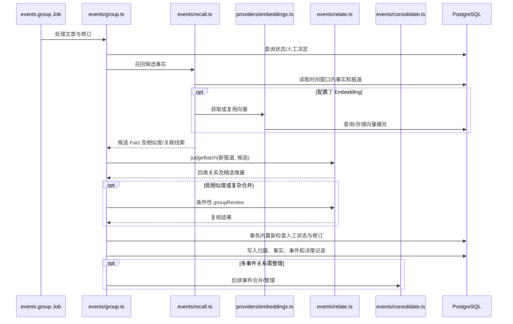

# AIHOT 事件候选召回与检索技术架构设计

| 文档属性 | 内容 |
|---|---|
| 文档编号 | TP04（独立专题文档，编号可按项目目录调整） |
| 版本 | V1.0 |
| 文档类型 | 专题技术架构设计 / 现状实现研究 |
| 研究对象 | `KKKKhazix/AIHOT` |
| 主研究基线 | 2026-10-16 源码参考快照，提交 `c8704e5313e6b051560365226b3919d7e0ada5ea` |
| 辅助依据 | AIHOT 官方 `docs/grouping.md`、`docs/architecture.md`；2026-09-29 的旧提交代码解读 |
| 关注范围 | 事件候选召回、文本特征、Embedding、相似度计算、候选过滤、模型关系判定与归组衔接 |
| 关联专题 | Worker 调度与任务执行、AI/Agent 技术架构、事件归组、数据模型与 Schema |

> **证据等级**
>
> - **[C] 固定快照已核验**：来自 2026-10-16《AIHOT 系统技术架构总览 V1.0》中明确标记为源码验证的内容。
> - **[O] 项目官方说明**：来自 AIHOT GitHub 官方文档；在线 `main` 可能在固定快照后发生变化。
> - **[H] 历史源码解读**：第三方于 2026-09-29 对较早提交 `589f79e` 逐文件研究记录的细节，属于有来源的版本参考；与 10 月 16 日快照的逐项一致性尚未重新确认。
> - **[I] 架构解释**：基于现有证据进行的职责划分、时序表达与合理推导。
> - **[P] 设计建议**：工程完善或 RiskHot 借鉴建议，未声称 AIHOT 已实现。
>
> **特别说明**：目前可用的固定快照属于参考子集，缺少完整数据库迁移和全部运行环境。本文保留了可核验的代码路径与已知参数；对缓存细节、精确阈值和特殊分支明确标记其来源版本。

---

## 1. 研究范围与核心结论

### 1.1 召回系统的业务定位

AIHOT 的事件召回主要服务于**新闻/信息的事件归组（Event Grouping）**。系统收到一篇已经完成相应处理的新报道后，需要在既有事实（Fact）中找到可能描述同一次发生、或属于同一持续事件的候选对象，再交给关系判定逻辑完成后续处理。[C/O]

本专题的检索对象是**候选事实及其代表性报道**；输出用于后续归组判断。站点面向读者的搜索、公开 API 查询和 RAG 问答拥有各自的业务边界，不能直接套用这一套召回流程。[I]

业务对象之间的基本关系为：

```text
Article（文章/报道）
    │ 多篇报道可能描述同一次发生
    ▼
Fact（事实：一次具体发生）
    │ 多个事实可能组成一条事件演进线
    ▼
Story（事件/故事：起始事实与直接进展）
```

**召回负责“找出值得比较的候选”，关系判定负责“判断候选与新报道的真实关系”，归组负责“将结果安全写入 Fact/Story 结构”。**

### 1.2 技术结论摘要

1. `packages/backend/src/events/recall.ts` 是事件候选召回的重要入口，在最近 **14 天**的事实报道中寻找候选。[C]
2. 配置 Embedding 服务后，系统可使用语义向量相似度；未配置时使用字符 **bigram** 重合度作为回退检索手段。[C/O]
3. 同 URL、X 回复或引用等确定性关联，可以参与候选补充或直接关联判定，弥补纯文本相似度遗漏。[C]
4. 向量由 `providers/embeddings.ts` 通过 `/embeddings` 接口获取，以文本哈希复用；固定快照显示 PostgreSQL 使用 `real[]` 字段保存向量，尚无证据表明依赖 pgvector。[C]
5. `judgeBatch()` 对召回候选执行批量关系判定，关系包含 `SAME_OCCURRENCE`、`SAME_STORY`、`UNRELATED` 和 `ROUNDUP`。[C/O]
6. 事件合并还包含模型复核、事务锁、版本检查和人工决定优先等控制，召回相似度本身不能直接决定事实或事件合并。[C]
7. 历史旧提交解读记录的参考参数包括：普通召回余弦阈值 **0.60**、最多 **10** 个候选事实，文本回退阈值 **0.25**；这些数字需结合目标提交复核。[H]

### 1.3 设计目标

| 目标 | 设计含义 |
|---|---|
| 候选覆盖 | 把可能属于同一事实或持续事件的报道召回，降低误漏关联 |
| 候选规模可控 | 为后续 LLM 判断提供有限、相关且有代表性的上下文 |
| 多通道召回 | 结合语义、词法和确定性关系，覆盖不同类型的关联线索 |
| 无向量服务可运行 | 未配置 Embedding 时仍能够进行基本的候选匹配 |
| 可追溯 | 能追踪召回来源、相似度、候选及后续关系判定 |
| 人工优先 | 允许运营人员纠正归组结果，并防止模型覆盖人工决定 |
| 时效适配 | 通过事实窗口和业务状态限制旧材料进入当前归组判断 |

---

## 2. 系统总体架构

### 2.1 逻辑分层

| 层次 | 对应模块 | 职责 | 依据 |
|---|---|---|---|
| 任务触发 | `jobs/events.ts`、Worker | 触发事件归组任务 | [C/I] |
| 业务准入 | `events/group.ts`、文章/分析状态 | 排除不参与自动归组的业务对象，处理历史、人工和既有归属 | [C/H] |
| 召回输入构造 | `events/recall.ts` | 构造新报道及候选事实的比较文本 | [C/H] |
| 候选池读取 | PostgreSQL + 事件相关业务表 | 读取时间窗口内可用的事实和代表报道 | [C/H] |
| 相似度召回 | `events/recall.ts` | 向量相似度或字符 bigram 词法比较 | [C/O] |
| 关系补充 | 同 URL、X 回复/引用关系 | 处理高确定性的候选线索 | [C] |
| 向量服务 | `providers/embeddings.ts` | 调用 Embedding、哈希复用、持久化向量 | [C] |
| 关系判定 | `events/relate.ts` | `judgeBatch()` 输出候选关系 | [C/O] |
| 归组写入 | `events/group.ts` | 写入 Fact/Story 归属和判定历史 | [C] |
| 合并复核 | `events/consolidate.ts` | 处理需要进一步验证的事实、事件关系 | [C] |

### 2.2 总体架构图

```mermaid
flowchart TB
    A["Worker: events.group"] --> B["业务准入与现有归属检查"]
    B --> C{ "是否进入候选召回？" }
    C -->|否| Z["直接处理 / 跳过 / 保留人工结果"]
    C -->|是| D["构建报道检索文本"]

    D --> E["读取近 14 天候选事实池"]
    E --> F["代表报道及可用业务状态"]

    D --> G{ "Embedding 是否配置？" }
    F --> H["候选事实比较文本"]
    G -->|是| I["Embedding / Cosine"]
    G -->|否| J["字符 bigram 相似度"]
    H --> I
    H --> J

    B --> K["同 URL / X 回复或引用关联"]
    I --> L["候选过滤、去重、排序及截断"]
    J --> L
    K --> L

    L --> M["judgeBatch 批量关系判断"]
    M --> N{ "判定结果" }
    N -->|SAME_OCCURRENCE| O["同次事实归属 / 必要时复核"]
    N -->|SAME_STORY| P["直接进展关联 / 根事实校验"]
    N -->|UNRELATED| Q["保持独立"]
    N -->|ROUNDUP| R["综合稿规则"]
    O --> S["事务写入与人工状态复查"]
    P --> S
    Q --> S
    R --> S
    S --> T[("PostgreSQL: facts / stories / decisions")]
```

> 图中“过滤、去重、排序及截断”的具体操作顺序属于逻辑表达；特殊候选是否占用 Top K 名额、特殊分支是否提前返回，需要对目标提交的 `recall.ts`/`group.ts` 逐行复核。[I]

### 2.3 与相邻专题的职责边界

- **采集与内容处理**：提供可识别的原始文章、分析结果、标题、摘要、原始 URL 和 X 身份信息。
- **事件召回**：在候选事实池中寻找可能相关的事实，输出有限候选及关联证据。
- **事件关系判定**：调用关系判断模型，对候选逐一判断。
- **事件归组**：按业务规则、人工覆盖和事务一致性写入正式关系。
- **事件综述/热度/公开投影**：消费已确认的事实和事件结构，完成后续计算与展示。

---

## 3. 召回数据模型与输入契约

### 3.1 核心业务实体

| 数据实体 | 召回中的作用 | 说明 |
|---|---|---|
| `articles` | 新报道及候选报道的数据来源 | 标题、摘要、来源、时间、URL、内容修订等业务信息 |
| `analyses` | 业务准入及分析结果 | 预筛相关性、结构化信息和分析修订 |
| `facts` | 被召回的主要对象 | 一次具体发生所对应的归组事实 |
| `stories` | 归组的上层对象 | 一个具体事件及其直接进展 |
| `fact_articles` | 事实与报道的关联 | 体现事实下的多个报道及人工归属 |
| `embeddings` | 向量复用 | 保存文本向量及输入文本哈希 |
| `grouping_decisions` | 判定审计 | 保存归组判断历史及其上下文 |
| `grouping_overrides` | 人工覆盖 | 保存保持独立等人工归组决定 |
| `story_signals` | 讨论帖/热度证据 | X 等讨论帖可作为事件信号，不等价于新的 Fact |

这些表名在固定快照研究报告中能够得到支持。[C] 物理主键、索引、列类型、外键、约束及完整 ER 图仍应以 `database/migrations/` 为准。

### 3.2 输入对象的语义

**新报道输入**至少需要在逻辑上提供：

- 待处理的 Article 身份及其当前修订；
- 用于比较的标题和摘要；
- URL/规范化身份等确定性关联线索；
- 来源及时间相关信息；
- 是否已经有人工归属、是否需要重组，以及是否符合自动归组条件。

**候选事实输入**则需要提供：

- Fact 身份以及所属 Story；
- 可代表该 Fact 的一篇报道；
- 可用于比较的标题与摘要；
- 该事实已有报道情况及其事件根事实身份；
- 必要的当前归组状态和可用性条件。

以上描述为**逻辑输入契约**；并未伪称是 `recall.ts` 的逐字段 TypeScript 接口。[I]

### 3.3 候选事实与代表报道

历史源码解读指出：`candidateViews` 会为事实选取代表报道，优先使用 primary；缺少 primary 时采用时间线上较早的报道。同时可向判定环节提供事实既有报道数量和是否为 Story 根事实等信息。[H]

这一做法的意义是：

1. 按 Fact 召回，避免同一事实的多篇转述占满候选名额。
2. 用具有代表性的报道向模型提供简洁上下文。
3. 让模型区分同次发生、事件进展和跨事件混淆。

**根事实的时间顺序应依据可信业务时间和现有归组规则识别；不能将数据库 ID 顺序直接视为事件发生顺序。**[H]

---

## 4. 业务准入与候选池构建

### 4.1 召回前的业务分流

在发起相似度计算之前，归组模块应首先处理当前文章的业务状态。历史源码解读给出的处理分支包括：[H]

1. 检查人工归属或人工“保持独立”决定。
2. 明确强制重组时，清理可重新判断的自动归属。
3. 对历史回灌资料执行历史准入规则。
4. 将讨论型信号（`hot_signal`）分流到 Signal 路径。
5. 对通常修订保留既有合法归属。
6. 检查最新分析相关性是否通过。
7. 对同 URL 等高确定性关系优先判断。
8. 对需要智能比较的普通报道进入候选召回。

该流程表达**业务入口的优先级**；重新检查目标提交时，应以 `group.ts` 的实际分支顺序为准。

### 4.2 时间窗口

固定快照确认普通候选召回检索最近 **14 天**的事实报道。[C]

历史分析进一步指出：这一窗口按照候选资料的**发现时间**计算，并排除处于 `regroup_pending`、尚未重新决定的报道。[H]

这意味着：今天发现的一篇旧网页，在满足其他准入条件时仍可能作为近 14 天候选池中的资料被比较。**14 天召回窗口**与**超过 48 小时历史资料的常规入库/公开规则**属于不同约束，需分别执行，避免混用。

### 4.3 候选池的业务范围

候选池至少应满足以下逻辑条件：

- 候选报道能够归属到可用 Fact；
- 候选数据处于本轮定义的召回窗口；
- 不引用正在重组、尚未形成有效判断的材料；
- 排除当前不满足业务可用性规则的证据；
- 按 Fact 组织候选，减少重复报道占用模型上下文。

这里描述召回集合的业务语义。精确的 SQL WHERE 子句和索引条件，需要在完整 `events/recall.ts` 及数据库迁移中核验。[I]

---

## 5. 文本特征构建

### 5.1 检索文本

历史源码解读给出了用于相似度比较的文本构造方式：[H]

```text
检索文本 = 标题 + 分隔符 + 摘要前 300 字
```

该文本由 `reportText()` 之类的公共构造逻辑生成，**新报道和候选报道使用同一套文本构造规则**，确保两侧向量或词法比较对象一致。[H]

不建议在缺少源码确认时擅自加入正文、发布机构、事件主体等额外字段，因为这会改变相似度分布和阈值的含义。[P]

### 5.2 选择标题与摘要的作用

- 标题集中表达具体主体、动作与对象，有利于识别新闻主题。
- 摘要补充时间、对象、进展与具体事实，降低仅比较标题造成的误判。
- 限制摘要长度可减少 Embedding 输入量，使候选计算和历史数据相对稳定。

### 5.3 文本修订与向量版本

固定快照确认向量按**输入文本哈希**复用，意味着同一输入可以复用已生成向量；文本发生变化时，需要重新生成对应向量。[C]

建议同时记录 Embedding 模型标识、向量维度和预处理版本，使不同模型或不同文本规则生成的向量能够被明确区分。[P]

---

## 6. 语义向量召回

### 6.1 实现技术

- 代码位置：`packages/backend/src/providers/embeddings.ts`。
- 模型接口：请求兼容 `/embeddings` 的服务。[C]
- 复用条件：按文本哈希复用生成结果。[C]
- 持久化：固定快照报告显示 PostgreSQL `real[]` 字段。[C]
- 检索：以新报道与候选事实代表文本的向量相似度进行候选排序。[C/O]

**当前证据支持 PostgreSQL 数组存储和应用层候选比较；没有证据证明项目已使用 pgvector、HNSW、IVFFlat、Milvus、Elasticsearch 或向量专用检索服务。**

### 6.2 余弦相似度

在向量长度、模型来源及维度相同的条件下，余弦相似度可以描述为：

$$
\operatorname{cosine}(a,b)=\frac{\sum_{i=1}^{d}a_ib_i}{\sqrt{\sum_{i=1}^{d}a_i^2}\sqrt{\sum_{i=1}^{d}b_i^2}}
$$

该公式用于解释余弦相似度概念；真实代码在归一化、零向量、维度不一致时的处理细节仍需核验。[I]

### 6.3 参考阈值与 Top K

历史旧提交的源码解读列出：[H]

| 参数 | 历史记录值 | 业务含义 |
|---|---:|---|
| `RECALL_DAYS` | 14 | 普通候选窗口（固定快照也确认 14 天） |
| `RECALL_MIN_COSINE` | 0.60 | 语义候选的最低余弦相似度 |
| `RECALL_TOP_FACTS` | 10 | 普通召回候选 Fact 上限 |

**注意**：0.60 和 10 是历史提交参考值，文档可用于理解原设计，部署前需要重新检查当前目标提交的常量。它们是候选召回参数，不能直接当作“可自动合并事实”的条件。

### 6.4 向量缓存与预热

历史源码解读还记录以下实现细节：[H]

- Worker 进程内保存窗口向量缓存，并采用 `Float32Array` 等紧凑的内存表示。
- 进程内缓存设置约 30,000 条上限，达到上限后执行整体清理策略。
- 有 `warmRecallWindow()` 预热逻辑，尽量在批量归组前补齐窗口中缺失的向量。
- 文本哈希没有变化时复用已有向量，避免重复 Embedding 调用。

需要分清两个生命周期：

1. **PostgreSQL 持久化向量**：用于跨进程或重启后的结果复用。
2. **Worker 进程内缓存**：用于降低本轮候选扫描期间的重复内存构造或服务访问。

进程重启不会天然保留内存缓存；缓存与持久化结果的相互重建方式要以代码为准。单 Worker 的缓存视图也不能自动推广为多 Worker 的全局一致缓存。[I]

---

## 7. 无 Embedding 场景的词法召回

### 7.1 回退条件

当未配置 Embedding 服务时，`events/recall.ts` 可以采用**字符 bigram 重合度**进行候选比较。[C/O]

重要边界：**“未配置 Embedding”有明确的词法回退路径；“已经配置、但 Embedding 接口本次超时或报错”是否直接回退，需要结合异常处理代码另行核对。**

### 7.2 字符 bigram

字符 bigram 将一段文本拆分为相邻的两个字符。例如：

```text
文本：某公司发布新产品
bigram：某公、公司、司发、发布、布新、新产、产品
```

比较两组 bigram 的重合程度，可得到简单的文本相似性线索。历史源码分析将其描述为基于共享二元组与较小集合大小计算的词法重合度；精确分词、去重及归一化细节以 `recall.ts` 为准。[H]

### 7.3 回退参考参数

历史源码解读指出词法召回阈值约为 **0.25**。[H]

该阈值和 0.60 余弦阈值使用不同的相似度定义，**不能直接比较数值大小来判断哪条召回路径更严格**。不同文本和行业下，应分别评测候选覆盖率与误召回比例。

### 7.4 词法回退的局限

| 现象 | 可能效果 |
|---|---|
| 同一事实的不同近似标题 | 可能召回成功 |
| 跨语言或不同说法 | 词法重合较低，容易漏召回 |
| 同一公司不同新闻 | 名称高度重合，可能误召回 |
| 大量模板化标题 | 容易召回同主题但非同一事实的材料 |
| 型号、数字、日期差异 | 有些关键差异可能被总体重合度掩盖 |

因此，词法分数是候选相关性线索，正式归组仍需要后续关系判定与业务保护。

---

## 8. 确定性关系补充召回

### 8.1 关系类型

固定快照已经确认召回支持**同 URL、X 回复、X 引用关系**补充候选。[C]

| 关系 | 适用场景 | 技术价值 |
|---|---|---|
| 相同 URL | 两条记录指向同一原始地址 | 对同源报道的高确定性关系进行直接识别 |
| X 回复 | 当前帖回复某个已有归属的帖子 | 从社交关系定位可能所属事件 |
| X 引用 | 当前帖引用某个已有归属的帖子 | 降低仅依赖文字描述造成的漏检 |

### 8.2 确定性关系与语义关系的组合

历史分析指出，同 URL 报道在业务入口中可能直接进入已有事实，无须额外 LLM；X 回复/引用的关系还可作为特殊候选或 Signal 关联入口。[H]

因此架构上应区分：

- **直接归属**：某些规则足够确定，业务层在召回前就可结束本轮普通匹配。
- **候选加权/补充**：某些关系提升了候选进入模型比较阶段的机会。
- **讨论帖关联**：X 等讨论信号可能只记录到 Story 的 Signal 证据中。

“直接归属”的安全性依赖 URL 规范化、身份键及已有事实的业务状态。实际短路顺序和是否完全跳过 LLM，应以 `group.ts` 为准。

### 8.3 不同关联证据的适用边界

同 URL、X 回复和引用表示较强的**来源/传播关系**，业务上的同次发生与持续事件关系仍应结合归组规则确认。尤其是 X 上的引用可能包含反驳、转述、跨话题讨论，不能将每一个引用都直接转化为同一次真实发生。[I]

---

## 9. 候选整理与输出契约

### 9.1 为什么按 Fact 生成候选

一件真实发生可能被多家媒体重复报道。如果按每篇 Article 单独送给模型判断，容易造成：

- 多篇相同报道占据候选额度；
- 模型重复阅读高度相似内容；
- 下游把报道数量误当事实数量；
- 增加模型调用 token 量。

按 Fact 组织候选有助于保持“一个候选代表一次发生”的语义。[I]

### 9.2 建议的逻辑候选结构

下面是**用于阅读和跨模块沟通的接口示意**，未声称是 AIHOT 的实际 TypeScript 定义：[P]

```ts
interface RecallCandidateView {
  factId: string;
  storyId?: string;
  representativeArticleId: string;
  title: string;
  summary: string;
  similarity?: number;
  recallChannels: Array<"embedding" | "bigram" | "same-url" | "x-relation">;
  isStoryRoot?: boolean;
  articleCount?: number;
}

interface RecallResultView {
  queryArticleId: string;
  candidates: RecallCandidateView[];
  usedVectorRecall: boolean;
  windowDays: number;
}
```

实际代码的输入输出签名必须以 `recall.ts` 的类型定义为准，避免把示意接口用于生产编译。

### 9.3 候选通道融合的检查点

需要在目标源码中核验：

1. 不同召回通道是否在同一个集合去重。
2. 同一个 Fact 多次命中时如何合并相似度及关联原因。
3. 同 URL 与 X 关系候选是否占用普通 Top K 名额。
4. Top K 在特殊候选补充之前还是之后截断。
5. 相似度相同的情况下如何稳定排序。
6. 候选过多时如何保证模型上下文不超限。

这些边界会直接影响召回率和可重复性，不宜依靠通用检索经验自行假定。

---

## 10. 召回结果到 LLM 关系判定

### 10.1 `judgeBatch()` 的职责

召回产生候选后，`events/relate.ts` 的 `judgeBatch()` 对候选进行批量判断；固定快照确认其输出包含候选关系判定，同时还输出精选信息增量 `selection.addsValue`，并由 Zod/业务规则进行结构化约束。[C]

官方文档也说明：模型判断新报道与候选之间的关系，并在同次处理中判断新报道相对于精选内容是否增加了新信息。[O]

### 10.2 四类关系

| 关系类型 | 含义 | 后续处理方向 |
|---|---|---|
| `SAME_OCCURRENCE` | 两篇报道描述同一次具体发生 | 优先考虑加入同一 Fact，必要时进入复核 |
| `SAME_STORY` | 两次不同发生具有直接进展关系 | 可能作为新 Fact 加入已有 Story，需验证根事实与进展边界 |
| `UNRELATED` | 属于不同事项 | 保持独立；可能建立新 Fact/Story |
| `ROUNDUP` | 一方属于多主题综合稿 | 按综合稿规则处理，避免当成普通单一事实 |

**“主体相同”“产品相同”“语义相似”均不足以直接认定 `SAME_OCCURRENCE`。**例如同一家公司今天融资、明天发布产品，可能有较高词法相似度，但属于两次不同发生。[O/I]

### 10.3 模型批量判断契约

固定快照确认：候选判断输出需要按规则保证每个候选得到一次完整判定。[C]

历史代码解读还提到候选编号 `C1..Cn`、批量输出结构校验及缺失候选的兜底处理。[H] 当前文档不把该细节等同于固定快照中所有异常分支的精确行为，需复核 `relate.ts` 的模型响应后处理。

### 10.4 低相似度合并与复核

固定快照确认，对低相似度的候选合并有按阈值触发 `groupReview` 的进一步复核流程，对独立 Story 的合并也有事件根事实复查。[C]

历史源码解读提供参考值：[H]

- 当 `SAME_OCCURRENCE` 判断的候选相似度低于 `CONFIRM_BELOW_COSINE = 0.85` 时，可能调用 `groupReview` 复核。
- 对跨 Story 合并，历史版本还有根事实比较和复核置信度门槛，例如 `STORY_REVIEW_MIN_CONFIDENCE = 0.75`。
- 这些阈值主要服务于**归组安全**，其职责与**候选召回阈值**不同。

### 10.5 判定与合并时序



上图为模块级架构时序，不能代替逐函数调用序列。[I]

---

## 11. X 讨论信号的专用召回路径

### 11.1 与普通新闻的区别

历史源码解读显示，`hot_signal` 类型的 X 讨论帖子有一套专用 `groupSignal()` 处理逻辑；其结果用于将讨论信号关联到 Story，一般不直接创建新的 Fact/Story。[H]

### 11.2 历史版本的三级漏斗

| 阶段 | 主要判定 | 旧提交参考参数 | 是否需要模型 |
|---|---|---|---|
| 回复/引用直达 | 目标帖已经归属某事件 | 确定性关系 | 可直接关联 |
| 高相似自动关联 | 与已有候选事件高度相似 | `SIGNAL_AUTO_COSINE = 0.92` | 可以免模型 |
| 边界候选判断 | 与候选事件存在一定相似度 | `SIGNAL_MIN_COSINE = 0.72` | 调用关系判定 |
| 候选控制 | 最多进入判断的候选事实 | `SIGNAL_TOP_FACTS = 4` | 控制上下文 |

这些数值是 [H] 旧提交的实现描述，不能与普通新闻的 `RECALL_MIN_COSINE = 0.60`、`RECALL_TOP_FACTS = 10` 混为一组。

### 11.3 原帖晚到的恢复

历史源码解读记录两个恢复路径：[H]

- `reclaimWaiting`：关联目标后来被识别时，重新检查一定窗口内等待匹配的 X 回复/引用帖子；历史参考窗口为 **48 小时**。
- `rematchSignals`：新事实出现时，对一定窗口内尚未匹配的讨论信号重试；历史参考窗口为 **6 小时**。

这两条恢复逻辑应放到**事件归组恢复/数据一致性**专题联审，避免原帖、引用帖到达顺序不同造成永久漏挂。

---

## 12. 归组一致性、并发与人工优先

### 12.1 Worker 串行约束

固定快照已核验 `events.group` 消费者设置 `localConcurrency = 1`。[C]

此设置可减少一个 Worker 进程内两篇相近报道同时创建重复 Fact 的风险。若运行多个 Worker 实例，进程内串行不能单独提供跨进程的业务唯一性保障。[I]

### 12.2 数据库层保护

AIHOT 在归组写入时还使用事务、行锁和修订检查，并对人工覆盖进行再次检查。[C]

核心保护逻辑：

1. 模型推理前检查现有人工归属。
2. 在模型调用期间，运营人员可能改变归属状态。
3. 写入事务中重新检查文章及人工决定。
4. 发现冲突时按当前业务状态处理，避免旧模型结论覆盖新决定。
5. 将最终的关系决定及可审计信息保存到业务表。

### 12.3 召回缓存与事务写入

召回阶段读取到的是**当时的候选视图**；到写入时，候选所属事实、文章修订、人工决定和 Story 结构都可能变化。

因此，**召回结果属于候选建议，最终归属必须在写入边界重新校验业务状态**。这是检索层与持久化层之间的关键一致性契约。[C/I]

### 12.4 重组期间的证据隔离

历史分析指出，处于 `regroup_pending` 的报道在重新完成决定前不会作为其他新报道的有效候选证据。[H]

该设计减少“仍在改变归属的数据反过来影响别人的判断”的连锁问题，也有助于按既定顺序重放事件归组历史。

---

## 13. 存储、索引与缓存架构

### 13.1 已确认的持久化事实

| 内容 | 当前证据结论 |
|---|---|
| 业务数据库 | PostgreSQL [C/O] |
| 文章、分析、事实、事件 | 独立业务表及关联表 [C] |
| 向量数据 | `embeddings`，包含文本哈希及向量；研究快照报告指出 `real[]` [C] |
| 归组历史 | `grouping_decisions` [C] |
| 人工决定 | `grouping_overrides`、`fact_articles.manual` 等相关结构 [C/H] |
| 专用 ANN 索引 | 尚未确认 |
| pgvector 扩展 | 固定快照中未见使用证据 [C] |

### 13.2 应用层比较与数据库检索

从当前证据看，AIHOT 可以采用“**数据库提供有限时间窗口的候选事实，Worker 执行语义/词法相似度比较**”的架构。[C/I]

如果每次都对窗口中的 `N` 个候选逐个计算 `d` 维余弦，主要向量比较量级大致与 `N × d` 成正比；具体性能仍取决于缓存命中、代表事实数量、候选池构建、查询计划和实际代码路径。[I]

现阶段不宜在架构图中画出未确认的 ANN 向量索引服务，避免误导后续容量评估。

### 13.3 缓存一致性关注点

- 文章标题/摘要更新后，文本哈希对应的向量需要失效或替换。
- Embedding 模型升级时，旧模型向量与新模型向量不可无条件混算。
- 进程内缓存并不天然跨 Worker 共享。
- 候选视图的业务归属发生变化后，仍需在事务写入阶段重新验证。
- 窗口扩大时，缓存体量、检索延迟和模型候选质量需要一同评估。

其中向量版本与缓存一致性治理属于 [P] 工程建议；当前快照还不足以确认每个细节的生产实现。

---

## 14. 异常、退化与恢复策略

### 14.1 场景矩阵

| 场景 | 已知行为 / 建议策略 | 依据 |
|---|---|---|
| Embedding 服务未配置 | 使用 bigram 词法召回 | [C/O] |
| Embedding API 调用失败 | 是否自动回退为 bigram 需核验异常处理；应保留可追踪错误 | [I/P] |
| 相似度候选为空 | 归组逻辑可继续按新事实/新事件条件判断 | [I] |
| URL 关系可直接识别 | 先处理确定性关联，减少无谓模型调用 | [H] |
| 关系判定模型失败 | 保留待处理状态，由队列重试或恢复机制处理 | [C/I] |
| 发现文章修订变更 | 拒绝旧修订覆盖当前业务结果 | [C] |
| 人工归属发生变化 | 事务写入阶段重新检查并遵从当前人工决定 | [C] |
| 原帖后到 | 通过讨论信号恢复/重匹配路径修复关联 | [H] |
| 多 Worker 并行 | 通过数据库唯一性、行锁、修订及幂等规则维持一致性 | [P] |

### 14.2 退化路径需要保留可观察性

当系统转入词法召回或恢复入队时，建议记录：

- 本次使用向量还是 bigram；
- 召回窗口和候选池规模；
- 调用 Embedding 的数量、复用数量和错误原因；
- 特殊候选来源（同 URL、回复、引用）；
- 候选被过滤与截断的原因；
- 下游模型是否仍然完成完整候选判断。

以上属于 [P] 可观测性建议，不代表现有系统都具备这些指标。

---

## 15. 召回效果评测与验证

### 15.1 必须区分两层评测

**召回评测（Recall Evaluation）**：检查正确 Fact 是否出现在候选集合中，评估“能否找到”。

**关系判定评测（Relation Evaluation）**：在给定两篇报道或给定候选的条件下，评估四关系判断是否准确，检查“找到后有没有判对”。

AIHOT 官方 `docs/grouping.md` 描述了 `scripts/eval-relations.ts`，它复用关系提示词和 Schema，对成对标注样本执行关系判定评测；**该脚本不会重新跑候选召回，也不会修改正式归组结果**。[O]

因此，`eval-relations.ts` 的高 F1 不能直接证明生产环境的候选召回率足够高。

### 15.2 召回评测指标

建议建立单独的候选召回金标集，并记录：

| 指标 | 含义 |
|---|---|
| `Recall@K` | 正确候选 Fact 是否进入前 K 名 |
| `MRR` | 首个正确候选的倒数排名均值 |
| `CandidatePrecision@K` | 候选集合中真正相关候选所占比例 |
| `No-candidate false negative` | 实际存在正确候选，却召回为空的比例 |
| `Fallback Recall@K` | 关闭 Embedding 后 bigram 路径的召回效果 |
| `Boost Contribution` | 同 URL 和 X 关系额外找回多少正确候选 |
| `Cost per article` | 单篇召回的向量调用成本、缓存复用与下游 token 成本 |
| `P50/P95 latency` | 候选池查询、相似度计算和总召回时延 |

### 15.3 金标样本设计

至少覆盖：

1. 相同主体、相同动作、相同对象、不同报道措辞。
2. 相同主体、不同动作或不同时间，真实关系无关。
3. 新品发布与后续测评/回应，属于直接进展。
4. 同 URL 的重复报道或别名 URL。
5. X 回复/引用链，包含原帖晚到。
6. 不同语言但描述同一事实。
7. 14 天窗口边界；发现时间与发布时间不一致。
8. 多话题综述稿（ROUNDUP）。
9. 人工保持独立、强制重组及文章修订。
10. 未配置 Embedding 或故意让服务超时。

### 15.4 验收口径

本阶段建议把以下项目作为可验证的技术验收条件：[P]

- 能区分普通报道和 Signal 的不同召回路径。
- 给定相同数据版本、模型和配置，多次召回的候选范围和排序可复现。
- 正确候选在指定窗口和 Top K 下能够被稳定召回。
- 词法回退条件与运行日志明确。
- 特殊关联不会被普通相似度阈值误删。
- 候选关系分类满足 Schema 与业务规则。
- 人工覆盖、文章修订和事务锁阻止错误覆盖。
- 召回效果与关系判定效果有独立报表。

具体数值型 SLA 应在真实行业金标集和生产数据规模上测量后确定，避免直接照搬 AI 新闻语料的经验阈值。

---

## 16. 性能与扩展设计建议

### 16.1 当前实现适用的前提

当前架构依赖受控时间窗口、按 Fact 组织候选、相似度阈值和 Top K 控制，以及 Worker 串行归组等约束。[C/H/I]

对于短窗口、事实数量可控的新闻归组，这种方式可以在少引入检索基础设施的前提下支持基本召回；当候选池或并发量显著增长时，需要重新评估 Worker 内存、相似度扫描延迟及串行吞吐。[I]

### 16.2 可能的扩展路线

以下选项属于 [P] 后续演进方向：

1. **继续使用 PostgreSQL 数组 + 应用层比较**：适合事实池规模可控、希望控制系统复杂度的阶段。
2. **增加持久化向量索引**：当窗口规模和检索延迟成为瓶颈时，再评估 pgvector 等方案。
3. **构建混合召回与重排**：结合精确身份、词法、向量和结构化事件六要素，提升金融等高歧义行业的召回准确性。
4. **分层候选池**：按事件状态、时间窗口、行业或主题组织候选，降低全窗口扫描成本。
5. **增加独立的离线召回回放工具**：固定输入数据、模型与阈值，支持版本回归测试。

技术选型应由数据规模、延迟目标、召回率、数据库负载和团队运维能力共同决定。

---

## 17. 模块与代码审计清单

### 17.1 源码入口映射

| 文件或目录 | 关注事项 | 证据 |
|---|---|---|
| `packages/backend/src/events/recall.ts` | 候选池查询、窗口、特征、相似度、排序、特殊候选 | [C] |
| `packages/backend/src/providers/embeddings.ts` | Embedding 调用、文本哈希复用、向量持久化 | [C] |
| `packages/backend/src/events/relate.ts` | `judgeBatch()`、关系 Schema、相似度与置信度共同决策 | [C] |
| `packages/backend/src/events/group.ts` | 归组主流程、人工覆盖、事务写入、Signal 分流 | [C] |
| `packages/backend/src/events/consolidate.ts` | 跨 Story 合并及根事实复核 | [C] |
| `packages/backend/src/events/merge.ts` | 事件合并和历史关联处理 | [H] |
| `packages/backend/src/events/related.ts` | 相关 Story 的非合并关联 | [H] |
| `packages/backend/src/jobs/events.ts` | `events.group` Worker 消费者 | [C] |
| `packages/backend/src/jobs/queue.ts` | 任务类型、重试、并发配置 | [C] |
| `packages/backend/src/content/materials.ts` | URL/身份与内容修订 | [C] |
| `database/migrations/` | 实际表字段、索引、约束、向量存储定义 | 待核验 |
| `industry/prompts/group-*.md` | 关系分类、关系判定和复核提示词 | [O] |
| `scripts/eval-relations.ts` | 两两关系判定评测，不包含候选召回 | [O] |

### 17.2 后续需要优先复核的关键问题

- [ ] 目标提交中 `RECALL_MIN_COSINE`、`RECALL_TOP_FACTS` 等参数是否与历史分析一致。
- [ ] `RECALL_DAYS` 的时间字段及时间边界是否仍为 `discovered_at`。
- [ ] Fact 代表报道选择逻辑、回退逻辑及是否存在多代表稿。
- [ ] 同 URL / X 关系在普通 Top K 之前或之后执行，是否直接绕过模型。
- [ ] `reportText()` 的输入字段、摘要截取长度和字符标准化方式。
- [ ] bigram 的计算公式、集合/多重集处理以及阈值。
- [ ] Embedding 数据的模型版本、维度、失效与异常处理。
- [ ] 30,000 条进程缓存与 `warmRecallWindow()` 在当前版本是否存在、如何触发。
- [ ] `groupSignal()` 的三个阈值及 48 小时/6 小时恢复窗口。
- [ ] 多 Worker 部署下的全局锁、人工覆盖和重复 Fact 创建保护。
- [ ] `eval-relations.ts` 与独立召回评测工具的覆盖范围。
- [ ] 实际表索引、物理执行计划和时间窗口内的候选池数量。

---

## 18. 技术架构结论

AIHOT 的事件候选召回依托既有 Article、Fact、Story 业务模型，在短时间窗口中寻找需要进行关系判定的事实候选。其技术路线采用**可选语义 Embedding、无服务时的字符 bigram 回退，以及同 URL / X 关系补充**，通过候选压缩控制后续模型判断成本。[C/O]

召回后，`judgeBatch()` 负责四类关系判定，`groupReview` 和跨 Story 根事实复核降低错误合并风险；事务锁、版本检查和人工决定优先保证正式写入的可靠性。[C]

从现有证据看，该系统更接近**面向事件归组的短窗口应用层混合候选召回**。固定快照并未表明已建立独立向量检索集群、pgvector ANN 索引或通用全文检索引擎。对于更大数据量或金融风险事件场景，可以在保留 Article/Fact/Story 契约的基础上逐步扩展向量索引、结构化六要素过滤、候选重排和独立召回评测。[I/P]

---

## 附录 A：面向 RiskHot 的可借鉴边界（参考建议）

RiskHot 的事件候选抽取与风险纳管具有更强的业务异构性，直接使用标题相似度可能对“同主体、不同风险行为”产生误召回。可借鉴 AIHOT 的“候选召回 → 关系判定 → 事务确认”总体拆分，同时增加以下结构化信号：[P]

| 维度 | 在 RiskHot 检索中的可选作用 |
|---|---|
| Subject | 主体别名、法人实体、产品或机构身份规范化 |
| Action | 违约、处罚、融资、诉讼、下调评级等行为区分 |
| Object | 债券、股权、项目、资产、产品等受事对象 |
| OccurredAt | 区分发生时间和报道时间，控制“同日不同事件” |
| Semantic | 标题、摘要、事实说明用于向量/词法召回 |
| Evidence | 原文证据片段用于后续复核与溯源 |

采用这些结构化信号前应先明确：RiskHot 的事件候选、Fact、Story、风险事件和核心变量之间的领域关系，并使用标注数据验证是否改善召回效果。这是 RiskHot 的设计拓展，不属于 AIHOT 已有功能说明。

---

## 附录 B：参考依据与来源说明

### B.1 主研究材料

- 《AIHOT 系统技术架构总览 V1.0》（2026-10-16），固定源码快照提交：`c8704e5313e6b051560365226b3919d7e0ada5ea`。重点对应第 5.2、5.4、6 和 7 章。
- 本报告所依据的研究快照为部分代码文件集合，未在此次文档生成中重新执行完整工程测试。

### B.2 AIHOT 官方资料

- [AIHOT 官方：事件归组与关系评测](https://github.com/KKKKhazix/AIHOT/blob/main/docs/grouping.md)
- [AIHOT 官方：系统架构](https://github.com/KKKKhazix/AIHOT/blob/main/docs/architecture.md)
- [AIHOT 仓库](https://github.com/KKKKhazix/AIHOT)

### B.3 历史提交的第三方代码解读

- [AIHOT 聚簇与热度源码研究（2026-09-29）](https://bingqiangzhou.github.io/posts/aihot-clustering-hotrank-deep-dive/)。该资料明确说明依据更早的提交 `589f79e`，用于辅助定位候选窗口、相似度阈值、缓存和 Signal 路径等细节。

> **版本核验提示**：文中所有 [H] 参数和旧提交细节，应在当前目标 commit 的 `recall.ts`、`group.ts`、`relate.ts` 等源码中复核后再列为工程实施基线。
