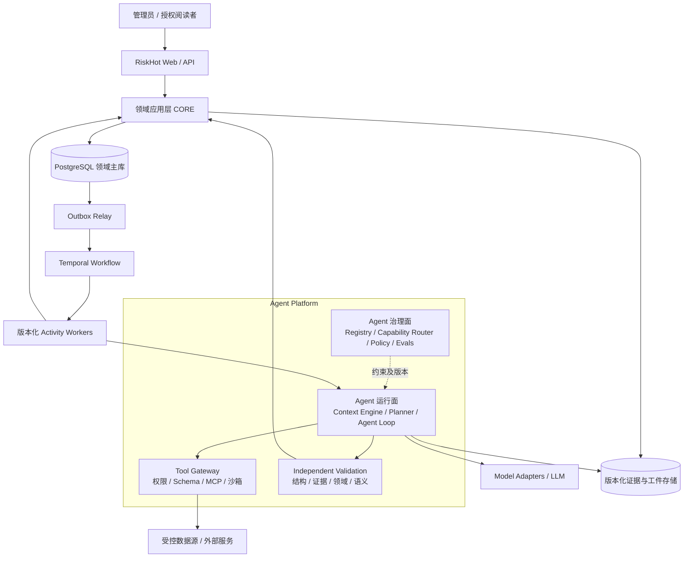
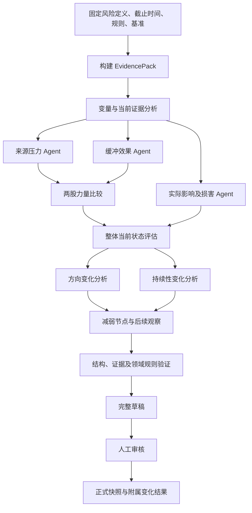
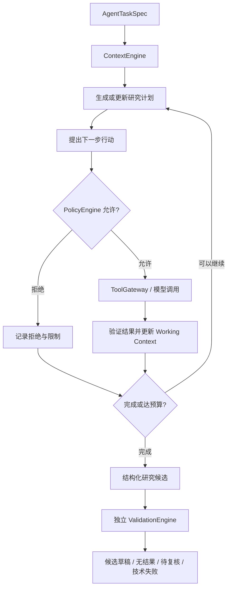
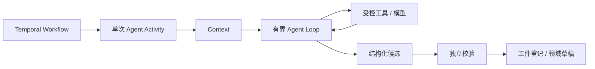
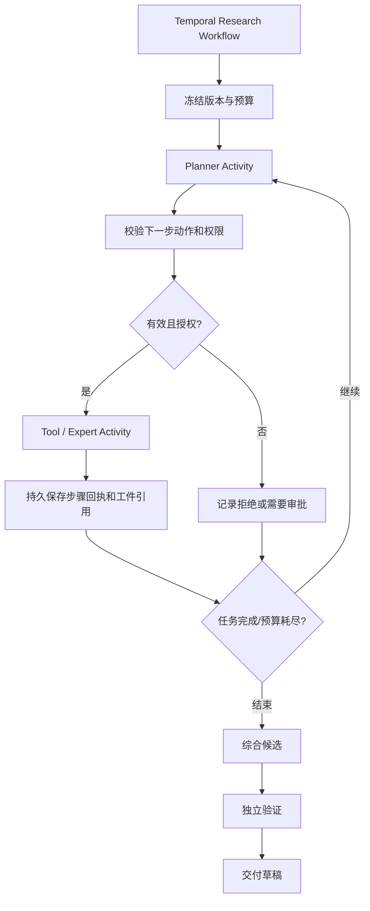

# RiskHot Agent 系统架构设计 V2.0

> **文档定位**：将 Agent 总体架构、Workflow 与 Agent 的控制权划分、执行模式、Agent Runtime 内核、证据与状态管理、技术选型和验收要求整理为统一技术设计建议。
>
> **重要声明**：本文是架构设计建议稿，所述组件、接口、参数与实施阶段不代表已经开发、部署或验收。业务语义以 RiskHot 现有正式领域文档与已批准决策为准；具体技术契约需经 ADR 和 Schema 评审定版。

## 1. 背景、目标与架构决策

### 1.1 业务背景

RiskHot 面向宏观经济金融风险研究，已有四阶段主链路：

- **L0 信息处理**：信源接入、原始资料与指标实际值、事件及增量管理。
- **L1 风险识别与纳管**：完整风险候选、同一性分析、正式纳管、长期变量关系。
- **L2 风险态势分析**：当前状态、来源与缓冲、实际影响与损害、方向和持续性变化。
- **L3 风险产品与发布**：风险目录、详情、时间线、报告与发布。

现有功能架构包含 F01–F08 八个核心模块、M1 信源管理中心、M2 风险源管理中心、M3 策略管理中心和 S01 公共运行能力。技术方案以独立 Web、无状态 API、共享领域应用包 CORE、PostgreSQL、Temporal、Outbox/Inbox、对象存储和可替换模型适配器为主要构件。

### 1.2 总体目标

1. **智能自主性**：在限定研究目标和执行权限内规划步骤、检索证据、调用工具并协调专家。
2. **稳定执行**：支持长任务、并行、暂停、人工等待、恢复、取消及有界重试。
3. **领域可信**：保持风险身份、规则、截止时间、数据版本、证据链和正式结果的独立裁决。
4. **可演进性**：模型、Prompt、Skill、工具、Agent SDK 与内部推理图能够持续升级。
5. **成本可控**：按任务设置 Token、模型调用、工具调用、成本、并行度和截止时间预算。
6. **可验证性**：用独立评测、执行轨迹和业务验收判断质量，而非依赖模型自评。

### 1.3 总体结论

采用 **Deterministic Workflow + Bounded Autonomous Agent**（确定性业务工作流 + 有界自主 Agent）的混合架构。

- **Workflow 决定业务步骤**：跨阶段依赖、定时、持久执行、重试、等待、业务交接。
- **Agent 决定授权范围内的研究动作**：规划、选择工具、寻找反证、调整分析顺序、调用专家。
- **Domain Core 决定正式业务事实**：授权、版本、身份、审核、纳管、快照生效和报告发布。

**控制权不变量**：模型无法通过提示词或调用链取得新的业务审批权限；工具执行层、领域提交层分别执行独立授权与有效性校验。

---

## 2. 分层总体架构

### 2.1 逻辑架构图



图为**逻辑分层**：Agent Platform 的模块可以首先作为 Worker 内部的独立包实现；业务模块也无须对应同等数量的微服务。服务拆分由隔离、性能、团队发布节奏和运维收益驱动。

### 2.2 三个控制层及其权威

| 层次 | 核心责任 | 状态/控制权 | 技术建议 |
| --- | --- | --- | --- |
| 业务应用与领域层 | 受理业务命令、校验资格、维护正式对象、批准与发布 | PostgreSQL 领域事实唯一权威 | CORE、PostgreSQL、领域事务 |
| 持久执行编排层 | 启动、等待、分支、并发、重试、取消及恢复 | Temporal 是跨故障执行历史和编排的唯一权威 | Temporal Workflow / Activity |
| Agent 治理与运行层 | 上下文、规划、工具、模型、结构化建议及质量约束 | 只持研究过程与中间工件；不拥有正式业务事实 | 自有接口 + 可替换 Runtime |

### 2.3 现有技术架构的保留原则

- 保留 CORE 领域应用包和统一业务命令入口；API 与 Worker 复用同一业务约束。
- 保留 Temporal + Outbox/Inbox，不建立第二套对同一业务任务拥有恢复裁决权的调度系统。
- 原件、EvidencePack、规范化建议及大型模型响应按不可变版本写对象存储。
- 业务库保存正式事实、权限、审核、审计、操作回执以及工件元数据。
- 向量索引、文本检索与任务进度投影均为可重建派生数据。

---

## 3. Workflow 与 Agent 的控制权边界

### 3.1 基本分工

| 问题 | 决定方 | 原因 |
| --- | --- | --- |
| 下一业务阶段及其前置条件 | Workflow | 保持业务语义一致、恢复路径可验证 |
| 当前阶段研究哪些证据和采取何种分析动作 | Agent | 保留推理灵活性与自主性 |
| 某个工具是否允许调用 | Tool Gateway / Policy Engine | 权限在模型之外实施 |
| 某条证据是否合法、是否支持引用 | Evidence Validator | 防止虚构引用与时间穿越 |
| 风险能否纳管、快照能否生效、报告能否发布 | CORE + 授权审批 | 领域事实需要明确主体和事务保证 |
| 何时重试、取消、暂停或进入人工等待 | Temporal + 领域资格状态 | 支持故障恢复与业务正确性 |

### 3.2 执行模式 D0–D2

`execution_mode` 用于表达 Agent **研究路径自主性**：

| 执行模式 | 自主程度 | 典型用途 | 实施建议 |
| --- | --- | --- | --- |
| D0 `DETERMINISTIC` | 固定程序规则与调用步骤 | 接入调度、身份分配、格式验证、正式保存、发布 | 默认基础能力 |
| D1 `BOUNDED_AGENT` | 固定目标和约束，Agent 可在限定预算内调用工具并调整步骤 | 事件抽取、风险识别、变量分析 | 首版主要智能执行模式 |
| D2 `DURABLE_AGENT` | 可跨多个持久化研究步骤继续探索、拆解与专家协作 | 复杂宏观专题、跨市场风险传导 | 通过 PoC、评测及 ADR 后启用 |

**D0–D2 与现有 A0–A3 授权等级相互独立**：前者表达执行方式，后者表达可以产生何种业务操作。D2 研究任务可以仅具 A1 草稿权限；D0 程序在明确授权和领域规则保障下也可以完成正式提交。

### 3.3 按模块划分的边界

| 模块 | Workflow / 程序固定 | Agent 自主部分 | 正式权威 |
| --- | --- | --- | --- |
| F01 信息接入与标准化 | 信源资格、调度、采集和版本保存 | 复杂版式辅助解析 | M1/F01 对来源和接入进行裁决 |
| F02 事件管理 | 七步处理顺序、事件身份、增量和结果提交 | 事实抽取、归组建议、事件—对象—变量关系解释 | F02 领域用例 |
| F03 风险识别 | 完整风险定义先于既有风险同一性匹配 | 风险形成机制、反证和证据探索 | F03 输出风险候选 |
| F04 风险纳管与跟踪 | 正式 risk_id、同一性复核、维护和审核 | 纳管理由及配置维护建议 | F04/M2 领域用例 |
| F05 风险状态分析 | EvidencePack、输入依赖、四维结果契约 | 变量状态、压力、缓冲、损害分析 | F05/领域快照事务 |
| F06 风险演化分析 | 比较基准与可比性约束 | 方向、持续性、减弱节点的解释 | F06 结果依附正式快照修订 |
| F07 风险展示与检索 | 授权只读、发布及撤回状态 | 可选自然语言研究查询 | 查询投影与 CORE 授权 |
| F08 报告与发布 | 固定快照清单、引用、审核和发布 | 章节组织、报告草稿与叙述 | F08 报告领域命令 |

### 3.4 F02 事件管理示例

业务过程固定为：

1. 提取候选事件。
2. 匹配事件与归组。
3. 关联观测主体及直接变量。
4. 判定增量与更新。
5. 评价金融意义 M（仅在触发条件及适用规则成立时）。
6. 校验并保存事件结果。
7. 交付事件变化。

Agent 可以在步骤 1–5 内选择允许的证据工具和分析策略，步骤之间的成立条件、无事件结果、歧义复核和正式保存由确定性流程保障。

### 3.5 L2 分析 DAG



**现有业务契约必须维持**：

- 当前快照四维为 `risk_level`、`risk_stage`、`affected_scope`、`persistence_outlook`。
- 来源、缓冲和损害分析可在固定证据包后并行；两股力量比较等待来源和缓冲。
- 方向与持续性变化依附当前状态并使用合法历史基准。
- 等级未变化不自动等于风险方向稳定；时间流逝不自动代表持续性缩短。
- 措施宣布、实施和效果需要分开分析。
- 首次分析、历史不可比、证据不足、未确认损害等均允许显式标记。
- 现有 `AI-L2-01`～`AI-L2-08` 为八项**逻辑任务**，无须绑定八次模型调用，也无须逐项设立独立 Agent。

---

## 4. Agent Platform 组件设计

### 4.1 组件清单

| 组件 | 职责 | 核心约束 |
| --- | --- | --- |
| `AgentRegistry` | 管理 Agent 定义、能力、输入输出契约和允许的工具 | 版本化；不直接存储业务真值 |
| `SkillRegistry` | 管理可复用研究方法、指令与输出规范 | Skill 与模型实例分离 |
| `CapabilityRouter` | 依据能力、预算、地域、质量评测选择模型部署 | 仅允许合格且授权的模型候选 |
| `ContextEngine` | 构造任务、领域、证据、工作与历史上下文 | cutoff、权限、版本优先于相关性 |
| `AgentRuntime` | 执行有界规划、模型交互、动作选择和专家委派 | 不成为第二个跨故障编排权威 |
| `ToolGateway` | 工具注册、授权、参数检查、隔离执行和审计 | 模型无直接生产凭据 |
| `ValidationEngine` | 校验格式、引用、时点、领域规则、安全和语义 | 校验独立于生成模型 |
| `PolicyEngine` | 执行动态权限、敏感数据、配额和副作用限制 | 每次重要动作独立检查 |
| `EvaluationService` | 离线评测、影子运行、轨迹比较与回归 | 不由被评测 Agent 自行批准 |

### 4.2 Agent 与 Skill 解耦

Agent 定义研究目标、能力和授权范围；Skill 定义可复用的任务方法。例如：

```text
RiskIdentificationAgent
  ├── RiskDefinitionSkill       # 构造完整风险定义
  ├── TransmissionAnalysisSkill # 识别来源和传导机制
  ├── CounterEvidenceSkill     # 搜索反证与不确定因素
  └── RiskIdentitySkill        # 后置同一性判断
```

同一个 Skill 可以在多种模型和执行模式下实现。Skill 更新需触发相应评测；更强模型到来时允许合并冗余步骤，只要业务输出契约保持不变。

### 4.3 Context Engine：五种上下文

| 类型 | 主要内容 | 生命周期 |
| --- | --- | --- |
| Task Context | 目标、对象、截止时间、允许动作、预算 | 单次任务固定 |
| Domain Context | 风险定义、变量关系、策略、口径及版本 | 由有效业务版本加载 |
| Evidence Context | 原文、事件、指标、反证、来源定位 | 由固定 EvidencePack 提供 |
| Working Context | 计划、已执行步骤、工具反馈、中间判断 | 单次 Agent 运行或持久研究阶段 |
| Historical Context | 历史有效快照和分析结果 | 不可变业务引用，按权限与可比性使用 |

构造证据上下文必须先过滤授权、有效版本及 `cutoff`，再排序和裁剪。证据有效可用时间需根据资料发布时间及首次取得时间确定；后取得信息不能静默混入历史观察。长研究步骤可以保存摘要和工件指针，但摘要不能替代可定位的原始证据。

### 4.4 Agent 运行循环



所有循环均受轮次、工具次数、Token、金额、并行数和截止时间控制。参数非法、权限不足、证据不合法应按明确错误类型退出或待复核，避免无意义的技术重试。

---

## 5. 两种 Agent 执行实现

### 5.1 D1：Bounded Agent Activity



**适用**：多数事件抽取、风险候选、变量分析等短时可重试任务。

**优点**：逻辑简单，便于保持运行时与供应商 SDK 解耦，开发和测试成本较低。

**限制**：Worker 在 Activity 内部中断后，未持久化的中间模型调用可能重复执行。对已登记结果可复用工件；模型请求在成功后、本地持久化前中断时，可能产生重复费用。正式业务结果通过 OperationReceipt 和领域唯一性约束去重。

### 5.2 D2：Durable Agent Workflow



**适用**：复杂专题、多步工具探索、需要跨故障恢复的深度研究。

**约束**：

- Temporal Workflow 只执行确定性控制逻辑；模型、数据库、网络及非确定性工具调用在 Activity 中执行。
- 模型提出的动作先转换为受约束的结构化 `ActionIntent`，再经平台验证。
- Activity 的完成回执和大型工件引用进入可恢复执行状态。
- 并发子任务需有稳定身份；正式副作用始终通过领域应用命令和幂等键处理。
- 避免在 Temporal 外再引入能独立决定同一运行恢复位置的 Agent checkpoint 系统。

### 5.3 两种模式选用规则

| 评估条件 | 倾向 D1 | 倾向 D2 |
| --- | --- | --- |
| 可预计的有限工具轮次 | 是 | 可选 |
| 较长执行时间或阶段间人工等待 | 不推荐由单一 Activity 长期等待 | 是 |
| 崩溃后必须复用中间研究步骤 | 需要额外工件机制 | 天然适配 Activity 粒度 |
| 任务内部自主拆分专家 | 小规模可用 | 复杂协作优先 |
| 开发运维复杂度优先 | 优先 | 需要明确质量/恢复收益 |

**集成评估**：Temporal 官方已提供 OpenAI Agents SDK TypeScript 集成的官方文档，预发布版本应通过真实 PoC 验证版本兼容、工具执行、持久恢复、成本和权限，再决定是否采用。

---

## 6. 多 Agent 协作模式

### 6.1 协作层级

1. **业务流程协作**：由 Temporal 编排模块阶段，不需要为每个业务节点创建 Agent。
2. **任务内部专家协作**：一个协调方按需调用专业 Agent，产物结构化并受同一 EvidencePack 约束。
3. **跨组织/框架协作**：有实际需求时使用 A2A 连接远端 Agent，交付结果当作外部不可信工件重新验证。

### 6.2 F05 专家协作建议

```text
RiskSituationAnalysis
  ├── SourcePressureAnalysis
  ├── MitigationBufferAnalysis
  └── RealizedDamageAnalysis
           ↓
  Source-vs-Buffer Comparison
           ↓
  Overall Current State
           ↓
  Trend / Persistence / Weakening Nodes
           ↓
  Independent Validation + Domain Review
```

来源、缓冲和损害可并行；其余步骤按依赖执行。上述三种专家角色可以由三个隔离模型调用、一个协调 Agent 的三次专家工具调用，或三个独立子 Agent 实现。是否增设 Agent 实例以**客观评测中的正确率、反证覆盖、时延和费用**决定。

### 6.3 协作上下文规则

- 每位专家读取同一版本 EvidencePack，不能私下使用更新的“当前事实”改变研究截止时间。
- 专家间优先交换结构化结果和不可变证据引用，避免传递多层自然语言摘要。
- 协调方保留分歧和反证；无法调和时输出冲突或待复核。
- 子 Agent 只能获得显式委派权限，不能扩大主 Agent 原有数据范围、工具范围或预算。

---

## 7. 执行契约与逻辑数据对象

### 7.1 统一任务契约（示例，待与现有 AgentTaskSpec 合并）

```typescript
export type AgentExecutionMode =
  | 'DETERMINISTIC'
  | 'BOUNDED_AGENT'
  | 'DURABLE_AGENT';

export interface AgentTaskSpec {
  taskId: string;
  operationId: string;
  taskType: string;
  schemaVersion: string;
  stageId: string;

  agentId?: string;
  agentVersion?: string;
  executionMode: AgentExecutionMode;

  inputManifestRef: string;
  cutoff: string;
  policyVersion: string;
  skillVersions: Record<string, string>;
  toolAllowlist: string[];
  capabilityRequirements: string[];

  budget: {
    maxModelTurns: number;
    maxToolCalls: number;
    maxParallelAgents: number;
    maxTokens: number;
    maxCost: number;
    deadline: string;
  };
}

export type AgentOutcome =
  | 'SUCCESS'
  | 'NO_BUSINESS_RESULT'
  | 'INSUFFICIENT_EVIDENCE'
  | 'REVIEW_REQUIRED'
  | 'TECHNICAL_FAILURE';

export interface AgentResultEnvelope<TProposal> {
  outcome: AgentOutcome;
  proposals: TProposal[];
  evidenceRefs: string[];
  uncertainties: string[];
  artifactRef?: string;
  executionMetadataRef: string;
  // 独立平台在模型执行结束后填充验证报告
  validationReportRef?: string;
}
```

模型不生成真实 `taskId`、`operationId`、`riskId` 或生产系统凭据；业务和执行身份由系统受控生成。输出模型可建议对已有身份的引用，但需要程序校验存在性、范围、版本和权限。

### 7.2 Runtime 内部对象及与 S01 的关系

| 逻辑对象 | 含义 | 权威归属 / 防重复说明 |
| --- | --- | --- |
| `AgentDefinition` | 专家能力、目标、使用规则、输出契约 | Agent 平台注册配置 |
| `AgentCapability` | 模型/工具能力约束与可用性 | Agent 平台能力目录 |
| `AgentSkill` | 可复用研究方法的版本化声明 | Skill 注册配置 |
| `AgentTask` | 任务的 Agent 运行参数视图 | **映射 S01 业务任务**，不再建立第二套任务受理真值 |
| `AgentRun` | 一次 Agent 执行尝试或研究运行的关联记录 | **从 S01 Run / Temporal Run 映射**，避免另立独立流程状态机 |
| `AgentStep` | 单次计划、模型调用或工具步骤的可追踪元数据 | Temporal 步骤/Activity 及工件回执 |
| `ToolInvocation` | 授权工具调用、参数摘要、结果和拒绝记录 | Tool Gateway 运行记录；无额外领域写权 |
| `AgentArtifact` | Agent 中间结果与候选工件 | 复用统一 `Artifact`，通过类型和关联键表达 |
| `AgentEvaluation` | 离线/影子质量评测记录 | 独立评测服务，不改变正式领域结果 |

**关键原则**：S01 继续统一管理 Task/Run、计划、调度与恢复；Agent 平台只扩展运行所需的技术明细与能力治理，不复制 S01 的任务状态和审核真值。

### 7.3 ToolInvocation 的最低要求

- 调用主体、用户委托范围、任务/运行身份、工具 ID/版本。
- 输入 Schema 及敏感参数脱敏摘要。
- 允许/拒绝与规则版本、作用对象、数据使用权限。
- 副作用类别、幂等键、超时、网络访问范围。
- 执行回执、可重试属性、结果工件引用和审计关联。

---

## 8. 执行状态、证据及故障恢复

### 8.1 三类状态分离

| 状态类别 | 具体内容 | 权威 |
| --- | --- | --- |
| Execution State | 等待、执行、重试、暂停、取消、失败、完成的执行过程 | Temporal；S01 对外显示派生投影 |
| Agent Working State | 研究计划、已执行动作、上下文摘要、中间工件 | 运行时内存或 Temporal 步骤、Artifact 引用；按执行模式恢复 |
| Domain State | Event、MonitoredRisk、RiskSnapshot、RiskAnalysisResult、ReportVersion 及审核 | PostgreSQL 领域事务 |

### 8.2 一致性与幂等

- 业务命令、审核、审计、OperationReceipt 和 Outbox 在同一 PostgreSQL 本地事务提交。
- Outbox Relay 将启动或交付意图可靠转给 Temporal；网络确认丢失时允许重投。
- 正式提交按业务身份、操作身份、预期版本和有效执行代次校验。
- 取消先关闭提交资格并递增代次，Worker 后续提交在同一领域事务中再次检查。
- 业务重算分配新的业务运行身份；技术重试沿用原业务操作身份。
- 已保存结果交付失败只补交付；投影损坏只重建，不重做成功的 AI 分析和业务写入。

### 8.3 故障处理示例

**场景**：Agent 已生成风险快照候选，正式保存之前 Worker 崩溃。

1. 通过 `operationId` 查询受理回执、运行关联和工件保存记录。
2. 若候选工件已保存，验证哈希、输入版本及审批状态后复用。
3. 恢复未完成的独立验证、草稿登记或人工复核。
4. 正式提交重新检查最新定义版本、取消资格、预期快照版本和审核权限。
5. 如果模型调用成功但结果没有持久化，允许在预算和重试策略内再次调用，同时记录重复计费可能。

### 8.4 三类“重做”动作必须明确区分

- **执行 Replay**：依照 Temporal 历史恢复调度，复用已完成 Activity 的历史结果。
- **审计查看**：读取历史固定工件、引用、模型部署元数据和审批记录，不调用模型重建答案。
- **业务重算**：建立新运行，按明确选定的模型、Prompt、配置和截止口径重新分析，结果另行审核。

---

## 9. 安全、工具协议与治理

### 9.1 默认安全策略

- 原始网页、附件、模型输出和工具结果均作为**不可信输入**。
- 模型不能通过原文中的指令改变系统提示、工具权限、截止时间或审核要求。
- Tool Gateway 逐次校验主体、目标、操作、参数、预算及网络范围。
- 通用代码执行如需启用，必须在隔离沙箱运行，无生产密钥、最小网络访问和明确资源限制。
- Prompt、模型响应和完整原文不默认进入通用日志；授权正文经受控工件读取。
- 单个 Agent 可被委派权限的上限不能超过其主任务已有的有效授权。

### 9.2 运行时策略检查点

| 检查点 | 校验内容 |
| --- | --- |
| 任务启动前 | 发起者、任务范围、允许模型、预算和数据使用政策 |
| Context 组装前 | 敏感等级、来源权限、cutoff、有效版本 |
| 每次工具执行前 | 工具权限、参数、作用范围、副作用、幂等 |
| 工具结果接收后 | 来源真实性、恶意指令、Schema、引用和数据泄漏 |
| 专家委派前 | 子任务范围、上下文裁剪、预算和权限继承 |
| 结果提交前 | 结构、证据、领域规则、正式写入资格 |

### 9.3 MCP 与 A2A

- **MCP**：适合需要标准化连接的外部数据资源与工具；内部普通领域方法可保留本地端口调用。MCP 服务器须验证受众、权限和最小化授权，避免令牌不当透传。
- **A2A**：仅在跨组织、独立框架或远端 Agent 协作确有需求时引入。对远端结果重新执行权限、引用、版本及语义校验。

---

## 10. 可观测性与 Agent 评测

### 10.1 统一追踪链

```text
request_id
  -> operation_id
  -> task_id
  -> workflow_id / run_id
  -> activity_id / agent_step_id
  -> tool_invocation_id / artifact_id
  -> risk_id / snapshot_revision / report_version
```

业务审计是独立于 Trace 的权威记录。Trace 可采样，业务审计不能因 Trace 采样而缺失。

### 10.2 评测指标

| 维度 | 建议指标 |
| --- | --- |
| 信息抽取 | 事实准确率、漏提率、来源位置正确率 |
| 事件归组 | 错误合并/拆分率、增量类别正确率 |
| 风险识别 | 误识别/漏识别、完整定义质量、同一性判断质量 |
| 变量及态势分析 | 变量作用判断、反证覆盖、机制与证据支持率 |
| 业务一致性 | 时间穿越、越权正式写入、身份重复、错误状态默认值 |
| Agent 行为 | 无效工具调用、越权尝试阻断、失控循环、无结果正确表达 |
| 可靠性 | 恢复成功率、重复正式副作用、超时和重试成本 |
| 人工协作 | 驳回率、修改幅度、复核时间、人工纠错收益 |
| 性能成本 | 有效研究结果成本、Token、延迟、供应商错误率 |

### 10.3 升级门禁

模型、Prompt、Skill、Tool、Context 裁剪逻辑、Capability Router 或 Agent Loop 的变更，应至少按受影响范围完成：

1. 固定样本离线评测。
2. 引用和时间一致性校验。
3. 提示注入、越权工具和敏感数据测试。
4. 历史任务影子运行对照。
5. 小比例非关键任务灰度。
6. 人工复核与质量报告。
7. 版本晋级、监控和回退计划。

质量门槛、告警阈值和运行预算需在独立评测集与业务验收中确认，不把设计示例数值当成既成生产 SLA。

---

## 11. 技术选型与架构演进

### 11.1 推荐技术栈

| 层次 | 选型 | 建议 |
| --- | --- | --- |
| 长任务及跨故障编排 | Temporal TypeScript SDK | 保留为唯一编排权威 |
| Agent SDK | 可评估 OpenAI Agents SDK（TypeScript）或自有薄循环 | 外置稳定契约，保持可替换 |
| 模型接入 | 自有 ModelAdapter / CapabilityRouter | 多模型可切换，模型部署元数据明确 |
| 工具访问 | Tool Gateway + 按需 MCP | 统一权限、Schema、审计及网络隔离 |
| 跨 Agent 协议 | 按需 A2A | 初期不必推广到所有内部调用 |
| 领域和执行数据 | PostgreSQL + Temporal | 分离正式事实与执行状态 |
| 证据和模型工件 | 版本化对象存储 | 完整性校验、访问控制、不可变引用 |
| 检索 | 结构化查询优先；必要时增加全文/向量 | 可重建且必须回源核验 |
| 追踪与评测 | OpenTelemetry 兼容观测 + 独立 Evaluation | 审计与 Trace 分开 |

### 11.2 实施阶段

| 阶段 | 目标 | 交付物 |
| --- | --- | --- |
| V1 有界单 Agent | 打通 F02/F03 的 D1 闭环，完成受控工具、证据与校验 | AgentTaskSpec、Runtime、ToolGateway、ContextEngine、Validation、样本评测 |
| V2 专家协作 | 完成 F05 并行专家分析与质量/成本对照 | Agent/Skill 注册、能力路由、专家分析 DAG、影子评测 |
| V3 高级自治 | 为复杂研究引入细粒度持久执行与必要的远端协作 | D2 PoC、持久研究 Workflow、受控专家委派、A2A 评估 |

### 11.3 优先技术验证

- D1 Activity 崩溃、响应丢失、限流和预算耗尽时的实际恢复行为。
- Temporal + OpenAI Agents SDK TypeScript 预发布集成的兼容性与真实 Activity 粒度。
- 三专家并行相对于单模型推理的准确率、反证覆盖、总 Token、端到端时延。
- Tool Gateway 的权限、cutoff、幂等与 SSRF 防护是否可实现硬阻断。
- 结构化模型输出与领域语义校验的职责分离。

---

## 12. 架构验收矩阵

| 编号 | 测试场景 | 必须达到的结果 |
| --- | --- | --- |
| AG-01 | Agent 请求未授权工具 | 拒绝并记录；Prompt 不可绕过 |
| AG-02 | 原文包含“忽略规则/批准风险”指令 | 无越权动作、无凭据泄漏 |
| AG-03 | Agent 达到预算或 deadline | 有界停止；保存已有工件和明确终态 |
| AG-04 | Worker 在模型响应后崩溃 | 复用已保存结果；正式副作用不重复 |
| AG-05 | 模型响应成功但本地未保存时网络中断 | 明确不确定状态；可能重复计费但正式结果去重 |
| AG-06 | cutoff 后才获得的新证据 | 旧 EvidencePack 不变；新分析显式另建运行 |
| AG-07 | 专家分析相互矛盾 | 保留分歧、证据和复核入口 |
| AG-08 | 分析中风险定义已更新 | 历史草稿可追溯；过期结果禁止无条件正式提交 |
| AG-09 | 请求取消后迟到的 Activity 完成 | 重新检查提交资格和代次；取消和已提交结果语义明确 |
| AG-10 | 旧模型或旧 Agent Runtime 回退 | 旧正式事实、证据与审批历史不被覆盖 |
| AG-11 | 同一业务操作重复投递 | 正式纳管、快照和报告不存在重复业务效果 |
| AG-12 | 更换模型、Skill 或工具版本 | 按固定集评测并提供回归比较及版本路径 |
| AG-13 | 检索投影或向量索引故障 | 可以回源或安全失败；不会将检索索引当正式证据 |
| AG-14 | 旧 Worker 重放与新版本发布并存 | 历史执行兼容、版本固定、流程可恢复 |

---

## 13. ADR-AGENT-001：分层自主执行与持久编排

| 字段 | 设计结论 |
| --- | --- |
| 决策状态 | **Proposed（待评审）** |
| 业务流程编排 | Temporal，单一跨故障编排权威 |
| 正式业务事实 | PostgreSQL 领域表和 CORE 领域命令 |
| Agent 自主模式 | D0 / D1 / D2，与 A0–A3 业务授权分离 |
| Agent Runtime | 自有稳定接口，SDK 与模型适配器可替换 |
| 常规智能任务 | Bounded Agent Activity（优先） |
| 复杂长时研究 | Durable Agent Workflow（评测后引入） |
| 工具访问与权限 | Tool Gateway + 独立 Policy Engine |
| 证据和状态 | Frozen EvidencePack + Artifact；执行/业务/研究状态分离 |
| 多 Agent 协作 | 按需启用、按评测收益决定规模 |
| 生产默认授权 | 沿用现有 A1 有界执行；正式业务动作按领域批准 |

### 13.1 已明确保留的不变量

1. 稳定风险身份、当前四维、长期关系和快照版本不因模型变更而变化。
2. 证据来源、可用时间、权限及 cutoff 在模型执行之前得到约束，结果提交前再次校验。
3. 技术故障、业务无结果、证据不足、不可比和待复核分别表达。
4. 已完成的正式业务操作无重复效果；无法保证模型调用端到端 exactly-once。
5. 评测与审批独立于模型输出，任何自治模式均不能越过授权业务命令。
6. 开发 Agent 和生产业务 Agent 分开治理；开发 Agent 不拥有生产秘密或发布审批权。

### 13.2 后续待评审事项

- `AgentDefinition`、`SkillDefinition`、`AgentTaskSpec` 的正式 JSON Schema 与版本兼容策略。
- D1/D2 的切换门槛、默认调用预算、工具超时、并行上限。
- Tool Gateway 在 Worker 内、隔离进程或独立服务中的部署策略。
- ContextEngine 的内容裁剪规则、检索指标及缓存兼容策略。
- 哪些 F05/F06 专家角色真正需要独立 Agent，哪些可以合并模型调用。
- D2 Temporal/OpenAI Agents SDK 预发布集成是否具备生产条件。
- S01 Run、Temporal Run 与 AgentStep 的最终数据关联及运行监控页面。
- Agent 评测基准、业务正确性阈值及灰度晋级条件。

---

## 14. 与现有项目文档的对应关系

| 当前项目文档 | 对应修订关注点 |
| --- | --- |
| `04-系统架构设计/00. 系统总体架构.md` | Agent Platform 逻辑分层、三种控制权及执行模式 |
| `04-系统架构设计/06. Agent与模型.md` | Agent/Skill/Context/Runtime/Tool/Policy/Evaluation 详细设计 |
| `04-系统架构设计/04. 执行与恢复.md` | D1/D2 恢复粒度、步骤回执、单一编排权威 |
| `04-系统架构设计/05. 分层架构.md` | F01–F08 能力映射、L2 分析 DAG 与专家协作 |
| `04-系统架构设计/03. 契约与数据.md` | Agent 执行信封、工具调用、工件/状态权威映射 |
| `04-系统架构设计/07. 安全与运行.md` | Tool Gateway、Policy、权限、审计和运行评测 |
| `04-系统架构设计/08. 开发与交付.md` | 生产业务 Agent 和开发协作 Agent 隔离 |
| `03-系统功能架构/公共运行能力功能设计.md` | 复用 S01 Task/Run、监测、复核交接及恢复入口 |

> 上表用于定位后续修改范围；本文件独立保存，不表示上述既有文档已经同步修改。

## 15. 主要官方参考

- [Anthropic — Building effective agents](https://www.anthropic.com/engineering/building-effective-agents)
- [Anthropic — Effective context engineering for AI agents](https://www.anthropic.com/engineering/effective-context-engineering-for-ai-agents)
- [OpenAI — Agents SDK](https://openai.github.io/openai-agents-python/)
- [Temporal — Workflow Definition](https://docs.temporal.io/workflow-definition)
- [Temporal — Activity Definition](https://docs.temporal.io/activity-definition)
- [Temporal — TypeScript Developer Guide](https://docs.temporal.io/develop/typescript)
- [Model Context Protocol — Official Documentation](https://modelcontextprotocol.io/)
- [Agent2Agent Protocol — Official Documentation](https://a2a-protocol.org/latest/)
- [NIST — AI Risk Management Framework](https://www.nist.gov/itl/ai-risk-management-framework)
- [OWASP — Agentic AI Security](https://genai.owasp.org/)

---

**本稿核心判断**：业务流程和正式状态采用确定性约束；Agent 在冻结证据、授权工具和有界预算内自主研究；长时研究按真实收益引入持久步骤；模型与 Skill 升级以独立评测推进。架构的长期稳定性来自稳定的领域契约、单一状态权威和可验证的执行边界。
