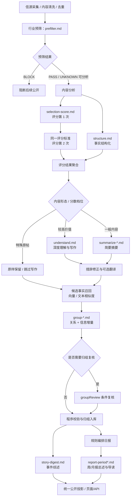

# AIHOT 提示词体系与源码实现分析 V1.0

> **研究目的**：理解 AIHOT 如何组织 Prompt、如何通过程序装配与执行，以及提示词与模型、业务规则、数据结构和评测之间的关系。本文适合作为学习 AI Prompt Engineering 与 RiskHot AI 技术设计的参考资料。  
> **研究日期**：2026-10-28  
> **研究仓库**：[KKKKhazix/AIHOT](https://github.com/KKKKhazix/AIHOT)  
> **事实基线**：当前 GitHub 目录与官方说明，以及 RiskHot 项目在 2026-10-16 针对固定提交 `c8704e5313e6b051560365226b3919d7e0ada5ea` 完成的源码研究报告。  
> **重要限制**：本次 RiskHot Knowledge MCP 隧道离线，无法访问用户 Mac 上的本地源码；当前 GitHub 仓库的 29 个提示词文件已核对目录，但只有部分正文获得直接核验。未启动 AIHOT、未运行真实 LLM 调用、未完成当前 HEAD 的端到端测试。本文对核验程度作显式区分。

## 0. 阅读说明与证据等级

本文区分以下三个等级：

| 等级 | 含义 | 典型依据 |
| --- | --- | --- |
| **A：直接可核实** | 当前访问中已看到原文或明确的仓库内容 | `selection-score.md`、`group-definitions.md` 及当前文件目录 |
| **B：代码/官方文档可支持** | AIHOT 官方文档明确说明，或此前固定 Commit 的源码研究报告核验过实现 | `docs/selection.md`、`docs/grouping.md`、2026-10-16 代码审查 |
| **C：待核验** | 根据文件名称与系统结构所作的职责归类，具体提示词正文、调用条件或 Schema 有待读取 | `group-signal.md`、`identity-context.md` 等未逐字阅读文件 |

**版本注意**：固定 Commit 的技术实现结论不自动适用于 GitHub `main` 的所有后续修改。本文在关键结论后注明适用来源；需要对当前版本进行变更审计时，应重新抓取同一 Commit 的 `industry/prompts` 与调用代码。

## 1. AIHOT 提示词体系的整体定位

AIHOT 是一个面向行业信息的自动采集、筛选、组织、写作和发布框架。提示词集合是其行业 KnowHow 的核心可配置资产：哪些消息值得关注、哪些应降低优先级、怎样提取事实、如何判断两篇报道的关系、如何生成可读的文字，都可以通过 Prompt 表达。模型选择、评分门槛、存储和任务控制则由其他配置或程序提供。详见[官方 README](https://github.com/KKKKhazix/AIHOT/blob/main/README.md)和[行业定制文档](https://github.com/KKKKhazix/AIHOT/blob/main/docs/customize.md)。

### 1.1 四个容易混淆的层次

| 层次 | 代表对象 | 负责内容 |
| --- | --- | --- |
| **业务任务（Task）** | 行业预筛、评分、事实抽取、事件关系判断 | 定义需要完成的业务认知工作 |
| **提示词（Prompt）** | `prefilter.md`、`selection-score.md`、`group-*.md` | 规定模型执行任务时的判断准则、行为约束和输出要求 |
| **模型能力路由（Capability）** | `prefilter`、`score`、`structure`、`group` 等 | 指定一个任务调用哪种模型能力及其配置 |
| **程序执行与治理** | `editorial/analyze.ts`、`providers/llm.ts`、`receipts.ts` | 编排调用、验证输出、保存业务状态、处理重试与费用 |

以前的《AIHOT 业务处理架构与 AI 任务拆解 V2.0》使用 **AI-01～AI-13** 做逻辑任务编号；这些编号是研究文档的分析模型。根据 2026-10-16 固定 Commit 的 `editorial/models.ts`，实际模型配置层有 **11 类 Capability**：`prefilter`、`score`、`understand`、`summarize`、`wording`、`structure`、`group`、`groupReview`、`digest`、`report`、`translate`。一个业务任务可能多次调用模型；一个模型请求也可能同时产出多个逻辑任务结果。

### 1.2 Prompt 所在位置与组织方式

```text
AIHOT/
├── industry/
│   ├── prompts/                 # 29 个 Markdown 提示词资产（本次目录核对）
│   │   ├── safety.md
│   │   ├── rules-*.md
│   │   ├── prefilter.md
│   │   ├── selection-score.md
│   │   ├── structure.md
│   │   ├── understand.md
│   │   ├── content-understanding.md
│   │   ├── summarize-*.md
│   │   ├── group-*.md
│   │   ├── story-digest.md
│   │   ├── report-period*.md
│   │   └── translate-*.md
│   ├── selection.ts             # 精选门槛、写作分流规则
│   └── taxonomy.ts              # 分类体系
├── site/
│   ├── site.ts                  # 站点/行业属性
│   └── models.ts                # 各 Capability 默认模型
└── packages/backend/src/
    ├── editorial/
    │   ├── prompts.ts           # Prompt 模板装配与版本
    │   ├── models.ts            # 模型能力路由
    │   └── analyze.ts           # 内容分析流程
    ├── events/
    │   ├── relate.ts            # 关系判断与信息增量
    │   ├── group.ts             # 归组及条件复核
    │   └── digest.ts            # 事件综述
    ├── reports/compose.ts       # 周/月报生成
    └── providers/
        ├── llm.ts               # 模型调用、JSON/Schema 验证
        └── receipts.ts          # 调用回执、费用、去重与恢复
```

以上代码路径与职责依据此前固定 Commit 的源码研究；当前 GitHub 中各文件请以实际 HEAD 为准。

## 2. 当前提示词资产清单：29 个 Markdown 文件

目录来源：2026-10-28 读取 GitHub `industry/prompts/group-definitions.md` 页面中的仓库目录树。**A/B/C 标注代表本次已取得的证据强度，C 项暂不推断精确字段契约。**

### 2.1 基础约束与共享规则（6 个）

| 文件 | 主要职责 | 证据 |
| --- | --- | --- |
| [`safety.md`](https://github.com/KKKKhazix/AIHOT/blob/main/industry/prompts/safety.md) | 提示词共同的安全边界；须核验具体引用位置 | C |
| [`rules-anti-hallucination.md`](https://github.com/KKKKhazix/AIHOT/blob/main/industry/prompts/rules-anti-hallucination.md) | 约束生成文字与原文证据一致，控制虚构实体、数字等问题 | B |
| [`rules-domain.md`](https://github.com/KKKKhazix/AIHOT/blob/main/industry/prompts/rules-domain.md) | 行业术语、中文译法及专业词保留规则 | B |
| [`rules-self-contained-title.md`](https://github.com/KKKKhazix/AIHOT/blob/main/industry/prompts/rules-self-contained-title.md) | 自包含标题的写作规则；具体条款待核验 | C |
| [`rules-answer-first-summary.md`](https://github.com/KKKKhazix/AIHOT/blob/main/industry/prompts/rules-answer-first-summary.md) | 答案先行的摘要规则；具体条款待核验 | C |
| [`identity-context.md`](https://github.com/KKKKhazix/AIHOT/blob/main/industry/prompts/identity-context.md) | 身份/上下文相关辅助规则；调用场景待核验 | C |

**设计特点**：通过公共规则文件复用领域约束，可以减少写作、摘要、翻译等任务各自维护一套术语标准的成本。共享规则被哪些任务包含、规则是否互相冲突，需看实际模板依赖图。

### 2.2 资料预筛与价值评分（2 个）

| 文件 | 主要职责 | 证据 |
| --- | --- | --- |
| [`prefilter.md`](https://github.com/KKKKhazix/AIHOT/blob/main/industry/prompts/prefilter.md) | 判断是否与目标行业相关；采用宽召回，对明显无关资料执行阻断，允许 `PASS`、`BLOCK`、`UNKNOWN` | B |
| [`selection-score.md`](https://github.com/KKKKhazix/AIHOT/blob/main/industry/prompts/selection-score.md) | 根据内容类型和五个评价维度，对资料给出 0–100 的关注价值分数 | A |

### 2.3 事实抽取（1 个）

| 文件 | 主要职责 | 证据 |
| --- | --- | --- |
| [`structure.md`](https://github.com/KKKKhazix/AIHOT/blob/main/industry/prompts/structure.md) | 分类、标签、主体公司与事件事实结构化抽取 | B |

本组负责分类、标签、主体与事件事实的结构化抽取。

### 2.4 内容写作（11 个）

| 文件 | 主要职责 | 证据 |
| --- | --- | --- |
| [`understand.md`](https://github.com/KKKKhazix/AIHOT/blob/main/industry/prompts/understand.md) | 深度理解任务的装配入口，历史快照中包含正文及公共规则引用 | B |
| [`content-understanding.md`](https://github.com/KKKKhazix/AIHOT/blob/main/industry/prompts/content-understanding.md) | 深度内容理解；写中文标题、摘要、推荐理由与标签 | B |
| [`summarize-article.md`](https://github.com/KKKKhazix/AIHOT/blob/main/industry/prompts/summarize-article.md) | 一般文章的简要标题与摘要 | B |
| [`summarize-article-empty.md`](https://github.com/KKKKhazix/AIHOT/blob/main/industry/prompts/summarize-article-empty.md) | 正文缺失/特殊材料形态对应摘要模板；准确触发条件待核验 | C |
| [`summarize-long-post.md`](https://github.com/KKKKhazix/AIHOT/blob/main/industry/prompts/summarize-long-post.md) | 较长帖文的摘要模板 | B |
| [`summarize-long-post-quoted.md`](https://github.com/KKKKhazix/AIHOT/blob/main/industry/prompts/summarize-long-post-quoted.md) | 带引用的长帖摘要分支；具体输入方式待核验 | C |
| [`summarize-short-post.md`](https://github.com/KKKKhazix/AIHOT/blob/main/industry/prompts/summarize-short-post.md) | 短帖摘要模板 | B |
| [`summarize-short-post-quoted.md`](https://github.com/KKKKhazix/AIHOT/blob/main/industry/prompts/summarize-short-post-quoted.md) | 带引用的短帖摘要分支；具体输入方式待核验 | C |
| [`mend-wording.md`](https://github.com/KKKKhazix/AIHOT/blob/main/industry/prompts/mend-wording.md) | 条件触发的措辞修正，处理特定禁用或不合适表述 | B |
| [`translate-body.md`](https://github.com/KKKKhazix/AIHOT/blob/main/industry/prompts/translate-body.md) | 正文翻译 | B |
| [`translate-post.md`](https://github.com/KKKKhazix/AIHOT/blob/main/industry/prompts/translate-post.md) | 帖文翻译 | B |

本组覆盖深度理解写作、摘要、措辞修正与翻译；其中 `understand.md` 和 `content-understanding.md` 按标题、摘要等写作输出归入本组。写作与翻译通常由材料形态、分值和规则决定路径。

### 2.5 事件关系与归组（5 个）

| 文件 | 主要职责 | 证据 |
| --- | --- | --- |
| [`group-batch.md`](https://github.com/KKKKhazix/AIHOT/blob/main/industry/prompts/group-batch.md) | 多个候选关系的批量判定任务；历史代码确认存在 `decisions[]` 批量结果 | B |
| [`group-definitions.md`](https://github.com/KKKKhazix/AIHOT/blob/main/industry/prompts/group-definitions.md) | 定义 `SAME_OCCURRENCE`、`SAME_STORY`、`UNRELATED`、`ROUNDUP` 的精细边界 | A |
| [`group-method.md`](https://github.com/KKKKhazix/AIHOT/blob/main/industry/prompts/group-method.md) | 归组判断方法的共享文件；条款待核验 | C |
| [`group-pair.md`](https://github.com/KKKKhazix/AIHOT/blob/main/industry/prompts/group-pair.md) | 两篇资料的成对关系判断；具体运行分支待核验 | C |
| [`group-signal.md`](https://github.com/KKKKhazix/AIHOT/blob/main/industry/prompts/group-signal.md) | 归组相关信号判定的辅助文件；确切职责待核验 | C |

### 2.6 事件综述与报告（4 个）

| 文件 | 主要职责 | 证据 |
| --- | --- | --- |
| [`story-digest.md`](https://github.com/KKKKhazix/AIHOT/blob/main/industry/prompts/story-digest.md) | 根据同一事件的已归组证据生成自然语言综述 | B |
| [`report-period.md`](https://github.com/KKKKhazix/AIHOT/blob/main/industry/prompts/report-period.md) | 周/月报周期内容的主要生成模板 | B |
| [`report-period-sections.md`](https://github.com/KKKKhazix/AIHOT/blob/main/industry/prompts/report-period-sections.md) | 周/月报栏目导读规则 | B |
| [`report-period-no-sections.md`](https://github.com/KKKKhazix/AIHOT/blob/main/industry/prompts/report-period-no-sections.md) | 无栏目时的周期报告模板；具体触发条件待核验 | C |

**数量核对**：基础约束 6 + 预筛评分 2 + 事实抽取 1 + 内容写作 11 + 归组 5 + 事件报告 4 = **29**。上游可能继续更新，请以 GitHub 目录为最终清单。

## 3. 从输入到发布：提示词如何进入执行链



**执行时序修正（固定 Commit）**：两次评分在 `runScores` 内部**顺序执行**，整组评分与 `runStructure` **并行发起**；评分及结构化均完成后选择内容写作路径。尽管研究报告把两次评分分别叫作 AI-02 和 AI-03，它们可以属于同一个业务函数 `runScores`。该事实来源于历史源码分析的 [`editorial/analyze.ts`](https://github.com/KKKKhazix/AIHOT/blob/c8704e5313e6b051560365226b3919d7e0ada5ea/packages/backend/src/editorial/analyze.ts)。

## 4. 核心 Prompt 一：行业预筛 `prefilter.md`

### 4.1 业务目标

在较早阶段识别明显不属于当前行业的资料，从而减少后续评分、写作与归组费用。采用偏向召回率的过滤策略，边界不清晰的资料可以继续进入后续流程。

### 4.2 输入与输出（官方契约层）

- **输入来源**：当前资料（标题、正文/可用内容）、行业定义和站点上下文。
- **主要输出**：`PASS`、`BLOCK`、`UNKNOWN`。
- **路由规则**：`BLOCK` 阻断；`PASS` 与可继续分析的 `UNKNOWN` 进入后续处理。
- **程序关联**：`editorial/analyze.ts` 中 `runPrefilter`，再由业务状态决定是否执行其余任务。

这里必须区分**模型判断的不确定**与**系统执行异常**：`UNKNOWN` 属于业务上的信息不足或边界不确定；接口超时、Schema 不合法、预算耗尽属于执行状态，应按运行错误流程处理。后一项是对系统设计的分析建议，具体失败状态由程序定义。

## 5. 核心 Prompt 二：价值评分 `selection-score.md`

这是本次直接读取了主要正文、最值得深入研究的 Prompt。它将一个看似主观的“是否值得关注”判断，拆成**内容类型识别、五轴评分、类型权重、正向价值规则、噪声抑制规则、输出契约**几个环节。

### 5.1 任务目标与输出边界

模型依据资料内容评估其在目标行业读者中的注意力价值。公开提示词要求最终只返回一个 JSON 字段：

```json
{"attentionScore": 78}
```

上述 `78` 为示例数值；模型内部可以根据五轴分析，但提交的结构化产物保持精简。实际请求还要经过模型客户端的 JSON 与 Schema 校验。

### 5.2 七类内容类型

| 类型 | 代表场景 |
| --- | --- |
| `model_release` | 新模型或重要模型版本发布 |
| `product_launch` | 新产品、工具及重大功能更新 |
| `tool_or_prompt` | 可复用的方法、Prompt、Skill、技巧 |
| `research_paper` | 论文、研究或技术报告 |
| `industry_event` | 融资、收购、监管、诉讼及行业动作 |
| `opinion_analysis` | 观点、行业分析、访谈及复盘 |
| `tutorial_explainer` | 教程、科普、解读或评测 |

### 5.3 五个评分维度

| 维度 | 含义 | 判断重点 |
| --- | --- | --- |
| `sig` | 实质份量 | 对行业能力边界或重要事实带来了多大变化 |
| `nov` | 信息增量 | 是否包含具体的新结果、新方法、新事实 |
| `cred` | 证据强度 | **材料内部**是否有足够事实支持关键结论 |
| `reson` | 共振面 | 对目标站点读者的关注面与理解价值 |
| `act` | 可用性 | 是否可以直接使用、学习、调整选择或迁移做法 |

每个轴为 **0–10 整数分**，并针对内容类型应用不同权重。评分语义中强调：官方发布能够证明“宣布/上线”等行动，不能直接证明全部宣称效果；普通用户能直接使用的工具，在某些类型下可通过可用性维度获得高分。

### 5.4 类型权重矩阵（Prompt 原规则）

| 内容类型 | sig | nov | cred | reson | act | 权重合计 |
| --- | ---: | ---: | ---: | ---: | ---: | ---: |
| `model_release` | 3 | 2 | 2 | 2 | 1 | 10 |
| `product_launch` | 2 | 2 | 1 | 2 | 3 | 10 |
| `tool_or_prompt` | 1 | 2 | 1 | 2 | 4 | 10 |
| `research_paper` | 5 | 3 | 1 | 0 | 1 | 10 |
| `industry_event` | 3 | 1 | 2 | 4 | 0 | 10 |
| `opinion_analysis` | 1 | 3 | 1 | 4 | 1 | 10 |
| `tutorial_explainer` | 1 | 1 | 1 | 3 | 4 | 10 |

内部计算公式：

```text
attentionScore = sig × w1 + nov × w2 + cred × w3 + reson × w4 + act × w5
```

因为每个维度最大 10 分、每类权重总和为 10，因此分数自然落在 **0–100**。

**示例（仅演示公式）**：某个 `tool_or_prompt` 的五轴分别为 5、7、7、8、9，则其总分为 `5×1 + 7×2 + 7×1 + 8×2 + 9×4 = 78`。这组五轴为人为构造，不代表任何实际文章的评分结果。

### 5.5 评分规则的工程价值

- **内容类型校准**：同一维度的权重因场景而变，避免用一套标准机械比较论文、工具与新闻。
- **重视实证**：将原文事实、营销宣称、第三方验证和实际影响区分开。
- **防噪声**：Prompt 明确约束小补丁、普通营销、空泛方法等内容的评分上界，降低低价值稿件冲高分的概率。
- **降低外部锚定**：评分任务的模型输入有意隐藏信源分级、此前评分及入选门槛等信息，使内容判断尽量独立进行。
- **输出可校验**：请求以单值 JSON 返回，便于范围校验、记录和阈值判断。

**工程注意**：五轴、权重和算式目前由提示词指导模型执行；若需要强可复现的量化模型，可以要求模型返回五轴及类别，再由程序按照已批准权重确定性计算。该条属于可借鉴设计建议，不能据此认定 AIHOT 已采用程序重算五轴分的方式。

### 5.6 双评分与程序门槛

官方文档指出：同一套 `selection-score.md` 对同一资料执行**两次独立评分**，最终展示 `floor((score1 + score2) / 2)`；入选比较使用两分之和与两倍门槛。示例信源门槛配置为 T1=60、T1_5=65、T2=76；`understandFloor=50` 用于写作策略分流。

**区分职责**：

- 提示词规定单次评分的内容价值标准。
- `industry/selection.ts` 定义信源分级的入选门槛与写作分流门槛。
- 程序执行双评分、聚合、与门槛比较，并结合去重及归组结果决定最终公开资格。

资料来源：[selection-score.md](https://github.com/KKKKhazix/AIHOT/blob/main/industry/prompts/selection-score.md)、[精选与校准](https://github.com/KKKKhazix/AIHOT/blob/main/docs/selection.md)。

## 6. 核心 Prompt 三：事实结构化 `structure.md`

这类 Prompt 将原始文章变为后续可复用的结构化事实信息。官方文档明确列出的输出范围包括**分类、标签、主体公司、事实**；历史业务架构分析将事件事实进一步概括为“谁、做了什么、针对什么对象”。

**在工作流中的作用**：

1. 让下游关系判断使用相对稳定的事实信息，降低完全依赖标题相似度的风险。
2. 为主题页、事件归组和内容展示提供统一字段。
3. 将业务事实抽取与标题摘要的写作任务拆开，使两类结果可分别校验。

**待进一步核验的细节**：当前 `structure.md` 的实际 JSON Schema、每个字段是否必填、时间含义与缺失策略、原文证据定位和多事件拆分边界，必须读当前源码及输出 Zod Schema 后才能定稿。不能仅凭文件名推断其支持 RiskHot 级别的 `occurredAt`、`Target` 或 `Variable` 字段。

## 7. 核心 Prompt 四：深度理解、摘要与翻译

### 7.1 深度理解 `understand.md` / `content-understanding.md`

按官方说明，在价值较高或达到写作分流档位时，系统生成**中文标题、答案先行的摘要、推荐理由与标签**。2026-10-16 固定 Commit 的审查报告确认，`understand.md` 充当装配入口，通过引用引入 `content-understanding.md` 与公共规则。这样可以使业务写作要求和跨任务规则独立维护。

### 7.2 多套 `summarize-*.md`

针对文章与长/短帖、带引用帖等资料形态使用不同模板。该设计允许不同信息载体各自采用适合的长度、事实保留和写法约束。**精确的路由表达式、特殊空正文分支、引用帖上下文装配**需重新核对当前 `runSummarize` 和实际 Prompt。

### 7.3 措辞修正与翻译

- `mend-wording.md`：对符合触发条件的文本实施措辞修复，属于选择性后处理；独立 Capability `wording`。
- `translate-body.md`、`translate-post.md`：支持正文与帖文的翻译模板；独立 Capability `translate`。
- 历史源码显示翻译还可以由后续周期任务触发，写作链和翻译链可以分开调度。

### 7.4 事实约束

写作型 Prompt 的核心工程风险是**表达增强导致事实超出原文**。因此文案规则、术语表、反幻觉规则和程序字段校验应分工实施。官方 README 也强调控制生成文字中无依据的公司名称与数字。

## 8. 核心 Prompt 五：事件关系判断 `group-*.md`

### 8.1 两级处理：候选召回 + 语义判断

历史固定 Commit 中，`events/recall.ts` 先通过向量/文字相似度，结合最近约 14 天的候选事实筛选可能的匹配对象；再由 `events/relate.ts` 提交给模型判断。此设计限制了模型比较范围，降低关系判断费用。

### 8.2 四种关系的判断语义

根据本次直接读取的 `group-definitions.md`：

| 关系标签 | 含义 | 正例 | 典型反例 |
| --- | --- | --- | --- |
| `SAME_OCCURRENCE` | 同一具体发生 | 官方发布与媒体转述同一次产品发布 | 同一天同家公司发布的两件独立产品 |
| `SAME_STORY` | 同一具体事件的直接后续 | 新品发布、随后上架、当事方回应或评测 | 相隔数月的独立功能更新，仅共享产品名 |
| `UNRELATED` | 不同事件 | 两项各自独立的研究、事故或商业决定 | 仅共享主体或话题无法证明同一性 |
| `ROUNDUP` | 多项事件的综合汇总 | 日报、周报、大会总结稿包含多项独立发生 | 文章引用另一个事件作背景，不一定构成综合稿 |

特别注意：**“同一主体”“同一日期”“同一大会”都不足以自动证明同一次发生**。这与 RiskHot 的事件去重和事实身份建模高度相关。

### 8.3 `group-batch.md` 的复合业务结果

历史代码审查结论：`judgeBatch()` 的一次 `group` Capability 模型请求同时返回：

1. `decisions[]`：当前报道与各候选事实/事件的关系判断；
2. `selection.addsValue`：相对于已精选内容，是否提供重要新增事实。

因此，研究文档的 **AI-08（关系判断）与 AI-10（精选信息增量）**可能共享一次实际模型调用。程序负责检查候选集合覆盖是否完整、关系对象是否有效，并根据条件触发 `groupReview` 复核低置信度或高风险合并。

### 8.4 `Fact` / `Story` 的不同粒度

- `Fact`：一次具体发生的业务事实身份。
- `Story`：围绕具体发生形成的持续事件及后续进展。
- `Article`：表达或报道某项事实的原始材料。

同一 Fact 可有多篇 Article；同一 Story 可纳入多个先后发生的 Fact。综合稿可以作为 mention 关联，避免把一个多事件汇总直接并成一项事实。历史源码研究报告将业务关系记录定位于 `events/group.ts`、`events/relate.ts`、`events/consolidate.ts`。

### 8.5 典型风险与防护

- **过度归组**：因标题、主体或主题相似，把独立事件合并。
- **重复保留**：跨语言转述、官方与媒体转发仍产生两个发生身份。
- **事件进展错配**：将先后独立事项理解为一个 Story 的进展。
- **归组竞争条件**：多个任务同时创建相同 Fact；需要程序锁与版本控制。
- **复核与人工覆盖**：条件性二次判定、人工归属优先、重试不应覆盖人工纠正。

资料来源：[group-definitions.md](https://github.com/KKKKhazix/AIHOT/blob/main/industry/prompts/group-definitions.md)、[事件归组与关系评测](https://github.com/KKKKhazix/AIHOT/blob/main/docs/grouping.md)。

## 9. 核心 Prompt 六：事件综述与周期报告

### 9.1 事件综述 `story-digest.md`

输入是已经归组、受公开范围约束的事件证据集合，生成供事件页阅读的自然语言综述。历史源码审查确认 `events/digest.ts` 的 `composeStoryDigest` 具有**输入哈希、结果版本和过期检查**：事件证据变化时可以重新生成，旧推理结果不能随意覆盖新版本。

其核心要求应围绕三类质量目标组织：**事实忠实、时间线一致、来源可追溯**。这三类是本报告的评审框架；实际 Prompt 的具体原文条款有待再次读取。

### 9.2 周报/月报 `report-period*.md`

历史审查显示 `reports/compose.ts` 对周/月报先按业务规则确定素材、排序和栏目，然后通过 `report` Capability 的一次模型请求生成 `overview` 及 `sections`；其栏目导读只有在满足条件时才使用。程序对生成文本中的数字和实体实施校验、回退，模型输出不被授予新增或删除刊载条目的权限。

**日报特别说明**：官方描述的日报由规则编排完成；本分析没有发现其必须依赖独立日报导语 LLM Prompt 的证据。仓库更新文档还说明旧 `report-daily-lead.md` 已删除，新版本采用 `report-period-sections.md` 等资产。阅读旧架构资料时需识别这一变化。

## 10. Prompt 的技术实现机制

### 10.1 变量与引用

AIHOT 使用可复用的 Markdown 提示词模板，官方文档展示两种基本语法：

```text
{{siteName}}         # 站点名称等变量
{{> rules-domain}}   # 引入另一份提示词，具体引用名以实际文件和代码为准
```

固定 Commit 的 `editorial/prompts.ts` 源码审查确认：装配器支持 `{{变量}}` 和 `{{> prompt-name}}` 的递归引入，缺失文件、未提供变量或循环引用会导致装配失败。引用文件内容共同参与版本哈希。这种设计使公共写作要求被统一复用，也使共享规则的每次改动能影响相关任务的版本身份。

### 10.2 版本标识与快照

在既往审查版本中，Prompt 最终装配内容由 SHA-256 产生版本标识；同一业务请求的模型、Prompt 版本、输入摘要和生成参数共同影响付费请求的身份。随着 Prompt 变更，新资料可按新版本执行，旧结果通常保留历史而不会自动全面重算。可追溯最小信息建议包括：

```yaml
prompt_asset: industry/prompts/selection-score.md
prompt_version: <装配后版本哈希>
source_revision: <文章/材料修订>
model_capability: score
model_id: <实际模型标识>
input_hash: <规范化输入摘要>
output_schema_version: <输出契约版本>
run_status: <执行结果>
receipt_id: <付费请求回执>
```

这段 YAML 是**用于 RiskHot 架构设计的建议记录样例**，字段名不等于 AIHOT 当前数据库完整列清单。

### 10.3 模型选择与分工

历史 `modelFor(capability)` 的配置优先级为：**管理后台覆盖配置 > 环境变量 > `site/models.ts` 默认 > 内建默认模型**；后台覆盖存在缓存。业务流程可以让评分、结构化、归组、复核、写作分别使用不同模型及成本策略。

### 10.4 输出校验与执行回执

旧版已验证代码链路：

```text
业务模块选择 Capability
       ↓
装配 Prompt 与内容版本哈希
       ↓
providers/llm.ts：chatJson(...)
       ↓
providers/receipts.ts：幂等、预算、付费回执
       ↓
LLM /chat/completions
       ↓
解析 JSON → Zod Schema → 业务一致性校验
       ↓
持久化结果、关联回执、必要时继续下游任务
```

**不同规则的职责**：Prompt 约束模型判断，JSON/Zod 校验结构，业务程序实施权限和实体校验，事务与回执负责可靠性。对于高风险事件归组，还需校验关联对象存在、材料版本没有过期。

## 11. 提示词版本与业务代码对照表

下表**依据 2026-10-16 固定 Commit 的源码审查报告**。`AI-01～AI-13` 是分析编号，方便映射到 RiskHot 当前设计文档。当前主分支的函数/接口如有修改，应重新核验。

| 逻辑编号 | 任务 | Capability | 主要 Prompt | 代码入口 | 模型调用粒度 |
| --- | --- | --- | --- | --- | --- |
| AI-01 | 行业预筛 | `prefilter` | `prefilter.md` | `editorial/analyze.ts:runPrefilter` | 条件调用 |
| AI-02 / AI-03 | 两次独立评分 | `score` | `selection-score.md` | `runScores` | 两次调用，历史实现为顺序 `await` |
| AI-04 | 事实结构化 | `structure` | `structure.md` | `runStructure` | 与整个双评分并行 |
| AI-05 | 深度理解写作 | `understand` | `understand.md` + `content-understanding.md` | `runUnderstand` | 按条件执行 |
| AI-06 | 简要摘要 | `summarize` | `summarize-*.md` | `runSummarize` | 按材料形态分流 |
| AI-07 | 措辞修正 | `wording` | `mend-wording.md` | 内容处理模块 | 条件执行 |
| AI-07 | 翻译 | `translate` | `translate-*.md` | 翻译处理模块/调度 | 独立能力 |
| AI-08 | 事件关系判断 | `group` | `group-*.md` | `events/relate.ts:judgeBatch` | 共享批量请求 |
| AI-09 | 归组复核 | `groupReview` | 归组复核上下文/规则 | `events/group.ts`、`consolidate.ts` | 条件触发 |
| AI-10 | 信息增量判断 | `group` | 与 AI-08 共享 | `judgeBatch` | 常与 AI-08 同次响应 |
| AI-11 | 事件综述 | `digest` | `story-digest.md` | `events/digest.ts` | 输入变更后重新生成 |
| AI-12 / AI-13 | 周/月报总述与栏目导读 | `report` | `report-period*.md` | `reports/compose.ts` | 同一请求中的不同输出字段 |

代码追溯入口：[`editorial/prompts.ts`](https://github.com/KKKKhazix/AIHOT/blob/c8704e5313e6b051560365226b3919d7e0ada5ea/packages/backend/src/editorial/prompts.ts)、[`editorial/models.ts`](https://github.com/KKKKhazix/AIHOT/blob/c8704e5313e6b051560365226b3919d7e0ada5ea/packages/backend/src/editorial/models.ts)、[`editorial/analyze.ts`](https://github.com/KKKKhazix/AIHOT/blob/c8704e5313e6b051560365226b3919d7e0ada5ea/packages/backend/src/editorial/analyze.ts)、[`events/relate.ts`](https://github.com/KKKKhazix/AIHOT/blob/c8704e5313e6b051560365226b3919d7e0ada5ea/packages/backend/src/events/relate.ts)、[`reports/compose.ts`](https://github.com/KKKKhazix/AIHOT/blob/c8704e5313e6b051560365226b3919d7e0ada5ea/packages/backend/src/reports/compose.ts)。

## 12. 评测和质量保障

AIHOT 已提供针对不同业务任务的专项评测入口，重点避免仅靠主观阅读单个模型结果作判断。

| 评测对象 | 官方提供的工具/资料 | 应关注的质量指标 |
| --- | --- | --- |
| 精选评分 | `scripts/eval-selection.ts`、`industry/gold.example.jsonl`、SelectBench | 查准率、查全率、错例、各门槛下的表现 |
| 事件关系 | `scripts/eval-relations.ts`、`docs/grouping.md` | 同发生、同事件进展、独立事件和综合稿的混淆情况 |
| 事件综述 | `docs/story-digest-evaluation.md` | 事实忠实、时间线、遗漏与多来源冲突 |
| 技术契约 | 代码中的 JSON/Zod/关联校验 | 输出格式、ID 有效性、字段边界、非法结果拒绝 |

官方建议使用**100–200 条人工标注样本**校准精选，区分开发集与留出集，优先针对“该选却没选”“不该选却选上”的错例修改评分标准；仅在有证据说明整体阈值偏移时再调整门槛。可执行示例：

```bash
node --env-file=.env scripts/eval-selection.ts \
  --gold .data/gold.jsonl \
  --split development \
  --label "评分标准基线"
```

上面的命令出自官方评测流程示例，**本轮没有实际执行**。真实环境还需要安装依赖、配置 Provider、准备样本并授权模型调用。

## 13. 面向 RiskHot 的可借鉴设计

RiskHot 的 L0 信息处理、F02 事件管理及金融意义评价与 AIHOT 有一部分工程机制相通；两套系统的业务目标和评价口径保持独立。

| AIHOT 机制 | RiskHot 可借鉴的工程原则 | 实施时应保留的业务边界 |
| --- | --- | --- |
| 分任务 Prompt 文件 | `AI Task → Prompt → Schema → Validator → Run` 建立独立契约 | 各任务字段由 RiskHot 领域设计定义 |
| 双路评分 | 当判断不稳定且决策重要时可配置多次评估/复核 | 不自动套用 AIHOT 的内容精选分数 |
| 召回 + 关系判定 | F02 先获取候选事件，再做同一性判断 | 以 Subject/Action/Object/OccurredAt/证据为准 |
| `Fact` / `Story` 区分 | 区分一次发生与持续事件、文章与事实 | 与 RiskHot 已批准的 Event/Fact/Information 模型对齐 |
| 复合输出 | 一次 LLM 调用可生成关系判断和信息增量两个结果 | 两个结果应分别具有独立业务校验 |
| 公共规则文件 | 术语、证据、格式和安全规则统一维护 | 避免共享规则改动造成多个任务非预期变化 |
| 内容哈希和回执 | 保存 Prompt 版本、输入快照、模型输出、运行回执 | 历史结果和当前结果明确隔离 |
| 专项评测集 | 为 AI-01～AI-05 建立专门的 gold set 与失败分型 | 金融意义五维必须使用批准后的口径和证据规则 |

**编号特别提醒**：AIHOT 研究文档的 `AI-05` 指**深度内容理解写作**；RiskHot F02 的 `AI-05` 指**金融意义评价**。它们名称相同但职责不同。设计文档中应尽量使用带命名空间的任务标识（如 `AIHOT/AI-05` 与 `RiskHot/F02/AI-05`）以避免对照错误。

### 13.1 推荐 RiskHot Prompt 技术设计模板

可为每个 AI 任务维护如下条目：

```yaml
id: RiskHot/F02/AI-02
name: 事件候选匹配与归组
business_goal: 判断新候选事件与现有事件的关系
input_contract: <输入 Schema 路径>
output_contract: <输出 Schema 路径>
prompt_files:
  - prompts/f02/event-matching.md
  - prompts/shared/evidence-rules.md
capability: event_match
model_strategy: <模型路由策略>
validation:
  - schema_validation
  - candidate_id_validation
  - evidence_reference_validation
  - business_invariant_check
versioning:
  - prompt_content_hash
  - input_revision
  - model_and_parameters
fallback: human_review
status: proposed
```

该 YAML 为**推荐规范示例**，并非 AIHOT 已有配置文件。建议把数据契约、业务规则、Prompt 文本、执行策略和评测样本分开管理，使每项变更都有清晰的责任与验证手段。

## 14. 当前无法确认的事项与后续审计清单

由于本次无法连接用户本地 RiskHot Knowledge 隧道，且 GitHub 主分支的全部 Prompt 正文与调用代码未完整同步到会话，以下结论仍需按当前 Commit 复核：

1. 29 个文件的**最终装配依赖图**：哪些文件作为入口、哪些仅是共享部分、是否存在未引用资产。
2. `group-method.md`、`group-pair.md`、`group-signal.md`、`identity-context.md`、`report-period-no-sections.md` 的具体内容、触发条件及输出 Schema。
3. 当前 `main` 下所有模型参数、提示词版本哈希计算细节、请求去重字段与失败处理是否与 2026-10-16 固定 Commit 一致。
4. `prefilter`、`structure`、`group`、`digest`、`report` 的最新 Zod/JSON Schema、必填字段、枚举和错误处理。
5. AI 任务的 Prompt 注入、越权引用、伪造证据、跨事件污染、多语言转述和空正文等专项测试结果。
6. 对所有 Prompt 的调用位置作静态检索（`loadPrompt`/`promptText`/`promptVersion` 等真实符号需根据当前代码确认），建立“文件 → 调用函数 → Capability → Schema → 测试”的逐项可追溯矩阵。

**完整性声明**：本文已覆盖 29 个文件的目录清单、核心业务链路、已证实的评分原理、事件关系定义、Prompt 装配技术与 RiskHot 借鉴分析。对未取得正文的文件，本文保留明确的验证缺口，没有把推断写成已读源码的直接事实。

## 15. 参考资料与源码入口

### 15.1 AIHOT 官方仓库与说明

1. [AIHOT GitHub 主仓库](https://github.com/KKKKhazix/AIHOT)
2. [Prompt 目录](https://github.com/KKKKhazix/AIHOT/tree/main/industry/prompts)
3. [评分提示词 `selection-score.md`](https://github.com/KKKKhazix/AIHOT/blob/main/industry/prompts/selection-score.md)
4. [事件关系定义 `group-definitions.md`](https://github.com/KKKKhazix/AIHOT/blob/main/industry/prompts/group-definitions.md)
5. [精选与校准 `docs/selection.md`](https://github.com/KKKKhazix/AIHOT/blob/main/docs/selection.md)
6. [事件归组与关系评测 `docs/grouping.md`](https://github.com/KKKKhazix/AIHOT/blob/main/docs/grouping.md)
7. [行业定制 `docs/customize.md`](https://github.com/KKKKhazix/AIHOT/blob/main/docs/customize.md)
8. [部署与版本更新 `docs/deploy.md`](https://github.com/KKKKhazix/AIHOT/blob/main/docs/deploy.md)
9. [事件综述评测 `docs/story-digest-evaluation.md`](https://github.com/KKKKhazix/AIHOT/blob/main/docs/story-digest-evaluation.md)

### 15.2 固定 Commit 源码追溯（历史基线）

- [Prompt 装配与版本 `editorial/prompts.ts`](https://github.com/KKKKhazix/AIHOT/blob/c8704e5313e6b051560365226b3919d7e0ada5ea/packages/backend/src/editorial/prompts.ts)
- [模型能力路由 `editorial/models.ts`](https://github.com/KKKKhazix/AIHOT/blob/c8704e5313e6b051560365226b3919d7e0ada5ea/packages/backend/src/editorial/models.ts)
- [内容分析 `editorial/analyze.ts`](https://github.com/KKKKhazix/AIHOT/blob/c8704e5313e6b051560365226b3919d7e0ada5ea/packages/backend/src/editorial/analyze.ts)
- [事件关系 `events/relate.ts`](https://github.com/KKKKhazix/AIHOT/blob/c8704e5313e6b051560365226b3919d7e0ada5ea/packages/backend/src/events/relate.ts)
- [事件归组 `events/group.ts`](https://github.com/KKKKhazix/AIHOT/blob/c8704e5313e6b051560365226b3919d7e0ada5ea/packages/backend/src/events/group.ts)
- [统一模型调用 `providers/llm.ts`](https://github.com/KKKKhazix/AIHOT/blob/c8704e5313e6b051560365226b3919d7e0ada5ea/packages/backend/src/providers/llm.ts)
- [请求回执 `providers/receipts.ts`](https://github.com/KKKKhazix/AIHOT/blob/c8704e5313e6b051560365226b3919d7e0ada5ea/packages/backend/src/providers/receipts.ts)

### 15.3 RiskHot 项目已存档研究

- `AIHOT_系统技术架构总览_V1.0.md`（2026-10-16，固定 Commit `c8704e5...`，源码参考子集 103 个文件，29 份 Prompt，未运行全量工程测试）
- `AIHOT_业务处理架构与AI任务拆解_V2.0.md`（2026-10-16，逻辑 AI Task 拆解）
- `下载AIHOT对应源码到RiskHot.command`（此前用于下载与校验对应源码参考快照的 Mac 脚本）

---

**文档结论**：AIHOT 最值得学习的是将“行业判断标准”写入可版本化的 Markdown 提示词，将“业务资格、状态一致性、回执、去重、发布权限”放入程序与数据治理链路，同时使用专项评测检验实际效果。其评分、写作和事件关系 Prompt 对 RiskHot 具有工程参考价值；领域指标、事实身份和金融评价方法应按 RiskHot 已批准规则独立设计。
