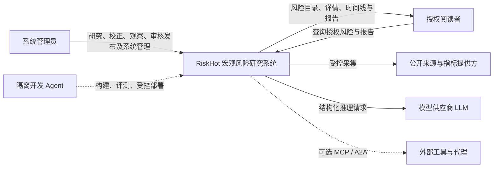
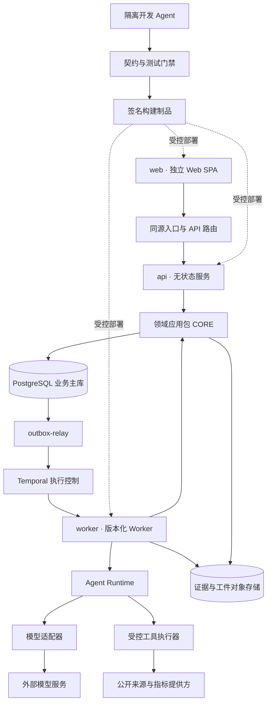
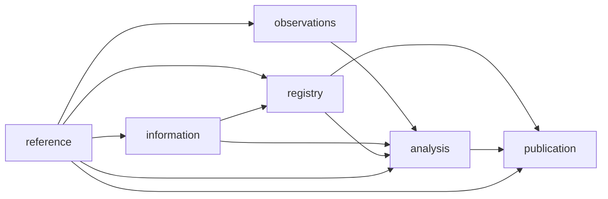
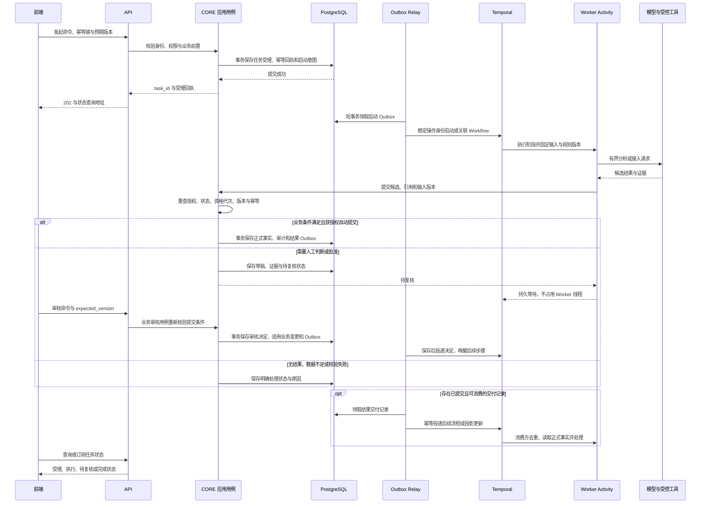
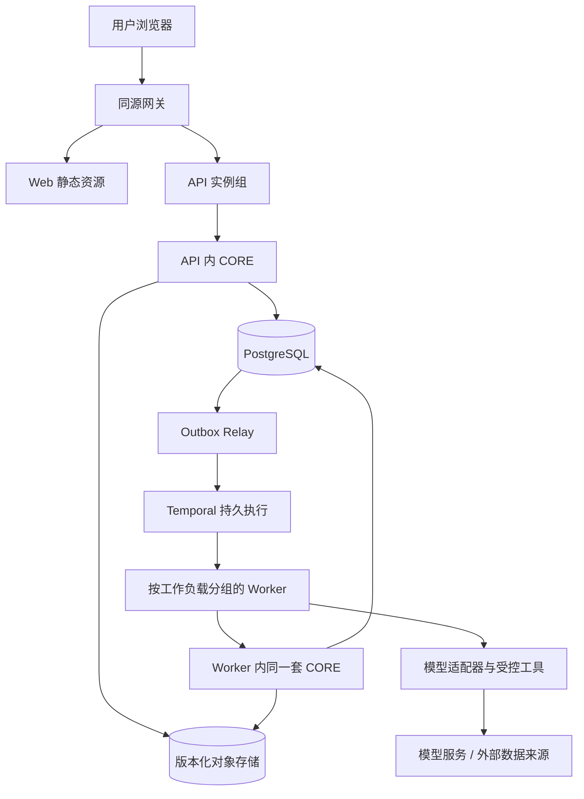

# RiskHot 系统总体架构

> **历史归档 · 2026-10-24**：按用户要求移入aihot。本页保留旧设计供追溯，不作为当前L0规范；当前入口见[系统总体技术架构](../../../docs/system-design/04-%E7%B3%BB%E7%BB%9F%E6%9E%B6%E6%9E%84%E8%AE%BE%E8%AE%A1/01-%E7%B3%BB%E7%BB%9F%E6%80%BB%E4%BD%93%E6%8A%80%E6%9C%AF%E6%9E%B6%E6%9E%84%E8%AE%BE%E8%AE%A1.md)。独有内容是否迁入新体系仍需逐项评审。

> **当前L0设计入口（2026-10-24）**：[系统总体技术架构](../../../docs/system-design/04-%E7%B3%BB%E7%BB%9F%E6%9E%B6%E6%9E%84%E8%AE%BE%E8%AE%A1/01-%E7%B3%BB%E7%BB%9F%E6%80%BB%E4%BD%93%E6%8A%80%E6%9C%AF%E6%9E%B6%E6%9E%84%E8%AE%BE%E8%AE%A1.md)及其分册按最新F01六步/F02七步重新设计。本页保留为历史技术参考，其中F01指标路径和旧候选/幂等口径不适用于本轮L0；运行验收仍待执行。

> 文档编号：RH-SAD-000  
> 版本：V1.1（2026-10-14，技术架构内容融合稿）  
> 状态：总体架构评审稿；保留既有技术路线，最新功能映射和未决事项显式列出，不代表已部署或已验收。  
> 阅读对象：架构师、产品与业务负责人、前后端开发、数据工程、运维

本文是技术架构顶层总览，说明系统边界、功能到应用组件的映射、运行单元、通信与正式写入、运行保障及部署演进。功能职责以 [[tools/RiskHot/docs/system-design/03-系统功能架构/系统功能架构总览|系统功能架构总览]] 为入口；技术细则通过第 8 章进入专题文档。

## 0. 设计依据、架构主线与评审边界

### 0.1 依据与状态

- **业务约束**：四个业务阶段、八个核心功能模块、三个横向中心，以及唯一业务主责、身份、时间、版本和证据约束，来自功能总览与领域文档。
- **技术设计路线**：独立 SPA、无状态 API、模块化 CORE、版本化 Worker、PostgreSQL、Temporal、Outbox/Inbox 与对象存储，沿用 [[tools/RiskHot/aihot/归档/旧版系统架构设计/01. 基础与决策|01. 基础与决策]] 和现有技术专题。
- **待对齐事项**：新功能归属与旧技术包的差异见 §2.5、§7。未决内容不会因迁入本文自动批准；冲突需由对应主责文档与契约评审解决。
- **验证边界**：本文整合设计，不重新判定代码、部署或性能验收状态。已有接口、事件、幂等方案继续作为技术设计输入，各模块细节与迁移须逐项确认。

### 0.2 主要选择与理由

| 架构选择 | 解决的问题 | 必须保持的边界 |
|---|---|---|
| 独立 SPA + 无状态 API | 交互与业务命令独立发布、伸缩 | 浏览器经版本化 API 访问，不直连业务库或模型 |
| API 与 Worker 共用 CORE | 在线命令与后台任务遵守同一领域规则 | CORE 是进程内应用包，不是新增微服务 |
| PostgreSQL 维护正式事实 | 稳定身份、版本、审计、并发和幂等统一裁决 | 每类事实只有一个技术写入主责；执行状态不能替代业务真值 |
| Temporal + Outbox/Inbox | 长任务等待、重试及保存后交付可恢复 | PG 决定业务能否提交，Temporal 推进执行；不增设第二套同任务恢复权威 |
| 对象存储保存原件与工件 | 原文、输入包、模型响应和报告可追溯 | 业务库保存元数据及引用，对象按版本与校验和读取 |
| 可替换模型适配器与受控工具 | 模型和数据接入升级不改变领域规则 | AI 提供候选与解释；身份、批准和发布仍经授权领域命令 |
| 按证据扩展部署 | 功能拆分不直接变成服务拆分 | 独立伸缩、安全隔离、发布节奏及团队需求经验证后再拆服务 |

---

## 1. 系统上下文与边界设计

### 1.1 系统是什么

RiskHot 是一个首版宏观风险研究系统。它从有效信源接入宏观资讯与指标实际值：资讯经处理形成可追溯的事件并用于识别与纳管风险，指标实际值作为分析证据；系统据此做态势分析，最后发布风险产品（目录、详情、时间线、报告）。

一句话：**把「资料从哪来、风险从哪产生、观察什么、用什么口径、损害属于什么性质」变成可追溯、可复用、可发布的正式结论。**

### 1.2 系统上下文图

系统参与角色统一为系统管理员和授权阅读者。系统管理员按操作权限承担研究、审核、配置和运行管理；授权阅读者只读访问已授权内容。服务身份和隔离开发 Agent 按技术职责管理，不作为额外的系统用户角色。

### 1.3 边界设计

**系统内：三个清晰的责任面**

| 责任面 | 承担内容 | 职责边界 |
| --- | --- | --- |
| 业务应用面 | 前端、API、领域模块、查询模型 | 决定用户能做什么、结果何时成为正式业务事实 |
| 研究执行面 | 工作流、Agent 运行时、数据适配器、受控工具 | 把研究任务可靠执行完 |
| 开发协作面 | 开发 Agent、隔离工作区、CI、评测、合并与部署 | 生产可验证软件；其身份与生产业务 Agent 分开 |

**系统外：明确不拥有、不代替**

| 外部对象 | 系统对待方式 |
| --- | --- |
| 公开来源与指标提供方 | 只读采集，不拥有数据；连接成功不替代业务准入判断 |
| 模型供应商（LLM） | 能力输入，不是决策权威；模型输出不自动获得业务审批权 |
| 外部工具 / 代理（MCP、A2A） | 可选边界适配器；不把每个内部函数都协议化 |

**关键边界原则（不变量）**

1. 正式业务身份由程序分配；LLM 输出的 ID 必须按权限与类型校验，不能直接信任。
2. 未知、缺失、不可比、业务无结果、技术失败分别编码，不折算成零、低风险或「稳定」。
3. 原文、已审核定义、正式快照和已发布报告不可无痕覆盖；修订形成新版本与关系。
4. 审批与正式写入经过应用用例和授权策略；模型升级不绕过此路径。
5. 更换模型或 Agent 框架不改变正式结果的成立条件。

---

## 2. 技术运行单元

### 2.1 运行单元总览

### 2.2 首版部署单元

以下为既有设计路线与责任分工，不表示各单元已上线或通过生产验收。CORE 是应用包，其余单元按表中职责部署；具体形态与容量仍须验证。

| 运行单元 | 独立伸缩与发布 | 责任 |
| --- | --- | --- |
| `web` | 是 | 静态资源与浏览器交互 |
| `api` | 是 | 认证、命令受理、查询、下载授权、任务状态流 |
| `worker` | 是；按队列形成多个实例组 | 采集、研究、报告的 Activity 与 Workflow |
| `outbox-relay` | 是 | 数据库提交后可靠发起流程、投递事件、更新投影 |
| PostgreSQL | 托管优先 | 业务、版本、审计、幂等和读模型 |
| Temporal | 托管优先；也可独立自托管 | 执行历史、计时、等待、重试、版本路由 |
| 对象存储 | 托管优先 | 大对象、原件、规范化输入包、模型响应和报告 |

**CORE 说明**：`CORE` 是可被 API 和 Worker 装配调用的**同一套领域应用包**，不是必须经网络访问的第二层微服务。应用包由 API 进程或 Worker Activity 执行，均通过同一权限和业务命令入口；领域代码不依赖 Temporal、HTTP 或具体模型 SDK。

领域模块初期共享后端发布制品，**不必一领域一微服务**。拆服务须有独立扩缩容、权限隔离、发布节奏或团队自治的实证需求；模块契约使后续拆分有路径，但不能声称拆分零成本。

### 2.3 领域模块（8 个）

此处八个是既有**技术领域包**，与功能总览的八个**核心功能模块**不是同一分类，也不一一对应。下表保留既有技术事实拥有者设计；最新功能映射与待决差异见 §2.4～§2.5，不据此认定代码已完成迁移。

| 模块 ID | 对应业务 | 唯一写入的事实 | 允许消费的上游 |
| --- | --- | --- | --- |
| `reference` | 配置及基础定义（信源配置归此模块） | 信源身份、分类、准入启停版本；对象、变量、风险源/类型、规则发布版本 | 无领域上游 |
| `observations` | 指标配置与数据 | 指标、变量映射、观测值、修订与可用时间 | reference |
| `information` | L0 | 资料版本、事件、增量、三元关系、M 评价 | reference |
| `registry` | L1 | 风险候选、正式风险、定义版本、长期变量关系、风险—事件关联 | reference、information |
| `analysis` | L2 | 分析草稿、快照及修订、变量分析、附属变化、减弱节点 | reference、observations、information、registry |
| `publication` | 风险产品 | 报告、冻结引用、发布版本、撤回记录、列表读模型 | reference、registry、analysis |
| `operations` | 横向运行 | 任务登记、计划、技术恢复入口、复核投影、审计检索 | 无领域上游；经注册端口调度 |
| `identity` | 身份权限 | 用户映射、角色、授权范围、服务身份 | 无领域上游 |

依赖方向：`reference` 是核心业务数据流的定义根；operations、identity 是共用运行与安全模块。下游只导入上游 `public` 契约，跨模块读取走查询端口，跨模块语义变更走契约。图中箭头表示数据提供方向；运行调度通过注册端口装配，不新增反向领域代码依赖。

### 2.4 从功能职责到应用组件的映射

API 承接用户命令、查询和任务受理；Worker 调用同一 CORE 内的应用用例执行接入、分析和报告。M1/M2/M3 是业务主责，不据此创建独立服务；定义治理与运行期处理均遵守授权、版本和审计约束。

| 功能模块或中心 | 业务阶段 | 既有或候选技术承载 | 职责与评审边界 |
|---|---|---|---|
| M1 信源管理 | 横向支撑 | `reference` 信源用例 | 维护信源身份、分类、启停与版本；不负责连接检测和采集 |
| M2 风险源管理 | 横向支撑 | `reference` / `observations` 定义用例 | 风险源、类型、全局变量、指标口径和映射归 M2；技术拆分待对齐 |
| M3 策略管理 | 横向支撑 | `reference` 规则版本能力与方法端口 | 方法定义与当期结论分离；L0/L2/L3 方法范围待细化 |
| 信息接入 | L0 | `information`；实际值既有 `observations` | 原始资料与指标实际值同属 L0 输入能力；实际值技术拥有者及端口待决 |
| 事件管理 | L0 | `information` | 事件身份、增量、三元关系和 M，不维护 M1 配置 |
| 风险识别 | L1 | `registry` 候选用例 | 形成候选和匹配建议，不越过正式纳管条件 |
| 风险纳管与跟踪 | L1 | `registry` 纳管与维护用例 | 风险身份、长期定义、变量及事件关联的唯一写入入口 |
| 风险状态分析 | L2 | `analysis` 快照用例 | 读取固定证据与定义，保存当前四维快照及变量分析 |
| 风险演化分析 | L2 | `analysis` 比较用例 | 读取可比历史，保存附属变化结果，不改写长期风险定义 |
| 风险展示与检索 | L3 | `publication` 查询与读模型 | 组合已有风险、快照和变化，不重新评级 |
| 风险报告与发布 | L3 | `publication` 报告与发布用例 | 独立报告身份、版本、冻结引用、发布及撤回 |
| 共用运行与安全 | 跨模块 | `operations`、`identity`、平台适配器 | 任务、复核入口、审计与授权，不增加横向业务中心 |

### 2.5 既有技术模块与最新业务主责的差异

| 现有技术模块 | 既有责任 | 最新业务功能归属 | 本稿处理 |
|---|---|---|---|
| `reference` | 信源、对象、变量、风险源/类型、规则等 | M1、M2、M3 中的定义治理能力 | 保留技术模块作为候选承载；边界拆分待设计 |
| `observations` | 指标定义、变量映射与实际观测值 | 定义与映射归 M2；实际值接入业务归信息接入/L0 | **显式待决**：技术数据拥有者、对外端口与迁移路径 |
| `information` | 资料、事件、增量与 M 评级 | 信息接入与事件管理 | 大体对应；另需纳入实际值业务路径 |
| `registry` | 风险候选、纳管及长期关联 | 风险识别 / 风险纳管与跟踪 | 一个技术模块可承载两个一级功能模块 |
| `analysis` | 快照、变量分析与附属变化 | 风险状态分析 / 风险演化分析 | 一个技术模块可承载两个一级功能模块 |
| `publication` | 报告与风险列表读模型 | 风险展示与检索 / 风险报告与发布 | 一个技术模块可承载两个一级功能模块 |
| `operations`、`identity` | 任务/复核/审计、用户和权限 | 共用运行与安全能力 | 继续承载；不提升为本版第四、第五个横向业务中心 |

**对齐原则**：功能归属不等于物理表立即迁移。指标实际值应先明确 L0 接入用例、唯一技术写入方、M2 定义查询及 L2 读取端口，再决定是否保留 `observations` 或调整其边界。兼容入口委托同一写入用例，不建立双写；旧技术包不反向改变 M1/M2/M3 业务主责。

---

## 3. 技术单元间通信

### 3.1 通信方式总览

| 通信路径 | 机制 | 关键特性 |
| --- | --- | --- |
| web → api | HTTP/JSON（同源入口与 API 路由） | 版本化契约 `/api/v1`；长任务返回 202 受理 |
| api / worker → CORE | 进程内调用（组合根装配） | 同一领域包、同一权限与业务命令入口 |
| CORE → PostgreSQL | SQL（事务） | 业务真值、幂等、版本、审计 |
| PostgreSQL → Temporal | Outbox 模式（经 outbox-relay） | 数据库提交后可靠发起流程 |
| Temporal → worker | 任务调度（Activity / Workflow） | 持久执行、等待、重试、版本路由 |
| worker → Agent Runtime → 模型 | 结构化请求 | 自有能力接口 + 供应商适配器 |
| worker → 外部来源 | 受控工具执行 | 隔离进程、权限受限 |
| CORE / worker → 对象存储 | 对象读写 | 内容与元数据分离，版本 + 校验和 + 加密 |
| 领域模块之间 | 集成事件 + 查询端口 | 事件启动流程、重建投影；读取走端口 |

### 3.2 契约分层

| 层 | 内容 | 边界 |
| --- | --- | --- |
| Schema | DTO 字段、约束、版本、可空性、判别联合 | 单一 DTO 源，禁止手写多套类型 |
| OpenAPI | 资源、命令、权限、错误、分页、长任务语义 | 契约先行，落在 `/api/v1` |
| 集成事件 | 不可变事实通知 | 用于启动流程和重建投影 |
| 领域用例端口 | 服务端应用调用 | 不得直接透出持久化实体 |
| 工具投影 | 权限受限的 Agent 工具 Schema | 供应商不支持的关键字显式转换并服务器完整校验 |

### 3.3 关键通信约束

- **幂等**：创建命令携带 `Idempotency-Key`；领域业务键是跨客户端、跨任务的第二道防重。
- **并发**：编辑提交 `expected_version`，过期返回 409 与最新版本引用，不自动覆盖。
- **事件信封**：统一 `IntegrationEvent`（含 `event_id`、`event_type`、`schema_version`、`aggregate_*`、`occurred_at`、`correlation_id`、`causation_id`、`payload_ref`）；消费者 Inbox 去重，乱序用 aggregate version 检查、补读或重建。
- **长任务**：受理返回 202 + `task_id/status_url/request_id/accepted_at`；受理 ≠ 模型启动 ≠ 结果保存。
- **错误**：统一 Problem Details 风格；`retryable=true` 表示允许相同操作恢复，不表示允许创建重复业务结果。
- **权威分离**：任务的「业务受理记录」与「执行状态投影」分开字段与更新时间；对账发现不一致时补投递或修复投影，不凭一个 UI 状态重做业务计算。

---

## 4. 任务执行、正式写入与一致性

### 4.1 从受理到保存后交付

原功能总览的概念时序在此落实到已有 Outbox 与 Temporal 路线。适用于识别、观察和报告等长任务；普通查询、短命令不必经过工作流，也不强制每个领域步骤调用模型。

人工批准只允许适用的后续步骤，唤醒信号不替代领域库的批准真值；若后续还需计算或提交，Worker 再次走 CORE 校验。审核拒绝、版本冲突或资格失效不得形成批准或触发正式结果发布。无结果、待复核、技术失败与已完成分别表达。

### 4.2 事务、重试和版本边界

- 业务变更、审计、幂等回执及 Outbox 在同一 PostgreSQL 事务内提交；数据库、Temporal、对象存储之间没有统一事务。模型或网络等待不得持有长事务。
- Relay 在事务外调用执行服务。发送成功但确认丢失允许重投，稳定操作身份、领域约束和消费者 Inbox 防止重复正式业务效果。
- 业务提交、交付和状态投影分阶段恢复：交付失败补投递，投影损坏重建，不能因此重新纳管、创建快照或发布报告。
- 技术重试复用原操作身份；业务重算创建新运行。执行回放复用历史活动结果，审计展示保存的依据，重算不承诺逐字复现模型输出。
- 取消、权限变化、定义更新或恢复代次变化后，正式写入须在事务内复查提交资格、代次、状态和预期版本；旧批准信号或已完成外部调用不能绕过检查。

### 4.3 数据与证据版本链

正式风险、长期关系、事件、指标实际值、快照与报告各有业务主责。技术层固定 ID、引用版本、来源和时间，不让模型上下文或任务日志成为第二份事实库。

最小追溯链：`reportId/version → riskId → snapshotId → relationId/variableId → Event/Information 或指标记录 → 来源及当时有效规则版本`。原文、输入包和模型产物按对象版本与校验和引用；规则或配置修订产生新版，历史结果继续引用当时内容。缺失或不可比明确表达，不补造确定结论。

详见 [[tools/RiskHot/aihot/归档/旧版系统架构设计/03. 契约与数据|03. 契约与数据]]、[[tools/RiskHot/aihot/归档/旧版系统架构设计/04. 执行与恢复|04. 执行与恢复]]。

---

## 5. 安全、运行控制与故障恢复

### 5.1 共用能力与业务决定的边界

- `identity` 与应用用例执行授权，API、后台任务、页面、下载与导出遵守同一权限；后台任务保留发起者和限权服务身份，提交前重查关键权限。
- `operations` 提供任务、计划、复核入口和审计检索；批准由对应领域命令提交，通用复核表不能直接修改风险或报告状态。
- 信源启停与技术就绪分别判断。连接失败不自动撤销业务资格；数据缺失不变成零、低风险或稳定；报告撤回不删除上游历史结论。
- 外部资料、模型输出与工具结果是待校验数据。工具遵守授权、预算、数据范围和引用校验，不能自行取得业务审批权。
- 业务审计与技术执行记录分别保存，以 request/operation/task/workflow/artifact/risk/snapshot/report 身份关联；技术日志不默认输出原文、模型响应或凭据。

### 5.2 业务异常与技术恢复的对应关系

| 场景 | 对外业务状态 | 技术处理与恢复 | 主责 |
|---|---|---|---|
| 信源停用或接入失效 | 分别显示停用、接入受限及原因 | 启动与在途提交检查资格；技术重试不自动启用信源 | M1 定资格，L0 与运行侧执行 |
| 重复资料或任务 | 复用已有结果或指向原运行 | 输入版本、业务键与操作回执防重，不重复增量、纳管或发布 | 各事实主责模块 |
| 模型 ID 不存在或风险匹配歧义 | 候选、待复核或校验失败 | 校验真实身份，保存候选和差异，不强行建立关联 | M2、registry、对应分析用例 |
| 指标冲突、缺失或配置更新 | 受限判断、不可比或结果过期 | 保留原值、版本和缺口；重审或新运行，不覆盖旧快照 | L0、M2、analysis |
| 快照已保存但交付中断 | 业务已保存、交付待恢复 | Outbox 重投、Inbox 去重、重建投影，不重跑成功分析 | analysis、运行侧 |
| 报告撤回 | 正文、下载及读模型体现撤回 | 授权领域命令改状态，保留报告版本与上游引用，校验缓存和导出访问 | publication、identity |
| API / Worker 中断 | 结果待确认、执行受阻或可重试 | 查询原操作回执；无状态切换或幂等活动恢复 | API、Worker、operations |
| Temporal 不可用 | 已受理但启动或执行受阻 | 受理事实保留在 PG，恢复后 Outbox 对账补投递 | Relay、Temporal |
| 模型限流或对象存储不可读 | 有界等待、证据不可用或待人工 | 预算内重试、批准路由切换、恢复固定对象；阻止依赖缺失证据的新发布 | 执行与存储适配器 |
| 主库与执行历史恢复点不一致 | 恢复中，敏感读取及正式提交关闭 | 对账事实、权限、撤回、取消与回执，再提升有效代次并受控恢复 | 运行与安全负责人 |

### 5.3 运维与恢复验收

运行入口区分技术重试、补交付、投影重建、业务重算和业务修订。自动恢复只执行既定幂等操作；改变身份、重新判断或批准回到业务用例。

备份、执行历史与对象版本分别治理，备份成功不等于恢复成功。演练覆盖受理未启动、模型响应已保存、批准未交付、报告已撤回等窗口；重新开放前验证历史引用、提交资格、权限及撤回状态。保留策略、RPO/RTO 目标、告警阈值与兼容发布见 [[tools/RiskHot/aihot/归档/旧版系统架构设计/07. 安全与运行|07. 安全与运行]]，本次融合不新增生产阈值。

---

## 6. 部署边界与演进条件

### 6.1 首版部署拓扑

两处 CORE 是同一领域应用包在不同进程中的装配，不是两套领域规则或两个独立微服务。Web、API、Worker、Relay 可独立发布和伸缩；托管存储及持久执行服务是既有候选路线。

具体云厂商、地域、节点数、容量及队列分组结合预算、可用性和性能验证确定。技术专题中的副本数、Worker 池划分仍是部署建议，不以功能模块数量推导服务数量，也不把概念拓扑写成已上线事实。

### 6.2 扩展触发条件

| 目标 | 候选扩展方向 | 必须取得的验证依据 |
|---|---|---|
| 高频指标采集 | 批量/增量接入、独立数据适配和存储策略 | 指标数量、频率、修订率、接口 SLA |
| 长时间 AI 分析 | 分阶段任务、幂等恢复、模型路由 | 运行分布、失败率、费用及语义质量 |
| 风险查询性能 | 领域查询投影、索引和缓存 | 真实数据量、P95 延迟、时效要求 |
| 发布与撤回一致性 | 不可变报告版本及授权校验 | 多客户端读取、缓存失效和审计验证 |
| 多团队并行开发 | 公开契约、仓库权限及依赖边界检查 | 模块独立交付与综合测试结果 |

新增缓存、消息中间件、独立检索库或微服务须证明既有方案无法满足已批准目标，并明确数据主责、幂等及恢复边界。详细引入条件与兼容发布见 [[tools/RiskHot/aihot/归档/旧版系统架构设计/07. 安全与运行|07. 安全与运行]]。

---

## 7. 关键对齐项与评审检查

### 7.1 功能与技术的待对齐项

沿用 [[tools/RiskHot/docs/system-design/03-系统功能架构/系统功能架构总览#11.4 待确认问题与风险|功能总览待决清单]] 中的 D-ARCH 编号，不另建一套冲突编号。

| 对齐项 | 当前约束 | 技术设计尚需确认 |
|---|---|---|
| D-ARCH-01～03：M1 状态、金融属性、单目录 | 最新功能稿为单目录、两态启停和三项金融属性 | 旧三态、旧枚举的兼容、入口适配及存量迁移，不恢复独立信源准入审批 |
| D-ARCH-04～05：指标定义、映射和实际值 | M2 管定义与映射，L0 管实际值接入，L2 消费证据 | `observations/information` 的唯一写入方、用例、端口和迁移；旧表归属不代表最终业务归属 |
| D-ARCH-06：长期关系字段 | 保持风险、变量、作用机制和历史引用语义 | `variable_impact_on_risk/impact_mechanism`、`risk_source_code/risk_source_id` 的规范契约和转换 |
| D-ARCH-07～08：分析与发布规则 | 四维快照、历史变化、报告版本与撤回分别管理 | 比较基准、冻结策略、状态机与受限结果发布条件；技术层不发明阈值 |
| D-ARCH-09：模型、接口与调度 | 继承版本化 API、Outbox/Inbox、持久执行及正式写入校验路线 | 模块 DTO/Schema、业务幂等键、事件 payload、模型/Prompt、计划与版本迁移逐项定版 |
| D-ARCH-10：推荐变量 | L1 按具体风险动态选择 M2 全局变量 | 对齐旧清单、契约与 UI，不以旧配置要求覆盖新功能边界 |
| M3 支撑范围 | 方法定义与当期结论分开 | L0/L2/L3 方法对象、模板范围、版本发布及调用端口，继续保留待定状态 |

### 7.2 总体架构评审核对表

| 检查项 | 通过条件 |
|---|---|
| 功能承载 | 八个核心功能、三个中心与共用能力均有映射，未误作一模块一服务 |
| 事实拥有者 | 正式身份、定义、实际值、快照和报告各有唯一技术写入入口 |
| 受理与执行 | 受理、启动意图和幂等回执可对账，不依赖直接启动成功才保留受理事实 |
| 正式写入 | 自动与人工路径均检查权限、状态、版本、证据、幂等及提交资格 |
| 保存后交付 | 提交、投递与投影分别恢复，重试不重复正式效果 |
| 历史追溯 | 报告可追到风险、快照、变量关系、事件/指标、原文和规则版本 |
| 安全与恢复 | 撤回和权限在读取、导出及恢复后仍成立，旧 Worker 和迟到批准不能越权提交 |
| 部署与演进 | 兼容、容量和恢复有验证依据，候选选型不冒充已验收事实 |
| 未决处理 | 对齐项有主责与验证位置，合并不构成隐式批准 |

---

## 8. 文档分工与详细设计导航

| 文档 | 主责 |
|---|---|
| [[tools/RiskHot/docs/system-design/03-系统功能架构/系统功能架构总览\|系统功能架构总览]] | 功能划分、业务主责、协作与约束，维护业务待决项 |
| 本文 | 边界、功能技术映射、运行单元、通信、执行、安全恢复及部署的总体视图 |
| [[tools/RiskHot/docs/system-design/04-系统架构设计/RiskHot_系统架构设计_V1.0\|系统架构设计（详细索引）]] | 原 24 章、八个专题与既有 ADR、契约及验收依据 |

| 专题 | 深入内容 |
|---|---|
| [[tools/RiskHot/aihot/归档/旧版系统架构设计/01. 基础与决策\|01. 基础与决策]] | 质量目标、约束等级、技术基线与工具链验证 |
| [[tools/RiskHot/aihot/归档/旧版系统架构设计/02. 模块与代码组织\|02. 模块与代码组织]] | 领域包、代码依赖、写入边界与前端组织 |
| [[tools/RiskHot/aihot/归档/旧版系统架构设计/03. 契约与数据\|03. 契约与数据]] | API、事件、版本、证据及数据契约 |
| [[tools/RiskHot/aihot/归档/旧版系统架构设计/04. 执行与恢复\|04. 执行与恢复]] | 持久执行、事务、幂等、取消与恢复 |
| [[tools/RiskHot/aihot/归档/旧版系统架构设计/05. 分层架构\|05. 分层架构]] | L0/L1/L2 与产品发布实现 |
| [[tools/RiskHot/aihot/归档/旧版系统架构设计/06. Agent与模型\|06. Agent与模型]] | 模型适配、受控工具、评测及升级 |
| [[tools/RiskHot/aihot/归档/旧版系统架构设计/07. 安全与运行\|07. 安全与运行]] | 授权、审计、运行控制、部署和灾难恢复 |
| [[tools/RiskHot/aihot/归档/旧版系统架构设计/08. 开发与交付\|08. 开发与交付]] | 开发协作、门禁、ADR、需求追踪与交付 |

**维护说明**：本次融合功能总览原技术附录，去重运行与部署图，按既有 Outbox 路线细化受理到正式写入时序，补齐功能映射、运行恢复与待决对齐。功能总览保留业务约束和技术入口，不再维护技术附录。未改代码、数据库、机器清单或专题中的既有契约；专题与最新功能口径的差异保留于 §7.1，后续评审后同步。
