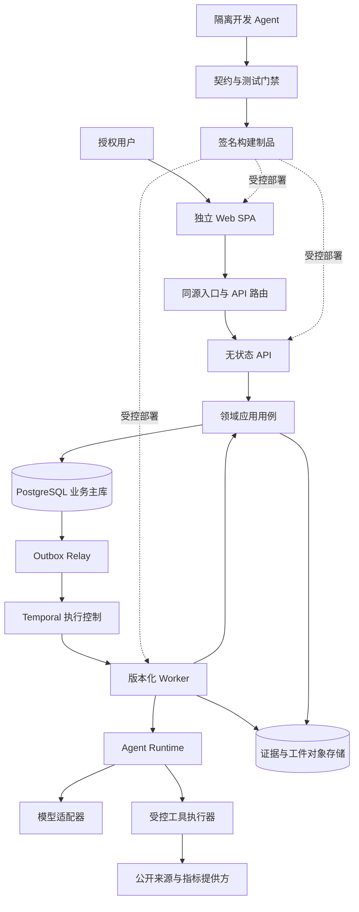

# RiskHot 系统架构设计 · 基础与决策

> **历史归档 · 2026-10-24**：按用户要求移入aihot。本页保留旧设计供追溯，不作为当前L0规范；当前入口见[系统总体技术架构](../../../docs/system-design/04-%E7%B3%BB%E7%BB%9F%E6%9E%B6%E6%9E%84%E8%AE%BE%E8%AE%A1/01-%E7%B3%BB%E7%BB%9F%E6%80%BB%E4%BD%93%E6%8A%80%E6%9C%AF%E6%9E%B6%E6%9E%84%E8%AE%BE%E8%AE%A1.md)。独有内容是否迁入新体系仍需逐项评审。

> 总览索引：[[RiskHot_系统架构设计_V1.0]]
> 覆盖章节：1. 设计依据与决策口径 · 2. 架构目标与质量约束 · 3. 总体架构与运行边界 · 4. 2026 技术基线

## 1. 设计依据与决策口径

### 1.1 业务输入

本设计以当前工作区的以下文件为依据，旧 AIHOT 讨论不覆盖现行 RiskHot 领域模型：

| 编号 | 输入 | 本设计继承的重点 |
| --- | --- | --- |
| B0 | [[tools/RiskHot/02-业务架构与领域设计/RiskHot_L0_信息处理层_业务架构与领域设计V1.0\|L0 信息处理层]] | 原文版本、事件身份、事件—对象—变量三元关系、增量与金融意义 M |
| B1 | [[tools/RiskHot/02-业务架构与领域设计/RiskHot_L1_风险识别与纳管层_业务架构与领域设计\|L1 风险识别与纳管层]] | 完整风险候选、风险同一性、稳定纳管身份、长期变量配置、八字段事件关联 |
| B2 | [[tools/RiskHot/02-业务架构与领域设计/RiskHot_L2_Risk_Situation_Analysis_V1.0\|L2 风险态势分析层]] | 四维当前状态、来源与缓冲、实际损害、附属变化分析与减弱节点 |
| B3 | [[tools/RiskHot/02-业务架构与领域设计/02-D6 风险产品与发布业务领域设计\|风险产品与发布领域]] | 目录、最新、严重度、详情及日周月报 |
| BR | [[tools/RiskHot/03-业务功能需求/01. RiskHot_系统业务功能需求规格说明书_V1.0\|系统业务功能需求规格说明书 V1.0]] | 51 项功能、157 条验收条件、32 个端到端用例、12 项非功能要求、D-01—D-12 |

本文件是 `tools/RiskHot` 的项目工件，不新增正式 Wiki 知识页。所有拟建源码目录、HTTP 路径、数据技术表和脚本均是**本次设计**，并非声称仓库已存在对应实现。

### 1.2 约束等级

- **业务继承**：B0—BR 的明确语义。技术选型不得破坏。
- **技术决策**：本文提出的默认实施路线。架构评审通过后作为开发基线；变更以 ADR 记录。
- **验证门槛**：工具链兼容、模型质量、容量和恢复能力必须经过试验，不能以文档代替结果。
- **业务待定**：D-01—D-12 继续有效。架构提供可配置、可表达未知和可人工复核的承载，不自行补齐风险方法阈值。

公开技术事实引用官方来源；“选择该技术”的结论是针对 RiskHot 的设计判断，不代表存在对所有项目都最优的架构。用户提到的 GPT-6、Claude Fable 5.1、COpus 5.5n 作为未来能力档位的例子，不作为已核实可采购的 API 清单。

## 2. 架构目标与质量约束

### 2.1 六项主目标

| 目标 | 架构落实 | 如何判断达成 |
| --- | --- | --- |
| 业务极清晰 | L0、L1、L2、发布各自拥有事实，平台能力不反向定义风险 | 模块导入与数据库写入规则自动检查，无环依赖 |
| 前后端完全分离 | 静态 SPA、独立 API 和独立 Worker 制品，唯一共享业务接口为版本化契约 | 前端仅使用 mock 就能开发；独立发布且不读数据库或模型密钥 |
| Agent 可并行开发 | 任务包、独占写入路径、契约摘要、隔离环境、组合验收 | 两个独立模块可同时开发，合并后通过同一组 E2E |
| 分析可信且可追溯 | 输入包固定、引用版本固定、判断与事实分离 | 从发布结论追到当时证据和审批记录 |
| 长任务可恢复 | Temporal、业务幂等、Outbox/Inbox、取消与恢复规则 | 任一阶段杀进程后不重复纳管、不重复发布 |
| 能吸收模型进步 | 自有能力接口、模型适配器、评测与灰度、可调整内部推理图 | 换供应商不改领域类型，升级质量可量化、可回退 |

### 2.2 不变量

1. 正式业务身份由程序分配，LLM 输出的 ID 必须按权限与类型校验，不能直接信任。
2. 未知、缺失、不可比、业务无结果、技术失败分别编码；不折算成零、低风险或稳定。
3. 原文、已审核定义、正式快照和已发布报告不可无痕覆盖；修订形成新版本与关系。
4. 证据可用时间不得晚于分析截止时间；追溯重算显式标记事后取得。
5. 跟踪状态、M、风险严重度、趋势是四种概念，不互相替代。
6. 审批与正式写入经过应用用例和授权策略；模型升级不绕过此路径。
7. API、任务、页面和导出遵循相同数据权限与撤回状态。
8. 允许模块内实现变化；跨模块语义必须通过契约变更。

### 2.3 首版容量基线

继承 BR 的参考验收规模：10 万资料版本、1 万事件、1000 个风险、10 万快照、100 万变量明细、20 个并发读者。列表 P95≤2 秒、详情≤3 秒、长任务受理≤2 秒、状态变化≤10 秒可见。它们是待测试目标，不是测得能力。AI 推理时延单独衡量，不混入纯查询接口。

## 3. 总体架构与运行边界

### 3.1 三个清晰的责任面

- **业务应用面**：前端、API、领域模块和查询模型，决定用户能做什么以及结果何时成为正式业务事实。
- **研究执行面**：工作流、Agent 运行时、数据适配器、受控工具，负责把研究任务可靠执行完。
- **开发协作面**：开发 Agent、隔离工作区、CI、评测、合并与部署，负责生产可验证的软件。其身份与生产业务 Agent 分开。

图中的 `CORE` 是可被 API 和 Worker 装配调用的同一套领域应用包，不是必须经网络访问的第二层微服务。应用包由 API 进程或 Worker Activity 执行，均通过同一权限和业务命令入口；领域代码不依赖 Temporal、HTTP 或具体模型 SDK。

### 3.2 首版部署单元

| 制品或服务 | 独立伸缩与发布 | 责任 |
| --- | --- | --- |
| `web` | 是 | 静态资源与浏览器交互 |
| `api` | 是 | 认证、命令受理、查询、下载授权、任务状态流 |
| `worker` | 是；按队列形成多个实例组 | 采集、研究、报告的 Activity 与 Workflow |
| `outbox-relay` | 是 | 数据库提交后可靠发起流程、投递事件或更新投影 |
| PostgreSQL | 托管优先 | 业务、版本、审计、幂等和读模型 |
| Temporal | 托管优先；也可独立自托管 | 执行历史、计时、等待、重试、版本路由 |
| 对象存储 | 托管优先 | 大对象、原件、规范化输入包、模型响应和报告 |

领域模块初期共享后端发布制品，不必一领域一微服务。拆服务须有独立扩缩容、权限隔离、发布节奏或团队自治的实证需求；模块契约使后续拆分有路径，但不能声称拆分零成本。

## 4. 2026 技术基线

### 4.1 选型表

版本在 2026-10-10 核验，安装时锁定通过兼容矩阵的具体补丁，不使用浮动 `latest` 或生产 nightly。表中数字描述核验时状态，不代替实施当天再次核验。

| 层次 | 首选方案 | 选择理由与约束 |
| --- | --- | --- |
| 语言 | TypeScript 7.x；必要工具兼容使用 TS6 API 包 | 统一前后端与 Worker 类型表达，加快反馈；官方 7.0 已发布，但 7.0 不提供程序化编译器 API，ESLint、生成器及 Temporal 构建工具必须验证。[官方说明](https://devblogs.microsoft.com/typescript/announcing-typescript-7-0/) |
| 服务端运行时 | Node.js 24 LTS | 生产选 LTS。核验时 Node 26 为 Current，不能写成 LTS。[发布周期](https://nodejs.org/en/about/previous-releases) |
| 前端 | React 19.3 + Vite 8.1 | 独立 SPA；Vite 的实验 bundled dev mode、chunk import map 不作为默认生产依赖。[React 版本](https://react.dev/versions)、[Vite 8.1](https://vite.dev/blog/announcing-vite8-1) |
| 路由与远端状态 | TanStack Router + TanStack Query | URL 表达筛选与定位，查询缓存管理远端状态；具体版本进入兼容试验。[Router 文档](https://tanstack.com/router/latest/docs/overview) |
| API | Fastify 5.x | 小型组合根、插件式适配器、显式验证；不允许外部输入注册可执行 Schema。[验证与序列化](https://fastify.dev/docs/latest/Reference/Validation-and-Serialization/) |
| 契约 | JSON Schema 2020-12 + OpenAPI 3.1.2 | Schema 是 DTO 类型源；3.1.2 与 2020-12 对齐。虽有 3.2 系列，首版优先验证过的生成链，升级另评审。[OAS 3.1.2](https://spec.openapis.org/oas/v3.1.2.html)、[版本目录](https://spec.openapis.org/oas/) |
| 校验 | Ajv 2020 专用实例与显式响应校验 | 不把 Fastify 默认 Draft-7 配置当成自动支持 2020-12；编译器、响应路径及工具 Schema 转换须通过 PoC。[Ajv 说明](https://ajv.js.org/json-schema.html) |
| 数据 | PostgreSQL 18.x + SQL 迁移 + Kysely | 事务、一致性、清晰 SQL 与类型查询；核验时 18.6 为该系列当前小版本，19 仍开发中。[PG 版本](https://www.postgresql.org/support/versioning/)、[Kysely](https://kysely.dev/docs/intro) |
| 持久执行 | Temporal TypeScript SDK | 执行与恢复独立于模型厂商；默认 Pinned 版本，支持安全发布。[Worker Versioning](https://docs.temporal.io/worker-versioning) |
| 大对象 | 支持版本、校验和与加密的对象存储 | 内容与元数据分离；具体供应商由部署地域和权限要求确定 |
| 检索 | PostgreSQL 过滤与文本检索；按需 pgvector | 先正确过滤和时间切片，再增强语义召回。向量不是事实或身份裁决器。[pgvector](https://github.com/pgvector/pgvector) |
| 工程 | pnpm workspace + Nx 模块边界与任务图 | 一个仓库内保持独立包；可缓存确定性构建与测试，禁止缓存真实模型质量结果。[pnpm](https://pnpm.io/workspaces)、[Nx 边界](https://nx.dev/docs/features/enforce-module-boundaries) |
| 运维观测 | OpenTelemetry、结构化日志、运行指标 | 内部可观测性；生产默认关闭向外部发送正文或用户行为数据。GenAI 语义约定单独锁版本，不绑定领域模型。[语义约定](https://opentelemetry.io/docs/concepts/semantic-conventions/)、[GenAI 仓库](https://github.com/open-telemetry/semantic-conventions-genai) |
| 测试 | 单元测试运行器、Playwright 浏览器测试、真实 PG/Temporal 集成环境 | 具体包版本在阶段 0 固定；契约、时点、幂等、恢复优先于单纯覆盖率 |

### 4.2 必做的工具链验证

阶段 0 创建最小切片验证：React 构建 → 生成 SDK 调 API → Ajv2020 请求/响应验证 → PostgreSQL 事务 → Temporal Activity → 返回任务状态。TypeScript 7 类型检查、ESLint/Nx、Kysely 类型生成、Temporal Workflow 打包与测试、OpenAPI 生成器分别验证。

若依赖仍要求旧编译器 API，按官方兼容方式隔离 TS6 API 工具，TS7 作为类型检查基准；不在正文伪造一个已经验证的依赖组合。若组合不能稳定工作，ADR 记录临时锁定 TS6 的原因、影响和解除条件，业务契约不受影响。服务器 Schema 采用一套规范：请求由 Ajv2020 编译，响应通过同一 DTO 校验后使用经测试的序列化路径，禁止不兼容关键字被默认 serializer 静默忽略。

### 4.3 按需求引入的能力

首版不用 Kafka/NATS、Redis 任务队列、独立向量库、图数据库、Kubernetes 和第二套持久 Agent checkpoint。增加它们的触发条件见第18章。MCP、A2A 是可选边界适配器；不把每个内部函数都协议化。Python 仅在确有不可替代数据或计算依赖时，通过类型化端口接入，避免默认维护两套核心领域实现。
