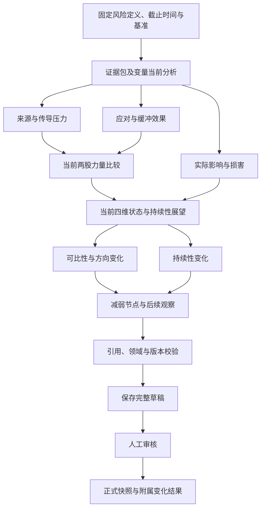

# RiskHot 系统架构设计 · 分层架构

> **历史归档 · 2026-10-24**：按用户要求移入aihot。本页保留旧设计供追溯，不作为当前L0规范；当前入口见[系统总体技术架构](../../../docs/system-design/04-%E7%B3%BB%E7%BB%9F%E6%9E%B6%E6%9E%84%E8%AE%BE%E8%AE%A1/01-%E7%B3%BB%E7%BB%9F%E6%80%BB%E4%BD%93%E6%8A%80%E6%9C%AF%E6%9E%B6%E6%9E%84%E8%AE%BE%E8%AE%A1.md)。独有内容是否迁入新体系仍需逐项评审。

> 总览索引：[[RiskHot_系统架构设计_V1.0]]
> 覆盖章节：11. L0 与 L1 实现架构 · 12. L2 分析架构 · 13. 风险产品与报告发布

## 11. L0 与 L1 实现架构

### 11.1 L0 信息到事件

L0Workflow 按读取 reference 的有效信源并校验接入资格 → 来源抓取/补录 → 原文版本化 → 清洗 → 抽取候选 → 归组建议 → 三元关系校验 → 增量分类 → M 评价 → 复核/保存 → 可靠交付组织。独立资料可以并行，属于同一事件的正式增量写入按聚合版本串行检查。

| 步骤 | 程序责任 | Agent 责任 | 异常与恢复 |
| --- | --- | --- | --- |
| 接入 | 读取 reference 的来源身份、版本和启停状态，检查技术就绪、访问许可、超时、内容哈希、首次取得时间；在途提交再次检查业务资格 | 无需模型做网络调度 | 暂停后响应只留作待检查资料，不继续分析；抓取失败不修改准入；人工补录走同一版本规则 |
| 原文清洗 | 保留原件，输出清洗映射，不执行正文脚本 | 复杂版式可辅助定位 | 无法定位的引文不可作确定性证据 |
| 抽取 | 候选 Schema 和定位验证 | 提取事件事实、时态与参与对象 | 无事件是业务无结果；解析失败是技术失败 |
| 归组 | 候选召回、已知 ID 检查、影响预览 | 判断是否同一事件及理由 | 冲突转复核；D-07 未定关闭自动合并/拆分 |
| 关系 | 校验 Event、Target、Variable 与版本 | 提议直接作用变量和作用解释 | 不能创建 Target 固定 Variable 清单 |
| 增量 | 保留 EventUpdate 身份与前后差异 | 提议增量类别 | NEW_EVENT、EVENT_PROGRESS、MATERIAL_ADDITION、CORRECTION、SOURCE_ADDITION、DUPLICATE、UNRESOLVED 分开 |
| M | 校验规则版本、范围、期限与重复评价 | 提供评分依据与候选值 | D-01 未定则 M 为空，不算假总分，不添加 C/P |
| 保存/交付 | 领域事务、审计、Outbox | 无正式写库权限 | 保存成功后交付失败只补交付，不重新抽取 |

L0 允许 economy、macro_institution、financial_system、financial_market、economic_sector 五类 Target。采集到的计划事件可以进入事实表示，但计划公布不等于未来事项已发生。CORRECTION 形成新版本并标明被纠正关系，不能修改过去报告的原文引用。

### 11.2 L1 先完整定义，再匹配

L1Workflow 以固定 Event/EventUpdate 与配置版本构造上下文，先一次形成完整 RiskIdentificationResult，再查询同一性候选，给出复用、新建、待复核或无风险结论。不得让模型先挑现有 risk_id 后反向凑定义，避免已有目录限制新风险识别。

候选继承 B1 的 12 字段和 key_variables 的 5 字段；不向候选塞正式 risk_id。损害对象 `damage_targets` 与观察对象独立，可以空并说明不确定。观察对象首版只允许经济体、宏观主体、市场、金融系统，不能因为 L0 有 economic_sector 就自动允许微观纳管。

同一性三项核心是风险定义、观察对象和范围边界；风险源、名称、变量等是辅助。结构化过滤和向量相似只召回，不决定同一性。审批用例重查正式库，必要时对观察对象/范围候选组加短事务锁并再次比较，防止两个并行候选被重复批准。

### 11.3 纳管与长期配置

纳管应用用例验证对象范围、已确认变量映射和最小可执行观察门槛，程序分配 risk_id，保存定义版本、长期变量机制及关联关系，写审计与交付事件。自动模式须通过 D-05/D-12；默认人工审核。最少一个可执行变量是工程可运行门槛建议，不等于足够判断全部风险。

变量角色固定为 `risk_driver/risk_transmission/risk_buffer/damage_verification`；长期机制放 L1，当前值及风险作用放 L2。修改长期机制创建新版本，既有快照引用旧版本。跟踪状态 observing/monitoring/paused/closed 与风险等级分离；恢复 closed 沿用 risk_id 和原 admitted_at，并记录恢复操作。

L2 的配置补充建议成为 L1 待办/维护申请。未经审核的建议不能自动改变下一轮正式输入；任务详情清楚显示使用了哪一版定义与变量配置。

## 12. L2 分析架构

### 12.1 固定业务节点、可替换推理实现

业务分析图固定输入与输出责任，节点内部可选择单模型、多模型、工具辅助或未来更强单模型。是否需要多个 Agent 是评测结论，不把某套角色扮演 Prompt 固化成领域架构。

来源、缓冲、损害在变量证据包固定后可并行；力量比较必须等待来源和缓冲；当前状态须结合力量和损害；方向与持续性变化可在当前状态形成后并行。不得把依赖步骤为了“并行速度”提前执行。

### 12.2 输入、产物与程序门槛

| 节点 | 固定输入 | 输出 | 程序校验 |
| --- | --- | --- | --- |
| 观察准备 | risk_id、definition_version、cutoff、计划/人工触发、基准 | ExecutionManifest、EvidencePack | 范围、权限、时间、基准归属与规则可比性 |
| 变量分析 | 长期关系与证据版本 | relation_id、observed_state、evidence_content、source_refs、risk_effect、interpretation、uncertainty | relation 属于该风险配置；单位/值/时点合法；无证据表达缺失 |
| 来源/缓冲/损害 | 固定变量分析 | 三组分析工件 | 来源变量、缓冲变量和损害验证角色不互换；证据重复引用不重复计量 |
| 力量比较 | 来源和缓冲工件 | 力量状态及依据 | 宣布措施与实际生效分开；规则未定允许待判断 |
| 当前状态 | 力量、损害、全部限制 | 四维状态和 status_summary | 不生成已取消旧维度；损害不明不能写“无损害” |
| 变化 | 当前草稿、指定基准及各自规则 | trend、persistence_change、change_reason 等附属字段 | 同一风险、严格更早且可比；首次或不可比不能默认稳定 |
| 减弱节点 | 变化、条件证据和历史节点 | 候选/验证/失效说明、next_observation | D-04 未定不写 confirmed；节点条件有引用 |
| 保存/审核 | 完整草稿和版本令牌 | 快照修订与附属结果，同一事务 | 输入版本仍有效，预期版本匹配，审核人有权 |

### 12.3 当前与变化的边界

RiskSnapshot 表达当前状态，RiskAnalysisResult 依附当前快照修订，保存 comparison_snapshot_id、trend、persistence_change、change_reason、weakening_node_status、next_observation 等业务内容。变化结果不能离开当前快照单独成为“最新风险”。

首次无历史、历史不兼容属于有效业务情况，可形成“不可判定变化”的完整结果。方向或持续性模块技术失败则保留已算当前草稿并标为部分完成；默认不能批准为新的完整正式分析，上一个有效版本继续服务。后续恢复从成功工件继续，不丢弃原证据包。

同等级内部可以减弱，时间流逝不自动缩短持续性，措施公告不等于压力缓解。规则比较不足时保留定性差异与不可比原因，不让模型强行生成排名或确定趋势。

### 12.4 并发与成本

每个 run 有总 Token、调用数、工具次数、并行数和墙钟预算。先按独立变量及三组分析并行，供应商限流由共享配额控制；重试也计入预算。并行策略记录在 ExecutionManifest。缓存只复用输入哈希、配置、模型版本、工具版本和权限范围全部一致的工件；正式新观察必须有新运行与清楚的复用记录。

不保存隐藏思维链。保存可供审核的结构化理由、引用、工具调用、输入/输出工件与验证结论即可支撑追溯；“模型内部想了什么”不作为业务审计要求。

## 13. 风险产品与报告发布

### 13.1 查询模型

publication 消费批准/撤回/修订事件生成目录投影，每条投影保存 risk_id、definition_version、snapshot_revision、rule_version、截止时间及投影水位。投影可以异步，但关键读取用主库状态检查有效性；异常时显式显示刷新中或回源，不展示已撤回结果。

| 产品 | 选择与排序规则 | 必须避免 |
| --- | --- | --- |
| 最新风险 | 每风险取 snapshot_time 最新的可消费快照；同一时点取已批准的有效修订 | 按 created_at 把补算旧日结果排成今天最新 |
| 今日新增 | 按首次 admitted_at 的业务日区间 | 恢复旧风险被算为新纳管；无快照风险被错误丢弃 |
| 最严重风险 | 先为各风险选最新有效快照，再按可比规则等级排序 | 为凑高风险榜倒找该风险旧的最高等级 |
| 完整目录 | 身份、类型、对象、跟踪与展示市场分开筛选 | 未分类被猜成市场；paused 自动等于低风险 |
| 详情/Timeline | 定义、快照、变化、事件与审批各有版本和时间类型 | 时间线混淆事件发生、观察截止与审批发生 |

相同 cutoff 的多次正式修订须有明确 supersedes 关系与当前有效指针；不得只凭 created_at 任意选择。若最新正式结果被撤回，可回退到明确仍有效的更早批准版本，并显示回退/陈旧状态；若无有效版本，显示无可用结果。规则版本不可比、等级为空和陈旧项单列。

### 13.2 报告流水线

ReportWorkflow 固定周期、时区、纳入规则与快照清单 → 生成内容 → 校验引用/数字/状态 → 保存草稿 → 人工审核 → 发布。周月报直接引用该周期的快照与变化，不把日报文字多次摘要当新证据。

每条 ReportItemReference 固定风险定义、快照修订、附属变化结果和段落来源。正文编辑必须触发引用与一致性重验；不得由模型改变来源快照的等级或趋势。空期可以生成清楚标示“无新增/证据不足”的草稿；不得因模板要求补造风险。

导出根据已批准的固定 ReportVersion 生成，Artifact 记录版本与哈希。渲染失败只重试导出，不重新研究或创建新报告版本。日周月计划默认仅生成草稿，正式发布仍经批准。

### 13.3 撤回与缓存

正式读入口统一经 API 授权；报告正文与导出文件不放公共 CDN，不给长期直达对象 URL。下载经应用代理或等效的每次访问鉴权网关，在主库校验发布状态；短期签名 URL 若无法即时吊销，不用于需要严格撤回的正文/导出入口。

撤回事务写入状态、撤回原因、审计与失效事件。返回撤回成功前，API 的所有正文/导出路径必须已基于该权威状态拒绝新访问。列表缓存只返回安全元数据或回查状态；失效广播用于刷新界面，不能作为唯一保障。任何支持的入口仍可读则返回“撤回处理中/失败”，不能伪报成功。

审核通过但尚未发布的报告正文也不得被匿名对象路径访问。已下载到用户本地的副本无法远程召回，导出带版本与状态核验入口。已开始的数据传输和用户已看到的内容不能追溯抹除；服务器取消后续未完成的导出交付，并记录竞态结果。

快照修订不会改写既有报告；发现实质错误时列出受影响报告并触发复核，按规则撤回或发布修订。审批页面显示影响面和依据，不自动静默替换引用。
