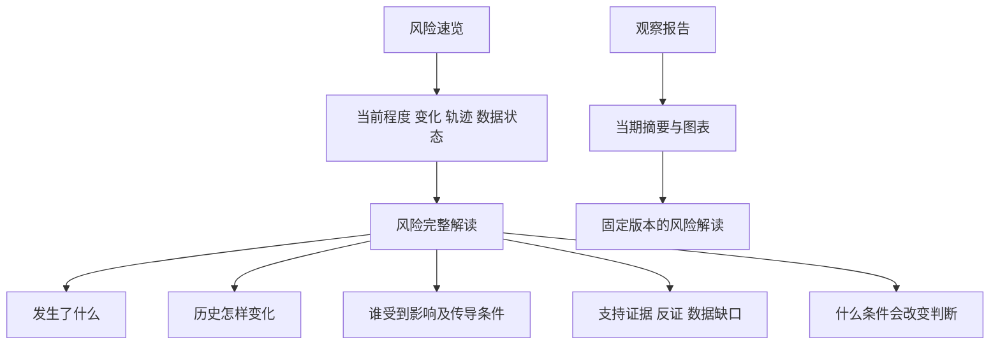

# 趋势动物产品报告与 RiskHot 设计借鉴

原报告页面：[趋势动物产品报告与 RiskHot 设计借鉴](https://chatgpt.com/space/page_cc4a0a6e9588819180933d0342d82970)

研究日期：2026年10月17日。用途：为 RiskHot 的功能组织、量化信号和数据呈现提供产品设计参考。

**核心判断：趋势动物最值得借鉴的是把大量数据组织成可扫描、可比较、可下钻的观察路径。RiskHot 应吸收这种信息效率，并把证据、反证、时点和判断条件保留在同一条路径上。**

本报告以公开访谈和六张已查看的产品及说明截图为依据，重点界面样本日期为2025年8月5日和2026年8月17日。未进入小程序实测，因此搜索、排序、收藏等只确认界面入口，不能据此判断实际交互表现；最新菜单、完整权限、价格和计算公式不属于已核实范围。RiskHot 对照基准为2026年10月16日的量化信号方案，一般阅读者版作为独立方案保留。

## 一 产品定位与用户任务

趋势动物 Pro 由 Nick 主理。早期公开介绍围绕全国、城市、行政区、板块、楼盘五个层级组织楼市观察；此后公开界面扩展到金融资产。它把原本分散、难比较的数据转成行情列表、趋势状态和比较曲线。[早期产品介绍](https://www.xiaoyuzhoufm.com/episode/6577e4cf991e2ee608b39c56)；[金融资产功能介绍](https://www.xiaoyuzhoufm.com/episode/6890c2138e06fe8de74c266b)。

从界面结构推断，其主要用户任务是：

| 用户任务 | 产品提供的观察方式 | 产品价值 |
| --- | --- | --- |
| 从大量对象中缩小范围 | 分类、列表、相对强弱 | 先确定值得深入看的对象 |
| 判断对象最近怎样变化 | 趋势状态、不同时间窗口 | 区分短期变化与较长期表现 |
| 判断表现是否特殊 | 对照城市、全国或同类对象 | 为单个数字提供参照 |
| 持续跟踪同一对象 | 历史曲线、更新时间、收藏入口 | 降低重复查找和记忆成本 |

这是一种“先筛选，再比较，再理解”的使用路径。对 RiskHot 的价值在于减少用户从长篇解释中自行寻找重点的负担。

## 二 可确认的功能地图

| 功能 | 已有证据 | 评价与边界 |
| --- | --- | --- |
| 楼市分层观察 | 早期介绍明确五层结构 | 适合由大范围逐步缩小对象；不能据此断言各层级当前覆盖完整 |
| 金融资产总览 | 2025年截图列出大类资产，并有品种、价格、YTD涨幅、强度等字段 | 同屏提供横向比较；资产集合的构造方法需另查 |
| 搜索与排序入口 | 搜索提示涉及大类、行业、个股、品种；多个表头带排序符号 | 已确认控件呈现，未验证匹配规则、排序稳定性和响应速度 |
| 趋势温度 | 早期说明采用冻、寒、凉、平、温、热、沸七档 | 用熟悉语言描述状态；七档规则和当前阈值未核实 |
| 趋势相对强度 | 早期说明将其定义为0—100的相对位次 | 表达相对领先或抗跌，不代表盈利概率 |
| 多周期变化 | 2026年单对象图同时列出近周、近月、近年及年初以来变化 | 减少反复切换窗口；必须标明各窗口边界 |
| 基准和分组比较 | 同对象对比上海、按面积段比较、全国城市比较 | 能揭示总量下的分化，是最值得借鉴的能力 |
| 收藏及传播入口 | 金融资产截图有收藏、已收藏、赚佣金入口 | 表明存在留存和传播设计，具体流程与规则未验证 |
| 注意力趋势 | 2026年9月录制访谈讨论注意力的扩张和收缩 | 仅确认讨论方向；不能当作已实测的完整模块 |

证据：[金融资产列表原图](https://image.xyzcdn.net/FnhuJfGPi-3P46RiockPV48Q8azO.png)、[温度说明原图](https://image.xyzcdn.net/Fppz556_bqXtpT2bUmugmPq-8itC.jpg)、[相对强度说明原图](https://image.xyzcdn.net/FhNwtva8j-OF2-1aYmR1BJTjfgbB.jpg)、[注意力趋势相关访谈](https://www.xiaoyuzhoufm.com/episode/6acb9dd0e742e36efcc15a45)。

会员体系方面，主理人的公开知识星球介绍曾将城市会员列为权益。此证据只说明产品曾有分层服务安排，不足以确定当前小程序定价、免费额度或商业收入。[公开会员介绍](https://wx.zsxq.com/group/88858525882142)。

## 三 四类界面的数据呈现分析

### 金融资产列表

[查看原图，截图日期2025年8月5日](https://image.xyzcdn.net/FnhuJfGPi-3P46RiockPV48Q8azO.png)。

界面采用紧凑行表：左侧温度，随后是品种、价格、年初以来涨幅、强度和收藏。辅助行放右侧天数、成交额、更新时间等；当前排序列以颜色提示。强度以深浅色块突出，部分行附方向箭头。

**设计作用：** 固定列位置让用户沿同一列连续比较，状态词帮助先筛选，数字提供精度。这种结构适合高频扫描，信息密度来自真实字段。

**可见问题：** 单行内同时出现状态、天数、价格、涨幅、成交额、分数和箭头，初次用户必须学习各字段含义。箭头所对应的窗口在这张截图中不够明确。“价格 CNY”和各类资产聚合值也需要解释，不能仅因单位相同就认为可直接比较。

**对 RiskHot：** 保留横向对齐的紧凑行，优先显示“风险名称、当前程度、较上次变化、短期轨迹、数据状态”；把解释放进联动详情。首屏不要堆入后台任务、来源数量、模型参数等字段。

### 单对象摘要与基准曲线

[查看原图，截图日期2026年8月17日](https://image.xyzcdn.net/Fkcmlq54KHz7vrOXhJjA_uikI0Sw.jpg)。

这张上海老破小组合图把对象范围、日期、价格、租金收益率、多周期变化、温度和相对强度放在曲线上方，下方对比该组合与上海基准。摘要承担快速读取，曲线解释变化路径。

同一画面中，“趋势相对强度96”和“近一年变动−4.3%”同时存在，直观说明**相对强并不等于绝对上涨**。这些数字是历史截图示例，不是当前行情。

**可见问题：** 图下方的区间说明、柱形和曲线区域发生重叠；右侧部分标签在发布图片中被裁切。图片脱离原交互后，阅读质量会下降。

**对 RiskHot：** 用“当前程度＋本期变化＋历史轨迹＋关键解释”构成同一摘要。高风险正在缓解、较低风险正在增强，都必须能够正常表达。导出报告时，注释应放到图外，图表不能依赖悬停才能读懂。

### 按特征分组的比较图

[查看上海面积段原图，截图日期2026年8月17日](https://image.xyzcdn.net/FiJyvpex6-k95MRrdl7Vc1lm4AGg.jpg)。

图中从共同起点比较不同面积段与上海整体，使用多色折线和末端标签。它回答的是“同一城市内部，哪些群体走势不同”。

**设计作用：** 共同基点消除了绝对价格差异，让相对表现更直观；整体基准帮助识别局部背离。

**可见问题：** 七条线在部分时间段交叉，若干颜色接近，图例与末端文字都较密。读者需要在颜色、名称和曲线之间来回对应。

**对 RiskHot：** 适合比较同一风险在不同地区、行业或主体中的差异。默认突出一个对象及一个基准，其余对象按需添加；复杂场景改成同尺度的小图并排。不同量纲的原始指标不能直接叠在同一坐标轴上。

### 全国城市比较图

[查看原图，截图日期2026年8月17日](https://image.xyzcdn.net/FkSVuYW7ZjfLmzUvRtt_Ah-OAAqR.png)。

图中以共同基点显示近半年城市变化，全国曲线用黑色强调。它让用户同时看到整体方向和例外对象，避免由一个热点城市代替全国判断。

**对 RiskHot：** 可将总体观察与局部异常并列。例如在信用风险下呈现不同主体的压力差异，但聚合口径、样本覆盖和权重需要说明。局部缓解不能自动推导整体解除，整体稳定也不能掩盖局部恶化。

以上分析采用 Impeccable 的信息层级、认知负担、比较效率和语义清晰原则。静态图片不足以评价真实触控体验、键盘操作、加载速度和无障碍实现。

## 四 数据解释与可信度

### 原始观测和模型加工应分开

2026年8月的访谈节目文案将楼市指标描述为基于盘口边际变化、加权形成小区粒度的周度涨跌幅指数。此处属于主理人访谈的节目文案转述，尚未取得可复算的数据与公式。[访谈说明](https://podfollow.com/podcast-1686711660/episode/50a98d469e2fb652b83b2b89263110908264fcad/view)。

因此，“最新价格”“趋势指数”“相对强度”需要分别理解。它们可能涉及不同数据来源和加工步骤，页面呈现得精确，不代表每个数都是真实成交价或可执行报价。

RiskHot 应为每个重要数字提供简明说明：它衡量什么、单位是什么、使用何种样本、何时可用、与什么比较、何时更新、方法是否变过。首层提供短说明，详细口径在原位展开。

### 状态和排名是两个维度

趋势动物的温度用于描述对象自身所处状态，相对强度用于表达在一组对象中的位置。[温度说明](https://image.xyzcdn.net/Fppz556_bqXtpT2bUmugmPq-8itC.jpg)；[相对强度说明](https://image.xyzcdn.net/FhNwtva8j-OF2-1aYmR1BJTjfgbB.jpg)。

RiskHot 至少要分清四件事：

| 维度 | 用户的问题 | 推荐表达 |
| --- | --- | --- |
| 当前程度 | 现在有多严重 | 高、较高等已批准等级，或经验证的强度值 |
| 历史变化 | 比之前怎样 | 增强、缓解、持平及明确比较窗口 |
| 同组位置 | 在可比对象中处于哪里 | 仅在比较集合和方法成立时展示位次 |
| 数据可用性 | 这个判断是否仍有效 | 有效、首次、过期、缺失、不可比 |

尤其不能把“排名靠后”解释为安全，也不能把“高分”自动解释为高发生概率。风险分数、发生概率、模型置信度需要不同定义。

### 变化幅度与加速需要不同证据

本期减上期是变化量；要表达加速，还需要比较相邻窗口的变化速度，并处理窗口长度和频率差异。RiskHot 当前方案已明确不把日差值称为加速度，应继续保留这一约束。

还应区分观测发生时间、数据首次可用时间、判断截止时间与发布时间。历史报告只能引用当时可用且已固定的结果，不能随最新模型或新证据悄然改写。

## 五 与 RiskHot 当前方案的对照

RiskHot 的量化方案已把“风险排序和变化”作为入口，并保留排行与解读联动、历史趋势、反证、影响条件和固定报告快照。其0—100分、阈值和内容仍是合成演示，正式公式、权重及跨类别可比性尚未确定。这里应在已有基础上细化，不需要重做全部信息架构。

| 议题 | 趋势动物的可见做法 | RiskHot 已有基础 | 本报告建议 |
| --- | --- | --- | --- |
| 快速扫描 | 紧凑行情表、排序入口 | 风险排序与变化排序 | 精简首层字段，加入清晰的短期轨迹和数据状态 |
| 理解状态 | 温度词与相对强度并列 | 当前程度与历史方向分开 | 保留独立维度，用普通语言解释状态转换 |
| 横向比较 | 城市、面积段、同类资产对照 | 跨类别风险分值演示 | 优先做同一风险内的主体比较 |
| 纵向观察 | 多周期变化与曲线 | 历史趋势和轮次 | 显示实际观测点、比较基准、方法变更与数据缺口 |
| 理解原因 | 截图主要交付趋势事实 | 核心驱动、影响、反证 | 将解释与曲线关联，成为 RiskHot 的主要差异 |
| 使用负担 | 搜索、收藏、会员等入口 | 两入口，无个性化配置 | 保留风险速览和观察报告，不新增关注或订阅 |
| 内容流通 | 带日期与对象名的图表 | 当期报告与固定引用 | 增强可独立阅读的报告图，保留来源和截止时间 |

依据：RiskHot Knowledge 读取的《量化信号决策辅助产品设计》《量化信号决策辅助产品设计/PRODUCT.md》《量化信号决策辅助产品设计/DESIGN.md》，均更新于2026年10月16日。一般阅读者版《RiskHot_产品理念与页面设计》同日明确两入口和无配置负担；它与量化版属于不同方案，不能混称为同一已上线版本。

## 六 建议借鉴的产品设计

### 1 用一个稳定的信息单元贯穿列表和详情

建议每项风险沿用相同字段顺序：名称、当前程度、变化、轨迹、数据状态。用户在列表中认识这些字段，进入详情后不需要重新学习。

桌面保留左侧列表、右侧解释的联动；手机列表优先保留名称、程度和变化，选中后显示轨迹与解释。控制比较密度比把所有桌面列压进手机更重要。

### 2 给趋势线加上可核验的变化解释

RiskHot 的趋势图应能回答“哪一轮判断发生变化，是什么证据改变了判断”。关键节点可附观察日期、当期摘要和证据入口。

应清楚区分原始指标曲线与研究判断历史。离散的观察轮次采用观测点或阶梯表达，不用平滑曲线暗示每天都有数据。数据缺失处断开，方法变更处标注，不拼成一条看似连续可比的历史。

### 3 先建立可比较的范围，再提供排名

趋势动物提示了参照系的重要性。RiskHot 应先支持“同一风险、同一窗口、同一方法下，不同主体的比较”。跨类别的0—100分只有在归一化和验证完成后，才适合作为统一排序依据。

方法未完成时，首页可以按已批准的风险等级分组，并展示变化和编辑选择理由。若需要综合优先级，应单独定义其规则，避免把界面排列当作客观风险模型。

### 4 让状态变化可以用一句话复述

建议主文案采用“压力仍高，本周有所缓解”“压力上升，影响仍待确认”等组合句。每句都同时保留当前状态与变化，避免一个颜色或箭头承担全部语义。

温度隐喻可降低初次理解成本，但 RiskHot 适合沿用风险领域的直白词语。七档温度不应直接变成七档风险，更不应同时承担严重程度、方向和置信度。

### 5 将整体和局部分化放在同一阅读路径

在风险详情中展示“总体判断”后，再给出最有解释力的主体差异。比如总体压力持平但部分地区增强，应该明确写出覆盖范围及反例。

若未来增加“增强对象占比”，必须同时给出分子、分母、有效样本数量和未知数量。这个比例表达扩散范围，不能自动等同于损害程度。

### 6 让观察报告保留图表语境

每张报告图至少包括对象范围、指标名称、单位、时间窗口、基准和截止时间。图外用一句话说明读图重点，图下放来源、口径与适用限制。

沿用 RiskHot 已有固定快照。打开旧报告时，图表、文字和证据均应对应当期版本；返回后恢复原阅读位置。

## 七 建议的信息结构

以下是对现有两入口的内容细化，不新增一级功能。

**展示示例，以下内容为虚构文案，不是市场判断：**

“融资压力｜当前程度较高｜较上周缓解｜数据有效”

“资金价格有所回落，但融资期限仍偏短。接下来需要核查较长期限资金是否恢复；若短期资金价格再次持续上升，当前缓解判断将受到挑战。”

列表负责让用户找到重点；详情负责解释变化依据及适用范围；报告负责把同一判断放回当时的背景。

## 八 实施优先级与验收方式

| 优先级 | 工作项 | 完成条件 |
| --- | --- | --- |
| P0 | 明确评分和比较口径 | 能解释分数含义、单位、范围、阈值及可比集合；未确认处不展示为正式模型 |
| P0 | 统一当前程度与变化表达 | 高位缓解、低位增强、首次、过期、缺失、不可比均有独立状态 |
| P0 | 完善趋势图时间语义 | 实际点、截止时间、基准、缺口、方法变化可识别；历史引用不漂移 |
| P1 | 列表与详情字段一致 | 用户选择一行后，可在同一语境中找到对应趋势、驱动及依据 |
| P1 | 同类对象比较 | 窗口与口径一致；明确基准；复杂图允许聚焦，手机文字不裁切 |
| P1 | 报告图表独立可读 | 导出后仍能读懂对象、单位、窗口和结论；图注不遮挡数据 |
| P2 | 扩散范围与状态分布 | 分母、覆盖率和未知项可查；不把数量占比包装成风险概率 |
| P2 | 状态语言的理解测试 | 用户能区分高风险与风险增强，相对位次与绝对程度 |

建议先用5—8名目标用户进行小规模任务测试，人数是研究建议，不代表统计验证。任务包括：找到正在增强的风险；解释“高位但缓解”；指出比较基准；找到一条反证；辨认过期数据；打开旧报告说明其截止时间。

记录完成时间、误读位置和错误类型，先建立基线，再决定目标。不要用页面点击率替代理解效果，也不要用虚构原型的表现证明正式模型有效。

## 九 不宜直接照搬的部分

- **温度或节气体系。** 熟悉的比喻有传播力，但风险阶段不一定按固定周期往复。若保留隐喻，需要同时给出明确的业务含义。

- **跨对象统一分数。** 排名、严重程度和发生概率有不同含义。统一外观不能替代统一测量方法。

- **大量彩色曲线。** 公开图中的分化信息有价值，但线条和标签过密会增加识别成本；RiskHot 应控制默认显示对象数量。

- **用状态直接给交易动作。** 趋势动物早期说明包含面向交易者的状态解释；RiskHot 当前方案交付核查优先级和判断条件，产品职责不同。

- **收藏和会员流程。** 它们可能适合趋势动物的留存与商业模式，但 RiskHot 已明确无个人关注、订阅和参数配置，不应为了对标重新加入。

- **只显示支持判断的内容。** 趋势图适合快速扫描，风险研究还需要反证、覆盖盲区和适用限制。这些应成为可展开的核心内容。

最值得先落地的组合是：**紧凑风险列表、明确的状态与变化、带参照的历史图，以及同屏可达的解释和证据。**

## 十 资料索引与核实范围

### 趋势动物公开资料

1. [面基 E37 产品早期介绍](https://www.xiaoyuzhoufm.com/episode/6577e4cf991e2ee608b39c56)：用于核实楼市层级与早期指标结构；评论区观点未作为正式方法依据。

2. [温度说明图](https://image.xyzcdn.net/Fppz556_bqXtpT2bUmugmPq-8itC.jpg)与[相对强度说明图](https://image.xyzcdn.net/FhNwtva8j-OF2-1aYmR1BJTjfgbB.jpg)：来自上述节目公开配图，已视觉查看；属于早期说明。

3. [面基 E118](https://www.xiaoyuzhoufm.com/episode/6890c2138e06fe8de74c266b)及[金融资产截图](https://image.xyzcdn.net/FnhuJfGPi-3P46RiockPV48Q8azO.png)：截图自身日期为2025年8月5日。

4. [截胡不截财 EP155](https://podfollow.com/podcast-1686711660/episode/50a98d469e2fb652b83b2b89263110908264fcad/view)：页面发布日期为2026年8月19日；节目文案用于说明数据方法的公开表述。

5. [单组合与基准图](https://image.xyzcdn.net/Fkcmlq54KHz7vrOXhJjA_uikI0Sw.jpg)、[面积段比较图](https://image.xyzcdn.net/FiJyvpex6-k95MRrdl7Vc1lm4AGg.jpg)、[全国城市比较图](https://image.xyzcdn.net/FkSVuYW7ZjfLmzUvRtt_Ah-OAAqR.png)：来自EP155公开配图，均标注2026年8月17日，已视觉查看。

6. [面基 纪律.md 访谈](https://www.xiaoyuzhoufm.com/episode/6acb9dd0e742e36efcc15a45)：页面注明2026年9月录制；用于确认近期讨论的注意力趋势方向。

7. [主理人知识星球公开介绍](https://wx.zsxq.com/group/88858525882142)：搜索可见的会员权益说明；当前订购页未完整读取，未据此报告小程序现价。

### RiskHot 项目依据

以下资料通过 RiskHot Knowledge 读取，位于项目目录 `docs/system-design/06产品UI原型设计/06-5 产品交付页面设计构思/`：

- `量化信号决策辅助产品设计.md`：第7—42行，产品定位、信号含义及业务边界。

- `量化信号决策辅助产品设计/PRODUCT.md`：第7—32行，目标用户、两入口、无配置要求和数据约束。

- `量化信号决策辅助产品设计/DESIGN.md`：第81—160行，数字对齐、色彩语义、响应式与阅读层次。

- `RiskHot_产品理念与页面设计.md`：第10—18、79—118、121—151行，一般阅读者版的定位、时点、证据和固定报告引用。

报告中的建议属于设计提案，未修改 RiskHot 原型、业务规则或同步项目资料。趋势动物的当前覆盖率、采集完整性、算法准确性、付费权限以及端内实际交互，仍需在可访问的小程序版本中进一步核实。

