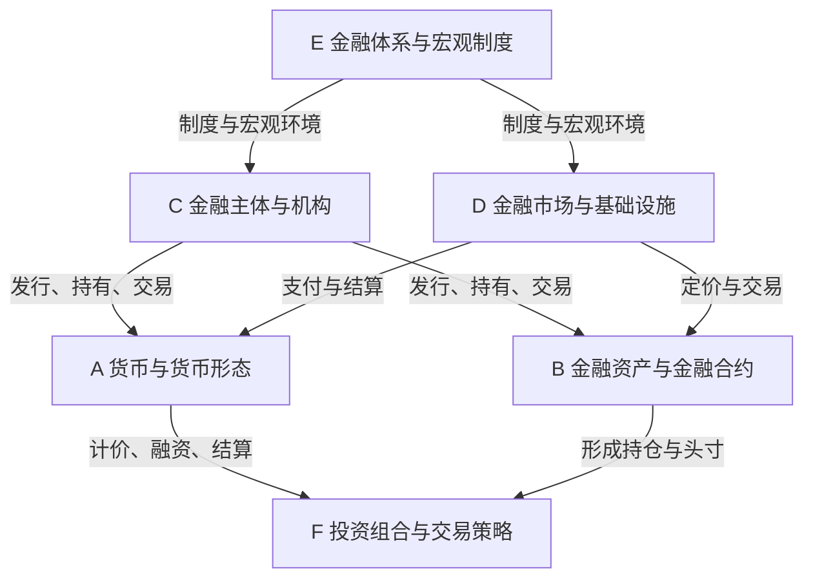

# 金融风险研究对象分类索引 V1.0

> [!abstract] 核心定位
> 本文用于回答：**金融风险研究可以针对哪些对象？各类对象如何组织？**
>
> **研究对象分类**确定分析范围；**金融风险分类**识别潜在损失类型；后续再研究核心驱动变量、传导机制、监测指标与风险评估。

## 1. 分类原则与适用边界

本索引以**研究对象的经济金融属性与研究功能**为组织依据，将常见对象分为六大类：

- **A. 货币与货币形态**：以什么货币计价、支付或结算？
- **B. 金融资产与金融合约**：研究什么金融工具或权利义务？
- **C. 金融主体与机构**：谁发行、持有、融资、交易或承担义务？
- **D. 金融市场与基础设施**：金融交易、融资、定价和结算发生在哪里？
- **E. 金融体系与宏观制度**：金融活动所处的制度与系统环境是什么？
- **F. 投资组合与交易策略**：金融工具与融资头寸如何被组合和运用？

**严谨性说明：**本体系是为风险研究和 Obsidian 知识管理建立的**研究型分类法**，不是全球统一的法定或监管本体分类。类别之间允许交叉：银行存款同时具有货币功能与金融债权属性；ETF 既是集合投资产品，也在金融市场交易；杠杆投资组合可同时包含债券、股票和衍生品。

## 2. 金融风险研究对象分类总表

| 一级分类 | 二级分类 | 典型研究对象 | 对象属性及研究边界 |
|---|---|---|---|
| **A. 货币与货币形态** | 货币单位 | 人民币、美元、欧元、日元 | 研究计价单位的国内购买力及对外价值 |
| A. 货币与货币形态 | 中央银行货币 | 现金、商业银行央行准备金、已发行的央行数字货币 | 研究央行负债形态；不同主体的可持有性不同 |
| A. 货币与货币形态 | 商业银行存款货币 | 活期存款、可用于支付的银行存款 | 具有货币功能，同时属于对商业银行的债权 |
| A. 货币与货币形态 | 其他货币性工具 | 电子货币、特定稳定币等 | 支付功能、法律地位、发行主体和储备安排存在差异 |
| **B. 金融资产与金融合约** | 主权债务工具 | 美国国债、中国国债、地方政府债 | 需区分发行主体、币种、期限和债券种类 |
| B. 金融资产与金融合约 | 企业债务工具 | 企业债、公司债、商业票据 | 研究公司信用、利率及再融资等风险 |
| B. 金融资产与金融合约 | 信贷资产 | 银行贷款、住房抵押贷款 | 研究借款人偿付及合同现金流 |
| B. 金融资产与金融合约 | 证券化产品 | ABS、MBS、CMBS | 研究基础资产池、结构分层与现金流分配 |
| B. 金融资产与金融合约 | 权益资产 | 普通股、优先股、个股 | 研究股权价值、企业盈利、估值和市场交易 |
| B. 金融资产与金融合约 | 集合投资产品 | ETF、共同基金、货币市场基金、REITs | 需穿透产品结构和底层资产识别风险 |
| B. 金融资产与金融合约 | 衍生金融工具 | 期货、期权、远期、互换 | 研究标的风险因子、杠杆、保证金及交易对手 |
| B. 金融资产与金融合约 | 其他金融合约 | 结构性产品、私募信贷合约 | 视合同结构进一步细分 |
| **C. 金融主体与机构** | 主权及公共部门 | 政府、财政部 | 区分发行主体、财政政策制定主体与货币当局 |
| C. 金融主体与机构 | 货币当局 | 中央银行、美联储、欧洲央行 | 研究货币政策、中央银行资产负债表及支付体系 |
| C. 金融主体与机构 | 存款类金融机构 | 商业银行、信用合作机构 | 研究资本、资产质量、流动性及操作风险 |
| C. 金融主体与机构 | 非银行金融机构 | 证券公司、保险公司、基金管理公司 | 业务模式和监管风险类别因机构而异 |
| C. 金融主体与机构 | 非金融部门 | 居民、非金融企业 | 作为借款人、存款人、发行人或投资者参与金融体系 |
| C. 金融主体与机构 | 机构投资者 | 养老基金、主权财富基金、对冲基金 | 研究资产配置、负债匹配及投资策略风险；可与其他机构类别交叉 |
| **D. 金融市场与基础设施** | 货币市场 | 银行间拆借市场、回购市场 | 研究短期融资条件与资金传导 |
| D. 金融市场与基础设施 | 债券市场 | 美国国债市场、中国银行间债券市场 | 研究交易、供需、市场流动性和收益率形成 |
| D. 金融市场与基础设施 | 股票市场 | A股市场、美股市场 | 研究市场定价、流动性、波动及结构性风险 |
| D. 金融市场与基础设施 | 外汇市场 | 人民币外汇市场、美元外汇市场 | 研究汇率形成、外汇流动性及跨境交易 |
| D. 金融市场与基础设施 | 衍生品市场 | 利率期货市场、期权市场 | 研究杠杆、保证金、波动与交易结构 |
| D. 金融市场与基础设施 | 金融基础设施 | 支付清算系统、交易所、中央证券存管机构 | 研究支付、交易、清算和结算的可靠性与系统关联 |
| **E. 金融体系与宏观制度** | 国家金融体系 | 美国金融体系、中国金融体系 | 研究金融部门整体运行及系统性风险 |
| E. 金融体系与宏观制度 | 货币与汇率制度 | 美元货币体系、各类汇率制度 | 研究货币发行、汇率安排及政策约束 |
| E. 金融体系与宏观制度 | 金融部门体系 | 银行体系、非银行金融中介体系 | 研究部门内关联、杠杆与风险传染 |
| E. 金融体系与宏观制度 | 跨境金融网络 | 国际资本流动体系、美元融资网络 | 研究跨境货币、融资和风险传播 |
| E. 金融体系与宏观制度 | 全球金融体系 | 国际货币体系、全球金融体系 | 研究全球流动性、金融周期及系统性风险 |
| **F. 投资组合与交易策略** | 单一资产持仓 | 10年期美债持仓、个股持仓 | 研究具体持仓与持有期限对应的风险 |
| F. 投资组合与交易策略 | 多资产组合 | 股债组合、全球资产配置组合 | 研究资产相关性、分散化和组合风险 |
| F. 投资组合与交易策略 | 杠杆与融资策略 | 美债基差交易、回购融资策略 | 研究融资、保证金与被迫平仓机制 |
| F. 投资组合与交易策略 | 风险对冲策略 | 汇率对冲、利率对冲策略 | 研究风险敞口管理、基差和对冲有效性 |

## 3. 六大类之间的功能关系



> [!note] 图示边界
> 箭头代表**典型功能关系**，不是严格的集合包含或单向因果关系。例如，基金可能既是机构，又管理投资组合；银行存款可同时关联 A、B、C 等多个类别。

## 4. 研究对象的命名与层级规则

建议使用三级分类，必要时增加第四级，以降低概念歧义。

| 层级 | 目的 | 美国国债示例 |
|---|---|---|
| 一级：对象大类 | 确定经济金融属性 | B. 金融资产与金融合约 |
| 二级：对象类别 | 确定金融工具类型 | 主权债务工具 |
| 三级：具体研究对象 | 可独立研究的对象 | 美国国债 |
| 四级（可选）：具体品种 | 收窄期限、条款或计价口径 | 美国10年期名义固定利率国债 |

### 同名主题下必须区分的对象

| 名称 | 归属及属性 |
|---|---|
| 美国国债 | B：金融工具 |
| 美国国债市场 | D：金融市场 |
| 美国财政部 | C：主权发行与财政主体 |
| 美联储 | C：中央银行 |
| 美国金融体系 | E：国家金融体系 |
| 美国国债ETF | B：集合投资产品 |
| 美债基差交易 | F：杠杆及融资交易策略 |

## 5. 研究对象与风险类型映射（示例）

下表提供研究入口，不构成穷尽的风险清单；风险适用性取决于投资主体、计价币种、持有期限与交易方式。

| 研究对象 | 代表性风险 | 优先关注的核心驱动变量 |
|---|---|---|
| 人民币现金 | 购买力风险；存在外币需求时的汇率风险 | 通胀、货币政策、汇率 |
| 商业银行存款 | 信用风险、流动性风险、购买力风险 | 银行偿付能力、融资与流动性状况、通胀 |
| 美国国债 | 利率风险、市场流动性风险、主权信用风险 | 收益率、实际利率、通胀补偿、期限溢价 |
| 股票 | 股票价格风险、市场流动性风险 | 企业盈利、折现率、估值、风险偏好 |
| 商业银行 | 信用风险、流动性风险、市场风险、操作风险 | 资产质量、资本状况、融资条件 |
| 美国国债市场 | 市场流动性风险、市场价格波动风险 | 国债供需、市场深度、做市能力、波动率 |
| 美国金融体系 | 系统性风险 | 信用周期、杠杆、机构关联、流动性条件 |

## 6. 如何套用金融风险研究框架

对每个具体研究对象，使用已经确定的 **1+3+1 金融风险研究框架**：

| 模块 | 对应主表 | 核心问题 | 主要输出 |
|---|---|---|---|
| 0. 研究对象定义 | 前置模块 | 研究什么、从谁的视角、以什么标准评价？ | 对象、视角、期限与研究边界 |
| 1. 风险分类 | 表一 | 面临哪些类型的潜在损失？ | 风险类型、定义、损失机制 |
| 2. 风险源与核心驱动变量 | 表二 | 风险从哪里来？哪些关键变量推动变化？ | 风险源、核心驱动变量 |
| 3. 风险传导机制 | 表二 | 通过什么渠道形成损失？ | 传导路径、条件、方向与时滞 |
| 4. 风险监测指标 | 表三 | 用什么数据监测变量及风险状态？ | 监测对象、指标、数据来源与规则 |
| 5. 风险评估 | 输出模块 | 风险程度、趋势和不确定性如何？ | 情景、证据、判断与局限 |

### 三张核心表的统一命名

1. **表一：金融风险分类表**
2. **表二：风险源、核心驱动变量与传导机制表**
3. **表三：金融风险监测指标表**

表三使用 **「监测对象」** 字段，可以监测表二中的核心驱动变量，也可以直接监测风险状态；通过变量 ID 或风险 ID 建立引用，不在表三重复定义变量。

> [!todo] 暂缓设计
> **风险暴露与影响范围** 独立模块暂列待办，本版不展开设计。实际风险评估仍可依据研究目的定性讨论潜在影响，不建设专门的风险敞口量化模块。

## 7. 推荐 Obsidian 文件目录

```text
03-研究对象/
│
├── 00-研究对象总索引.md
│
├── A-货币与货币形态/
│   ├── 货币单位/
│   │   ├── 人民币.md
│   │   └── 美元.md
│   ├── 中央银行货币/
│   └── 商业银行存款/
│
├── B-金融资产与金融合约/
│   ├── 主权债务工具/
│   │   ├── 美国国债.md
│   │   └── 中国国债.md
│   ├── 企业债务工具/
│   ├── 信贷与证券化/
│   ├── 权益资产/
│   ├── 集合投资产品/
│   └── 金融衍生品/
│
├── C-金融主体与机构/
│   ├── 中央银行/
│   ├── 商业银行/
│   ├── 非银行金融机构/
│   ├── 政府与财政部门/
│   └── 企业与居民/
│
├── D-金融市场与基础设施/
│   ├── 货币市场/
│   ├── 债券市场/
│   ├── 股票市场/
│   ├── 外汇市场/
│   ├── 衍生品市场/
│   └── 支付清算基础设施/
│
├── E-金融体系与宏观制度/
│   ├── 国家金融体系/
│   ├── 货币与汇率制度/
│   ├── 跨境金融体系/
│   └── 全球金融体系/
│
└── F-投资组合与交易策略/
    ├── 单一资产持仓/
    ├── 多资产组合/
    ├── 杠杆与融资策略/
    └── 风险对冲策略/
```

这里的文件夹及文件名仅提供**组织建议**，尚不代表这些独立笔记已经创建。

## 8. 对象索引笔记与风险研究报告分开管理

| 文件类型 | 示例 | 建议保存内容 | 更新频率 |
|---|---|---|---|
| **对象索引笔记** | `美国国债.md` | 概念、分类、发行主体、主要属性、关联市场、研究入口 | 较低 |
| **专项风险研究报告** | `美国国债风险研究-2026-10-21.md` | 风险分类、驱动变量、传导机制、监测指标快照、风险评估 | 随研究更新 |

未来新增研究对象，先确认其本体类别与边界，再从全局风险分类中筛选适用风险，引用已有的驱动变量、传导机制与指标定义，最后形成具体风险评估。

## 9. 最终知识链

**研究对象分类 → 具体研究对象 → 风险类型 → 风险源与核心驱动变量 → 传导机制 → 监测指标 → 风险评估**

此结构适用于从货币、债券、股票、银行等微观研究对象逐步扩展至整个金融体系，同时避免重复定义同一风险概念。

## 10. 目录落地与现有报告

2026-10-21已按第7节建立六大类及二级目录。实际对象、报告和HTML阅读版见研究对象总索引；目录示意中的人民币、美元、中国国债等示例文件不自动生成空白笔记。


## 项目内副本说明

- 复制日期：2026-10-30。
- 用途：RiskHot 的 Target 分类与范围设计参考；后续引用本项目副本。
- 原文件：`/Users/cjw/dev/Obsidian/wiki/wiki_financial_risk/03-研究对象/金融风险研究对象分类索引 V1.0.md`。
- 处理：正文和表格完整保留，原知识库的导航双链改为普通文字；不依赖另一个项目的页面或目录。
- 原文所述目录与报告状态仅反映来源知识库；不表示 RiskHot 已导入其中对象或创建对应报告。
