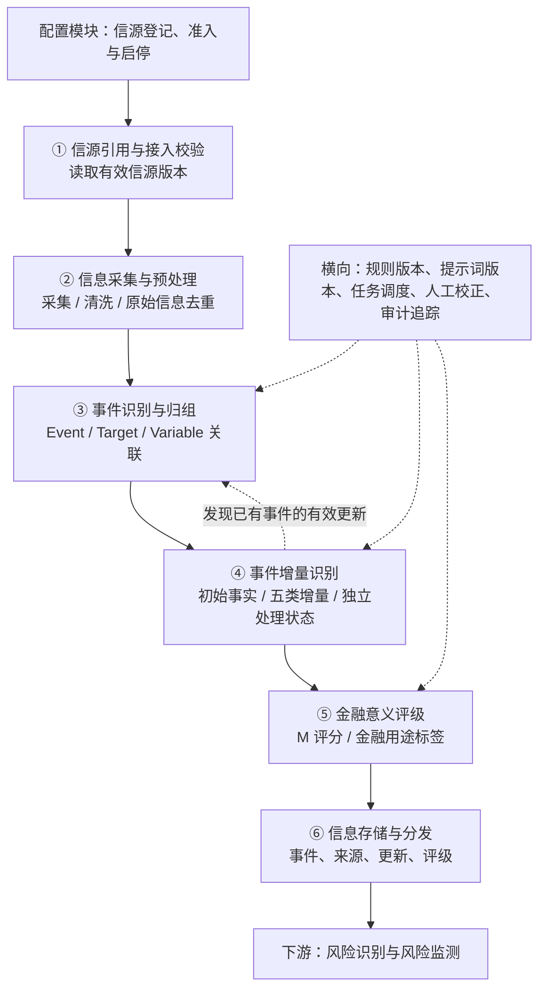
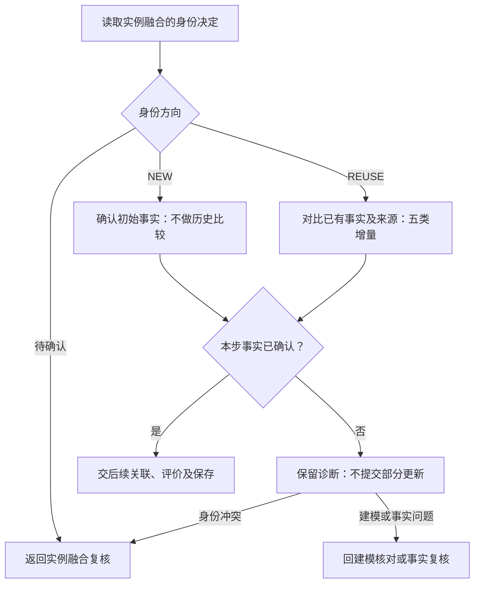
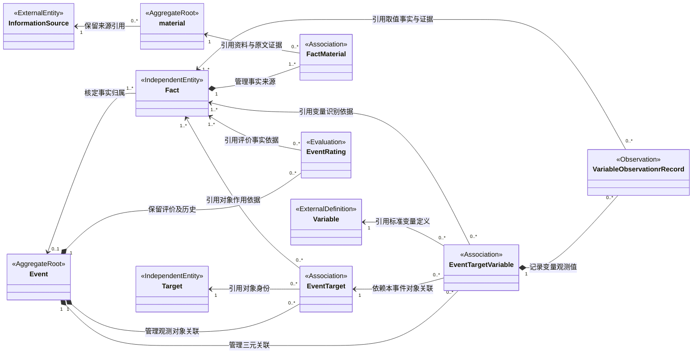

# RiskHot L0 信息处理层：业务架构与领域设计

> **2026-10-30 职责修订**：事件是否新建由实例融合唯一负责。Step 4 当前名称为“事件增量识别”（2026-10-31 名称调整）：NEW 确认初始事实，REUSE 判断五类增量，待确认作为独立处理状态。以[[tools/RiskHot/docs/system-design/03-系统功能架构/F02 事件管理模块功能设计 V1.0#4.5 Step 4：事件增量识别|F02 当前功能设计]]及[[tools/RiskHot/docs/system-design/03-系统功能架构/AI任务与提示词/AI-03 Event增量识别|AI-03 V0.6 草案]]为准。本文件其他章节保留的旧 AI-04 编号、EventUpdate 和旧六步流程属于待对齐设计，不代表当前运行契约已迁移。

> **文档版本**：V1.0（2026-10-09 讨论整合版；2026-10-22 第4章结构重构）
> **2026-10-29 变量定义修订**：更新3.4节定义、业务特征及四要素候选发现规则，同步领域对象和识别职责；版本号保持V1.0，未调整运行实现。
> **2026-10-30 Target 局部修订**：解除五类宏观对象限制，按 §3.3 匹配、复用或创建并建立事件关联；版本号不变，其他流程和运行实现不变。
> **2026-10-31 风险变量定义修订**：§3.4 按用户提供的六部分定义整体替换，以 Target 为核心，区分可复用变量定义与特定对象、特定时间的变量取值；版本号保持 V1.0。其他章节、F02 功能设计、数据模型与 AI 提示词中的既有变量口径仍需对齐，本次仅替换本节及修正相关引用。
> **2026-10-31 Event 定义修订**：§3.2 按用户提供的四部分内容整体替换，明确识别要素、八项归组规则及与后续对象的关系；Target 和 Risk Variable 不作为建立 Event 的前置条件。版本号保持 V1.0。
> **2026-10-31 领域关系模型修订**：§4.2 以现行 §4.1 十类对象为准重构，采用 material，补充 VariableObservationrRecord 及其三元关联、取值和证据路径；版本号保持 V1.0。§4.3 等章节中的旧 Information、EventUpdate 定义及技术存储设计仍待按现行清单对齐。
> **2026-10-31 领域对象详细定义修订**：§4.3 依照 §4.1 清单和用户提供的 Event 模板统一为五段业务定义；采用 material、VariableObservationrRecord，移除本节物理表字段与约束，已明确的存储设计通过链接引用，不确定内容留空。版本号保持 V1.0。其他章节中的旧 Information、EventUpdate 契约继续待对齐。
> **2026-10-31 变量观测记录修订**：§4.3.9 按用户提供的七部分内容整体替换，细化观测属性、三元归属、取值性质、独立业务时间、证据及更正历史；版本号保持 V1.0。
> **2026-10-31 Fact 领域对象补充**：§4.1～§4.3 补齐 Fact（来源事实陈述），领域清单增至十一类；新增 §4.3.11，保留原有对象章节编号。明确 material 与 Fact 多对多、Fact 归组后最多属于一个 Event，EventMaterial 由事实归属及来源关系推导。版本保持 V1.0；依据现行 F02 补齐业务定义，不新增物理表或改变运行流程。
> **2026-10-31 Target 候选识别分工修订**：按 F02 V1.14，Fact → Event 为程序映射，Object → Target 候选采用 AI 语义识别加程序校验，Step 3 负责身份融合；同步 §3.3.2 和 Fact 使用说明。版本保持 V1.0；旧流程图与 AI 编号仍待整体对齐，本次未修改运行实现。
> **2026-10-31 Fact 跨报道复用确认**：Fact 统一表征同一次具体发生，多个 material 经核对可共同引用一个 Fact；保留多对多来源关系及各来源证据。此前“来源事实陈述”命名改为“事实单元”，单份资料的陈述与跨来源事实身份分别表达；仍可先于 Event 归组保存，Event 边界不直接套用 AIHOT story。版本保持 V1.0，本次仅更新设计。
> **2026-10-31 事实来源关联对齐**：现行十一类领域对象中的 EventMaterial 替换为 FactMaterial（事实—资料关联），对应 fact_material；事件来源按 Event → Fact → FactMaterial → material 派生。Event—Fact 是直接归属关系，不增设 EventFact 对象或表。同步清单、UML、§4.3.6、生命周期与附录；其他对象章节编号及 V1.0 不变，本次不新增物理结构。
> **设计范围**：RiskHot / L0 信息处理层 / 宏观领域  
> **文档性质**：业务架构与领域设计草案，可用于后续详细设计  
> **设计基线**：以本轮确认的 Event、Target、Variable、`event_target_variable` 方案为准。  
> **说明**：评分模型中的具体权重尚待验证，不把方案性参数视为已经通过的业务决策。


## 1. 业务能力与职责设计


### 1.1 业务定位与总体职责

L0 将来自可信信源的宏观资讯转化为**可追溯、可归组、可更新、可评级、可供后续风险分析使用的事件（Event）**。

L0 对信息的来源可追溯、事件身份与阶段表达、观测主体和变量引用、事件变化记录及金融意义评价负责，并向下游交付稳定的事件、对象和变量标识以及原文引用链。

原始资料以 Information 管理，结构化事件以 Event 管理；同一资料可以包含多个事件，同一事件也可以持续关联多份资料。各项能力围绕事件持续积累来源、更新与评级，支撑后续风险识别和观测。

信源登记、准入及启停的业务定义以[[tools/RiskHot/03-业务功能需求/02. RiskHot_配置模块功能需求规格说明书_V1.0#FR-L0-01 信源登记、准入与启停|配置模块 FR-L0-01]]为准；L0 仅消费有效信源版本，不重复维护信源身份或准入决定。

### 1.2 核心业务能力与责任


| 业务能力        | 回答的业务问题               | L0 承担的责任                                                                 | 主要交付结果                                                 |
| ----------- | --------------------- | ------------------------------------------------------------------------ | ------------------------------------------------------ |
| 信源引用与接入校验   | 信息从哪里来，哪些来源可以使用？      | 读取配置模块维护的信源身份、版本和启停状态，校验本次接入资格，保留原始发布主体                                  | 有效 InformationSource 引用与接入检查结果                         |
| 信息采集与预处理    | 如何将不同来源的资料变为可追溯输入？    | 采集和清洗原文，规范链接与时间，处理资料重复与原文修订，保留来源元数据和正文版本                                 | 标准化原始资料及版本记录（Information）                              |
| 事件识别与归组     | 发生了什么，是否属于同一事件，作用于什么？ | 识别宏观事件的主体、行为、状态与时间；判断新事件或既有事件；关联宏观 Target 与有直接依据的统一 Variable，保留原文定位和待确认项 | Event、Fact、FactMaterial、EventTarget、EventTargetVariable |
| 事件增量识别 | 相比既有记录，出现了什么新变化？      | NEW 确认初始事实；REUSE 区分进展、实质补充、来源增加、纠正与重复；维护事件状态和变化历史，避免重复生成业务进展             | 初始事实或五类增量、独立处理状态及来源变化记录                                |
| 金融意义评级      | 事件对指定宏观观察范围有什么金融意义？   | 在明确评价范围和研究期限下给出 M 维度评价、金融用途标签与依据；按需复评，保留规则版本和历史评级                        | 金融意义评价与用途标签（EventRating）                               |
| 信息存储与分发     | 下游怎样稳定引用和持续跟踪事件？      | 校验标识与关联约束，幂等保存事件及其来源、更新、评级；提供检索和变更通知，保留历史引用                              | 可检索的结构化事件、稳定 ID、来源链和事件变更通知                             |


**横向质量与追溯职责**：各项能力共同保留规则、提示词及模型版本、原文引用和处理记录；通过任务调度、结构校验、人工校正与审计追踪支持复核和重新处理。对象、变量或归组关系无法可靠判断时，保留空值或待确认状态，不编造引用或强行合并。

能力清单定义 L0 持续承担的业务责任；第 2 章进一步说明这些能力如何组成处理流程。

### 1.3 六个业务环节职责


| 编号  | 业务环节        | 输入                                      | 核心处理                                | 输出                                                     |
| --- | ----------- | --------------------------------------- | ----------------------------------- | ------------------------------------------------------ |
| 01  | 信源引用与接入校验   | 配置模块发布的有效信源及版本                          | 读取启停状态（即业务准入）、核对范围及技术接入条件；不维护来源业务配置 | `InformationSource` 引用与接入资格                            |
| 02  | 信息采集与预处理    | 可用信源                                    | 增量采集、抽取正文、统一时间和链接、资料级去重             | `Information`                                          |
| 03  | 事件识别与归组     | Information、已有 Event、Target、Variable 字典 | 提取事件、判断同事件、匹配／创建 Target、引用 Variable | Event、Fact、FactMaterial、EventTarget、EventTargetVariable |
| 04  | 事件增量识别 | 当前信息、事件既有状态及更新历史                        | 承接身份方向，确认初始事实或判断已有事件的五类增量           | 初始事实或五类增量、独立处理状态                                       |
| 05  | 金融意义评级      | Event、观测主体、涉及变量、增量信息                    | 识别金融关联、给出 M 维度评价、金融用途分类             | EventRating                                            |
| 06  | 信息存储与分发     | 上述全部结构化结果                               | 幂等入库、关联约束、版本保留、事件订阅与检索              | 持久化 Event 及对下游的事件变更通知                                  |


### 1.4 首版职责覆盖范围


| 维度   | L0 V1 范围                                 |
| ---- | ---------------------------------------- |
| 领域   | **宏观**：经济体、宏观政策主体、金融系统、主要金融市场、宏观经济部门     |
| 信源   | 第一手官方信息、官方公开数据、权威机构公开研究与报告               |
| 信息粒度 | Information（原始资料）与 Event（结构化事件）分别管理      |
| 事件形态 | 已发生、正在推进、已宣布、计划或预期的宏观事件；使用事件状态表达阶段       |
| 变量   | 共用全局 `risk_variable_definitions`，按具体事件建立事件—对象—变量关联 |
| 评级   | 金融意义 M；投资／融资／投机等金融用途标签，可多选               |
| 演进   | 同一事件的新增报道、进展、实施、纠正与状态变化                  |
| 交付   | 向后续风险识别、风险变量分析、风险快照与演化分析提供结构化输入          |


### 1.5 上下游职责分工

上游信源提供原始公告、数据、研究与报告；配置模块维护来源身份、分类、准入、启停及版本，L0 读取有效信源并负责接入资格检查、资料接入及结构化处理。下游以 L0 交付的事件、对象、变量和原文证据为输入，承担风险识别、风险判断与持续观测职责。


| 层次       | 关注点                       | 核心产物                               |
| -------- | ------------------------- | ---------------------------------- |
| L0 信息处理层 | 可信信息、事件、观测主体、变量引用、增量、金融意义 | Event、EventUpdate、EventRating、关联关系 |
| 下游风险识别层  | 哪项风险受到新事件触发或影响，为什么        | 风险匹配、风险源与变量关系                      |
| 下游风险观测层  | 哪些观测值变化，风险现处于何种状态         | 变量证据、风险快照、风险演化轨迹                   |


> 重要区分：Event 的 Target 是**事件的观测主体**；`risk.observation_target` 是**某项风险判断针对的观察对象**。两者在含义和范围一致时可映射，但不自动视为同一个业务身份。


### 1.6 职责边界与暂不承担事项

- 不对每条资料进行独立的事实可信度 C 打分，不开展逐条事实核验工作流；原文定位和来源关联仍须保留。
- 不强制将原始信息拆成“事实”和“预测”两条业务流水线；通过事件状态、时间类型和描述保留阶段差异。
- 不设置独立处理优先级 P 评分。首版展示或研究排序可先参考 M 和是否存在有效增量。
- 不在 L0 形成风险等级、风险方向、风险传导结论、投资建议或交易决策。
- 不创建企业、行业和单项资产的独立微观 Target；这类内容只有在服务宏观事件描述时作为文本上下文保留。
- 不为 Target 预配置固定 Variable 集合；仅记录**某次 Event 在某个 Target 上关联的 Variable**。
- 不单独创建通用 Entity 领域模型；事件行为主体在 Event 中表达，跨事件复用的观测主体由 Target 独立管理。


## 2. 业务架构设计


### 2.1 L0 总体业务流程




> 六个环节是业务职责划分，部署时允许通过不同任务、异步队列或同一服务执行；流程不要求每个环节对应独立微服务。


### 2.2 业务流程图（详细版，带阶段）

全局处理顺序见第 2.1 节。以下拆成六张详图，图内圆角节点标明入口、出口或暂停状态；“图①—图⑥”为阅读编号，与第 1.3 节的业务环节对应关系如下。


| 详图  | 处理内容        | 对应业务环节                        |
| --- | ----------- | ----------------------------- |
| 图①  | 信源准入与信息预处理  | 01 信源引用与接入校验、02 信息采集与预处理      |
| 图②  | 事件抽取与归组     | 03 事件识别与归组：确定事件身份             |
| 图③  | 对象与变量关联     | 03 事件识别与归组：关联 Target、Variable |
| 图④  | 事件增量识别 | 04 事件增量识别                |
| 图⑤  | 金融意义评级      | 05 金融意义评级                     |
| 图⑥  | 存储分发与下游衔接   | 06 信息存储与分发，并标明下游职责            |


**颜色图例**：蓝底白字＝AI 分析任务；灰色＝程序处理；浅黄＝规则校验与结果分支；橙色＝不可用、待补采、待复核或待审核；青绿＝入口、出口与正常结束；紫色＝下游职责。

**AI 编号口径**：沿用第 6.1 节的统一任务编号。同一任务跨图复用时保持编号一致；图④已按 F02 当前职责修订为 AI-03 事实确认与增量识别，身份冲突返回 AI-02；第6.1节 AI-04 为旧编号待迁移。图①和图⑥的 L0 步骤属于程序处理，不新增 AI 任务；下游 AI 任务不在本节定义。

#### 2.2.1 图①：信源准入与信息预处理


**处理口径**：准入检查读取白名单、来源资质与采集配置，引用 InformationSource 的准入档位和可选 S 分。采集保留正文、附件、原始出处、发布时间与抓取时间；按来源标识、URL 与内容指纹判重。不同来源的同内容材料仍保留来源关系，形成可追溯的 Information 及版本记录。

#### 2.2.2 图②：事件抽取与归组


**AI 与程序分工**：AI-01 输出事件候选和原文定位，AI-02 输出归组建议及理由；程序检查字段、引用、ID 和归组阈值，再按结果分支创建或匹配事件，不合格结果进入复核。

**处理口径**：抽取保留主体、行为、事件状态和时间语义。归组同时比较主体、行为、观测主体、时间范围及政策或行动标识；新事件身份标记 `NEW`，既有事件读取状态、来源与更新历史，无法判断时记录 `UNRESOLVED` 并保留待归组任务，禁止强行合并。Fact 通过 FactMaterial 关联资料，并经证据关系保存原文位置；Event 来源从其已归属 Fact 汇总。

**多事件处理**：一份 Information 可以关联多个 Event。自本图拆分后，各事件独立完成图③—图⑥；某个事件待复核或无增量，不阻断其他事件。

#### 2.2.3 图③：对象与变量关联


**AI 与程序分工**：AI-03 输出对象、变量候选与直接引用依据；程序检查对象范围、变量定义是否存在及关系约束，再建立关联或登记待审核项。

**处理口径**：Target 按作用对象的身份与范围匹配、复用或创建，关系记为 EventTarget；无法确定对象时仍保留 Event 与来源。变量引用全局 `risk_variable_definitions`，三元关系使用 `event_target_variable(event_id, target_id, variable_id)`。变量候选未经审核不填写虚假 ID；缺少直接依据时保留 EventTarget、允许三元关联为空，不推测后续传导变量。

#### 2.2.4 图④：事件增量识别




**AI 与程序分工**：程序读取实例融合的有效 NEW/REUSE 决定。AI-03 在 NEW 分支确认初始事实，在 REUSE 分支识别五类增量；发现身份冲突返回实例融合，不自行改判新建。程序校验独立处理状态，只有已确认结果才交后续关联、评价及保存。当前任务编号以 F02 为准。

**输出分工**：初始事实不是增量类型；待确认不是增量类型。已有事件的五类增量及动作见 §3.5。

#### 2.2.5 图⑤：金融意义评级


**AI 与程序分工**：程序结合新增事件标记、增量结果及评级规则判断是否初评或复评，准备评价范围和期限；AI-05 输出 M 维度判断、用途标签与依据，程序保留评级记录与版本，并在图⑥完成统一校验。

**评级口径**：评价范围使用 `assessment_scope`，金融用途包括投资、融资、投机／情绪，允许多标签及无法判断状态，结果记录为 EventRating。M 权重尚待验证，规则未定时总分允许为空，保留维度评价与草案状态。纯来源增加由图④直接进入图⑥；M 不代表风险等级、风险方向或投资收益概率。

#### 2.2.6 图⑥：存储分发与下游衔接


**校验与存储**：检查结构化结果、ID、关联约束、时间语义、状态及更新幂等性；保存 Event、来源关系、对象与变量关联、EventUpdate、EventRating，并保留原文版本、规则／提示词／模型版本及审计轨迹。前述图中的事件创建、关系变更和更新记录在此统一校验并持久化，Information 原文及版本在图①预处理时保留。

**通知按实际变化产生**：


| 业务通知                    | 适用变化               |
| ----------------------- | ------------------ |
| `event_created`         | 新增事件               |
| `event_updated`         | 事件进展、作用变量或状态发生有效变化 |
| `event_rating_updated`  | 金融意义评价或用途标签更新      |
| `event_source_attached` | 仅新增来源关联，不发布为实质事件进展 |


**复核与下游边界**：复核完成后回到对应处理步骤；归组调整保留合并／拆分审计。下游引用 Event、Target、Variable 与原文证据，自行判断风险方向、传导关系和变量角色，并形成风险判断、快照与演化记录。

## 3. 业务规则设计


### 3.1 信源准入与原文可追溯

**状态定义（2026-10-13）**：业务准入等同于启停，统一由 `admission_status` 表达，不再设独立准入审核状态。ACTIVE 表示启用，PAUSED／DISABLED 均不允许新采集；新登记默认 DISABLED。技术就绪由 L0／运行侧单独判断，连接失败不自动改变业务状态。历史标题保留用于已有引用。

1. 首版建立信源白名单：中央银行、财政与统计部门、监管机构、正式政府公告和权威国际／研究机构等。
2. 信源可信程度在**配置模块的信源管理**中维护，可使用准入档位及可选 S 分；每次事件分析引用既有信源标识，不重复计算发布者的长期信用。
3. 采集必须记录来源 ID、原始 URL／资料标识、标题、发布时间、抓取时间及正文版本。
4. 对转载材料记录原始发文主体和转载主体；能识别原始出处时优先引用原始文本。
5. 对 AI 抽取或概述的具体结论保存其对应的原始信息 ID 与证据片段位置。此规则属于**溯源与结构化质量保障**，不构成逐条事实核验评级。


#### 信源分类与排序的维度


| 维度    | 分类方式                       | 解决的问题         |
| ----- | -------------------------- | ------------- |
| 信源等级  | T1 官方一手、T1.5 官方账号、T2 媒体及博主 | 信息来源是否权威、如何核验 |
| 金融属性  | 钱的数量、价格、流向、风险偏好、资源配置       | 影响钱的哪个维度      |
| 观察层级  | 宏观（美联储）、中观（中国央行）、微观（企业）    | 信息作用于哪个层级     |
| 关注优先级 | 核心关注、重点关注、一般关注             | 哪些信源值得优先跟踪    |
| 时效性   | 实时、每日、每周、每月、不定期            | 应该多频繁地监测      |
| 信息功能  | 原始数据、政策发布、事件报道、观点分析        | 该信源能提供什么价值    |


核心字段的分类规则


| 字段                      | 建议枚举值                                                  | 配置规则                             |
| ----------------------- | ------------------------------------------------------ | -------------------------------- |
| `source_tier`           | `T1`、`T1_5`、`T2`                                       | 根据发布渠道和原始证据属性确定，不随关注优先级变化        |
| `observation_levels`    | `MACRO`、`MESO`、`MICRO`                                 | 支持多选，一个信源可能覆盖多个层级                |
| `financial_dimensions`  | `QUANTITY`、`PRICE`、`FLOW`、`RISK_APPETITE`、`ALLOCATION` | 支持多选，表示信源主要覆盖的金融属性               |
| `attention_priority`    | `CORE`、`HIGH`、`NORMAL`                                 | 单选，用于决定系统优先监测哪些信源                |
| `monitor_frequency`     | `REALTIME`、`DAILY`、`WEEKLY`、`MONTHLY`、`IRREGULAR`      | 单选，表示系统计划采集或检查的频率                |
| `information_functions` | `RAW_DATA`、`POLICY`、`EVENT`、`ANALYSIS`                 | 支持多选，描述该信源主要提供的信息形式              |
| `admission_status`      | `ACTIVE`、`PAUSED`、`DISABLED`                           | 唯一业务状态：启用即准入；暂停／停用禁止新采集，技术就绪另行检查 |


### 3.2 Event 定义与识别边界


#### 3.2.1 Event 业务定义

**Event（事件）** 是指在明确的时间语境下，围绕特定宏观主体发生的、具有相对完整事实内容和独立业务含义的行为、决策或状态变化，并能够被持续追踪的事实单元。

Event 用于对不同信息来源中描述的同一事件进行统一识别、归组和管理，形成具有稳定身份、明确时间语境和可追溯证据的事件对象，为后续金融观测对象（Target）识别、风险变量提取及风险分析提供事实基础。

#### 3.2.2 核心识别要素

Event 的识别以 **主体（Subject）+ 行为或变化（Action）+ 时间（Time）** 为基础，结合客体（Object）及语义信息确定事件的事实边界与独立性。

- **Subject（主体）**：事件行为、决策或状态变化所对应的宏观主体。
- **Action（行为或变化）**：事件中发生的具体行为、决策或状态变化，是识别事件核心事实的主要依据。
- **Time（时间）**：行为、决定或状态变化发生的时间，用于确定事件的时间语境。
- **Object（客体）**：事件行为作用或涉及的对象，用于辅助区分事件，并为后续金融观测对象（Target）的识别提供依据。

其中，Subject、Action 和 Time 构成事件识别的基础判断要素，Object 和语义信息用于进一步判断事件的完整性、独立性及同一性。

#### 3.2.3 Event 识别与归组规则

1. **事实独立性**：一个 Event 应对应一个具有相对完整业务含义的核心事实。同一主体发生的不同决定、行为或状态变化，应根据事实独立性分别识别。
2. **事件同一性**：不同报道对同一核心事实的重复描述，应归入同一 Event，并保留各自的信息来源及原始证据。
3. **时间区分性**：同一主体在不同时点作出的相互独立决定，通常建立不同 Event。对于持续性事项，应结合其核心行为、客体及业务语义判断事件是否延续。
4. **事件连续性**：同一政策或行动在“宣布—推进—实施—完成”等阶段的连续进展，原则上归入同一 Event，通过新增事实、关联报道和事件状态变化持续完善事件信息。当出现具有独立业务含义的新决定、新政策措施或独立行为时，应建立新的 Event，并可记录事件之间的关联。
5. **时间语义准确性**：Event 可以描述已经发生、正在进行或已明确宣布的计划性事项。应通过 `event_status` 及相关时间信息区分实际发生、持续进行和计划实施等情况，避免将预期变化记录为已经发生的事实。
6. **多事件拆分**：一篇新闻、报告或汇总材料可能包含多个相互独立的事件，应按照核心事实分别识别和建立 Event。
7. **归组证据约束**：事件归组应综合主体、行为、时间、客体及关键事实进行判断。仅凭标题主题相似、发布机构相同或关键词重合，不足以认定为同一 Event。
8. **事实可追溯性**：Event 应保留与原始信息及事件事实的关联，使事件识别、归组、内容补充和状态变化能够追溯至相应证据。


#### 3.2.4 Event 与后续业务对象的关系

Event 是风险相关事件事实的统一管理单元，其后续业务处理主要包括：

- Target（金融观测对象） 是指从事件事实中，结合主体（Subject）、行为（Action）、客体（Object）及相关语义信息，识别并标准化形成的、具有明确金融风险观测价值、稳定身份和确定范围的业务对象。
Target 用于统一管理不同事件中涉及的金融观测对象，建立事件与观测对象之间的关联关系，并作为风险变量识别、取值关联及后续风险分析的对象基础。
Target 可以来源于事件主体、事件客体或事件语义信息中明确涉及的其他对象。同一 Target 可以被多个 Event 共同引用，一个 Event 也可以关联多个 Target。
- 风险变量（Risk Variable） 是指从事件事实中，基于主体（Subject）、行为（Action）、客体（Object）及相关语义信息，识别并抽象形成的、能够描述金融观测对象（Target）风险相关属性、行为、状态、数量或关联关系的标准化业务要素。
风险变量具有明确的业务含义和规范的取值方式，可关联具体 Target、事件事实及原始证据，为后续风险识别、风险分析和风险演化研究提供基础数据。

Event 的识别与归组以事件事实为依据。Target 和 Risk Variable 在后续业务处理中形成，不作为建立 Event 的前置条件。

### 3.3 Target（金融观测对象）定义与识别边界


#### 3.3.1 Target 业务定义

**Target（金融观测对象）** 是指从风险事件的客体（Object）及其相关语义信息中，依据事件事实及作用关系，识别并标准化形成的、具有明确金融观测价值、稳定身份和确定业务范围的对象。

Target 用于统一管理风险事件所涉及的金融观测对象，建立事件事实与观测对象之间的关联关系，为后续风险变量的关联、取值管理及风险分析提供稳定的对象基础。

同一 Target 可以被多个 Event 共同引用，一个 Event 也可以关联多个 Target，从而实现不同事件中金融观测对象的统一识别、复用和持续跟踪。

#### 3.3.2 Target 识别与形成逻辑

Target 按照以下业务逻辑形成：

**Event 事实 → Object 解析 → Target 识别 → 对象匹配与标准化 → 复用或创建 Target → 建立 EventTarget 关联**

- **Event 事实**：从已识别的风险事件中获取主体（Subject）、行为（Action）、客体（Object）、发生时间（OccurredAt）、语义信息及原文证据，作为 Target 识别的事实依据。
- **Object 解析**：分析事件行为所作用或涉及的客体，识别其中具有金融观测价值的对象及其相关属性。
- **Target 识别**：Step 2 的 Target 候选识别 AI 结合 Object 的业务含义、事件行为、语义信息及原文证据，提出候选名称、可区分身份的属性、业务范围、分类与作用依据；程序校验并保留缺口，不在本步确立正式身份。
- **对象匹配与标准化**：将候选对象与已有 Target 进行匹配，依据对象名称及别名、所属辖区、分类含义和业务范围判断对象同一性。
- **复用或创建 Target**：已有匹配对象时复用其正式身份；无匹配对象且符合建档条件时，按照既定规则创建新的 Target。身份或范围尚不明确的对象保留为候选。
- **建立 EventTarget 关联**：在 Event 和 Target 的正式身份均已确定后，建立事件与金融观测对象之间的关联，并保留对象原文称谓、作用依据及匹配结果。


#### 3.3.3 Target 识别边界

Target 的识别与管理遵循以下原则：

1. **金融观测价值**：对象应具备明确的金融观测意义，能够作为风险相关信息和变量变化的观测对象。
2. **身份明确性**：对象应具有可识别、可区分的稳定身份，能够在不同事件中进行匹配与复用。
3. **范围确定性**：对象的业务含义、所属层级及观测范围应能够明确界定。
4. **事实关联性**：对象与 Event 之间应具有明确的作用或涉及关系，并能够通过事件事实及原文证据进行追溯。
5. **对象复用性**：同一金融观测对象在不同事件中应复用统一身份，避免重复建档。
6. **候选保留机制**：对于身份不明、范围不清或定义缺失的对象，保留候选识别结果，待条件满足后再正式建档。

行业相关性用于后续业务关注或风险分析筛选，不作为 Target 建档的必要条件。

#### 3.3.4 Target 分类与身份管理

Target 分类依据《金融风险研究对象分类索引 V1.0》，采用以下六大初始分类目录：

1. 货币与货币形态
2. 金融资产与金融合约
3. 金融主体与机构
4. 金融市场与基础设施
5. 金融体系与宏观制度
6. 投资组合与交易策略

分类体系支持二级分类及后续扩展，同一 Target 可以归属多个业务分类。

Target 采用正式 ID 作为稳定身份标识，不设置独立的对象业务编码。

对象同一性综合以下信息判断：

- 标准名称与别名；
- 所属国家或司法辖区；
- 对象的业务分类及具体含义；
- 对象的实际范围与边界。

分类相同不代表对象身份相同；同名但业务含义或观测范围不同的对象，应分别建档管理。

#### 3.3.5 Target 与相关业务对象的关系

**1. 与 Event 的关系**

Event 用于识别、归组和管理事件事实；Target 用于统一标识事件所涉及的金融观测对象。

两者通过 EventTarget 建立多对多关联：

- 一个 Event 可以关联多个 Target。
- 一个 Target 可以关联多个 Event。
- Event 的识别与建立不依赖 Target 是否已确定。
- EventTarget 仅在双方正式身份均已确定后建立。

**2. 与 Subject 的关系**

Subject 是 Event 中发起、执行或体现事件行为的主体；Target 是事件中被识别并纳入统一管理的金融观测对象。

Subject 和 Target 分别表达事件行为角色与金融观测对象身份。

同一对象可以同时具有 Subject 和 Target 身份，但须分别满足相应业务识别条件。

当 Subject 同时构成事件的金融观测对象，且能够从 Object 及相关事件事实中确定其观测身份与作用依据时，可以将其关联为 Target。

**3. 与 Object 的关系**

Object 是 Event 的原始事实要素，用于描述事件行为所作用或涉及的客体。

Target 是在 Object 分析基础上识别并标准化形成的金融观测对象。

Object 保留事件原始语义，Target 提供能够跨事件复用的统一对象身份。

同一 Object 可以根据其业务含义识别出一个或多个 Target；无法明确识别金融观测对象的 Object 保留原始事实信息。

**4. 与 Risk Variable 的关系**

Risk Variable 用于描述金融观测对象风险相关的属性、行为、状态、数量及关联关系。

风险变量可以从 Event 的 Subject、Action、Object 及语义信息中识别，并通过标准化定义形成可复用的变量对象。

Target 为风险变量提供具体的观测对象关联。变量识别来源与 Target 身份识别分别管理，风险变量的发现不以 Target 已完成确认为前置条件。

同一 Target 可以关联多个风险变量；同一标准风险变量也可以应用于多个 Target，并分别记录其具体取值、时间及来源证据。

#### 3.3.6 业务定位

Target 是 RiskHot 事件事实与风险变量之间的重要关联对象，承担金融观测对象的识别、标准化、身份管理及事件关联职责。

本阶段重点完成：

- 从事件客体中识别金融观测对象；
- 对候选对象进行身份匹配与标准化；
- 复用已有对象或创建新的 Target；
- 建立 Event 与 Target 的关联关系；
- 保留对象的原文称谓、识别依据及关联证据；
- 为后续风险变量关联和风险分析提供稳定对象身份。

Target 与 L1 风险观察对象仅在身份及范围一致时建立映射。Target 的识别与建档范围不直接决定下游风险纳管范围。

具体对象识别、匹配、候选管理及事件关联规则沿用 F02 事件管理模块已确定的业务规则。

### 3.4 风险变量（Risk Variable）的定义


#### 3.4.1 业务定义

风险变量是指从风险事件事实中，以金融观测对象（Target）为核心，结合事件行为、对象属性、状态变化及相关语义信息，识别并抽象形成的、能够描述金融观测对象风险相关特征、行为、状态、数量或关联关系的标准化业务要素。

风险变量用于将事件中分散的风险相关信息转化为具有明确业务含义、统一定义和规范取值的变量对象，为后续风险识别、风险分析及风险演化研究提供基础数据。

#### 3.4.2 识别与形成逻辑

风险变量按照以下业务逻辑形成：

**Event 事实 → 事件要素分析 → 风险变量识别 → 变量标准化定义 → 变量取值 → 关联 Target 及事件证据**

- **Event 事实**：从已识别的风险事件中获取主体（Subject）、行为（Action）、客体（Object）、发生时间（OccurredAt）、语义信息及原文证据，作为风险变量识别的原始输入。
- **事件要素分析**：对 Event 的各要素进行分析，识别其中具有风险观测意义的信息。风险变量的识别来源不限定于单一要素，可以来自 Subject、Action、Object，也可以来自语义信息中表达的属性、状态、数量、变化或关联关系。
- **风险变量识别**：从事件要素及其语义表达中，识别能够描述风险相关对象特征、行为、状态、数量或关联关系的候选变量。
- **变量标准化定义**：对识别出的候选变量进行标准化处理，形成统一的变量定义，包括变量名称、业务含义、适用对象、取值类型及计量口径，并与已有变量进行匹配和去重。
- **变量取值**：依据事件事实及原文证据，提取或确定变量在特定时间语境下的具体取值；对于计划、预期或尚未发生的事项，应明确区分计划值、预期值与实际值。
- **关联 Target 及事件证据**：在变量识别和取值完成后，将变量与其对应的金融观测对象（Target）、来源 Event 及原始证据建立关联，形成可追溯的风险变量记录。Target 是风险变量的关联对象，但不是风险变量识别的前置条件。

**说明：**

1. 风险变量的识别以 Event 事实为基础，重点是从事件信息中发现和抽象风险相关变量。
2. 风险变量可以来源于 Event 的不同要素，但最终应形成统一的标准化变量定义。
3. 风险变量与 Target 之间是“关联关系”，不是“来源等同关系”；并非所有变量都只能从 Object 中识别，也并非变量识别必须先完成 Target 确定。


#### 3.4.3 核心业务特征

1. **风险相关性**：能够描述与风险事件有关的金融观测对象的特征、行为、状态或关联关系。
2. **对象关联性**：变量能够与具体金融观测对象（Target）建立关联。
3. **语义明确性**：具有清晰、统一的业务含义，能够区分不同变量所描述的具体内容。
4. **取值规范性**：具有明确的取值类型、计量单位或状态表达规则。
5. **时间属性**：变量取值能够关联到相应的发生时间或有效时间。
6. **证据可追溯性**：变量的识别与取值能够追溯至对应的事件事实和原始证据。
7. **定义可复用性**：同一变量定义可以应用于不同事件及不同金融观测对象，避免重复定义。


#### 3.4.4 业务概念边界

- **事实单元（Fact）**：[[tools/RiskHot/docs/system-design/02-业务架构与领域设计/RiskHot_L0_信息处理层_业务架构与领域设计V1.0#4.3.11 Fact（事实单元）|Fact]] 统一表征同一次具体发生，可由多份资料共同支持；各份资料的原始陈述、条件和证据分别追溯。计划、预期、预测与已发生内容保留原有业务阶段及时间语境，跨来源复用不等于真实性已被证实。
- **事件主体（Subject）**：事件中实施行为或发生动作的主体。
- **事件行为（Action）**：事件主体实施或发生的具体行为。
- **事件客体（Object）**：事件行为所作用或涉及的对象，是识别金融观测对象的重要输入。
- **金融观测对象（Target）**：从事件客体（Object）中分析、识别并标准化形成的金融风险观测对象。
- **风险变量（Risk Variable）**：描述 Target 及其相关行为、属性、状态、数量或关联关系的标准化业务要素。
- **变量取值（Variable Value）**：描述某个风险变量在特定 Target、特定时间下的具体数值、类别或状态。


#### 3.4.5 业务示例

事件事实：

某评级机构宣布下调甲公司的信用评级，评级由 A 降至 BBB。


| 业务概念    | 识别结果       |
| ------- | ---------- |
| Subject | 某评级机构      |
| Action  | 下调信用评级     |
| Object  | 甲公司的信用评级   |
| Target  | 甲公司        |
| 风险变量1   | 企业信用评级     |
| 变量取值1   | BBB（原评级 A） |
| 风险变量2   | 信用评级变动方向   |
| 变量取值2   | 下调         |
| 原文证据    | 评级机构公告     |


该示例中，系统首先从 Object 中识别出甲公司这一金融观测对象（Target），随后结合 Action 和 Object 中包含的评级信息，识别出“企业信用评级”和“信用评级变动方向”两个风险变量，并记录对应取值及证据。

#### 3.4.6 业务定位

在 RiskHot 当前业务流程中，风险变量作为风险事件事实的结构化抽象结果进行定义和管理，以金融观测对象（Target）作为主要关联对象。

本阶段重点完成：

- 从事件客体中识别并标准化金融观测对象；
- 结合事件行为及语义信息识别风险变量；
- 对风险变量进行标准化定义和去重；
- 建立风险变量与 Target、事件事实及原文证据之间的关联；
- 提取和管理风险变量的具体取值。

变量在后续风险分析中的驱动、影响、中介、调节及结果等作用，根据具体风险场景和风险传导路径进一步识别和确定，不作为当前变量定义阶段的固定属性。

### 3.5 事件归组与增量规则

事件归组比较主体、具体行动、时间范围及政策或行动标识，唯一核定 NEW / REUSE / UNRESOLVED；Target 身份单独核定。归组结果与事实处理结果分开记录。


| 身份结果       | 事实处理                | 输出             |
| ---------- | ------------------- | -------------- |
| NEW        | 确认初始建模与本次事实一致，不比较历史 | 初始事实确认；不输出增量分类 |
| REUSE      | 与已有事实和来源比较          | 下表五类增量及事实变化    |
| UNRESOLVED | 暂不进入后续事实处理          | 待身份复核          |


| 增量类型              | 定义                | 后续保存动作               |
| ----------------- | ----------------- | -------------------- |
| EVENT_PROGRESS    | 同一行动有实施、结果或状态推进   | 保存进展 Fact，更新有依据的当前事实 |
| MATERIAL_ADDITION | 新增关键数字、范围或条件      | 保存补充事实，按条件复评         |
| CORRECTION        | 有依据证明已采用事实错误      | 修正当前事实，保留旧依据和审计      |
| SOURCE_ADDITION   | 事实无实质变化，新增来源或证据关联 | 补充来源，不制造进展           |
| DUPLICATE         | 事实及所需来源关联均已存在     | 复用结果，仅恢复未完成环节        |


本步已确认/待确认状态独立记录。初始事实不一致回建模或抽取核对；已有事件事实冲突在本步复核；身份冲突返回实例融合。待确认不提交初始事实或部分更新，NEW_EVENT 不作为本步分类。正式保存统一执行校验，不新建 EventUpdate。

### 3.6 金融意义 M 及金融用途

**金融意义 M 的目标**：衡量 Event 在指定宏观观察范围内，对关键金融变量、资源配置、经济运行约束或资产定价条件的潜在重要程度。评价时须固定 `assessment_scope` 和研究期限。

目前已确认：**保留 M 为 L0 的核心评分，并保留金融用途标签**。五维权重尚未由历史数据或文章原文提供直接量化依据，以下仅为**候选评分方案**：


| 候选维度     | 候选权重 | 判断内容                     |
| -------- | ---- | ------------------------ |
| B：底层变量关联 | 30%  | 是否涉及重要货币、信用、财政、供需或其他基础约束 |
| D：影响程度   | 25%  | 对事件观测主体的作用可能有多大          |
| T：持续时间   | 20%  | 影响预计持续多久                 |
| W：影响范围   | 15%  | 覆盖多少关键市场、部门或金融环节         |
| L：作用落地   | 10%  | 从计划、宣布、执行到可观察结果推进到何种阶段   |


若以上候选方案被确认，0—5 分的计算表达式为：

`M = 6×B + 5×D + 4×T + 3×W + 2×L`（总分 0—100）。

在权重确认前，系统应支持存储各维度评价、评分规则版本与说明；正式等级门槛继续留为配置项。**原文强调重视底层信息及投资／融资／投机区分；这五个维度和比例属于后续工程化提案。**

金融用途标签：`investment`（投资判断）、`financing`（融资活动）、`speculation_sentiment`（投机／情绪观察）；允许多标签及无法判断状态。**金融用途类别不自动决定 M 的高低。**

L0 的 M 是信息研究重要性，不能直接理解为风险严重程度、行情涨跌幅或投资收益概率。

## 4. 领域模型设计

本章按“对象清单 → 关系与聚合 → 对象详细定义 → 生命周期 → 跨对象规则与领域事件”组织。以现行十一类领域对象及属性基线为准；对既有规则的行为化、聚合边界和状态转换描述属于设计细化，未决授权、评分方法和合并拆分规则仍见第 7 章。

领域对象不等于数据库表。[[tools/RiskHot/docs/system-design/03-系统功能架构/F01 信息接入与标准化模块功能设计 V2.1|F01 V2.1]]细化资料保存与交付契约；[[tools/RiskHot/docs/system-design/03-系统功能架构/F02 事件管理模块功能设计 V1.0|F02 功能设计]]第 3 章细化字段约束、版本化证据及处理记录。证据、修订、候选和执行记录的存储结构不因此自动成为新的核心聚合。


### 4.1 领域对象清单

本模块围绕信息来源、事件事实、金融观测对象、风险变量及事件评价建立领域对象体系。

其中，Fact 负责可跨报道复用的事实单元及其多来源依据，Event 负责事件身份的统一识别和当前有效事实的管理，Target 负责金融观测对象的标准化身份管理，Variable 负责风险变量的统一定义。各对象通过直接归属或关联对象建立业务联系，支持事件追踪、变量识别、变量取值记录及后续风险分析。


| 领域对象                         | 中文名称         | 分类与所属边界          | 核心职责                                                         |
| ---------------------------- | ------------ | ---------------- | ------------------------------------------------------------ |
| **InformationSource**        | 信源           | 外部配置实体，M1 维护     | 发布来源身份、分类、启停及适用配置版本；L0 只读校验。                                 |
| **material**                 | 资料           | 资料聚合根，L0/F01 维护  | 保存标准化资料、原件引用、来源及版本，供事件分析读取。                                  |
| **Fact** | 事实单元 | 可跨报道复用、在事件归组前独立保存的实体，L0/F02 维护 | 统一表征同一次具体发生，关联多份 material 并保留各来源依据；支撑 Event、对象关联、变量观测与评价。 |
| **Event**                    | 事件           | 事件聚合根，L0/F02 维护  | 确立事件身份，组织主体、行为、客体、时间及相关事实，支持多来源归组和持续追踪。                      |
| **Target**                   | 金融观测对象       | 可跨事件复用的独立实体      | 定义金融观测对象的身份、分类、辖区及范围，支持跨事件匹配与复用。                             |
| **Variable**                 | 风险变量         | 外部共享定义，M2 维护     | 统一管理风险变量的身份、名称、业务定义、取值类型、单位及解释口径。                       |
| **FactMaterial** | 事实—资料关联 | Fact 一致性范围内的关联对象，L0/F02 维护 | 记录一份资料支持或质疑哪个 Fact，保留来源作用及证据路径；可先于 Event 归组建立。 |
| **EventTarget**              | 事件—观测对象关联    | Event 聚合内的关联对象   | 记录事件涉及哪些金融观测对象及其作用关系，支持跨事件对象复用。                              |
| **EventTargetVariable**      | 事件—观测对象—变量关联 | Event 聚合内的三元关联对象 | 记录特定 Event 中哪个 Target 涉及哪个标准 Variable，建立事件、观测对象和变量定义之间的业务关联。 |
| **VariableObservationrRecord** | 事件变量观测记录     | Event 聚合内的取值记录对象 | 记录特定事件中识别出的风险变量具体取值、取值性质、对应时间及来源证据，支持同一变量的多次观测与历史变化追踪。       |
| **EventRating**              | 事件金融意义评价     | Event 聚合内的评价实体   | 固定范围、期限、方法和证据，保留评价结果、用途及历史。                                  |


#### 4.1.1 核心领域对象边界

**1. Event（事件）**

Event 是事件事实的统一管理对象，负责识别、归组和持续维护事件信息。

Event 的建立以主体（Subject）、行为或变化（Action）、时间（Time）等核心事实为依据，结合客体（Object）及语义信息判断事件同一性。

Event 的识别与建立独立于后续 Target 和 Variable 的识别结果。

**2. Target（金融观测对象）**

Target 是具有稳定身份和明确范围的金融观测对象。

Target 依据事件客体（Object）及相关事件事实进行识别，通过对象匹配和标准化形成可跨事件复用的正式对象。

Target 与 Event 通过 EventTarget 建立关联，其身份独立于具体事件。

**3. Variable（风险变量）**

Variable 是具有明确业务含义、统一定义和规范取值方式的标准化风险变量。

风险变量可以从 Event 的 Subject、Action、Object 及相关语义信息中识别，经过标准化定义后由 M2 统一维护。

Variable 的定义独立于具体事件和金融观测对象，同一 Variable 可以应用于不同 Event 和 Target。

**4. EventTargetVariable（事件—观测对象—变量关联）**

EventTargetVariable 用于建立 Event、Target 和 Variable 三者之间的业务关联。

该对象表达：

**在某个 Event 中，哪个 Target 涉及哪个标准风险变量。**

EventTargetVariable 负责维护事件、金融观测对象及变量定义之间的关联，并保留相应的变量识别依据。

变量的具体取值及其时间、取值性质和证据由 VariableObservationrRecord 管理。

变量识别过程中尚未完成 Target 确认或 Variable 标准化的候选结果，应保留在相应处理环节，待满足正式关联条件后再建立 EventTargetVariable。

**5. VariableObservationrRecord（事件变量观测记录）**

VariableObservationrRecord 是指从特定 Event 的事实及原始证据中提取或确定的、与该事件所涉及的 Target 和标准 Variable 相关联的具体变量取值记录。

该对象用于描述风险变量在事件所涉及的特定时间语境下的取值情况，并保留其来源及证据。

核心职责包括：

- 记录变量的具体数值、类别、状态或其他规范化取值。
- 记录变量取值对应的发生时间、统计时间或有效时间。
- 区分实际值、历史值、计划值、预期值及预测值等不同取值性质。
- 保留取值来源、原文证据及提取或计算依据。
- 支持同一 EventTargetVariable 关联多条变量观测记录。
- 保留事件来源的变量历史取值，为后续跨事件变量变化分析提供数据基础。

VariableObservationrRecord 通过 EventTargetVariable 确定对应的 Event、Target 和 Variable，无须重复管理三者的业务身份。

同一事件中，如果某个变量存在不同时间、不同取值性质或不同证据对应的取值，可以形成多条 VariableObservationrRecord。

**6. EventRating（事件金融意义评价）**

EventRating 用于记录事件金融意义评价的结果及依据。

同一 Event 可以根据不同评价范围、时间期限、方法或版本形成多条评价记录。

EventRating 负责评价结果及历史管理，与风险变量定义和变量观测记录分别管理。

**7. Fact（事实单元）**

Fact 是从资料中识别、具有独立身份和可追溯证据的结构化事实单元，用于统一表征同一次具体行动或阶段性发生。不同来源报道同一次发生时，经核对复用同一个 Fact，各来源的原文、条件及支持或质疑依据分别保留。

Fact 在 Event 身份确定前作为候选事实独立保存；归组后继续沿用原身份。Fact 转为待融合 Event 是实例建模，不是删除 Fact 或将其身份改名为 Event。Fact 同一性回答“是否同一次具体发生”，Event 同一性回答“是否属于同一事件及其允许归入的进展”，两者分别核定。

来源不同、措辞不同或新增佐证不自动产生新 Fact；同一 Event 的另一具体发生、阶段性进展可以形成新的 Fact，但是否属于同一 Event 仍按 RiskHot 的事件归组边界判断。身份未定或来源冲突时保留候选与依据，不强行合并，也不以报道数量证明真实性。

Fact 的候选、待归组、复核或排除等处理情况与事件业务阶段分别管理。计划、预期、预测不得因进入 Fact 或获得多来源支持就被改写为已发生。

**8. FactMaterial（事实—资料关联）**

FactMaterial 连接一个 Fact 与一份 material，承担多来源支持或质疑关系。它不承担 Event 归组；未归组 Fact 同样需要来源关系与证据。事件资料列表从已归属 Fact 的来源关系派生，不再维护独立 EventMaterial。

#### 4.1.2 领域对象关联规则

1. **InformationSource 与 material**：一个信源可以产生多份资料，资料应保留信源引用及采集来源信息。
2. **material、Fact 与 Event**：material 与 Fact 为多对多；每个已保存 Fact 至少有一份资料及合格的来源证据。正式 Event 至少关联一个 Fact，未归组 Fact 没有 Event，归组后最多属于一个 Event。FactMaterial 明确连接 Fact 与 material；Event 与 material 的联系由 Event → Fact → FactMaterial → material 推导。Event—Fact 的归属及作用保存在 Fact，不新增 EventFact 关联对象。
3. **Event 与 Target**：两者为多对多关系，通过 EventTarget 管理。Event 的建立不依赖 Target 是否已确定。
4. **Event、Target 与 Variable**：通过 EventTargetVariable 建立三元关联，表达事件中具体金融观测对象涉及的风险变量。
5. **Target 与 Variable**：同一 Target 可以关联多个风险变量，同一 Variable 定义可以被多个 Target 复用。
6. **EventTargetVariable 与 VariableObservationrRecord**：两者为一对多关系。一个 EventTargetVariable 可以关联多条 VariableObservationrRecord，分别记录不同时间或不同取值性质的变量观测结果。变量关联可以先于具体取值建立。
7. **VariableObservationrRecord 与事件证据**：每条变量观测记录应追溯到本事件采用的 Fact 及其资料版本、原文定位和证据；涉及计算或推断时保留相应依据，不能仅以 Event 汇总描述代替来源陈述。
8. **Event 与 EventRating**：一个 Event 可以形成多次评价记录，应根据评价范围、方法、期限及版本保留评价历史。
9. **对象身份与引用**：Event、Target 和 Variable 分别维护自身身份，关联对象通过正式身份引用，不重复创建核心业务对象。
10. **变量取值历史管理**：VariableObservationrRecord 保留事件来源的变量取值记录。后续开展跨事件的统一时间序列管理时，应基于 Target、Variable、时间和取值口径进行归并与去重，保留原始事件证据关联。


### 4.2 领域对象关系模型

本节以[[tools/RiskHot/docs/system-design/02-业务架构与领域设计/RiskHot_L0_信息处理层_业务架构与领域设计V1.0#4.1 领域对象清单|领域对象清单]]及其边界、关联规则为依据，描述十一类对象的聚合归属、身份引用、关联基数及证据路径。

Fact 独立维护可跨报道复用的事实身份，通过 FactMaterial 管理多来源依据，Event 确认其归属并管理当前有效事实，Target 和 Variable 提供可复用的对象身份与变量定义；EventTarget、EventTargetVariable 逐层明确事件中的对象和变量关联，VariableObservationrRecord 记录具体取值及证据。关系模型中的资料对象统一使用 `material`。

#### 4.2.1 UML 类图与聚合边界



组合线表示所属对象的业务一致性范围：FactMaterial 随 Fact 管理，事件对象关联与评价随 Event 管理；VariableObservationrRecord 通过 EventTargetVariable 确定唯一的 Event、Target 和 Variable。引用线表示使用稳定身份及适用定义，不转移对象或定义的治理职责。图中的证据连线表示业务追溯要求，具体存储关联由数据模型设计确定。Fact 与 Event 使用归属引用线而非组合线：Fact 可先独立存在，事件归组、建模或排除不删除来源陈述。事件资料入口由 Fact 及 FactMaterial 派生，不作为独立类绘制，也不新增 EventFact 类。

| 聚合或独立边界 | 包含与管理内容 | 跨边界协作 |
| --- | --- | --- |
| material 资料聚合，L0/F01 维护 | 资料身份、标准化内容、原件引用、来源及版本 | 引用 M1 信源配置，向 F02 提供可读取且可追溯的资料 |
| Fact 独立实体，L0/F02 维护 | 统一事实身份、事实内容、FactMaterial 来源关系及多来源证据引用；可先于 Event 保存 | 引用 F01 material；经核定归属最多一个 Event，保留未归组候选及各来源冲突依据，不随建模或重试消失 |
| Event 事件聚合，L0/F02 维护 | EventTarget、EventTargetVariable、VariableObservationrRecord、EventRating；管理事件事实及各项结果的一致性 | 引用 Fact、material、Target、Variable；核定 Fact 归属、当前事实及采用依据，资料关联由事实路径汇总 |
| Target 独立实体 | 金融观测对象身份、分类、辖区及范围 | 多个 Event 通过 EventTarget 复用同一 Target；对象匹配、建档及修订遵循相应治理规则 |
| InformationSource 外部配置，M1 维护 | 信源身份、分类、启停及适用配置版本 | L0 读取并校验有效配置，资料保留来源引用 |
| Variable 外部共享定义，M2 维护 | 风险变量身份、名称、业务定义、取值类型、单位及解释口径 | EventTargetVariable 引用正式定义；定义匹配、去重及候选治理由 M2 承接 |

聚合边界表达业务管理和一致性职责，不等同于数据库表、单次加载范围、共享事务或部署服务。组合关系不授权级联删除已有来源、观测或评价历史；具体提交与恢复机制由技术设计承接。

#### 4.2.2 对象关联与基数

| 对象关系 | 业务基数 | 关系含义与约束 |
| --- | --- | --- |
| InformationSource → material | 1 → 0..N | 一个信源可产生多份资料；每份资料保留其信源引用及采集来源信息 |
| material ↔ Fact，经 FactMaterial | 多对多 | 一份资料可关联0..N个Fact；每个已保存Fact至少有一项FactMaterial，每项关系对应一个Fact与一份material，保留证据及支持或质疑作用 |
| Event ↔ Fact | Event对应1..N个Fact；Fact对应0..1个Event | 正式Event至少有一个有效Fact；未归组时保留独立Fact，归组后最多属于一个Event；归属变化须受控核定 |
| material ↔ Event，经 Fact 及 FactMaterial | 多对多，派生关系 | 从事件的Fact归属及FactMaterial来源关系推导，保留所经Fact与证据；不另建EventMaterial对象，也不能绕过Fact增删事件来源 |
| Event ↔ Target，经 EventTarget | 多对多 | 一个Event可关联0..N个Target，一个Target可被0..N个Event引用。每项EventTarget对应一个Event和一个Target；Event可以先于Target识别结果建立 |
| EventTarget → EventTargetVariable | 1 → 0..N | 每项三元关联依赖本事件中一个有效EventTarget，并引用一个正式Variable，表达唯一的Event + Target + Variable业务组合 |
| Variable → EventTargetVariable | 1 → 0..N | 同一标准变量可应用于不同事件及不同Target，变量定义独立于具体事件和对象 |
| EventTargetVariable → VariableObservationrRecord | 1 → 0..N | 变量关联可以先于取值建立；每条正式观测记录归属一项三元关联，同一关联允许多条不同时间、取值性质或证据对应的观测 |
| EventTarget、EventTargetVariable、VariableObservationrRecord、EventRating → Fact | 每项正式结果采用1..N个Fact；同一Fact可支持0..N项结果 | 采用的Fact必须属于该Event，且证据支持对应对象、变量、取值或评价；再经Fact追溯material的版本值和原文位置，不能串用其他事件的事实 |
| Event → EventRating | 1 → 0..N | 每条评价属于一个Event；同一事件可按范围、期限、方法或版本保留多次评价，尚未评价时允许为空 |

Target 与 Variable 的多对多使用关系通过具体事件中的 EventTargetVariable 表达：同一 Target 可以涉及多个 Variable，同一 Variable 可以被多个 Target 使用。该关系的解释保留事件语境，变量定义由 M2 统一维护。

#### 4.2.3 对象关联、变量关联与观测记录的职责分工

来源到事件的职责链为 **material → FactMaterial → Fact → Event**：material 保存各来源原始内容；Fact 统一表征同一次具体发生，并关联各来源的陈述、限制与证据；Event 统一事件身份并依据已核定 Fact 维护当前事实。一个 Event 可汇集多个 Fact，Fact 的同次发生判断与 Event 的同一性判断分别执行。

**FactMaterial 是事实来源关联对象**，用于管理资料对事实的支持或质疑；事件层资料入口只是一项派生查询，不作为独立领域对象。同一资料通过多个 Fact 支持同一事件时，资料入口可以汇总，但各 Fact 的归属作用和证据不能合并丢失。变量观测及评价的证据链为“业务结果 → 本事件 Fact → FactMaterial → material 的采用版本及原文位置”，并通过对应证据关系定位引文。

| 对象 | 回答的业务问题 | 可以独立保留的阶段 |
| --- | --- | --- |
| EventTarget | 这个事件涉及哪个金融观测对象？ | Target 已确认而尚未识别或匹配标准变量时，保留对象关联 |
| EventTargetVariable | 在这个事件中，该Target涉及哪个标准风险变量？ | Target与Variable均已确认、有变量识别依据但尚无具体取值时，保留三元关联 |
| VariableObservationrRecord | 该变量在什么时间、以什么取值性质呈现什么值，依据是什么？ | 已有三元关联后记录具体观测；不同时间、实际／历史／计划／预期／预测等性质或不同证据对应的取值分别保留 |

VariableObservationrRecord 管理数值、类别、状态或其他规范化取值，以及对应的发生时间、统计时间或有效时间、取值性质、来源证据与提取或计算依据。EventTargetVariable 管理变量识别与三元关联依据，两者分别承担关系建立和具体取值记录职责。

例如，同一信用评级事件中，Target 为甲公司、Variable 为企业信用评级时，建立一项对应的 EventTargetVariable；原评级 A 与调整后评级 BBB 可作为该关联下的不同观测记录，分别保留时间语境、取值性质和证据。后续另一事件再次涉及甲公司评级时，复用 Target 与 Variable 定义，在新事件的关联下保留其观测记录。

#### 4.2.4 关系一致性与历史追溯

1. **事件建立与事实归属**：Fact 校验后独立保存，正式 Event 至少由一个有效 Fact 支撑；Fact 未归组时不创建空 Event 占位，归组后最多属于一个 Event。Target、Variable 及观测结果的缺失不阻断 Event 自身的识别与建立。
2. **正式关联条件**：EventTarget引用已确定的Target；EventTargetVariable同时具备有效EventTarget和正式Variable。身份或标准化尚未完成的候选保留在相应处理环节，满足条件后建立正式关系。
3. **观测归属一致**：观测通过所属EventTargetVariable确定Event、Target和Variable，证据须支持该事件中对应对象及变量的取值；涉及计算或推断时保留依据。
4. **定义与取值分开**：Variable统一业务含义和取值口径；VariableObservationrRecord记录一次具体观测的值、时间及取值性质。新增观测不重复创建标准变量定义。
5. **评价独立管理**：EventRating按评价范围、期限、方法及版本保留依据与历史，与变量定义、三元关联及观测记录分别管理。
6. **历史观测保留**：同一事件关联下的多次观测及不同事件来源的观测保留各自上下文。后续统一时间序列按Target、Variable、时间和取值口径归并去重时，仍保留原始事件及证据关联。
7. **事实身份与来源陈述分开**：同一次发生的多来源报道复用 Fact，各来源的补充、纠正与矛盾保留依据；出现新的具体发生时另建 Fact，不能因文字或数值有差异就自动推定新身份。更新 Fact 或 Event 当前内容须有依据并留审计，不静默覆盖来源。Fact 归属及其在事件中的初始、进展、补充、纠正或佐证作用由归属关系表达，资料对事实的支持或质疑作用由 FactMaterial 表达，具体引文的作用与定位由证据关系表达。
8. **证据与归属变化**：资料内容变化后核对采用版本、摘要和原文位置；不匹配时保留 Fact 及旧证据标识并标为待核验，不把旧定位套到新内容，也不承诺旧正文可回放。Fact 改挂事件须受控核定，并重验受影响的当前事实、对象/变量关联、观测及评价依据。

### 4.3 领域对象详细定义

本节将[[tools/RiskHot/docs/system-design/02-业务架构与领域设计/RiskHot_L0_信息处理层_业务架构与领域设计V1.0#4.1 领域对象清单|领域对象清单]]中的十一类业务概念落实为领域对象，统一说明领域对象定位、核心业务属性、领域对象关系、聚合与职责边界及领域归属。对象关系遵循[[tools/RiskHot/docs/system-design/02-业务架构与领域设计/RiskHot_L0_信息处理层_业务架构与领域设计V1.0#4.2 领域对象关系模型|领域对象关系模型]]；不确定内容保留空白。

业务属性采用逻辑名称，具体数据表结构统一由《数据模型与存储设计》维护：资料设计见[[tools/RiskHot/docs/system-design/04-系统架构设计/01-数据模型与存储设计/F01信息接入模块数据模型与存储设计|F01 数据模型与存储设计]]，事件及其关联设计见[[tools/RiskHot/docs/system-design/04-系统架构设计/01-数据模型与存储设计/F02事件管理模块数据模型与存储设计|F02 数据模型与存储设计]]。各对象已明确的存储设计位置集中列于本节末尾；尚未确定的专门结构位置留空。

“建议字段”列仅填写已有存储设计或已实现结构中能够核实的字段，采用“表名.字段名”表示承载位置；一项业务属性可以由多个字段或关联表共同承载。未设计或尚未明确的映射留空。字段类型、约束和索引继续由《数据模型与存储设计》维护。

#### 4.3.1 InformationSource（信源）

##### 1. 领域对象定位

InformationSource 是由 M1 维护的外部配置实体，定义资料发布来源的身份、分类、启停和适用配置。L0 读取有效配置并校验资料接入资格。信源分类和准入业务口径遵循[[tools/RiskHot/docs/system-design/02-业务架构与领域设计/RiskHot_L0_信息处理层_业务架构与领域设计V1.0#3.1 信源准入与原文可追溯|信源业务规则]]。

##### 2. 核心业务属性

| 业务属性 | 建议字段 | 业务含义 | 管理说明 |
| --- | --- | --- | --- |
| 信源身份 | `sources.id` | 唯一识别发布来源 | 由 M1 统一维护 |
| 信源名称 | `sources.name` | 来源机构或站点名称 | 保留可追溯来源语义 |
| 来源定位 | `sources.url` | 来源网址或其他定位信息 |  |
| 信源分类 | `sources.metadata`、`sources.financial_attributes` | 来源类别、等级、观察层级与金融属性 | 遵循信源业务分类规则 |
| 关注与监测要求 | `sources.metadata` | 关注优先级、监测频率与信息功能 | 由配置管理维护 |
| 启停状态 | `sources.state` | 当前是否允许资料接入 | 与技术连通和任务结果分别管理 |
| 适用配置版本 | `ingestion_material.metadata.source_config_basis`（资料采用依据） | 本次接入采用的来源配置口径 | M1未提供版本号时保留实际配置项及摘要，不编造版本，不恢复独立版本表 |

以上均为逻辑业务属性，具体存储字段和数据类型由数据模型与存储设计确定。

##### 3. 领域对象关系

| 关联对象 | 关系 | 领域职责 |
| --- | --- | --- |
| material | 一对多 | 资料保留信源引用和采集来源信息 |

##### 4. 聚合与职责边界

**外部配置实体**

InformationSource 负责来源身份、分类、启停及配置发布；配置变更由 M1 管理。L0 负责读取、资格核验及保留采用依据，事件分析不修改来源定义。

##### 5. 领域归属

- **所属业务层**：
- **所属功能模块**：M1 信源管理中心
- **领域角色**：外部配置实体
- **主要使用方**：F01 资料接入及 L0 来源核验

信源建议字段依据[[tools/RiskHot/src/db/005-ingestion.sql|现行信源建表定义]]、[[tools/RiskHot/src/db/006-source-financial-attributes.sql|金融属性字段迁移]]及[[tools/RiskHot/src/information-ingestion/sources/current-management.ts|信源档案读写实现]]核对；metadata 为已有档案容器，其内部属性不在本表扩展为独立列。

#### 4.3.2 material（资料）

##### 1. 领域对象定位

material 是 L0/F01 的资料聚合根，保存标准化内容、原件引用、来源及版本，为事件事实识别和证据追溯提供原始输入。本文使用 material 表示资料领域对象，其他章节中的 Material 为同一概念。

##### 2. 核心业务属性

| 业务属性 | 建议字段 | 业务含义 | 管理说明 |
| --- | --- | --- | --- |
| 资料身份 | `ingestion_material.id` | 唯一识别一份来源资料 | 与事件身份分别管理 |
| 来源信源 | `ingestion_material.source_id` | 资料所属的发布来源 | 引用有效来源身份 |
| 原始出处 | `ingestion_material.identity`、`ingestion_material.external_id`、`ingestion_material.canonical_url` | 来源侧标识、原文链接或其他来源凭据 | 保留可核验依据 |
| 资料标题 | `ingestion_material.title` | 来源提供的原始标题 | 未知时不补造 |
| 标准化内容 | `ingestion_material.content` | 可供分析的正文或结构化内容 | 保留原文语义 |
| 原件与附件引用 | `ingestion_material.canonical_url`、`ingestion_material.metadata.attachments` | 正文对应的原始资料和必要附件 | 保存来源定位及必要附件读取依据，不恢复独立原件表 |
| 原始发布时间 | `ingestion_material.published_at_text` | 来源发布资料的时间 | 保留精度和未知项 |
| 采集时间 | `ingestion_material.collected_at` | 系统取得资料的时间 | 与发布时间分别表达 |
| 资料版本 | `ingestion_material.version`、`ingestion_material.content_digest` | 当前内容所对应的版本口径 | 保留采用版本及内容核验依据 |
| 内容完整性 | `ingestion_material.metadata.content_coverage` | 本次可读取的正文及附件覆盖情况 | 不完整内容明确标记；未记录不能当作完整 |

以上均为逻辑业务属性，具体存储字段和数据类型由数据模型与存储设计确定。

##### 3. 领域对象关系

| 关联对象 | 关系 | 领域职责 |
| --- | --- | --- |
| InformationSource | 多对一 | 保留资料来源引用 |
| Fact | 多对多 | 为事实单元提供原文证据；一份资料可支持多个 Fact，同一次发生可由多份资料共同支持 |
| FactMaterial | 一对多 | 每项来源关系引用本份资料，并连接一个Fact；不要求Fact已经归组 |
| Event | 经 FactMaterial 与 Fact 多对多派生关联 | 同一资料可描述多个事件，同一事件可采用多份资料 |

##### 4. 聚合与职责边界

**资料聚合根**

material 负责资料身份、内容、原件引用、来源与版本信息。F01 管理获取、标准化、保存及资料读取；F02 通过 FactMaterial 及证据关系引用已保存内容，事件资料入口经已归属 Fact 汇总。资料重复、版本变化与事件同一性分别判断；证据定位须与采用的资料内容和版本一致。

##### 5. 领域归属

- **所属业务层**：L0 信息处理层
- **所属功能模块**：F01 信息接入与标准化模块
- **领域角色**：资料聚合根
- **主要使用方**：候选事件提取、事件归组及原始证据追溯

#### 4.3.3 Event（事件）

##### 1. 领域对象定位

Event 是事件管理领域的聚合根，负责统一管理具有独立业务含义的事件事实及其稳定身份。

Event 的业务定义、识别条件、同一性判断和归组规则统一遵循[[tools/RiskHot/docs/system-design/02-业务架构与领域设计/RiskHot_L0_信息处理层_业务架构与领域设计V1.0#3.2 Event 定义与识别边界|第 3.2 节《Event 定义与识别边界》]]，本节重点定义其核心业务属性、领域关系及职责边界。

##### 2. 核心业务属性

| 业务属性 | 建议字段 | 业务含义 | 管理说明 |
| --- | --- | --- | --- |
| 事件身份 | `event.id` | 唯一标识一个 Event | 创建后保持稳定 |
| 事件名称 | `event.title` | 概括事件的核心事实 | 可根据新增事实规范化调整 |
| 事件主体（Subject） | `event.subject` | 发起、执行或体现事件行为的主体 | 保留主体原始语义 |
| 事件行为（Action） | `event.action` | 事件的核心行为、决定或状态变化 | 构成事件同一性判断的重要依据 |
| 事件客体（Object） | `event.object` | 事件行为作用或涉及的对象 | 为 Target 识别提供信息 |
| 事件发生时间 | `event.event_time` | 核心行为、决定或变化发生的时间 | 保留实际时间精度 |
| 事件状态 | `event.event_status` | 事件当前所处的业务状态 | 随事件事实变化维护 |
| 事件事实描述 | `event.description` | 对事件核心事实及必要背景、关键数值、适用范围、条件和限制的规范化描述 | 用于事件展示、持续追踪，并为 Target、Variable 识别提供输入 |

以上均为逻辑业务属性，具体存储字段和数据类型由数据模型与存储设计确定。

##### 3. 领域对象关系

| 关联对象 | 关系 | 领域职责 |
| --- | --- | --- |
| Fact | 一对多；每个 Fact 归组后最多属于一个 Event | 正式事件至少有一个有效 Fact；保留归属作用与理由，支撑当前事实及后续分析 |
| material | 经 Fact 及 FactMaterial 多对多派生关联 | 汇总来源资料及证据，不独立维护第二套来源 |
| EventTarget | 一对多 | 管理事件涉及的金融观测对象 |
| EventTargetVariable | 一对多 | 管理事件、观测对象与标准风险变量的关联 |
| VariableObservationrRecord | 通过 EventTargetVariable 关联 | 管理事件变量的具体取值及证据 |
| EventRating | 一对多 | 管理事件金融意义评价及评价历史 |
| Event | 自关联 | 记录相关事件之间的业务联系 |

Event 通过 Fact 的当前归属采用事实，并经 FactMaterial 追溯 material；通过关联对象引用 Target 和 Variable。各对象保留独立身份和职责，事件当前描述不替代各来源陈述。

##### 4. 聚合与职责边界

**Event 聚合根**

Event 负责维护：

- 事件的稳定身份；
- 核心事实及其业务属性；
- 事件状态及必要的事实补充；
- Fact 归属、由事实派生的资料入口，以及 Target、Variable 的关联；
- 事件关联数据的业务一致性。

**外部对象职责**

- **Fact**：由 F02 维护可跨报道复用的事实身份及多来源依据；Event 核定其归属与采用作用，不因汇总当前事实而丢失各来源原文。
- **Material**：由 F01 管理，提供标准化资料和来源证据。
- **Target**：独立维护标准化金融观测对象身份，供不同 Event 引用。
- **Variable**：由 M2 维护标准变量定义，供不同事件复用。

Event 聚合负责关联关系的业务一致性，不负责修改外部对象的基础定义和身份信息。

##### 5. 领域归属

- **所属业务层**：L0 信息处理层
- **所属功能模块**：F02 事件管理模块
- **领域角色**：事件聚合根
- **主要使用方**：金融观测对象识别、风险变量提取、事件金融意义评价及后续风险分析模块。

Event 的具体创建、归组、状态更新、关联维护及异常处理规则，统一在[[tools/RiskHot/docs/system-design/03-系统功能架构/F02 事件管理模块功能设计 V1.0|F02 功能详细设计]]中规定。

#### 4.3.4 Target（金融观测对象）

##### 1. 领域对象定位

Target 是具有稳定身份和明确范围、可跨事件复用的独立实体。其业务定义与识别边界遵循[[tools/RiskHot/docs/system-design/02-业务架构与领域设计/RiskHot_L0_信息处理层_业务架构与领域设计V1.0#3.3 Target（金融观测对象）定义与识别边界|第 3.3 节 Target 定义与识别边界]]，用于将事件涉及的对象标准化为金融观测对象。

##### 2. 核心业务属性

| 业务属性 | 建议字段 | 业务含义 | 管理说明 |
| --- | --- | --- | --- |
| 对象身份 | `target.id` | 跨事件复用的稳定对象身份 | 通过匹配和标准化维护 |
| 正式名称 | `target.target_name` | 对象的规范业务名称 | 结合范围区分同名对象 |
| 对象分类 | `target.categories` | 对象所属的金融研究分类 | 允许多个分类归属 |
| 国家或辖区 | `target.jurisdiction` | 对象适用的地域或管辖范围 | 未知时留空 |
| 范围定义 | `target.scope_definition` | 对象包含、排除范围及必要限定 | 作为身份核对依据 |
| 别名 | `target.aliases` | 有依据的简称、别称和历史名称 | 别名相同不能单独证明对象相同 |
| 有效状态 | `target.is_active` | 对象是否允许新增引用 | 保留历史引用 |
| 定义版本 | `target.definition_version` | 对象定义在本次采用时的口径 | 保留所采用的定义依据 |

以上均为逻辑业务属性，具体存储字段和数据类型由数据模型与存储设计确定。

##### 3. 领域对象关系

| 关联对象 | 关系 | 领域职责 |
| --- | --- | --- |
| EventTarget | 一对多 | 供不同事件引用同一对象身份 |
| Event | 通过 EventTarget 多对多关联 | 表达对象在具体事件中的作用 |
| Variable | 通过 EventTargetVariable 多对多关联 | 在事件语境中使用标准变量 |

##### 4. 聚合与职责边界

**独立实体**

Target 负责标准化身份、名称、分类、辖区和范围，由获授权的对象管理职责承接匹配、建档及修订。Event 负责本次对象关联及其依据。Subject 表达行为主体，Object 表达事件客体；两者的事实描述不自动成为正式 Target。

##### 5. 领域归属

- **所属业务层**：L0 信息处理层
- **所属功能模块**：
- **领域角色**：可跨事件复用的独立实体
- **主要使用方**：事件对象匹配、风险变量关联及后续风险分析

#### 4.3.5 Variable（风险变量）

##### 1. 领域对象定位

Variable 是由 M2 维护的外部共享定义，负责统一风险变量的身份、业务含义及规范取值口径。业务定义、识别逻辑和概念边界遵循[[tools/RiskHot/docs/system-design/02-业务架构与领域设计/RiskHot_L0_信息处理层_业务架构与领域设计V1.0#3.4 风险变量（Risk Variable）的定义|第 3.4 节风险变量定义]]。

##### 2. 核心业务属性

| 业务属性 | 建议字段 | 业务含义 | 管理说明 |
| --- | --- | --- | --- |
| 变量身份 | `risk_variable_definitions.variable_id` | 全局可复用的标准变量身份 | 由 M2 统一维护 |
| 变量名称 | `risk_variable_definitions.name` | 标准化业务名称 | 匹配与去重后统一使用 |
| 业务定义 | `risk_variable_definitions.definition` | 变量所描述的具体内容及边界 | 与其他变量语义区分 |
| 语义类别 | `risk_variable_definitions.semantic_category` | 变量描述属性、状态、数量、变化或关联关系中的哪一类业务内容 | 单选 attribute、state、quantity、change、relationship；未分类留空 |
| 变量发现来源 | `risk_variable_definitions.discovery_sources` | 变量从事件的哪些要素被识别出来 | 可多选 Subject、Action、Object、Semantic Information；保留已确认来源类别 |
| 取值类型 | `risk_variable_definitions.data_type` | 数值、类别、状态、时间等取值方式 | 形成规范表达 |
| 计量单位 | `risk_variable_definitions.unit` | 变量的量纲或计量单位 | 无计量单位时允许为空 |
| 变量状态 | `risk_variable_definitions.status` | 变量定义当前所处的管理状态 | 必填；candidate、active、deprecated、disabled |
| 定义版本 | `risk_variable_definitions.definition_version` | 变量定义版本号 | 必填；integer，受控变更时递增 |
| 创建时间 | `risk_variable_definitions.created_at` | 创建时间 | 必填；timestamptz，由程序生成 |
| 更新时间 | `risk_variable_definitions.updated_at` | 更新时间 | 必填；timestamptz，实际修改时维护 |

以上均为逻辑业务属性，具体表结构、类型和约束由[[tools/RiskHot/docs/system-design/04-系统架构设计/01-数据模型与存储设计/M2风险变量数据模型与存储设计#3. risk_variable_definitions：风险变量定义表|M2 风险变量数据模型与存储设计]]维护。

##### 3. 领域对象关系

| 关联对象 | 关系 | 领域职责 |
| --- | --- | --- |
| EventTargetVariable | 一对多 | 在不同事件和对象上引用同一标准定义 |
| Target | 通过 EventTargetVariable 多对多关联 | 表达变量在具体对象上的使用 |
| VariableObservationrRecord | 通过 EventTargetVariable 关联 | 观测记录使用变量定义的取值口径 |

##### 4. 聚合与职责边界

**外部共享定义**

Variable 管理可复用的变量定义，由 M2 负责定义维护、匹配去重及候选治理。EventTargetVariable 管理事件中的变量关联，VariableObservationrRecord 管理具体取值、时间与证据；新增观测不重复创建变量定义。变量在风险传导中的具体作用由后续风险场景分析确定。

##### 5. 领域归属

- **所属业务层**：
- **所属功能模块**：M2 风险源管理中心
- **领域角色**：外部共享定义
- **主要使用方**：事件变量识别、变量观测及后续风险分析

#### 4.3.6 FactMaterial（事实—资料关联）

##### 1. 领域对象定位

FactMaterial 是由 F02 随 Fact 管理的来源关联对象，表达一份 material 对一个 Fact 的支持或质疑作用。它连接事实身份与原始资料，在 Fact 尚未归属 Event 时就可以建立；同一个 Fact 可关联多份资料，同一份资料也可关联多个 Fact。

本对象对应既有目标表 fact_material。原 EventMaterial 不再作为独立领域对象；事件资料列表由 Event → Fact → FactMaterial → material 汇总得到。Event 与 Fact 的归属直接保存在 Fact，不另设 EventFact 对象或关系表。具体存储见[[tools/RiskHot/docs/system-design/04-系统架构设计/01-数据模型与存储设计/F02事件管理模块数据模型与存储设计#5.1 fact_material：事实—资料，多对多|FactMaterial 存储设计]]。

##### 2. 核心业务属性

| 业务属性 | 建议字段 | 业务含义 | 管理说明 |
| --- | --- | --- | --- |
| 所属事实 | `fact_material.fact_id` | 本项资料支持或质疑的 Fact | 引用已保存的事实身份 |
| 来源资料 | `fact_material.material_id` | 提供原文依据的 material | 与事实身份共同确定一项来源关系，重试不重复建立 |
| 来源作用 | `fact_material.relation_role` | 资料支持或质疑该事实 | supporting / conflicting；不混用 Fact 对 Event 的初始、进展、补充、纠正或佐证角色 |
| 首次关联时间 | `fact_material.created_at` | 本资料首次被关联到该 Fact 的时间 | 不等于事件发生时间或事件归组时间 |
| 采用的资料依据 | `fact_evidence.material_id`、`fact_evidence.material_version`、`fact_evidence.material_digest` | 本次使用的资料内容及版本 | 可核验采用内容 |
| 证据定位 | `fact_evidence.segment_id`、`fact_evidence.start_cp`、`fact_evidence.end_cp`、`fact_evidence.quote` | 支持或质疑事实的原文位置与引文 | 每项来源关系至少有一条接纳时合格的证据，可对应多条证据 |

证据字段表示经本项 Fact—material 关系追溯的承载位置，不是将证据字段复制进 fact_material。Fact 的事件归属、归属角色与理由仍属于 Fact 的当前归属信息。

##### 3. 领域对象关系

| 关联对象 | 关系 | 领域职责 |
| --- | --- | --- |
| Fact | 多对一 | 一项来源关系属于一个 Fact；每个已保存 Fact 至少有一项来源关系 |
| material | 多对一 | 引用一份来源资料 |
| Event | 经 Fact 间接关联，可能尚无 Event | 按事实的当前归属推导事件来源，不在本对象复制 event_id |
| EventTarget、EventTargetVariable、VariableObservationrRecord、EventRating | 经本事件采用的 Fact 追溯 | 支撑对象、变量、取值及评价的来源核验；精确观测级映射按专门设计的待定边界处理 |

##### 4. 聚合与职责边界

**Fact 一致性范围内的来源关联对象，由 F02 维护。**

FactMaterial 管理事实采用哪些来源及来源作用，material 管理正文与版本，Fact 管理事实身份、内容及当前事件归属，Event 管理事件当前有效事实。新增资料只建立或复用来源关系及相应证据，不自动新建 Fact、改变其 Event 归属或生成事件进展。

来源冲突保留各方依据并核定；同一资料重复接纳复用原关系。同一资料通过多个 Fact 支持同一 Event 时，事件来源入口可以按 material 汇总，但不能丢掉各 Fact 的归属作用、资料支持/质疑作用或原文证据。资料修订须核对采用版本与内容摘要，不能把旧位置套到新正文。

##### 5. 领域归属

- **所属业务层**：L0 信息处理层
- **所属功能模块**：F02 事件管理模块
- **领域角色**：Fact 的来源关联对象
- **主要使用方**：事件来源追溯、变量观测依据和评价证据读取

#### 4.3.7 EventTarget（事件—观测对象关联）

##### 1. 领域对象定位

EventTarget 是 Event 聚合内的对象关联，表达本事件涉及哪个金融观测对象及其作用关系。它引用 Target 的标准化身份，不承担对象基础定义管理。

##### 2. 核心业务属性

| 业务属性 | 建议字段 | 业务含义 | 管理说明 |
| --- | --- | --- | --- |
| 所属事件 | `event_target.event_id` | 涉及该观测对象的 Event |  |
| 关联对象 | `event_target.target_id` | 本事件采用的正式 Target | 对象身份与范围已确定 |
| 作用关系说明 | `event_target.relation_note` | 事件如何作用或涉及该对象 | 保留本次语境与范围 |
| 关联依据 | `event_target_fact.fact_id`（通过 Fact 追溯证据） | 支撑本次对象关联的事件事实与证据 | 可追溯至本事件 |

以上均为逻辑业务属性，具体存储字段和数据类型由数据模型与存储设计确定。

##### 3. 领域对象关系

| 关联对象 | 关系 | 领域职责 |
| --- | --- | --- |
| Event | 多对一 | 属于一个事件 |
| Target | 多对一 | 引用独立对象身份 |
| EventTargetVariable | 一对多 | 为本事件该对象的变量关联提供上下文 |
| Fact | 多对多的事实依据关系 | 引用本事件 Fact 的 Object、作用语境及证据，支持对象关联 |

##### 4. 聚合与职责边界

**Event 聚合内关联对象**

EventTarget 维护本事件涉及的对象和作用依据，Target 维护标准化对象身份。对象已确认而变量尚未识别时，可独立保留本关联；调整关联时核对依赖的变量关联及观测记录，保留处理依据。

##### 5. 领域归属

- **所属业务层**：L0 信息处理层
- **所属功能模块**：F02 事件管理模块
- **领域角色**：Event 聚合内的关联对象
- **主要使用方**：事件对象展示、风险变量关联及对象证据追溯

#### 4.3.8 EventTargetVariable（事件—观测对象—变量关联）

##### 1. 领域对象定位

EventTargetVariable 是 Event 聚合内的三元关联对象，表达在某个 Event 中，哪个 Target 涉及哪个标准 Variable。该对象管理变量关联及识别依据。

##### 2. 核心业务属性

| 业务属性 | 建议字段 | 业务含义 | 管理说明 |
| --- | --- | --- | --- |
| 所属事件 | `event_target_variable.event_id` | 该变量关联所在的 Event | 与所属对象关联保持一致 |
| 金融观测对象 | `event_target_variable.target_id` | 本事件中对应的 Target | 通过有效 EventTarget 确定 |
| 标准风险变量 | `event_target_variable.variable_id` | 本次识别涉及的 Variable | 引用正式标准定义 |
| 变量关联说明 | `event_target_variable.relation_type`、`event_target_variable.description` | 对象与变量在事件中的业务联系及范围 |  |
| 变量识别依据 | `event_variable_fact.fact_id`（事实依据）、`event_variable_definition.definition_snapshot_id`（定义依据） | 支持本次标准变量关联的事实与证据 | 保留适用口径 |

以上均为逻辑业务属性，具体存储字段和数据类型由数据模型与存储设计确定。

##### 3. 领域对象关系

| 关联对象 | 关系 | 领域职责 |
| --- | --- | --- |
| Event | 多对一 | 归入一个事件聚合 |
| EventTarget | 多对一 | 依赖该事件中有效的对象关联 |
| Variable | 多对一 | 引用一个标准变量定义 |
| VariableObservationrRecord | 一对多 | 承接该变量关联下的具体取值 |
| Fact | 多对多的事实依据关系 | 引用本事件的变量识别依据，保留来源语境及原文证据 |

##### 4. 聚合与职责边界

**Event 聚合内三元关联对象**

EventTargetVariable 负责事件、对象与标准变量的关联，不管理外部对象基础定义。Target 和 Variable 尚未确定的候选保留在处理环节；正式关联可以先于取值建立，具体值、时间、取值性质和证据由 VariableObservationrRecord 管理。

##### 5. 领域归属

- **所属业务层**：L0 信息处理层
- **所属功能模块**：F02 事件管理模块
- **领域角色**：Event 聚合内的三元关联对象
- **主要使用方**：变量观测归属、事件变量查询及后续风险分析

#### 4.3.9 VariableObservationrRecord（事件变量观测记录）

##### 1. 领域对象定位

**VariableObservationrRecord（事件变量观测记录）** 是 Event 聚合内的取值记录对象，用于管理从特定事件事实及原始证据中提取或确定的风险变量具体取值。

VariableObservationrRecord 通过 EventTargetVariable 关联确定对应的 Event、Target 和 Variable，在此基础上记录变量取值、取值性质、对应时间及来源证据。

该对象承担事件来源的变量取值管理职责，为后续变量历史变化分析及风险分析提供可追溯的数据基础。

##### 2. 核心业务属性

| 业务属性 | 建议字段 | 业务含义 | 管理说明 |
| --- | --- | --- | --- |
| 观测记录身份 | `variable_observation_records.id` | 唯一标识一条事件变量观测记录 | 用于记录的独立识别与追踪 |
| 变量关联 | `variable_observation_records.event_id`、`target_id`、`variable_id`（复合引用） | 对应的 EventTargetVariable | 确定 Event、Target、Variable 业务上下文 |
| 变量取值 | `variable_observation_records.value` | 从事件中提取或确定的具体值 | 支持数值、状态、类别、布尔值等形式 |
| 取值单位 | `variable_observation_records.unit` | 变量取值对应的计量单位 | 与 Variable 的标准定义及取值口径保持一致 |
| 取值性质 | `variable_observation_records.value_nature` | 描述取值所表达的业务性质 | 实际值、历史值、计划值、预期值、预测值等 |
| 取值对应时间 | `variable_observation_records.value_time` | 变量取值在业务上对应的时间 | 可以是时间点、统计期间或有效时间范围 |
| 取值来源 |  | 产生该观测结果的事件资料 | 经本事件采用的 Fact、FactMaterial 追溯资料；精确观测级映射仍待设计 |
| 原文证据 |  | 支持变量取值的原始信息 | 保留原文片段、引用位置或其他证据 |
| 取值获取方式 | `variable_observation_records.acquisition_method`、`derivation_basis` | 说明取值如何产生 | 原文提取、数据计算、规则推断等 |
| 观测记录状态 | `variable_observation_records.status` | 描述取值记录的有效性和核验情况 | 待核验、已确认、存在争议、已失效等 |

以上为领域对象的逻辑业务属性。具体字段、类型、主外键、约束及索引由[[tools/RiskHot/docs/system-design/04-系统架构设计/01-数据模型与存储设计/F02变量观测记录数据模型与存储设计|F02 变量观测记录数据模型与存储设计]]统一维护。

##### 3. 领域对象关系

| 关联对象 | 关系 | 领域职责 |
| --- | --- | --- |
| EventTargetVariable | 多对一 | 确定观测记录所属的事件、金融观测对象及标准风险变量 |
| Event | 通过 EventTargetVariable 关联 | 确定观测记录来源的事件事实 |
| Target | 通过 EventTargetVariable 关联 | 确定变量取值对应的金融观测对象 |
| Variable | 通过 EventTargetVariable 关联 | 确定变量的标准定义、取值类型及计量口径 |
| Fact | 多对多的取值依据关系 | 引用本事件中支持具体取值、时间和取值性质的来源陈述及证据 |
| FactMaterial / material | 经 Fact 的资料追溯关系 | 经观测采用的本事件 Fact 定位来源及原文证据；不据此宣称精确观测—证据存储已实现 |

**关系约束：**

- 一个 EventTargetVariable 可以关联零条或多条 VariableObservationrRecord。
- 一条 VariableObservationrRecord 只能归属于一个 EventTargetVariable。
- 同一 EventTargetVariable 可以记录不同时间或不同取值性质的变量观测结果。
- VariableObservationrRecord 通过 EventTargetVariable 获取 Event、Target 和 Variable 的业务关联，不重复维护三者的正式身份。

##### 4. 核心业务规则

**（1）变量关联规则**

VariableObservationrRecord 必须关联已确定的 EventTargetVariable。

只有 Event、Target 和 Variable 的正式身份及其关联关系已经明确时，才能建立正式的变量观测记录。

对于变量已经识别，但 Target 尚未确定或变量定义尚未完成标准化的情况，应保留候选提取结果，待关联条件满足后再形成正式观测记录。

**（2）变量取值规则**

变量取值应符合对应 Variable 的标准定义，包括取值类型、计量单位及业务口径。

同一变量可以根据业务定义采用不同取值表达方式，例如：

- 数值型：75%、10亿元；
- 状态型：正常、逾期、违约；
- 类别型：信用评级 BBB；
- 布尔型：是否发生债务违约。

无法从事件事实中确定具体取值时，可以保留 EventTargetVariable 关联，不强制生成 VariableObservationrRecord。

**（3）取值性质区分规则**

应区分不同业务性质的变量取值，避免混淆已经发生的事实与未来计划或预测。

例如：

- 实际值：企业当前资产负债率为75%；
- 历史值：企业上一季度资产负债率为68%；
- 计划值：企业计划将债务规模降低至50亿元；
- 预期值：机构预计未来通胀率为3%；
- 预测值：模型预测某指标未来取值。

实际值、历史值等描述的是取值的时间或事实性质，预测值还涉及其产生方式。具体枚举设计应保证能够准确表达这些不同维度。

**（4）时间管理规则**

变量取值的业务时间应与 Event 的发生时间分别管理。

一条 Event 可以同时包含历史、当前及未来不同时间的变量取值。

例如，某企业于2026年10月披露第三季度财报，其中包含第二季度和第三季度的资产负债率。两项取值应分别关联对应统计期间。

对于无法确认具体时间的取值，应保留已知时间精度，不得直接使用事件发生时间代替变量取值时间。

**（5）多次观测规则**

同一 EventTargetVariable 可以对应多条观测记录。

以下情况可以分别形成观测记录：

- 同一变量在不同时间的取值；
- 同一变量的实际值与计划值；
- 同一变量来自不同来源且存在待核验差异的取值；
- 同一事件中披露的多个历史期间取值。

多条观测记录应通过时间、取值性质和证据等属性进行区分。

**（6）证据追溯规则**

每条观测记录应保留对应的事件事实和来源证据。

直接提取的取值，应能够追溯至资料原文；通过计算形成的取值，应保留计算依据及输入信息；通过规则推断形成的取值，应明确推断依据及核验状态。

当多个来源对同一变量取值存在差异时，应保留来源信息，并根据业务核验规则处理，不得无依据地覆盖其他来源的观测结果。

**（7）观测记录更新规则**

当新增事件资料提供更准确或更完整的变量信息时，可以补充观测记录或修正已确认存在错误的记录。

对于不同时间形成的实际变量变化，应保留各期观测记录。

对于原始提取错误、取值口径错误或来源更正等情况，应保留必要的更正依据及历史记录，确保取值变化和数据更正能够区分。

##### 5. 聚合与职责边界

**Event 聚合内的取值记录对象**

VariableObservationrRecord 归属于 Event 聚合，通过 EventTargetVariable 建立业务归属关系，由 L0/F02 事件管理模块负责维护事件来源的变量观测记录。

**职责范围：**

- 管理事件来源的变量具体取值；
- 维护变量取值性质及业务时间；
- 维护取值与事件事实、资料及证据的关联；
- 保留同一事件中变量的多次观测结果；
- 支持变量观测记录的核验、更正及历史追溯。

**与其他领域对象的职责边界：**

- **Variable**：由 M2 统一维护变量的标准定义、取值类型及计量口径。
- **EventTargetVariable**：负责建立 Event、Target 和 Variable 的三元业务关联。
- **VariableObservationrRecord**：负责记录该关联下的具体变量取值及证据。
- **Event**：负责事件事实、事件身份、事件状态及资料关联管理。
- **Target**：负责金融观测对象的标准化身份及范围管理。

VariableObservationrRecord 的职责限定于事件来源的变量观测记录。跨事件的统一变量时间序列、风险传导分析及变量变化预测，由后续相应业务模块负责。

##### 6. 业务示例

**事件事实：**

2026年10月，甲公司发布第三季度财报，披露第三季度资产负债率为75%，第二季度为68%。

**关联对象：**

| 领域对象 | 业务内容 |
| --- | --- |
| Event | 甲公司披露2026年第三季度财务情况 |
| Target | 甲公司 |
| Variable | 企业资产负债率 |
| EventTargetVariable | 本次事件涉及甲公司的资产负债率 |
| VariableObservationrRecord 1 | 第二季度资产负债率为68% |
| VariableObservationrRecord 2 | 第三季度资产负债率为75% |

其中，两条 VariableObservationrRecord 归属于同一个 EventTargetVariable，分别记录对应统计期间的变量取值，并共同关联本次财报的来源证据。

系统可以基于这两条记录识别资产负债率上升7个百分点的变化事实；如需将“资产负债率变动幅度”作为独立变量管理，应另行关联相应标准 Variable 定义。

##### 7. 领域设计约束

1. VariableObservationrRecord 必须具有明确的 EventTargetVariable 业务归属。
2. 变量取值必须符合对应 Variable 的定义及取值口径。
3. 变量取值时间与 Event 发生时间分别管理。
4. 同一变量关联允许存在多条不同时间、不同性质的观测记录。
5. 观测记录必须具有可追溯的事件事实或来源依据。
6. 不强制要求每个 EventTargetVariable 都具有具体取值。
7. VariableObservationrRecord 保留事件来源的原始观测语境，后续跨事件归并不应破坏原始证据链。

#### 4.3.10 EventRating（事件金融意义评价）

##### 1. 领域对象定位

EventRating 是 Event 聚合内的评价实体，记录事件在特定范围、研究期限、方法及证据下的金融意义评价，并保留评价结果与历史。

##### 2. 核心业务属性

| 业务属性 | 建议字段 | 业务含义 | 管理说明 |
| --- | --- | --- | --- |
| 评价身份 | `event_rating.id` | 区分一次评价及其结果 |  |
| 所属事件 | `event_rating_relation.event_id` | 本次被评价的 Event | 引用稳定事件身份 |
| 评价范围 | `event_rating.assessment_scope` | 本次评价针对的观察范围 | 固定本次判断口径 |
| 研究期限 | `event_rating.research_horizon` | 本次评价适用的研究时间范围 | 与评价范围共同限定结论 |
| 评价方法及版本 | `event_rating.method_version` | 本次采用的规则与方法依据 | 可追溯 |
| 维度结果 | `event_rating.dimension_scores` | 各评价维度的结论及依据 | 按有效评价方法管理 |
| 金融意义结果 | `event_rating.m` | 事件金融研究重要性的评价结果 | 方法或依据不足时保留未量化状态 |
| 评价理由与证据 | `event_rating.reasoning_summary`、`event_rating_fact.fact_id` | 形成评价的事实、解释和来源 | 证据属于本事件 |
| 限制与评价状态 | `event_rating.limitations`、`event_rating.rating_status` | 当前评价的缺口、适用性及确认状态 | 与历史结果分别展示 |
| 评价时间 | `event_rating.evaluated_at` | 本次评价形成的时间 |  |

以上均为逻辑业务属性，具体存储字段和数据类型由数据模型与存储设计确定。

##### 3. 领域对象关系

| 关联对象 | 关系 | 领域职责 |
| --- | --- | --- |
| Event | 多对一 | 属于一个事件 |
| Fact | 多对多的事实依据关系 | 引用本事件采用的 Fact，保留每条评价的事实依据 |
| FactMaterial / material | 经 Fact 的资料追溯关系 | 经评价采用的本事件 Fact 定位来源及原文证据 |
| Target、Variable及变量观测记录 | 评价输入关系 | 按本次评价范围使用有效对象、变量和事实 |

##### 4. 聚合与职责边界

**Event 聚合内评价实体**

EventRating 负责评价结果、依据与历史，同一事件可按不同范围、期限、方法或版本形成多次评价。金融意义评价与变量定义、三元关联和观测记录分别管理，评价不修改其基础事实。金融用途按 F02 的独立分类功能管理，具体评价及复评行为由功能详细设计规定。

##### 5. 领域归属

- **所属业务层**：L0 信息处理层
- **所属功能模块**：F02 事件管理模块
- **领域角色**：Event 聚合内的评价实体
- **主要使用方**：事件金融意义阅读、研究排序及后续风险分析

#### 4.3.11 Fact（事实单元）

##### 1. 领域对象定位

**Fact（事实单元）** 是从一份或多份已保存 material 中识别、用于统一表征同一次具体发生的结构化事实对象，具有独立身份及可追溯的多来源依据，承载主体、行动、客体、发生时间、业务阶段，以及关键数值、范围、条件和限制。不同报道经核对描述同一次发生时，复用同一个 Fact，而不是为每份 material 固定创建一条不可复用的 Fact。

Fact 在 Event 身份确定前承担“候选事件”的业务角色，归组后仍以原身份保留，作为事件及后续对象识别、变量观测和评价的事实依据。此定义承接 [[tools/RiskHot/docs/system-design/03-系统功能架构/F02 事件管理模块功能设计 V1.0#3.1 领域本体|F02 的 Fact 定义]]，不另建与候选事件并行的对象。

单份资料的抽取陈述是 Fact 识别的输入，不等于跨来源 Fact 身份。Fact 统一“是哪一次发生”，各 material 保留“各来源如何报道”。同一事实获得多来源支持不保证其已经被证实。资料中的已发生、计划、预期、预测等内容应保留相应阶段、时间语境、条件和不确定性，不将预测改写为现实。一个 Fact 围绕一个具有独立业务含义的行动组织完整陈述，不机械拆成每个名词、数值或句子；发现多个独立行动时按 F02 抽取规则受控拆分。

**与 AIHOT 的对应范围**：本次仅保留其“同一次发生复用 Fact、多篇资料通过关系关联”的业务逻辑，参考[[tools/RiskHot/aihot/AIHOT_source_snapshot/2026-10-16_c8704e5313e6/packages/backend/src/events/group.ts|AIHOT 固定快照归组实现]]。RiskHot 保留一份 material 可抽取多个候选、Fact 可先于 Event 保存及自身 Event 归组边界；不据此引入 AIHOT 的 analyses 层或 story/mention 全套流程。

##### 2. 核心业务属性

| 业务属性 | 建议字段 | 业务含义 | 管理说明 |
| --- | --- | --- | --- |
| 事实身份 | `fact.id` | 唯一识别一个可跨报道复用的事实单元 | 独立于 Event 身份；重试、归组及后续引用沿用 |
| 事实标题 | `fact.title` | 概括本条候选行动 | 不据标题判断唯一事件身份 |
| 事实描述 | `fact.description` | 有依据的事实内容、数字、范围、条件与限制 | 各来源原文分别追溯；规范化修订须有依据及审计，不被 Event 描述替代 |
| 行为主体（Subject） | `fact.subject` | 发起、执行或体现行动的主体文字 | 信息不足保持未知，不据此直接创建正式 Event |
| 具体行动（Action） | `fact.action` | 来源所述行动、决定或状态变化 | 保留具体内容，不以主题标签替代 |
| 事件客体（Object）及对象线索 | `fact.object`（客体表达）；逐项依据经 `fact_evidence` 追溯 | 原文作用或涉及对象的称谓、范围、限制及逐项线索 | 是 Target 候选识别的输入，不等于正式 Target；客体字段目标设计已补齐，AI候选的独立载体仍待适配 |
| 业务阶段 | `fact.event_status` | 来源所述行动所处阶段 | 与匹配、复核、排除、失败等处理状态分开；取值性质及条件在陈述语境中保留 |
| 发生时间 | `fact.event_time` | 本条陈述对应行动的业务时间 | 保留精度及未知项，不使用采集或入库时间补齐 |
| 来源资料及其作用 | `fact_material.fact_id`、`fact_material.material_id`、`fact_material.relation_role` | 哪些资料支持或质疑本事实 | 多对多关系信息；每个已保存 Fact 至少有一份 material，同一资料可关联多个 Fact |
| 原文证据 | `fact_evidence.material_id`、`fact_evidence.material_version`、`fact_evidence.material_digest`、`fact_evidence.segment_id`、`fact_evidence.start_cp`、`fact_evidence.end_cp`、`fact_evidence.quote`、`fact_evidence.evidence_role` | 采用内容的版本、摘要、原文位置、精确引文及支持/质疑作用 | 证据关系信息，不复制整份资料；读取与使用时核对采用依据 |
| 事件归属及作用 | `fact.event_id`、`fact.event_relation_role`、`fact.event_relation_note`、`fact.event_assigned_at` | 本事实归属的事件，以及初始、进展、补充、纠正或佐证作用和理由 | 当前归属保存在 Fact 主表；未归组为空，归组后最多属于一个 Event，保留角色、理由和归属时间 |
| 创建与维护时间 | `fact.created_at`、`fact.updated_at` | 首次保存及受控维护时间 | 与业务时间分开；重试不制造新 Fact 或无意义刷新 |

以上字段映射引用最新目标存储设计：来源由 fact_material 多对多关联，证据沿用独立证据关系，当前 Event 归属直接保存在 Fact 主表。2026-10-31 取消独立归属表的设计不改变业务基数，数据库迁移尚待实施。具体结构、字段类型及约束由 [[tools/RiskHot/docs/system-design/04-系统架构设计/01-数据模型与存储设计/F02事件管理模块数据模型与存储设计#3.1 fact：候选事件|Fact 存储设计]]及其第5章关系设计维护。

##### 3. 领域对象关系

| 关联对象 | 关系 | 领域职责 |
| --- | --- | --- |
| material | 多对多 | 一份资料可支持0..N个Fact；每个已保存Fact至少有一份来源资料，每项关系保留原文证据及支持/质疑作用 |
| Event | Fact对应0..1个Event；正式Event对应1..N个Fact | 归组前独立保存，核定后确认唯一归属及在事件中的作用 |
| FactMaterial | 一对多；每个已保存Fact至少一项 | 维护各份资料及其支持/质疑作用，尚未归组也必须保留来源与证据 |
| EventTarget、EventTargetVariable | 事实依据引用 | 为本事件的对象作用和变量识别提供可追溯依据；Fact本身不分配Target或Variable身份 |
| VariableObservationrRecord | 取值事实及证据引用 | 支撑具体取值、时间、取值性质及提取/计算依据；观测记录仍通过三元关联确定业务归属 |
| EventRating | 评价事实依据引用 | 每项评价保留采用的本事件Fact，同一Fact可支撑多项评价 |

##### 4. 聚合与职责边界

**可在事件归组前独立保存的实体，由 L0/F02 维护。** Fact 的身份、事实内容及多来源证据不依赖 Event 已经建立；Event 负责事实归属核定及当前有效事实的一致性。两者的保存与恢复按 F02 既有流程处理，本节不新增服务或事务边界。

- **形成与使用**：Step 1 校验后保存 Fact 及来源证据；Step 2 由程序将其映射为待融合 Event，由 AI 从 Object 及事实语境识别 Target 候选并经程序校验；Step 3 核定身份方向；Step 4 确认初始事实或增量；Step 7 正式保存 Event 归属及适用结果。建模、融合或保存后均保留 Fact。
- **复用与差异**：综合主体、具体行动、作用对象、发生时间、行动标识、阶段与范围核对是否同一次发生；不要求各报道文字完全相同。确认同一时复用 Fact 并补充来源，另一具体发生或独立阶段进展另建 Fact。数字、条件或阶段有冲突时先保留各来源证据并核定，不把冲突自动当作新事实，也不无依据合并。尚未核定可暂存独立候选并标记待核对；已有 Fact 的合并须受控迁移来源、归属与依赖，不删除依据。
- **陈述与采用**：Fact 维护统一事实表达，material 及其证据保留各来源原意，Event 保存核定后的当前事件事实。新增来源不自动构成事件进展；正式更正若只纠正同一次发生的内容，不机械复制 Fact；若更正公告本身构成独立发生，按抽取与归组规则形成相应 Fact。事实修订、抽取修复与归属调整均保留理由及审计，并重验依赖结果。
- **来源与恢复**：material 内容或版本变化时保留 Fact 及采用依据，不能将旧原文位置套用到新正文。重复执行复用已有有效结果；Fact 待归组、待复核或经授权排除时保留来源和处置记录，不为继续流程创建空 Event。
- **后续职责**：Target 识别须回到 Fact 的 Object、作用语境和原文证据；变量识别可以使用 Subject、Action、Object 及语义信息。Fact 不代替标准 Target/Variable 身份、变量观测记录、金融意义评价或风险结论。

##### 5. 领域归属

- **所属业务层**：L0 信息处理层
- **所属功能模块**：F02 事件管理模块
- **领域角色**：可跨报道复用、在 Event 归组前独立保存的事实实体
- **主要使用方**：事件实例建模与归组、初始事实与增量识别、Target 识别、变量提取与观测、事件评价及证据追溯

**数据模型与存储设计引用**

| 领域对象 | 数据模型与存储设计引用 | 具体结构位置 |
| --- | --- | --- |
| InformationSource |  |  |
| material | [[tools/RiskHot/docs/system-design/04-系统架构设计/01-数据模型与存储设计/F01信息接入模块数据模型与存储设计\|F01 数据模型与存储设计]] | §3.3 资料 ingestion_material |
| Fact | [[tools/RiskHot/docs/system-design/04-系统架构设计/01-数据模型与存储设计/F02事件管理模块数据模型与存储设计#3.1 fact：候选事件\|F02 Fact 存储设计]] | §3.1 主表；§5.1～§5.3 来源、归属与证据关系 |
| Event | [[tools/RiskHot/docs/system-design/04-系统架构设计/01-数据模型与存储设计/F02事件管理模块数据模型与存储设计#3.2 event：唯一正式事件\|F02 Event 存储设计]] |  |
| Target | [[tools/RiskHot/docs/system-design/04-系统架构设计/01-数据模型与存储设计/F02事件管理模块数据模型与存储设计#3.3 Target：分类目录与已收集观测对象\|F02 Target 存储设计]] |  |
| Variable | [[tools/RiskHot/docs/system-design/04-系统架构设计/01-数据模型与存储设计/M2风险变量数据模型与存储设计\|M2 风险变量数据模型与存储设计]] | §3.1 字段结构 |
| FactMaterial | [[tools/RiskHot/docs/system-design/04-系统架构设计/01-数据模型与存储设计/F02事件管理模块数据模型与存储设计#5.1 fact_material：事实—资料，多对多\|F02 FactMaterial 存储设计]] | §5.1 来源关联表；§5.3 关联证据 |
| EventTarget | [[tools/RiskHot/docs/system-design/04-系统架构设计/01-数据模型与存储设计/F02事件管理模块数据模型与存储设计#6. 其他业务对象与关系\|F02 关系存储设计]] |  |
| EventTargetVariable | [[tools/RiskHot/docs/system-design/04-系统架构设计/01-数据模型与存储设计/F02事件管理模块数据模型与存储设计#6. 其他业务对象与关系\|F02 关系存储设计]] |  |
| VariableObservationrRecord | [[tools/RiskHot/docs/system-design/04-系统架构设计/01-数据模型与存储设计/F02变量观测记录数据模型与存储设计\|F02 变量观测记录数据模型与存储设计]] | §2 观测主表 |
| EventRating | [[tools/RiskHot/docs/system-design/04-系统架构设计/01-数据模型与存储设计/F02事件管理模块数据模型与存储设计#6. 其他业务对象与关系\|F02 评价存储设计]] |  |

表中空白位置保留待明确；存储文档中的既有结构须按本节对象职责继续对齐，链接不表示新对象的物理结构已设计完成。

### 4.4 对象生命周期与状态模型


#### 4.4.1 状态分类与归属


| 对象或处理结果                                              | 状态含义                                 | 维护与转换依据                                            |
| ---------------------------------------------------- | ------------------------------------ | -------------------------------------------------- |
| InformationSource                                    | `ACTIVE`、`PAUSED`、`DISABLED` 等信源准入状态 | 由 M1 治理；L0 读取适用资格，不因抓取失败自行停用信源                     |
| Information                                          | 标准化、保存、交付各阶段的业务结果                    | F01 维护，见 4.4.2；这些不是宏观事件阶段                          |
| Event                                                | 预计、已宣布、推进中、生效、完成、取消、未知               | F02 根据实际证据判断，见 4.4.3；不能随运行时钟自动推进                   |
| Target / Variable                                    | 是否允许新增引用及定义有效版本                      | 主体治理/M2 维护；停用不删除历史引用，不与 Event 阶段联动                 |
| FactMaterial | 已接纳的事实来源关系及支持/质疑作用 | 随Fact校验和受控维护；可以先于Event建立，来源角色不是事件阶段 |
| EventTarget / EventTargetVariable | 已建立的有效关系及其受控变更 | 由Event聚合校验；变更保留依据与审计，不另设事件阶段枚举 |
| Fact | 事实内容及业务阶段，可能尚未归属Event | 归属、复核、排除等处理状态另行记录；保留FactMaterial来源与证据，不再使用EventUpdate历史实体 |
| EventRating                                          | 草案、已确认、待复评                           | 由方法批准、证据完整性和授权结果驱动，见 4.4.4                         |
| 事件候选 / 待归组结果                                         | 待判断、待复核、已完成等处理状态                     | 尚未成为正式 Event 时可独立保留；`UNRESOLVED` 不是 `event_status` |


候选、任务运行、资料交付和正式 Event 的状态分别记录。空变量、空 M 分值、零事件结果不自动等于处理失败。

#### 4.4.2 Information 生命周期

下表承接 F01 V2.1 的阶段结果，不引入另一套资料状态枚举。


| 当前阶段       | 触发事实或操作       | 转换条件                          | 结果                        |
| ---------- | ------------- | ----------------------------- | ------------------------- |
| 已取得原件，待标准化 | 正文/结构化内容读取及检查 | 来源可追溯，正文和必需附件完整、数字与单位保真       | 形成可保存的标准化资料；失败保留原件及待处理原因  |
| 已标准化，待保存   | 资料身份/版本核对及保存  | 身份明确、比较条件满足、提交时资格有效，内容及关联完整可读 | 确认已保存版本；部分保存不允许交付         |
| 已保存，待交付    | 向获授权接收方交付确定版本 | 接收确认及回执记录成功                   | 该接收方交付完成；确认丢失只恢复同版交付/回执   |
| 已存在资料版本    | 再次取得资料或重新解析   | 区分重复复用、来源修订与处理版本变化            | 重复复用原版本；真实变化保留新旧关系，不覆盖旧证据 |


资料版本变化不自动构成事件进展或来源纠正；F02 仍按 §3.5 判断实际事件事实。

#### 4.4.3 Event 生命周期与转换条件

现有 `event_status` 枚举保留不变。以下为证据驱动的转换规则细化；事件类型允许跳过不适用阶段，不要求每个事件经过完整线性流程。


| 当前状态                      | 触发事实             | 转换条件                        | 后续状态与动作                                  |
| ------------------------- | ---------------- | --------------------------- | ---------------------------------------- |
| 尚无正式 Event                | 识别并确认独立事件        | 同一性、来源和核心要素通过校验             | 直接按已知事实进入任一适用阶段，并确认至少一个初始Fact；不是默认先进入 expected |
| `unknown` 未知              | 获得明确阶段证据         | 能确认该事件当前阶段及时间语义             | 转相应已知阶段，保留先前不确定性与新证据                     |
| `expected` 预计             | 正式宣布同一行动         | 主体、行动及范围仍属同一事件              | `announced`；如证据直接确认实施，可进入相应实际阶段          |
| `announced` 已宣布           | 开始推进或正式生效        | 有实施/生效依据，不能仅因预计日期已到达        | `in_progress` 或 `effective`，追加进展         |
| `in_progress` 推进中         | 达到生效条件或行动完成      | 来源证实进展或结果                   | `effective` 或 `completed`，必要时调整时间与评价依据   |
| `effective` 已生效           | 行动执行完成           | 证据表明行为完成；不以“金融影响消失”代替完成条件   | `completed`；长期效果由后续分析解释                  |
| 尚未完成的适用阶段                 | 明确取消该行动          | 有取消决定或事实，且不是暂停抓取/停止监控       | `cancelled`，保留取消时间与依据                    |
| 任意既有阶段                    | 新来源佐证、纯重复或无关资料修订 | 事件事实和阶段没有变化                 | 状态不变；只处理来源或重复结果                          |
| 任意既有阶段                    | 来源纠正、迟到证据或原判断错误  | 比较业务时间与记录时间，履行适用复核，不按到达顺序覆盖 | 追加纠正/修订历史；只有证据支持才调整当前视图                  |
| `completed` / `cancelled` | 后续又出现相似行动        | 先区分独立新决定与历史纠正               | 独立决定新建 Event；同事件更正受控处理，不默认重新开启           |


状态变更必须有证据和对应历史，`previous_status/current_status` 记录变更前后。无法确认时保留未知或待复核；不靠模型推测补全阶段。跨事件合并拆分与已结束事件的复杂重开规则仍按第 7 章待决项评审。

#### 4.4.4 EventRating 生命周期


| 当前评价状态 | 触发事实或操作       | 转换条件                  | 后续结果                |
| ------ | ------------- | --------------------- | ------------------- |
| 尚无评价   | 初评或获授权评价请求    | 固定范围、研究期限、方法版本及证据     | 建立草案；方法未批准允许空分      |
| 草案     | 确认评价          | 方法可用、证据/范围校验通过且具备确认权限 | 形成已确认版本，保留原草案和确认依据  |
| 已确认    | 新增进展或纠正改变评价依据 | 确认变化与该评价范围/期限有关       | 标记待复评，旧评价仍可按当时版本查阅  |
| 待复评    | 完成重新评价        | 使用明确的新依据和适用方法，履行同样校验  | 新增评价及替代关系；不覆盖旧分值和依据 |
| 草案或已确认 | 纯来源增加、重复或无关变化 | 没有改变评价依据              | 沿用原评价，必要时记录未复评原因    |


评价范围或研究期限变化时建立另一组评价，不能将不同语义的评分当成同一序列覆盖。上述转换表达业务条件，自动确认权限、M 方法与具体状态存储仍依现有待决项。

### 4.5 跨对象业务规则与领域事件


#### 4.5.1 跨对象业务规则


| 规则主题    | 跨对象约束                                                            | 不满足时的处理                     |
| ------- | ---------------------------------------------------------------- | --------------------------- |
| 来源与资料版本 | Information 引用真实信源及实际配置版本；F02 使用完整保存的确定资料版本                      | 资料侧待处理或恢复，不进入正式事件提交         |
| 事件身份与归组 | 一份资料可对应多个独立 Event；多个来源可归入同一 Event；主题/标题相似不构成同一性                  | 保留比较依据及待归组结果，不强行合并          |
| 正式事件的来源 | 每个正式 Event 至少关联一份 Information，关键事实、更新及评价均可追溯到原件版本                | 缺证据的结果保留候选/待复核，不以 AI 摘要替代来源 |
| 主体及三元关系 | EventTargetVariable 必须有有效 EventTarget、M2 正式变量及本事件的直接证据           | 保留主体关联或变量候选，缺项不造 ID         |
| 定义所有权   | 创建 EventTarget 不修改 Target 定义；创建三元关联不修改 Variable 定义；配置变更不能追溯改写旧依据 | 经治理提出候选或采用新版本，历史保持可读        |
| 增量与更新   | 初始事实与五类增量按 §3.5 分流，处理状态独立记录；来源增加和重复不能制造实质进展；资料重解析不自动等于来源纠正       | 只附来源、复用结果或受控修正，必要时回到归组复核    |
| 评价与范围   | M 固定范围/期限/方法和证据；依据变化才复评，不能直接映射风险等级                               | 空分、草案或待复评；风险判断交给下游          |
| 历史与时间   | 事件状态、关系及评价修订保留前版；业务时间与记录时间独立                                     | 冲突进入复核；不无痕覆盖、不级联删除历史        |
| 正式提交与通知 | 业务结果及必要关联保存成功后，才对实际变化形成通知；重复提交不重复业务效果                            | 按已保存范围恢复；通知失败不重新创建业务事实      |


#### 4.5.2 领域事件及触发条件

这里的“领域事件”是已保存的业务变化通知，与宏观业务对象 **Event** 区分。沿用 §5.1 的四个建议名称，不增加消息通道或技术协议。


| 领域事件建议名                 | 中文名称      | 触发条件                        | 业务载荷与约束                                                  |
| ----------------------- | --------- | --------------------------- | -------------------------------------------------------- |
| `event_created`         | 事件已建立     | 独立事件身份、首次来源及适用关系正式保存        | Event ID、初始更新、可追溯资料版本及已确认关系；空 Target/Variable 不伪造        |
| `event_updated`         | 事件已更新     | 进展、实质补充、纠正、状态或直接变量关系有效变化已保存 | Event ID、本次更新（如有）、修订/变化引用、前后差异及证据；仅关系变化不强制创建 EventUpdate |
| `event_rating_updated`  | 金融意义评价已更新 | 本次评价、用途或适用状态变化正式保存          | Event ID、评价身份及版本、范围/期限、方法与状态；草案/空分须明确，不能宣称已确认分数          |
| `event_source_attached` | 事件来源已补充   | 同一事件新增独立来源佐证，无实质事件变化        | Event ID、新来源关系和确定资料版本；通常沿用原评价                            |


无事件、纯重复、待归组、资料尚未完整保存、AI 建议未通过校验均不产生上述正式变化通知。一次提交可对应多类真实变化，按变化身份去重；不能为记录技术重试另造领域事件。具体信封、顺序、接收回执和传递机制由系统契约与运行能力落实；第 5 章定义跨层消费边界。

## 5. 业务接口


### 5.1 L0 的输入与输出契约

**输入**：已准入 Source + 原始 Information + Target 字典 + 全局 Variable 字典 + 已有 Event 历史 + 评级规则配置。

**输出**：

- `event_created`：新增事件、首次来源、Target 与变量关联。
- `event_updated`：事件进展、作用变量或状态发生有效变化。
- `event_rating_updated`：金融意义评价或用途标签更新。
- `event_source_attached`：同事件新增可信资料来源，但尚无实质事件进展。

以上为**业务事件名称建议**，并不预设必须采用消息总线；首版可以通过数据库变更记录和任务调度完成下游消费。

### 5.2 与风险域共享的数据


| L0 产物                          | 下游使用方式                                    | 边界                                    |
| ------------------------------ | ----------------------------------------- | ------------------------------------- |
| `event_id` / `event_update_id` | 引用影响风险的新事件及进展                             | 风险层不得修改 L0 原始历史                       |
| `target_id`                    | 辅助匹配风险观察对象的范围                             | 与 `risk.observation_target` 映射须确认范围一致 |
| `variable_id`                  | 与 `risk_source_variable_relation` 等风险配置复用 | 下游自行判断变量在风险中的驱动、传导、缓冲或验证角色            |
| `information_id` / 来源定位        | 风险分析引用对应原文                                | 原始出处不能由 AI 概述替代                       |
| `financial_significance_m`     | 作为信息阅读／研究重要性的参考                           | 不直接等于风险等级、损害程度或风险方向                   |


### 5.3 核心验收场景


| 场景                               | 预期行为                                |
| -------------------------------- | ----------------------------------- |
| 同一公告重复抓取 3 次                     | 保留一个 Information 版本或幂等记录，不重复生成事件更新  |
| 两家官方机构材料描述同一宏观事件                 | 两条 Information 归组至同一 Event，维护两个来源关系 |
| 一份报告包括两个独立的政策决定                  | 一个 Information 关联两个 Event           |
| 两项宏观政策共同作用中国银行间货币市场              | 两个 Event 共用同一个 `target_id`          |
| 同一 Target 在不同事件关联不同 Variable     | 通过不同三元关联记录表达，未预先配置 TargetVariable   |
| Event 能确认 Target，但 Variable 尚未确定 | 允许 EventTarget 有效存在、三元关联为空          |
| 央行公告政策将来实施，之后正式落地                | 状态由已宣布推进，EventUpdate 留痕，并按需复评 M     |
| 变量在统一定义库中不存在                     | 生成变量候选及理由，未审核前不填虚假的 `variable_id`   |
| 同一来源修订关键数字                       | 保留原文版本，追加 CORRECTION 更新并修改展示状态      |
| 发生事件后，下游认为风险上升                   | 风险层维护风险判断，L0 仅保存事件与来源关联             |


## 6. AI 业务设计


### 6.1 AI 任务定义

L0 沿用 AI-01—AI-05 五项任务。AI 提供候选、判断与依据；程序负责输入准备、字段与引用校验、正式身份和关系写入。以下触发条件对应第 2.2 节既有业务流程，不新增调度阈值。

AI-02、AI-03、AI-04 可以按实际依赖适度往返处理；同一任务跨图复用时保持编号一致。输出经业务规则校验后进入持久化或人工复核，最终持久化时进行统一事务性校验。

**字段口径**：下列字段以第 4 章领域模型、第 2 章流程及第 3 章规则为依据。“对象.字段”用于定位所属对象，`[]` 表示集合元素，不是新增接口路径。已定义字段沿用原名；只有业务含义、尚未确定技术命名的项目使用中文名称并标注待定。输入中的正式 ID、截止时间和版本由程序提供，AI 只引用；字段表不等于已定稿的 JSON Schema、必填约束或数据库设计。

**AI 任务清单**


| 任务编号    | 任务名称                 |
| ------- | -------------------- |
| `AI-01` | 事件抽取                 |
| `AI-02` | 事件匹配与归组              |
| `AI-03` | Target 与 Variable 识别 |
| `AI-04` | 增量判定                 |
| `AI-05` | 金融意义评级               |


#### 6.1.1 AI-01 事件抽取 定义

**任务编号**：`AI-01`

**触发条件**：图②：新资料通过信源准入、清洗和资料级去重，进入事件识别

**输入字段**


| 字段／业务项                     | 内容与使用要求                  | 来源／状态          |
| -------------------------- | ------------------------ | -------------- |
| Information.information_id | 当前资料身份，用于关联每条事件候选与出处     | §4.3.2，程序提供    |
| Information.source_id      | 发布信源引用，须通过准入检查           | §4.3.2，程序提供    |
| Information.title          | 原始标题，辅助定位主题，不作为唯一事件依据    | §4.3.2         |
| Information.content        | 清洗后全文或结构化原文，保留可定位段落      | §4.3.2         |
| Information.published_at   | 原始发布时间；未知保留空值            | §4.3.2         |
| Information.collected_at   | 采集时间，只解释系统取得资料的时间        | §4.3.2，程序提供    |
| Information.canonical_url  | 原文链接；与资料身份共同追溯           | §4.3.2，可空      |
| Information.raw_metadata   | 来源特有信息与原文版本定位            | §4.3.2         |
| 事件类型字典                     | 允许的事件类型及定义，供event_type分类 | 既有任务输入；字典字段名待定 |


**分析职责与步骤**

1. 通读标题、正文和发布时间，识别可定位的行为、决定或状态变化；排除只有泛泛主题而没有具体变化的表述。
2. 按主体、行为及时间语境切分候选：一份材料可对应多个事件，同一行为的重复段落只形成一个候选。
3. 为每个候选提取行为主体、行为、核心变化与范围，拟定标题，依据事件类型字典分类。
4. 分别识别宣布、预计发生、实施和实际发生的时间；填写时间种类、精度和事件状态，未知日期不得用采集时间替代。
5. 提取材料直接涉及的初步观测主体名称及范围线索，区分行为主体与观测主体；此步不创建Target或变量正式身份。
6. 将每项关键事实对应到资料ID和原文定位，记录缺失或歧义；输出0..N个事件候选，交AI-02判断事件身份。

**输出字段**


| 字段／业务项               | 内容与使用要求                          | 来源／状态                     |
| -------------------- | -------------------------------- | ------------------------- |
| title                | 每个事件候选的简明标题                      | Event逻辑字段，§4.3.3          |
| description          | 该事件的核心变化和范围                      | Event逻辑字段，§4.3.3          |
| event_type           | 按输入字典识别的类型；不能确定时标记待核             | Event逻辑字段，§4.3.3          |
| subject_name         | 发起、执行或体现变化的主体名称                  | Event逻辑字段，§4.3.3          |
| subject_type         | 主体类别；证据不足可空                      | Event逻辑字段，§4.3.3          |
| action_code          | 行为或变化的分类代码，依既有口径填写               | Event逻辑字段，§4.3.3          |
| event_status         | expected、announced等既有状态，依据原文阶段判断 | Event逻辑字段，§4.3.3          |
| event_time           | 事件主要时间；精度不足时可空并说明                | Event逻辑字段，§4.3.3          |
| event_time_kind      | 该时间是宣布、预计还是实际发生等                 | Event逻辑字段，§4.3.3          |
| event_time_precision | 日、月、季度、年或未知                      | Event逻辑字段，§4.3.3          |
| 初步观测主体               | 名称、类型线索与范围描述，供AI-03复核            | 既有任务业务项；技术字段名待定           |
| information_id       | 透传当前资料身份，不能由AI生成                 | FactMaterial资料引用，§4.3.6；旧字段名待契约对齐 |
| evidence_locator     | 对应段落、页码或数据区块，支持核对事实              | §4.3.6；具体结构待定             |
| 待确认说明                | 时间、主体或事件边界不明确的具体问题               | 不确定性业务项；技术字段名待定           |


**交付边界**：输出为事件候选集合；集合包装格式待详细设计。正式event_id、first_seen_at及updated_at由程序在后续创建或复用事件时处理。

**提示词资产草案**：[[tools/RiskHot/docs/system-design/03-系统功能架构/AI任务与提示词/AI-01 候选事件提取提示词 V0.1|AI-01 候选事件提取提示词 V0.1]]。M3-C02 管理提示词版本，本文保留任务业务语义；草案未发布，未绑定生效任务，精确 Schema 与集合包装继续待定。

#### 6.1.2 AI-02 事件匹配与归组 定义

**任务编号**：`AI-02`

**触发条件**：图②：事件候选形成并召回已有事件；图④：当前信息与历史需要再次核对事件身份

**输入字段**


| 字段／业务项                  | 内容与使用要求                             | 来源／状态             |
| ----------------------- | ----------------------------------- | ----------------- |
| 事件候选.title              | 待归组的事件名称                            | AI-01输出           |
| 事件候选.description        | 行为、变化内容及范围                          | AI-01输出           |
| 事件候选.subject_name       | 行为主体                                | AI-01输出           |
| 事件候选.action_code        | 具体行为或变化                             | AI-01输出           |
| 事件候选.event_time         | 主要时间，与时间语义一起比较                      | AI-01输出，可空        |
| 事件候选.event_time_kind    | 宣布、预计或实际发生等时间语义                     | AI-01输出           |
| 事件候选.event_status       | 当前材料描述的阶段                           | AI-01输出           |
| 事件候选初步观测主体              | 观测主体名称、类型和范围线索                      | AI-01业务输出         |
| 已有Event.event_id        | 程序检索召回的可匹配事件身份                      | §4.3.3，程序提供       |
| 已有Event.description     | 被召回事件的内容和范围，与其主体及行为字段共同比较           | §4.3.3            |
| 已有Event.subject_name    | 被召回事件的行为主体                          | §4.3.3            |
| 已有Event.action_code     | 被召回事件的行为类别                          | §4.3.3            |
| 已有Event.event_time      | 被召回事件时间，结合event_time_kind与状态解释      | §4.3.3            |
| 已有Event.event_time_kind | 被召回事件时间的业务语义                        | §4.3.3            |
| 已有Event.event_status    | 已有事件所处阶段                            | §4.3.3            |
| 已有Target引用及范围           | 已有事件的观测主体和作用范围                      | §4.3.4、§4.3.7     |
| 当前资料与事件历史               | 图④复核时读取原文、来源及EventUpdate，核对是否仍为同一事件 | §2.2.4、旧 EventUpdate 契约（待对齐）     |
| 政策或行动标识                 | 原文中的决定、措施或行动定位信息，不自造编码              | §3.5业务比较项；技术字段名待定 |


**分析职责与步骤**

1. 读取候选的主体、行为、时间、观测主体和政策／行动标识，明确本次要比较的事件单元。
2. 逐个检查程序召回的已有Event，比较核心行为与范围；名称、关键词或发布机构相同只能作为线索。
3. 核对时间语义和生命周期，区分同一行动的宣布—实施进展与同一主体在另一时点作出的独立决定。
4. 结合来源与历史更新解释相同和不同之处；图④出现新证据时复核先前身份判断，不因历史已关联就自动认定同一事件。
5. 形成同事件、新事件或待判定建议：同事件只能引用已有有效event_id，无法可靠区分时保留待判定及冲突依据。
6. 输出归组理由、逐项差异和证据定位，交程序校验ID与归组规则；具体增量类型交AI-04，不由本任务直接合并或改写历史。

**输出字段**


| 字段／业务项           | 内容与使用要求                         | 来源／状态                |
| ---------------- | ------------------------------- | -------------------- |
| 归组结论             | 新事件／同事件／待判定；沿用§3.5语义，正式枚举映射待定   | 任务处理结果，技术字段名待定       |
| 匹配的event_id      | 同事件时引用输入中的已有身份；新事件或无法确认时不生成正式ID | §4.3.3身份引用，包装字段名待定   |
| 主体与行为比较          | 说明哪些事实支持或否定核心行为一致               | §3.2、§3.5业务项，技术字段名待定 |
| 时间与阶段比较          | 说明生命周期连续性或独立决定的时间差异             | §3.2、§3.5业务项，技术字段名待定 |
| 范围与标识比较          | 说明观测主体、作用范围、政策或行动标识的异同          | §3.5业务项，技术字段名待定      |
| 归组理由             | 汇总为何匹配、为何不匹配或为何不能确定             | 既有任务输出；技术字段名待定       |
| information_id   | 支持归组判断的资料身份                     | §4.3.6引用，可多项         |
| evidence_locator | 与每项判断相对应的原文定位                   | §4.3.6引用             |
| 待复核事项            | 多个可能匹配、证据冲突或时间范围缺失等具体问题         | 既有待判定输出；技术字段名待定      |


**交付边界**：只建议身份归属。新建、归组、合并／拆分及审计由程序和既有复核流程执行；不增加自动合并阈值。

**提示词资产草案**：[[tools/RiskHot/docs/system-design/03-系统功能架构/AI任务与提示词/AI-02 事件匹配与归组提示词 V0.1|AI-02 事件匹配与归组提示词 V0.1]]。M3-C02 管理提示词版本，本文保留任务业务语义；草案未发布，未绑定生效任务，精确 Schema、枚举映射与自动通过条件继续待定。

#### 6.1.3 AI-03 Target 与 Variable 识别 定义

**任务编号**：`AI-03`

**触发条件**：图③：事件身份明确，进入观测主体与变量关联识别

**输入字段**


| 字段／业务项                             | 内容与使用要求                            | 来源／状态       |
| ---------------------------------- | ---------------------------------- | ----------- |
| Event.event_id                     | 当前事件身份；由前序流程确定                     | §4.3.3      |
| Event.description                  | 事件直接改变或宣布改变的内容                     | §4.3.3      |
| Event.subject_name                 | 用于区分行为主体与观测主体                      | §4.3.3      |
| Event.event_status                 | 判断关联处于预计、宣布或已有结果阶段                 | §4.3.3      |
| Target.target_id                   | 可复用对象身份                            | §4.3.4      |
| Target.target_name                 | 现有观测主体名称                           | §4.3.4      |
| Target 分类路径                        | 直接读取 categories 字段中的一个或多个一级/二级分类配对 | §3.3、§4.3.4 |
| Target.jurisdiction                | 国家或辖区，用于区分同名对象                     | §4.3.4      |
| Target.scope_definition            | 对象包含范围与边界                          | §4.3.4      |
| Target.is_active                   | 对象是否允许新增引用                         | §4.3.4，程序提供 |
| risk_variable_definitions.variable_id        | 全局变量身份                             | §4.3.5      |
| risk_variable_definitions.name      | 正式变量名称                             | §4.3.5      |
| risk_variable_definitions.definition         | 变量定义、观测边界和解释口径                     | §4.3.5      |
| risk_variable_definitions.unit               | 单位或量纲；无计量单位的类别、状态等变量可空             | §4.3.5      |
| risk_variable_definitions.status             | 正式变量有效状态                           | §4.3.5      |
| Information.information_id         | 当前原始资料身份，供关系证据引用                   | §4.3.2，程序提供 |
| Information.content                | 支持对象及直接变量关系的原文                     | §4.3.2      |
| event_information.evidence_locator | 当前事件对应的证据位置                        | §4.3.6      |


**分析职责与步骤**

1. 读取事件变化及直接证据，确定哪些对象是本次观测主体；行为发起者只有同时被观测时才纳入。
2. 按名称、辖区、类型和范围逐项匹配Target库；不因名称近似而合并不同口径的对象。
3. 以Subject、Action、Object、Time四要素为主要入口，结合事件事实、属性、关键数值和领域知识发现变量候选；对每个观测主体核对直接涉及、宣布调整或已观察变化的变量，排除只凭传导推测得到的后续变量。
4. 按定义、观测边界和单位匹配全局变量；存在正式匹配项时复用variable_id，无法匹配时记录候选及理由。
5. 为有依据的对象—变量组合说明关系类型、变化方向和作用阶段，并关联原始资料；没有变量依据时只保留EventTarget建议。
6. 整理可复用引用、新对象或新变量候选及待确认问题，交程序检查类型范围、有效性和复合关系后再建立正式关联。

**输出字段**


| 字段／业务项                                 | 内容与使用要求                    | 来源／状态                  |
| -------------------------------------- | -------------------------- | ---------------------- |
| EventTarget.event_id                   | 引用本次事件身份                   | §4.3.7，透传              |
| EventTarget.target_id                  | 匹配已有对象时引用；新对象候选不编造ID       | §4.3.7                 |
| EventTarget.relation_note              | 事件如何作用于该观测主体               | §4.3.7                 |
| Target候选.target_name                   | 未找到匹配项时的对象名称建议             | 复用§4.3.4属性，候选载体待定      |
| Target候选分类建议                           | 建议一个或多个分类路径；缺目录项时保留候选并提交治理 | 复用§4.3.4业务属性，字段结构见数据模型 |
| Target候选.jurisdiction                  | 候选所属国家或辖区                  | 复用§4.3.4属性             |
| Target候选.scope_definition              | 候选对象的明确范围                  | 复用§4.3.4属性             |
| event_target_variable.event_id         | 当前事件引用                     | §4.3.8，透传              |
| event_target_variable.target_id        | 与本次EventTarget一致的正式对象引用    | §4.3.8；未获身份前不形成正式关系    |
| event_target_variable.variable_id      | 匹配现有全局变量时引用                | §4.3.8；未获身份前不形成正式关系    |
| event_target_variable.relation_type    | 直接改变、宣布调整或已观察变化等关系语义       | §4.3.8，正式枚举待定          |
| event_target_variable.change_direction | 有依据的上升、下降、不变或未知            | §4.3.8                 |
| event_target_variable.impact_status    | 预计、已宣布、执行中或已有观测结果          | §4.3.8                 |
| event_target_variable.description      | 本次关系及具体变化的说明               | §4.3.8                 |
| event_target_variable.information_id   | 支持本关系且已关联事件的资料引用           | §4.3.8                 |
| 变量候选名称与定义                              | 未匹配变量的名称、定义、单位及观测边界建议      | 候选业务项；技术字段名待定          |
| 候选及关系证据                                | 原文定位、匹配理由与不能确认的部分          | §6.2证据要求；候选包装结构待定      |


**交付边界**：对象、变量和关系可以有多项。候选内容与正式引用分别表达，程序批准并取得真实身份后才能写入正式三元关系；不建立静态Target—Variable归属。

**提示词资产草案**：[[tools/RiskHot/docs/system-design/03-系统功能架构/AI任务与提示词/AI-03 观测主体与变量识别提示词 V0.1|AI-03 观测主体与变量识别提示词 V0.1]]。由 M3-C02 管理；包含主体与变量匹配、直接关系依据、定义候选及输入异常处理。草案未发布，未绑定生效任务；完整 Schema、枚举映射和复核条件待确认。

#### 6.1.4 AI-04 增量判定 定义

**任务编号**：`AI-04`

**触发条件**：图④：当前信息与事件历史已准备，且事件身份复核通过

**输入字段**


| 字段／业务项                     | 内容与使用要求          | 来源／状态  |
| -------------------------- | ---------------- | ------ |
| Event.event_id             | 身份复核通过的当前事件      | §4.3.3 |
| Event.description          | 已保存的事件内容         | §4.3.3 |
| Event.event_status         | 更新前的事件状态         | §4.3.3 |
| Information.information_id | 本次输入资料身份         | §4.3.2 |
| Information.content        | 本次原文内容，逐项与历史对照   | §4.3.2 |
| Information.published_at   | 本次来源发布时间         | §4.3.2 |
| Information.raw_metadata   | 原文版本和来源修订定位      | §4.3.2 |
| 历史EventUpdate.update_type  | 已发生更新的类型         | 旧 EventUpdate 契约（待对齐） |
| 历史EventUpdate.summary      | 已记录的增量内容         | 旧 EventUpdate 契约（待对齐） |
| 历史EventUpdate.effective_at | 历史变化的实际或适用时间     | 旧 EventUpdate 契约（待对齐） |
| 历史EventUpdate.recorded_at  | 历史记录入库时间，与变化时间区分 | 旧 EventUpdate 契约（待对齐） |
| 历史Information.content      | 对照旧版数字、范围、条件和表述  | §4.3.2 |
| 历史来源关系及证据定位                | 核对新来源还是已知重复材料    | §4.3.6 |


**分析职责与步骤**

1. 确认事件身份仍明确；发现独立决定或无法解释的身份冲突时，提出返回AI-02复核，不强行写入当前事件。
2. 按数字、对象范围、实施阶段、条件及来源逐项比较当前材料与历史，区分重复措辞和实质业务变化。
3. 按§3.5承接NEW初始事实确认或REUSE五类增量；待确认单列为处理状态，独立事件须返回归组确认身份。
4. 对需要更新的内容记录新增事实、旧值与新值的文字差异、更新前后状态及变化适用时间；不把记录时间当作变化时间。
5. 为纠正内容指出被修订资料和原文位置，保留历史依据；仅新增来源时说明无实质变化，重复输入不建议生成更新。
6. 输出增量判断与证据供程序去重、检查时间序列和状态合法性；是否复评金融意义由后续流程结合评级依据决定。

**输出字段**


| 字段／业务项           | 内容与使用要求                             | 来源／状态                    |
| ---------------- | ----------------------------------- | ------------------------ |
| 增量分类             | 仅REUSE使用§3.5的五类增量；NEW输出初始事实，待确认单列状态 | 任务处理字段名及与update_type映射待定 |
| event_id         | 本次事件引用，不能擅自换成新ID                    | 旧 EventUpdate 契约（待对齐）                   |
| information_id   | 引发判断的资料引用                           | 旧 EventUpdate 契约（待对齐）                   |
| update_type      | 需形成更新时填写对应进展、补充、纠正或状态变化语义           | 旧 EventUpdate 契约（待对齐）；并非所有分类都生成更新       |
| summary          | 相比历史新增或纠正了什么                        | 旧 EventUpdate 契约（待对齐）                   |
| previous_status  | 读取的更新前状态；无状态变化时按实际情况说明              | 旧 EventUpdate 契约（待对齐），可空                |
| current_status   | 原文支持的更新后状态                          | 旧 EventUpdate 契约（待对齐），可空                |
| effective_at     | 此次变化实际或适用时间；不明可空                    | 旧 EventUpdate 契约（待对齐）                   |
| information_role | 仅新增来源或建立来源关系时说明来源角色                 | §4.3.6                   |
| evidence_locator | 支持增量判断或纠正差异的原文定位                    | §4.3.6                   |
| 待复核事项            | 身份、数字、时间或状态冲突及需要补充的依据               | 业务处理项；技术字段名待定            |


**交付边界**：输出首先是处理建议，不能为SOURCE_ADDITION、DUPLICATE机械创建EventUpdate。event_update_id、recorded_at及正式历史写入由程序完成。

**提示词资产草案**：当前使用[[tools/RiskHot/docs/system-design/03-系统功能架构/AI任务与提示词/AI-03 Event增量识别|AI-03 事件增量识别 V0.6]]。由 M3-C02 管理，分开表达初始事实、五类增量与处理状态，保留逐项差异、来源及版本区分、纠正与混合变化。草案未发布，机器 Schema、运行编号及编排仍待适配。

#### 6.1.5 AI-05 金融意义评级 定义

**任务编号**：`AI-05`

**触发条件**：图⑤：新增事件需要初评，或事件进展影响已有评级依据、需要复评

**输入字段**


| 字段／业务项                  | 内容与使用要求                                                | 来源／状态               |
| ----------------------- | ------------------------------------------------------ | ------------------- |
| Event.event_id          | 被评级事件引用                                                | §4.3.10             |
| Event.description       | 事件变化、数值和范围                                             | §4.3.3              |
| Event.event_status      | 计划、宣布、实施或已有结果等阶段                                       | §4.3.3              |
| Target.scope_definition | 事件观测主体范围                                               | §4.3.4              |
| 关联variable_id及定义        | 事件直接关联的全局变量及其含义                                        | §4.3.5、§4.3.8       |
| 关联change_direction      | 有直接依据的变量变化方向                                           | §4.3.8              |
| assessment_scope        | 本次固定的宏观评价范围                                            | §3.6、§4.3.10，程序提供   |
| 研究期限                    | 本次评估针对的期限或窗口，不由AI静默改变                                  | §3.6业务项；技术字段名待定     |
| 评分规则与锚点                 | 本轮可用维度、判定口径、权重及阈值；未确认部分明确标记                            | §3.6；正式规则未定         |
| method_version          | 本轮规则／权重版本                                              | §4.3.10，程序提供        |
| 原始依据及定位                 | 原文、数据区块与事件来源关系                                         | §4.3.6              |
| 既有评级与新增进展               | 复评时的历史dimension_scores、reasoning_summary及本次EventUpdate | 旧 EventUpdate 契约（待对齐）、§4.3.10；初评可无 |


**分析职责与步骤**

1. 固定assessment_scope和研究期限，核对规则版本与可用证据；明确本次是初评还是哪些依据变化引起的复评。
2. 按输入规则逐维分析事件与底层变量的关系、作用程度、持续时间、覆盖范围和落地阶段；候选五维方案只在其讨论状态内表达。
3. 为各维度保留支持证据、限制和判断理由；缺少量化锚点时给出文字评价，不虚构精确分值。
4. 分析事件对投资判断、融资活动或投机／情绪观察的用途，可多选；用途不能代替金融意义大小判断。
5. 组织dimension_scores与reasoning_summary；仅当已确认规则及输入充分时提供可复核的分值建议，确定性加权计算由程序按规则完成。
6. 复评时说明新增事实如何改变评价依据；输出带范围和版本的结果，规则未定时financial_significance_m保留空值，交程序校验与保存。

**输出字段**


| 字段／业务项                   | 内容与使用要求                                                 | 来源／状态               |
| ------------------------ | ------------------------------------------------------- | ------------------- |
| event_id                 | 被评价事件，透传既有引用                                            | §4.3.10             |
| assessment_scope         | 与输入相同的评价范围                                              | §4.3.10             |
| dimension_scores         | 各维文字判断或有规则依据的0—5分；内部维度结构沿用本轮配置                          | §3.6、§4.3.10，细分结构待定 |
| financial_usages         | investment、financing、speculation_sentiment等用途标签；可多选或待判断 | §3.6、§4.3.10        |
| reasoning_summary        | 金融意义、证据、限制及复评变化的解释                                      | §4.3.10             |
| financial_significance_m | 0—100分；规则未确认或不充分时为空，程序校验或复算                             | §4.3.10             |
| method_version           | 透传采用的规则版本，不由AI生成新版本                                     | §4.3.10             |
| 评级证据定位                   | 将各维判断关联到原始资料和事件进展                                       | 既有追溯要求；任务引用结构待定     |


**交付边界**：rating_id、evaluated_at、rating_status由程序及复核流程管理。候选权重、等级阈值和公式未确认，不因展开字段而转为正式评分规则。

**提示词资产草案**：[[tools/RiskHot/docs/system-design/03-系统功能架构/AI任务与提示词/AI-05 金融意义评级提示词 V0.1|AI-05 金融意义评级提示词 V0.1]]。由 M3-C02 管理，覆盖固定范围、期限与方法、逐维证据、初评复评及用途；M 由程序计算，候选规则不因提示词而生效。草案未发布，未绑定生效任务；完整 Schema 及旧接口适配待确认。

#### 共用输出示例：Event（假设情境）

以下为模型结构示意，不代表某次真实政策事件已经发生。

```json
{
  "event": {
    "event_id": "EVT-001",
    "title": "央行宣布下调7天逆回购操作利率",
    "event_type": "monetary_policy",
    "subject_name": "中国人民银行",
    "action_code": "rate_cut",
    "event_status": "announced",
    "event_time_kind": "announcement",
    "event_time": null
  },
  "targets": [
    {"target_id": "T-CN-INTERBANK", "target_name": "中国银行间货币市场"}
  ],
  "event_target_variables": [
    {
      "event_id": "EVT-001",
      "target_id": "T-CN-INTERBANK",
      "variable_id": "V-7D-REVERSE-REPO-RATE",
      "relation_type": "announced_adjustment",
      "change_direction": "down",
      "impact_status": "announced"
    }
  ],
  "information_ids": ["INFO-001"],
  "financial_rating": {
    "assessment_scope": "CN_MACRO",
    "financial_usages": ["investment"],
    "financial_significance_m": null,
    "rating_status": "draft"
  }
}
```

注：本示例仅将公告**直接涉及的政策利率**关联到事件。DR007、融资成本、信用扩张等传导关系留给后续分析层依据数据与风险机制判断。

### 6.2 AI 业务约束


#### 6.2.1 分析与证据要求

- **引用优先**：对象和变量优先引用现有库；缺失时标记候选新增，不编造主键。
- **时间与状态明确**：区分信息发布时间、事件发生／预计发生时间和采集时间；不强制拆分事实与预测，但保留事件状态、发生阶段及依据。
- **关系有据**：只有原文或数据直接支持的变量关系才能进入 L0；后续传导关系由风险分析层判断。
- **评级边界**：M 表示指定宏观范围内的金融意义，不直接等同于风险等级、损害程度或风险方向；评分规则未定时允许分值为空。
- **可追溯**：保留原文引用、生成时间、规则版本、提示词版本、模型版本与必要的原始结构化结果。


#### 6.2.2 结果校验


| 任务编号                       | 结果校验要求                   |
| -------------------------- | ------------------------ |
| AI-01 事件抽取                 | 必填字段、时间语义、原文定位           |
| AI-02 事件匹配与归组              | ID 有效性、归组阈值、幂等与人工兜底      |
| AI-03 Target 与 Variable 识别 | Target 类型范围、变量存在性、复合关系约束 |
| AI-04 增量判定                 | 同一更新去重、时间序列、状态合法性        |
| AI-05 金融意义评级               | 分值范围、权重版本、范围一致性          |


程序依据第 4 章检查正式引用及关系：`event_target_variable` 对应有效的 EventTarget，变量引用全局字典，所引 Information 已关联本事件。归组、更新及最终写入分别执行幂等检查；业务验收场景见第 5.3 节。

#### 6.2.3 异常与人工处理

- 对象、变量或同事件关系无法确认时，保留空值、候选或待复核状态，不强行补齐或合并；Target 已确认而 Variable 未确认时，允许 EventTarget 有效、三元关联为空。
- 变量未匹配到正式定义时保留候选及理由，经审核后使用正式身份；未审核前不能填写虚假的 `variable_id`。
- 事件身份复核不通过时返回图②归组；字段、引用、状态或评分校验未通过时进入复核或重新处理。
- 重复信息按幂等规则处理；纠正信息保留旧版并追加纠正记录，不能覆盖历史。
- Prompt、正式输出 Schema、模型与编排等属于后续技术设计；本章只定义业务职责、证据要求和结果处理边界。


## 7. 设计决策、风险与待定事项


### 7.1 本轮确认的设计决策


| 决策项                  | 当前结论                            | 状态     |
| -------------------- | ------------------------------- | ------ |
| 业务范围                 | 首版仅处理宏观领域                       | 已确认    |
| 信源策略                 | 优先官方第一手与权威机构                    | 已确认    |
| 逐条事实核验及 C            | 首版暂不建设                          | 已确认    |
| 事件命名                 | 使用 Event 作为事件单元                 | 已确认    |
| 事实／预测拆分              | 不强制拆分；保留事件状态和时间语义               | 已确认    |
| 领域实体                 | Event、Target、Variable 分别独立维护    | 已确认    |
| Entity               | 暂不作为独立模型引入                      | 已确认    |
| Target—Variable 固定归属 | 取消                              | 已确认    |
| 事件所涉变量               | 使用 `event_target_variable` 三元关联 | 已确认    |
| EventTarget          | 保留事件与观测主体关系，允许暂无变量              | 本文补充建议 |
| 金融意义 M               | 保留                              | 已确认    |
| 金融用途                 | 投资、融资、投机／情绪，可多标签                | 已确认    |
| 处理优先级 P              | 首版暂不设计独立评分                      | 已确认    |


### 7.2 尚待确认或验证

1. **M 评分方法论**：五个候选维度、权重、量化锚点和等级门槛需要后续专题确认与历史样本校准。
2. **宏观 Target 字典边界**：各市场、部门、宏观政策主体的标准编码及同义名称合并规则。
3. **Event 合并粒度**：长期政策主题与单次政策决定的边界，以及合并／拆分后 ID、历史引用如何迁移。
4. **Variable 字典治理**：`risk_variable_definitions` 既有字段与 L0 候选变量审批、同义去重机制。
5. **来源信用 S 的实现形式**：首版仅使用信源准入等级，或额外维护定量分值，由信源管理确定。
6. **跨事件关系**：是否需要事件之间的前因后果、同主题关系，可在后续需求明确后增加 `event_relation`。
7. **评分粒度**：同一事件涉及多个宏观 Target 时，M 的评价口径是全局固定观察范围还是分 Target 评级；需结合展示与分析目标确认。


### 7.3 建议实施顺序

**第一阶段：先建立数据骨架。** InformationSource、material、Fact、FactMaterial、Event、Target、`risk_variable_definitions` 引用、EventTarget、EventTargetVariable。

**第二阶段：完善连续事件处理。** Fact 归属、事件增量分类、当前事实更新及审计追溯；不恢复 EventUpdate 或事件版本回放。

**第三阶段：接入金融意义。** EventRating、金融用途标签、可配置评分模型、版本管理和复评触发。

**第四阶段：打通风险层。** 稳定事件消息、风险观察对象映射、统一变量 ID 与原文引用链。

---


## 附录 A：术语对照


| 术语                         | 统一含义                                           |
| -------------------------- | ---------------------------------------------- |
| Source / InformationSource | 配置模块维护的信息发布来源及其准入配置，L0 只读消费；与风险源 RiskSource 区分 |
| material（旧称 Information） | 原始文章、政策公告、报告或数据发布材料及其当前版本信息 |
| Event                      | 一个可追踪的宏观行为、决定或状态变化单元                           |
| Subject                    | Event 中的行为／变化主体，首版作为事件属性                       |
| Target                     | 可被多个 Event 共同引用、具有稳定身份的事件观测主体                  |
| Variable                   | 全局可复用的变量定义，描述主体、对象、行为、关系或外部环境                  |
| EventTargetVariable        | 本次 Event 针对某 Target 涉及某 Variable 的三元关系         |
| Fact | 可跨报道统一表征同一次具体发生的事实单元，归组前可独立保存 |
| FactMaterial | 一个Fact与一份material的来源关系，记录支持/质疑作用并追溯证据 |
| M                          | 事件在指定宏观观察范围内的金融意义分                             |


## 附录 B：最小模型总结

```text
InformationSource（配置模块）1 ── 0..N material（L0/F01）
material         N ── N Fact             [FactMaterial / fact_material]
Fact             N ── 0..1 Event        [Fact 当前归属；每个正式 Event 至少一个 Fact]
Event            N ── N Target           [event_target]
Event + Target   ── N Variable           [event_target_variable]
Event            1 ── 0..N EventRating

Variable          = 共享 risk_variable_definitions
Target ─ Variable = 无固定预配置关系
L0 Event          → 下游 Risk / RiskSource / RiskSnapshot
```

**最终设计结论**：RiskHot L0 以 Event 为信息组织中心，通过 Target 明确事件的观测主体，通过 `event_target_variable` 精确记录该事件涉及的全局变量，以 Fact 及 FactMaterial 保留统一事实与多来源依据，依据核定结果更新 Event 当前事实，以 EventRating 承载金融意义，最终形成可长期追踪的宏观事件信息底座。
