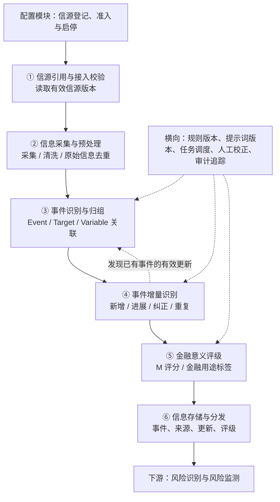
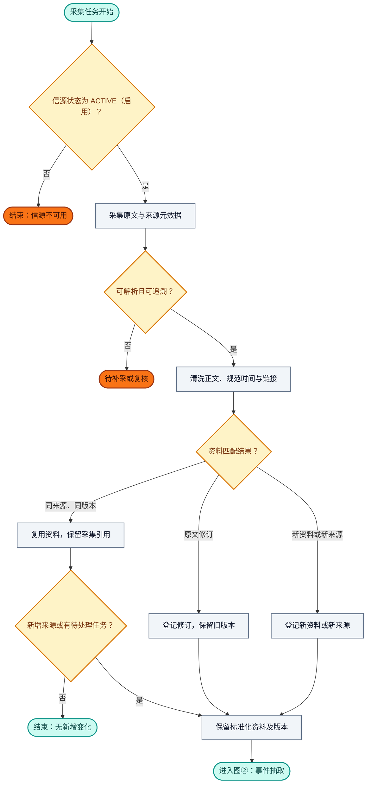
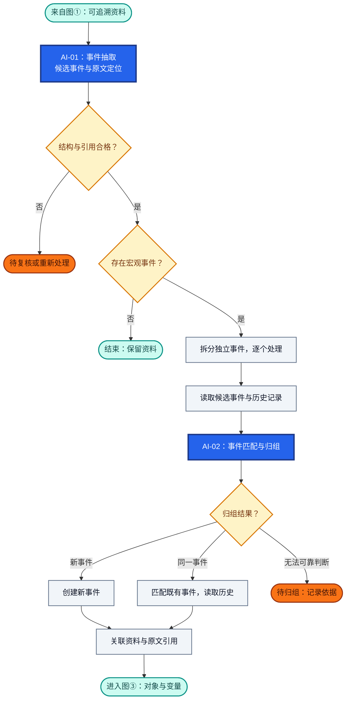
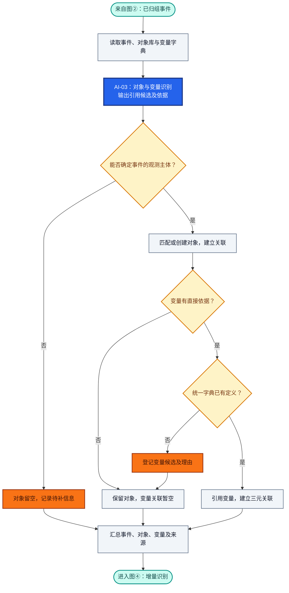
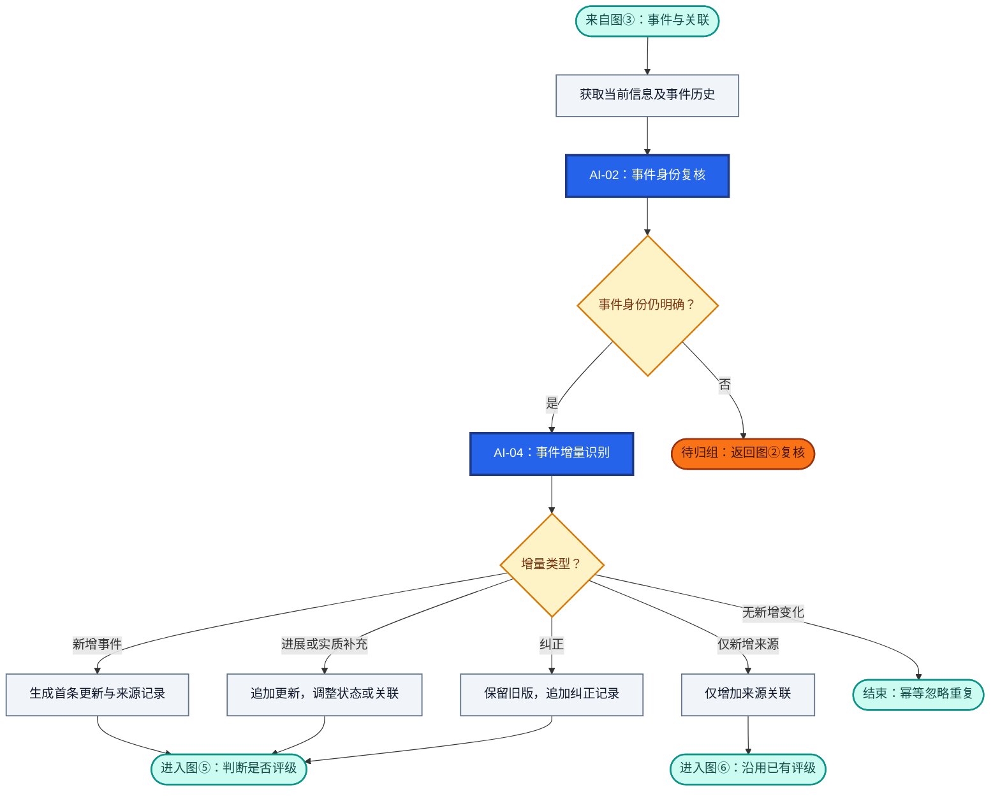
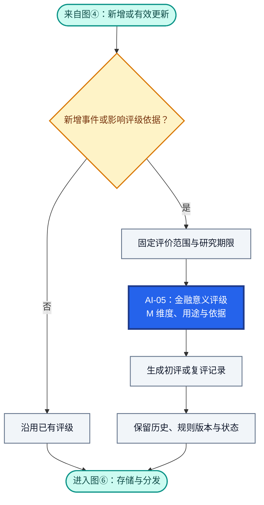
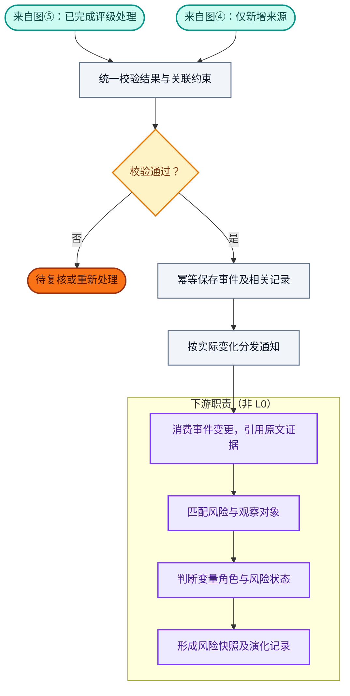
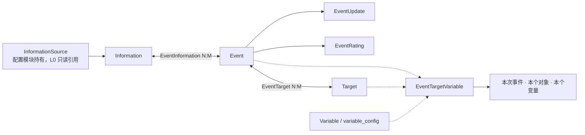

# RiskHot L0 信息处理层：业务架构与领域设计

> **文档版本**：V1.0（2026-10-09 讨论整合版）  
> **设计范围**：RiskHot / L0 信息处理层 / 宏观领域  
> **文档性质**：业务架构与领域设计草案，可用于后续详细设计  
> **设计基线**：以本轮确认的 Event、Target、Variable、`event_target_variable` 方案为准。  
> **说明**：评分模型中的具体权重尚待验证，不把方案性参数视为已经通过的业务决策。

## 1. 业务能力与职责设计

### 1.1 业务定位与总体职责

L0 将来自可信信源的宏观资讯转化为**可追溯、可归组、可更新、可评级、可供后续风险分析使用的事件（Event）**。

L0 对信息的来源可追溯、事件身份与阶段表达、观测主体和变量引用、事件变化记录及金融意义评价负责，并向下游交付稳定的事件、对象和变量标识以及原文引用链。

原始资料以 Information 管理，结构化事件以 Event 管理；同一资料可以包含多个事件，同一事件也可以持续关联多份资料。各项能力围绕事件持续积累来源、更新与评级，支撑后续风险识别和观测。

信源登记、准入及启停的业务定义以[[tools/RiskHot/03-业务功能需求/02. RiskHot_配置模块功能需求规格说明书_V1.0#FR-L0-01 信源登记、准入与启停|配置模块 FR-L0-01]]为准；L0 仅消费有效信源版本，不重复维护信源身份或准入决定。

### 1.2 核心业务能力与责任


| 业务能力     | 回答的业务问题               | L0 承担的责任                                                                 | 主要交付结果                                                 |
| -------- | --------------------- | ------------------------------------------------------------------------ | ------------------------------------------------------ |
| 信源引用与接入校验 | 信息从哪里来，哪些来源可以使用？ | 读取配置模块维护的信源身份、版本和启停状态，校验本次接入资格，保留原始发布主体 | 有效 InformationSource 引用与接入检查结果 |
| 信息采集与预处理 | 如何将不同来源的资料变为可追溯输入？    | 采集和清洗原文，规范链接与时间，处理资料重复与原文修订，保留来源元数据和正文版本                                 | 标准化原始资料及版本记录（Information）                              |
| 事件识别与归组  | 发生了什么，是否属于同一事件，作用于什么？ | 识别宏观事件的主体、行为、状态与时间；判断新事件或既有事件；关联宏观 Target 与有直接依据的统一 Variable，保留原文定位和待确认项 | Event、EventInformation、EventTarget、EventTargetVariable |
| 事件增量识别   | 相比既有记录，出现了什么新变化？      | 区分新增、进展、实质补充、来源增加、纠正与重复；维护事件状态和变化历史，避免重复生成业务进展                           | 增量类型、EventUpdate 及来源变化记录                               |
| 金融意义评级   | 事件对指定宏观观察范围有什么金融意义？   | 在明确评价范围和研究期限下给出 M 维度评价、金融用途标签与依据；按需复评，保留规则版本和历史评级                        | 金融意义评价与用途标签（EventRating）                               |
| 信息存储与分发  | 下游怎样稳定引用和持续跟踪事件？      | 校验标识与关联约束，幂等保存事件及其来源、更新、评级；提供检索和变更通知，保留历史引用                              | 可检索的结构化事件、稳定 ID、来源链和事件变更通知                             |


**横向质量与追溯职责**：各项能力共同保留规则、提示词及模型版本、原文引用和处理记录；通过任务调度、结构校验、人工校正与审计追踪支持复核和重新处理。对象、变量或归组关系无法可靠判断时，保留空值或待确认状态，不编造引用或强行合并。

能力清单定义 L0 持续承担的业务责任；第 2 章进一步说明这些能力如何组成处理流程。

### 1.3 六个业务环节职责


| 编号  | 业务环节     | 输入                                      | 核心处理                                | 输出                                                     |
| --- | -------- | --------------------------------------- | ----------------------------------- | ------------------------------------------------------ |
| 01 | 信源引用与接入校验 | 配置模块发布的有效信源及版本 | 读取启停状态（即业务准入）、核对范围及技术接入条件；不维护来源业务配置 | `InformationSource` 引用与接入资格 |
| 02  | 信息采集与预处理 | 可用信源                                    | 增量采集、抽取正文、统一时间和链接、资料级去重             | `Information`                                          |
| 03  | 事件识别与归组  | Information、已有 Event、Target、Variable 字典 | 提取事件、判断同事件、匹配／创建 Target、引用 Variable | Event、EventInformation、EventTarget、EventTargetVariable |
| 04  | 事件增量识别   | 当前信息、事件既有状态及更新历史                        | 判断新事件、事件进展、新佐证、纠正或纯重复               | EventUpdate、增量类型                                       |
| 05  | 金融意义评级   | Event、观测主体、涉及变量、增量信息                    | 识别金融关联、给出 M 维度评价、金融用途分类             | EventRating                                            |
| 06  | 信息存储与分发  | 上述全部结构化结果                               | 幂等入库、关联约束、版本保留、事件订阅与检索              | 持久化 Event 及对下游的事件变更通知                                  |


### 1.4 首版职责覆盖范围


| 维度   | L0 V1 范围                                 |
| ---- | ---------------------------------------- |
| 领域   | **宏观**：经济体、宏观政策主体、金融系统、主要金融市场、宏观经济部门     |
| 信源   | 第一手官方信息、官方公开数据、权威机构公开研究与报告               |
| 信息粒度 | Information（原始资料）与 Event（结构化事件）分别管理      |
| 事件形态 | 已发生、正在推进、已宣布、计划或预期的宏观事件；使用事件状态表达阶段       |
| 变量   | 共用全局 `variable_config`，按具体事件建立事件—对象—变量关联 |
| 评级   | 金融意义 M；投资／融资／投机等金融用途标签，可多选               |
| 演进   | 同一事件的新增报道、进展、实施、纠正与状态变化                  |
| 交付   | 向后续风险识别、风险变量分析、风险快照与演化分析提供结构化输入          |


### 1.5 上下游职责分工

上游信源提供原始公告、数据、研究与报告；配置模块维护来源身份、分类、准入、启停及版本，L0 读取有效信源并负责接入资格检查、资料接入及结构化处理。下游以 L0 交付的事件、对象、变量和原文证据为输入，承担风险识别、风险判断与持续观测职责。


| 层次       | 关注点                       | 核心产物                               |
| -------- | ------------------------- | ---------------------------------- |
| L0 信息处理层 | 可信信息、事件、观测主体、变量引用、增量、金融意义 | Event、EventUpdate、EventRating、关联关系 |
| 下游风险识别层  | 哪项风险受到新事件触发或影响，为什么        | 风险匹配、风险源与变量关系                      |
| 下游风险观测层  | 哪些观测值变化，风险现处于何种状态         | 变量证据、风险快照、风险演化轨迹                   |


> 重要区分：Event 的 Target 是**事件的观测主体**；`risk.observation_target` 是**某项风险判断针对的观察对象**。两者在含义和范围一致时可映射，但不自动视为同一个业务身份。


### 1.6 职责边界与暂不承担事项

- 不对每条资料进行独立的事实可信度 C 打分，不开展逐条事实核验工作流；原文定位和来源关联仍须保留。
- 不强制将原始信息拆成“事实”和“预测”两条业务流水线；通过事件状态、时间类型和描述保留阶段差异。
- 不设置独立处理优先级 P 评分。首版展示或研究排序可先参考 M 和是否存在有效增量。
- 不在 L0 形成风险等级、风险方向、风险传导结论、投资建议或交易决策。
- 不创建企业、行业和单项资产的独立微观 Target；这类内容只有在服务宏观事件描述时作为文本上下文保留。
- 不为 Target 预配置固定 Variable 集合；仅记录**某次 Event 在某个 Target 上关联的 Variable**。
- 不单独创建通用 Entity 领域模型；事件行为主体在 Event 中表达，跨事件复用的观测主体由 Target 独立管理。


## 2. 业务架构设计


### 2.1 L0 总体业务流程




> 六个环节是业务职责划分，部署时允许通过不同任务、异步队列或同一服务执行；流程不要求每个环节对应独立微服务。


### 2.2 业务流程图（详细版，带阶段）

全局处理顺序见第 2.1 节。以下拆成六张详图，图内圆角节点标明入口、出口或暂停状态；“图①—图⑥”为阅读编号，与第 1.3 节的业务环节对应关系如下。


| 详图  | 处理内容       | 对应业务环节                        |
| --- | ---------- | ----------------------------- |
| 图①  | 信源准入与信息预处理 | 01 信源引用与接入校验、02 信息采集与预处理        |
| 图②  | 事件抽取与归组    | 03 事件识别与归组：确定事件身份             |
| 图③  | 对象与变量关联    | 03 事件识别与归组：关联 Target、Variable |
| 图④  | 事件增量识别     | 04 事件增量识别                     |
| 图⑤  | 金融意义评级     | 05 金融意义评级                     |
| 图⑥  | 存储分发与下游衔接  | 06 信息存储与分发，并标明下游职责            |


**颜色图例**：蓝底白字＝AI 分析任务；灰色＝程序处理；浅黄＝规则校验与结果分支；橙色＝不可用、待补采、待复核或待审核；青绿＝入口、出口与正常结束；紫色＝下游职责。

**AI 编号口径**：沿用第 6.1 节的统一任务编号。同一任务跨图复用时保持编号一致；图④中的事件身份复核复用 AI-02，事件增量识别使用 AI-04。图①和图⑥的 L0 步骤属于程序处理，不新增 AI 任务；下游 AI 任务不在本节定义。

#### 2.2.1 图①：信源准入与信息预处理




**处理口径**：准入检查读取白名单、来源资质与采集配置，引用 InformationSource 的准入档位和可选 S 分。采集保留正文、附件、原始出处、发布时间与抓取时间；按来源标识、URL 与内容指纹判重。不同来源的同内容材料仍保留来源关系，形成可追溯的 Information 及版本记录。

#### 2.2.2 图②：事件抽取与归组




**AI 与程序分工**：AI-01 输出事件候选和原文定位，AI-02 输出归组建议及理由；程序检查字段、引用、ID 和归组阈值，再按结果分支创建或匹配事件，不合格结果进入复核。

**处理口径**：抽取保留主体、行为、事件状态和时间语义。归组同时比较主体、行为、观测主体、时间范围及政策或行动标识；新事件标记 `NEW_EVENT`，既有事件读取状态、来源与更新历史，无法判断时记录 `UNRESOLVED` 并保留待归组任务，禁止强行合并。资料关系使用 EventInformation，保存原文位置。

**多事件处理**：一份 Information 可以关联多个 Event。自本图拆分后，各事件独立完成图③—图⑥；某个事件待复核或无增量，不阻断其他事件。

#### 2.2.3 图③：对象与变量关联




**AI 与程序分工**：AI-03 输出对象、变量候选与直接引用依据；程序检查对象范围、变量定义是否存在及关系约束，再建立关联或登记待审核项。

**处理口径**：Target 按事件观测主体的宏观范围规则匹配或创建，关系记为 EventTarget；无法确定对象时仍保留 Event 与来源。变量引用全局 `variable_config`，三元关系使用 `event_target_variable(event_id, target_id, variable_id)`。变量候选未经审核不填写虚假 ID；缺少直接依据时保留 EventTarget、允许三元关联为空，不推测后续传导变量。

#### 2.2.4 图④：事件增量识别




**AI 与程序分工**：AI-02 根据本轮信息复核事件身份；身份明确后，AI-04 对比事件历史，输出增量类型、变更说明与状态变化。程序校验结果并按类型生成更新或来源记录；身份无法确认时返回图②待归组。

**增量与动作**：


| 增量类型                                   | 记录要求                              |
| -------------------------------------- | --------------------------------- |
| `NEW_EVENT`                            | 生成首条 EventUpdate 与来源记录            |
| `EVENT_PROGRESS` / `MATERIAL_ADDITION` | 追加 EventUpdate，按需更新事件状态和对象、变量关联   |
| `CORRECTION`                           | 保留旧版本，追加纠正记录并更新事件描述               |
| `SOURCE_ADDITION`                      | 仅增加来源关联，不记为实质业务进展，沿用已有评级          |
| `DUPLICATE`                            | 幂等忽略，不重复生成更新或发布通知                 |
| `UNRESOLVED`                           | 新证据使事件身份存疑时，记录判断依据，保留待归组任务并返回图②复核 |


#### 2.2.5 图⑤：金融意义评级




**AI 与程序分工**：程序结合新增事件标记、增量结果及评级规则判断是否初评或复评，准备评价范围和期限；AI-05 输出 M 维度判断、用途标签与依据，程序保留评级记录与版本，并在图⑥完成统一校验。

**评级口径**：评价范围使用 `assessment_scope`，金融用途包括投资、融资、投机／情绪，允许多标签及无法判断状态，结果记录为 EventRating。M 权重尚待验证，规则未定时总分允许为空，保留维度评价与草案状态。纯来源增加由图④直接进入图⑥；M 不代表风险等级、风险方向或投资收益概率。

#### 2.2.6 图⑥：存储分发与下游衔接




**校验与存储**：检查结构化结果、ID、关联约束、时间语义、状态及更新幂等性；保存 Event、来源关系、对象与变量关联、EventUpdate、EventRating，并保留原文版本、规则／提示词／模型版本及审计轨迹。前述图中的事件创建、关系变更和更新记录在此统一校验并持久化，Information 原文及版本在图①预处理时保留。

**通知按实际变化产生**：


| 业务通知                    | 适用变化               |
| ----------------------- | ------------------ |
| `event_created`         | 新增事件               |
| `event_updated`         | 事件进展、作用变量或状态发生有效变化 |
| `event_rating_updated`  | 金融意义评价或用途标签更新      |
| `event_source_attached` | 仅新增来源关联，不发布为实质事件进展 |


**复核与下游边界**：复核完成后回到对应处理步骤；归组调整保留合并／拆分审计。下游引用 Event、Target、Variable 与原文证据，自行判断风险方向、传导关系和变量角色，并形成风险判断、快照与演化记录。

## 3. 业务规则设计


### 3.1 信源准入与原文可追溯

**状态定义（2026-10-13）**：业务准入等同于启停，统一由 `admission_status` 表达，不再设独立准入审核状态。ACTIVE 表示启用，PAUSED／DISABLED 均不允许新采集；新登记默认 DISABLED。技术就绪由 L0／运行侧单独判断，连接失败不自动改变业务状态。历史标题保留用于已有引用。

1. 首版建立信源白名单：中央银行、财政与统计部门、监管机构、正式政府公告和权威国际／研究机构等。
2. 信源可信程度在**配置模块的信源管理**中维护，可使用准入档位及可选 S 分；每次事件分析引用既有信源标识，不重复计算发布者的长期信用。
3. 采集必须记录来源 ID、原始 URL／资料标识、标题、发布时间、抓取时间及正文版本。
4. 对转载材料记录原始发文主体和转载主体；能识别原始出处时优先引用原始文本。
5. 对 AI 抽取或概述的具体结论保存其对应的原始信息 ID 与证据片段位置。此规则属于**溯源与结构化质量保障**，不构成逐条事实核验评级。


#### 信源分类与排序的维度


| 维度    | 分类方式                       | 解决的问题         |
| ----- | -------------------------- | ------------- |
| 信源等级  | T1 官方一手、T1.5 官方账号、T2 媒体及博主 | 信息来源是否权威、如何核验 |
| 金融属性  | 钱的数量、价格、流向、风险偏好、资源配置       | 影响钱的哪个维度      |
| 观察层级  | 宏观（美联储）、中观（中国央行）、微观（企业）    | 信息作用于哪个层级     |
| 关注优先级 | 核心关注、重点关注、一般关注             | 哪些信源值得优先跟踪    |
| 时效性   | 实时、每日、每周、每月、不定期            | 应该多频繁地监测      |
| 信息功能  | 原始数据、政策发布、事件报道、观点分析        | 该信源能提供什么价值    |


核心字段的分类规则


| 字段                      | 建议枚举值                                                  | 配置规则                      |
| ----------------------- | ------------------------------------------------------ | ------------------------- |
| `source_tier`           | `T1`、`T1_5`、`T2`                                       | 根据发布渠道和原始证据属性确定，不随关注优先级变化 |
| `observation_levels`    | `MACRO`、`MESO`、`MICRO`                                 | 支持多选，一个信源可能覆盖多个层级         |
| `financial_dimensions`  | `QUANTITY`、`PRICE`、`FLOW`、`RISK_APPETITE`、`ALLOCATION` | 支持多选，表示信源主要覆盖的金融属性        |
| `attention_priority`    | `CORE`、`HIGH`、`NORMAL`                                 | 单选，用于决定系统优先监测哪些信源         |
| `monitor_frequency`     | `REALTIME`、`DAILY`、`WEEKLY`、`MONTHLY`、`IRREGULAR`      | 单选，表示系统计划采集或检查的频率         |
| `information_functions` | `RAW_DATA`、`POLICY`、`EVENT`、`ANALYSIS`                 | 支持多选，描述该信源主要提供的信息形式       |
| `admission_status`      | `ACTIVE`、`PAUSED`、`DISABLED`                           | 唯一业务状态：启用即准入；暂停／停用禁止新采集，技术就绪另行检查 |


### 3.2 Event 定义与识别边界

**Event 定义**：在明确时间语境下，由特定宏观主体发起或体现、包含相对完整的行为、决定或状态变化，并能被持续追踪的事件单元。

基础判断要素：**主体 Subject + 行为／变化 Action + 时间 Time**；Target 与 Variable 为后续归组、分析提供稳定引用。

- 同一核心行为在不同报道中的描述，应归入同一 Event。
- 同一主体于不同时点做出的相互独立决定，通常建立不同 Event。
- “宣布—推进—实施—完成”等属于同一政策或行动生命周期的连续进展时，以 EventUpdate 体现；发生明确独立决定或新的政策措施时，建立新 Event 并可记录关联。
- Event 允许描述预期或计划中的具体变化；必须保留 `event_status` 与时间语义，以免把预计日期解释为已经执行的日期。
- 一篇汇总材料可能识别多个 Event；仅凭标题主题、发布机构相同、关键词相似，不能直接合并事件。


### 3.3 Target 定义与边界

**Target 定义**：事件的观测主体，即在事件分析中被观测、用于记录该事件作用及相关变量变化的主体，具有稳定身份和明确范围，可被多个 Event 共同引用。首版主体类型仍限于下列五类宏观范围。

**术语约定（2026-10-12 用户确认）**：Target 统一称为“事件的观测主体”。它与 Event 中发起、执行或体现事件行为的主体（Subject）分别表达；与 L1 风险观察对象仅在身份及范围一致时映射。此次更名保留原有类型范围、身份和关联规则。

首版支持的 Target 类型：


| `target_type`       | 范围     | 示例               |
| ------------------- | ------ | ---------------- |
| `economy`           | 经济体    | 中国经济、美国经济        |
| `macro_institution` | 宏观政策主体 | 中国人民银行、美国联邦政府    |
| `financial_system`  | 金融体系   | 中国银行体系           |
| `financial_market`  | 金融市场   | 中国银行间货币市场、中国国债市场 |
| `economic_sector`   | 宏观经济部门 | 中国居民部门、中国政府部门    |


稳定身份至少由**名称／代码、国家或辖区、对象类型、范围说明**共同确定。不同口径或不同辖区应分别建 Target。

Target 可以出现在多个事件中；同一事件也可作用于多个 Target。事件行为主体保存在 Event 的 `subject_name` 等字段中，只有当它同时构成事件的观测主体时，才将其纳入 EventTarget。

### 3.4 Variable 定义与事件关联

Variable 使用全局变量定义库 `variable_config`，沿用统一的 `variable_id`、名称、定义、单位和解释口径。**不设置** `variable_config.target_id` **归属字段**。

事件涉及的变量由 `event_target_variable(event_id, target_id, variable_id)` 记录：

- `event_id`：哪次事件。
- `target_id`：本次事件的观测主体身份。
- `variable_id`：此次事件具体涉及哪个统一变量。

L0 优先提取**事件直接涉及、宣布改变或有来源记录发生变化的变量**；融资成本、信用扩张、资产估值等后续传导变量由下游风险分析判断。缺少直接依据时可留空。

### 3.5 事件归组与增量规则

事件归组须同时比较**主体、行为、观测主体、时间范围、政策或行动标识**。建议输出下列判断：


| 分类                  | 定义                  | 系统动作                       |
| ------------------- | ------------------- | -------------------------- |
| `NEW_EVENT`         | 可独立识别的新事件           | 创建 Event                   |
| `EVENT_PROGRESS`    | 同一事件出现实施、结果或状态推进    | 追加 EventUpdate，必要时调整 Event |
| `MATERIAL_ADDITION` | 同一事件新增关键数字、范围或影响条件  | 追加 EventUpdate，必要时复评 M     |
| `SOURCE_ADDITION`   | 同一事件出现新来源，无实质业务内容变化 | 增加来源关联，通常无需复评              |
| `DUPLICATE`         | 已有相同资料或重复内容         | 幂等忽略重复输入                   |
| `CORRECTION`        | 原来源更新或纠正先前内容        | 保留旧版本，写入纠正记录并更新事件描述        |
| `UNRESOLVED`        | 不能可靠区分新事件与既有事件      | 保留待归组任务，禁止强行合并             |


归组与增量之间存在双向反馈：归组确定事件身份，增量判定负责更新事件历史；出现新证据时可重新归组，并记录合并／拆分审计。

### 3.6 金融意义 M 及金融用途

**金融意义 M 的目标**：衡量 Event 在指定宏观观察范围内，对关键金融变量、资源配置、经济运行约束或资产定价条件的潜在重要程度。评价时须固定 `assessment_scope` 和研究期限。

目前已确认：**保留 M 为 L0 的核心评分，并保留金融用途标签**。五维权重尚未由历史数据或文章原文提供直接量化依据，以下仅为**候选评分方案**：


| 候选维度     | 候选权重 | 判断内容                     |
| -------- | ---- | ------------------------ |
| B：底层变量关联 | 30%  | 是否涉及重要货币、信用、财政、供需或其他基础约束 |
| D：影响程度   | 25%  | 对事件观测主体的作用可能有多大          |
| T：持续时间   | 20%  | 影响预计持续多久                 |
| W：影响范围   | 15%  | 覆盖多少关键市场、部门或金融环节         |
| L：作用落地   | 10%  | 从计划、宣布、执行到可观察结果推进到何种阶段   |


若以上候选方案被确认，0—5 分的计算表达式为：

`M = 6×B + 5×D + 4×T + 3×W + 2×L`（总分 0—100）。

在权重确认前，系统应支持存储各维度评价、评分规则版本与说明；正式等级门槛继续留为配置项。**原文强调重视底层信息及投资／融资／投机区分；这五个维度和比例属于后续工程化提案。**

金融用途标签：`investment`（投资判断）、`financing`（融资活动）、`speculation_sentiment`（投机／情绪观察）；允许多标签及无法判断状态。**金融用途类别不自动决定 M 的高低。**

L0 的 M 是信息研究重要性，不能直接理解为风险严重程度、行情涨跌幅或投资收益概率。

## 4. 核心领域模型


### 4.1 领域关系总览




### 4.2 领域对象说明


| 领域对象                      | 角色             | 主要业务责任              | 生命周期特征             |
| ------------------------- | -------------- | ------------------- | ------------------ |
| `InformationSource` | 配置模块持有的信源实体 | 配置模块维护身份、分类、准入与启停；L0 只读引用有效版本 | 跨多条 Information 复用 |
| `Information`             | 原始资料实体         | 保存原文、出处和版本          | 一份材料可关联多个 Event    |
| `**Event**`               | **核心事件实体／聚合根** | 描述宏观变化、管理事件身份、状态与更新 | 被多次信息采集持续更新        |
| `**Target**`              | **独立领域实体**     | 提供可跨事件复用的观测主体身份与边界  | 与具体 Event 独立存在     |
| `**Variable**`            | **全局变量定义**     | 提供共享变量 ID、定义及口径     | 可被多个事件和下游风险模型引用    |
| `EventInformation`        | 关联对象           | 记录材料与事件的对应关系、引用方式   | 跨事件多对多             |
| `EventTarget`             | 关联对象           | 记录事件与其观测主体的关联       | 跨事件多对多             |
| `**EventTargetVariable**` | **三元关联对象**     | 记录本次事件涉及的具体对象与变量    | 随事件识别／更新而变化        |
| `EventUpdate`             | 事件更新记录         | 保存新增变化、阶段推进和纠正历史    | 同一 Event 可产生多条     |
| `EventRating`             | 评级记录           | 保存 M、用途标签、评估范围与规则版本 | 允许随着事件进展复评并留历史     |


### 4.3 核心关系基数

- 一条 Information 可以关联 **0..N** 个 Event；一个 Event 可以关联 **1..N** 条 Information（建事件时至少需要一个可追溯来源）。
- 一个 Event 可以关联 **0..N** 个 Target；一个 Target 可被 **0..N** 个 Event 引用。
- 一条 `event_target_variable` 唯一指明 **一组 Event + Target + Variable**；同一个 Variable 可出现在不同 Event、不同 Target 的关系中。
- Event 与 Variable 之间**没有固定直接归属**，Target 与 Variable 之间**没有固定静态归属**。
- EventUpdate、EventRating 由 Event 关联；修改 Event 的状态或说明不应删除历史更新与既有评级。


### 4.4 为什么保留 EventTarget

`event_target` 表示“该事件关联这个观测主体”；`event_target_variable` 进一步表示“本次事件在该主体上涉及哪个变量”。

当能够确定影响对象、暂时无法确定具体变量时，前者仍具有独立业务价值；后者允许为空。若将来数据稳定证明每个 EventTarget 都必定有变量，可评估合并存储，当前版本保留二者。

### 4.5 建议逻辑数据结构

> 下表为**建议的逻辑存储结构**。字段长度、数据类型和索引以数据库详细设计为准；既有 RiskHot 变量定义表沿用 `variable_config`，避免另建等价字典。


#### 4.5.1 `information_source`：信源

本表由配置模块维护，技术写入方为 `reference`；在本文保留字段定义用于说明 L0 的上游引用契约，不表示 L0 拥有信源写入权。具体职责与迁移边界见[[tools/RiskHot/04-系统架构设计/RiskHot_系统架构设计_V1.0#5.1.1 信源配置的唯一写入方|信源配置的唯一写入方]]；字段设计保持本表口径。


| 字段                         | 建议类型             | 说明                |
| -------------------------- | ---------------- | ----------------- |
| `source_id`                | UUID / PK        | 信源唯一标识            |
| `source_code`              | VARCHAR / UNIQUE | 稳定编码              |
| `source_name`              | VARCHAR          | 发布机构或站点名称         |
| `source_type`              | ENUM             | 来源类别：官方一手、权威机构等   |
| `source_tier`              | ENUM             | 信源等级：`T1`、`T1_5`、`T2`；启用时必填，按发布渠道与原始证据属性确定，不随关注优先级变化（§3.1） |
| `observation_levels`       | ENUM 多选          | 观察层级：`MACRO`、`MESO`、`MICRO`；一个信源可覆盖多个层级（§3.1） |
| `financial_dimensions`     | ENUM 多选          | 金融属性：`QUANTITY`、`PRICE`、`FLOW`、`RISK_APPETITE`、`ALLOCATION`；表示信源主要覆盖的钱的维度（§3.1） |
| `attention_priority`       | ENUM             | 关注优先级：`CORE`、`HIGH`、`NORMAL`；单选，决定系统优先监测哪些信源（§3.1） |
| `monitor_frequency`        | ENUM             | 信息时效性／监测频率：`REALTIME`、`DAILY`、`WEEKLY`、`MONTHLY`、`IRREGULAR`；单选（§3.1） |
| `information_functions`    | ENUM 多选          | 信息功能：`RAW_DATA`、`POLICY`、`EVENT`、`ANALYSIS`；描述信源主要提供的信息形式（§3.1） |
| `official_url`             | TEXT             | 来源定位地址            |
| `admission_status`         | ENUM             | 启停状态（业务准入即启停）：`ACTIVE`＝启用、`PAUSED`＝暂停、`DISABLED`＝停用；新登记默认 DISABLED，技术就绪独立判断 |
| `source_credit_score`      | NUMERIC / NULL   | 可选 S 信用分，仅由信源管理维护 |
| `created_at`, `updated_at` | TIMESTAMPTZ      | 审计时间              |

> 事实核验场景的"原始发布时间"与"数据口径"排序分别由 `information.published_at`（资料层）与资料口径说明承载；信源层面以 `monitor_frequency` 与条目口径说明近似表达（见配置 UI 文档 P-SRC-01 事实核验视图）。


**分类维度与物理字段的对应**（枚举值已于 §3.1 定版，字段落库细节仍归 D-08）：

| 业务维度 | 物理字段 | 状态 |
| --- | --- | --- |
| 信源等级（T1/T1.5/T2） | `source_tier` | 枚举已定（§3.1）；D-08 落表并回填存量数据 |
| 金融属性 | `financial_dimensions` | 枚举已定（§3.1）；多选存储形式（数组/关联表）归 D-08 |
| 观察层级 | `observation_levels` | 枚举已定（§3.1）；与风险源"分析层次"是同名不同对象，语义独立（见配置 UI 文档 P-RSK-03） |
| 关注优先级 | `attention_priority` | 枚举已定（§3.1） |
| 信息时效性 | `monitor_frequency` | 枚举已定（§3.1） |
| 信息功能 | `information_functions` | 枚举已定（§3.1）；多选存储形式归 D-08 |


#### 4.5.2 `information`：原始资料


| 字段               | 建议类型               | 说明              |
| ---------------- | ------------------ | --------------- |
| `information_id` | UUID / PK          | 信息 ID           |
| `source_id`      | FK                 | 来源信源            |
| `external_id`    | VARCHAR / NULL     | 来源侧原文 ID        |
| `canonical_url`  | TEXT / NULL        | 规范原始链接          |
| `title`          | TEXT               | 原始标题            |
| `content`        | TEXT               | 清洗后正文或结构化原文     |
| `published_at`   | TIMESTAMPTZ / NULL | 原始发布时间          |
| `collected_at`   | TIMESTAMPTZ        | 采集时间            |
| `content_hash`   | VARCHAR            | 内容指纹            |
| `raw_metadata`   | JSONB              | 来源特殊字段与原始资料版本定位 |


**唯一性建议**：优先按 `(source_id, external_id)`，其次使用规范 URL 和内容指纹识别资料级重复；发布时间未知应保持空值，不以抓取时间代替。

#### 4.5.3 `event`：事件主表


| 字段                     | 建议类型               | 说明                                                                                             |
| ---------------------- | ------------------ | ---------------------------------------------------------------------------------------------- |
| `event_id`             | UUID / PK          | 事件稳定 ID                                                                                        |
| `title`                | VARCHAR(300)       | 简明事件标题                                                                                         |
| `description`          | TEXT               | 事件核心变化与范围                                                                                      |
| `event_type`           | VARCHAR            | 货币政策、财政政策、宏观经济指标、金融市场变化等                                                                       |
| `subject_name`         | VARCHAR            | 行为发起者／变化主体名称                                                                                   |
| `subject_type`         | VARCHAR / NULL     | 央行、政府、统计部门、市场整体等                                                                               |
| `action_code`          | VARCHAR            | 下调、上调、发布、实施、变化、违约等                                                                             |
| `event_status`         | ENUM               | `expected` / `announced` / `in_progress` / `effective` / `completed` / `cancelled` / `unknown` |
| `event_time`           | TIMESTAMPTZ / NULL | 事件主要时间（精度不足允许空或附加年月值）                                                                          |
| `event_time_kind`      | ENUM               | 实际发生、宣布、预计、实施等时间语义                                                                             |
| `event_time_precision` | ENUM               | 日、月、季度、年或未知                                                                                    |
| `first_seen_at`        | TIMESTAMPTZ        | 首次识别时间                                                                                         |
| `updated_at`           | TIMESTAMPTZ        | 最近资料修改时间                                                                                       |


`event_time` 只表示主要时间轴定位；公告日、预期生效日和真实执行日可以记录于更新记录或扩展时间字段，防止混为同一天。

#### 4.5.4 `target`：事件的观测主体


| 字段                 | 建议类型             | 说明                              |
| ------------------ | ---------------- | ------------------------------- |
| `target_id`        | UUID / PK        | 对象稳定 ID                         |
| `target_code`      | VARCHAR / UNIQUE | 稳定业务编码，例如 `CN_INTERBANK_MARKET` |
| `target_name`      | VARCHAR          | 对象名称                            |
| `target_type`      | ENUM             | 经济体、宏观机构、金融系统、金融市场、经济部门         |
| `jurisdiction`     | VARCHAR          | 国家／辖区                           |
| `scope_definition` | TEXT             | 明确包含范围与边界                       |
| `parent_target_id` | FK / NULL        | 可选层级关联，当前不要求建立完整树               |
| `is_active`        | BOOLEAN          | 是否可被新增事件引用                      |


**没有** `target.variable_ids` **或静态 TargetVariable 表**。对象与变量的对应关系在具体 Event 的上下文中解释。

#### 4.5.5 `variable_config`：统一变量字典（沿用既有配置）


| 字段              | 说明                |
| --------------- | ----------------- |
| `variable_id`   | 全局稳定变量 ID，既有配置主键  |
| `variable_code` | 稳定语义编码（建议保留）      |
| `variable_name` | 变量名称              |
| `definition`    | 变量定义、观测边界与解释口径    |
| `unit`          | 量纲或单位，若变量为状态项可以为空 |
| `status`        | 启用状态，必要时维护        |


L0 对变量的处理为**优先匹配现有定义 → 未匹配时生成候选 → 审核后入库**，避免 AI 自动制造大量近义变量。

#### 4.5.6 `event_information`：事件与信息关联


| 字段                 | 建议类型                | 说明                  |
| ------------------ | ------------------- | ------------------- |
| `event_id`         | FK                  | 事件                  |
| `information_id`   | FK                  | 原始资料                |
| `information_role` | ENUM                | 初始来源、补充信息、进展来源、纠正来源 |
| `evidence_locator` | TEXT / JSONB / NULL | 原文段落、页码或数据区块定位      |


建议联合主键 `(event_id, information_id)`。

#### 4.5.7 `event_target`：事件与观测主体关联


| 字段              | 建议类型        | 说明            |
| --------------- | ----------- | ------------- |
| `event_id`      | FK          | 事件            |
| `target_id`     | FK          | 事件的观测主体       |
| `relation_note` | TEXT / NULL | 事件如何作用于该对象的简述 |


**联合主键**：`(event_id, target_id)`。

#### 4.5.8 `event_target_variable`：事件—对象—变量三元关联


| 字段                 | 建议类型        | 说明                    |
| ------------------ | ----------- | --------------------- |
| `**event_id**`     | **FK**      | **具体事件**              |
| `**target_id**`    | **FK**      | **该事件的具体观测主体**        |
| `**variable_id**`  | **FK**      | **本次事件涉及的统一变量**       |
| `relation_type`    | ENUM / NULL | 直接改变、宣布调整、已观察变化等      |
| `change_direction` | ENUM / NULL | 上升、下降、不变、未知；只记录有依据的方向 |
| `impact_status`    | ENUM / NULL | 预计、已宣布、执行中、已有观测结果     |
| `description`      | TEXT / NULL | 变量关联及具体变化说明           |
| `information_id`   | FK / NULL   | 对应支持本条关联的原始材料         |
| `created_at`       | TIMESTAMPTZ | 建立时间                  |


**联合主键**：`(event_id, target_id, variable_id)`。

**一致性约束**：

1. 外键 `(event_id, target_id)` 引用 `event_target(event_id, target_id)`。
2. `variable_id` 引用全局 `variable_config(variable_id)`。
3. `information_id` 如填写，应已关联此 Event；可用应用层校验，或通过复合外键实现。
4. 不要求 `(target_id, variable_id)` 在单独配置表中存在；这是本轮设计的明确结论。
5. 事件影响的具体数值与未来风险作用可在后续证据、指标或风险分析模型中管理，避免在本表反复创建派生判断。


#### 4.5.9 `event_update`：事件增量与历史


| 字段                | 建议类型               | 说明               |
| ----------------- | ------------------ | ---------------- |
| `event_update_id` | UUID / PK          | 更新 ID            |
| `event_id`        | FK                 | 所属事件             |
| `information_id`  | FK / NULL          | 引发更新的资料          |
| `update_type`     | ENUM               | 进展、实质补充、纠正、状态变化等 |
| `summary`         | TEXT               | 相比前次的新增信息        |
| `previous_status` | ENUM / NULL        | 更新前状态            |
| `current_status`  | ENUM / NULL        | 更新后状态            |
| `effective_at`    | TIMESTAMPTZ / NULL | 此次变化的实际或适用时间     |
| `recorded_at`     | TIMESTAMPTZ        | 入库记录时间           |


同一 Event 的更新按照变化时间与记录时间双轴保存；重复采集不能生成重复更新。

#### 4.5.10 `event_rating`：金融意义评级


| 字段                         | 建议类型           | 说明                   |
| -------------------------- | -------------- | -------------------- |
| `rating_id`                | UUID / PK      | 评级记录 ID              |
| `event_id`                 | FK             | 被评价的事件               |
| `assessment_scope`         | VARCHAR        | 评价所针对的宏观观察范围         |
| `financial_significance_m` | NUMERIC / NULL | 金融意义 0—100；规则未定时允许空  |
| `dimension_scores`         | JSONB / NULL   | 各维度 0—5 分或业务要求的结构化结果 |
| `financial_usages`         | JSONB / ARRAY  | 投资、融资、投机／情绪等用途标签     |
| `reasoning_summary`        | TEXT           | 为什么具有相关金融意义          |
| `method_version`           | VARCHAR        | 本次规则／权重版本            |
| `rating_status`            | ENUM           | 草案、已确认、待复评           |
| `evaluated_at`             | TIMESTAMPTZ    | 评价时间                 |


同一事件允许多次评价，通过时间与规则版本保留历史；新增事件进展仅在影响评级依据时触发复评。

## 5. 业务接口


### 5.1 L0 的输入与输出契约

**输入**：已准入 Source + 原始 Information + Target 字典 + 全局 Variable 字典 + 已有 Event 历史 + 评级规则配置。

**输出**：

- `event_created`：新增事件、首次来源、Target 与变量关联。
- `event_updated`：事件进展、作用变量或状态发生有效变化。
- `event_rating_updated`：金融意义评价或用途标签更新。
- `event_source_attached`：同事件新增可信资料来源，但尚无实质事件进展。

以上为**业务事件名称建议**，并不预设必须采用消息总线；首版可以通过数据库变更记录和任务调度完成下游消费。

### 5.2 与风险域共享的数据


| L0 产物                          | 下游使用方式                                    | 边界                                    |
| ------------------------------ | ----------------------------------------- | ------------------------------------- |
| `event_id` / `event_update_id` | 引用影响风险的新事件及进展                             | 风险层不得修改 L0 原始历史                       |
| `target_id`                    | 辅助匹配风险观察对象的范围                             | 与 `risk.observation_target` 映射须确认范围一致 |
| `variable_id`                  | 与 `risk_source_variable_relation` 等风险配置复用 | 下游自行判断变量在风险中的驱动、传导、缓冲或验证角色            |
| `information_id` / 来源定位        | 风险分析引用对应原文                                | 原始出处不能由 AI 概述替代                       |
| `financial_significance_m`     | 作为信息阅读／研究重要性的参考                           | 不直接等于风险等级、损害程度或风险方向                   |


### 5.3 核心验收场景


| 场景                               | 预期行为                                |
| -------------------------------- | ----------------------------------- |
| 同一公告重复抓取 3 次                     | 保留一个 Information 版本或幂等记录，不重复生成事件更新  |
| 两家官方机构材料描述同一宏观事件                 | 两条 Information 归组至同一 Event，维护两个来源关系 |
| 一份报告包括两个独立的政策决定                  | 一个 Information 关联两个 Event           |
| 两项宏观政策共同作用中国银行间货币市场              | 两个 Event 共用同一个 `target_id`          |
| 同一 Target 在不同事件关联不同 Variable     | 通过不同三元关联记录表达，未预先配置 TargetVariable   |
| Event 能确认 Target，但 Variable 尚未确定 | 允许 EventTarget 有效存在、三元关联为空          |
| 央行公告政策将来实施，之后正式落地                | 状态由已宣布推进，EventUpdate 留痕，并按需复评 M     |
| 变量在统一定义库中不存在                     | 生成变量候选及理由，未审核前不填虚假的 `variable_id`   |
| 同一来源修订关键数字                       | 保留原文版本，追加 CORRECTION 更新并修改展示状态      |
| 发生事件后，下游认为风险上升                   | 风险层维护风险判断，L0 仅保存事件与来源关联             |


## 6. AI 业务设计

### 6.1 AI 任务定义

L0 沿用 AI-01—AI-05 五项任务。AI 提供候选、判断与依据；程序负责输入准备、字段与引用校验、正式身份和关系写入。以下触发条件对应第 2.2 节既有业务流程，不新增调度阈值。

AI-02、AI-03、AI-04 可以按实际依赖适度往返处理；同一任务跨图复用时保持编号一致。输出经业务规则校验后进入持久化或人工复核，最终持久化时进行统一事务性校验。

**字段口径**：下列字段以第 4 章领域模型、第 2 章流程及第 3 章规则为依据。“对象.字段”用于定位所属对象，`[]` 表示集合元素，不是新增接口路径。已定义字段沿用原名；只有业务含义、尚未确定技术命名的项目使用中文名称并标注待定。输入中的正式 ID、截止时间和版本由程序提供，AI 只引用；字段表不等于已定稿的 JSON Schema、必填约束或数据库设计。

**AI 任务清单**

| 任务编号 | 任务名称 |
| --- | --- |
| `AI-01` | 事件抽取 |
| `AI-02` | 事件匹配与归组 |
| `AI-03` | Target 与 Variable 识别 |
| `AI-04` | 增量判定 |
| `AI-05` | 金融意义评级 |

#### 6.1.1 AI-01 事件抽取 定义

**任务编号**：`AI-01`

**触发条件**：图②：新资料通过信源准入、清洗和资料级去重，进入事件识别

**输入字段**

| 字段／业务项 | 内容与使用要求 | 来源／状态 |
| --- | --- | --- |
| Information.information_id | 当前资料身份，用于关联每条事件候选与出处 | §4.5.2，程序提供 |
| Information.source_id | 发布信源引用，须通过准入检查 | §4.5.2，程序提供 |
| Information.title | 原始标题，辅助定位主题，不作为唯一事件依据 | §4.5.2 |
| Information.content | 清洗后全文或结构化原文，保留可定位段落 | §4.5.2 |
| Information.published_at | 原始发布时间；未知保留空值 | §4.5.2 |
| Information.collected_at | 采集时间，只解释系统取得资料的时间 | §4.5.2，程序提供 |
| Information.canonical_url | 原文链接；与资料身份共同追溯 | §4.5.2，可空 |
| Information.raw_metadata | 来源特有信息与原文版本定位 | §4.5.2 |
| 事件类型字典 | 允许的事件类型及定义，供event_type分类 | 既有任务输入；字典字段名待定 |

**分析职责与步骤**

1. 通读标题、正文和发布时间，识别可定位的行为、决定或状态变化；排除只有泛泛主题而没有具体变化的表述。
2. 按主体、行为及时间语境切分候选：一份材料可对应多个事件，同一行为的重复段落只形成一个候选。
3. 为每个候选提取行为主体、行为、核心变化与范围，拟定标题，依据事件类型字典分类。
4. 分别识别宣布、预计发生、实施和实际发生的时间；填写时间种类、精度和事件状态，未知日期不得用采集时间替代。
5. 提取材料直接涉及的初步观测主体名称及范围线索，区分行为主体与观测主体；此步不创建Target或变量正式身份。
6. 将每项关键事实对应到资料ID和原文定位，记录缺失或歧义；输出0..N个事件候选，交AI-02判断事件身份。

**输出字段**

| 字段／业务项 | 内容与使用要求 | 来源／状态 |
| --- | --- | --- |
| title | 每个事件候选的简明标题 | Event逻辑字段，§4.5.3 |
| description | 该事件的核心变化和范围 | Event逻辑字段，§4.5.3 |
| event_type | 按输入字典识别的类型；不能确定时标记待核 | Event逻辑字段，§4.5.3 |
| subject_name | 发起、执行或体现变化的主体名称 | Event逻辑字段，§4.5.3 |
| subject_type | 主体类别；证据不足可空 | Event逻辑字段，§4.5.3 |
| action_code | 行为或变化的分类代码，依既有口径填写 | Event逻辑字段，§4.5.3 |
| event_status | expected、announced等既有状态，依据原文阶段判断 | Event逻辑字段，§4.5.3 |
| event_time | 事件主要时间；精度不足时可空并说明 | Event逻辑字段，§4.5.3 |
| event_time_kind | 该时间是宣布、预计还是实际发生等 | Event逻辑字段，§4.5.3 |
| event_time_precision | 日、月、季度、年或未知 | Event逻辑字段，§4.5.3 |
| 初步观测主体 | 名称、类型线索与范围描述，供AI-03复核 | 既有任务业务项；技术字段名待定 |
| information_id | 透传当前资料身份，不能由AI生成 | EventInformation引用，§4.5.6 |
| evidence_locator | 对应段落、页码或数据区块，支持核对事实 | §4.5.6；具体结构待定 |
| 待确认说明 | 时间、主体或事件边界不明确的具体问题 | 不确定性业务项；技术字段名待定 |

**交付边界**：输出为事件候选集合；集合包装格式待详细设计。正式event_id、first_seen_at及updated_at由程序在后续创建或复用事件时处理。

#### 6.1.2 AI-02 事件匹配与归组 定义

**任务编号**：`AI-02`

**触发条件**：图②：事件候选形成并召回已有事件；图④：当前信息与历史需要再次核对事件身份

**输入字段**

| 字段／业务项 | 内容与使用要求 | 来源／状态 |
| --- | --- | --- |
| 事件候选.title | 待归组的事件名称 | AI-01输出 |
| 事件候选.description | 行为、变化内容及范围 | AI-01输出 |
| 事件候选.subject_name | 行为主体 | AI-01输出 |
| 事件候选.action_code | 具体行为或变化 | AI-01输出 |
| 事件候选.event_time | 主要时间，与时间语义一起比较 | AI-01输出，可空 |
| 事件候选.event_time_kind | 宣布、预计或实际发生等时间语义 | AI-01输出 |
| 事件候选.event_status | 当前材料描述的阶段 | AI-01输出 |
| 事件候选初步观测主体 | 观测主体名称、类型和范围线索 | AI-01业务输出 |
| 已有Event.event_id | 程序检索召回的可匹配事件身份 | §4.5.3，程序提供 |
| 已有Event.description | 被召回事件的内容和范围，与其主体及行为字段共同比较 | §4.5.3 |
| 已有Event.subject_name | 被召回事件的行为主体 | §4.5.3 |
| 已有Event.action_code | 被召回事件的行为类别 | §4.5.3 |
| 已有Event.event_time | 被召回事件时间，结合event_time_kind与状态解释 | §4.5.3 |
| 已有Event.event_time_kind | 被召回事件时间的业务语义 | §4.5.3 |
| 已有Event.event_status | 已有事件所处阶段 | §4.5.3 |
| 已有Target引用及范围 | 已有事件的观测主体和作用范围 | §4.5.4、§4.5.7 |
| 当前资料与事件历史 | 图④复核时读取原文、来源及EventUpdate，核对是否仍为同一事件 | §2.2.4、§4.5.9 |
| 政策或行动标识 | 原文中的决定、措施或行动定位信息，不自造编码 | §3.5业务比较项；技术字段名待定 |

**分析职责与步骤**

1. 读取候选的主体、行为、时间、观测主体和政策／行动标识，明确本次要比较的事件单元。
2. 逐个检查程序召回的已有Event，比较核心行为与范围；名称、关键词或发布机构相同只能作为线索。
3. 核对时间语义和生命周期，区分同一行动的宣布—实施进展与同一主体在另一时点作出的独立决定。
4. 结合来源与历史更新解释相同和不同之处；图④出现新证据时复核先前身份判断，不因历史已关联就自动认定同一事件。
5. 形成同事件、新事件或待判定建议：同事件只能引用已有有效event_id，无法可靠区分时保留待判定及冲突依据。
6. 输出归组理由、逐项差异和证据定位，交程序校验ID与归组规则；具体增量类型交AI-04，不由本任务直接合并或改写历史。

**输出字段**

| 字段／业务项 | 内容与使用要求 | 来源／状态 |
| --- | --- | --- |
| 归组结论 | 新事件／同事件／待判定；沿用§3.5语义，正式枚举映射待定 | 任务处理结果，技术字段名待定 |
| 匹配的event_id | 同事件时引用输入中的已有身份；新事件或无法确认时不生成正式ID | §4.5.3身份引用，包装字段名待定 |
| 主体与行为比较 | 说明哪些事实支持或否定核心行为一致 | §3.2、§3.5业务项，技术字段名待定 |
| 时间与阶段比较 | 说明生命周期连续性或独立决定的时间差异 | §3.2、§3.5业务项，技术字段名待定 |
| 范围与标识比较 | 说明观测主体、作用范围、政策或行动标识的异同 | §3.5业务项，技术字段名待定 |
| 归组理由 | 汇总为何匹配、为何不匹配或为何不能确定 | 既有任务输出；技术字段名待定 |
| information_id | 支持归组判断的资料身份 | §4.5.6引用，可多项 |
| evidence_locator | 与每项判断相对应的原文定位 | §4.5.6引用 |
| 待复核事项 | 多个可能匹配、证据冲突或时间范围缺失等具体问题 | 既有待判定输出；技术字段名待定 |

**交付边界**：只建议身份归属。新建、归组、合并／拆分及审计由程序和既有复核流程执行；不增加自动合并阈值。

#### 6.1.3 AI-03 Target 与 Variable 识别 定义

**任务编号**：`AI-03`

**触发条件**：图③：事件身份明确，进入观测主体与变量关联识别

**输入字段**

| 字段／业务项 | 内容与使用要求 | 来源／状态 |
| --- | --- | --- |
| Event.event_id | 当前事件身份；由前序流程确定 | §4.5.3 |
| Event.description | 事件直接改变或宣布改变的内容 | §4.5.3 |
| Event.subject_name | 用于区分行为主体与观测主体 | §4.5.3 |
| Event.event_status | 判断关联处于预计、宣布或已有结果阶段 | §4.5.3 |
| Target.target_id | 可复用对象身份 | §4.5.4 |
| Target.target_code | 对象稳定代码 | §4.5.4 |
| Target.target_name | 现有观测主体名称 | §4.5.4 |
| Target.target_type | 首版允许的宏观类型 | §3.3、§4.5.4 |
| Target.jurisdiction | 国家或辖区，用于区分同名对象 | §4.5.4 |
| Target.scope_definition | 对象包含范围与边界 | §4.5.4 |
| Target.is_active | 对象是否允许新增引用 | §4.5.4，程序提供 |
| variable_config.variable_id | 全局变量身份 | §4.5.5 |
| variable_config.variable_name | 正式变量名称 | §4.5.5 |
| variable_config.definition | 变量定义、观测边界和解释口径 | §4.5.5 |
| variable_config.unit | 单位或量纲；状态变量可空 | §4.5.5 |
| variable_config.status | 正式变量有效状态 | §4.5.5 |
| Information.information_id | 当前原始资料身份，供关系证据引用 | §4.5.2，程序提供 |
| Information.content | 支持对象及直接变量关系的原文 | §4.5.2 |
| event_information.evidence_locator | 当前事件对应的证据位置 | §4.5.6 |

**分析职责与步骤**

1. 读取事件变化及直接证据，确定哪些对象是本次观测主体；行为发起者只有同时被观测时才纳入。
2. 按名称、辖区、类型和范围逐项匹配Target库；不因名称近似而合并不同口径的对象。
3. 对每个对象提取原文直接涉及、宣布调整或已观察变化的变量，排除只凭传导推测得到的后续变量。
4. 按定义、观测边界和单位匹配全局变量；存在正式匹配项时复用variable_id，无法匹配时记录候选及理由。
5. 为有依据的对象—变量组合说明关系类型、变化方向和作用阶段，并关联原始资料；没有变量依据时只保留EventTarget建议。
6. 整理可复用引用、新对象或新变量候选及待确认问题，交程序检查类型范围、有效性和复合关系后再建立正式关联。

**输出字段**

| 字段／业务项 | 内容与使用要求 | 来源／状态 |
| --- | --- | --- |
| EventTarget.event_id | 引用本次事件身份 | §4.5.7，透传 |
| EventTarget.target_id | 匹配已有对象时引用；新对象候选不编造ID | §4.5.7 |
| EventTarget.relation_note | 事件如何作用于该观测主体 | §4.5.7 |
| Target候选.target_name | 未找到匹配项时的对象名称建议 | 复用§4.5.4属性，候选载体待定 |
| Target候选.target_type | 在宏观允许类型内提出分类 | 复用§4.5.4属性 |
| Target候选.jurisdiction | 候选所属国家或辖区 | 复用§4.5.4属性 |
| Target候选.scope_definition | 候选对象的明确范围 | 复用§4.5.4属性 |
| event_target_variable.event_id | 当前事件引用 | §4.5.8，透传 |
| event_target_variable.target_id | 与本次EventTarget一致的正式对象引用 | §4.5.8；未获身份前不形成正式关系 |
| event_target_variable.variable_id | 匹配现有全局变量时引用 | §4.5.8；未获身份前不形成正式关系 |
| event_target_variable.relation_type | 直接改变、宣布调整或已观察变化等关系语义 | §4.5.8，正式枚举待定 |
| event_target_variable.change_direction | 有依据的上升、下降、不变或未知 | §4.5.8 |
| event_target_variable.impact_status | 预计、已宣布、执行中或已有观测结果 | §4.5.8 |
| event_target_variable.description | 本次关系及具体变化的说明 | §4.5.8 |
| event_target_variable.information_id | 支持本关系且已关联事件的资料引用 | §4.5.8 |
| 变量候选名称与定义 | 未匹配变量的名称、定义、单位及观测边界建议 | 候选业务项；技术字段名待定 |
| 候选及关系证据 | 原文定位、匹配理由与不能确认的部分 | §6.2证据要求；候选包装结构待定 |

**交付边界**：对象、变量和关系可以有多项。候选内容与正式引用分别表达，程序批准并取得真实身份后才能写入正式三元关系；不建立静态Target—Variable归属。

#### 6.1.4 AI-04 增量判定 定义

**任务编号**：`AI-04`

**触发条件**：图④：当前信息与事件历史已准备，且事件身份复核通过

**输入字段**

| 字段／业务项 | 内容与使用要求 | 来源／状态 |
| --- | --- | --- |
| Event.event_id | 身份复核通过的当前事件 | §4.5.3 |
| Event.description | 已保存的事件内容 | §4.5.3 |
| Event.event_status | 更新前的事件状态 | §4.5.3 |
| Information.information_id | 本次输入资料身份 | §4.5.2 |
| Information.content | 本次原文内容，逐项与历史对照 | §4.5.2 |
| Information.published_at | 本次来源发布时间 | §4.5.2 |
| Information.raw_metadata | 原文版本和来源修订定位 | §4.5.2 |
| 历史EventUpdate.update_type | 已发生更新的类型 | §4.5.9 |
| 历史EventUpdate.summary | 已记录的增量内容 | §4.5.9 |
| 历史EventUpdate.effective_at | 历史变化的实际或适用时间 | §4.5.9 |
| 历史EventUpdate.recorded_at | 历史记录入库时间，与变化时间区分 | §4.5.9 |
| 历史Information.content | 对照旧版数字、范围、条件和表述 | §4.5.2 |
| 历史来源关系及证据定位 | 核对新来源还是已知重复材料 | §4.5.6 |

**分析职责与步骤**

1. 确认事件身份仍明确；发现独立决定或无法解释的身份冲突时，提出返回AI-02复核，不强行写入当前事件。
2. 按数字、对象范围、实施阶段、条件及来源逐项比较当前材料与历史，区分重复措辞和实质业务变化。
3. 按§3.5分类为新事件首条内容、事件进展、实质补充、来源补充、重复、纠正或待判定；独立新事件须先返回归组确认身份。
4. 对需要更新的内容记录新增事实、旧值与新值的文字差异、更新前后状态及变化适用时间；不把记录时间当作变化时间。
5. 为纠正内容指出被修订资料和原文位置，保留历史依据；仅新增来源时说明无实质变化，重复输入不建议生成更新。
6. 输出增量判断与证据供程序去重、检查时间序列和状态合法性；是否复评金融意义由后续流程结合评级依据决定。

**输出字段**

| 字段／业务项 | 内容与使用要求 | 来源／状态 |
| --- | --- | --- |
| 增量分类 | 沿用§3.5的NEW_EVENT、EVENT_PROGRESS、MATERIAL_ADDITION、SOURCE_ADDITION、DUPLICATE、CORRECTION、UNRESOLVED业务分类 | 任务处理字段名及与update_type映射待定 |
| event_id | 本次事件引用，不能擅自换成新ID | §4.5.9 |
| information_id | 引发判断的资料引用 | §4.5.9 |
| update_type | 需形成更新时填写对应进展、补充、纠正或状态变化语义 | §4.5.9；并非所有分类都生成更新 |
| summary | 相比历史新增或纠正了什么 | §4.5.9 |
| previous_status | 读取的更新前状态；无状态变化时按实际情况说明 | §4.5.9，可空 |
| current_status | 原文支持的更新后状态 | §4.5.9，可空 |
| effective_at | 此次变化实际或适用时间；不明可空 | §4.5.9 |
| information_role | 仅新增来源或建立来源关系时说明来源角色 | §4.5.6 |
| evidence_locator | 支持增量判断或纠正差异的原文定位 | §4.5.6 |
| 待复核事项 | 身份、数字、时间或状态冲突及需要补充的依据 | 业务处理项；技术字段名待定 |

**交付边界**：输出首先是处理建议，不能为SOURCE_ADDITION、DUPLICATE机械创建EventUpdate。event_update_id、recorded_at及正式历史写入由程序完成。

#### 6.1.5 AI-05 金融意义评级 定义

**任务编号**：`AI-05`

**触发条件**：图⑤：新增事件需要初评，或事件进展影响已有评级依据、需要复评

**输入字段**

| 字段／业务项 | 内容与使用要求 | 来源／状态 |
| --- | --- | --- |
| Event.event_id | 被评级事件引用 | §4.5.10 |
| Event.description | 事件变化、数值和范围 | §4.5.3 |
| Event.event_status | 计划、宣布、实施或已有结果等阶段 | §4.5.3 |
| Target.scope_definition | 事件观测主体范围 | §4.5.4 |
| 关联variable_id及定义 | 事件直接关联的全局变量及其含义 | §4.5.5、§4.5.8 |
| 关联change_direction | 有直接依据的变量变化方向 | §4.5.8 |
| assessment_scope | 本次固定的宏观评价范围 | §3.6、§4.5.10，程序提供 |
| 研究期限 | 本次评估针对的期限或窗口，不由AI静默改变 | §3.6业务项；技术字段名待定 |
| 评分规则与锚点 | 本轮可用维度、判定口径、权重及阈值；未确认部分明确标记 | §3.6；正式规则未定 |
| method_version | 本轮规则／权重版本 | §4.5.10，程序提供 |
| 原始依据及定位 | 原文、数据区块与事件来源关系 | §4.5.6 |
| 既有评级与新增进展 | 复评时的历史dimension_scores、reasoning_summary及本次EventUpdate | §4.5.9、§4.5.10；初评可无 |

**分析职责与步骤**

1. 固定assessment_scope和研究期限，核对规则版本与可用证据；明确本次是初评还是哪些依据变化引起的复评。
2. 按输入规则逐维分析事件与底层变量的关系、作用程度、持续时间、覆盖范围和落地阶段；候选五维方案只在其讨论状态内表达。
3. 为各维度保留支持证据、限制和判断理由；缺少量化锚点时给出文字评价，不虚构精确分值。
4. 分析事件对投资判断、融资活动或投机／情绪观察的用途，可多选；用途不能代替金融意义大小判断。
5. 组织dimension_scores与reasoning_summary；仅当已确认规则及输入充分时提供可复核的分值建议，确定性加权计算由程序按规则完成。
6. 复评时说明新增事实如何改变评价依据；输出带范围和版本的结果，规则未定时financial_significance_m保留空值，交程序校验与保存。

**输出字段**

| 字段／业务项 | 内容与使用要求 | 来源／状态 |
| --- | --- | --- |
| event_id | 被评价事件，透传既有引用 | §4.5.10 |
| assessment_scope | 与输入相同的评价范围 | §4.5.10 |
| dimension_scores | 各维文字判断或有规则依据的0—5分；内部维度结构沿用本轮配置 | §3.6、§4.5.10，细分结构待定 |
| financial_usages | investment、financing、speculation_sentiment等用途标签；可多选或待判断 | §3.6、§4.5.10 |
| reasoning_summary | 金融意义、证据、限制及复评变化的解释 | §4.5.10 |
| financial_significance_m | 0—100分；规则未确认或不充分时为空，程序校验或复算 | §4.5.10 |
| method_version | 透传采用的规则版本，不由AI生成新版本 | §4.5.10 |
| 评级证据定位 | 将各维判断关联到原始资料和事件进展 | 既有追溯要求；任务引用结构待定 |

**交付边界**：rating_id、evaluated_at、rating_status由程序及复核流程管理。候选权重、等级阈值和公式未确认，不因展开字段而转为正式评分规则。

#### 共用输出示例：Event（假设情境）


以下为模型结构示意，不代表某次真实政策事件已经发生。

```json
{
  "event": {
    "event_id": "EVT-001",
    "title": "央行宣布下调7天逆回购操作利率",
    "event_type": "monetary_policy",
    "subject_name": "中国人民银行",
    "action_code": "rate_cut",
    "event_status": "announced",
    "event_time_kind": "announcement",
    "event_time": null
  },
  "targets": [
    {"target_id": "T-CN-INTERBANK", "target_name": "中国银行间货币市场"}
  ],
  "event_target_variables": [
    {
      "event_id": "EVT-001",
      "target_id": "T-CN-INTERBANK",
      "variable_id": "V-7D-REVERSE-REPO-RATE",
      "relation_type": "announced_adjustment",
      "change_direction": "down",
      "impact_status": "announced"
    }
  ],
  "information_ids": ["INFO-001"],
  "financial_rating": {
    "assessment_scope": "CN_MACRO",
    "financial_usages": ["investment"],
    "financial_significance_m": null,
    "rating_status": "draft"
  }
}
```

注：本示例仅将公告**直接涉及的政策利率**关联到事件。DR007、融资成本、信用扩张等传导关系留给后续分析层依据数据与风险机制判断。

### 6.2 AI 业务约束

#### 6.2.1 分析与证据要求

- **引用优先**：对象和变量优先引用现有库；缺失时标记候选新增，不编造主键。
- **时间与状态明确**：区分信息发布时间、事件发生／预计发生时间和采集时间；不强制拆分事实与预测，但保留事件状态、发生阶段及依据。
- **关系有据**：只有原文或数据直接支持的变量关系才能进入 L0；后续传导关系由风险分析层判断。
- **评级边界**：M 表示指定宏观范围内的金融意义，不直接等同于风险等级、损害程度或风险方向；评分规则未定时允许分值为空。
- **可追溯**：保留原文引用、生成时间、规则版本、提示词版本、模型版本与必要的原始结构化结果。

#### 6.2.2 结果校验

| 任务编号 | 结果校验要求 |
| --- | --- |
| AI-01 事件抽取 | 必填字段、时间语义、原文定位 |
| AI-02 事件匹配与归组 | ID 有效性、归组阈值、幂等与人工兜底 |
| AI-03 Target 与 Variable 识别 | Target 类型范围、变量存在性、复合关系约束 |
| AI-04 增量判定 | 同一更新去重、时间序列、状态合法性 |
| AI-05 金融意义评级 | 分值范围、权重版本、范围一致性 |

程序依据第 4 章检查正式引用及关系：`event_target_variable` 对应有效的 EventTarget，变量引用全局字典，所引 Information 已关联本事件。归组、更新及最终写入分别执行幂等检查；业务验收场景见第 5.3 节。

#### 6.2.3 异常与人工处理

- 对象、变量或同事件关系无法确认时，保留空值、候选或待复核状态，不强行补齐或合并；Target 已确认而 Variable 未确认时，允许 EventTarget 有效、三元关联为空。
- 变量未匹配到正式定义时保留候选及理由，经审核后使用正式身份；未审核前不能填写虚假的 `variable_id`。
- 事件身份复核不通过时返回图②归组；字段、引用、状态或评分校验未通过时进入复核或重新处理。
- 重复信息按幂等规则处理；纠正信息保留旧版并追加纠正记录，不能覆盖历史。
- Prompt、正式输出 Schema、模型与编排等属于后续技术设计；本章只定义业务职责、证据要求和结果处理边界。

## 7. 设计决策、风险与待定事项


### 7.1 本轮确认的设计决策


| 决策项                  | 当前结论                            | 状态     |
| -------------------- | ------------------------------- | ------ |
| 业务范围                 | 首版仅处理宏观领域                       | 已确认    |
| 信源策略                 | 优先官方第一手与权威机构                    | 已确认    |
| 逐条事实核验及 C            | 首版暂不建设                          | 已确认    |
| 事件命名                 | 使用 Event 作为事件单元                 | 已确认    |
| 事实／预测拆分              | 不强制拆分；保留事件状态和时间语义               | 已确认    |
| 领域实体                 | Event、Target、Variable 分别独立维护    | 已确认    |
| Entity               | 暂不作为独立模型引入                      | 已确认    |
| Target—Variable 固定归属 | 取消                              | 已确认    |
| 事件所涉变量               | 使用 `event_target_variable` 三元关联 | 已确认    |
| EventTarget          | 保留事件与观测主体关系，允许暂无变量              | 本文补充建议 |
| 金融意义 M               | 保留                              | 已确认    |
| 金融用途                 | 投资、融资、投机／情绪，可多标签                | 已确认    |
| 处理优先级 P              | 首版暂不设计独立评分                      | 已确认    |


### 7.2 尚待确认或验证

1. **M 评分方法论**：五个候选维度、权重、量化锚点和等级门槛需要后续专题确认与历史样本校准。
2. **宏观 Target 字典边界**：各市场、部门、宏观政策主体的标准编码及同义名称合并规则。
3. **Event 合并粒度**：长期政策主题与单次政策决定的边界，以及合并／拆分后 ID、历史引用如何迁移。
4. **Variable 字典治理**：`variable_config` 既有字段与 L0 候选变量审批、同义去重机制。
5. **来源信用 S 的实现形式**：首版仅使用信源准入等级，或额外维护定量分值，由信源管理确定。
6. **跨事件关系**：是否需要事件之间的前因后果、同主题关系，可在后续需求明确后增加 `event_relation`。
7. **评分粒度**：同一事件涉及多个宏观 Target 时，M 的评价口径是全局固定观察范围还是分 Target 评级；需结合展示与分析目标确认。


### 7.3 建议实施顺序

**第一阶段：先建立数据骨架。** InformationSource、Information、Event、Target、`variable_config` 引用、EventInformation、EventTarget、EventTargetVariable。

**第二阶段：完善连续事件处理。** 事件归组、EventUpdate、信息增量分类、纠正记录及回放。

**第三阶段：接入金融意义。** EventRating、金融用途标签、可配置评分模型、版本管理和复评触发。

**第四阶段：打通风险层。** 稳定事件消息、风险观察对象映射、统一变量 ID 与原文引用链。

---


## 附录 A：术语对照


| 术语                         | 统一含义                                   |
| -------------------------- | -------------------------------------- |
| Source / InformationSource | 配置模块维护的信息发布来源及其准入配置，L0 只读消费；与风险源 RiskSource 区分 |
| Information                | 一条原始文章、政策公告、报告或数据发布材料                  |
| Event                      | 一个可追踪的宏观行为、决定或状态变化单元                   |
| Subject                    | Event 中的行为／变化主体，首版作为事件属性               |
| Target                     | 可被多个 Event 共同引用、具有稳定身份的事件观测主体          |
| Variable                   | 全局可复用的经济金融变量定义                         |
| EventTargetVariable        | 本次 Event 针对某 Target 涉及某 Variable 的三元关系 |
| EventUpdate                | 同一事件的增量、进展、修正和状态变化                     |
| M                          | 事件在指定宏观观察范围内的金融意义分                     |


## 附录 B：最小模型总结

```text
InformationSource（配置模块）1 ── N Information（L0）
Information      N ── N Event            [event_information]
Event            N ── N Target           [event_target]
Event + Target   ── N Variable           [event_target_variable]
Event            1 ── N EventUpdate
Event            1 ── N EventRating

Variable          = 共享 variable_config
Target ─ Variable = 无固定预配置关系
L0 Event          → 下游 Risk / RiskSource / RiskSnapshot
```

**最终设计结论**：RiskHot L0 以 Event 为信息组织中心，通过 Target 明确事件的观测主体，通过 `event_target_variable` 精确记录该事件涉及的全局变量，再以 EventUpdate 承载变化，以 EventRating 承载金融意义，最终形成可长期追踪的宏观事件信息底座。
