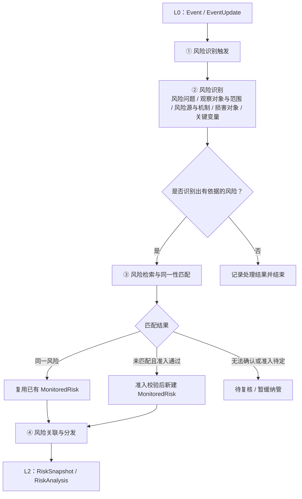
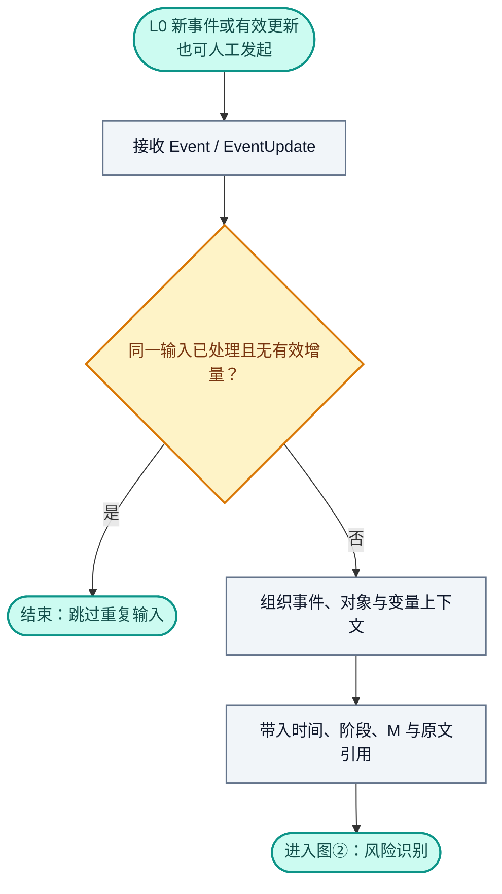
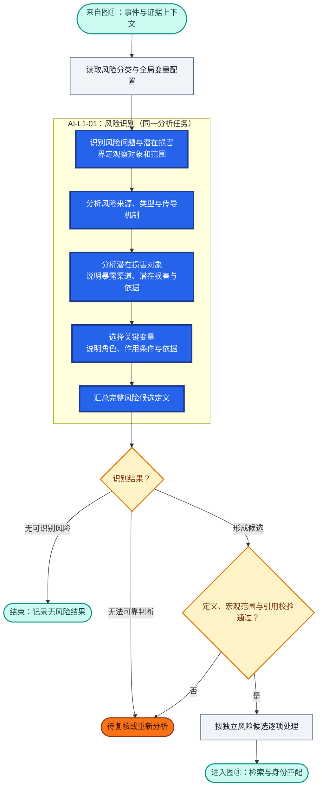
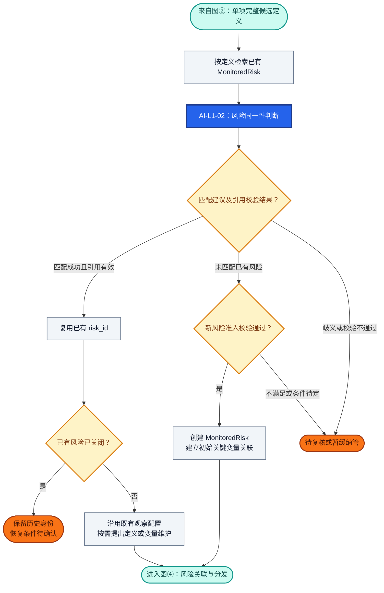
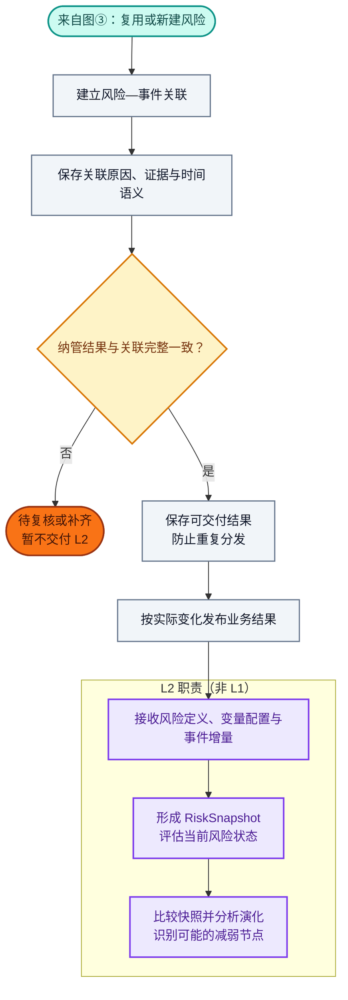
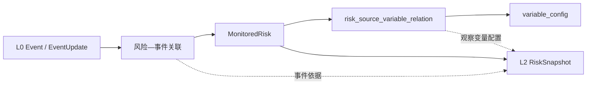

# RiskHot L1 风险识别与纳管层：业务架构与领域设计

> **文档版本**：V1.0（讨论整理稿）  
> **编制日期**：2026-10-09  
> **规则更新**：2026-10-14，明确观测指标稳定配置、审核变更与分析版本锁定；本次不调整原型设计。  
> **设计范围**：RiskHot / L1 风险识别与纳管层 / 首版宏观领域  
> **设计基线**：L0 Event / EventUpdate / Target / Variable；L1 MonitoredRisk；L2 RiskSnapshot / RiskAnalysis  
> **内容约定**：本文件归纳已经讨论的业务设计；尚未确定的规则、字段、算法、Prompt 或接口规范统一标注「待讨论」，不预设具体实现。

## 1. 业务能力与职责设计

### 1.1 业务定位与总体职责

L1 将 L0 提供的结构化事件与有效更新转化为**定义清晰、身份稳定、证据可追溯、观察变量明确的风险观察对象（MonitoredRisk）**，交付 L2 持续观察。

本层主要回答三个问题：**存在什么值得观察的风险？是否已经纳管？应当跟踪哪些关键变量？** L1 对风险定义的完整性、风险身份的复用与准入、长期观察配置、事件关联和下游交付负责。

L1 先从事件中一次性识别并定义具体风险，包括风险问题、观察对象与范围、风险损害对象、潜在损害、风险来源、主要传导机制和关键变量，再检索、匹配已有 MonitoredRisk。匹配成功时复用既有身份；确属新风险且通过准入校验时正式纳管；无法判断时保留待复核结果。

### 1.2 核心业务能力与责任

| 业务能力        | 回答的业务问题                  | L1 承担的责任                                                                               | 主要交付结果                                                          |
| ----------- | ------------------------ | -------------------------------------------------------------------------------------- | --------------------------------------------------------------- |
| 事件承接与识别触发   | 哪些事件或有效更新需要进入风险识别？       | 接收 L0 的 Event / EventUpdate，准备对象、变量与原文证据上下文，识别重复输入并保留事件时间和阶段语义                         | 待识别的事件上下文、输入处理记录                                                |
| 风险识别        | 存在什么风险，影响谁，为什么需要观察，跟踪什么？ | 一次性明确风险问题、观察对象与范围、潜在损害；分析风险来源、类型及形成和传导机制；从机制中选择关键变量，优先引用全局变量 ID，并说明驱动、传导、缓冲或损害验证作用     | 完整风险候选定义、关键变量候选及作用说明、事件证据引用；此时尚未形成正式风险身份                        |
| 风险检索与身份匹配   | 候选风险是否已经纳管，能否复用既有身份？     | 使用完整候选定义检索已有 MonitoredRisk，比较风险问题、观察对象、范围与潜在损害；给出匹配、未匹配或待复核结果，避免以名称或关键词相同代替同一性判断       | 已有风险匹配结果、可复用的 `risk_id` 或待复核说明                                  |
| 风险纳管与跟踪配置维护 | 哪项风险进入持续观察，如何维持其身份和观察配置？ | 对未匹配风险执行准入校验，创建 MonitoredRisk 与初始关键变量关系；对已有风险复用身份，按需维护定义与变量配置；管理跟踪状态，具体审批、版本和状态迁移条件待讨论 | 已有或新增 MonitoredRisk、`risk_source_variable_relation`、纳管与跟踪状态管理结果 |
| 风险关联与分发     | 本次事件与哪些风险有关，下游据此观察什么？    | 建立风险—事件关联，保存关联原因和证据定位；区分新风险纳管、已有风险关联新事件和跟踪状态变化，向 L2 交付风险定义、关键变量及事件增量                   | 风险—事件关联、可追溯的证据引用、L2 观察输入与业务结果通知                                 |

**横向质量与追溯职责**：各项能力共同保证事件依据可回溯、对象与变量引用有效、重复输入不重复创建或分发。风险识别允许无结果，同一事件允许形成多项候选，无法可靠判断时进入待复核。新风险创建、初始关键变量配置与初始事件关联应一致完成，避免向 L2 交付尚未完成纳管的对象；具体事务和消息协议待设计。

上述能力对应第 1.3 节的四个业务环节，处理流程见第 2 章：事件承接对应①，风险识别对应②，身份匹配及纳管维护对应③，风险关联与分发对应④。关键变量选择在②完成，③消费完整候选定义并建立或维护正式关联；跟踪状态管理还承担持续的生命周期维护职责。

### 1.3 业务能力划分

| 环节  | 业务能力           | 核心处理                                  | 主要输出                      |
| --- | -------------- | ------------------------------------- | ------------------------- |
| ①   | 风险识别触发         | 接收事件及有效更新，准备识别上下文                     | 待识别的 Event / EventUpdate  |
| ②   | **风险识别**       | 识别风险问题、观察对象、潜在损害、风险源、传导机制与关键变量        | 完整的风险候选定义（暂未纳管）           |
| ③   | **风险检索、匹配与纳管** | 按完整定义检索 MonitoredRisk；判定同一性；复用、创建或待复核 | 已有或新增的 MonitoredRisk、纳管结果 |
| ④   | 风险关联与分发        | 建立事件关联，引用证据，向 L2 提交观察输入               | 风险—事件关联、下游观察通知            |

### 1.4 首版职责覆盖范围

| 维度    | L1 首版范围与责任                                                                        |
| ----- | --------------------------------------------------------------------------------- |
| 研究领域  | 仅针对宏观经济金融风险；行业、企业和单项资产可作为背景或证据，暂不独立纳管为微观风险观察对象                                    |
| 风险身份  | 以 MonitoredRisk 为稳定的风险观察实体；多个事件和多个观察周期可以引用同一 `risk_id`                            |
| 事件使用  | 复用 L0 的 Event / EventUpdate 及原文引用；已宣布、预计实施或尚未兑现的事件也可提供风险线索，须保留时间与阶段语义             |
| 风险定义  | 表达稳定的风险问题、观察对象与范围、潜在损害、风险来源及机制，不写入当期风险等级或涨跌判断                                     |
| 变量体系  | 使用全局 `variable_config`；L1 选择具体风险需要持续跟踪的变量，维护角色、作用条件与观察理由，不记录本次变量数值                |
| 跟踪管理  | 管理 `observing`、`monitoring`、`paused`、`closed` 等跟踪状态；暂停、关闭及恢复条件待讨论，已关闭风险优先考虑复用历史身份 |
| 处理与结果 | 先完整识别与定义，再检索匹配，最后决定复用或新建；允许无风险、已有风险、新风险、待复核，不强行生成风险或虚构 ID                         |
| 下游交付  | 交付风险定义、长期观察配置和相关事件增量，为 L2 首次观察与持续观察提供输入                                           |

### 1.5 上下游职责分工

| 业务层             | 承担的业务职责                                   | 核心业务产物                                                   | 与 L1 的协作                       |
| --------------- | ----------------------------------------- | -------------------------------------------------------- | ------------------------------ |
| L0 信息处理层        | 信息采集、原始资料去重、事件归组、事件直接作用对象与变量识别、金融意义 M 评价  | Event、EventUpdate、Target、EventTargetVariable、EventRating | 提供结构化事件和可追溯信息，作为 L1 风险识别的依据    |
| **L1 风险识别与纳管层** | 定义具体风险、确定关键变量、匹配风险身份、纳管和维护观察配置、关联事件并分发    | **MonitoredRisk**、风险—事件关联、风险—关键变量关联                      | 承接 L0 的事件，将正式纳管的风险及观察输入交付 L2   |
| L2 风险观察与监测层     | 评估变量当前状态、风险大小、兑现程度和持续条件；比较快照并识别演化及可能的减弱节点 | RiskSnapshot、RiskAnalysisResult                          | 消费 L1 的风险定义、关键变量配置与事件证据，形成观察判断 |

L0 的 Event Target 表示事件直接作用对象；L1 的观察对象表示某项风险判断针对的对象。两者只在身份及范围一致时建立映射，不自动视为相同。风险损害对象则表示沿传导路径可能承受损害的主体或系统，可以与观察对象重合，也可以不同，不能直接复制 Event Target 或观察对象作为结果。L0 的事件直接变量关联提供识别线索，L1 仍须依据风险机制独立确定长期观察变量。

### 1.6 职责边界与暂不承担事项

- L1 复用 L0 的信息和事件产物，不承担信息抓取、原始资料去重、事件归组及金融意义 M 评分；M 仅辅助信息筛选和研究排序，不等同于风险大小。
- L1 的风险定义及变量配置描述“观察什么、为什么观察”；变量当前状态、风险等级、兑现程度、趋势和风险减弱节点由 L2 判断。
- L1 的跟踪状态表示是否及如何继续跟踪，不代替 L2 对风险当前状态的评估。事件与风险建立关联，也不直接构成风险加剧或缓和的结论。
- 风险候选定义属于识别过程结果，尚未纳管；AI 提供识别与匹配建议，正式风险 ID 创建、准入校验和持久化由系统业务流程执行。候选是否独立持久化、自动准入条件及人工复核权限待讨论。
- L1 不承担投资交易与风险应对决策；首版不独立纳管行业、企业和单项资产的微观风险。

## 2. 业务架构设计

### 2.1 总体业务流程

**流程关键约束：** 风险定义只在②形成一次，③直接消费②输出的完整候选定义；③在匹配成功时复用既有风险身份，在未匹配且符合准入要求时新建。一个 Event 可以识别多项风险，每项风险分别匹配。

### 2.2 详细业务流程

以下四张详图与①—④业务环节一一对应。圆角节点标明入口、出口、正常结束或暂停处理；图内保留主要动作，字段与业务口径见各图下方步骤表。

**颜色图例**：蓝底白字＝AI 分析任务；灰色＝程序处理；浅黄＝规则校验与结果分支；橙色＝待复核、暂缓纳管或条件待确认；青绿＝入口、出口与正常结束；紫色＝下游职责。

**AI 编号口径**：沿用第 6.1 节的 `AI-L1-01`（风险识别）与 `AI-L1-02`（风险同一性判断）。图②内的分析步骤归属同一个 AI 任务；图①和图④不新增 L1 AI 任务。尚未确定的准入、配置维护及恢复条件继续保留待讨论，不由流程图补定。

#### 2.2.1 ① 风险识别触发

**图①处理口径**：本图为程序承接与上下文准备，不新增 AI 任务。重复输入直接结束；人工发起与 L0 通知进入相同的重复检查和上下文准备步骤。具体触发阈值、调度及重新处理策略仍待讨论。

| 步骤          | 处理内容                                       | 输入与输出                           |
| ----------- | ------------------------------------------ | ------------------------------- |
| 1.1 接收事件输入  | 接收 L0 的新 Event 或有效 EventUpdate，也允许人工发起风险识别 | 输入：Event / EventUpdate；输出：待处理事件 |
| 1.2 增量与重复检查 | 识别是否已处理同一事件及版本，避免重复执行                      | 输出：有效识别请求或跳过结果                  |
| 1.3 组织识别上下文 | 获取事件基本内容、时间语义、作用对象、直接涉及变量、金融意义及原始证据引用      | 输出：②的分析输入                       |

**边界：** 这一环节不重新采集原文、不重新抽取 Event。事件金融意义 M 可供辅助筛选，但不直接决定风险等级或风险存在与否。具体触发阈值与调度策略待讨论。

#### 2.2.2 ② 风险识别

**AI 与程序分工**：蓝色节点是同一个 `AI-L1-01` 的分析步骤，对应下表 2.1—2.6，不代表拆分为多个独立 AI 任务。程序校验候选定义、宏观范围、变量引用与证据；未匹配到全局变量时保留候选和待确认信息，不虚构变量 ID，是否满足纳管要求在图③判断。

**多风险处理**：同一事件可输出 0..N 项候选。通过校验的候选分别进入图③和图④，某项待复核不妨碍其他候选继续处理；此时尚未创建正式 `risk_id`。

此环节一次性完成候选风险的业务定义；在此之后才开展存量风险检索。

| 步骤              | 业务工作                           | 应形成的内容                                              |
| --------------- | ------------------------------ | --------------------------------------------------- |
| 2.1 风险问题识别      | 从事件中识别可能发生的不利变化及潜在损害           | 风险问题、潜在损害、依据                                        |
| 2.2 观察对象与范围界定   | 明确本项风险持续观察的经济金融对象及研究边界，不直接等同于损害对象 | 观察对象、观察范围 `scope_boundary` |
| 2.3 风险来源与传导分析 | 识别主要风险源与风险性质，引用已有分类配置；解释风险驱动、传导、缓冲和损害验证条件 | `risk_source_config`、`risk_dimension_config` 的引用或候选，以及简要、可解释的风险机制 |
| 2.4 潜在损害对象分析 | 沿传导路径识别可能受损的主体或系统，说明其暴露渠道、潜在损害与证据依据，区分观察对象与损害对象 | 风险损害对象集合 `damage_targets`；对象对应的传导与损害说明，证据不足项标为待验证 |
| 2.5 关键变量选择      | 从机制中提取需要持续跟踪的变量，匹配全局变量库，说明变量作用 | 关键变量候选、角色、作用条件及原因                                   |
| 2.6 汇总完整候选定义    | 对上述要素去重整理，建立可用于同一性匹配的完整候选定义    | 完整风险候选定义及事件证据引用                                     |

**本环节规则：**

- 同一事件可以形成 0..N 项风险候选；无法说明具体风险问题及潜在损害时不强行生成。
- 已宣布、预计实施或尚未兑现的事件，可构成风险线索；必须保留事件的时间与阶段语义。
- 风险定义描述稳定的风险问题，不写入当期风险等级或涨跌判断。
- 风险损害对象在本环节初步确定，不以损害已经发生为前提。应有可解释的暴露渠道与传导依据；尚无法确定的对象或关系写入 `uncertainty`，不能无依据扩列对象。`damage_targets` 不代表损害已经兑现，也不为其中每个对象自动建立独立 MonitoredRisk。
- 关键变量来自风险机制，优先引用 `variable_config`，并解释其驱动、传导、缓冲或损害验证作用。
- 当前变量值、风险影响程度及减弱节点由 L2 分析。
- 「完整风险候选定义」属于②的处理输出，尚未形成正式 MonitoredRisk 身份；是否持久化候选待讨论。

#### 2.2.3 ③ 风险检索、匹配与纳管

**AI 与程序分工**：程序按完整定义检索既有风险，`AI-L1-02` 输出同一性建议与理由；程序校验引用和匹配结果，再执行复用、准入与创建。检索没有召回结果也须经过准入校验，不能直接创建新风险；本图不重新开展一轮完整风险定义。

**维护与恢复边界**：既有风险按需提出配置维护，审批与版本规则仍待讨论，未确认的建议不直接覆盖既有配置。已关闭风险保留历史身份，恢复条件确认后再衔接关联与分发；图中不预设自动恢复。新建分支须与图④初始事件关联一致完成后才可向 L2 交付，具体事务边界待设计。

| 步骤            | 业务工作                                          | 输出                         |
| ------------- | --------------------------------------------- | -------------------------- |
| 3.1 按候选定义检索   | 使用②生成的风险问题、观察对象、范围、潜在损害等检索已有 MonitoredRisk    | 已有风险候选集合                   |
| 3.2 风险同一性匹配   | 判断既有风险是否完整覆盖当前风险定义；主要机制辅助解释差异                 | 匹配成功 / 未匹配 / 待复核           |
| 3.3 复用或创建决策   | 匹配成功复用原 `risk_id`；未匹配时执行新风险准入校验；不确定时暂停自动纳管    | 匹配或纳管决策                    |
| 3.4 正式纳管或配置维护 | 对新风险创建 MonitoredRisk 与变量关联；对既有风险按需提出定义或变量配置维护 | 已有或新增 MonitoredRisk、关键变量关系 |

**同一性判定重点：** 风险问题、观察对象、观察范围、潜在损害。风险来源或具体触发事件不同，并不必然需要创建新风险。

**匹配分支：**

- **已有风险：** 复用 `risk_id`；保留已有观察定义。新候选的风险机制或变量有实质差异时，可提出配置维护，变更规则待细化。
- **全新风险：** 在同一性检查和准入校验通过后创建 MonitoredRisk，并建立其关键变量关联。
- **无法判断：** 标记待复核，不自动重复创建风险。
- **已有风险已关闭：** 优先考虑复用历史身份并恢复跟踪；具体恢复条件待讨论。

**纳管准入条件（已讨论的方向）：** 有明确风险问题、观察对象与范围、潜在损害、可追溯的事件依据及必要的观察条件。关键变量最低配置数量及自动准入条件尚未确认，见第 3 章待定事项。

#### 2.2.4 ④ 风险关联与分发

**校验与交付**：本图属于程序处理，不新增 L1 AI 任务。检查有效风险身份、关键变量配置及事件证据关联，未完成纳管时暂不交付；补齐或复核后回到对应步骤。图③与本图表达业务上的一致完成要求，不预设事务、重试或补偿协议。

**分发与下游边界**：按实际变化区分新风险纳管、已有风险关联新事件与跟踪状态变化，候选通知名称见第 5.3 节。L2 引用同一 `risk_id` 开展观察；是否触发新快照及暂停状态的处理条件待讨论。事件关联本身不代表风险加剧或缓和，紫色节点仅说明 L2 的职责。

| 步骤            | 业务工作                                            | 输出         |
| ------------- | ----------------------------------------------- | ---------- |
| 4.1 建立风险—事件关联 | 记录本次 Event / EventUpdate 对应的一个或多个 MonitoredRisk | 风险—事件关联关系  |
| 4.2 保存关联依据    | 保留事件与风险关联的原因、来源定位及必要的时间语义                       | 可追溯的风险证据引用 |
| 4.3 发布业务结果    | 区分新风险纳管、已有风险关联新事件和跟踪状态变化                        | 业务结果通知     |
| 4.4 交付下游      | 为 L2 提供 `risk_id`、风险定义、关键变量及相关事件增量              | L2 观察输入    |

新风险的创建、初始关键变量配置与初始风险—事件关联应一致地完成，避免向 L2 交付尚未完成纳管的对象。具体事务和消息协议待设计。

### 2.3 主要业务处理分支

| 场景                     | L1 处理路径           | 结果                           |
| ---------------------- | ----------------- | ---------------------------- |
| 新事件揭示已有风险              | ①→②→③匹配成功→④       | 复用 MonitoredRisk、关联事件        |
| 新事件揭示全新风险              | ①→②→③未匹配并准入通过→④   | 新建 MonitoredRisk、配置关键变量、关联事件 |
| 事件包含多项风险               | ①→②得到多个定义→③逐项匹配→④ | 可同时复用与新建多个风险                 |
| 有风险线索但匹配歧义             | ①→②→③待复核          | 暂不自动纳管                       |
| 无法识别具体风险               | ①→②结束             | 无 MonitoredRisk 新增           |
| 已有风险出现可能缓和风险的事件        | ①→②→③复用→④         | 关联已有风险；是否缓和由 L2 判断           |
| 同一 Event / Update 重复通知 | ①判定重复             | 不重复创建或分发                     |
| 已有风险定义或关键变量需要调整        | ①→②→③匹配成功并提出维护→④  | 复用风险身份，维护观察配置的具体规则待定         |

## 3. 业务规则设计

### 3.2  风险同一性判断

本表细化 BR-L1-05，用于比较完整风险候选 `RiskIdentificationResult` 与已有 `MonitoredRisk`，判断是否复用同一风险身份。

| 优先级 | RiskIdentificationResult 字段 | MonitoredRisk 字段                | 判断内容             |
| --- | --------------------------- | ------------------------------- | ---------------- |
| 核心  | `definition`                | `definition`                    | 风险问题及潜在损害是否实质相同  |
| 核心  | `observation_target`        | `observation_target`            | 是否针对同一个经济金融对象    |
| 核心  | `scope_boundary`            | `scope_boundary`                | 风险观察范围是否一致或等价    |
| 辅助  | `title`                     | `title`                         | 风险名称是否相同或语义相近    |
| 辅助  | `mechanism_summary`         | `mechanism_summary`             | 风险形成与传导机制是否一致或相容 |
| 辅助  | `dimension_code`            | `dimension_id`                  | 是否属于相同风险维度       |
| 辅助  | `risk_source_codes`         | 关联的风险源配置                        | 风险来源是否相同或相关      |
| 辅助  | `key_variables`             | `risk_source_variable_relation` | 关键观察变量是否相同或相关    |

**字段比较口径：**

- 优先核对三项核心依据是否实质一致；名称、维度、来源或变量相同只能作为辅助依据，不能覆盖核心差异。范围仅部分重叠、证据不足或机制存在无法解释的冲突时，保留待复核结果，不以简单相似度直接判定同一风险。
- 比较 `definition` 时，同时读取 `damage_targets` 及 `mechanism_summary` 中的潜在损害说明，核对谁可能受损及其传导依据；损害对象扩大、收缩或转移不单独决定风险身份，应结合原有三项核心依据判断。
- 表中的 `dimension_id` 指配置解析后的风险维度标识；MonitoredRisk 当前实际字段是 `risk_dimension_ids` 数组。先通过 `risk_dimension_config` 将 `dimension_code` 解析为 `dimension_id`，再与数组中的维度比较，不新增同名标量字段，也不直接比较代码与 ID。
- `risk_source_codes` 通过 `risk_source_config` 解析为来源 ID，与 MonitoredRisk 的 `risk_source_ids` 及关联配置比较；来源相关不等于风险身份相同。
- `key_variables` 与 `risk_source_variable_relation` 比较时，同时核对变量身份、所属来源、角色及作用机制；未匹配到变量 ID 的候选名称只能作为待核线索，不据此虚构正式变量身份。

### 3.3 观察对象的定义

#### 3.3.1 观察对象的定义

观察对象，是一项具体风险判断所针对的、具有明确身份和范围边界的经济或金融对象。

它回答：

> “我们正在判断谁、哪个市场或哪套经济金融系统的风险状况？”

对风险大小、影响程度、持续性及是否缓和的判断，都必须针对这个对象成立。

观察对象不限定为企业或机构，也可以是经济体、行业、资产、市场或金融系统。

#### 3.3.2 第一版范围

本系统第一版只建立宏观层面的风险观察对象，允许的类型为：

- 经济体
- 宏观主体，例如中央政府、中央银行
- 市场
- 金融系统

行业、企业和单项资产可以作为宏观风险的证据或传导环节，本阶段不单独建立为观察对象。

### 3.4 全局风险变量体系

#### 业务定位与设计目标

全局核心变量体系用于建立统一、稳定、可复用的风险因素定义，为 L0 信息处理、L1 风险识别与纳管、L2 风险态势分析提供一致的变量身份与语义标准。

**核心目标：确保 AI 在动态识别风险因素时优先复用已有变量，避免因名称差异、观察对象差异或重复分析而不断创建语义相同的变量。**

全局变量体系遵循以下原则：

1. **统一身份**：所有正式变量采用统一身份、标准名称和语义定义。
2. **优先复用**：AI 识别风险因素时优先匹配全局变量库，避免重复创建。
3. **动态选择**：具体风险所需的关键变量，由 L1 根据观察对象、风险问题和传导机制动态确定。
4. **分类可选**：变量采用统一字典管理，可以使用分类或标签辅助检索，不强制建立父子层级。
5. **渐进建设**：先建立满足首批风险识别需要的基础变量池，运行过程中持续完善。
6. **受控治理**：新增、修改、合并、拆分和废弃变量须经过相应治理流程。
7. **跨层共享**：同一变量可以服务多个风险源、多个具体风险及多个观察周期。
8. **历史追溯**：变量身份、定义版本和历史引用必须可追溯。

**职责边界：**

- M2 风险源管理中心负责全局变量的统一定义、身份管理、语义去重、候选治理与版本维护。
- L1 根据具体风险动态选择变量，维护风险与关键变量的长期观察关联。
- L2 根据当期证据分析变量状态，以及变量对具体风险的实际作用。
- 全局变量定义沿用共享的 `variable_config`。
- 风险长期观察关联沿用 `risk_source_variable_relation`。
- L2 变量分析沿用 `risk_snapshot_variable_analysis`。
- 风险源无需预先配置推荐核心变量清单。

---

#### 3.4.1 BR-L1-11：核心风险因素定义与统一身份

**1. 核心风险因素定义**

全局风险变量（Global Risk Variable / Risk Factor），是指能够影响一个或多个风险的形成、发展、传导或消退，并且其状态及变化能够通过指标、事件或其他证据进行观察和分析的相对稳定因素。

正式变量应具有：

- 明确、相对稳定的业务含义。
- 清晰的语义定义和适用边界。
- 可解释的观测依据或分析方法。
- 独立的分析价值或跨场景复用价值。

**2. 全局统一身份规则**

1. 每个正式变量必须具有全局唯一的 `variable_id`。
2. 每个正式变量具有一个标准名称，可维护多个别名和历史名称。
3. 经确认语义等价的因素统一复用已有变量身份。
4. 变量身份不因风险源、观察对象或分析场景变化而自动重新创建。
5. 同一变量可以被多个风险源、具体风险及分析任务引用。
6. 当因素定义、适用范围或观察粒度存在实质差异时，可以建立独立变量。
7. 正式变量身份及稳定业务编码不得重复分配给其他语义。

**3. 概念边界**

| 概念 | 业务含义 | 边界 |
|---|---|---|
| 全局变量 `variable_config` | 定义观察什么因素及其稳定含义 | 不记录当期状态和风险结论 |
| 风险源 `risk_source_config` | 定义可能引起风险的来源类别 | 不决定具体风险使用哪些变量 |
| 观测指标 `indicator_config` | 定义衡量因素的统计或数据口径 | 与实际观测数据分离 |
| 事件及观测证据 | 提供政策、行为、冲击或变化的事实依据 | 保留来源、时间和证据 |
| 具体风险 `MonitoredRisk` | 针对观察对象及潜在损害形成的风险问题 | 具有独立风险身份 |
| 变量状态 | 描述因素在特定时间及范围内的实际表现 | 由 L2 基于证据判断 |
| 风险—变量关联 | 说明变量在具体风险中的角色及作用机制 | 由 L1 根据风险机制维护 |

**4. 变量命名规则**

变量名称应表达稳定的因素含义。

例如：

- “美元流动性”属于核心风险变量。
- “美元流动性正在收紧”属于变量状态。
- “美联储宣布缩表”属于具体事件。
- “美元融资利差”属于具有明确统计口径的观测指标，也可以根据独立分析需要及既有定义判断是否具有变量身份。

不得因状态变化、事件发生或表达方式不同而重复创建变量。

对于已有直接观测型变量，应核对其稳定含义和历史用途，不自动批量转换为指标。

---

#### 3.4.2 BR-L1-12：全局变量分类与粒度管理

全局核心变量采用统一字典管理，以稳定身份、标准名称、语义定义和适用范围作为变量识别与复用的主要依据。

**业务规则：**

1. 所有正式变量统一纳入全局变量库 `variable_config`，不强制建立父子层级。
2. 允许使用分类或标签辅助变量检索、浏览和管理。
3. 一个变量可以归属多个分类，但保持唯一正式身份。
4. 变量可以暂不归类，不因分类缺失而重复创建身份。
5. 分类信息只提供辅助检索线索，不作为语义同一性判断的决定性依据。
6. AI 应综合名称、别名、定义、适用范围和观测口径判断变量是否相同。
7. 具有不同语义、范围或粒度的因素可以建立独立变量；语义等价的因素应复用已有正式身份。
8. 变量之间确实存在因素分解关系时，可以独立维护该关系，不要求将其转换为固定的父子分类树。
9. 变量之间的因果关系应独立表达，不根据分类或标签自动推导。
10. 观测指标和事件证据通过独立关联支持变量分析，不纳入变量分类层级。
11. 系统初始化不要求建立完整分类树或因素分解体系，分类能力可随实际业务需要逐步完善。

**设计原则：优先保障变量身份统一、语义去重和跨风险复用，分类及层级组织作为辅助能力按需建设。**

---

#### 3.4.3 BR-L1-13：基础变量池初始化与渐进完善

**建设原则：先建立满足实际风险观察需要的基础变量池，再通过系统运行持续完善。**

系统使用前不要求穷尽所有潜在风险因素，也不要求预先完成完整的变量分类体系。

**1. 初始化目标**

建立能够支撑首批宏观经济金融风险识别与分析的核心变量集合。

首批变量可以参考以下业务领域组织：

| 参考业务领域 | 首批核心变量示例 |
|---|---|
| 宏观经济 | 经济增长、通胀压力、就业环境、财政与主权债务可持续性 |
| 货币金融 | 货币政策预期、美元流动性、信用扩张能力、跨境融资条件 |
| 市场行为 | 市场风险偏好、市场杠杆水平、交易拥挤程度 |
| 产业结构 | 能源供需平衡、关键供给能力 |
| 地缘政治 | 地缘冲突强度、国际贸易环境 |

上述业务领域仅用于说明基础变量的可能覆盖范围，不要求将其预先建立为正式分类树。

具体变量名单及定义需经过治理确认后启用，不在本文中分配实际变量 ID。

**2. 初始化规则**

1. 优先配置首批宏观风险识别和分析所需的核心变量。
2. 正式变量至少明确标准名称、定义、语义边界及可用观测依据。
3. 分类、标签、别名和参考机制可以根据实际需要逐步完善。
4. 不要求每个变量必须归属于某个预先建立的父分类。
5. 不为追求分类完整性而预建大量缺少分析价值的变量。
6. 变量缺失应作为候选或观察缺口处理，不阻断其他无关风险的分析。

**3. 渐进完善机制**

- L0 从事件及原始资料中发现新因素线索。
- L1 在风险识别过程中动态发现关键因素。
- L2 在风险态势分析中发现观测缺口及机制修订需求。
- M2 汇总候选和维护建议，通过语义匹配及治理流程持续完善变量库。

---

#### 3.4.4 BR-L1-14：AI 动态发现与语义匹配

AI 在风险识别过程中，根据具体风险问题和作用机制动态提取关键风险因素。

关键变量识别属于 L1 风险识别任务 `AI-L1-01` 的内部工作，不新增独立主业务环节。

**1. 处理流程**

| 步骤 | 处理动作 | 业务规则 |
|---|---|---|
| 1 | 提取风险因素 | 根据风险源、观察对象、风险问题及传导机制识别关键因素 |
| 2 | 检索全局变量库 | 查询标准名称、别名、语义定义、适用范围及历史替代关系 |
| 3 | 执行语义匹配 | 判断是否为已有因素的不同表达、不同范围或真正新因素 |
| 4 | 复用正式变量 | 匹配成功时使用已有 `variable_id` |
| 5 | 生成候选 | 未匹配或存在歧义时，保留候选名称、提出原因及依据 |
| 6 | 校验并交付 | 校验正式 ID、可用状态和版本，交付风险纳管流程 |

**2. 语义匹配依据**

匹配时综合考虑：

- 标准名称与别名。
- 变量定义及语义边界。
- 地域、市场、币种和期限。
- 变量粒度及观察范围。
- 观测口径和参考依据。
- 历史拆分、合并和替代关系。

变量分类可以辅助检索，但不能单独决定匹配结果。

**3. 匹配结果处理**

| 匹配结果 | 处理规则 |
|---|---|
| 语义等价 | 复用已有正式变量身份 |
| 语义相近但范围不同 | 核对是否能够复用已有变量 |
| 语义相近但粒度不同 | 判断是否具有独立变量价值 |
| 多个匹配项存在歧义 | 保留候选并进入复核 |
| 无有效匹配项 | 形成新变量候选 |
| 仅匹配废弃变量 | 检查替代关系及当前适用性 |

**4. 约束规则**

1. 不得仅凭名称或相似度创建、合并变量。
2. 不得因观察对象不同而自动建立新变量。
3. 不得因属于同一风险源而强制使用相同变量。
4. AI 不能直接创建未经治理的正式变量身份。
5. 匹配正式变量时填写真实 `variable_id`。
6. 未匹配正式变量时，`variable_id` 留空并填写 `candidate_variable_name`。
7. 候选名称不得冒充正式变量 ID。
8. 多轮分析发现相同候选时，应汇总证据和提出记录，避免重复申请。

---

#### 3.4.5 BR-L1-15：候选变量治理、去重与审批

全局变量候选统一进入 M2 治理流程。

**初期采用 AI 提议、程序校验、人工审核的方式。**

**1. 候选记录要求**

候选变量应保留：

- 建议名称与定义。
- 语义边界、适用范围和粒度。
- 提出原因及来源。
- 关联风险或事件。
- 可用观测依据。
- 与已有变量的比较结果。
- 建议处理方式及待确认事项。

AI 提出新变量候选时，同时建议观测指标及解释依据、适用范围、口径和来源，优先引用已有正式指标；无法提出适用指标时保留缺口，定性变量可建议可核验事件证据。M2 候选审核流程承接首次配置，由有相应授权的业务审核人员分别确认变量身份与观测方案。复用已有变量沿用有效映射，新增指标建议单独审核；新变量取得正式身份后，获批指标及映射经程序校验形成首次版本。身份确认不代表映射全部获批，也不代表 L1 风险准入已经通过。具体衔接见 [[tools/RiskHot/docs/system-design/03-系统功能架构/M2风险源管理中心功能设计|M2 功能设计]] §4.3.3；提议载体和字段结构待详细设计，不在 `key_variables` 中新增未经定版的字段。

**2. 治理结果**

| 处理结果 | 业务动作 |
|---|---|
| 复用已有变量 | 映射至现有正式 `variable_id`，必要时补充别名 |
| 接受为新变量 | 完成定义和去重校验后，分配正式身份 |
| 维护已有变量 | 进入定义修订、分类调整或拆分合并流程 |
| 退回或暂缓 | 保留候选及证据缺口 |
| 拒绝纳入 | 记录具体原因并保留原始提出依据 |

**3. 去重与审批规则**

1. 新变量正式入库前必须再次检索现有正式库及候选记录。
2. 并发任务提出相同语义变量时，优先归并并复用已有正式身份。
3. 同名但语义、适用范围或粒度不同的变量不得直接合并。
4. 仅存在相关性或因果关系的因素，不自动认定为相同变量。
5. 审核必须针对明确的候选版本；材料实质变化后需重新核对。
6. 保存审核理由、处理主体、时间及身份映射结果。
7. 变量正式入库与具体风险纳管分别执行校验。
8. 候选变量审核通过后，不自动建立具体风险的长期观察关联。

---

#### 3.4.6 BR-L1-16：变量拆分、合并与语义演化

全局变量体系允许根据实际业务需求持续演化。

当变量定义过宽、语义重复、适用范围混杂，或某因素具有独立分析价值时，可以提出调整建议。

| 变更类型 | 身份处理规则 | 历史约束 |
|---|---|---|
| 名称、别名或解释补充 | 语义不变时保留原 ID | 保留旧名称及定义版本 |
| 分类或标签调整 | 保留变量身份 | 不影响已有正式风险关联 |
| 变量拆分 | 为具有独立语义的新因素建立身份 | 保留原变量及新旧关系 |
| 变量合并 | 语义等价时复用保留身份；含义实质改变时建立新身份 | 保留旧身份映射 |
| 实质改变定义或范围 | 评估建立新身份或并存关系 | 标记历史可比性限制 |
| 变量废弃 | 停止新增正式引用 | 保留历史身份和引用 |

**业务规则：**

1. AI 可以提出变量演化建议，正式变更需要受控审核。
2. 语义保持一致时，优先保留原正式身份。
3. 实质改变变量含义时，不得复用旧 ID 表达新的独立因素。
4. 拆分、合并和废弃必须记录原因、定义差异、映射关系及生效时间。
5. 变量变更前，应检查 L0 事件引用、L1 长期风险关联、L2 分析及历史快照的影响。
6. 变量拆分或合并不自动创建、拆分或合并 `MonitoredRisk`。
7. 原有风险关联是否迁移应逐项复核。
8. 历史分析继续保留原定义和版本依据。
9. 不兼容的历史数据须标明差异，不强行形成连续可比序列。

---

#### 3.4.7 BR-L1-17：跨风险源复用与具体风险动态选择

**全局变量统一定义，具体风险动态选择。**

这里的“动态选择”指 L1 根据具体风险选择关键变量；变量采用哪些观测指标由 M2 预先稳定配置，不随每次风险识别重新生成。指标映射支持多对多及解释依据，新增、替换、停用或实质调整须审核并形成新版本。AI 可以提出维护建议，不能直接改写有效映射；L2 在任务锁定的映射版本内选取适用证据。具体规则见 [[tools/RiskHot/docs/system-design/03-系统功能架构/M2风险源管理中心功能设计|M2 功能设计]] §4.4.3（2026-10-14 用户确认）。

**1. 全局复用规则**

1. 同一全局变量可以服务多个风险源。
2. 同一变量可以被多个具体风险引用。
3. 同一变量可以跨观察周期重复使用。
4. 一个具体风险可以关联多个全局变量。
5. 变量不固定归属于某个风险源或观察对象。
6. 不因风险来源、观察主体或使用场景不同而复制语义相同的变量。

**2. 关键变量选择规则**

L1 根据以下上下文动态确定具体风险需要观察的变量：

- 风险源及其定义。
- 观察对象及范围。
- 具体风险问题。
- 潜在损害。
- 风险形成与传导机制。
- 风险缓冲及损害验证需要。

同一风险源面对不同观察对象时，可以选择不同变量。

同一观察对象面对不同风险问题时，也可以选择不同变量。

风险源配置不维护强制性的推荐变量集合。

**3. 具体风险关联规则**

L1 使用 `risk_source_variable_relation` 保存长期观察关联。

主要业务信息包括：

| 信息 | 业务含义 |
|---|---|
| `risk_id` | 所属具体风险 |
| 风险源引用 | 变量对应的风险来源 |
| `variable_id` | 引用的正式全局变量 |
| `variable_role` | 变量在具体风险中的角色 |
| `variable_impact_on_risk` | 变量为何重要，以及在什么条件下影响风险 |

变量角色沿用：

- `risk_driver`：风险驱动。
- `risk_transmission`：风险传导。
- `risk_buffer`：风险缓冲。
- `damage_verification`：损害验证。

变量角色属于具体风险关联，不作为全局变量的固定属性。

同一变量涉及多个风险来源或角色时，应分别解释机制，避免无业务差异的重复引用。

---

#### 3.4.8 BR-L1-18：变量定义、变量状态与具体风险作用分离

全局变量定义、长期作用机制、当期状态和实际风险作用分别管理。

| 内容 | 业务归属 | 业务含义 |
|---|---|---|
| 全局变量定义 | M2 `variable_config` | 因素是什么及其稳定含义 |
| 长期风险关联 | L1 `risk_source_variable_relation` | 为什么观察该因素及其作用机制 |
| 变量当期状态 | L2 分析结果 | 因素当前处于什么状态 |
| 本轮风险作用 | L2 `risk_snapshot_variable_analysis` | 当前变量状态对具体风险的实际影响 |
| 整项风险状态 | L2 `RiskSnapshot` | 风险整体状态及变化情况 |

例如：

- “美元流动性”是全局变量。
- “美元流动性收紧”是变量状态。
- “美元融资条件变化可能加大再融资压力”是长期作用机制。
- “本轮融资压力已经加大”是结合具体风险和当期证据形成的作用判断。

**业务规则：**

1. M2 不保存变量当前状态或具体风险等级。
2. L1 保存变量在具体风险中的长期角色和作用条件。
3. L2 根据当期证据分析变量状态及实际风险作用。
4. 同一变量状态可以在兼容的时间、范围、口径和证据条件下复用。
5. 同一变量在不同风险中的实际作用须分别判断。
6. 变量状态变化不自动推导风险作用方向。
7. 证据缺失或相互冲突时保留不确定性，不以中性或零影响代替缺失数据。
8. L2 沿用 `observed_state`、`risk_effect` 和 `interpretation` 等分析字段；L1 的一般机制字段 `variable_impact_on_risk` 与 L2 的 `impact_mechanism` 具体适配方式留待详细设计。

---

#### 3.4.9 BR-L1-19：变量分类、因素关系与因果关系分离

变量分类及标签用于辅助组织、检索和浏览。

变量之间的因素分解关系和因果作用关系，应根据明确的业务语义独立表达。

**业务规则：**

1. 同属一个分类的变量不自动具有因果关系。
2. 相同标签不代表变量语义相同。
3. 变量之间存在因素分解关系时，可以根据实际需要记录。
4. 因果关系应说明影响方向、传导机制、成立条件、适用范围及证据。
5. AI 可以提出因果关系假设，未经验证的机制应明确标记。
6. 通用因果机制经审核后可以作为跨风险共享知识。
7. 相关性、同时变化或分类相近，不能单独证明因果关系。
8. L1 可以参考通用机制识别具体风险的长期观察重点。
9. L2 必须根据当期证据判断具体机制是否成立。
10. 首版不要求建立完整的变量因果网络，后续根据实际分析需要逐步完善。

---

#### 3.4.10 BR-L1-20：变量生命周期、版本与历史追溯

**1. 生命周期管理**

| 生命周期状态 | 业务含义 | 使用约束 |
|---|---|---|
| `Candidate` | 尚未确认的变量候选 | 可以参与候选治理，不允许建立正式变量引用 |
| `Active` | 已审核且正式生效的变量 | 可以供新的事件及风险关联引用 |
| `Deprecated` | 已废弃或不再允许新增引用的变量 | 保留历史身份、版本及关联 |

上述状态属于变量的业务生命周期，与配置审批状态、启停状态和风险跟踪状态分别管理。

**2. 生命周期规则**

1. Candidate 经审核通过后可以成为 Active。
2. Candidate 确认与已有变量重复时，映射至已有正式身份。
3. Candidate 退回、暂缓或拒绝时保留处理记录。
4. Active 可以经过审核转为 Deprecated。
5. Deprecated 不再供新增正式引用。
6. Deprecated 恢复使用必须重新核对定义、版本及引用影响。

**3. 版本与追溯规则**

1. 正式 `variable_id` 保持稳定，不得回收给其他语义。
2. 名称、定义、适用范围、观测口径及关联关系发生变化时，保留适用版本及生效依据。
3. 拆分、合并和废弃时，保存旧身份及替代映射关系。
4. 变更记录应包含前后内容、原因、处理主体、审核结论及时间。
5. L1 长期观察关系的变更应保留历史版本依据。
6. L2 风险快照必须能够还原当时使用的变量定义、观察关系和证据。
7. 后续定义修订不得无痕覆盖既有分析快照。
8. 已执行的分析任务保持输入版本一致；使用新定义需要显式重新分析。
9. 历史比较必须检查变量定义、范围及观测口径是否可比。
10. 历史回放应区分当时可获得的信息和事后修订信息。

---

#### 3.4.11 BR-L1-21：全局变量跨模块职责

| 模块 | 主要职责 | 业务边界 |
|---|---|---|
| M2 风险源管理中心 | 全局变量身份、定义、语义匹配、候选治理、分类及版本维护 | 统一管理共享变量定义 |
| L0 信息处理层 | 从事件及输入资料中识别变量线索、提供原始证据 | 保留事件变量关联，不决定具体风险长期观察配置 |
| L1 风险识别与纳管层 | 动态选择关键变量、匹配统一身份、维护长期观察关联 | 不直接修改全局正式变量定义 |
| L2 风险态势分析层 | 分析变量状态、风险作用及历史变化 | 不直接修改全局变量定义或 L1 长期关联 |

**跨模块协作规则：**

1. L0、L1、L2 可以提出新增变量或维护已有变量的建议。
2. M2 统一接收候选和变更建议，组织语义去重及受控治理。
3. L1 根据具体风险机制选择正式变量。
4. L2 可以根据实际分析结果反馈新因素和机制变化。
5. 新变量获准正式入库后，仍须由 L1 确认其与具体风险的长期关联。
6. 变量定义发生变化时，应将受影响身份、版本、原因及生效范围通知相关模块。
7. 依赖方根据实际影响维护后续业务配置，保留已有历史分析。

---

#### 3.4.12 BR-L1-22：运行时使用与异常处理

运行时采用以下业务处理顺序：

**动态识别风险因素 → 检索全局变量库 → 语义匹配 → 复用正式变量或保留候选 → 建立具体风险关联 → 准备观测证据 → 分析变量状态及作用 → 保存依据和版本。**

| 业务场景 | 处理规则 |
|---|---|
| 匹配有效正式变量 | 复用真实 `variable_id`，校验定义版本及适用范围 |
| 未匹配正式变量 | 保留 `candidate_variable_name` 及提出依据 |
| 匹配结果存在歧义 | 进入语义复核，不强制选择相似变量 |
| 多任务重复发现相同候选 | 汇总候选记录和证据，避免重复建立身份 |
| 新风险依赖未确认的必要变量 | 根据风险准入条件进入待复核或暂缓纳管 |
| 新变量仅是补充观察线索 | 已满足其他准入要求时，可保留缺口继续相应流程 |
| L2 发现新因素 | 保留本轮线索及证据，反馈 M2 治理和 L1 维护 |
| 正式变量被废弃 | 历史引用保留；新引用重新检查有效替代变量 |
| 变量定义版本不兼容 | 标记维护需求或显式重新分析 |
| 变量观测证据缺失 | 保留证据缺口，不补造数值或强行形成结论 |
| 同一变量用于多个风险 | 复用兼容状态，分别分析具体风险作用 |
| 相同证据被多次使用 | 检查证据重叠，避免重复计量 |
| 分析期间配置发生变化 | 当前任务保持已锁定版本，新版本供后续任务使用 |
| 历史分析口径不兼容 | 标明差异、分段比较或保留不可比结论 |

**独立业务约束：**

- 变量正式入库不自动创建 `MonitoredRisk`。
- 变量候选被拒绝不自动删除原始事件或已有风险。
- 变量获准入库不自动建立 L1 长期观察关系。
- 变量状态变化不自动形成整项风险变化结论。
- 变量被多个风险引用不代表其压力可以重复累计。

---

#### 3.4.13 实施衔接与待讨论事项

本节明确以下业务原则：

- 变量身份全局统一。
- AI 动态识别时优先语义匹配与复用。
- 分类或标签作为辅助能力按需建设。
- 不强制建立固定的变量父子层级。
- 不要求风险源预配置推荐变量。
- 新变量通过候选治理逐步进入全局变量库。
- 变量定义、具体风险关联和当期状态分别维护。
- 历史身份、版本和分析依据必须可追溯。

**待详细设计事项：**

| 事项 | 已明确原则 | 待确定内容 |
|---|---|---|
| 变量身份管理 | 全局唯一、语义等价优先复用 | 稳定编码、别名存储及唯一性校验 |
| AI 语义匹配 | 综合名称、定义、范围和粒度 | 检索方法、消歧机制及质量评估 |
| 变量分类 | 可选分类或标签，不强制树形结构 | 分类字段、标签结构及维护方式 |
| 因素关系 | 与分类、因果分别表达 | 是否需要独立关系模型及适用范围 |
| 候选治理 | AI 提议、程序校验、初期人工审核 | 候选载体、审批权限及流程 |
| 生命周期 | Candidate、Active、Deprecated | 与现有审批及启停状态的映射 |
| 变量与指标映射 | 多对多、稳定配置及解释依据；变更须审核形成新版本，分析锁定版本 | 关系存储、版本引用及数据口径字段；治理规则见 M2 §4.4.3 |
| 变量版本管理 | 身份稳定、历史版本可追溯 | 存储结构、发布及回退方案 |
| 跨风险状态复用 | 仅复用时间、范围及证据相容的状态 | 缓存、失效及并发策略 |
| L1 长期关联 | 由具体风险动态选择变量 | 同变量多来源、多角色的关系约束 |
| 自动化治理 | AI 不直接创建未经确认的正式变量 | 自动审批条件、阈值及评测方案 |

**相关业务架构依据：**

- L0 信息处理层：§4.5.5 `variable_config`、§4.5.8 `event_target_variable`。
- L1 风险识别与纳管层：§3.4、§4.4、§4.6。
- L2 风险态势分析层：BR-L2-03、BR-L2-04、BR-L2-05、§4.4.1。
- 系统功能架构总览：M2 横向支撑定位及定义与运行分离原则。

本节保留 `BR-L1-11` 至 `BR-L1-22` 的现有编号，M2 详细功能设计通过规则引用承接相关治理职责，避免重复创建同义业务规则。

## 4. 领域模型设计

### 4.1 核心领域模型

L1 以 **MonitoredRisk 为核心领域实体**。关键变量关系与风险—事件关系作为业务关联对象；风险识别中间结果不必提升为独立聚合根。

### 4.2 领域对象汇总说明

下表汇总 L1 自身管理的核心实体、业务关联和处理结果，以及模型涉及的上游、共享配置与下游对象。对象在表中出现不代表由 L1 创建或维护；具体字段和约束在后续小节展开。

| 领域对象／业务结果                       | 类型与归属           | 业务含义                               | 核心职责                               | 主要关联对象与关系                                                 | 讨论状态                      |
| ------------------------------- | --------------- | ---------------------------------- | ---------------------------------- | --------------------------------------------------------- | ------------------------- |
| **MonitoredRisk**               | L1 核心领域实体       | 正式纳入持续观察的一项具体宏观风险                  | 维护稳定 `risk_id`、风险定义、观察对象与范围及跟踪状态   | 关联多个事件和关键变量配置；被 L2 RiskSnapshot 引用                        | 已讨论；聚合边界、物理映射及状态迁移条件待定    |
| `risk_source_variable_relation` | L1 业务关联对象       | 某项风险在特定风险源之下的关键变量观察配置              | 记录变量角色、作用条件与观察理由，支持长期跟踪            | 连接 MonitoredRisk、`risk_source_config` 与 `variable_config` | 已讨论；重复关联约束及版本策略待定         |
| `monitored_risk_event_relation` | L1 业务关联表        | 某个 Event 与正式纳管 MonitoredRisk 的业务关联 | 保存关联原因、首次关联依据及有效状态                 | 连接 MonitoredRisk 与 L0 Event，首次依据可引用 EventUpdate；风险与事件为多对多 | 八字段表结构见第 4.5 节；联合唯一约束待定   |
| 完整风险候选定义                        | L1 识别过程结果       | 尚未正式纳管的风险定义、关键变量候选及事件依据            | 为存量检索、同一性匹配与准入判断提供完整输入             | 由 Event / EventUpdate 识别形成；经匹配后可能对应已有或新增 MonitoredRisk    | 已讨论；是否独立持久化待定，不作为核心实体     |
| 匹配与纳管结果                         | L1 处理结果         | 复用、新建或待复核的处理结论                     | 说明风险身份处理结果，衔接正式纳管和事件关联             | 消费完整候选定义；匹配或新建成功时指向 MonitoredRisk                         | 已讨论；是否独立持久化待定，不作为核心实体     |
| Event / EventUpdate             | L0 上游对象，L1 引用   | 结构化事件及其有效进展、补充或纠正                  | 提供风险识别输入及可追溯的事件依据；事件身份和原始记录由 L0 管理 | 通过风险—事件关联连接 MonitoredRisk                                 | 沿用 L0；输入契约见第 5.1 节        |
| `variable_config`               | 共享变量配置，L1 引用    | 跨事件、跨风险复用的全局变量定义与标识                | 为关键变量选择提供统一引用；不在风险关联中重复定义变量        | 被 `risk_source_variable_relation` 引用，同一变量可供多项风险使用         | 沿用全局配置；具体风险的长期观察配置由 L1 维护 |
| `risk_source_config`            | 共享风险源配置，L1 引用   | 风险来源的分类依据                          | 维护分析层次、分类定义、识别依据与边界                | 被 MonitoredRisk.risk_source_ids 及关键变量关联引用                 | 表结构见第 4.9 节；尚未实施数据库变更     |
| `risk_dimension_config`         | 共享风险类型配置，L1 引用  | 基本面、流动性、估值、情绪等风险维度的分类依据            | 维护定义、识别依据和分类边界                     | 被 MonitoredRisk.risk_dimension_ids 引用                     | 表结构见第 4.8 节；尚未实施数据库变更     |
| RiskSnapshot                    | L2 下游对象，非 L1 管理 | 某项风险在一个观察时点的状态评估                   | 由 L2 评估风险大小、当前状态、兑现程度及持续条件         | 引用同一 `risk_id`，使用 L1 交付的定义、变量配置及事件证据                      | 沿用 L2 边界；跨层版本引用策略待定       |

**汇总边界**：L1 的稳定风险身份、长期观察配置与事件关联分别承担不同职责；候选定义和匹配结果属于处理过程，不因列入本表而成为独立聚合根。上游对象、共享配置与下游快照用于说明协作关系，不扩展 L1 的管理职责。`risk_def` 与 MonitoredRisk 的引用和复用方式尚未确定，本表不预设其领域定位。风险类型配置表结构见第 4.8 节，风险源配置表结构见第 4.9 节。

### 4.3 MonitoredRisk：风险观察对象

**领域定义：** 一条 MonitoredRisk 表示针对特定宏观观察对象与范围，被正式纳入持续观察的一项具体风险。它具有稳定 `risk_id`，可以跨多个事件和多个观察周期持续存在。

| 逻辑属性 / 候选字段                 | 业务含义                                                        | AI负责                    |
| --------------------------- | ----------------------------------------------------------- | ----------------------- |
| `risk_id`                   | 风险稳定身份                                                      | 否；系统在纳管时创建或复用           |
| `title`                     | 风险名称，不包含当前风险等级                                              | 是；拟定具体风险名称              |
| `definition`                | 风险问题与潜在损害的定义性一句话描述                                          | 是；归纳风险问题与潜在损害           |
| `mechanism_summary`         | TEXT；建议保留，提供完整的风险形成、传导、持续与缓冲逻辑                              | 是；归纳机制、成立条件与缓冲路径        |
| `observation_target`        | 风险判断针对的经济金融对象                                               | 是；识别观察对象，系统校验已有对象引用     |
| `damage_targets`            | STRING[]；风险损害对象集合，记录沿本项风险传导路径可能受损的主体或系统，不等同于观察对象 | 是；识别潜在损害对象并说明传导依据，系统校验候选与纳管定义的一致性 |
| `scope_boundary`            | 地域、市场与研究环节的观察边界                                             | 是；界定观察范围，系统校验首版宏观范围     |
| `risk_source_ids`           | 风险源配置 ID 数组，引用 `risk_source_config.source_id`，允许多个来源        | 是；建议来源分类，系统校验配置 ID 与可用性 |
| `risk_dimension_ids`        | 风险类型配置 ID 数组，引用 `risk_dimension_config.dimension_id`，允许多个维度 | 是；建议风险类型，系统校验配置 ID 与可用性 |
| `tracking_status`           | 观察、监控、暂停或结束跟踪                                               | 否；系统按跟踪管理流程维护           |
| `admitted_at`               | 正式纳入观察时间；用于今日新增风险展示                                         | 否；系统在正式纳管时记录            |
| `created_at` / `updated_at` | 记录创建与修改时间                                                   | 否；系统记录创建与修改时间           |

MonitoredRisk 的表名在本设计中采用 `monitored_risk`，供第 4.5 节关联表引用；既有 `risk` 表的迁移映射及最终字段集合，留待详细数据设计确定。

`damage_targets` 的逻辑结构沿用第 4.6.1 节。正式纳管时保留该集合及对应的潜在损害、传导与证据说明；对象身份引用和物理存储映射待详细数据设计确定，不因本字段自动创建对象表或扩大首版宏观观察对象的纳管范围。

### 4.4 risk_source_variable_relation：风险—风险源—关键变量关联

**领域定义：** 针对某个 MonitoredRisk，在某类风险源之下选择一个关键变量，说明其在风险形成与传导中的作用及观察理由。该关系保存长期观察配置，不记录本次变量数值或最新风险判断。

| 属性                          | 业务含义                                        |
| --------------------------- | ------------------------------------------- |
| `relation_id`               | 关键变量关联记录身份                                  |
| `risk_id`                   | 属于哪个 MonitoredRisk                          |
| risk_source_code            | 引用 `risk_source_config.source_id`，保留现有关系字段名 |
| `variable_id`               | 引用共享的 `variable_config`                     |
| `variable_role`             | 驱动 / 传导 / 缓冲 / 损害验证                         |
| `variable_impact_on_risk`   | 变量为何重要，以及在什么条件下加大或减小风险                      |
| `created_at` / `updated_at` | 关联创建和更新时间                                   |

变量角色沿用：`risk_driver`、`risk_transmission`、`risk_buffer`、`damage_verification`。具体是否允许同一风险—变量在多个风险源或角色下重复关联、历史版本如何保留，待讨论。

### 4.5 monitored_risk_event_relation：风险与事件关联表

- **中文名称：** 风险与事件关联表。
- **英文表名：** `monitored_risk_event_relation`。
- **表性质：** 业务关联表。
- **所属层级：** L1 风险识别与纳管层。

**一条记录表示：** 某个 Event 与某项正式纳管的 MonitoredRisk 存在业务关联，并记录关联原因。一个 Event 可以关联多项风险，一项 MonitoredRisk 可以关联多个 Event。

#### 4.5.1 表结构

| 字段名               | 类型          | 约束               | 业务含义                                              |
| ----------------- | ----------- | ---------------- | ------------------------------------------------- |
| `relation_id`     | UUID        | PK               | 关联记录唯一 ID                                         |
| `risk_id`         | UUID        | FK、NOT NULL      | 关联的风险，引用 `monitored_risk.risk_id`                 |
| `event_id`        | UUID        | FK、NOT NULL      | 关联的事件，引用 `event.event_id`                         |
| `event_update_id` | UUID        | FK、可空            | 首次建立该关联所依据的事件更新，引用 `event_update.event_update_id` |
| `relation_reason` | TEXT        | NOT NULL         | 为什么该事件与这项风险有关                                     |
| `is_active`       | BOOLEAN     | NOT NULL，默认 TRUE | 当前关联是否仍然有效                                        |
| `created_at`      | TIMESTAMPTZ | NOT NULL         | 关联创建时间                                            |
| `updated_at`      | TIMESTAMPTZ | NOT NULL         | 关联记录更新时间                                          |

#### 4.5.2 关联语义与引用边界

- `risk_id` 只能引用正式纳管的风险，不引用尚未纳管的 RiskIdentificationResult。
- `event_update_id` 非空时，所引用更新必须属于本行 `event_id` 对应的事件；它记录首次建立关联的依据，不作为“最新事件更新”指针。后续事件进展不覆盖此字段。
- 证据通过 Event、首次关联依据的 EventUpdate 及其上游 Information 追溯；本表不另加原文或证据正文存储字段。
- `is_active` 表示关联是否有效，不代表风险是否增强、减弱或解除，也不代替 MonitoredRisk 的跟踪状态。
- 表结构按上述八个字段设计；联合唯一约束、关联失效与重新启用的具体规则另行确定，现阶段不擅自增加复合唯一键。重复输入不得重复建立同一业务关联，沿用现有幂等处理要求。

### 4.6 风险识别过程结果

②输出「完整风险候选定义」，③输出「已匹配 / 新建 / 待复核」结果。它们首先作为业务处理结果使用，尚未确定需要独立持久化为领域实体。

| 业务结果          | 含义                  | 是否为核心实体 |
| ------------- | ------------------- | ------- |
| 完整风险候选定义      | ②完成的待匹配风险定义、变量及事件依据 | 否（处理结果） |
| 匹配与纳管结果       | ③确定的复用、新建或待复核结果     | 否（处理结果） |
| MonitoredRisk | 正式纳管的风险观察对象         | 是       |

#### 4.6.1 RiskIdentificationResult：完整风险候选定义

`RiskIdentificationResult` 表示风险识别环节形成的一项完整风险候选，供后续风险检索、同一性匹配与纳管使用。一轮识别可以形成 0..N 项结果；每项结果对应一项具体风险候选，尚未分配正式 `risk_id`，是否独立持久化仍沿用本节边界。

| 字段名                     | 类型       | 中文名称      | 业务含义                         |
| ----------------------- | -------- | --------- | ---------------------------- |
| `title`                 | STRING   | 风险名称      | 识别到了什么风险                     |
| `definition`            | TEXT     | 风险定义      | 风险是什么，可能出现什么不利变化             |
| `observation_target`    | STRING   | 观察对象      | 本项风险持续观察所针对的经济金融对象，不自动等同于受损主体 |
| `damage_targets`        | STRING[] | 风险损害对象    | 沿风险传导路径可能承受损害的主体或系统集合，允许多个；在风险识别阶段初步确定 |
| `scope_boundary`        | TEXT     | 观察范围      | 本项风险观察覆盖哪些范围                 |
| `dimension_code`        | STRING   | 风险维度      | 引用 `risk_dimension_config`   |
| `risk_source_codes`     | STRING[] | 风险源       | 引用 `risk_source_config`，允许多个 |
| `mechanism_summary`     | TEXT     | 风险形成与传导机制 | 风险如何形成、传导、持续或缓和              |
| `key_variables`         | OBJECT[] | 关键变量集合    | 从风险形成及传导机制中提取的观察变量           |
| `identification_reason` | TEXT     | 识别依据      | 为什么根据当前事件识别出这项风险             |
| `evidence_refs`         | OBJECT[] | 事件证据引用    | 对应的 Event、EventUpdate 等      |
| `uncertainty`           | TEXT     | 不确定性      | 哪些判断尚缺乏证据或需要验证               |

其中，`key_variables` 是嵌套结构，字段定义见下节。上述类型描述处理结果的逻辑结构，不代表创建同名数据库表。

**风险损害对象字段口径：**

- `damage_targets` 每项写明可辨识的对象名称或主体群体及必要范围，例如某经济体内需要再融资的企业群体；只描述有机制和证据支持的损害对象，不以“所有市场”等无边界概括替代分析。
- 对象对应的暴露渠道、传导条件与潜在损害写入 `mechanism_summary`，并与 `evidence_refs` 中的依据建立可追溯对应；候选关系及证据缺口写入 `uncertainty`。本次不额外定义未经讨论的对象 ID 或嵌套对象字段。
- 与 `observation_target` 身份和范围一致时，两者可以重合；行业、企业或资产出现在损害对象分析中，只用于描述宏观风险的受损范围，不自动将其纳入首版独立观察对象。
- 损害对象尚不能确定时允许空集合并明确不确定性，不得编造；是否具备纳管条件在③校验或复核。L2 后续核实暴露、脆弱性、缓冲与损害兑现程度，出现新的损害对象或机制时反馈 L1 维护或补充识别。

#### 4.6.2 key_variables：关键变量结构

每个元素直接对齐 `risk_source_variable_relation` 的业务含义；候选阶段用风险源代码引用配置，正式纳管时解析为对应 ID。

| 字段名                       | 类型        | 中文名称     | 业务含义                 |
| ------------------------- | --------- | -------- | -------------------- |
| `risk_source_code`        | STRING    | 所属风险源    | 变量对应哪个风险来源           |
| `variable_id`             | UUID，可空   | 变量 ID    | 匹配 `variable_config` |
| `candidate_variable_name` | STRING，可空 | 候选变量名称   | 变量库不存在匹配项时使用         |
| `variable_role`           | ENUM      | 变量角色     | 驱动、传导、缓冲、损害验证        |
| `variable_impact_on_risk` | TEXT      | 对风险的影响机制 | 为什么观察这个变量，什么条件下影响风险  |

`variable_role` 沿用四个值：

- `risk_driver`：驱动。
- `risk_transmission`：传导。
- `risk_buffer`：缓冲。
- `damage_verification`：损害验证。

#### 4.6.3 配置引用与纳管衔接

- `dimension_code` 对应 `risk_dimension_config.dimension_code`，按本结构以单个字符串输出；系统解析为 `dimension_id` 后写入 MonitoredRisk 的 `risk_dimension_ids` 数组，保留正式对象允许多个维度的设计。本次不将候选字段自行扩为数组，也不因分类维度不同重复创建同一风险。
- `risk_source_codes` 对应 `risk_source_config.source_code`，系统解析为 `source_id` 集合后关联具体风险；`key_variables[].risk_source_code` 必须属于该候选的 `risk_source_codes`。
- `variable_id` 有匹配项时引用真实的 `variable_config` 标识；没有匹配项时置空并填写 `candidate_variable_name`，不得两者均空或虚构 UUID。候选变量经确认并获得有效 ID 后，才建立正式关键变量关联。
- `key_variables` 中的风险源、变量角色和影响机制分别用于正式关系的 `source_id`、`variable_role`、`variable_impact_on_risk`；`relation_id` 和 `risk_id` 由系统在对应纳管流程中确定，不由 AI 生成正式身份。
- `evidence_refs` 保留可定位的 Event、EventUpdate 及原始证据引用，具体引用对象字段沿用上游证据契约，本次不另加未经确定的嵌套字段。
- `mechanism_summary` 说明持续或缓和的条件机制，并承载各损害对象的暴露与潜在损害说明，不代替 L2 对当前方向、风险等级及持续性的评估。`damage_targets` 随候选定义转入正式 MonitoredRisk；纳管时不得仅取标题或一句摘要而丢失对象、机制及证据依据，具体存储映射在数据设计中确定。

### 4.8 risk_dimension_config：风险类型配置表

**表名：** `risk_dimension_config`。每条配置定义一种风险类型（风险维度），回答“哪一方面可能受损，以及凭什么归入这一类”。该表是共享分类配置，L1 引用；不承载具体风险的当前等级、变化方向、变量观测值或评级阈值。

#### 4.8.1 表结构

以下为表结构设计，字段类型为建议类型，尚未实施数据库变更。

| 字段               | 建议类型         | 必填  | 默认值／约束          | 业务说明                 |
| ---------------- | ------------ | --- | --------------- | -------------------- |
| `dimension_id`   | VARCHAR(64)  | 是   | 主键，不可变          | 风险类型的稳定标识，供具体风险引用    |
| `dimension_code` | VARCHAR(50)  | 是   | 唯一，不可变，小写英文及下划线 | 稳定业务编码，如 `liquidity` |
| `dimension_name` | VARCHAR(100) | 是   | 非空              | 展示名称，如“流动性风险”        |
| `definition`     | TEXT         | 是   | 非空              | 风险类型的定义与核心损害性质       |
| `core_question`  | TEXT         | 是   | 非空              | 使用者识别此类风险时应回答的核心问题   |
| `created_at`     | TIMESTAMP    | 是   | 创建时写入，不随修改重置    | 配置创建时间               |
| `updated_at`     | TIMESTAMP    | 是   | 创建及每次修改时写入      | 配置最近修改时间             |

#### 4.8.3 四类初始配置

下表给出初始配置内容，正式 `dimension_id` 在配置初始化时分配；不伪造已经存在的配置 ID。四项均设为 `enabled`，展示顺序依次为 10、20、30、40。

| dimension_code | dimension_name | definition                               | core_question           | recognition_criteria                        | classification_boundary                   |
| -------------- | -------------- | ---------------------------------------- | ----------------------- | ------------------------------------------- | ----------------------------------------- |
| `fundamental`  | 基本面风险          | 经济、行业或企业的经营、盈利、现金创造能力或权利基础受损的可能性         | 经营与价值基础是否受到不利影响？        | 需求、成本、竞争、治理或信用基础的变化，对盈利、现金创造能力或权利形成有依据的不利作用 | 价格下跌不等于基本面恶化；短期资金缺口不能单独证明长期经营或偿债基础受损      |
| `liquidity`    | 流动性风险          | 融资、支付或交易退出所需资金与承接能力不足，导致资金链中断或被迫处置资产的可能性 | 能否及时获得资金、履行支付义务或完成交易退出？ | 融资续接受阻、现金缓冲不足以覆盖支付需求，或资产退出面临明显承接约束          | 区分融资流动性与市场交易流动性；股价下跌或成交量下降本身不足以确认         |
| `valuation`    | 估值风险           | 当前价格所依赖的盈利、增长、折现或风险补偿假设失去支撑，引发重定价损失的可能性  | 当前价格是否仍有合理的价值与定价假设支撑？   | 价格隐含预期与可验证的增长、盈利、折现率或风险补偿要求出现不利偏离           | 高估值是线索，不能仅凭 PE 高就认定；与基本面风险可同时存在，但需要分别说明机制 |
| `sentiment`    | 情绪风险           | 群体预期、风险偏好及一致性交易行为放大价格冲击或损失的可能性           | 群体预期和交易行为是否形成放大损失的机制？   | 持续亏钱效应、预期反转、拥挤交易或恐慌行为形成有证据支持的相互强化           | 单条负面消息或单日下跌不足以认定；不能仅用情绪标签替代资金约束或基本面机制分析   |

各项 `typical_paths` 的初始参考内容：

| dimension_code | typical_paths 中的一条参考路径      |
| -------------- | --------------------------- |
| `fundamental`  | 需求下降 → 订单减少 → 盈利与现金创造能力承压   |
| `liquidity`    | 续贷受阻 → 支付资金缺口 → 被迫处置资产      |
| `valuation`    | 要求回报率提高 → 原定价假设失去支撑 → 估值重定价 |
| `sentiment`    | 预期转差 → 恐慌与一致性卖出 → 价格冲击进一步放大 |

四项 `knowledge_refs` 均引用 [[wiki/concepts/冰冰小美-indacator-风险类型|风险类型与二级市场风险维度]]；来源和传导的区分参照 [[wiki/concepts/冰冰小美-indacator-风险源与传导路径|风险源与传导路径]]。上表是面向 RiskHot 的配置定义整理，不宣称为作者逐字定义；路径属于示例，不代表现实风险已发生。

### 4.9 risk_source_config：风险源配置表

**表名：** `risk_source_config`。每条配置定义一种可能引起损害的风险来源类别，回答“发生了哪一类变化，为什么需要进一步检查其损害路径”。具体事件、变化方向、发生时间及证据状态由风险识别结果和事件关联承载，不作为分类字典的当期属性。

本表为共享配置，L1 引用。风险源与信息信源不同：前者解释风险可能从哪里产生，后者说明事实或指标来自哪里。

#### 4.9.1 表结构

以下为表结构设计，字段类型为建议类型，尚未实施数据库变更。字段风格与 `risk_dimension_config` 保持一致。

| 字段                 | 建议类型         | 必填  | 默认值／约束                          | 业务说明                             |
| ------------------ | ------------ | --- | ------------------------------- | -------------------------------- |
| `source_id`        | VARCHAR(64)  | 是   | 主键，不可变                          | 风险源的稳定标识，供具体风险与关键变量关联引用          |
| `source_code`      | VARCHAR(64)  | 是   | 全局唯一，不可变，小写英文及下划线               | 稳定业务编码，如 `macro_monetary_policy` |
| `source_name`      | VARCHAR(100) | 是   | 非空                              | 风险来源类别名称，沿用知识库分类                 |
| `analysis_level`   | VARCHAR(16)  | 是   | 无默认值；仅允许 `macro`／`meso`／`micro` | 宏观、中观、微观分析层次；不是分类树深度             |
| `parent_source_id` | VARCHAR(64)  | 否   | 默认 NULL；自引用 `source_id`         | 同一分析层次内的父分类；一级分类为空，首版八类均为空       |
| `definition`       | TEXT         | 是   | 非空                              | 此类风险源包含的变化和致险来源范围                |
| `core_question`    | TEXT         | 是   | 非空                              | 识别此类来源时要回答的核心问题                  |
| `created_at`       | TIMESTAMP    | 是   | 创建时写入，不随修改重置                    | 配置创建时间                           |
| `updated_at`       | TIMESTAMP    | 是   | 创建及每次修改时写入                      | 配置最近修改时间                         |

#### 4.9.3 八类宏观初始配置

分类名称与核心问题沿用 [[wiki/concepts/冰冰小美-indacator-风险源与传导路径|风险源与传导路径]] 的宏观八类表；英文编码和简要定义是本轮配置设计。以下各项 `analysis_level=macro`、`parent_source_id=NULL`、`status=enabled`，`sort_order` 按表顺序为 10—80。正式 `source_id` 在初始化时分配，不伪造已经存在的配置 ID。

| source_code                       | source_name | definition                                         | core_question              |
| --------------------------------- | ----------- | -------------------------------------------------- | -------------------------- |
| `macro_economic_growth`           | 经济增长风险      | 总量需求、就业收入、投资回报与产能利用等经济运行条件发生不利变化，可能影响增长和盈利基础       | 经济是否在减速或衰退？                |
| `macro_inflation_supply`          | 通胀与供给风险     | 供需缺口、供给中断、成本传导和通胀预期变化，可能损害生产、需求或购买力                | 成本和物价是否出现异常？               |
| `macro_monetary_policy`           | 货币政策风险      | 央行政策或其预期变化影响资金价格、数量及流动性条件，可能形成融资和定价压力              | 央行是否改变资金价格、数量及流动性条件？       |
| `macro_fiscal_sovereign_debt`     | 财政与主权债务风险   | 政府收支、债务期限、利息负担及再融资条件变化，可能形成财政与主权偿付压力               | 政府财政和债务是否形成压力？             |
| `macro_credit_financial_system`   | 信用与金融体系风险   | 企业居民及金融体系的偿债现金流、再融资、杠杆、期限错配和损失吸收能力变化，可能造成信用收缩或金融传染 | 银行、非银与信用体系是否出现问题？          |
| `macro_fx_cross_border_capital`   | 汇率与跨境资本风险   | 汇率预期、相对回报、跨境资本流动及外币债务匹配变化，可能形成外部资金与偿付压力            | 全球资金是否发生异常流动？              |
| `macro_market_structure_funding`  | 市场结构与资金供需风险 | 市场资金供需、跨资产配置、持仓集中、杠杆和赎回约束变化，可能削弱市场承接能力             | 市场资金供需、跨资产配置与风险偏好是否发生不利变化？ |
| `macro_geopolitical_policy_event` | 地缘政治与政策事件风险 | 地缘冲突、贸易限制、供应链阻断或监管政策事件变化，可能造成外生冲击及政策约束             | 是否存在突发外生冲击？                |

|     |
| --- |

## 5. 业务接口

### 5.1 L0 → L1：输入契约

| 上游对象 / 事件               | L1 用途             | 边界说明                |
| ----------------------- | ----------------- | ------------------- |
| `Event`                 | 作为风险识别和定义的基本输入    | L1 不修改 L0 事件身份与原始记录 |
| `EventUpdate`           | 提供事件新增事实、阶段进展或纠正  | 保留事件时间与更新记录时间的区别    |
| `Target`                | 辅助识别作用对象、映射风险观察对象 | 不能直接等同于风险观察对象       |
| `event_target_variable` | 提供事件直接涉及的变量线索     | L1 仍须独立确定风险长期观察变量   |
| `EventRating` / M       | 辅助事件研究优先顺序        | M 与风险等级保持独立         |
| `Information` / 原文定位    | 提供可追溯的证据来源        | 不以 AI 概述代替原始依据      |

L0 曾约定的事件通知候选名称包括 `event_created`、`event_updated`、`event_rating_updated`、`event_source_attached`。L1 如何订阅、哪些情况触发完整识别：**待讨论**。

### 5.2 L1 → L2：输出契约

| L1 输出                           | L2 使用方式              |
| ------------------------------- | -------------------- |
| `risk_id` / MonitoredRisk 定义    | 确定具体风险及观察范围          |
| `damage_targets` 与对应传导、损害说明 | 确定潜在受损对象，核实暴露、脆弱性、缓冲及损害兑现；与观察对象分开使用 |
| 风险源与传导机制                        | 解释风险形成及持续条件          |
| `risk_source_variable_relation` | 获取持续观察的关键变量及作用说明     |
| 关联 Event / EventUpdate          | 获取本轮新增事件证据及历史联系      |
| 跟踪状态与纳管时间                       | 决定是否进入首次观察、持续观察或暂停状态 |

下游 RiskSnapshot 负责评估风险大小、当前状态、兑现程度与持续条件；RiskAnalysis 负责比较快照、识别可能的减弱节点。

### 5.3 业务事件与协作形式

| 候选业务事件                  | 业务含义        | 讨论状态       |
| ----------------------- | ----------- | ---------- |
| `risk_registered`       | 新风险完成纳管     | 已讨论；正式命名待定 |
| `risk_event_linked`     | 有效事件与风险建立关联 | 已讨论；正式命名待定 |
| `risk_tracking_changed` | 风险跟踪状态发生变化  | 已讨论；正式命名待定 |

业务事件不要求一定采用消息总线，具体服务调用或异步事件的选择留待技术架构设计。

### 5.4 展示端数据边界

| 展示场景      | 主数据来源                                |
| --------- | ------------------------------------ |
| 今日新增风险    | MonitoredRisk；依据正式纳管时间 `admitted_at` |
| 已纳管风险列表   | MonitoredRisk 及跟踪状态                  |
| 当前风险等级与状态 | L2 最新 RiskSnapshot                   |
| 风险减弱节点    | L2 RiskAnalysisResult                |

### 5.5 未讨论的接口细节（保留空白）

| 设计项                       | 具体设计 |
| ------------------------- | ---- |
| L0 → L1 API / 消息主题 / 版本规范 |      |
| L1 → L2 API / 消息主题 / 版本规范 |      |
| 请求、响应字段与 JSON Schema      |      |
| 幂等键、重试及异常补偿策略             |      |
| 观察配置的跨层版本引用与变更通知          |      |
| 权限、安全与人工复核入口              |      |

## 6. AI 业务设计

### 6.1 AI 任务定义

本层沿用两项已讨论的 AI 分析任务，不将每个业务步骤机械拆成独立任务。业务处理顺序为：准备输入 → AI 分析 → 输出候选与依据 → 业务规则校验 → 写入或复核。

正式风险 ID 创建、准入校验、事件关联及持久化由系统业务流程执行。检索未召回已有风险也须经过准入校验，不能直接创建新风险；其他 AI 任务是否需要单独拆分仍待讨论。

**字段口径**：下列字段以第 4 章领域模型、第 2 章流程及第 3 章规则为依据。“对象.字段”用于定位所属对象，`[]` 表示集合元素，不是新增接口路径。已定义字段沿用原名；只有业务含义、尚未确定技术命名的项目使用中文名称并标注待定。输入中的正式 ID、截止时间和版本由程序提供，AI 只引用；字段表不等于已定稿的 JSON Schema、必填约束或数据库设计。

**AI 任务清单**

| 任务编号 | 任务名称 |
| --- | --- |
| `AI-L1-01` | 风险识别 |
| `AI-L1-02` | 风险同一性判断 |

#### 6.1.1 AI-L1-01 风险识别 定义

**任务编号**：`AI-L1-01`

**触发条件**：图①完成重复检查和上下文准备，L0 事件／有效更新或人工请求进入图②；具体触发阈值与调度策略待讨论

**输入字段**

| 字段／业务项 | 内容与使用要求 | 来源／状态 |
| --- | --- | --- |
| Event.event_id | 本轮识别依据的事件身份 | §5.1，L0提供 |
| Event.description | 事件核心事实与变化范围 | §5.1，L0提供 |
| Event.event_status | 原文所述发生阶段 | §5.1，L0提供 |
| Event.event_time | 事件时间，与阶段和时间语义一起解释 | §5.1，L0提供 |
| EventUpdate.event_update_id | 触发本轮的有效更新；首次事件可无 | §5.1 |
| EventUpdate.summary | 新增、补充或纠正的事实 | §5.1 |
| EventUpdate.effective_at | 更新实际或适用时间 | §5.1 |
| Target.target_name | 事件观测主体名称，辅助识别风险观察对象 | §5.1，不能直接等同 |
| Target.scope_definition | 观测主体范围，支持宏观边界核对 | §5.1 |
| event_target_variable.variable_id | 事件直接变量线索，不直接等同长期观察变量集合 | §5.1 |
| variable_config.variable_id | 可复用的正式变量身份 | §3.4、§4.6.2 |
| variable_config.definition | 变量的含义、观测边界及解释口径 | §3.4 |
| variable_config.variable_name | 正式变量名称，供语义匹配 | §3.4 |
| risk_source_config.source_code | 可引用风险源代码 | §4.9 |
| risk_source_config.definition | 该风险源包含的变化范围 | §4.9 |
| risk_source_config.core_question | 判断是否属于该来源的核心问题 | §4.9 |
| risk_dimension_config.dimension_code | 可引用风险类型代码 | §4.8 |
| risk_dimension_config.definition | 风险类型定义及核心损害性质 | §4.8 |
| risk_dimension_config.core_question | 风险类型识别问题 | §4.8 |
| 原始证据与定位 | Event／EventUpdate所依据的Information与原文位置 | §4.6.3、§5.1 |
| 现有观测映射与指标定义 | 复用变量时沿用有效映射；提出候选时参考既有指标及来源 | §3.4，技术结构待定 |

**分析职责与步骤**

1. 读取事件及有效更新，分清已发生变化、计划和未证实信息，提取与宏观经济金融对象相关的事实及证据。
2. 识别变化可能造成的具体不利后果，形成definition；分别界定observation_target与scope_boundary，避免仅凭负面事件标题生成风险。
3. 对照风险类型定义及核心问题确定dimension_code，对照风险源定义识别risk_source_codes，保留分类依据。
4. 展开风险形成、传导、持续和缓冲的机制，写入mechanism_summary；逐一识别damage_targets，说明其暴露渠道及潜在损害，未知对象保留缺口。
5. 从机制中选择关键变量，匹配全局variable_id，确定所属风险源、角色和variable_impact_on_risk；无匹配时保留candidate_variable_name，不伪造ID。
6. 对新变量候选提出可核验的指标或事件证据建议，优先复用已有定义；已有变量沿用有效映射，维护建议不直接改写配置。
7. 逐项整理identification_reason、evidence_refs及uncertainty，使风险问题、损害对象和变量机制均可追溯。
8. 输出0..N项完整候选，检查候选字段与关键变量结构一致后交AI-L1-02；不生成risk_id，不在此步评定当前风险等级。

**输出字段**

| 字段／业务项 | 内容与使用要求 | 来源／状态 |
| --- | --- | --- |
| title | 风险名称，不包含当前风险等级 | RiskIdentificationResult，§4.6.1 |
| definition | 风险问题及可能发生的不利变化 | §4.6.1 |
| observation_target | 持续观察针对的宏观经济金融对象 | §4.6.1 |
| damage_targets | 潜在受损主体或系统名称集合；不能确定可空并说明 | §4.6.1，STRING[]，不扩为对象数组 |
| scope_boundary | 地域、市场和研究环节边界 | §4.6.1 |
| dimension_code | 单个风险类型代码，正式纳管时由程序解析成ID | §4.6.1、§4.6.3 |
| risk_source_codes | 风险来源代码集合 | §4.6.1 |
| mechanism_summary | 形成、传导、持续、缓冲及各损害对象暴露说明 | §4.6.1 |
| key_variables | 关键变量集合，每项按下列五个子字段表达 | §4.6.2 |
| key_variables[].risk_source_code | 所属风险源，须属于本候选risk_source_codes | §4.6.2、§4.6.3 |
| key_variables[].variable_id | 已匹配的全局变量ID；未匹配可空 | §4.6.2 |
| key_variables[].candidate_variable_name | 未匹配时的候选名称，不能与variable_id同时缺失 | §4.6.2、§4.6.3 |
| key_variables[].variable_role | risk_driver、risk_transmission、risk_buffer或damage_verification | §4.6.2 |
| key_variables[].variable_impact_on_risk | 变量为什么重要、在何种条件下影响本风险 | §4.6.2 |
| identification_reason | 由当前事件识别本风险的推理依据 | §4.6.1 |
| evidence_refs | 可定位的Event、EventUpdate和原始证据引用 | §4.6.1、§4.6.3；嵌套协议沿用上游，不补造字段 |
| uncertainty | 缺失证据、尚未确认的对象、变量和机制条件 | §4.6.1 |
| 候选观测方案建议 | 与候选对应的指标／事件证据、观测理由、适用范围、口径、来源和缺口 | §3.4已有业务项；提议载体待定，不加入key_variables五字段 |

**交付边界**：候选定义与观测方案建议分别交给后续身份匹配／纳管和M2治理流程；正式risk_id、relation_id、admitted_at及tracking_status由程序维护。

#### 6.1.2 AI-L1-02 风险同一性判断 定义

**任务编号**：`AI-L1-02`

**触发条件**：图②形成完整风险候选，图③完成既有风险检索后进入同一性判断

**输入字段**

| 字段／业务项 | 内容与使用要求 | 来源／状态 |
| --- | --- | --- |
| 候选.definition | 风险问题及潜在损害，核心比较依据 | §3.2、§4.6.1 |
| 候选.observation_target | 候选观察对象，核心比较依据 | §3.2 |
| 候选.scope_boundary | 观察范围，核心比较依据 | §3.2 |
| 候选.damage_targets | 潜在损害对象，结合机制核对 | §3.2 |
| 候选.title | 风险名称，仅作辅助比较 | §3.2 |
| 候选.mechanism_summary | 形成、传导、持续与缓冲机制 | §3.2 |
| 候选.dimension_code | 待通过风险类型配置解析的代码 | §3.2 |
| 候选.risk_source_codes | 待通过风险源配置解析的代码集合 | §3.2 |
| 候选.key_variables | 变量身份／候选名称、来源、角色和作用机制 | §4.6.2 |
| 候选.evidence_refs | 核对本次识别依据 | §4.6.1 |
| 候选.uncertainty | 候选尚存的范围和证据缺口 | §4.6.1 |
| 已有MonitoredRisk.risk_id | 召回的正式风险身份 | §4.3，程序提供 |
| 已有MonitoredRisk.definition | 对应已有风险问题与损害 | §4.3 |
| 已有MonitoredRisk.observation_target | 已有观察对象 | §4.3 |
| 已有MonitoredRisk.scope_boundary | 已有观察范围 | §4.3 |
| 已有MonitoredRisk.damage_targets | 已有潜在损害主体集合 | §4.3 |
| 已有MonitoredRisk.title | 辅助核对名称 | §4.3 |
| 已有MonitoredRisk.mechanism_summary | 核对机制相容性 | §4.3 |
| 已有MonitoredRisk.risk_dimension_ids | 正式维度ID集合，与代码解析结果比较 | §3.2、§4.3 |
| 已有MonitoredRisk.risk_source_ids | 正式来源ID集合，与代码解析结果比较 | §3.2、§4.3 |
| 已有变量关系 | relation_id、variable_id、variable_role、variable_impact_on_risk及所属来源，逐项核对 | §4.4；关系集合的包装待定 |
| 代码与ID映射 | 风险类型、风险源配置提供的有效对应关系 | §3.2，程序提供 |

**分析职责与步骤**

1. 读取完整候选及召回风险，核对候选代码到配置ID的映射，避免直接将dimension_code与risk_dimension_ids作字符串比较。
2. 逐个比较definition、observation_target、scope_boundary三项核心依据，分别说明实质一致、部分重叠或明显不同的原因。
3. 结合damage_targets及mechanism_summary检查潜在损害和传导依据；对象扩大或收缩不单独决定风险身份。
4. 比较标题、风险类型、风险源和关键变量等辅助信息；变量同时核对来源、角色和机制，不能用名称相似覆盖核心差异。
5. 综合形成既有风险匹配、未匹配或待复核建议；多个可能对象、范围部分重叠或无法解释的机制冲突时保留待复核，不设未确认相似度阈值。
6. 给出匹配risk_id及逐项依据，未匹配时说明检索结果和差异；所有正式身份必须来自输入的已有对象。
7. 将结论和事件关联理由交程序执行身份复用、准入校验或复核；无召回结果也不能绕过准入直接创建新风险。

**输出字段**

| 字段／业务项 | 内容与使用要求 | 来源／状态 |
| --- | --- | --- |
| 同一性结论 | 既有风险匹配／未匹配／待复核；不等于已完成纳管 | §4.6处理结果，技术字段名及枚举待定 |
| 匹配的risk_id | 建议复用的已有正式身份；未匹配或无法确定时不生成新ID | §4.3身份引用，任务包装字段名待定 |
| 核心字段比较说明 | 分别记录definition、observation_target、scope_boundary的异同及依据 | §3.2业务项，技术字段名待定 |
| 损害与机制比较说明 | 对象、暴露路径和机制相容性，解释重要差异 | §3.2业务项，技术字段名待定 |
| 辅助字段比较说明 | 标题、类型、来源、变量的比较结果及代码解析依据 | §3.2业务项，技术字段名待定 |
| 匹配或未匹配理由 | 综合结论，说明为何不能仅凭名称、来源或事件差异决定身份 | 既有任务输出；技术字段名待定 |
| 事件关联依据 | 事件为何与匹配风险有关，供后续relation_reason使用 | §4.5业务含义；不是本任务直接写表 |
| 证据引用 | 沿用候选evidence_refs及已有定义依据，支持差异核验 | §4.6.3；输出包装待定 |
| 待复核事项 | 多匹配、部分重叠、定义冲突或缺失信息的具体列表 | 既有任务输出；技术字段名待定 |

**交付边界**：本任务不给未匹配候选创建risk_id，不设置tracking_status或admitted_at；风险准入、配置批准与同一性建议是不同业务动作。

### 6.2 AI 业务约束

#### 6.2.1 分析与证据要求

- 风险识别使用 L0 的 Event／EventUpdate 及原文定位，不重新采集原文或抽取事件，不以 AI 概述代替原始依据。
- 风险问题、潜在损害及作用机制应有依据；观察对象与范围须符合首版宏观边界。风险损害对象与观察对象分别识别，并说明暴露渠道、传导依据和不确定性。
- 关键变量引用全局字典，作用应可解释；未匹配时保留候选及依据，不编造正式 ID。已有变量复用有效观测映射，新增候选按第 3.4 节提出观测指标或事件证据建议，不能由 AI 直接改写正式配置。
- 风险同一性按完整定义比较；来源或触发事件不同不必然产生新风险。事件金融意义 M 仅可辅助筛选，不直接决定风险存在与否或风险等级。
- 当前风险等级、状态及变化分析由 L2 承担；L1 保留事件引用、配置依据与业务处理记录。

#### 6.2.2 结果校验

| 任务       | 已讨论的校验要求                                                          |
| -------- | ----------------------------------------------------------------- |
| AI-L1-01 | 风险问题及潜在损害有证据依据；观察对象与范围属于宏观领域；风险损害对象与观察对象分开识别，具备暴露渠道和传导依据，缺口写入不确定性；变量 ID 引用全局字典；关键变量作用需要可解释；允许输出空结果或待复核 |
| AI-L1-02 | 复用有效且真实存在的 `risk_id`；比较风险问题、观察对象、范围及潜在损害；无法确认同一性时进入待复核            |
| 系统纳管动作   | 新建前执行同一性与准入检查；已有风险应复用身份；结果须保留事件引用与业务处理记录                          |

#### 6.2.3 异常与人工处理

- 允许输出无风险候选或待复核结果；证据不足、损害对象或关键变量未确认时记录缺口，不强行生成完整确定结论。
- 无法确认风险同一性时进入待复核；引用无效、候选不满足校验或准入条件时，由相应业务步骤补齐、复核或重新分析。
- 新变量候选交由既有治理流程审核，候选身份确认不能替代风险准入；恢复、准入门槛与具体人工复核条件仍按待讨论事项处理。
- 人工复核权限与入口、置信度表示、重试、超时及失败降级策略尚未确定。

**后续详细设计待定项**：两项任务的系统提示词、分析步骤与匹配方法、Prompt 版本规则、研究方法论／Skill 引用方式；输入输出 Schema、枚举与容错；模型选择与编排、结果缓存、增量分析及重用；评测样本与质量验收指标。上述事项不在本章补定。

---

**文档结论：** L1 采用四个业务环节与一个核心实体 MonitoredRisk。风险识别在②一次完成，关键变量选择归属②；③依据完整定义进行检索与身份判定，再决定复用或纳管；④保存事件关联并向 L2 交付。后续按本文件留空事项逐项补充规则与 AI 任务细节。
