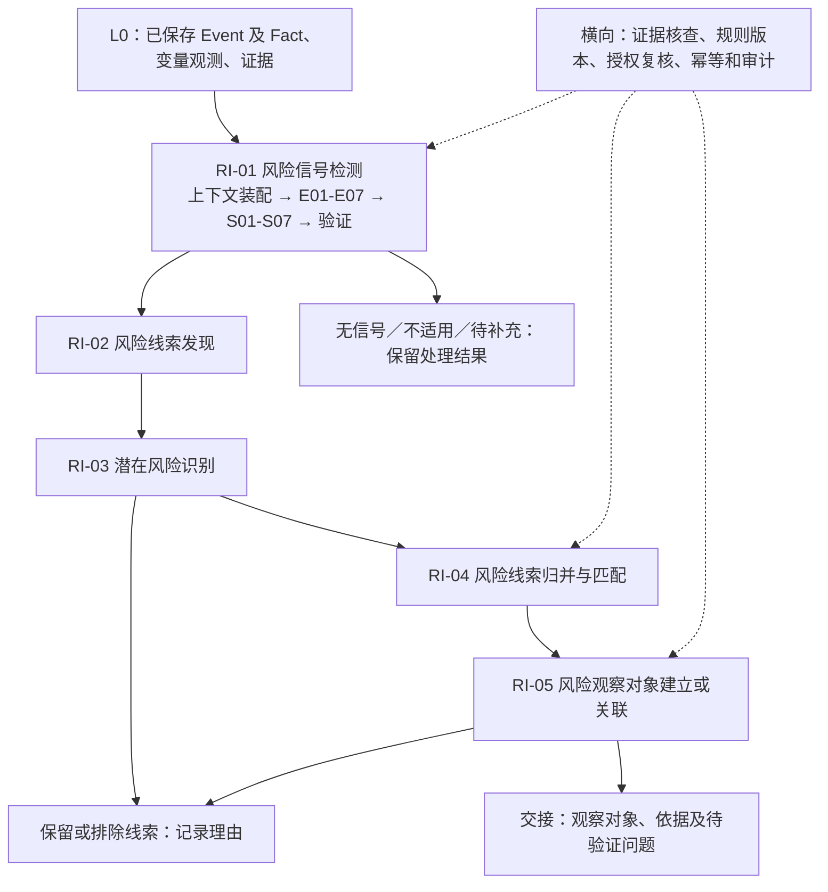
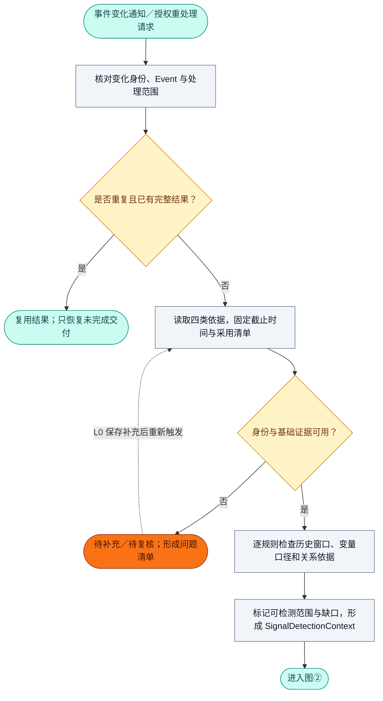
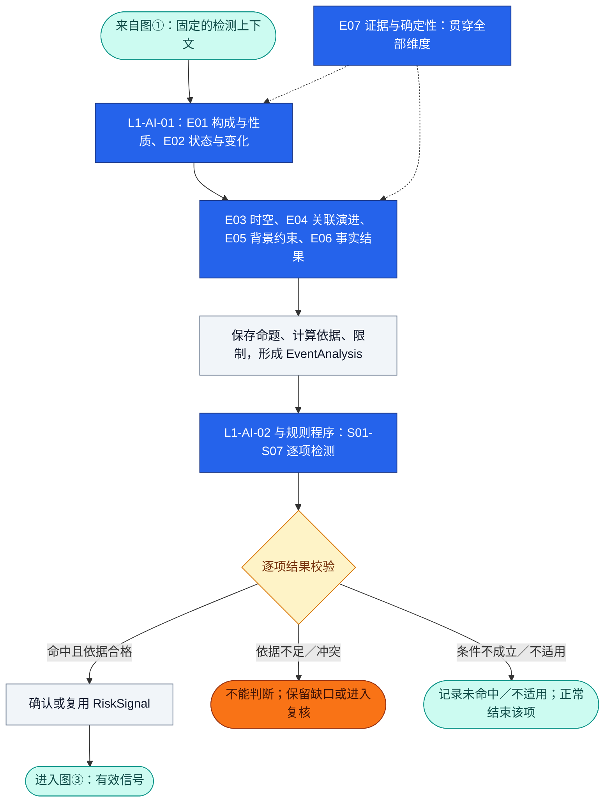
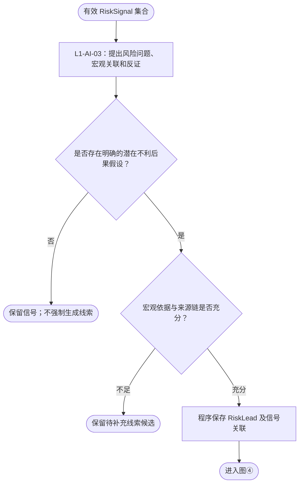
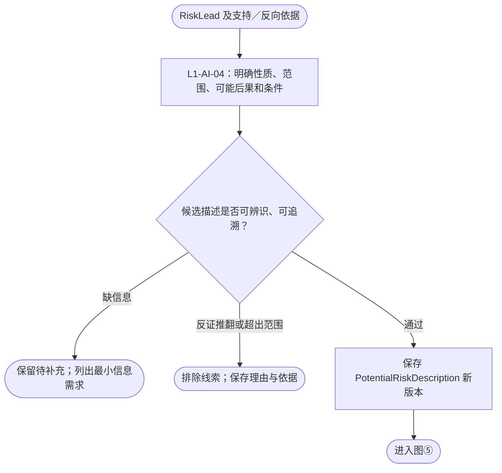
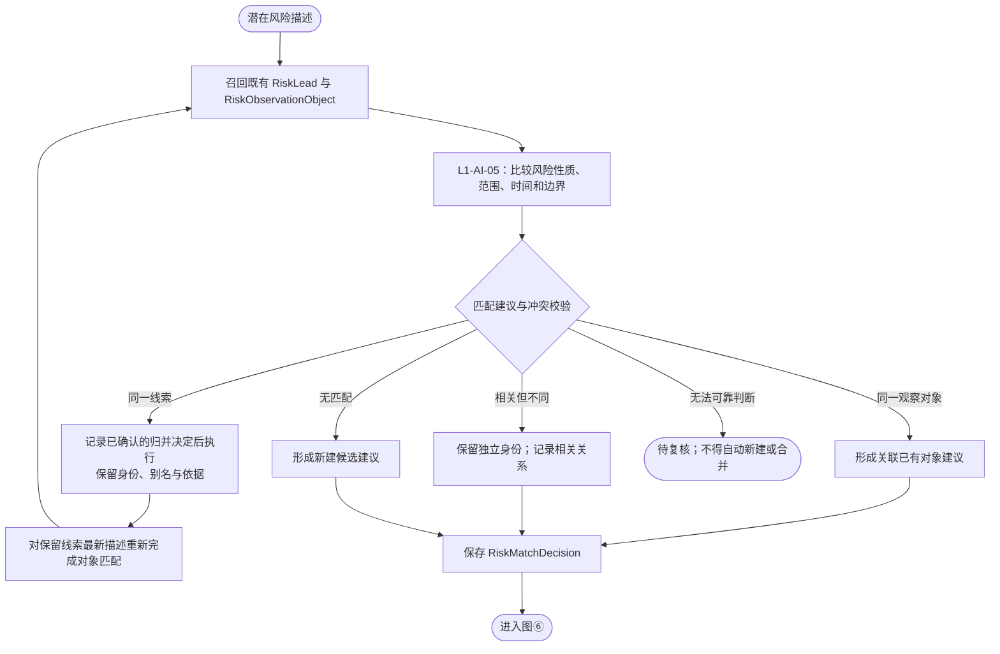
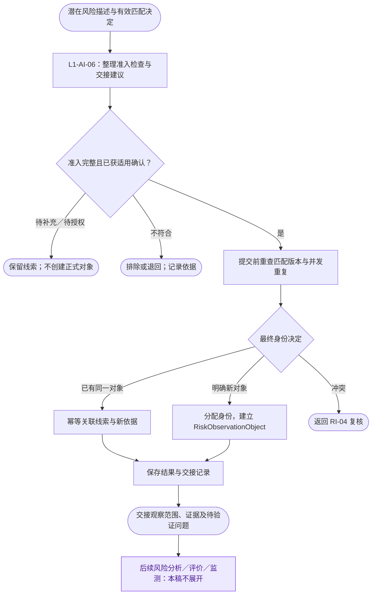
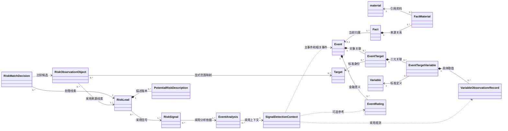
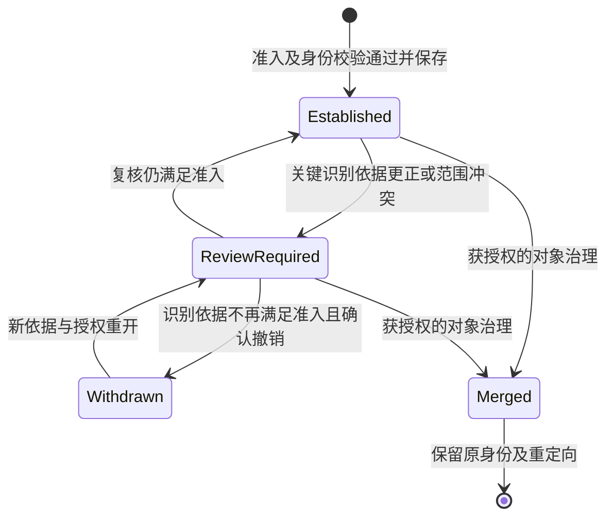

# RiskHot L1 风险识别层：业务架构与领域设计

> **文档版本**：V1.0（2026-11-01 讨论承接与设计整合版）  
> **设计范围**：RiskHot / L1 风险识别层 / 宏观风险识别  
> **文档性质**：业务架构与领域设计交付稿；新增方案尚待业务评审，不代表运行契约已发布。  
> **结构基线**：《RiskHot_L0_信息处理层_业务架构与领域设计V1.0.md》上传原文，沿用七章、两项附录及领域对象五段定义格式。  
> **语义基线**：以 L0 文首截至 2026-10-31 的修订说明及现行 §3.2～§3.5、§4.1～§4.3 为准。旧章节残留契约不自动继承。  
> **讨论依据**：[《信息到风险研究 transition》原会话](chatgpt-conversation://6ae6ba49-42c0-83ee-ade1-1e8309cae309)，以及本次交付要求。  
> **命名约定**：统一使用 RiskHot；资料对象写作 `material`，变量观测对象保留原文拼写 `VariableObservationrRecord`。名称修正另行治理，不在本次文档中静默改名。  
> **边界声明**：本层形成风险迹象、线索、潜在风险描述及风险观察对象；风险分析、风险评价、风险监测仅保留交接边界，不展开其模型与流程。

**确认状态口径**：

| 标记 | 含义 | 使用原则 |
| --- | --- | --- |
| L0 既定基线 | 上传原文现行定义及修订明确的约束 | 对齐设计语义，不据此宣称数据库迁移或运行功能已完成 |
| 本轮明确 | 用户本次明确要求或原会话直接明确的边界、术语 | 作为本稿必须满足的约束 |
| 讨论沿用 | 原会话已列出的框架或建议，本次要求继续展开 | 保留既有名称与编号；不把助手建议写成逐项经用户批准 |
| 新增方案 | 为使业务闭环而补充的规则、对象、状态、接口与分工 | 本稿给出可评审方案，未经确认不视为已发布契约 |
| 待确认 | 需要业务授权、样本验证或上下游契约决定的事项 | 明示缺口、影响与建议处理方式，见第 7 章 |

除明确标为 L0 既定基线、本轮明确或讨论沿用的内容外，本文 L1 的详细规则、字段建议、生命周期、接口和准入机制均属于**新增方案**。这是交付完整设计而非追认历史决策的统一口径。

## 1. 业务能力与职责设计

### 1.1 业务定位与总体职责

L1 基于 L0 已保存的事件事实、对象、变量观测和来源证据，开展**面向风险信号的事件分析**，识别值得继续研究的宏观风险迹象，将可解释的信号组织为风险线索，形成潜在风险描述，完成既有对象匹配或新风险观察对象建立。

本层回答三个问题：发生了哪些值得关注的变化；这些变化可能指向什么宏观风险；应关联已有对象、建立新对象，还是保留或排除线索。

L1 对识别依据、业务范围、假设与事实分离、结果可追溯和对象不重复负责。风险信号被确认，表示“按本次规则与证据检测到了该迹象”，不表示风险必然发生。风险观察对象被建立，表示“值得独立研究”，不表示已经完成风险评估。

**本轮明确**：L0 已将信息处理成事件入库；用于风险信号检测的进一步事件分析放在 L1。它是 RI-01 的内部活动，不另设与风险识别并列的业务阶段。

### 1.2 核心业务能力与责任

| 业务能力 | 回答的业务问题 | L1 承担的责任 | 主要交付结果 |
| --- | --- | --- | --- |
| 事件上下文装配 | 本次可以依据哪些事实开展检测？ | 固定输入截止时间、事件和证据采用依据，读取四类分析信息，列明缺口 | SignalDetectionContext |
| 面向风险信号的事件分析 | 事件呈现何种变化、时序、关系与宏观条件？ | 按 E01～E07 形成有证据的分析命题，区分事实、计算、推断和未知 | EventAnalysis |
| 风险信号检测 | 哪些现象符合风险迹象判定条件？ | 按 S01～S07 检测、验证、去重；保留命中、未命中、不能判断及不适用结果 | RiskSignal、检测覆盖记录 |
| 风险线索发现 | 信号可能指向什么风险问题？ | 组织支持与反向证据，形成可继续检验的问题或假设 | RiskLead |
| 潜在风险识别 | 风险是什么、涉及哪里、可能损害什么？ | 明确性质、宏观范围、潜在不利后果和条件，不做最终概率与损失评价 | PotentialRiskDescription |
| 风险线索归并与匹配 | 是否为同一研究问题，是否已有观察对象？ | 区分同一、相关、独立和无法判断，保留身份处理依据 | RiskMatchDecision |
| 风险观察对象建立 | 哪些候选值得正式独立观察？ | 执行准入、正式身份分配和来源关联，向后续阶段交接 | RiskObservationObject |

**横向质量与追溯职责**：保存输入依据、规则、提示词及模型版本；支持授权复核、幂等恢复、证据更正后的依赖复查。技术运行失败、业务待确认和无信号结果分别记录。

### 1.3 五个业务环节职责

| 编号 | 业务环节 | 输入 | 核心处理 | 输出 |
| --- | --- | --- | --- | --- |
| RI-01 | 风险信号检测 | L0 事件知识、历史上下文、规则 | 上下文装配 → E01～E07 → S01～S07 → 结果验证 | EventAnalysis、有效 RiskSignal 或完整的无信号／待补充记录 |
| RI-02 | 风险线索发现 | 一个或多个有效 RiskSignal | 提炼宏观风险问题，组织证据与反证，记录待验证假设 | RiskLead |
| RI-03 | 潜在风险识别 | RiskLead 及其依据 | 明确风险性质、范围、可能后果、条件与缺口 | PotentialRiskDescription，或退回补充／保留／排除 |
| RI-04 | 风险线索归并与匹配 | 潜在风险描述、既有线索及观察对象 | 语义召回、身份与范围比较、冲突复核、归并或关联建议 | RiskMatchDecision |
| RI-05 | 风险观察对象建立 | 可用潜在风险描述、匹配决定、准入依据 | 复查准入及重复身份，创建或关联，保存交接记录 | 新对象／关联已有对象／保留线索／排除线索 |

**讨论沿用**：五项活动及顺序承接原会话。七种能力被组织在五项活动内；事件上下文装配和事件分析均属于 RI-01，不能误写为 RI-06、RI-07。

### 1.4 首版职责覆盖范围

| 维度 | L1 V1 范围 |
| --- | --- |
| 研究视角 | 宏观经济运行、货币信用、财政与主权、主要金融市场、跨境联系、资源供需及系统运行条件 |
| 识别入口 | 正式 Event 及其有效 Fact；未归组 Fact 不作为独立正式识别入口 |
| 输入形态 | 已发生、已宣布、计划、预期或预测的来源内容均可参与；保留原阶段与取值性质 |
| 对象覆盖 | 引用 L0 的各类 Target，但需说明本次识别为何具有宏观意义 |
| 信号 | 事件冲击、状态异常、时序演化、结构脆弱、关联共振、传导扩散、预期反馈 |
| 数据不足 | 按规则逐项保留不能判断；不要求全部七类均可检测才处理事件 |
| 结果 | 可追溯信号、风险线索、潜在风险描述、匹配决定、风险观察对象 |
| 量化边界 | 可计算事件变化、偏离等检测特征；不输出未经定义的风险概率、损失估值或风险等级 |

**L0 既定基线**：Target 建档范围已放宽，不能继续沿用 L0 旧 §1.6 的微观对象排除条款作为字典限制。**本轮明确**：L1 本次仅研究宏观风险。单一机构、企业或资产事件只有具备明确的宏观暴露、系统关联或结构代表性依据，才可进入本层正式线索；“机构很大”或“新闻很多”本身不足以成立。

### 1.5 上下游职责分工

| 层次／职责方 | 维护内容 | L1 使用或交接边界 |
| --- | --- | --- |
| L0/F01 | material、原文及采用版本 | 按事实证据路径读取，不复制一套独立资料身份 |
| L0/F02 | Fact、FactMaterial、Event、EventTarget、EventTargetVariable、VariableObservationrRecord、EventRating | 读取已保存结果；事实错误和缺口回交 L0，不直接修改 |
| Target 治理职责 | 对象身份、分类、辖区与范围 | 引用现有身份；需要新身份时提交候选，不由 L1 越权建档 |
| M2 | Variable 标准定义及版本 | 复用全局变量；不因不同风险场景新建同义变量 |
| L1 | 风险导向分析、信号、线索、潜在风险及观察对象准入 | 维护自身结果与采用依据，保留推断性质 |
| 后续风险分析、评价、监测 | 后续各阶段自己的业务结论 | 接收观察对象与问题清单；其完整机制、方法及状态不在本文定义 |

Target 是金融观测对象的标准身份；RiskObservationObject 是围绕某项潜在风险建立的研究管理对象。二者可建立范围映射，不能按名称或 ID 自动等同。一个 Target 可以涉及多个风险观察对象，一个观察对象也可覆盖多个有明确角色的 Target。

### 1.6 职责边界与暂不承担事项

- 不重新执行 L0 已完成的资料采集、事件抽取、Fact 归组、Target 身份融合和变量标准化。
- 不创建独立 EventMaterial、EventFact 或 EventUpdate；事件来源仍经 Fact 与 FactMaterial 派生。
- 不将 EventTargetVariable 解释为取值表，也不创建固定的 Target—Variable 预配置归属。
- 不将 L1 跨事件计算结果直接回写为 L0 原始观测；可复用事实通过治理与补充流程提交。
- 不将 E07 扩展为全系统逐条事实核验流水线，不另设事实可信度 C 评分；它检查本次识别结论与所引证据是否匹配。
- 不建立完整因果传导模型、发生概率、风险严重度、损失量化、投资或交易建议。
- 不定义持续监测频率、报警阈值、风险快照或演化轨迹。输入更正后的识别结果复查属于结果维护，不等同于持续风险监测。
- 不以 EventRating 的 M 或 AI 自评置信度替代风险识别、准入和授权决定。

## 2. 业务架构设计

### 2.1 L1 总体业务流程



五项业务职责不要求对应五个服务或五张数据库表。首次识别按上述路径执行；同一对象因事实更正而复查时，可以从受影响步骤恢复，仍须满足后续校验与准入条件。

### 2.2 业务流程图（详细版，带阶段）

| 详图 | 处理内容 | 对应业务环节 |
| --- | --- | --- |
| 图① | 事件上下文装配 | RI-01 前置活动 |
| 图② | E01～E07 事件分析与 S01～S07 检测验证 | RI-01 核心活动 |
| 图③ | 风险线索发现 | RI-02 |
| 图④ | 潜在风险识别 | RI-03 |
| 图⑤ | 归并与匹配 | RI-04 |
| 图⑥ | 观察对象准入、建立及交接 | RI-05 |

**颜色图例**：蓝色为 AI 建议任务；灰色为程序处理；浅黄为校验或分支；橙色为待补充或待复核；青绿为入口或正常出口；紫色为后续阶段。AI 编号使用 `L1-AI-01`～`L1-AI-06`，避免与 L0 的 AI 编号及历史编号迁移混淆。

#### 2.2.1 图①：事件上下文装配



**处理口径**：存在 Event 且其身份、当前事实及关键证据可用，即可装配上下文。没有 Target、变量观测或 M，不自动拒绝整条事件；依赖相应数据的规则分别不能判断。无正式 Event 的 Fact 先回到 L0 处理。

#### 2.2.2 图②：事件分析、信号检测与验证



**执行口径**：E01～E06 是逻辑依赖顺序，具备输入的活动可并行；E07 不位于末尾才执行。一项检测无信号或不能判断，不阻断其他有充分依据的检测项。AI 形成语义建议，程序验证身份、时间、引用与确定性计算；正式确认权限见 §7.2。

#### 2.2.3 图③：风险线索发现



**处理口径**：一个信号可以支持多条不同假设的线索；多个信号可共同支持一条线索。暂存候选不得伪装成已满足准入条件的潜在风险。风险线索不等于关键词集合或新闻主题。

#### 2.2.4 图④：潜在风险识别



**处理口径**：记录潜在后果及初步关联理由，不能将未观测到的后果写为 E06 事实结果。机制证据不够完整时可保留待验证问题；连风险对象和可能受损事项都无法说明时不进入正式建档。

#### 2.2.5 图⑤：风险线索归并与匹配



**防循环约束**：一次归并只针对尚未归入保留身份的成员执行；已归并成员通过别名解析跳过同一归并动作。合并后形成新的描述版本，仅对该版本重新进行对象匹配。若仍存在身份冲突，进入复核，不能无限迭代。

#### 2.2.6 图⑥：观察对象建立与交接



**交付口径**：观察对象建立与后续交接成功是两个独立结果。交接失败只重试交接，不重复新建对象；关联已有对象不冒充新建结果。正式对象建立必须具备识别依据与身份决定，不能只依据 AI 输出标题生成。

## 3. 业务规则设计

### 3.1 输入准入、上下文与证据可追溯

#### 3.1.1 四类事件分析依据

| 编号 | 分析依据 | L0 对齐内容 | L1 使用方式 |
| --- | --- | --- | --- |
| ① | 事件六要素 | Subject、Action、Object、OccurredAt、语义信息、原文证据 | 理解事件事实、业务阶段和原始表达 |
| ② | 事件提取变量 | Variable 定义、EventTargetVariable、VariableObservationrRecord | 计算可比变化、异常、时序及结构特征 |
| ③ | 事件关联关系 | 可取得且有依据的事件联系、历史事件及共同对象 | 研究延续、响应、共振及演进；缺少正式关系时保留关系假设 |
| ④ | 事实与证据属性 | Fact、FactMaterial、资料版本、引文、来源作用和缺口 | 核查支持力度、矛盾、适用性及结论确定性 |

**本轮明确**：“事件六要素”替代此前泛称“事件自身属性”。原会话列出了六项；L0 §3.3.2 亦采用相同事实输入。第④类关注证据质量及采用条件，不重复建立另一份原文证据。

#### 3.1.2 事件六要素与 L0 映射

| 六要素 | 含义 | L0 读取口径 | 不得混淆 |
| --- | --- | --- | --- |
| Subject | 谁发起、执行或体现行为／变化 | `event.subject`，逐事实回查 `fact.subject` | 不自动等于 Target |
| Action | 发生何种行为、决定或变化 | `event.action`、`fact.action` | 不以主题标签替代具体行为 |
| Object | 行为作用或涉及什么 | `event.object`、`fact.object` | 原始语义不直接等于正式 Target |
| OccurredAt | 行为、决定或变化发生的业务时间 | `event.event_time`、`fact.event_time` 及时间精度、阶段语境 | OccurredAt 是业务术语，不新增同名运行字段；不替代变量取值时间 |
| Semantic Information | 标题、描述与必要语义 | `event.title`、`event.description` 及 Fact 描述 | 不用 AI 总结代替事实与引文 |
| Source Evidence | 支撑或质疑事实的原始内容 | Fact → FactMaterial → material，采用 `fact_evidence` 的版本与定位 | 不虚构独立 Evidence 聚合或 EventMaterial |

事件类型、地点、范围、发生状态可作为属性、变量或事实语境使用，但不替换或扩充六要素的术语清单。L0 的 Subject＋Action＋Time 身份识别依据与六要素的分析输入视图用途不同，不矛盾。

#### 3.1.3 上下文装配规则

1. **CTX-01 身份明确**：主事件必须是正式 Event，保留实际采用的 Fact 及其当时归属。Event 可无 Target、Variable、观测或评级。
2. **CTX-02 范围固定**：指定本次宏观研究范围、研究时间窗口与信息截止时间。未指定的关键范围不得由模型静默扩大。
3. **CTX-03 采用可复查**：读取时保存输入清单、内容摘要与采用时间；能取得的定义版本、资料版本均保留。L0 无 Event 版本字段时不得假称具有版本回放，可由 L1 保存最小采用内容与摘要作为自身执行依据。
4. **CTX-04 历史不前视**：历史窗口按业务时间选择；对“当时可知”的分析同时限定资料可得时间。迟到资料和修订值必须注明，不进入声称当时可知的历史检测。
5. **CTX-05 可比才计算**：比较前核对 Target 范围、Variable 定义版本、单位、统计期间、频率、取值性质、获取方式及修订口径。单位换算记录公式；同比、环比和百分点不能混用。
6. **CTX-06 依赖分级**：缺失主事件身份或关键证据阻断该次正式判断；缺少某类历史或变量，只阻断依赖它的规则。禁止用零值填缺失。
7. **CTX-07 关系分层**：既有事实关系、L1 推断关系及待验证关系分别标注。L0 未提供正式 EventRelation 契约时，使用上下文中的带依据关系项，不新增假定的上游必填对象。
8. **CTX-08 外部补充**：新原始资料经 L0 或获授权的数据接入职责入库后再作正式事实依据。暂不可接入的背景知识可标为待验证参考，不能单独支持正式信号。

#### 3.1.4 证据关系与结论采用

**单项证据路径**：L1 结论命题 → 采用的 Event／观测引用 → 对应 Event 的 Fact → FactMaterial → material 的采用版本与原文定位。

跨事件分析可以引用多个 Event 的各自事实链，但不得将 Event B 的 Fact 塞入 Event A 的变量观测依据。每条 L0 观测仍须符合本事件证据约束。

| 证据角色 | 处理要求 |
| --- | --- |
| 支持 | 指明支持哪个命题、时间、范围和条件，不以“有一篇来源”替代逐项支持关系 |
| 质疑／反向 | 保留与支持证据并列，说明冲突会否改变结论或准入 |
| 背景 | 说明仅用于解释环境；不自动当作本事件已产生结果的依据 |
| 计算输入 | 保留原始观测、口径、换算与公式，可由程序复算 |
| 推断依据 | 保留观察到的前提及推断步骤，明确哪些结论尚未证实 |

证据定位沿用 L0 实际提供的 `material_version`、`material_digest`、`segment_id`、`start_cp`、`end_cp`、`quote` 等口径；上述名称不等于所有接口均已实现。精确观测—证据映射在 L0 仍有待设计部分：无法明确哪个 Fact 支持某次取值时，L1 记录“取值证据待核对”，不得以整篇材料或事件摘要替代。

### 3.2 E01～E07 面向风险信号的事件分析

#### 3.2.1 分析定义与输出边界

EventAnalysis 是在固定上下文和截止时间下，对事件及关联知识形成的风险导向分析结果。它复用已有六要素和观测，重点完成比较、组合、关联与证据核查，不重复事实抽取。

**讨论沿用**：七个维度及 E07 贯穿其余维度的定位。下述细则为新增方案。

| 编号 | 分析维度 | 核心问题 | 主要输入 | 必须输出 | 禁止跨越的边界 |
| --- | --- | --- | --- | --- | --- |
| E01 | 事件构成与性质 | 发生什么，属于何种行为或变化？ | 六要素、Fact、业务阶段 | 事件画像、性质、主要事实与限定条件 | 不重新核定 Event 身份；身份疑点回 L0 |
| E02 | 事件状态与变化 | 状态、水平及变化如何？ | 三元关联、观测、可比历史 | 基期与本期、变化幅度／方向、计算方法与可比性 | 计划值不当实际值，数值异常不直接等于风险 |
| E03 | 事件时空特征 | 何时何地、持续多久、范围多大？ | 业务时间、适用期间、辖区及范围事实 | 时间轴、空间覆盖、已知期限和未知项 | 生效日期到达不自动确认实施；不推算未经支持的覆盖范围 |
| E04 | 事件关联与演进 | 与哪些事件延续、响应、升级或缓和？ | 历史 Event、Fact、带依据关系项 | 关联事件、关系性质、先后与阶段变化 | 先后不等于因果，同一主题不等于同一事件 |
| E05 | 事件背景与约束 | 发生在什么宏观环境及约束之下？ | 可追溯背景事件、结构数据与变量 | 背景条件、约束、适用范围及缺口 | 不用常识补造供应份额、依赖度或缓冲能力 |
| E06 | 事件事实结果 | 已产生哪些可验证结果？ | 结果 Fact、实际观测及后续事件 | 已观测结果与依据；尚无结果时明确为空 | 宣布、计划及预测后果不写作已发生结果 |
| E07 | 事件证据与确定性 | 哪些已获支持，哪些冲突或未知？ | 各命题采用的完整证据路径 | 支持／质疑关系、限制、核查结果 | 不以来源数量或模型置信度证明真实，不输出未经定义的 C 分 |

#### 3.2.2 分析执行与结果组织

1. 先确认 E01 的核心事实与阶段，并由 E07 同时核对原文。
2. 在具备可比观测时执行 E02；只描述变化或计算差值，具体风险含义留给信号规则及线索步骤。
3. E03 固定时间与空间范围，为 E04 的历史对照和 E05 的背景筛选提供边界。
4. E04 对关系逐项说明“来源明确陈述／数据支持的关联／L1 待验证推断”。
5. E05 只采用截止时间内可获得的背景；缺关键结构数据时列出补充请求。
6. E06 独立列出已经观察到的结果，避免与潜在后果混淆。
7. 每项分析命题保存维度、内容、命题性质、采用引用、时间范围、限制与核查状态；不适用维度说明理由。

命题性质建议采用**来源事实、确定性计算、研究推断、未知**四类。核查状态另行表达**待核查、证据支持、存在争议、依据失效**。两者不是同一维度：一项推断可以有充分的前提证据，但仍然是推断。

### 3.3 S01～S07 风险信号分类与检测规则

#### 3.3.1 RiskSignal 业务定义

RiskSignal 是在明确范围、时间、规则和证据下检测到的、可能具有宏观风险意义的现象或变化。它表达“检测到什么迹象及为什么”，不直接表达“风险已经发生或有多严重”。

**讨论沿用**：七类信号名称已在原会话列出，但分类完备性及独立性当时仍待审查。下表为可执行的业务细化建议，阈值与自动确认权限未定。

| 编号 | 类型 | 检测问题与最低依据 | 判定要求 | 不能判断或排除条件 |
| --- | --- | --- | --- | --- |
| S01 | 事件冲击 | 是否出现可能改变宏观运行条件的突发行为、决定或显著变化？需事件性质、阶段、范围和关键证据 | 说明相对何种既有条件发生变化、为何有宏观意义；已宣布的冲击须标为政策／计划层面 | 只有醒目标题、M 高分或一般政策报道，不足以命中 |
| S02 | 状态异常 | 某对象变量是否偏离适用基准、区间或状态约束？需同口径观测和经批准基准 | 保留观测值、基准、偏离方向与算法；数值由程序复算 | 无基准、口径不兼容或阈值未批准时不能输出正式数值规则命中 |
| S03 | 时序演化 | 是否有持续恶化、加速、反复、拐点等序列特征？需去重且可比的多期观测或独立阶段事件 | 固定窗口、样本条件和序列规则，区分实际变化与修订 | 重复报道、单点变化或预测与实际混接不能构成趋势 |
| S04 | 结构脆弱 | 是否存在集中、依赖、期限错配、缓冲不足等结构条件？需结构量及相关约束依据 | 说明结构对象、分母、范围和潜在暴露；结构本身与触发事件分开 | 单次冲击不能自动证明结构脆弱；无结构数据则保留假设 |
| S05 | 关联共振 | 多个独立现象是否在共同范围或窗口内相互强化？需至少两个可区分的现象及共同关联依据 | 排除同一事实多报道，明确共振时间窗、共同条件与限制 | 同时发生或同关键词不足以证明共振；不直接给出因果结论 |
| S06 | 传导扩散 | 风险相关变化是否从一个对象／区域出现向另一处扩展的迹象？需起点、后续响应和连接依据 | 给出观察到的链段、时间先后和替代解释；只识别迹象 | 仅有理论通道而无响应证据时不能称已扩散；完整因果识别交后续 |
| S07 | 预期反馈 | 预期变化与行为或市场反应是否形成反馈迹象？需有来源、期限的预期记录及对应行为／响应 | 区分预期变化、预期与现实差异、行为响应；反馈须有连接依据 | 单一预测、价格波动或普通预期调整不自动构成反馈回路 |

#### 3.3.2 E 与 S 的依赖映射

下表是规则装配参考，不是“完成某个 E 就必然触发某个 S”。E07 对全部信号强制适用。

| 信号 | 主要分析维度 | 常需补充依据 |
| --- | --- | --- |
| S01 | E01、E02、E03、E05、E07 | 事件适用范围、既有条件及冲击差异 |
| S02 | E02、E03、E07 | 同口径基准或规范状态 |
| S03 | E02、E03、E04、E07 | 多期数据、序列窗口、修订历史 |
| S04 | E02、E05、E07 | 集中度、依赖、错配或缓冲信息 |
| S05 | E03、E04、E05、E07 | 独立现象、共同背景及增强依据 |
| S06 | E03、E04、E05、E06、E07 | 起点与响应事实、可解释的连接 |
| S07 | E02、E04、E05、E06、E07 | 预期主体、预期期限、行为或市场响应 |

#### 3.3.3 检测规则的最小业务定义

每条规则至少明确：规则身份及版本、所属 S 类型、宏观适用范围、输入依赖、数据窗口、基准口径、命中条件、不能判断条件、排除条件、输出命题、证据要求和复核要求。具体规则配置名称、字段及发布载体待技术设计，不假定已有配置 API。

| 规则要求 | 执行口径 |
| --- | --- |
| 规则有效性 | 只以已批准且适用的规则形成正式命中；草案规则可产生候选及研究备注 |
| 定量判定 | 必须具备批准的阈值、样本要求、方向与算法，不在本文硬填数值门槛 |
| 定性判定 | 采用可复核的文字条件及证据检查项；不要求所有信号强行量化 |
| 四态结果 | 命中、未命中、不能判断、不适用逐项区分；技术失败另行记录 |
| 多类型 | 同一事件可命中多个 S，但每条正式信号采用一个主类型；共同证据保留重叠标记，不能按数量重复增强 |
| 幂等与身份 | 同规则语义、同观察范围、同现象／时间窗口的重复输入复用信号身份；新证据与规则版本可产生新的结果修订 |
| 降级或撤回 | 依据更正后重验；不能继续成立的信号撤回或被新修订替代，保留旧依据 |
| 研究排序 | M 可作为阅读排序参考，M 缺失不阻断识别；不把 M 当 S01 门槛或风险分 |

#### 3.3.4 时序、共振与来源去重

同一 Fact 的多份 material 不是多个独立事件；同一事件中的另一阶段 Fact 也不是自动独立冲击。S03 按业务发生或取值时间排序，S05 先核对现象独立性与同源转载，S06 核对起点与响应的可区分性。数据修订引起的历史值变化不能伪装为新的现实变化。

同一 Target、Variable、统计期间和口径的多个事件来源观测可在检测上下文中形成去重视图；保留全部原始引用、选值或冲突理由。L1 不在此建立全局权威时间序列库，也不删除 L0 观测。

### 3.4 风险线索发现与潜在风险识别

#### 3.4.1 RiskLead 定义与形成规则

RiskLead 表达由一个或多个有效信号提出的、值得继续检验的宏观风险问题。正式线索至少包含信号引用、问题陈述、宏观关联、可能受损事项、初步假设及缺口。潜在不利后果尚不清楚时保留信号，不强制建立线索。

**LEAD-01**：按风险问题而非关键词、新闻主题或单一 Target 聚合。  
**LEAD-02**：同一信号支持多个不同问题时分别建立线索并说明差异。  
**LEAD-03**：既有反向证据必须进入线索，不能只选择支持结论的材料。  
**LEAD-04**：宏观关联只是一项待验证推断时标明候选；不能以微观 Target 存在证明宏观风险成立。  
**LEAD-05**：线索被排除或归并后仍保留原身份、理由和历史引用。新事实足以改变判断时可受控重开。

#### 3.4.2 潜在风险描述的组成

PotentialRiskDescription 是 RI-03 对某条 RiskLead 的结构化表达，初期作为线索聚合内的版本化值对象，不另设与观察对象竞争的正式 Risk 身份。

| 业务项 | 必须回答的问题 | 使用要求 |
| --- | --- | --- |
| 风险名称与性质 | 可能出现什么不利状态或事件？ | 描述风险问题，不只复述触发事件 |
| 观察范围 | 哪些经济体、市场、部门或系统功能可能受影响？ | 给出包含／排除范围；Target 映射仅使用真实身份 |
| 触发与暴露依据 | 哪些已观测迹象支持关注它？ | 引用信号、分析命题及底层事实 |
| 潜在后果 | 哪种宏观运行条件或系统功能可能受损？ | 明确是潜在后果，不宣称已经发生 |
| 时间语境 | 关注哪个期间，哪些时点尚未知？ | 不虚构精确发生日期或概率 |
| 成立条件 | 在什么条件下此假设才合理？ | 保留关键假设、边界和可能失效的情形 |
| 反证与缺口 | 什么证据削弱假设，还需确认什么？ | 标出影响准入的关键缺口与后续研究问题 |

#### 3.4.3 RI-03 输出分流

- **可进入匹配**：风险性质、范围及潜在不利后果可辨识，基础证据完整，宏观关联有合理依据；其余机制细节可作为后续问题。
- **保留待补充**：关键对象、事实、条件或宏观关联仍缺失，无法形成可辨识描述。
- **排除**：经核查不具备宏观范围、风险问题被反证推翻或基础信号已撤回且无其他有效支持；须记录具体理由。

本阶段不要求先形成完整机制模型或损失估计才识别潜在风险；也不能仅有“可能有风险”的泛化表述就通过。

### 3.5 风险线索归并与匹配规则

#### 3.5.1 匹配维度与结果

比较风险性质、受损事项、观察对象范围、地区／市场边界、时间语境、关键条件和已有证据覆盖。词向量或关键词仅用于候选召回，不直接裁定同一身份。

| 结果 | 适用条件 | 后续动作 |
| --- | --- | --- |
| 同一线索 | 描述同一风险问题且范围兼容 | 选择保留身份，合并引用与问题清单，保留原线索别名和决定 |
| 同一观察对象 | 候选风险已包含在该对象当前明确边界内 | 关联新线索及依据，不新建对象 |
| 相关但不同 | 有共同触发或连接，但风险性质、范围或受损事项不同 | 保留独立身份，可记录相关关系；独立候选继续准入 |
| 无匹配 | 在指定检索范围与时点未发现兼容对象 | 形成新建候选，提交前再次核对 |
| 无法判断 | 身份、范围或多候选冲突未解 | 保留待复核，不以最高相似度强制决定 |

#### 3.5.2 归并、关联与身份治理

1. 归并只影响 L1 线索及其引用，不合并 L0 Event、Fact、Target 或 Variable。
2. 同一 Target 上不同风险分别管理；同一政策引起不同潜在后果可对应多条线索。
3. 多条线索归并时统一支持与反证，但去重共同 Fact 和同源资料，不重复计算证据强度。
4. 存量正式观察对象之间的合并、拆分为受控治理，不由一次识别自动执行。RI-04 可提出建议及受影响引用，未经授权保留原身份。
5. 已有关联不意味着所有后续线索都自动适用；范围发生变化应重新比较，不静默扩大原对象。
6. 已排除线索、已撤销对象仍可检索作为历史候选，但不能直接作为有效匹配目标。应先复核是否重开或建立新的时间范围。
7. 匹配决定记录候选清单、比较维度、理由、采用版本、执行／复核主体与结果；技术相似度不是业务同一性。

### 3.6 风险观察对象准入与建立

#### 3.6.1 RiskObservationObject 业务定义

RiskObservationObject 是对具备宏观研究价值、身份与范围可辨识且有可追溯识别依据的潜在风险，建立的稳定研究管理对象。它组织风险问题、边界、来源线索与后续研究入口。

#### 3.6.2 首版准入检查（新增方案）

| 检查项 | 通过条件 | 未通过处理 |
| --- | --- | --- |
| 宏观范围 | 能说明与宏观运行、主要市场或系统功能的关联，有明确依据 | 微观独立问题排除；关联待证实则保留 |
| 风险可辨识 | 风险性质、范围和潜在不利后果明确，可与其他对象区分 | 回 RI-03 补充 |
| 识别依据 | 至少一条当前有效线索及其有效信号，关键命题可追溯 | 补证或重验，不建空对象 |
| 不确定性透明 | 关键假设、反证及缺口已列明；无未处置的决定性冲突 | 待复核 |
| 身份处理 | RI-04 决定可用且范围版本未失效；提交时未产生重复对象 | 返回匹配 |
| 研究可承接 | 已明确后续应验证的问题与可寻找的证据方向 | 补充交接清单；不要求在此设计监测计划 |
| 授权与完整保存 | 按已批准机制确认准入；对象及必要关联完整保存 | 留在线索阶段，不以候选冒充正式结果 |

不设置未经验证的“信号数不少于 N”“M 大于某值”“模型置信度大于某比例”自动建档门槛。定性准入可在授权复核后完成；自动确认权限未批准前，建议默认进入人工确认。

#### 3.6.3 对象建立与既有对象关联

新对象记录名称、性质、边界、时间语境、Target 范围映射、识别描述、线索及证据入口、准入决定和待验证问题。没有适用的标准 Target 时可保留清晰的文字范围及映射缺口；若该缺口使对象范围不能确定，则不得通过准入。不得为满足表单创建虚假 Target。

关联已有对象须记录本条线索为何属于其边界、补充了什么证据或问题；不改写原准入依据。创建与关联统一遵循幂等提交和审计要求。

## 4. 领域模型设计

本章按“对象清单 → 关系与聚合 → 对象详细定义 → 生命周期 → 跨对象规则与领域事件”组织。L0 对象只读引用；L1 新对象为设计方案，不等于数据库表或已实现服务。领域对象均采用五段定义，不复制 L0 物理表设计。

### 4.1 领域对象清单

| 领域对象 | 中文名称 | 分类与所属边界 | 核心职责 |
| --- | --- | --- | --- |
| SignalDetectionContext | 信号检测上下文 | RI-01 执行上下文值对象 | 固定输入、时间窗口、采用依据和可检测范围 |
| EventAnalysis | 事件分析结果 | L1 分析结果实体 | 组织 E01～E07 命题、证据与限制 |
| RiskSignal | 风险信号 | L1 独立结果实体 | 管理已检测迹象、类型、规则、范围与修订 |
| RiskLead | 风险线索 | L1 线索聚合根 | 管理风险问题、信号组合、潜在风险描述和处置 |
| PotentialRiskDescription | 潜在风险描述 | RiskLead 聚合内版本化值对象 | 表达风险性质、范围、潜在后果及条件，不建立独立 Risk 身份 |
| RiskMatchDecision | 风险匹配决定 | L1 决定记录实体 | 保存线索归并、对象匹配的建议、确认及执行依据 |
| RiskObservationObject | 风险观察对象 | L1 观察对象聚合根 | 管理稳定风险研究身份、范围、准入和来源线索 |

#### 4.1.1 外部领域对象及统一引用

| L0／共享对象 | 本层采用内容 | 所有权与约束 |
| --- | --- | --- |
| InformationSource | 来源身份、适用配置及发布主体 | 配置方维护；历史证据不因当前停用自动消失 |
| material | 原文、来源、资料版本和摘要 | L0/F01 维护；不用 Information 作为本稿新对象名 |
| Fact | 事实内容、阶段、时间、归属及来源链 | L0/F02 维护；同次发生跨报道可复用，不等于真实性已证实 |
| FactMaterial | 资料对事实的支持／质疑关系 | 每项连接一个 Fact 和一个 material；证据经独立证据关系定位 |
| Event | 事件身份、六要素视图及已采用事实 | 至少一个有效 Fact；不要求先有 Target 或 Variable |
| Target | 标准身份、分类、辖区、范围及定义版本 | L1 复用，不自动等同于风险观察对象 |
| Variable | 全局定义、单位、类型、状态及定义版本 | 复用 `risk_variable_definitions`；由 M2 管理 |
| EventTarget | 事件与对象的正式关联及事实依据 | 无变量时仍可成立 |
| EventTargetVariable | Event＋Target＋Variable 三元关系 | 不是取值；依赖有效 EventTarget 与正式 Variable |
| VariableObservationrRecord | 值、单位、取值性质、业务时间、获取方式及依据 | 属于一个三元关系，可有多次观测；与事件时间独立 |
| EventRating | 范围、期限、方法、M、理由与状态 | 仅作研究重要性参考；允许缺失或未量化 |

#### 4.1.2 身份、命题、证据与执行记录

正式身份由程序分配或复用；AI 只引用已提供身份。分析命题、证据引用、检测覆盖、Target 映射和交接回执是逻辑组成项，本稿不将每项都升级为核心领域实体。

Context 初期可在任务中装配；必须持久保留足以复查已采用结论的最小输入清单、采用内容或摘要、资料版本、规则与运行依据。此举是 L1 结果追溯，不恢复 L0 已取消的 EventUpdate，也不宣称 L0 支持任意版本回放。

### 4.2 领域对象关系模型

#### 4.2.1 UML 类图与聚合边界



图中结果的最低基数指首次形成正式可用结果时的要求；历史结果因依据被撤回而保留时，其历史引用仍存在，不保证所有被引结果当前仍有效。各 L1 结果与 Fact 的逐项证据采用关系按 §3.1.4 管理，未在类图中逐边展开。

| 聚合／管理边界 | 内部管理内容 | 外部引用 |
| --- | --- | --- |
| RI-01 结果管理 | 分析版本、信号修订、覆盖结果及采用清单 | L0 对象与证据；不接管原始事实 |
| RiskLead 聚合 | 问题陈述、信号采用关系、潜在风险描述版本、处置历史 | RiskSignal、匹配决定和观察对象 |
| 匹配决定管理 | 候选比较、建议、确认和执行结果 | 线索与观察对象当前身份及范围依据 |
| RiskObservationObject 聚合 | 稳定身份、边界、线索关联、准入决定及交接记录 | Target、RiskLead 及其证据链 |

聚合边界不预设共享事务或部署方式；组合关系不授权级联删除证据与历史结果。

#### 4.2.2 对象关联与基数

| 关系 | 基数与约束 |
| --- | --- |
| Context → Event | 每个上下文一个主 Event，零至多个相关 Event；每个 Event 可参加多次装配 |
| EventAnalysis → Context | 每个分析版本采用一个确定上下文；上下文可在不同分析方法下复用 |
| RiskSignal ↔ EventAnalysis | 多对多；正式信号至少引用一个可用分析结果，并精确到命题及证据 |
| RiskLead ↔ RiskSignal | 多对多；首次正式线索至少有一个当前有效信号；不重复计算共同依据 |
| RiskLead → PotentialRiskDescription | 一对零至多版本；每个描述版本只属于一条线索，当前采用版本唯一 |
| RiskMatchDecision → RiskLead | 每个决定处理一条主线索，归并时显式列出其他成员；一条线索可有多次决定 |
| RiskMatchDecision → 目标 | 可比较多个候选；执行时明确保留线索、既有观察对象或新建建议；多个不同风险先拆分描述 |
| RiskObservationObject ↔ RiskLead | 多对多；首次建立至少有一条有效线索；每条关联说明范围和作用，禁止重复纳入 |
| RiskObservationObject ↔ Target | 多对多的显式映射；零映射只允许对象文字范围已清晰且标明映射缺口的情形 |
| L1 结果 → Fact 与证据 | 多对多采用；每条命题保持其实际来源 Event 路径，不改变 Fact 当前归属 |

#### 4.2.3 事实、分析与风险对象的职责分工

Fact 记录来源中的具体发生；Event 管理事件事实身份；EventAnalysis 整理风险目的下的分析；RiskSignal 记录规则检测到的现象；RiskLead 提出风险问题；PotentialRiskDescription 结构化该问题；RiskObservationObject 为值得研究的问题建立稳定管理身份。

“宣布削减出口配额”是事件事实，“配额计划较原值下降”可由 E02 描述，“符合事件冲击规则”是信号判断，“是否导致宏观供应约束”是线索问题，“全球能源供应约束潜在风险”是候选风险描述。只有准入后才建立观察对象，不能将这些概念互相改名。

#### 4.2.4 关系一致性与历史追溯

1. 读取观测时核对三元关系及所引 Fact 的事件归属；任何矛盾先标为不可采用。
2. 每个结论版本保留当时采用依据，当前事实更正后另记失效和替代关系，不静默改写历史结论。
3. Event、Fact 合并／归属调整由 L0 核定后，L1 根据实际提供的映射重新校验；不存在映射时暂停相关引用，不猜测新 ID。
4. L1 推断得到的变量作用只记录在本次风险语境，不回写 Variable 的固定属性。
5. 归并线索保留原身份和引用重定向，能够查询何时、为何归并及受影响对象。
6. 输入更新须按实际依赖触发复查；同一资料增加无关段落不强制重跑全部结果。

### 4.3 领域对象详细定义

以下“建议字段”仅为逻辑命名方案，不代表已有 API、数据库表或已发布 JSON Schema。公共建议项为结果身份、修订标识、形成时间、采用依据、规则／提示词／模型版本、执行与复核记录；不确定的模块代码不填造。

#### 4.3.1 SignalDetectionContext（信号检测上下文）

##### 1. 领域对象定位

组织一次 RI-01 检测所需的四类依据、范围、截止时间和数据缺口，是执行上下文而非新事实库。

##### 2. 核心业务属性

| 业务属性 | 建议字段 | 业务含义 | 管理说明 |
| --- | --- | --- | --- |
| 上下文引用 | `context_ref` | 标识本次采用清单 | 由程序生成；不要求独立物理表 |
| 主事件 | `primary_event_ref` | 本次触发的正式 Event | 引用真实身份 |
| 相关事件 | `related_event_refs` | 历史、响应与背景事件 | 每项说明相关性与采用时间 |
| 研究范围及窗口 | `scope`、`window`、`as_of` | 宏观边界、业务时间窗及信息截止 | 业务时间与可得时间分别处理 |
| 采用清单 | `input_manifest` | Fact、三元关系、观测、定义和资料依据 | 保留可取得的版本、摘要及定位 |
| 关系项 | `relation_items` | 既有关系或推断关系 | 标记来源与确定性，不假称 L0 已有关系表 |
| 规则及缺口 | `rule_refs`、`gaps` | 可检测规则、输入不足项 | 逐规则判断影响 |

##### 3. 领域对象关系

引用 Event、Fact、FactMaterial、material、Target、Variable、三元关系、观测和可选 EventRating；由 EventAnalysis 采用。Context 不拥有被引 L0 对象。

##### 4. 聚合与职责边界

**执行上下文值对象。** 负责装配与采用依据冻结，不负责修改事实或批准规则。完整上下文是否独立持久化可后定，但已发布结果的最小复查依据必须保留。

##### 5. 领域归属

- **所属业务层**：L1 风险识别层
- **所属业务活动**：RI-01
- **领域角色**：执行上下文值对象
- **主要使用方**：事件分析、信号检测、复核与重处理

#### 4.3.2 EventAnalysis（事件分析结果）

##### 1. 领域对象定位

承载一次风险导向事件分析的可追溯结果。相同事件可在不同截止时间、范围或方法下产生多个分析版本。

##### 2. 核心业务属性

| 业务属性 | 建议字段 | 业务含义 | 管理说明 |
| --- | --- | --- | --- |
| 分析身份与修订 | `analysis_id`、`revision` | 区分分析及采用版本 | 程序分配，修订不覆盖旧结果 |
| 上下文 | `context_ref` | 本次输入与边界 | 对应确定采用清单 |
| 维度结果 | `dimension_results` | E01～E07 的结论与适用性 | 七项均有结果或不适用／不足说明 |
| 分析命题 | `claims` | 可被检测采用的最小结论 | 带性质、范围、证据与限制 |
| 计算依据 | `calculations` | 输入观测、换算与公式 | 程序可复算 |
| 核查与缺口 | `verification`、`gaps` | E07 核查结果及未解问题 | 不能用单一置信度替代 |
| 分析状态 | `analysis_status` | 草案、可用、待复核等 | 与技术任务状态分开 |

##### 3. 领域对象关系

采用一个 SignalDetectionContext；关联主事件和相关事件；被零至多个 RiskSignal 采用。命题通过事实与观测引用追溯原文，不建立平行资料来源。

##### 4. 聚合与职责边界

**独立分析结果实体。** 管理结论、采用依据及修订，不接管 Event 当前事实。分析可部分可用；信号只能采用核查合格且适用的命题。

##### 5. 领域归属

- **所属业务层**：L1 风险识别层
- **所属业务活动**：RI-01
- **领域角色**：分析结果实体
- **主要使用方**：信号检测、线索解释和结果复核

#### 4.3.3 RiskSignal（风险信号）

##### 1. 领域对象定位

表示符合某类规则的可追溯风险迹象，管理现象身份、检测结果修订及有效性。未命中记录存于检测覆盖记录，不为每次未命中创建 RiskSignal。

##### 2. 核心业务属性

| 业务属性 | 建议字段 | 业务含义 | 管理说明 |
| --- | --- | --- | --- |
| 信号身份与修订 | `signal_id`、`revision` | 某项现象的身份及检测修订 | 重试复用；实质新现象需重新核定 |
| 主类型 | `signal_type` | S01～S07 之一 | 多类型按不同命题拆分，标记共同证据 |
| 现象描述 | `statement` | 检测到了什么 | 不写最终风险概率或等级 |
| 范围与时间 | `scope`、`phenomenon_time` | 对象、空间和业务时间窗 | 与检测完成时间区分 |
| 检测依据 | `analysis_refs`、`claim_refs` | 分析版本及命题 | 不只引用 Event 标题 |
| 规则与特征 | `rule_ref`、`features` | 规则版本、基准及特征结果 | 阈值需有已批准依据 |
| 证据与限制 | `evidence_refs`、`limitations` | 支持、反向及缺口 | 来源角色分别保留 |
| 状态与替代 | `signal_status`、`supersedes` | 候选、有效、待复核、撤回及修订联系 | 有效指检测成立，不指风险已发生 |

##### 3. 领域对象关系

至少采用一个 EventAnalysis；可支持多条 RiskLead；通过采用清单引用多个 Event、Fact 或观测。信号不会改变所引事实的归属。

##### 4. 聚合与职责边界

**独立结果实体。** 管理检测现象与规则结论，不负责风险对象准入。检测四态、信号业务状态、任务执行状态分开管理。

##### 5. 领域归属

- **所属业务层**：L1 风险识别层
- **所属业务活动**：RI-01
- **领域角色**：信号结果实体
- **主要使用方**：RI-02、RI-03、证据复查

#### 4.3.4 RiskLead（风险线索）

##### 1. 领域对象定位

围绕可能存在的宏观风险组织信号、假设、反证与待验证问题，是候选风险研究的管理入口。

##### 2. 核心业务属性

| 业务属性 | 建议字段 | 业务含义 | 管理说明 |
| --- | --- | --- | --- |
| 线索身份 | `lead_id` | 稳定区分一个风险问题 | 归并后保留历史身份 |
| 问题陈述 | `question`、`hypothesis` | 需要验证的宏观风险问题与初步假设 | 不以预测结论冒充事实 |
| 信号采用关系 | `signal_refs` | 支持线索的信号及版本 | 至少一个有效支持才形成正式线索 |
| 宏观关联 | `macro_relevance` | 为何属于宏观研究范围 | 必须有依据与限制 |
| 反证与缺口 | `counter_evidence`、`open_questions` | 削弱假设的证据及待补充事项 | 与支持材料并列 |
| 潜在风险描述 | `description_revisions` | RI-03 的描述版本 | 当前采用版本唯一 |
| 处置与归并 | `lead_status`、`canonical_lead_ref` | 当前处置和保留身份 | 不删除旧线索与来源 |

##### 3. 领域对象关系

多对多采用 RiskSignal，包含零至多个 PotentialRiskDescription 版本；通过 RiskMatchDecision 归并或关联；可被多个不同边界的 RiskObservationObject 采用，须明确各自作用。

##### 4. 聚合与职责边界

**线索聚合根。** 管理问题、描述和处置，不拥有被引信号。准入失败不抹去线索，归并不合并 L0 事件。

##### 5. 领域归属

- **所属业务层**：L1 风险识别层
- **所属业务活动**：RI-02～RI-04；RI-05 回写处置结果
- **领域角色**：线索聚合根
- **主要使用方**：潜在风险识别、匹配与观察对象建立

#### 4.3.5 PotentialRiskDescription（潜在风险描述）

##### 1. 领域对象定位

表达某条线索在特定依据下识别出的候选风险，承载性质、范围、潜在后果与条件。它是业务描述值对象，不是第二套正式 Risk 主档。

##### 2. 核心业务属性

| 业务属性 | 建议字段 | 业务含义 | 管理说明 |
| --- | --- | --- | --- |
| 所属线索与版本 | `lead_ref`、`description_revision` | 描述归属和版本定位 | 不独立分配风险身份 |
| 名称与性质 | `risk_name`、`risk_nature` | 潜在不利状态或事件 | 分类字典待确认时保留文字 |
| 观察范围 | `scope`、`target_mappings` | 包含／排除边界及标准对象映射 | 明确映射角色和缺口 |
| 潜在后果 | `potential_consequences` | 可能受损的宏观功能或运行条件 | 与 E06 已发生结果分开 |
| 依据和条件 | `basis`、`conditions` | 触发迹象、暴露与成立前提 | 逐项可回溯 |
| 时间与限制 | `time_context`、`limitations` | 适用期间及未知项 | 不虚构概率和日期 |
| 采用状态 | `description_status` | 草案、可用、待复核、被替代 | 不表示风险严重度 |

##### 3. 领域对象关系

只属于一条 RiskLead；复用该线索信号及证据，也可引用补充的 EventAnalysis；由 RiskMatchDecision 采用，准入后被 RiskObservationObject 保留为识别依据。

##### 4. 聚合与职责边界

**线索聚合内版本化值对象。** 只保存本次候选描述；实质改变风险问题时先核定是修订原线索还是另立线索。不得跳过 RI-04、RI-05 直接转换为正式对象。

##### 5. 领域归属

- **所属业务层**：L1 风险识别层
- **所属业务活动**：RI-03
- **领域角色**：RiskLead 内值对象
- **主要使用方**：RI-04、RI-05 与后续阶段交接

#### 4.3.6 RiskMatchDecision（风险匹配决定）

##### 1. 领域对象定位

记录一次线索归并或观察对象匹配的候选比较、建议、确认与执行结果，使身份处理可复核、可恢复。

##### 2. 核心业务属性

| 业务属性 | 建议字段 | 业务含义 | 管理说明 |
| --- | --- | --- | --- |
| 决定身份 | `decision_id` | 一次匹配决定 | 重试引用原决定 |
| 主线索与描述 | `lead_ref`、`description_ref` | 当前待处理对象及描述版本 | 版本变化须重新校验 |
| 检索与候选 | `search_scope`、`candidate_refs` | 检索范围、时间与候选依据 | 无匹配不是永久不存在 |
| 比较结果 | `comparison` | 风险性质、范围、时间等逐项比较 | 分开同一与相关 |
| 决定类型 | `decision_type` | 同一线索、同一对象、相关不同、无匹配、无法判断 | 与批准／执行状态分开 |
| 目标及成员 | `destination_ref`、`member_refs` | 保留线索、已有对象或参与成员 | 新建建议时不预造正式对象 ID |
| 确认与执行 | `decision_status`、`review_record`、`execution_ref` | 建议、确认、执行或失效 | 保留权限、理由及提交时复查 |

##### 3. 领域对象关系

属于一次对主 RiskLead 的处理，引用其描述版本；可比较多个线索与观察对象，执行时明确目标。观察对象新建后通过执行结果记录真实身份。

##### 4. 聚合与职责边界

**独立决定记录。** AI 提供建议，正式身份动作由程序及获授权复核完成。决定失效不能继续执行；撤销错误归并须受控恢复引用，不能删除审计。

##### 5. 领域归属

- **所属业务层**：L1 风险识别层
- **所属业务活动**：RI-04；RI-05 校验与执行
- **领域角色**：身份决定记录
- **主要使用方**：线索治理、观察对象准入与审计

#### 4.3.7 RiskObservationObject（风险观察对象）

##### 1. 领域对象定位

为满足准入条件的潜在宏观风险建立稳定研究身份，组织范围、识别依据和后续研究入口。它不等同于金融对象 Target，也不等同于已完成评价的风险结论。

##### 2. 核心业务属性

| 业务属性 | 建议字段 | 业务含义 | 管理说明 |
| --- | --- | --- | --- |
| 对象身份 | `observation_object_id` | 稳定风险研究身份 | 程序分配；与 Target ID 分开 |
| 名称与性质 | `name`、`risk_nature` | 研究什么风险问题 | 不以主题名代替风险描述 |
| 范围边界 | `scope_definition` | 对象、地区、市场、包含与排除项 | 变更保留依据，不静默扩大 |
| 时间语境 | `time_context` | 本次风险问题的适用期间 | 不充当监测周期 |
| Target 映射 | `target_mappings` | 标准对象、角色及覆盖关系 | 显式映射，不复制 Target 身份 |
| 识别依据 | `lead_refs`、`description_refs` | 来源线索与采用的候选描述 | 保留支持、反证和缺口 |
| 准入与身份决定 | `admission_record`、`match_decision_ref` | 为什么建立、谁确认、为何不重复 | 与后续风险评价分开 |
| 后续问题 | `research_questions` | 后续需验证的关键问题 | 不在此建立监测指标计划 |
| 识别有效性 | `identification_status` | 已建立、待复核、已撤销、已归并 | 不表达风险高低或是否消退 |
| 交接记录 | `handoff_records` | 接收对象、载荷版本及回执 | 交接状态独立管理 |

##### 3. 领域对象关系

至少由一条有效 RiskLead 支撑首次建立；引用潜在风险描述及匹配决定；显式映射零至多个 Target；通过线索和信号追溯事件证据。既有风险域 `risk.observation_target` 等结构的落地映射仍待确认，不假设一一对应。

##### 4. 聚合与职责边界

**观察对象聚合根。** L1 管理建立、来源关联及识别有效性复核；后续阶段管理自己的分析、评价与监测状态。上游信号撤回不自动删除对象，应检查是否还有其他有效依据；无法维持准入时受控撤销，保留历史交接并通知接收方。

##### 5. 领域归属

- **所属业务层**：L1 风险识别层
- **所属业务活动**：RI-05
- **领域角色**：风险研究对象聚合根
- **主要使用方**：后续风险分析、评价、监测及识别结果复核

### 4.4 对象生命周期与状态模型

#### 4.4.1 状态分类与归属

| 状态类别 | 管理对象 | 含义与边界 |
| --- | --- | --- |
| 宏观事件阶段 | L0 Event、Fact | 宣布、推进、生效等，L1 只读；不等于识别完成 |
| 取值性质与有效性 | L0 VariableObservationrRecord | 实际／计划等性质与待核验／失效等状态分别保留 |
| 检测覆盖结果 | 每项规则执行 | 命中、未命中、不能判断、不适用；不是信号实体生命周期 |
| 分析及信号有效性 | EventAnalysis、RiskSignal | 候选、可用／有效、待复核、被替代／撤回 |
| 线索处置 | RiskLead | 待研究、待补充、待匹配、待复核、已纳入、已归并、已排除 |
| 决定执行 | RiskMatchDecision | 建议、待复核、已确认、已执行、已失效 |
| 观察对象识别状态 | RiskObservationObject | 已建立、待复核、已撤销、已归并；不表达风险演化 |
| 交接与任务状态 | 执行／交接记录 | 待执行、成功、失败、重试或待回执；不代替业务结论 |

上述 L1 状态为业务建议；正式枚举、自动转换权限和物理字段待确认。

#### 4.4.2 EventAnalysis 与 RiskSignal 生命周期

| 当前状态 | 触发事实或操作 | 转换条件 | 结果 |
| --- | --- | --- | --- |
| 尚无分析 | 接收有效上下文 | 输入身份与基础证据可用 | 形成分析草案 |
| 分析草案 | 逐命题核查 | 适用范围、证据、计算和阶段语义通过 | 分析可用；不足项单列 |
| 尚无信号 | 规则检测命中 | 规则有效、证据充分且按权限确认 | 形成有效信号；否则只保留候选 |
| 有效结果 | 关键事实更正或规则错误 | 影响当前采用命题 | 标为待复核，暂停把其当作新准入的有效依据 |
| 待复核 | 新依据复查完成 | 原结论仍成立 | 恢复有效或新增修订，保留复核记录 |
| 待复核 | 原结论不再成立 | 无充分替代支持 | 撤回信号；分析失效或被新结果替代 |
| 任意状态 | 重复消息或同源转载 | 无实质输入变化 | 复用结果，不产生新信号 |

#### 4.4.3 RiskLead 与潜在风险描述生命周期

| 当前状态 | 触发事实或操作 | 转换条件 | 后续状态与动作 |
| --- | --- | --- | --- |
| 尚无线索 | 有效信号提出可检验问题 | 宏观关联和潜在后果假设明确 | 待研究 |
| 待研究／待补充 | RI-03 形成可用描述 | 风险性质、范围、依据及限制满足条件 | 待匹配 |
| 待研究／待匹配 | 关键缺口或冲突出现 | 不足以继续判断 | 待补充或待复核处理，不伪造完成 |
| 待匹配 | RI-04 确认同一线索 | 归并获授权且引用可迁移 | 已归并，记录保留身份 |
| 待匹配 | RI-05 创建或关联成功 | 准入及保存完整 | 已纳入，保留对应对象关联 |
| 任意非终态 | 范围不符或假设被推翻 | 有具体排除依据 | 已排除，保留理由 |
| 已纳入 | 关键依据撤回 | 需要重验风险问题 | 进入复核，同时标记受影响对象 |
| 待复核 | 复核完成，原判断仍有充分支持 | 风险问题及对象范围未变，采用依据重新通过校验 | 恢复记录的原处置；原为已纳入时同步复查观察对象关联，不自动解除对象的其他复核事项 |
| 待复核 | 复核形成实质修订 | 风险问题仍可辨识，但描述或匹配边界改变 | 保存新描述并转待匹配；已有关联暂停作为有效准入依据，待重新核定 |
| 待复核 | 复核仍缺关键依据 | 尚不能支持或推翻原假设 | 转待补充，记录缺口及受影响对象 |
| 待复核 | 反证推翻假设或不再符合宏观范围 | 排除理由与依据经过核定 | 转已排除，通知受影响对象复查，不删除历史关联 |
| 已排除 | 新证据改变排除依据 | 获授权且问题身份仍一致 | 重开待研究，保留排除历史 |

进入待复核时记录原处置、触发依据及受影响关联；技术失败不改变该业务状态。描述草案经核查成为可用版本；新描述替代旧描述时保留前版。已归并线索通过保留身份继续处理，撤销归并需专门授权，不自动重开为重复线索。

#### 4.4.4 RiskObservationObject 生命周期与交接



| 业务状态 | 含义 | 不得推断 |
| --- | --- | --- |
| 已建立 | 识别与准入完整，具备稳定身份 | 不意味着后续评价已完成 |
| 待复核 | 识别依据或对象边界受到实质质疑 | 不等于风险上升或下降 |
| 已撤销 | 本次识别依据经核定不再满足准入 | 不等于现实风险必然消失 |
| 已归并 | 经授权迁入另一保留对象 | 不删除历史身份与证据 |

交接单独经历待交付、已发送待回执、已接收或失败待恢复等状态。没有回执时只报告“对象已建立、交接待确认”；不能报告完整交付成功。

### 4.5 跨对象业务规则与领域事件

#### 4.5.1 跨对象业务规则

| 规则主题 | 约束 | 不满足时处理 |
| --- | --- | --- |
| 输入一致性 | 分析采用的事件、事实、三元关系、观测及版本相互兼容 | 局部隔离；影响主事实时阻断正式结论 |
| 正式引用 | ID 来自真实已保存对象；AI 不分配或猜测 | 校验失败，保留候选 |
| 证据独立性 | 共享 Fact、同源转载和重复观测不得重复计数 | 去重并保留来源结构 |
| 事实与假设 | 计划、预测、推断、实际结果分别标记 | 退回修正，不能凭表述强度通过 |
| L0 所有权 | L1 不修改 Fact、Event、Target、Variable 或观测 | 提交补充／纠错请求 |
| 风险身份 | 同一对象判定必须包含性质、范围及时间语境 | 待匹配或人工复核 |
| 准入一致性 | 正式对象具备有效线索、可用描述及确认决定 | 留在线索阶段 |
| 并发与幂等 | 同一决定重复执行不重复创建或关联 | 返回既有结果；冲突重查匹配 |
| 历史保存 | 归并、修订、撤回保留采用依据与处理历史 | 不允许无痕覆盖或级联删除 |
| 交付一致性 | 结果及必要关系保存后才发出业务通知 | 仅恢复未完成交付，不重做身份动作 |

#### 4.5.2 领域事件及触发条件

这里的领域事件是业务变化通知，不是 L0 的宏观 Event。以下为新增业务名称建议，不预设消息总线、HTTP 路径或已存在 API。

| 建议名称 | 触发条件 | 业务载荷与约束 |
| --- | --- | --- |
| `risk_signal_confirmed` | 有效信号首次确认或形成实质修订 | 信号身份、修订、类型、范围、规则及证据入口 |
| `risk_signal_withdrawn` | 已确认信号被受控撤回 | 原身份、撤回原因及受影响依赖 |
| `risk_lead_created` | 正式线索完整保存 | 问题、范围、信号引用及缺口 |
| `risk_lead_disposition_changed` | 线索归并、排除、重开或纳入 | 前后处置、决定依据和目标引用 |
| `risk_observation_object_created` | 新对象及准入关系完整保存 | 稳定身份、范围、准入依据、来源线索及后续问题 |
| `risk_observation_object_linked` | 新线索正式关联已有对象 | 对象、线索、作用及新增依据；不是新建通知 |
| `risk_identification_review_required` | 关键依据变化影响已交付结果 | 受影响结果、变化来源及复核原因 |
| `risk_identification_disposition_changed` | 复核完成、撤销或受控归并已交付对象 | 最终处置、替代引用及接收方需更新的依据 |

通知仅在实际业务变化保存后产生；重试不另造变化身份。建议以稳定变化身份加接收方记录交付回执，具体信封和序列策略由技术设计确定。

## 5. 业务接口

### 5.1 L1 的输入与输出契约

**输入**：L0 已保存 Event 及事实证据、对象和变量引用、可用观测与可选 EventRating；可追溯历史上下文；有效检测规则及方法版本；已有线索和观察对象；授权重处理或复核请求。

**输出**：EventAnalysis、RiskSignal、RiskLead、PotentialRiskDescription、RiskMatchDecision 及 RiskObservationObject；检测覆盖结果、待补充需求、排除原因、复核影响清单与交接回执。

#### 5.1.1 上游触发与接收行为

| L0 建议业务事件 | L1 接收行为 | 不应发生的行为 |
| --- | --- | --- |
| `event_created` | 读取正式事件与初始事实，建立检测上下文 | 因无 Target、Variable 或 M 就拒绝整条事件 |
| `event_updated` | 根据实际进展、补充、更正或关系变化定位受影响分析 | 要求必填已取消的 `event_update_id` |
| `event_source_attached` | 复查新增来源是否改变证据充分性、冲突或独立性 | 自动计作新进展、趋势点或新增冲击 |
| `event_rating_updated` | 更新可选研究排序参考，按依赖判断是否复查 | 直接转换为风险等级或强制新建信号 |

L0 上述名称在原文中仍是建议名。正式消息尚未提供时，可通过受控查询与变更记录调度；不能宣称已接通运行接口。

#### 5.1.2 业务服务契约（新增方案）

| 编号 | 业务接口 | 输入要求 | 输出与异常 |
| --- | --- | --- | --- |
| L1-IF-01 | 接收事件变化 | 事件身份、可核对的变化引用、触发原因与已保存结果入口 | 接收／重复复用／待补齐；缺关键引用不进入正式处理 |
| L1-IF-02 | 获取检测上下文 | 主事件、范围、时间窗、截止时间、规则版本 | Context、可检测清单、缺口；访问失败与业务缺失分别返回 |
| L1-IF-03 | 执行事件分析与检测 | 确定上下文及有效方法 | 分析、四态覆盖、候选／有效信号；部分成功允许保留 |
| L1-IF-04 | 形成线索与候选风险 | 有效信号、宏观范围、补充依据 | 线索与描述，或无可用线索／待补充／排除理由 |
| L1-IF-05 | 归并与对象匹配 | 描述版本、候选范围及对象依据 | 匹配决定及理由；冲突时待复核 |
| L1-IF-06 | 确认准入及保存 | 描述、有效匹配决定、准入清单、授权记录 | 新建／关联／保留／排除；重复返回原保存结果 |
| L1-IF-07 | 提交知识补充或纠错需求 | 受影响结果、缺口／错误、原引用、期望补充内容 | 受理引用、补充状态；不自动修改 L0 数据 |
| L1-IF-08 | 交付识别结果及处置更新 | 对象、识别版本、依据、限制、待验证问题 | 接收回执；失败只恢复交付 |
| L1-IF-09 | 复查依赖结果 | 上游更正、失效或规则变更及影响范围 | 复核、替代、撤回或无影响记录；保留历史 |

以上是职责与信息契约，不是 API 清单。传输格式、字段必填、错误码、鉴权机制及正式 Schema 由详细设计承接。

#### 5.1.3 输入完整性与失败恢复

- 程序验证引用真实可访问、所属事件一致及采用版本可核对；权限不足不得由模型补写缺失内容。
- 运行失败保留失败步骤和可恢复输入；无信号是正常业务结果，不触发无意义重试。
- 截止时间不变且无输入变化的重试复用结果；规则升级是新方法下的重处理，不冒充新增事实。
- 跨步骤部分保存时只恢复缺失步骤；在对象与必要关联尚未完整保存时不发正式建立通知。
- 非功能目标首先保证可追溯、可恢复、去重和有限范围重算。延迟、吞吐及保留期限未有依据，不在本文编造数值承诺。

### 5.2 与上下游共享的数据

| 共享业务项 | 统一口径 | 边界 |
| --- | --- | --- |
| Event 身份 | L0 `event.id` 的正式身份；接口包装名待适配 | 不混用旧 `event_update_id` 表示变化 |
| Fact 身份及归属 | `fact.id`、采用时 `fact.event_id` 与归属作用 | 当前归属变化须重验，历史采用留存 |
| 来源资料与证据 | FactMaterial、material、`fact_evidence` 的实际版本与定位 | 不只给一个文章链接或 Event 摘要 |
| Target 身份与范围 | `target.id`、定义范围及版本 | 与风险观察对象显式映射 |
| Variable 定义 | `risk_variable_definitions.variable_id` 及定义版本 | 不固定其风险传导角色 |
| 三元关系 | Event＋Target＋Variable | 区分对象关联、变量识别与具体取值 |
| 变量观测 | `variable_observation_records.id` 及值、性质、时间、口径、依据 | 对象名仍为 VariableObservationrRecord，不以简称替换正式契约 |
| 金融意义 | `event_rating.id`、范围、期限、方法、`m`、状态 | 当前 L0 口径优先，不沿用旧接口字段推定实际实现 |
| L1 识别依据 | 分析、信号、线索、描述及采用修订 | 下游可追溯、不把潜在后果改写为已发生事实 |
| 观察对象交接 | 稳定身份、范围、准入依据、未决问题和交接版本 | 与后续 Risk 或 `risk.observation_target` 的映射待确认 |

### 5.3 核心验收场景

以下均为设计验收用例，不代表已经实施或通过运行测试。具体阈值型场景采用未来批准的测试规则，不硬编码本稿未确认参数。

| 编号 | 场景与输入条件 | 预期行为／可检查结果 |
| --- | --- | --- |
| AC-01 | 同一事件变化重复投递三次 | 只产生一次业务效果；返回同一结果身份，恢复未完成回执 |
| AC-02 | 正式 Event 有事实证据但无 Target、变量和 M | E01 等可用维度继续；依赖缺失数据的规则不能判断，不造 ID |
| AC-03 | Fact 已保存但未归组 Event | 记录上游待归组问题，不创建空事件或正式信号入口 |
| AC-04 | 三份转载材料描述同一次发生 | 复用同一 Fact 路径；不构成三个独立 S05 现象或 S03 时间点 |
| AC-05 | 公告称下月配额下调 20% | E02 为计划调整，E06 仅确认宣布；不称实际出口已降 20% |
| AC-06 | 政策预计生效日已到但无实施证据 | 不自动将宣布改成生效，不把日期推进当实际结果 |
| AC-07 | 同一变量有实际值、计划值与预测值 | 分别保留性质及时间，不拼接为实际趋势 |
| AC-08 | 观测由 2% 变为 3% | 程序区分上升 1 个百分点与相对增长 50%，按规则使用并展示口径 |
| AC-09 | 对比样本单位、统计期间或范围不同 | 先换算并留依据，不能兼容则不能判断，不机械相减 |
| AC-10 | 历史检测中出现之后公布的修订值 | 不进入当时可知检测；若作事后重算，明确新截止时间及修订依据 |
| AC-11 | 一个事件触发 S01 但缺 S04 结构数据 | S01 独立验证；S04 不能判断并列缺口，不补造集中度 |
| AC-12 | 同时发生两个无关联事件 | 不仅凭同时性确认 S05，保留无关联或待判断依据 |
| AC-13 | 只有理论传导路径，无后续响应 | 不确认已扩散的 S06；可作为后续研究问题 |
| AC-14 | 只有一项机构预测，无行为响应 | 不确认 S07 反馈信号，不把预测当实际结果 |
| AC-15 | 两份官方材料相互矛盾 | 保留 supporting／conflicting 及引文；关键冲突未解则待复核 |
| AC-16 | 原始材料修订导致原引文定位失配 | 标明旧采用版本并重新核验，不将旧位置套用新正文 |
| AC-17 | 观测无法精确追溯支持该值的 Fact | 记录取值证据待核对；不能用整篇资料替代以通过定量规则 |
| AC-18 | Event A 的观测错误引用 Event B 的 Fact | 关联校验失败；跨事件分析可分别引用，不能篡改 L0 观测归属 |
| AC-19 | 检测结果为未命中、不能判断和不适用 | 三类分别保存；均不生成正式 RiskSignal；技术失败另列 |
| AC-20 | 定量规则尚无批准阈值 | 可保留特征和候选，不声称正式阈值命中 |
| AC-21 | M 很高但无风险迹象，或 M 为空但有效 S01 成立 | 前者不强建信号，后者允许正常识别 |
| AC-22 | 单一企业事件缺少宏观关联 | Target 可合法存在；本层保留或排除微观线索，不修改字典范围 |
| AC-23 | 同一 Target 存在流动性与偿付能力两种问题 | 根据不同性质保留不同线索或对象，不按 Target 自动归并 |
| AC-24 | 两条线索确实描述同一风险问题 | 受控归并，保留原身份、反证及引用；只对新描述重做对象匹配 |
| AC-25 | 已有范围一致的观察对象 | 关联新线索并记录作用，不新建对象，不发新建通知 |
| AC-26 | 两任务同时建议新建同一对象 | 提交前复查；只保留一个正式身份，另一个关联或进入冲突复核 |
| AC-27 | 风险名称类似但地区／市场边界不同 | 保留独立或相关关系，不按名称强制合并 |
| AC-28 | 准入缺授权或有决定性证据冲突 | 保留线索，正式对象不创建；指出缺少的确认或证据 |
| AC-29 | 对象文字范围明确但标准 Target 映射暂缺 | 记录映射缺口，按准入方案判断；范围本身不明则阻断 |
| AC-30 | 已创建对象但交付超时 | 报告建立成功、交接待确认；重试只恢复交付 |
| AC-31 | 关键事实更正使信号失效 | 标记分析与信号复核，检查线索和对象依赖；撤回留痕并通知已接收方 |
| AC-32 | 一个支持信号撤回，但另有独立有效支持 | 对对象重新核查准入，不直接删除，也不无条件保留有效状态 |
| AC-33 | 规则版本更新但原始事实不变 | 保存新方法结果与版本，不生成虚构事件进展 |
| AC-34 | 已排除线索出现改变判断的新事实 | 授权重开且保留排除历史；不再造同问题重复身份 |
| AC-35 | AI 输出未提供的 ID、无来源数字或风险概率 | 结构／证据／边界校验失败，退回修正或人工复核 |

## 6. AI 业务设计

### 6.1 AI 任务定义

**字段口径**：输入中的正式身份、范围、截止时间、规则版本由程序提供，AI 只能引用。下列字段表描述业务输入输出，不是已发布 Schema；L1 建议字段见 §4.3，L0 字段沿用现行原文。AI 输出首先是建议，正式确认与保存由校验程序及获授权人员承担。

| 任务编号 | 名称 | 所属活动 | 主要结果 |
| --- | --- | --- | --- |
| L1-AI-01 | 面向风险信号的事件分析 | RI-01 | E01～E07 分析命题及证据核查 |
| L1-AI-02 | 风险信号语义检测 | RI-01 | S01～S07 候选判断及理由 |
| L1-AI-03 | 风险线索发现 | RI-02 | 风险问题、宏观关联和初步假设 |
| L1-AI-04 | 潜在风险识别 | RI-03 | 结构化潜在风险描述 |
| L1-AI-05 | 风险归并与匹配建议 | RI-04 | 同一性比较及处理建议 |
| L1-AI-06 | 准入检查与交接整理 | RI-05 | 检查清单、缺口和交接草案 |

#### 6.1.1 L1-AI-01 面向风险信号的事件分析 定义

**任务编号**：`L1-AI-01`

**触发条件**：检测上下文已装配，主事件身份及基础证据可用。

**输入字段**

| 字段／业务项 | 内容与使用要求 | 来源／状态 |
| --- | --- | --- |
| 主事件与六要素 | 使用 Event 和对应 Fact 的事实与阶段 | L0 现行定义 |
| 对象、变量和观测 | 正式引用、口径、性质与业务时间 | L0；可部分缺失 |
| 历史与关系项 | 相关事件、关系依据和确定性 | Context；关系契约待适配 |
| 采用证据 | FactMaterial、资料采用版本及定位 | L0 现行证据路径 |
| 范围、窗口、截止时间 | 固定本轮分析边界 | 程序提供 |

**分析职责与步骤**

1. 复述主事实、阶段、时间及限制，发现身份疑点时提出回交 L0。
2. 按 E01～E06 整理画像、变化、时空、关联、背景和事实结果；只采用实际提供的输入。
3. 对数值提出可计算特征及公式，由程序复算；保留口径不兼容的原因。
4. E07 逐命题核对支持与反向证据，区分来源事实、计算、推断和未知。
5. 列出可能影响后续检测的关键缺口，不强制填满所有维度。

**输出字段**

| 字段／业务项 | 内容与使用要求 | 来源／状态 |
| --- | --- | --- |
| 维度结果 | E01～E07 各项结果、适用性和限制 | EventAnalysis 建议结构 |
| 命题集合 | 内容、性质、采用引用与时间范围 | AI 建议，待校验 |
| 计算建议 | 输入观测及公式 | 由程序复算后采用 |
| 证据核查与缺口 | 支持、冲突、无法核对及最小补充项 | 不输出 C 分 |

**交付边界**：不得修改 Event、Fact 或观测，不生成正式 RiskSignal，不声称完成最终风险评估。

#### 6.1.2 L1-AI-02 风险信号语义检测 定义

**任务编号**：`L1-AI-02`

**触发条件**：存在可用分析命题及适用规则。

**输入字段**

| 字段／业务项 | 内容与使用要求 | 来源／状态 |
| --- | --- | --- |
| 分析版本与命题 | 只采用核查合格部分 | EventAnalysis |
| 检测规则 | 类型、版本、适用条件、排除项、批准状态 | 程序提供的规则 |
| 检测特征与基准 | 经复算的数值、历史窗口和基准 | 程序计算 |
| 原文与反证 | 支持关键命题的事实及定位 | 采用清单 |

**分析职责与步骤**

1. 对每条适用规则检查输入是否足够，先判断可检测性。
2. 判断语义条件及排除条件，不自行创造阈值或修改规则。
3. 输出四态检测建议；命中时说明类型、现象、范围、证据及限制。
4. 检查跨类型共同证据，标记重复或高度重叠现象。
5. 对 S05～S07 特别说明独立现象、连接依据与替代解释。

**输出字段**

| 字段／业务项 | 内容与使用要求 | 来源／状态 |
| --- | --- | --- |
| 规则覆盖结果 | 命中／未命中／不能判断／不适用及理由 | 检测记录建议结构 |
| 信号候选 | 主类型、现象、范围、规则与命题引用 | RiskSignal 候选 |
| 证据与限制 | 支持、反向、缺口、共同依据 | 待程序验证 |

**交付边界**：AI 不决定正式信号身份，不将命中等同于风险发生；定量计算与幂等由程序执行。

#### 6.1.3 L1-AI-03 风险线索发现 定义

**任务编号**：`L1-AI-03`

**触发条件**：一个或多个有效信号可供组合研究。

**输入字段**

| 字段／业务项 | 内容与使用要求 | 来源／状态 |
| --- | --- | --- |
| 信号集合 | 类型、范围、修订、限制和证据 | 有效 RiskSignal |
| 宏观研究范围 | 本轮允许研究的边界 | 程序提供 |
| 既有问题候选 | 用于避免重复提出完全相同问题 | RiskLead 查询；正式匹配在 RI-04 |

**分析职责与步骤**

1. 识别信号指向的潜在不利状态及可能受损事项。
2. 解释宏观关联，指出仅有微观现象或关联仍不足的情况。
3. 组织可检验问题、成立条件、反证与缺口。
4. 不同风险问题分别提出；不能形成明确问题时返回“无线索建议”。

**输出字段**

| 字段／业务项 | 内容与使用要求 | 来源／状态 |
| --- | --- | --- |
| 线索建议 | 问题、假设、宏观关联及信号引用 | RiskLead 候选 |
| 待验证事项 | 反证、缺口及补充方向 | 不要求先完成机制分析 |
| 不形成线索理由 | 现象不足、超范围或缺少潜在后果 | 正常业务结果 |

**交付边界**：不能为了让流程继续而虚构风险；不执行归并或新建观察对象。

#### 6.1.4 L1-AI-04 潜在风险识别 定义

**任务编号**：`L1-AI-04`

**触发条件**：正式线索需要形成可辨识的候选风险描述。

**输入字段**

| 字段／业务项 | 内容与使用要求 | 来源／状态 |
| --- | --- | --- |
| RiskLead | 问题、假设、宏观关联、有效信号及反证 | 已保存线索 |
| 已有对象与范围 | Target 定义及与事实的联系 | 只引用真实身份 |
| 证据与补充分析 | 时间、背景、约束及实际结果 | 可追溯输入 |

**分析职责与步骤**

1. 将线索表达为风险性质、范围和潜在不利后果。
2. 说明时间语境、触发／暴露依据及成立条件。
3. 明确已知事实、研究推断与尚待验证的机制。
4. 根据完整性提出进入匹配、待补充或排除建议。

**输出字段**

| 字段／业务项 | 内容与使用要求 | 来源／状态 |
| --- | --- | --- |
| 潜在风险描述 | §3.4.2 的各业务项 | PotentialRiskDescription 草案 |
| 依据与限制 | 每项关键判断的证据、反证和缺口 | 可追溯 |
| 分流建议 | 可匹配、待补充或排除及理由 | 由规则与授权确认 |

**交付边界**：不得输出无方法依据的概率、风险分值、损失估计或完整因果结论。

#### 6.1.5 L1-AI-05 风险归并与匹配建议 定义

**任务编号**：`L1-AI-05`

**触发条件**：候选风险描述可用，程序已召回既有线索和观察对象候选。

**输入字段**

| 字段／业务项 | 内容与使用要求 | 来源／状态 |
| --- | --- | --- |
| 当前描述 | 风险性质、范围、时间与条件 | 指定描述版本 |
| 候选对象 | 真实身份、定义范围、状态和既有依据 | 程序召回 |
| 匹配规则 | §3.5 及当前有效治理约束 | 不以相似度代替同一性 |

**分析职责与步骤**

1. 按性质、受损事项、范围、时间和条件逐项比较。
2. 区分同一线索、同一对象、相关不同、无匹配与无法判断。
3. 指出范围冲突、多个兼容候选及不可判定原因。
4. 给出建议目标与处理理由，不删除成员或扩张对象边界。

**输出字段**

| 字段／业务项 | 内容与使用要求 | 来源／状态 |
| --- | --- | --- |
| 候选比较 | 逐维相同点、差异点及依据 | RiskMatchDecision 草案 |
| 决定建议 | 类型、目标引用及成员 | 目标必须来自输入真实身份 |
| 复核事项 | 冲突、缺口与可能影响的引用 | 供授权确认 |

**交付边界**：最终归并、新建和引用迁移由程序及授权流程执行；无匹配不等于已获新建许可。

#### 6.1.6 L1-AI-06 准入检查与交接整理 定义

**任务编号**：`L1-AI-06`

**触发条件**：候选描述及匹配决定已就绪，需要整理准入材料。

**输入字段**

| 字段／业务项 | 内容与使用要求 | 来源／状态 |
| --- | --- | --- |
| 潜在风险与匹配决定 | 描述、范围、证据及已核定身份建议 | 当前可用版本 |
| 准入清单 | §3.6.2 及已批准政策 | 程序提供 |
| 复核与接收要求 | 需要确认的事项、后续接收信息要求 | 不由 AI 创造权限 |

**分析职责与步骤**

1. 逐项整理准入是否满足及其依据，不以总置信度替代检查。
2. 指出关键缺口、反证和范围冲突，建议保留或退回。
3. 对可进入确认的材料整理名称、范围、依据、限制和后续问题。
4. 区分新建与关联已有对象的交接内容。

**输出字段**

| 字段／业务项 | 内容与使用要求 | 来源／状态 |
| --- | --- | --- |
| 准入检查建议 | 每项满足／不满足／未知及理由 | 不等于审批结果 |
| 交接草案 | 范围、线索、证据入口、潜在后果和问题 | 程序保存与交付 |
| 待处理事项 | 授权、补证或身份复核需求 | 保留明确责任入口 |

**交付边界**：AI 不批准准入、不分配正式 ID、不伪造接收回执，不配置持续监测计划。

#### 共用输出示例：原油出口配额调整（假设情境）

以下为业务表达示例，不表示真实事件已发生，也不构成已实现 JSON 契约。

| 阶段 | 假设输入及结果 |
| --- | --- |
| L0 | 某主要出口国宣布下月下调原油出口配额 20%；保留 Event、宣布 Fact、公告 material 和证据；若对象及变量已确认则建立相应三元关系与计划值观测 |
| Context | 固定公告时点；读取历史政策及可用背景；全球供应份额如未提供则列为缺口 |
| E01～E03 | 政策调整、计划配额变化、拟生效期间；不把配额直接当实际出口量 |
| E04～E05 | 核查历史是否连续收紧及结构背景；无数据不推断连续性与全球依赖 |
| E06～E07 | 已确认的是公告发布及计划内容；实施和实际出口变化尚待证据 |
| S01～S07 | 有效定性规则及宏观范围依据充分时可确认 S01；S03、S04、S05 等缺相应数据则不能判断，不机械全部命中 |
| RI-02 | 提出“该政策是否可能形成具有宏观意义的能源供应约束”线索 |
| RI-03 | 描述潜在供应约束及成立条件；未取得足够宏观关联依据时保留待补充 |
| RI-04 | 若已有边界相符对象则建议关联，否则形成新建候选或待复核 |
| RI-05 | 只有准入条件满足并获适用确认时建立／关联；否则保留线索，不输出既定风险等级 |

### 6.2 AI 业务约束

#### 6.2.1 分析与证据要求

- **输入有界**：固定范围、截止时间、真实 ID 和批准规则；原始材料中的指令性文字只作内容，不改变任务与权限。
- **引用优先**：沿已有对象与证据路径读取；未提供的 ID、定义、数值及版本不补造。
- **证据逐项**：关键命题能够指向支持或质疑它的具体事实与原文，不使用笼统“根据相关报道”。
- **事实与推断分离**：公告、计划、预期、预测、实际结果分别保留；来源权威不代表所有推断成立。
- **计算可复核**：数值与阈值比较由程序执行，AI 负责解释前提与语义，不能自己改阈值。
- **权限分离**：AI 建议、程序校验、授权确认、正式保存及下游交接分别留痕。
- **数据最小化**：仅使用当前研究所需资料与引用；工具访问按实际权限，敏感来源内容不扩散到无权接收方。

#### 6.2.2 结果校验

| 校验层 | 检查内容 | 失败处置 |
| --- | --- | --- |
| 结构 | 必要业务项、集合、类型、状态及范围 | 退回修正或记录不可解析结果 |
| 引用 | ID 真实、Fact 归属、三元关系、资料版本与定位 | 禁止正式采用，保留问题 |
| 语义 | 结论与引用相符、条件完整、计划与实际区分 | 重新分析或人工复核 |
| 数值 | 单位、频率、时间、分母、公式和阈值 | 复算；不兼容则不能判断 |
| 身份 | 现象去重、线索同一性、对象范围和并发冲突 | 返回匹配，不强制合并 |
| 业务边界 | 不输出最终概率、等级、交易建议或监测方案 | 删除越界产物并重做合规业务表达 |
| 授权与提交 | 批准规则、确认主体、准入和完整保存 | 保留草案／待确认，不发正式通知 |

#### 6.2.3 异常与人工处理

上下文不足时生成最小补充需求，返回缺失项所属职责；身份不明回 L0 或 RI-04，变量定义缺口回 M2，证据冲突进入适用复核。模型失败不自动排除线索，人工未处理也不自动批准。

提示词、模型、规则和输出结构分别版本化。错误重试次数、自动修复条件、人工队列归属及升级时限由运行设计确定。本稿不虚构已存在的提示词资产路径或任务编排接口。

## 7. 设计决策、风险与待定事项

### 7.1 本轮确认内容与设计决策

| 决策项 | 当前结论 | 状态与依据 |
| --- | --- | --- |
| 本次研究范围 | 仅宏观风险识别，不展开风险分析、评价与监测 | 本轮明确；原会话用户限定阶段及本次请求 |
| 事件分析位置 | 放在 L1，作为 RI-01 内部前置活动 | 本轮要求承接的讨论结论 |
| 五项活动 | RI-01～RI-05 依次为检测、线索、潜在风险、归并匹配、对象建立 | 讨论沿用；本次明确要求覆盖 |
| 四类分析依据 | 六要素、提取变量、事件关系、事实与证据属性 | 讨论沿用；“事件六要素”术语由用户明确 |
| 六要素内容 | Subject、Action、Object、OccurredAt、语义信息、原文证据 | L0 §3.3.2 与原会话一致；字段映射以 L0 为准 |
| 七个分析维度 | E01～E07，E07 贯穿其余维度 | 讨论沿用；具体规则为新增细化 |
| 七类信号 | S01～S07 名称保持原讨论 | 讨论沿用；分类独立性和规则有效性仍待验证 |
| 事实与资料 | Fact 可跨报道复用，material 与 Fact 多对多，经 FactMaterial 关联 | L0 既定基线 |
| 事件事实归属 | Fact 当前最多属于一个 Event；正式 Event 至少一个 Fact | L0 既定基线；不新增 EventFact |
| 变量与取值 | 全局 Variable、事件三元关联、VariableObservationrRecord 分工 | L0 既定基线；保留原拼写 |
| Target 范围 | 字典建档范围与 L1 宏观纳管范围分别管理 | L0 修订基线与本轮范围共同约束 |
| 金融意义 M | 仅作为研究重要性参考，不是风险等级或准入充分条件 | L0 既定基线 |
| L1 结果模型 | Context、分析、信号、线索、描述、决定、观察对象分工 | 新增方案，非已落地模型 |
| 规则、状态与接口 | 按本文细化，正式 Schema、权限、阈值另行确认 | 新增方案／待确认 |

#### 7.1.1 ADR-L1-01：沿用最新 L0 语义，隔离旧契约

**状态**：对齐依据明确；运行适配待确认。  
**背景**：L0 保留旧 Information、EventMaterial、EventUpdate 及部分旧字段，但文首和现行领域章节已有修订。  
**选择**：采用现行 Fact—FactMaterial—material 链与三元观测模型；字段适配留在接口边界。  
**备选与取舍**：直接复制旧章节更快，但会恢复已废弃对象；统一重写 L0 超出本次范围。因此只在 L1 明确优先级与适配缺口。  
**影响**：文档语义一致；实施前仍须核验真实运行接口，不能假定迁移完成。

#### 7.1.2 ADR-L1-02：保留可复查分析，避免复制事实底座

**状态**：新增方案。  
**背景**：纯临时分析难以复核，复制完整 L0 数据又会产生身份与维护冲突。  
**选择**：Context 可临时装配，持久保存被正式结果采用的最小输入依据、分析命题及版本；L0 仍维护事实。  
**备选与取舍**：全量上下文存档便于回放但成本高；完全不留存成本低但无法复查。本方案优先结论可解释和有限存储，保留期限待定。  
**影响**：需要输入摘要、采用清单和依赖索引；不要求 L0 恢复事件版本实体。

#### 7.1.3 ADR-L1-03：潜在风险描述归入线索

**状态**：新增方案。  
**背景**：RI-03 需要结构化输出，但立即新建正式 Risk 身份会与 RI-05 重叠。  
**选择**：PotentialRiskDescription 作为 RiskLead 内版本化值对象，RI-05 才建立观察对象。  
**备选与取舍**：独立 CandidateRisk 实体有利于复杂协作，但首版增加身份治理；直接把描述塞入信号则混淆现象与风险问题。  
**影响**：边界清晰，后续若存在独立审批和复用需求再评估升级。

#### 7.1.4 ADR-L1-04：按证据与授权准入，不设臆定分数

**状态**：新增方案，自动权限待确认。  
**背景**：讨论尚未确认阈值、权重、模型校准和审批权限。  
**选择**：逐项准入检查；规则批准、证据与身份校验齐备后按授权确认。自动确认规则未发布前采用人工确认建议。  
**备选与取舍**：以 M、信号数量或 AI 置信度自动建档速度快，但缺业务有效性依据；全部案例永久人工处理成本高。首版保留自动化校验，确认权限分批开放。  
**影响**：可先运行完整闭环，吞吐依赖复核资源；不隐含任何具体阈值已获批准。

### 7.2 尚待确认或验证

| 编号 | 待定事项 | 本稿建议／当前处理 | 影响与责任方向 |
| --- | --- | --- | --- |
| TBD-01 | S01～S07 是否足够完整、是否存在重叠 | 沿用名称；以样本比较 S01/S02、S03/S05、S06/S07 边界 | 业务研究方确认分类及反例 |
| TBD-02 | 定量规则阈值、样本量、窗口与基准 | 不填任意数值；逐规则校准并版本发布 | 研究与规则治理；未定规则不能正式数值命中 |
| TBD-03 | 宏观纳管判据与排除清单 | 使用明确宏观关联和范围检查，补充典型正反案例 | 业务负责人；影响微观事件何时进入线索 |
| TBD-04 | 正式信号和观察对象的自动确认权限 | 未批准自动机制前建议人工确认，确定性校验自动执行 | 业务授权与运行负责人 |
| TBD-05 | 跨事件关系的上游契约 | 使用 Context 带证据关系项，区分既有关系与推断 | L0/L1 接口；不假定 EventRelation 已实现 |
| TBD-06 | 观测到具体 Fact 与引文的精确映射 | 无法核对时不能将该值作为关键定量依据 | L0/F02 数据契约；直接影响 S02～S04 |
| TBD-07 | L0 实际字段、变化引用及迁移状态 | 本稿以现行设计语义为准，实施前逐接口核验 | L0 实现负责人；不恢复旧 EventUpdate |
| TBD-08 | Context／分析留存范围与保留期限 | 最小复查依据必须保存，完整上下文按成本评估 | 数据治理与运行方 |
| TBD-09 | 信号身份粒度与规则升级兼容 | 同现象保留身份、结果修订；语义变化另行核定 | 业务与数据设计；影响去重和历史查询 |
| TBD-10 | 潜在风险描述值对象方案 | 首版纳入 RiskLead，暂不独立 CandidateRisk 主档 | 领域设计评审 |
| TBD-11 | 观察对象与既有 Risk 的落地映射 | 不预设与 `risk.observation_target` 一一对应 | 下游风险域；影响交接与身份复用 |
| TBD-12 | 标准 Target 暂缺时是否允许准入 | 文字范围明确且映射缺口透明时可按授权处理 | 业务与对象治理；若必须标准映射则收紧准入 |
| TBD-13 | 线索／正式对象合并、拆分及撤销权限 | 线索受控归并；正式对象不自动合并拆分 | 业务治理；需明确引用迁移与恢复规则 |
| TBD-14 | 被撤回信号的级联复核与通知策略 | 按依赖局部复查，向已接收方发处置更新 | L1 与下游；确认时效、回执及恢复方式 |
| TBD-15 | 性能、服务时限与人工队列 | 不承诺无依据数字，先测量样本和复核负载 | 运行与产品负责人 |
| TBD-16 | 任务 Schema、AI 提示词及评测集 | 依据第 6 章逐任务制定，覆盖缺失、冲突、转载和修订 | AI 与业务评审；上线前需验证 |
| TBD-17 | `VariableObservationrRecord` 拼写治理 | 本稿原样保留；若更名需全链路映射与迁移 | L0 与全局模型治理；本次不改 |

#### 7.2.1 主要设计风险与控制

| 风险 | 可能后果 | 本稿控制 |
| --- | --- | --- |
| 把框架细化写成已确认规则 | 后续实现误以为权限、阈值已批准 | 全文状态口径、决策表与待定清单 |
| 复制 L0 旧章节契约 | 证据绕过 Fact、重复来源身份或恢复 EventUpdate | 明确优先级与统一对象表 |
| 证据数量膨胀 | 转载与重复观测被视为共振或趋势 | Fact 同次发生去重及来源独立性核对 |
| 过度推断 | 将宣布当实施、关联当因果、潜在后果当事实 | 六要素映射、E06/E07、S 类型边界及输出校验 |
| 过度建档 | 大量主题对象和重复风险对象 | 明确风险问题、RI-04 身份比较与提交时复查 |
| 无法复查历史 | 原文修订后结论无依据 | 采用清单、资料版本、摘要和结果修订 |
| 复核传播不完整 | 已交付对象继续引用失效依据 | 依赖复查、识别有效性状态和处置通知 |

### 7.3 建议实施顺序

**第一阶段：核定跨层基线。** 对齐实际 L0 字段、事件与事实引用、观测证据路径和变化通知；确认宏观准入、身份治理及授权机制。此阶段不新增平行事实库。

**第二阶段：打通 RI-01。** 先完成上下文装配、E01～E07、检测四态和可追溯分析；选择证据条件明确的少量 S 规则做端到端样本验证，逐步扩展其他类型。

**第三阶段：完成线索与身份闭环。** 建立 RiskLead、版本化潜在风险描述、候选召回、归并匹配与人工复核；用同主题不同风险、同风险不同来源等反例验证边界。

**第四阶段：完成准入、交接与恢复。** 落实观察对象建立／关联、并发去重、回执恢复、关键依据更正与级联复查。按第 5.3 节完成业务验收后再发布正式规则和契约。

---

## 附录 A：术语对照

| 术语 | 统一含义 |
| --- | --- |
| L0 信息处理层 | 形成可复用事件事实、对象、变量与证据的上游层 |
| L1 风险识别层 | 从事件知识发现宏观风险迹象并建立研究对象的业务层 |
| RI-01～RI-05 | 检测、线索发现、潜在风险识别、归并匹配、观察对象建立五项活动 |
| 事件六要素 | Subject、Action、Object、OccurredAt、Semantic Information、Source Evidence |
| Subject／Action／Object | 行为主体、行为或变化、事件客体；不得自动等同于 Target 或变量 |
| OccurredAt | 事件发生的业务时间术语，映射 L0 `event_time` 及事实时间，不承诺新增字段 |
| Semantic Information | 标题、事实描述及必要语义内容 |
| Source Evidence | 原始证据视图，经 Fact、FactMaterial 与 material 及证据关系追溯 |
| InformationSource | 信源身份及配置；与风险源 RiskSource 不同 |
| material | 原始资料及采用版本；旧称 Information，本稿统一小写 |
| Fact | 统一表征同一次具体发生、可跨报道复用的事实单元；不自动等于已证实事实 |
| FactMaterial | 一个事实与一份资料的来源关系，保留 supporting／conflicting 作用 |
| Event | 具有独立业务含义及稳定身份的事件，组织已核定事实 |
| Target | 具有稳定身份与确定范围的金融观测对象 |
| Variable／Risk Variable | 全局可复用的风险变量定义；不是某次取值或固定风险角色 |
| EventTarget | 某事件涉及某金融观测对象的关系 |
| EventTargetVariable | 某 Event 中某 Target 涉及某 Variable 的三元关系 |
| VariableObservationrRecord | 三元关系下的具体观测记录；值、性质、时间与证据分别保留，沿用 L0 原拼写 |
| EventRating／M | 指定范围、期限与方法下的金融意义评价／结果，不是风险等级 |
| SignalDetectionContext | 本次检测的四类依据、采用清单、范围、窗口及缺口 |
| EventAnalysis／E01～E07 | 风险导向事件分析结果／七个分析维度 |
| RiskSignal／S01～S07 | 规则确认的风险迹象／七类信号，不等同于风险已发生 |
| RiskLead | 由信号提出、值得进一步检验的风险问题 |
| PotentialRiskDescription | 线索内结构化候选风险描述，非独立正式 Risk 主档 |
| RiskMatchDecision | 归并与对象匹配的比较、确认及执行记录 |
| RiskObservationObject | 对潜在宏观风险建立的稳定研究管理对象，不等同于 Target |
| 信息截止时间 | 本次分析允许采用资料的可得时间边界 |
| 业务时间／记录时间 | 现象或取值所对应的时间／系统保存结果的时间，不能混用 |
| 命中／未命中 | 规则条件成立／具备判定条件但规则条件不成立 |
| 不能判断／不适用 | 输入、依据或规则不足／规则不适用于本范围或现象 |
| 领域事件 | 已保存业务变化的通知，与宏观业务对象 Event 区分 |
| 已确认信号 | 检测结论通过适用校验及确认，不表示风险概率为一 |

## 附录 B：最小模型总结

```text
L0 与共享基线：
InformationSource 1 ── 0..N material
material          N ── N Fact                  [FactMaterial]
Fact              N ── 0..1 Event              [当前直接归属]
每个正式 Event 至少 1 个有效 Fact
Event             N ── N Target                [EventTarget]
Event + Target    ── N Variable                [EventTargetVariable]
EventTargetVariable 1 ── 0..N VariableObservationrRecord
Event             1 ── 0..N EventRating

Variable = 共享 risk_variable_definitions
Target 与 Variable 无固定预配置归属
证据路径 = Event → Fact → FactMaterial → material 的采用版本及原文位置
不新建 EventMaterial、EventFact、EventUpdate

L1 识别链：
SignalDetectionContext
  → EventAnalysis [E01～E07，E07 贯穿]
  → 检测覆盖 [S01～S07：命中／未命中／不能判断／不适用]
  → RiskSignal [有效迹象]
  → RiskLead [可检验风险问题]
  → PotentialRiskDescription [线索内版本化描述]
  → RiskMatchDecision [同一／相关／新建候选／待复核]
  → RiskObservationObject [通过准入后的稳定身份]

各阶段允许无结果、保留待补充或按证据排除，不强制逐条建档。
Target ↔ RiskObservationObject 通过范围和角色显式映射，身份不等同。
观察对象建立完成 ≠ 风险已发生 ≠ 风险评价完成 ≠ 交接已确认。
```

**设计结论**：RiskHot L1 以 L0 已保存的事件事实和证据为输入，在 RI-01 内完成上下文装配、事件分析和风险信号检测，随后通过线索发现、潜在风险识别、归并匹配和准入建立风险观察对象。事实、分析、信号、假设与正式研究身份分别管理；所有新增方案与待确认事项保持显式状态，供后续评审和详细设计使用。
