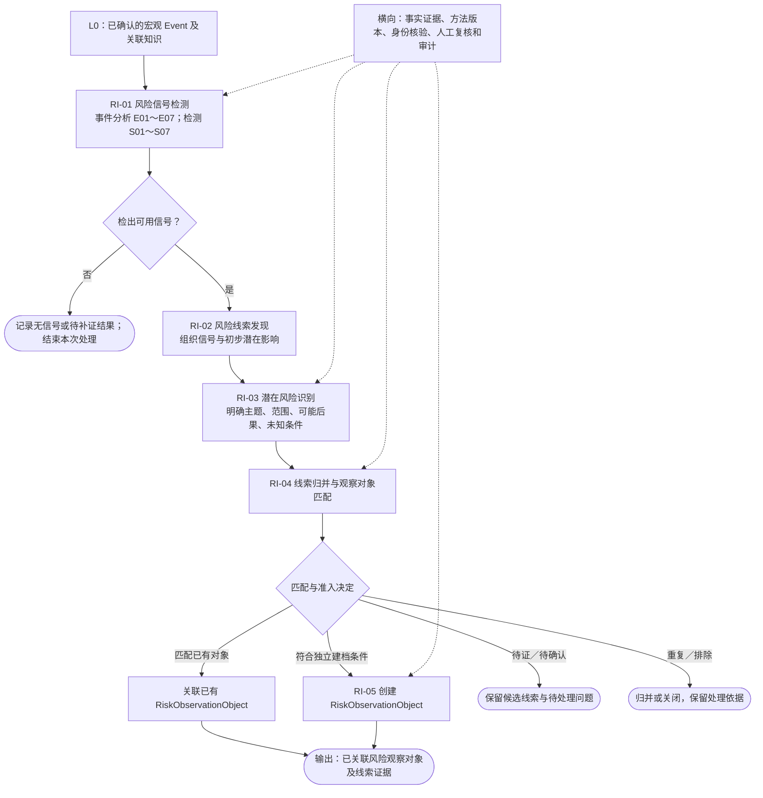
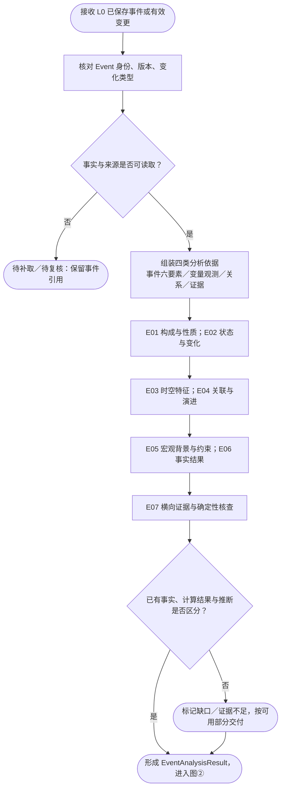
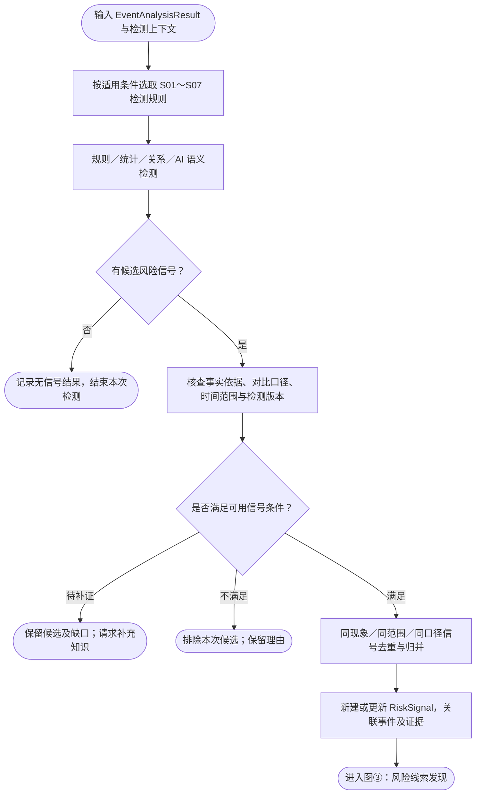
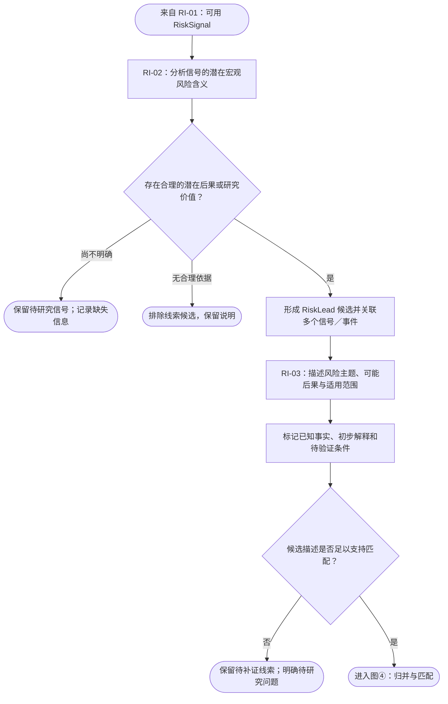
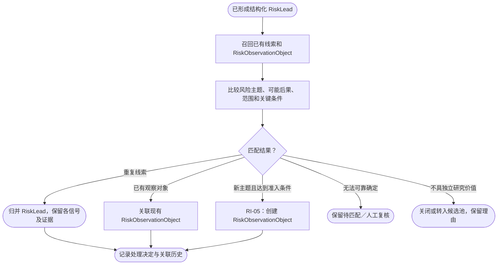
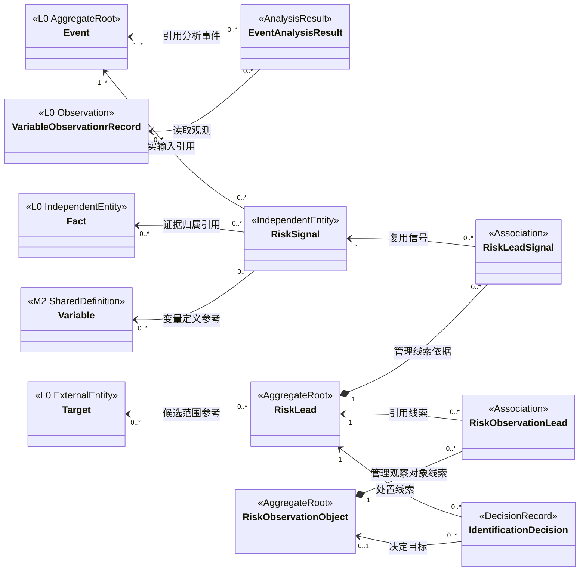

# RiskHot L1 风险识别层：业务架构与领域设计

> **文档版本**：V1.0（2026-11-01 讨论草案）  
> **设计范围**：RiskHot / L1 风险识别层 / 宏观领域  
> **文档性质**：业务架构与领域设计草案，可作为后续功能详细设计的输入；尚不代表技术实现已完成或所有设计已审批  
> **参考基线**：《RiskHot L0 信息处理层：业务架构与领域设计 V1.0》（截至 2026-10-31 的修订口径）及本轮关于事件分析、风险信号检测、风险线索与风险观察对象的业务讨论  
> **范围限定**：本文只设计**风险识别**阶段。风险作用机制的深入分析、风险发生可能性与影响程度评价、风险等级、风险演化监测及预警属于后续业务阶段，本文件只规定必要的交接边界。  
> **状态说明**：文中以 **【已确认】** 标注与 L0 基线一致或本轮已明确的业务边界；以 **【建议】** 标注本版 L1 的方案性设计；以 **【待确认】** 标注尚需评审的实体命名、规则阈值、状态枚举或技术契约。未确认内容不得直接视为数据库结构或生产运行规则。

> **重要对齐**：L0 以 `material → FactMaterial → Fact → Event` 维护来源与事件归属；Target、Variable 与变量观测采用现行 EventTarget、EventTargetVariable、`VariableObservationrRecord` 口径。L0 文档部分旧章节仍包含 Information、EventUpdate、旧 AI 任务编号等历史文字，L1 以 L0 最新修订段落、现行 F02 详细设计和实际发布契约为优先。L1 不恢复旧对象，也不自行更改 L0 的事件身份与更新职责。

---

## 1. 业务能力与职责设计

### 1.1 业务定位与总体职责

**L1 风险识别层**以 L0 已入库的宏观事件及其结构化知识为事实基础，识别事件或事件组合中值得关注的宏观风险迹象，进一步形成风险线索，明确潜在风险的基本含义、观察范围和证据依据，并判断应关联已有风险观察对象还是建立新的风险观察对象。

L1 风险识别阶段回答五个业务问题：

1. **发现了什么现象？** 事件的行为、状态、变化、时序或关联中出现了哪些值得关注的迹象？
2. **为什么值得关注？** 这些迹象是否具备合理的潜在宏观风险含义及可信依据？
3. **可能是什么风险？** 可否用明确的风险主题、可能后果和适用范围表达？
4. **是否已经在观察？** 该风险与已有线索或风险观察对象是否属于同一业务研究对象？
5. **如何处理？** 应新建观察对象、关联已有对象、保留待补证线索，还是排除重复或无效候选？

**【已确认】** L1 以宏观事件为研究入口；Variable 是分析事件的重要工具，事件六要素、事件之间的关联及事实证据也是必要输入。检测结果可以来自单事件分析，也可以来自跨事件、跨变量、跨时间的综合分析。

**【已确认】** 风险识别阶段的核心业务链为：

**L0 事件入库 → 事件知识获取与分析（E01～E07）→ 风险信号检测（S01～S07）→ 风险线索发现 → 潜在风险识别 → 线索归并与匹配 → 风险观察对象建立或关联。**

风险识别允许证据或范围暂时不完整，以待补证和待确认的业务状态保存结果。任何推测均须与已确认事实分别表达。

### 1.2 核心业务能力与责任

| 业务能力 | 回答的业务问题 | L1 承担的责任 | 主要交付结果 |
| --- | --- | --- | --- |
| 事件知识接收与上下文装配 | 基于什么事件事实开展识别？ | 消费 L0 已确认且可引用的事件及其变化；读取事件六要素、Fact、变量观测、历史事件、Target、证据和必要外部基准 | `SignalDetectionContext`（分析上下文，逻辑结果） |
| 面向信号的事件分析 | 事件具有什么变化、演进及宏观背景？ | 围绕 E01～E07 分析事件自身与跨事件知识；区分直接事实、比较计算和待验证关联 | `EventAnalysisResult`（事件分析结果，逻辑对象） |
| 风险信号检测 | 是否出现值得关注的宏观风险迹象？ | 根据 S01～S07 检测规则识别单事件及组合信号，核对触发条件、范围和证据 | `RiskSignal` |
| 风险线索发现 | 信号可能指向什么潜在风险？ | 对信号作初步潜在风险相关性判断，形成待研究的宏观风险主题 | `RiskLead` |
| 潜在风险识别 | 如何准确描述候选风险？ | 提出风险主题、可能后果、初步范围和未知条件，保持证据与假设分离 | 结构化候选风险描述（归属 RiskLead） |
| 线索归并与观察对象匹配 | 是否已经有同一风险正在观察？ | 依据风险主题、潜在后果、范围及关键条件进行线索归并、对象匹配与冲突复核 | 匹配决定、关联或待确认结果 |
| 风险观察对象建立 | 是否有必要正式持续观察？ | 在满足准入条件后建立风险观察对象，关联线索、信号和来源证据 | `RiskObservationObject` |

**横向职责：** 证据追溯、结果可解释、规则版本、相同输入下的幂等处理、历史决策保留、候选复核和结果纠错贯穿上述能力。L1 不擅自修改 L0 的 Event、Fact、Target 或 Variable 身份。

### 1.3 五个业务环节职责

本版沿用本轮讨论确定的五项风险识别业务活动。事件分析属于 RI-01 的前置活动，不增设并列的风险管理阶段。

| 编号 | 业务环节 | 输入 | 核心处理 | 输出 |
| --- | --- | --- | --- | --- |
| **RI-01** | **风险信号检测** | L0 Event、Fact、Target、Variable、观测、证据、历史知识 | 事件知识装配 → E01～E07 事件分析 → S01～S07 信号检测 → 结果核验与去重 | `RiskSignal`，或无信号／待补证记录 |
| **RI-02** | **风险线索发现** | 已检出的 RiskSignal、事件分析结论、相关背景 | 判断宏观相关性与潜在后果，组织一个或多个信号形成候选风险线索 | `RiskLead` 候选 |
| **RI-03** | **潜在风险识别** | RiskLead 候选、来源信号、事件和背景 | 明确潜在风险是什么、可能影响的宏观活动或系统、初步适用范围与待验证条件 | 结构化潜在风险描述 |
| **RI-04** | **风险线索归并与匹配** | 候选线索、已有线索和风险观察对象 | 识别重复、关联、相近与冲突，决定归并、新建候选或待复核 | 匹配／归并决定 |
| **RI-05** | **风险观察对象建立** | RI-04 结果、符合准入条件的线索 | 复用已有对象或创建独立的新对象；建立证据及线索关联 | `RiskObservationObject` 或其他处置结果 |

说明：某一新事件可以没有风险信号；一个事件可以触发多个信号；多个事件可以共同支持一个信号；多个信号可以支持同一线索。任何环节均不可为完成流程强行产出正式对象。

### 1.4 首版职责覆盖范围

| 维度 | L1 V1 范围 |
| --- | --- |
| 研究视角 | **宏观**：围绕经济体、宏观制度、金融体系、重要市场及与宏观变化有关的外部事件开展风险识别 |
| 实际输入 | 以 L0 当前已结构化、能够追溯来源的事件为基线；更广泛政治、地缘、能源、贸易等事件受上游实际覆盖范围约束 |
| 检测模式 | 新事件／有效事件变化触发；必要的历史事件与变量聚合扫描【建议】 |
| 分析依据 | 事件六要素、事件提取变量及观测、事件关联关系、事实与证据属性 |
| 事件分析 | E01～E07 七个维度，E07 作为横向证据核查 |
| 风险信号 | S01～S07 七种业务信号类别，可多类命中 |
| 风险线索 | 可保留候选、证据不足、待匹配、已归并、已排除等处理结果 |
| 风险观察对象 | 以独立的宏观风险主题及可能后果为核心，明确研究范围、持续观察理由与证据入口 |
| 交付 | 风险观察对象、信号／线索关联和初步风险描述，供后续风险分析、评价及监测使用 |

### 1.5 上下游职责分工

| 层次／阶段 | 关注点 | 维护或交付的主要对象 | 不在本层处理的内容 |
| --- | --- | --- | --- |
| L0 信息处理层 | 信息来源、事实归组、事件身份、变量取值及金融意义 | `material`、`Fact`、`Event`、`Target`、`Variable` 引用、`VariableObservationrRecord`、`EventRating` | 风险观察对象的身份及风险识别结论 |
| **L1 风险识别阶段** | 事件分析、风险信号、潜在风险主题及观察准入 | `RiskSignal`、`RiskLead`、`RiskObservationObject` | 深入因果机制验证、概率与损害程度量化、正式风险等级及持续监测结果 |
| 后续风险研究阶段 | 风险为何产生、如何变化、重要程度与处理需要 | 风险分析、评价和监测的后续对象（本版不定义） | 重新创建或覆盖 L0 客观事实身份 |

**Target 边界：** L0 的 `Target` 是事件涉及的**金融观测对象**；L1 的 `RiskObservationObject` 是需要独立研究的**潜在风险主题**。二者职责和身份均独立，例如“中国银行间货币市场”可以是 Target，“中国银行间市场流动性收紧风险”可以是风险观察对象。L1 可引用 Target 作为候选作用范围，但不能把 Target ID 直接当作风险观察对象 ID。

### 1.6 职责边界与暂不承担事项

- L1 不重复执行信息采集、原始文章清洗、Fact 同一性核定、Event 归组与增量确认。
- L1 不在没有事实依据的情况下补造 L0 缺失的 Target、Variable、观测值或原文证据。
- L1 不在风险识别阶段给出风险发生概率、损害数值、风险等级、投资收益预测或交易建议。
- L1 可提出**初步影响路径或待验证条件**帮助描述风险线索；不把未经验证的路径记为已证实的因果机制。
- L1 识别时可以关联已有风险观察对象；对该对象风险高低、演化方向的正式判断归后续阶段。
- L0 的金融意义 M 只能作为候选检索或研究排序的参考，不能直接映射为 L1 风险严重度或准入结论。
- 本文的 `EventAnalysisResult`、`SignalDetectionContext` 和新增领域对象均属业务设计；物理表、任务编号、消息名和检测门槛尚待技术／详细设计确认。

---

## 2. 业务架构设计

### 2.1 L1 总体业务流程



**流程语义：** “待补证”是一种可恢复的处理结果；“无信号”不等于事件无意义。线索归并与对象匹配发生在对象创建之前，避免相同潜在风险反复建档。

### 2.2 业务流程图（详细版，带阶段）

| 详图 | 处理内容 | 对应业务活动 |
| --- | --- | --- |
| 图① | 事件知识获取与分析 | RI-01 前置活动 |
| 图② | 风险信号检测与核验 | RI-01 检测及交付 |
| 图③ | 风险线索发现与潜在风险识别 | RI-02、RI-03 |
| 图④ | 线索归并、对象匹配及准入 | RI-04、RI-05 |

#### 2.2.1 图①：事件知识获取与事件分析



**处理口径：** L0 已提供的 SAO、时间、事件状态、变量观测及来源证据直接引用；L1 增加跨事件对比、历史基准、时序聚合及背景解释。缺少必要的历史数据时，相关分析项保留未知，不以 AI 补造对比序列。

#### 2.2.2 图②：风险信号检测与结果核验



**处理口径：** 一次检测可以命中多个 S 类别；一个信号可以具有多条事件及观测依据。来源增加、资料重复不自动形成新的风险信号；如果新证据改变原信号的事实判断，可依法定复核流程更新或撤销其可用性。

#### 2.2.3 图③：风险线索发现与潜在风险识别



**处理口径：** 线索允许暂时无法识别精确影响对象，但应具备至少一项事实依据、一项有意义的潜在后果方向以及可描述的宏观范围或研究主题。风险解释保持“可能、待验证”的语义。

#### 2.2.4 图④：线索归并、风险观察对象匹配与建立



**处理口径：** 同一宏观事件可能对应多种潜在风险；多个事件可以共同支撑一个风险观察对象。观察对象的正式创建发生在匹配与观察准入判断之后。不得因标题、关键词相同直接合并，也不能因本次事件不同便机械创建新对象。

### 2.3 事件分析依据与七个分析维度

#### 2.3.1 四类事件分析依据【已确认】

| 编号 | 分析依据 | 主要内容 | 使用原则 |
| --- | --- | --- | --- |
| A1 | **事件六要素** | Subject、Action、Object、OccurredAt、语义信息、原文证据 | 直接消费 L0 Event 及 Fact 所表达的事实语境，不重复抽取 |
| A2 | **事件提取变量** | 标准 Variable、EventTargetVariable、VariableObservationrRecord 中的取值、时间和取值性质 | 使用已有变量定义和真实观测；比较计算保留口径 |
| A3 | **事件关联关系** | 与其他事件的先后、响应、延续、升级、共同主题和可验证关联 | 区分已确认事实关联与待验证推测；关系能力缺失时保留分析候选 |
| A4 | **事实与证据属性** | Fact、FactMaterial、material 版本、来源支持／质疑、信息完整性和事实确定性 | 贯穿全部维度；保留原文证据与分析时采用的版本 |

A1 中的“原文证据”表示事件六要素之一；A4 重点关注证据质量、来源对应关系、完整度及冲突，两者用途不同。A2 的 Variable 定义和观测记录不由 L1 擅自修改。

#### 2.3.2 E01～E07 事件分析维度【已确认的讨论框架】

| 编号 | 分析维度 | 核心问题 | 主要输入 | 业务输出 |
| --- | --- | --- | --- | --- |
| **E01** | **事件构成与性质** | 发生了什么性质的事件？ | A1、A4 | 事件类型、参与主体、行为性质和事实阶段 |
| **E02** | **事件状态与变化** | 反映什么状态、水平或实际变化？ | A1、A2、A4 | 状态／数值及变化描述、比较依据 |
| **E03** | **事件时空特征** | 何时何地发生，持续多久，覆盖哪些范围？ | A1、A2、A3 | 发生时序、持续／频率、直接适用范围 |
| **E04** | **事件关联与演进** | 与哪些事件关联，是否形成连续发展？ | A1、A3、A4 | 关联事件集合、时序与演进事实或候选 |
| **E05** | **事件背景与约束** | 事件发生在什么宏观背景和约束条件下？ | A2、A3、A4，历史基准 | 背景条件、结构约束及证据缺口 |
| **E06** | **事件事实结果** | 已造成哪些可验证的直接结果？ | A1、A2、A3、A4 | 已确认结果与尚未证实的未来后果区分 |
| **E07** | **事件证据与确定性** | 哪些结论有据、哪些待核？ | A4，贯穿 A1～A3 | 事实／计算／推断标记，可信性及证据缺口 |

**组织方式：** E01～E06 可按依赖顺序或并行处理；E07 是横向校验，不应被误解为只有所有分析完成后才执行的独立末端步骤。

**结果约束：** E06 的“实际结果”仅限已有事实支持的结果；“可能使全球通胀上升”之类预期性结论进入后续风险信号及线索判断，不能直接写成已发生的事实结果。

### 2.4 七类风险信号检测

七类信号沿用本轮已确定的业务命名。类别允许多选，一条候选信号是否成立由具体规则和证据决定。

| 编号 | 信号类别 | 需要检测的现象 | 主要依赖的事件分析维度 | 示例（假设） |
| --- | --- | --- | --- | --- |
| **S01** | **事件冲击型** | 重要事件、行为或政策变化对原有条件形成冲击 | E01、E02、E03、E06 | 某国突然实施重要出口限制 |
| **S02** | **状态异常型** | 状态／指标明显偏离基准，或出现供需、结构失衡 | E02、E05 | 某区域通胀水平相对历史基准显著偏高 |
| **S03** | **时序演化型** | 变化持续、加速、反转，事件频次、波动或阶段发生变化 | E02、E03、E04 | 多次紧缩政策在短期内集中出现 |
| **S04** | **结构脆弱型** | 高依赖、集中度、杠杆或缓冲不足等结构条件 | E04、E05 | 国际关键资源供应高度集中 |
| **S05** | **关联共振型** | 多个事件或变量同步变化、相互背离或出现异常组合 | E02、E03、E04 | 经济增速放缓与通胀上行同时出现 |
| **S06** | **传导扩散型** | 某变化已沿地区、市场或领域出现传播迹象 | E03、E04、E05、E06 | 能源成本上升后，多地区运输费用出现有证据的联动变化 |
| **S07** | **预期反馈型** | 预期发生显著调整、实际与预期出现落差、行为反馈变化 | E01、E02、E03、E05 | 市场政策利率预期突然逆转 |

S06 的“传导扩散型”首先检测**传播迹象**；对传播因果机制的完整证明留给后续风险分析。S07 必须说明“预期”来自何种可识别依据及时间点；不能用单篇评论直接代表整体市场预期。

### 2.5 单事件、跨事件与持续知识扫描

| 检测模式 | 触发 | 主要数据 | 可重点支持的类别 | 边界 |
| --- | --- | --- | --- | --- |
| 单事件检测 | Event 创建或有效事件更新 | 事件六要素、当次变量与来源证据 | S01、部分 S02、S07 | 单条公告通常不足以推断长期趋势或传播结果 |
| 跨事件分析 | 新事件与历史事件形成可比较组合 | 同主题或关联事件、可比变量观测、历史基准 | S03、S05、S06 | 必须保留事件集合与筛选理由 |
| 持续知识扫描【建议】 | 规则期限到达、历史数据充足或关联知识发生变化 | 已保存事件、结构关系、观测时间序列 | S02、S03、S04、S05 | 不把无新文章误判为无风险线索；扫描频率待定 |

跨事件统一时间序列属于 L1 所需的查询／分析能力，原始事件来源观测仍归 L0 维护。L0 当前是否具有完整 EventRelation 存储及跨事件规范化查询能力需要后续核对。

### 2.6 业务处理示例：关键矿产出口限制

> 以下案例为虚构的业务示例，不代表真实政策已发生。

某资源出口国宣布，自下个月起收紧关键矿产的出口许可，并提出新的出口配额限制。

| 处理环节 | 业务处理结果 | 事实与推断边界 |
| --- | --- | --- |
| L0 Event | Subject：该国政府；Action：收紧出口许可；Object：关键矿产；公告时间、生效安排、原文证据 | 保留事件事实与政策阶段 |
| RI-01 事件分析 | E01 政策调整性质；E02 出口规则变化；E03 生效时间；E04 检索此前政策；E05 查询全球供应依赖；E06 已确认“宣布”，实际贸易变化待观测 | 关联事件和供应数据不足时标记待补 |
| RI-01 信号检测 | 若公告经核实，可能检出 S01 事件冲击；若供应高度集中有可信数据，可能检出 S04 结构脆弱 | S04 需独立结构数据；尚不能由单份公告直接证实 |
| RI-02 线索发现 | 关键矿产国际供应稳定性可能受到限制政策影响 | 初步风险解释 |
| RI-03 潜在风险识别 | 潜在风险主题：关键矿产供应受限风险；研究范围：相关跨境供应市场；潜在后果：供应能力下降或交付受扰 | 是否实际短缺、受影响地区、替代能力待研究 |
| RI-04 归并与匹配 | 检查是否已有“全球关键矿产供应受限”相关线索或观察对象 | 先匹配再决定创建 |
| RI-05 观察对象 | 已有则关联；确有独立风险主题且满足准入条件则建档 | 不同步给出风险等级、概率或实际影响测算 |

---

## 3. 业务规则设计

### 3.1 L0 输入准入与事实引用规则

1. **稳定事件身份**：正式识别只消费 L0 已持久化且具备有效事件 ID 的 Event；L0 待归组 Fact 不能伪装为正式 Event。
2. **事件归组主责**：Fact 与 Event 的同一性及增量由 L0 负责。L1 如发现事实冲突，应提交复核请求，不自行改写归组。
3. **事件来源路径**：通过 `Event → Fact → FactMaterial → material` 追溯材料来源及其版本；不得恢复另行维护的 EventMaterial 作为第二套来源主责。
4. **变量取值来源**：通过 `EventTargetVariable → VariableObservationrRecord`（参考文档现行拼写）读取事件变量观测；同一变量可有多个时间／取值性质不同的记录。
5. **事件六要素**：统一采用 Subject、Action、Object、OccurredAt、语义信息、原文证据，维持与 L0 的原始时间语义及来源结构一致。
6. **金融意义 M**：可参考 `EventRating` 进行候选研究排序；M 的权重及阈值在 L0 仍有待定项，不能转换为风险信号触发门槛或风险等级。

### 3.2 事件分析规则

**（1）事实、观测、计算与推断分开。**

- 直接事实：原文和已保存 Fact 支持的行为、时间、数值或状态。
- 变量观测：根据 Variable 定义、Target 归属及取值性质记录的某次值。
- 分析计算：基于可比时间、范围、单位和计算方法形成的差值、频率或趋势。
- 待验证推断：对宏观意义、潜在关联或未来结果的解释。此类结果必须明确标注依据与不确定性。

**（2）历史对比口径。** 比较同一指标时，应核对 Target、Variable 定义、计量单位、时间口径、统计范围、实际／预期／计划性质和来源修订。数据不可比时不得生成精确变化结论。

**（3）事件时序。** `occurred_at`、政策宣布时间、生效时间、事件阶段和变量 `value_time` 应按业务语义分别使用；不得将发表、采集或入库时间替代事件发生时间。

**（4）跨事件关系。** 同一主题或时间接近可以作为候选召回条件，正式“响应”“延续”“升级”或“扩散”判断需要事实支持。先后发生只说明时序，不自动说明因果。

**（5）实际结果。** 只有已出现且有事实依据的结果可记为 E06 的实际结果；对未来可能影响的表述进入风险线索说明或待证项。

**（6）证据矛盾。** 对冲突来源保留各自原文、对应 Fact 和采用版本，标识争议。证据不充分时允许部分分析输出，不强制将未知填成已知。

### 3.3 风险信号类别与检测规则

七类信号为业务分类，以下“检测触发”描述一般条件，**具体量化阈值、统计基准、样本窗口及规则生效版本均【待确认】**。

| 类别 | 候选触发条件 | 最低证据要求 | 常见误判 |
| --- | --- | --- | --- |
| S01 事件冲击 | 发生关键行为、制度规则或状态的实质变化 | 明确 Event、行为、时间阶段和可追溯来源 | 将“拟议”视为“已实施” |
| S02 状态异常 | 可比指标明显偏离基准、参考区间或已定义约束 | 观测值、标准变量定义和明确的比较基准 | 不同统计口径直接比较 |
| S03 时序演化 | 事件频次、趋势、动量或波动表现出值得关注的变化 | 有序事件／观测集合、时间口径与计算方法 | 将重复报道计作多次发生 |
| S04 结构脆弱 | 可验证的高依赖、杠杆、集中或缓冲不足条件 | 结构关系或相关指标及其适用范围 | 凭单个事件推断全局结构 |
| S05 关联共振 | 多个变量或事件出现具有研究意义的共同变化或背离 | 至少两类可比观测或独立事件、关联范围和时间窗口 | 把统计相关直接写成因果 |
| S06 传导扩散 | 某现象出现跨地区、市场或领域传播迹象 | 跨对象／跨时序的实际变化及关联证据 | 将理论上可能传播当成已实际扩散 |
| S07 预期反馈 | 预期修正、预期与实际显著偏离、行为反应变化 | 可识别的预期来源／生成时间和相应对照或行为证据 | 用个别观点代替普遍预期 |

**多类命中：** 一条 RiskSignal 可关联多个 `signal_types`，每一项应保留适用规则及触发依据，不重复制造同一客观现象的信号记录。

**信号检测与风险严重性：** S 类别表示发现现象的方式，不表达风险等级，也不直接表示某项风险正在加剧或消退。

### 3.4 风险信号定义与正式形成条件

**RiskSignal（风险信号）**是指在事件、变量、关联关系或时序知识中，通过可说明的检测规则识别出的、具备宏观风险研究意义的可观察迹象。

正式信号至少需要满足：

1. 能明确描述**检出了什么现象**，不能只有模糊的“可能有风险”。
2. 具有适用的一个或多个 S 类别及检测依据。
3. 能引用至少一项有效事件事实、变量观测或其他已明确来源的宏观知识；历史聚合信号需记录聚合对象及范围。
4. 已明确时间／地区／观察范围或对未知项作出标注。
5. 能区分直接观测事实、基于数据的分析计算与 AI 的解释性判断。
6. 通过同现象幂等核验或与已有信号建立更新关系。

不满足条件的输出保留为检测候选或待复核结果，不强制创建正式 RiskSignal。

### 3.5 风险线索发现与潜在风险识别规则

**RiskLead（风险线索）**是指基于一个或多个风险信号及相关事实，对某一可能存在的宏观风险形成的、值得继续研究的候选说明。

| 判断维度 | 业务问题 | 首版准入要求 |
| --- | --- | --- |
| 事实依据 | 有什么已知现象支持它？ | 能追溯至少一个有效风险信号及其基础证据 |
| 潜在后果 | 可能发生什么值得关注的宏观结果？ | 能给出合理的后果方向，保持条件性表达 |
| 研究范围 | 关注哪个地区、领域、市场或宏观系统？ | 能描述范围或明确未知边界，不强制具体企业身份 |
| 作用理由 | 为什么可能存在该潜在后果？ | 至少有可解释的初步关联或待验证机制；不可宣称因果已证实 |
| 待验证条件 | 还缺什么证据？ | 明确主要未知条件，支持后续研究任务 |

**RI-02 与 RI-03 的分工：** RI-02 识别“可能存在什么风险主题”；RI-03 将其进一步标准化为可比较、可匹配的候选风险描述，包括潜在后果、范围与未知条件。若尚不能标准化，保留 RiskLead 待补证，无须虚构正式观察对象。

### 3.6 线索归并与风险观察对象同一性

对象匹配建议综合以下维度：

1. **核心风险主题**：潜在的不确定变化或后果是否具有同一研究含义。
2. **潜在后果性质**：是供应中断、流动性收紧、通胀压力还是其他不同后果。
3. **宏观范围**：国家、区域、领域、市场与研究对象是否具有相容的边界。
4. **关键条件与背景**：风险源及重要约束是否使其成为不同独立情景。
5. **既有对象定义**：现有观察对象的正式名称、范围、排除项及当前可引用状态。

| 匹配情况 | 处理动作 |
| --- | --- |
| 同一信号重复检测 | 复用或更新 RiskSignal，追加新证据，不再创造重复信号 |
| 不同信号指向同一潜在风险线索 | 将信号关联到已有 RiskLead，保留各自证据 |
| 风险线索与已有观察对象范围一致 | 关联已存在的 RiskObservationObject |
| 线索明确、与已有对象有实质区分且达到准入条件 | 创建新 RiskObservationObject |
| 部分相似但范围／后果不同 | 记录关联，保留独立身份或进入复核 |
| 无法确定 | 保留候选、匹配项和冲突理由，不强行归并 |

**创建时机【已确认】**：完成 RI-04 的归并、匹配和准入判断后，RI-05 才正式新建风险观察对象。风险线索本身不能因产生就自动建立正式风险观察对象。

### 3.7 风险观察对象的观察准入规则

新建 RiskObservationObject 至少核对：

- 是否具有独立、可描述的**宏观潜在风险主题**。
- 是否具有合理的潜在后果及初步适用范围。
- 是否有可追溯的事件或信号证据，能够解释建档缘由。
- 是否有继续观察的价值和可观察的相关事件或变量；允许当前部分数据缺失。
- 是否已经排除与正式现有观察对象的实质重复。

**无需完成的事项：** 不要求给出发生概率、风险损失金额、风险等级或完整传导模型；也不要求确定唯一的 L0 Target。具体准入评分或人工审批权限【待确认】。

### 3.8 重复输入、更新与更正规则

| 输入情形 | 建议动作 |
| --- | --- |
| L0 `event_created` | 新事件进入 RI-01 分析与检测；不保证形成信号 |
| L0 `event_updated` | 根据事实增量、变量或状态变化重新检测相关规则；不重复创建未改变的信号 |
| L0 `event_rating_updated` | 仅更新研究排序参考；若无事件事实变化，不自动生成信号 |
| L0 `event_source_attached` | 补充来源证据；如影响事实可靠性则申请核对，不以来源数量制造新冲击 |
| L0 事实 CORRECTION | 受影响信号／线索标记重核，保留原结论及修正依据 |
| 旧版证据失效／Fact 归属调整 | 重新校验引用链及受影响的分析结果；历史引用不静默覆盖 |
| 同一任务重试或重复消费 | 保持信号、线索和观察对象身份稳定；按实际新变化更新 |

### 3.9 识别与后续风险研究的边界

本阶段输出的“风险相关性”“潜在后果”“初步关联路径”属于**识别时的候选解释**。风险作用机制的深入分析、发生可能性评估、影响程度评估、演化方向和正式预警在后续阶段处理。信号是否可能驱动、触发或缓释某个风险，可以作为待验证研究问题保留，不在 RiskSignal 基础类型中设定全局固定的风险作用方向。

---

## 4. 领域模型设计

本章沿用 L0 文档的结构：**对象清单 → 领域关系模型 → 对象详细定义（五段式）→ 生命周期 → 跨对象规则与领域事件**。

**领域对象不等于数据库表。** L1 首版优先确定业务身份、行为职责和跨层引用；字段名仅作为逻辑属性建议。L0 已存在的对象及物理字段由 L0 和相应数据模型文档维护。

### 4.1 领域对象清单

#### 4.1.1 L1 自主管理的核心对象与辅助对象

| 领域对象 | 中文名称 | 领域角色 | 核心职责 | 本版状态 |
| --- | --- | --- | --- | --- |
| **EventAnalysisResult** | 事件分析结果 | 分析结果／值对象 | 保存或临时承载 E01～E07 分析结论、输入版本与证据引用 | 【建议】，是否持久化待定 |
| **RiskSignal** | 风险信号 | 独立识别结果实体 | 记录检测到的宏观现象、类别、范围和事实依据 | 【建议】核心对象 |
| **RiskLead** | 风险线索 | 候选风险实体／聚合根 | 组织风险信号并形成潜在风险的结构化研究候选 | 【建议】核心对象 |
| **RiskObservationObject** | 风险观察对象 | 风险观察领域聚合根 | 维护已准入宏观风险的稳定身份、范围和线索入口 | 【建议】核心对象 |
| **RiskLeadSignal** | 线索—信号关联 | 关联对象 | 记录哪些信号支持、补充或质疑一条线索 | 【建议】，可由关系表实现 |
| **RiskObservationLead** | 观察对象—线索关联 | 关联对象 | 记录哪些线索归属或关联到某个观察对象 | 【建议】，可由关系表实现 |
| **IdentificationDecision** | 识别处置决定 | 审计／业务决定记录 | 记录归并、匹配、新建、排除和待确认的依据及操作者 | 【建议】，可能以决策历史承载 |

风险信号、风险线索和风险观察对象三者具有独立的生命周期。EventAnalysisResult 是分析过程的结构化结果；是否以正式可复用领域实体长期保存，需根据复核和重跑成本决定。

#### 4.1.2 引用的 L0 对象【已确认】

| 外部对象 | L1 使用方式 | 身份与修改主责 |
| --- | --- | --- |
| `Event` | 作为识别入口及事件身份引用 | L0/F02 |
| `Fact` | 使用核定事实及其归属 | L0/F02 |
| `material`、`FactMaterial` | 追溯资料版本、来源支持或质疑 | L0/F01、F02 |
| `Target` | 引用宏观金融观测对象及范围 | L0 相应对象管理职责 |
| `Variable` | 引用 M2 的标准定义及语义／取值口径 | M2 变量管理 |
| `EventTarget`、`EventTargetVariable` | 获取事件与观测对象／变量的直接关联 | L0/F02 |
| `VariableObservationrRecord` | 读取事件来源观测值、时间、取值性质和证据 | L0/F02 |
| `EventRating` | 作为金融意义研究排序的辅助参考 | L0/F02 |

`VariableObservationrRecord` 保留参考文档现有拼写；如需统一技术名称，应在跨层数据契约和迁移方案中另行处理，本文不静默改名。

### 4.2 领域对象关系模型

#### 4.2.1 UML 类图与聚合边界



**图示说明：** 图中跨域引用表达逻辑依赖，具体外键和关联方式待数据模型设计。一个 Event 可被多个信号引用，一个 RiskSignal 可支持多个 RiskLead，一个 RiskLead 也可在不同研究范围下关联多个 RiskObservationObject，但必须显式说明范围关系。观察对象包含的线索集合随实际识别活动增加；首次建立时至少关联一条可用线索。

#### 4.2.2 对象关联与基数

| 对象关系 | 业务基数 | 关系含义及约束 |
| --- | --- | --- |
| Event ↔ EventAnalysisResult | 多对多（按分析运行引用） | 一次分析可使用一个或多个事件；事件可以被多个规则和版本反复分析 |
| RiskSignal ↔ Event / Fact / VariableObservationrRecord | 多对多引用 | 每个有效信号有可追溯的事实依据；跨事件信号允许多个来源；不在 L1 复制原始事实主责 |
| RiskSignal ↔ RiskLead，经 RiskLeadSignal | 多对多 | 一个信号可支持多个线索；一个线索可汇集多个信号；记录支持／质疑／补充作用与依据 |
| RiskLead ↔ RiskObservationObject，经 RiskObservationLead | 多对多 | 正式观察对象首次建立必须有线索入口；不同范围映射需要说明理由 |
| RiskLead → IdentificationDecision | 1 → 0..N | 一条线索可经过多次匹配、准入、归并和复核决定；保留历史 |
| RiskObservationObject ↔ Target | 可选多对多的范围引用 | L0 Target 是金融观测对象，风险观察对象是风险研究主题，身份不合并 |

对于历史上已经存在、由其他流程管理的风险观察对象，本版不强制补造过去的 RiskLead；但新建对象时须具备至少一项可追溯的线索依据。

#### 4.2.3 聚合与一致性边界

| 领域边界 | 管理内容 | 跨边界责任 |
| --- | --- | --- |
| RiskSignal 独立识别实体 | 现象、检测类别、观察范围、规则及证据引用 | 可被多个线索复用；事件或证据更正时发起重新核验 |
| RiskLead 聚合 | 风险候选主题、潜在后果、未知条件及 RiskLeadSignal | 统一管理线索与信号关联、线索状态及匹配候选 |
| RiskObservationObject 聚合 | 正式风险主题身份、观察范围、准入依据及 RiskObservationLead | 管理是否为同一潜在风险的研究对象及其线索归属 |
| IdentificationDecision | 审批／匹配决定与理由 | 引用真实线索、对象和证据，不覆盖原决定 |
| L0 Event 聚合（外部） | 事件及原始来源事实 | L1 只读引用，通过跨层问题反馈申请复核 |

### 4.3 领域对象详细定义

本节仿照 L0 §4.3 的五段式：**1. 领域对象定位；2. 核心业务属性；3. 领域对象关系；4. 聚合与职责边界；5. 领域归属**。建议字段只表示逻辑名称，**均不代表已建物理字段**。

#### 4.3.1 EventAnalysisResult（事件分析结果）

##### 1. 领域对象定位

EventAnalysisResult 是 RI-01 在风险信号检测前形成的事件综合分析结果，用于按 E01～E07 组织当前事件及相关历史知识的研究结论，并保存分析范围、输入版本与证据关联。作为可重算的分析结果，其存储方式【待确认】。

##### 2. 核心业务属性

| 业务属性 | 建议逻辑字段 | 业务含义 | 管理说明 |
| --- | --- | --- | --- |
| 分析结果标识 | `analysis_result_id` | 区分一次分析结果 | 可采用任务／结果身份，待定 |
| 事件引用 | `source_event_ids` | 参与本次分析的一个或多个 Event | 由 L0 正式 ID 提供 |
| 分析范围 | `analysis_scope` | 地区、宏观领域、时间区间及研究口径 | 与检测规则保持一致 |
| 维度结果 | `dimension_results` | E01～E07 的结构化结果 | 未完成项明确标记 |
| 数据依据 | `observation_refs`、`fact_refs` | 引用变量取值、来源事实和事件 | 不复制来源主责 |
| 事实／推断属性 | `assertion_nature` | 区分直接事实、计算、推断 | 逐项结果标注 |
| 分析版本 | `method_version` | 使用的分析方法或规则版本 | 可追踪变更 |
| 分析时间 | `analyzed_at` | 本次分析执行时间 | 与事件业务时间区分 |
| 缺口与争议 | `limitations` | 数据缺失、口径冲突、待验证内容 | 不隐去不确定性 |

##### 3. 领域对象关系

| 关联对象 | 关系 | 领域职责 |
| --- | --- | --- |
| Event、Fact | 多对多引用 | 提供事件身份和基础事实 |
| Target、Variable、VariableObservationrRecord | 多对多引用 | 提供对象、标准变量和观测值 |
| RiskSignal | 可由一个或多个分析结果支持 | 供信号检测引用，可保留结果版本 |

##### 4. 聚合与职责边界

**分析结果／值对象。** 此对象维护 L1 的结构化分析结论、比较方法及证据引用；不重写 L0 原始事件事实。可重算分析优先允许临时承载，需复核或审计的有效结果建议保留摘要及输入快照引用。

##### 5. 领域归属

- **所属业务层**：L1 风险识别层。
- **所属业务环节**：RI-01 风险信号检测（事件分析子环节）。
- **领域角色**：分析结果／值对象。
- **主要使用方**：S01～S07 检测规则与候选结果核验。

#### 4.3.2 RiskSignal（风险信号）

##### 1. 领域对象定位

RiskSignal 用于记录经检测确认的、具有宏观风险研究意义的可观察迹象。它以“发现了什么现象”为核心，保存检测类别、范围、事实依据和规则版本，供后续风险线索发现复用。

##### 2. 核心业务属性

| 业务属性 | 建议逻辑字段 | 业务含义 | 管理说明 |
| --- | --- | --- | --- |
| 信号身份 | `signal_id` | 正式风险信号唯一 ID | 新建由业务规则确认 |
| 信号名称 | `title` | 简明概括检测到的现象 | 不直接以风险等级命名 |
| 信号描述 | `description` | 发生的异常、变化或关联事实 | 将事实和推断区分 |
| 信号类别 | `signal_types` | S01～S07，多选 | 逐类引用适用规则 |
| 观察范围 | `observation_scope` | 地区、领域、对象及时间范围 | 可有部分未知 |
| 触发依据 | `detection_basis` | 触发规则、基准和方法 | 支持规则／统计／AI 等方式 |
| 来源事件 | `source_event_refs` | 作为证据的 Event 集合 | 支持单事件和多事件 |
| 证据引用 | `fact_refs`、`evidence_refs` | Fact 与原始资料版本、位置 | 保留原文路径 |
| 变量与观测引用 | `observation_refs` | 对应的 L0 标准变量与观测值 | 不复制原始值主责 |
| 检测结论性质 | `assertion_nature` | 事实、计算或推断 | 推断须标明不确定性 |
| 检测有效性 | `verification_status` | 可用、待核验、争议、撤销等逻辑状态 | 枚举待定 |
| 方法版本 | `rule_version`、`model_version` | 检测依据与模型版本 | 便于复核重跑 |
| 检测时间 | `detected_at` | 本次识别的记录时间 | 与业务发生时间区分 |

##### 3. 领域对象关系

| 关联对象 | 关系 | 领域职责 |
| --- | --- | --- |
| Event / Fact / material | 多对多证据引用 | 支撑检测现象并保留来源链 |
| VariableObservationrRecord | 多对多引用 | 提供可比观测值和时间 |
| EventAnalysisResult | 可选多对多引用 | 说明分析结论来源 |
| RiskLead | 经 RiskLeadSignal 多对多 | 一个信号可以支撑不同潜在风险线索 |

##### 4. 聚合与职责边界

**独立识别结果实体。** RiskSignal 只描述宏观迹象及其事实或计算依据。对某个具体风险的驱动、触发、放大、缓释作用不固化为信号的全局类别；相关机制分析交后续阶段。重复检测可更新同一信号的证据及版本，撤销或更正必须保留历史理由。

##### 5. 领域归属

- **所属业务层**：L1 风险识别层。
- **所属业务环节**：RI-01 风险信号检测。
- **领域角色**：独立识别结果实体。
- **主要使用方**：RI-02 风险线索发现、线索证据核验。

#### 4.3.3 RiskLead（风险线索）

##### 1. 领域对象定位

RiskLead 是根据一个或多个风险信号形成的潜在宏观风险候选，用于组织已发现的迹象，描述可能出现的风险后果、初步研究范围和待验证条件，并承载后续准入或归并处理。

##### 2. 核心业务属性

| 业务属性 | 建议逻辑字段 | 业务含义 | 管理说明 |
| --- | --- | --- | --- |
| 线索身份 | `risk_lead_id` | 线索稳定 ID | 与信号和观察对象身份区分 |
| 线索标题 | `title` | 潜在风险主题的候选名称 | 避免模糊“重大风险”式标题 |
| 潜在风险描述 | `description` | 可能存在的风险及形成背景 | 明确“可能”及条件 |
| 潜在后果 | `potential_consequences` | 值得研究的宏观后果 | 允许多个，均标记待验证 |
| 研究范围 | `candidate_scope` | 涉及地区、宏观系统、市场及期限 | 精确目标可暂未知 |
| 初步关联路径 | `preliminary_pathway` | 从信号到潜在后果的初步解释 | 供识别使用，不代表因果确认 |
| 未知与待补事项 | `open_questions` | 需要补充的信息和条件 | 保留明确问题 |
| 信号关联 | `signal_refs` | 支撑线索的 RiskSignal | 通过 RiskLeadSignal 管理 |
| 线索状态 | `lead_status` | 候选、待补证、可匹配、已关联、已归并、已关闭等 | 正式枚举待定 |
| 生成与更新信息 | `created_at`、`updated_at` | 业务记录时间 | 不代替信号发生时间 |

##### 3. 领域对象关系

| 关联对象 | 关系 | 领域职责 |
| --- | --- | --- |
| RiskSignal | 多对多 | 支撑、质疑或补充本线索 |
| RiskObservationObject | 经 RiskObservationLead 多对多 | 归入或关联对应风险观察主题 |
| IdentificationDecision | 一对多 | 保留匹配、归并及准入决定 |
| Target | 可选范围引用 | 辅助描述涉及的金融观测对象 |

##### 4. 聚合与职责边界

**候选风险聚合根。** RiskLead 保留候选与已核定关系、版本和证据缺口，不负责维护 L0 事件事实。线索在未确认风险影响目标或尚未具备完整机制分析时可以存在。可用线索与正式观察对象分别建档与管理。

##### 5. 领域归属

- **所属业务层**：L1 风险识别层。
- **所属业务环节**：RI-02 风险线索发现、RI-03 潜在风险识别、RI-04 归并与匹配。
- **领域角色**：候选风险聚合根。
- **主要使用方**：RI-04、RI-05 和后续风险研究。

#### 4.3.4 RiskObservationObject（风险观察对象）

##### 1. 领域对象定位

RiskObservationObject 是经过风险识别与观察准入后建立的、具有稳定业务身份和明确研究边界的宏观潜在风险观察主题，用于承接线索及其证据，并作为后续风险研究持续引用的对象基础。

**示例：** “全球关键矿产供应受限风险”是风险观察对象；“关键矿产价格”“某国矿产出口配额”是可被引用的 Variable；“某国关键矿产市场”可以是 Target。三个对象的身份与作用分别管理。

##### 2. 核心业务属性

| 业务属性 | 建议逻辑字段 | 业务含义 | 管理说明 |
| --- | --- | --- | --- |
| 观察对象身份 | `risk_observation_id` | 正式风险观察对象稳定 ID | 同义对象复用、改名不改身份 |
| 风险主题名称 | `name` | 明确潜在风险是什么 | 包含核心风险后果或状态方向 |
| 业务定义 | `definition` | 观察主题与排除边界 | 支撑同一性判断 |
| 研究范围 | `observation_scope` | 地区、领域、市场或系统边界 | 研究期可以作为附加条件，不机械导致新身份 |
| 潜在后果 | `potential_consequences` | 该对象承载的风险后果候选 | 留待后续验证和细化 |
| 初始依据 | `admission_basis` | 为什么纳入观察 | 引用已核定线索和证据 |
| 线索入口 | `lead_refs` | 归属本对象的 RiskLead | 由 RiskObservationLead 关联 |
| 关联 Target | `related_target_refs` | 可选的 L0 金融观测对象引用 | 不直接共享 ID |
| 准入状态 | `admission_status` | 是否正式建立及可引用 | 观察对象业务状态细化待定 |
| 身份与定义版本 | `definition_version` | 正式观察主题边界的演变 | 受控调整并留历史 |
| 创建时间 | `created_at` | 正式建档记录时间 | 与风险起始时间区分 |

##### 3. 领域对象关系

| 关联对象 | 关系 | 领域职责 |
| --- | --- | --- |
| RiskLead | 经 RiskObservationLead 多对多 | 以线索及证据作为创建与持续补充入口 |
| IdentificationDecision | 一对多关联 | 保留建档、复用或边界调整决定 |
| Target | 可选多对多 | 描述涉及的金融观测范围 |
| 后续风险研究对象 | 待后续设计确定 | 作为稳定观察对象身份，不在本版定义风险快照等后续对象 |

##### 4. 聚合与职责边界

**风险观察聚合根。** 本对象负责观察主题的统一身份、边界与线索归属，不直接保存 L0 原始观测值，不负责给出风险等级或演化结论。创建时应经过 RI-04 匹配和 RI-05 准入；修订主题范围须保留历史身份及受影响的线索关联依据。

##### 5. 领域归属

- **所属业务层**：L1 风险识别层。
- **所属业务环节**：RI-05 风险观察对象建立。
- **领域角色**：正式风险观察聚合根。
- **主要使用方**：风险识别匹配、后续风险分析／评价／监测。

#### 4.3.5 RiskLeadSignal（线索—信号关联）

##### 1. 领域对象定位

RiskLeadSignal 表达一项 RiskSignal 在某条 RiskLead 中的证据作用及关联依据，支持多个信号汇集一条线索，也允许一个信号服务不同风险主题。

##### 2. 核心业务属性

| 业务属性 | 建议逻辑字段 | 业务含义 | 管理说明 |
| --- | --- | --- | --- |
| 线索引用 | `risk_lead_id` | 关联的线索 | 必须引用正式身份 |
| 信号引用 | `signal_id` | 被引用的信号 | 必须引用真实信号 |
| 证据作用 | `relation_role` | 支持、补充或质疑线索 | 不把该作用当成风险形成机制 |
| 关联理由 | `relation_note` | 为什么支持或质疑潜在风险主题 | 可追溯原信号证据 |
| 关联时间 | `linked_at` | 本次建立关系的时间 | 与信号业务时间区分 |

##### 3. 领域对象关系

| 关联对象 | 关系 | 领域职责 |
| --- | --- | --- |
| RiskLead | 多对一 | 所属线索，归其业务一致性范围管理 |
| RiskSignal | 多对一 | 引用有效信号及来源证据 |

##### 4. 聚合与职责边界

**RiskLead 聚合内关联对象。** 它记录信号在本条线索中的论证作用，避免把同一信号复制为多套独立实体；不能借修改关联理由去更改原信号事实。

##### 5. 领域归属

- **所属业务层**：L1 风险识别层。
- **所属业务环节**：RI-02、RI-03。
- **领域角色**：关联对象。
- **主要使用方**：线索归并、证据溯源和匹配。

#### 4.3.6 RiskObservationLead（观察对象—线索关联）

##### 1. 领域对象定位

RiskObservationLead 记录一条 RiskLead 与一个 RiskObservationObject 的业务归属或关联关系，保留适用范围、线索作用和匹配依据。

##### 2. 核心业务属性

| 业务属性 | 建议逻辑字段 | 业务含义 | 管理说明 |
| --- | --- | --- | --- |
| 观察对象引用 | `risk_observation_id` | 对应正式观察对象 | 引用稳定身份 |
| 线索引用 | `risk_lead_id` | 本次关联线索 | 不能为关联重建线索 |
| 关系角色 | `relation_role` | 归属、关联、范围补充等 | 枚举待定 |
| 适用范围 | `scope_note` | 说明本次线索对应对象的哪个部分 | 避免跨范围误用 |
| 匹配决定 | `decision_ref` | 对应的 RI-04/RI-05 处置依据 | 可审计 |

##### 3. 领域对象关系

| 关联对象 | 关系 | 领域职责 |
| --- | --- | --- |
| RiskObservationObject | 多对一 | 由观察对象聚合管理关联集合 |
| RiskLead | 多对一 | 引用候选风险线索 |
| IdentificationDecision | 可选多对一 | 支撑正式归属决定 |

##### 4. 聚合与职责边界

**RiskObservationObject 聚合内关联对象。** 负责归属关系及其范围，不把风险线索的候选解释自动升级为已证实风险结论；线索纠错时重新评估关联。

##### 5. 领域归属

- **所属业务层**：L1 风险识别层。
- **所属业务环节**：RI-04、RI-05。
- **领域角色**：关联对象。
- **主要使用方**：风险观察对象建档与引用。

#### 4.3.7 IdentificationDecision（识别处置决定）

##### 1. 领域对象定位

IdentificationDecision 用于记录风险识别过程中的匹配、归并、观察准入、排除及复核决定，支撑可解释、可纠错和可审计的业务决策历史。

##### 2. 核心业务属性

| 业务属性 | 建议逻辑字段 | 业务含义 | 管理说明 |
| --- | --- | --- | --- |
| 决定身份 | `decision_id` | 唯一区分一次业务决定 | 正式结果或历史记录 |
| 关联线索 | `risk_lead_id` | 被处理的风险线索 | 引用已有身份 |
| 候选对象 | `candidate_observation_ids` | 本次比较的已有对象集合 | 允许为空 |
| 决定类型 | `decision_type` | 归并、复用、新建、待确认、排除等 | 枚举待定 |
| 决定理由 | `decision_reason` | 同一性、范围、证据及准入依据 | 不只存最终结论 |
| 决定结果 | `result_ref` | 引用最终线索或观察对象 | 未通过时可为空 |
| 审批或执行身份 | `decided_by` | 程序、AI 建议或人工确认来源 | 区分建议与正式决定 |
| 采用版本 | `method_version` | 适用的匹配／准入规则版本 | 可复核 |
| 决定时间 | `decided_at` | 正式处置发生时间 | 与事件时间分开 |

##### 3. 领域对象关系

| 关联对象 | 关系 | 领域职责 |
| --- | --- | --- |
| RiskLead | 多对一 | 支撑线索状态及归并历史 |
| RiskObservationObject | 可选多对一 | 记录复用或创建结果 |
| RiskSignal | 经线索间接引用 | 回溯支持决策的信号及原始证据 |

##### 4. 聚合与职责边界

**识别业务决定记录。** AI 可以提供候选匹配理由；正式身份分配、是否新建及关联提交由程序规则和获授权的业务确认执行。既有决定被纠正时追加新决定及关联关系，保留原历史。

##### 5. 领域归属

- **所属业务层**：L1 风险识别层。
- **所属业务环节**：RI-04、RI-05。
- **领域角色**：业务决定／审计记录。
- **主要使用方**：对象身份治理、人工复核、识别结果纠错。

### 4.4 对象生命周期与状态模型

#### 4.4.1 状态分类原则

- **事实状态**由 L0 Event 和 Fact 负责管理，不在 L1 重复维护事件的宣布／生效／完成状态。
- **检测处理状态**描述一次候选是否可用，与 RiskSignal 的事实有效性分别管理。
- **线索状态**描述发现、补证、匹配和归并进度。
- **观察对象状态**描述是否正式建立、可供后续引用及是否处于历史归档；风险走势和风险等级另由后续阶段管理。

#### 4.4.2 RiskSignal 生命周期【建议】

| 当前状态 | 触发事实或操作 | 转换条件 | 后续状态或动作 |
| --- | --- | --- | --- |
| 候选 | 检测规则发现迹象 | 规则、时间与证据核查 | 通过则“可用”；证据不足则“待核验” |
| 待核验 | 补充来源、数据或口径 | 具备可验证条件 | 转“可用”或“排除” |
| 可用 | 新证据、L0 更正或规则重评 | 事实有效性改变 | 更新版本、转“争议”或“撤销” |
| 可用 | 重复检测但无有效变化 | 同现象、同口径且证据未改变 | 保留同一身份，不重发新信号 |
| 争议 | 证据冲突得到核定 | 保留各方来源与结论 | 恢复“可用”或“撤销” |
| 撤销 | 发现依据失效 | 受控核定并留历史 | 不再用于新的正式识别，历史引用可查 |

上述中文状态为业务示意，技术枚举与自动／人工确认权限待定。

#### 4.4.3 RiskLead 生命周期【建议】

| 当前状态 | 触发操作 | 结果 |
| --- | --- | --- |
| 候选 | 从风险信号发现潜在风险主题 | 建立线索候选 |
| 待补证 | 影响范围、后果或信号依据不足 | 保留缺口并允许后续重启 |
| 可匹配 | 已形成可以比较的候选风险描述 | 进入 RI-04 匹配 |
| 已关联 | 匹配已有正式观察对象 | 建立关联，不新建观察对象 |
| 已纳入新对象 | RI-05 正式新建观察对象 | 建立线索—观察对象关联 |
| 已归并 | 与已有线索重复 | 保留来源信号并记录归并历史 |
| 已关闭 | 被证据否定、无合理潜在后果或不具备研究价值 | 保留结论与证据；新证据可触发复核 |

“已关联”“已纳入新对象”可进一步合并为同一业务状态加不同处置决定，待详细设计评审。

#### 4.4.4 RiskObservationObject 生命周期【建议】

| 状态 | 业务条件 | 动作与边界 |
| --- | --- | --- |
| 正式建立 | 线索满足独立观察准入且匹配通过 | 分配稳定身份，建立来源线索关联 |
| 可引用 | 观察对象定义有效 | 供后续研究及新线索匹配复用 |
| 待修订 | 证据更正或对象边界出现冲突 | 保留旧版与相关线索，核定定义变化 |
| 归档 | 获授权的业务决定 | 停止作为新增归属的默认入口，保留历史可追溯性 |

风险是否加剧、缓解或消退属于风险研究结果，与这里的**对象档案状态**分开表达。

### 4.5 跨对象业务规则与领域事件

#### 4.5.1 跨对象业务规则

| 规则主题 | 约束 | 不满足时的处理 |
| --- | --- | --- |
| 事件与来源身份 | L1 只引用正式 L0 Event、Fact、material、Target、Variable 及真实观测 ID | 返回补取／待复核，不创建虚假引用 |
| 事实与分析区分 | 原文事实、计算、语义推断分别标识 | 证据不足部分保留候选或未知 |
| 多重信号类别 | S01～S07 允许多选，同一现象不机械建七条信号 | 归并类别及规则依据 |
| 同一性与范围 | 线索、观察对象按风险主题、后果与范围匹配 | 不确定时待复核 |
| 首次建档准入 | 新对象需有有效 RiskLead 及可信证据路径 | 暂存线索，不建立正式观察对象 |
| 引用历史 | L0 纠正、信号撤销、线索归并保留旧版及依据 | 启动影响面核对，追加修订历史 |
| 金融意义评分 | EventRating M 为事件研究参考，与风险等级分离 | 不进行分值强制换算 |
| 正式提交 | 业务 ID、关联和适用证据校验成功后提交 | 失败可恢复，重复提交幂等 |

#### 4.5.2 建议领域事件及触发条件

以下为 L1 识别域的业务变化通知建议名；它们与宏观事件对象 `Event` 不同，也不代表已经确定使用消息总线。

| 建议名称 | 中文名称 | 触发条件 | 载荷要点 |
| --- | --- | --- | --- |
| `risk_signal_detected` | 风险信号已检出 | 新信号正式可用 | signal_id、类别、来源事件及证据、规则版本 |
| `risk_signal_revised` | 风险信号已修订 | 事实或规则导致信号有效性发生实质变化 | signal_id、新旧依据、修订原因 |
| `risk_lead_created` | 风险线索已建立 | 新候选线索正式记录 | risk_lead_id、信号引用、候选主题和缺口 |
| `risk_lead_merged` | 风险线索已归并 | 归并决定正式保存 | 原线索／目标线索 ID、理由与证据 |
| `risk_observation_created` | 风险观察对象已建立 | RI-05 首次准入建档成功 | risk_observation_id、定义范围、初始线索 |
| `risk_observation_linked` | 线索已关联观察对象 | 复用或新建对象后关联成功 | risk_observation_id、risk_lead_id、决定依据 |

重复输入、纯证据增加或待复核输出不应机械产生“新信号”“新观察对象”通知。具体消息信封、顺序、回执及恢复规则由技术设计确定。

---

## 5. 业务接口

### 5.1 L0 → L1 的输入契约

**输入以 L0 已保存且具备可追溯身份的数据为准。** 本版先定义业务消费口径，暂不预设 API、消息总线或数据库直连。

| 输入项 | L0 来源 | L1 使用方式 | 边界与校验 |
| --- | --- | --- | --- |
| `event_id` 及事件六要素 | Event / Fact | RI-01 研究入口 | 只读，使用正式身份 |
| 事件状态、有效增量 | L0 事件处理结果 | 决定需要重算哪些分析维度 | NEW 初始事实与 REUSE 五类增量由 L0 区分 |
| 事件所涉 Target | EventTarget、Target | 确认事件直接涉及的金融观测对象 | 不等于 L1 风险观察对象 |
| 事件所涉 Variable | EventTargetVariable、Variable | 读取标准变量语义和观测定义 | 不重复创建变量定义 |
| 变量观测记录 | VariableObservationrRecord | 历史对比、异常、趋势等检测 | 保留 `value_time` 和取值性质，避免混用 |
| 来源证据 | Fact → FactMaterial → material | 信号和线索核验 | 引用原件版本、定位及支持／质疑关系 |
| 金融意义评价 | EventRating | 研究排序辅助参考 | 不直接视为风险优先级或严重度 |
| 事件间关联 | 当前 Event 事实与可用关系知识 | E04、S03、S05、S06 处理 | 若 L0 尚未实现统一 EventRelation，需通过查询分析或候选关系补足，不宣称已存储 |

#### 5.1.1 输入通知适配

L0 参考文档建议 `event_created`、`event_updated`、`event_rating_updated`、`event_source_attached` 四类通知。L1 根据 §3.8 处理各类输入，**实际可消费的通知结构仍须与现行 F02 契约核对**。如源文档旧字段 `event_update_id` 或 Information ID 与现行事实归属模型不一致，应回到 `event_id`、Fact 和资料关系获取真实身份，不恢复旧结构。

### 5.2 L1 对后续风险研究的输出契约

| L1 输出 | 说明 | 后续使用边界 |
| --- | --- | --- |
| `risk_observation_id` | 经准入建立的风险观察主题身份 | 作为后续风险研究的稳定引用 |
| `risk_lead_id` | 潜在风险线索及识别来源 | 可重核候选假设，不能直接认定风险必然发生 |
| `signal_id` | 宏观异常或关联迹象 | 后续可使用其证据，作用方向需结合具体风险另行判断 |
| 风险主题与范围 | 潜在后果、地区、领域、研究边界 | 允许初步描述和未确认条件 |
| L0 事实与证据引用 | Event、Fact、变量观测及原文来源 | 引用原始证据，不由 AI 文字替代 |
| 待验证问题 | 关键缺口、背景约束和候选路径 | 供后续风险研究安排验证 |

**不在本版输出中固定的内容：** 风险概率、影响量化、风险等级、风险作用机制结论、风险演化方向、风险快照及预警阈值。

### 5.3 核心验收场景

| 场景 | 预期行为 |
| --- | --- |
| 某央行宣布加息，L0 已正式入库 | L1 读取事件六要素及政策利率观测，先完成适用的事件分析，再检测信号 |
| 同一公告被多家媒体重复转载 | 使用 L0 统一 Event／Fact 身份，不重复创建事件冲击信号 |
| 同一事件提供过去和当前两个指标值 | 核对同变量、同目标与同口径后计算变化，保留各自取值时间 |
| 新事件只含计划中的政策措施 | 允许识别“宣布重要政策变化”，不把计划影响记为实际结果 |
| 多个产油国相继调整供给政策 | 支持跨事件时序和共振检测，保留事件集合及关联依据 |
| 只有一条新闻声称“全球供应受限” | 缺少结构数据时可保留待验证候选，不直接创建已证实 S04 信号 |
| 单一信号指向不同潜在风险主题 | 可以关联多个 RiskLead，逐项记录潜在后果与范围 |
| 多条线索均指向“全球关键矿产供应受限风险” | 先归并线索并匹配，原则上复用已有 RiskObservationObject |
| 新线索描述独立且有依据的宏观风险 | RI-04 完成匹配，RI-05 按准入规则建立风险观察对象 |
| L0 对核心事实进行了 CORRECTION | 重新核验受影响信号与线索，保留旧版判断及变更依据 |
| L0 只有 event_rating_updated，事件事实未改变 | 可以更新研究排序参考，不自动重复检测全部信号 |
| 证据不足或范围无法判定 | 保留候选及待研究问题，避免虚构风险观察对象身份 |

---

## 6. AI 业务设计

### 6.1 AI 任务定义

L1 可利用 AI 完成宏观事件语义分析、候选信号解释、风险线索组织和对象匹配建议；程序负责确定性计算、资料与 ID 引用、规则版本、正式身份核定及提交校验。

**【待确认】** 以下 `L1-AI-01`～`L1-AI-04` 为本版独立建议编号，避免与 L0 的 `AI-01`～`AI-05` 历史编号混淆；它们并非已部署任务。AI 任务可按数据充足程度拆分、合并或与规则引擎协同执行。

| 建议任务编号 | 任务名称 | 对应业务活动 | 主要作用 |
| --- | --- | --- | --- |
| `L1-AI-01` | 事件语义与背景分析 | RI-01 / E01～E07 | 形成事件分析语义摘要、背景候选及证据缺口 |
| `L1-AI-02` | 风险信号候选识别 | RI-01 / S01～S07 | 对难以用确定规则表达的事件语义提出候选信号及依据 |
| `L1-AI-03` | 宏观风险线索与候选风险描述 | RI-02、RI-03 | 解释潜在宏观风险、后果、范围和未知条件 |
| `L1-AI-04` | 线索归并与观察对象匹配建议 | RI-04 | 基于已有风险定义提出相同、相关、不同或待定建议 |

**非 AI 专项职责：** 数据库检索、指标比较计算、时间序列统计、标准变量定义匹配、幂等核验、身份分配和正式关联提交，应优先由程序或明确的规则能力完成。

### 6.2 各 AI 任务的业务输入、职责与输出

#### 6.2.1 L1-AI-01：事件语义与背景分析

**触发条件**：RI-01 已准备可用的事件知识上下文，存在需要语义研究或背景解释的分析项。

| 方向 | 主要业务字段／内容 |
| --- | --- |
| 输入 | Event ID、六要素、Fact 及原文定位、Target 与变量观测引用、相关事件集合、已有历史基准、分析维度和研究范围 |
| 核心处理 | 按 E01～E07 分离事件事实、变化、时序、关联、背景和直接结果；提出缺失条件及待验证解释 |
| 输出 | 按维度组织的结论摘要、引用的证据 ID、事实／推断标记、限制与缺口 |
| 交付边界 | 不改写 L0 Event／Fact／变量定义，不自行制造历史数据或已确认因果关系 |

#### 6.2.2 L1-AI-02：风险信号候选识别

**触发条件**：RI-01 事件分析可用，已选择需要语义检测的 S 类别或规则。

| 方向 | 主要业务字段／内容 |
| --- | --- |
| 输入 | EventAnalysisResult、检测类别、必要事件和变量引用、候选检测规则、证据路径 |
| 核心处理 | 对复杂行为、政策、跨领域迹象提出候选信号，给出对应 S 类别和可核验依据 |
| 输出 | 候选信号描述、信号类别、触发事实、研究范围、证据清单、未知条件和未通过原因 |
| 交付边界 | AI 输出只是候选；正式信号需经证据、规则版本与同现象去重校验 |

#### 6.2.3 L1-AI-03：宏观风险线索与候选风险描述

**触发条件**：已获得至少一个可用 RiskSignal，需解释其可能的宏观风险意义。

| 方向 | 主要业务字段／内容 |
| --- | --- |
| 输入 | RiskSignal 集合及证据、事件分析背景、宏观研究范围、可引用的既有线索 |
| 核心处理 | 形成潜在风险主题，描述可能后果及适用范围，区分已知事实、初步关联和待验证条件 |
| 输出 | RiskLead 候选名称、潜在后果、范围、初步路径、证据引用、待补证问题 |
| 交付边界 | 不输出正式风险等级、概率、损害测算或已证实因果机制 |

#### 6.2.4 L1-AI-04：线索归并与观察对象匹配建议

**触发条件**：RI-03 形成可比较的潜在风险描述并检索召回已有线索和风险观察对象。

| 方向 | 主要业务字段／内容 |
| --- | --- |
| 输入 | 候选 RiskLead、已有 RiskLead、RiskObservationObject 的正式定义与范围、匹配规则及证据 |
| 核心处理 | 比较核心风险主题、后果、范围和关键条件；指出相似与不同及证据不足 |
| 输出 | 匹配已有线索／匹配已有对象／建议新建／待确认等候选结论，匹配对象真实 ID 和具体理由 |
| 交付边界 | AI 不能分配正式对象 ID，也不能直接执行合并、覆盖或新建；提交由程序和授权业务规则确认 |

### 6.3 AI 业务约束

1. **事实引用优先**：尽量使用已保存 Event、Fact、Target、Variable 与观测 ID；无法确定时输出“未知”及缺失原因。
2. **来源可追溯**：每个关键事实或指标结论回溯到具体 Fact、material 版本及原文定位；跨事件分析保留参与事件集合。
3. **时间语义准确**：分清宣布、计划、生效、实际发生、统计期间和分析执行时间。
4. **事实与解释分离**：AI 的潜在后果与作用路径采用候选语义，不得伪装成 L0 已证实事实。
5. **标识治理**：AI 可以输出候选名称和匹配建议；正式身份、引用与合并由程序规则控制。
6. **范围清晰**：对宏观地区、市场、领域或观察期限的变化明确说明，避免范围不一致的信号与线索误合并。
7. **版本与复核**：保留适用提示词、模型、检测规则和上下文版本；关键结果支持人工核对与重新处理。

### 6.4 AI 与程序分工及结果校验

| 处理事项 | AI 适用职责 | 程序／规则职责 | 校验重点 |
| --- | --- | --- | --- |
| 事件分析 | 语义解释、背景补充候选 | 检索、事实版本固定、数值统计与聚合 | 时间／单位／范围可比性 |
| 信号检测 | 复杂信号候选、分类与理由 | 确定规则触发、阈值、同现象幂等校验 | 信号类别与证据一致 |
| 线索发现 | 初步宏观风险解释、未知条件 | 来源引用检查、线索身份与状态 | 有合理潜在后果及可追溯基础 |
| 对象匹配 | 语义相似和同一性建议 | 真实 ID 检查、业务准入、正式关联 | 风险主题、后果、范围是否一致 |
| 更正与复核 | 解释争议、列出影响范围候选 | 版本记录、引用核验、关系迁移与审计 | 保留旧依据、避免无痕覆盖 |

---

## 7. 设计决策、风险与待定事项

### 7.1 已明确的讨论结论与 L0 继承约束

| 决策项 | 当前结论 | 状态 |
| --- | --- | --- |
| 研究范围 | 以宏观事件为研究入口 | 【已确认】 |
| 研究中心 | Event 为研究中心，Variable 为事件分析工具之一 | 【已确认】 |
| 输入基础 | 事件六要素、事件提取变量、事件关联关系、事实与证据属性 | 【已确认】 |
| 事件分析归属 | 面向风险信号的事件分析属于 L1 风险识别阶段 RI-01 的内部活动 | 【已确认】 |
| 分析维度 | E01～E07 七维事件分析框架，E07 横向核验 | 【已确认的讨论框架】 |
| 信号分类 | S01～S07 七类宏观风险信号，可多选 | 【已确认的讨论框架】 |
| 识别流程 | RI-01～RI-05 五项业务环节 | 【已确认的讨论框架】 |
| 观察对象创建 | RI-04 完成归并／匹配和准入后，RI-05 新建或关联 | 【已确认】 |
| Target 边界 | L0 Target 与 L1 风险观察对象分离管理 | 【已确认】 |
| 事实与来源 | L0 现行 Fact、FactMaterial、material、Event 主责不变 | 【继承 L0 基线】 |
| 变量与观测 | Variable 由 M2 管理，EventTargetVariable 与 VariableObservationrRecord 由 L0 管理 | 【继承 L0 基线】 |
| 风险作用机制和演化方向 | 不混入风险信号的基础类型；识别阶段仅保留候选问题 | 【已确认的业务边界】 |

### 7.2 本版建议、风险及尚待确认事项

| 编号 | 项目 | 需要确认的具体问题 | 影响 |
| --- | --- | --- | --- |
| T01 | S01～S07 具体检测规则 | 基准、阈值、时间窗口、规则优先级及版本由谁批准 | 决定信号能否可重复、可评测 |
| T02 | RiskSignal 正式有效性 | 候选与正式信号的核准权限、证据最低要求 | 防止未证实信号进入正式线索 |
| T03 | 风险线索准入 | 潜在后果、范围和初步路径达到什么程度进入 RI-03 | 避免过度发现与漏检 |
| T04 | 观察对象建档 | 新建审批、观察价值标准、主题命名和范围治理 | 防止风险观察对象膨胀 |
| T05 | 跨事件关系能力 | L0 是否已经具备完整 EventRelation；L1 是否需要暂用派生关系结果 | 影响 E04、S05、S06 |
| T06 | 变量观测历史 | 如何实现 Target／Variable／时间／口径的统一检索和去重 | 影响 S02、S03、S05 |
| T07 | 数据模型 | RiskSignal、RiskLead、RiskObservationObject 及关联对象的物理表和索引 | 影响功能设计与开发 |
| T08 | 状态枚举与生命周期 | 线索状态、信号有效性及归档权限 | 影响流程执行与前端呈现 |
| T09 | 幂等与变更通知 | 输入事件版本、检测规则版本、信号身份、对象匹配及重试恢复方式 | 影响重复发现与数据一致性 |
| T10 | AI 任务编号与契约 | 任务拆分、正式 Schema、Prompt、模型版本与审核节点 | 影响编排与可验证输出 |
| T11 | 风险观察对象命名 | 最终英文名是否采用 RiskObservationObject，以及与既有 `risk` 领域对象如何对接 | 影响跨模块命名一致性 |
| T12 | 宏观领域覆盖 | 首版是否纳入地缘政治、能源、贸易等宏观外部事件的完整信源和变量数据 | 影响信号检出的覆盖与盲区 |
| T13 | 缺失证据反馈 | L1 如何向 L0／数据接入模块申请补证、修订或扩展来源 | 影响待补证线索恢复 |
| T14 | 识别质量评测 | 误报、漏报、重复率、证据正确性、对象同一性如何测量 | 影响上线验收 |

**设计风险提示：** 宏观风险发现具有较高的解释自由度。若缺少可比历史数据、关联知识和验证边界，AI 容易将“事件重要”推成“风险已成立”、将“时间相关”推成“因果传导”、将“标题相似”推成“同一风险”。因此应将证据链、待验证条件、分类规则和人工复核作为首版核心约束。

### 7.3 建议实施顺序

**第一阶段：建立跨层可消费输入。** 明确 L0 最新可用的 Event、Fact、Target、VariableObservationrRecord、证据和事件增量接口，验证来源链和时间口径。

**第二阶段：实现 RI-01 最小闭环。** 从单事件 E01、E02、E03、E07 入手，优先落地 S01 与具有明确基准的 S02，形成可追溯 RiskSignal；再逐步扩展 E04～E06 和跨事件检测。

**第三阶段：实现 RI-02／RI-03。** 建立 RiskLead 及信号关联，明确潜在后果、研究范围、已知／未知区分和待补证能力。

**第四阶段：实现 RI-04／RI-05。** 建立线索归并、观察对象同一性、准入及决策历史，确保正式风险观察对象可复用且不重复建档。

**第五阶段：完善跨事件信号与质量验收。** 建立 S03～S07 的历史比较与关系分析能力，验证误报、漏报、证据正确性、身份稳定及重新处理能力。

---

## 附录 A：术语对照

| 术语 | 统一含义 | 业务归属 |
| --- | --- | --- |
| Event | 已归组且有稳定身份的宏观行为、决定或状态变化单元 | L0 |
| 事件六要素 | Subject、Action、Object、OccurredAt、语义信息、原文证据 | L0 事实表达，L1 只读使用 |
| Fact | 可跨资料复用、统一表征同一次具体发生的事实单元 | L0 |
| material / FactMaterial | 资料及 Fact—资料关联，保留来源和支持／质疑证据 | L0 |
| Target | L0 标准化金融观测对象，与 RiskObservationObject 区分 | L0 |
| Variable | 全局可复用的标准风险变量定义 | M2，共享 |
| EventTargetVariable | Event、Target、Variable 三元关联 | L0 |
| VariableObservationrRecord | 事件变量取值记录，含时间、取值性质和来源证据；本名沿用 L0 文档 | L0 |
| E01～E07 | 事件多维分析的七项业务维度 | L1 / RI-01 |
| S01～S07 | 七类风险信号检测类别 | L1 / RI-01 |
| EventAnalysisResult | 事件分析结构化结果，可重算、可选择保留 | L1 / RI-01 |
| RiskSignal | 通过检测发现、具有事实依据的宏观风险迹象 | L1 / RI-01 |
| RiskLead | 基于信号形成、需要进一步研究的潜在风险线索 | L1 / RI-02～RI-04 |
| RiskObservationObject | 准入后正式建立的宏观风险观察主题 | L1 / RI-05 |
| IdentificationDecision | 风险线索归并、匹配或对象准入的业务决定 | L1 / RI-04～RI-05 |
| EventRating / M | L0 对事件在固定范围和期限内的金融意义评价 | L0；L1 仅作为参考 |

## 附录 B：最小模型总结

```text
L0 事实与事件知识（只读）
  material  N ─── N Fact             [FactMaterial]
  Fact      N ─── 0..1 Event         [Fact 当前归属]
  Event     N ─── N Target           [EventTarget]
  Event + Target ─── N Variable      [EventTargetVariable]
  EventTargetVariable 1 ─── N VariableObservationrRecord
  Event     1 ─── N EventRating
              │
              ▼
L1 风险识别
  Event + Fact + 变量观测 + 历史关系 + 证据
              │
              ▼
  EventAnalysisResult（E01～E07）
              │
              ▼
  RiskSignal（S01～S07，可关联多个 Event）
              N
              │ [RiskLeadSignal]
              N
  RiskLead（潜在风险、后果、范围、未知条件）
              N
              │ [RiskObservationLead，RI-04 匹配后建立]
              N
  RiskObservationObject（正式宏观风险观察对象）
              │
              ▼
   后续风险分析／评价／监测（本版不展开）
```

## 附录 C：业务规则与状态的确认清单

- [x] 研究入口是 L0 已入库 Event，变量是分析工具之一。
- [x] 事件分析的依据包括事件六要素、提取变量、事件关系和事实证据。
- [x] E01～E07 属于 L1 / RI-01 的事件分析活动。
- [x] S01～S07 是宏观风险信号类别，允许多重命中。
- [x] 风险识别包含 RI-01～RI-05 五项业务活动。
- [x] 观察对象新建发生在匹配和准入判断之后。
- [x] L0 Target 与 L1 风险观察对象分离。
- [ ] 各信号检测规则的阈值、基准及有效性准入。
- [ ] 线索及观察对象身份治理规则和审批职责。
- [ ] 物理数据模型、正式状态枚举、消息与接口 Schema。
- [ ] AI 任务编号、规则／Prompt 版本和验收指标。

---

**最终设计结论：** RiskHot L1 风险识别阶段以 L0 可靠、可追溯的 Event 及其变量和事实知识为研究基础，通过 E01～E07 事件分析组织检测上下文，利用 S01～S07 检测宏观风险信号，进一步形成 RiskLead 并标准化潜在风险描述，在归并与身份匹配后建立或关联 RiskObservationObject。L1 承担风险发现和观察准入职责，风险作用机制的深入分析、风险评价和持续监测由后续阶段承接。
