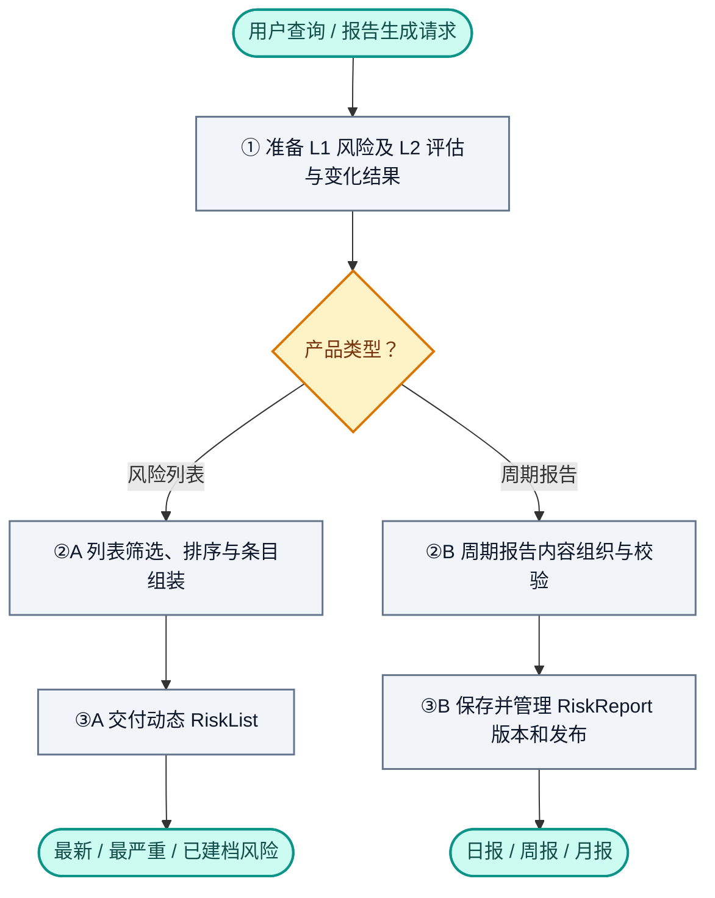
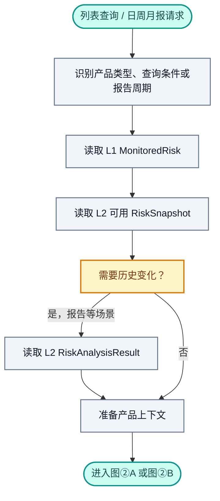
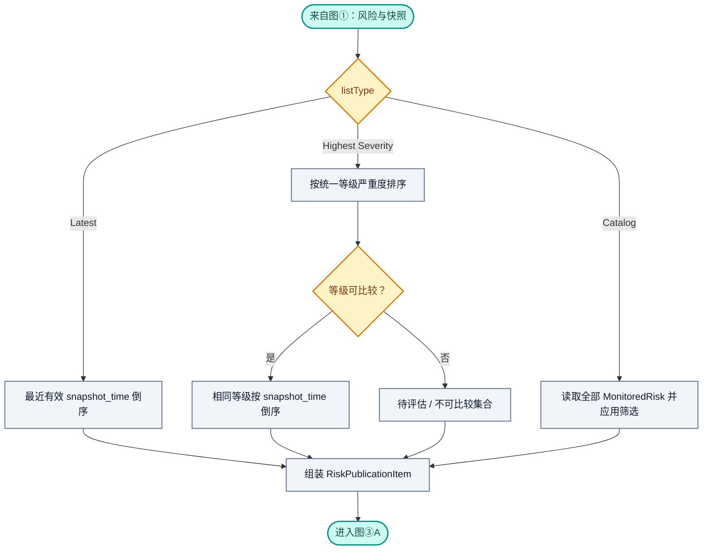
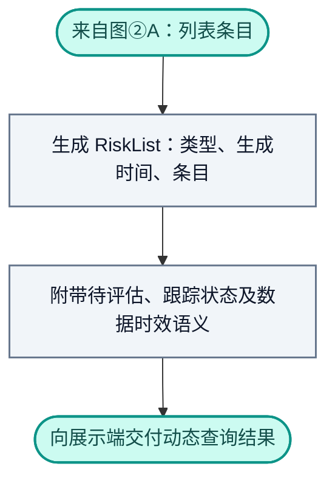
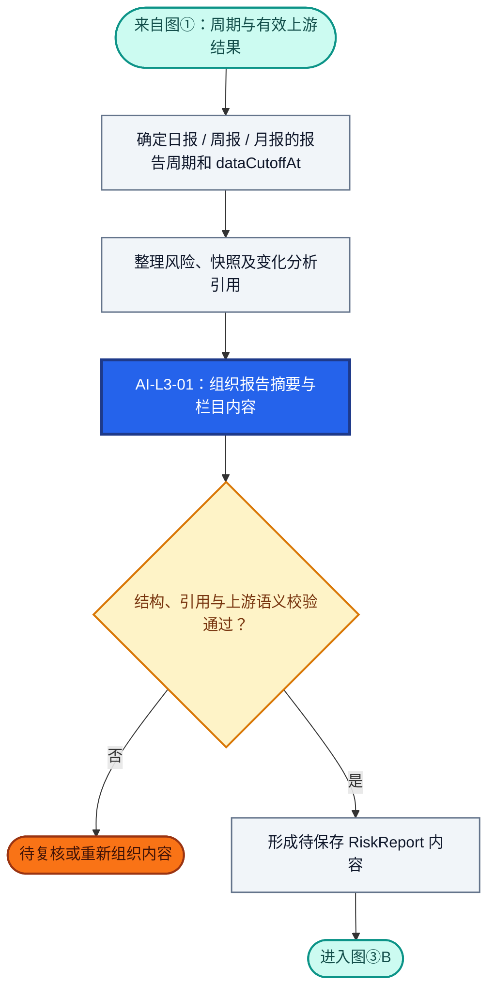
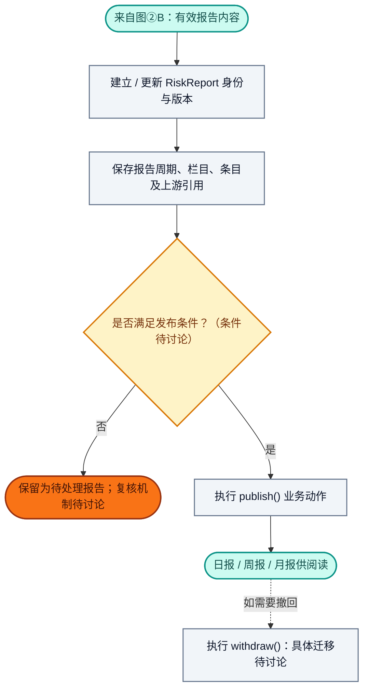
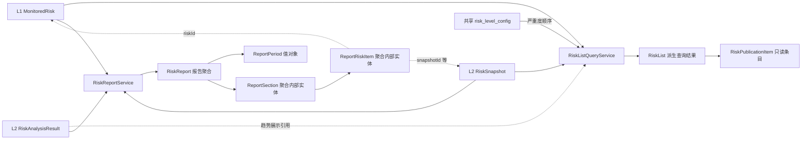

# RiskHot L3 风险产品与发布层：业务架构与领域设计

> **文档版本**：V1.0（由 D6 V1.0 转换的 L3 讨论整合稿）  
> **编制日期**：2026-10-13  
> **设计范围**：RiskHot / L3 风险产品与发布层 / 首版宏观经济金融风险  
> **设计基线**：L1 `MonitoredRisk` 与共享风险等级配置；L2 `RiskSnapshot`、`RiskAnalysisResult`；D6 `RiskList`、`RiskPublicationItem`、`RiskReport` 领域设计。  
> **设计依据**：上传的《02-D6 风险产品与发布业务领域设计.md》（2026-10-08，V1.0）、《业务架构与领域设计模板(1).md》；并核对现行《RiskHot_L1_风险识别与纳管层_业务架构与领域设计.md》与《RiskHot_L2_风险态势分析层_业务架构与领域设计V1.0.md》（2026-10-10）。  
> **内容约定**：保留 D6 已确认的业务产品、职责和排序原则；按照现行 L1/L2 对象名称调整层间协作。原文“建议”“待细化”均维持未定状态。为组织文档新增的 BR-L3 编号属于**整理编号**，不代表新增业务规则已经审批。  
> **旧版到新版映射**：D6「风险产品与发布领域」→ L3「风险产品与发布层」；原 D3 风险观察对象 → L1 `MonitoredRisk`；原 D4 风险状态评估 → L2 `RiskSnapshot`；原 D5 风险演化分析结果 → 现行 L2 `RiskAnalysisResult`。统一严重度依赖共享 `risk_level_config`，维护责任与最终比较口径仍需确认。

**本版核心结论**：L3 把已有风险身份、当前状态和历史变化组织为三类动态风险列表及三类周期报告。列表是派生查询结果；报告具有独立身份、周期、内容、版本与发布状态。L3 不重做风险识别、风险状态分析和变化趋势判断。

## 1. 业务能力与职责设计

### 1.1 业务定位与总体职责

L3 面向风险信息阅读者，将 L1 纳管的风险对象与 L2 的风险状态、变化分析结果转化为可查找、可比较、可阅读和可发布的风险信息产品。L3 主要回答：**当前有哪些风险、哪些风险最近完成评估、哪些风险最严重，以及一个周期内风险状态与演化发生了哪些重要变化？**

L3 对**列表的选择与排序、报告的组织内容、版本与发布管理**负责；风险定义、严重度判断、趋势方向和持续性变化结论均引用上游结果。

### 1.2 核心业务能力与责任

| 业务能力 | 回答的业务问题 | L3 承担的责任 | 主要交付结果 |
| --- | --- | --- | --- |
| 风险展示数据组织 | 一条风险应显示什么？ | 组合 L1 身份与 L2 最新有效结果，保留来源引用及时效 | `RiskPublicationItem` |
| 风险列表查询 | 哪些风险最新、最严重、已建档？ | 依据明确的时间、等级与筛选规则生成视图；标明待评估、陈旧及跟踪状态 | 三类 `RiskList` |
| 周期风险报告组织 | 日、周、月该汇总哪些风险？ | 选取适用上游结果，构成报告周期、栏目和条目 | `RiskReport` 草拟内容；纳入条件待讨论 |
| 报告内容生成与校验 | 如何解释周期内的风险状态与变化？ | 使用 AI-05（L3 逻辑编号见第 6 章）组织已有结论，程序校验引用和结构 | 报告摘要、栏目与风险条目 |
| 报告版本与发布管理 | 如何区分报告的不同版本与发布结果？ | 管理独立身份、版本、发布/撤回语义及消费边界 | 可追溯的周期报告；具体状态机待讨论 |

**横向质量与追溯职责**：列表中等级、方向、快照时间均以有效上游记录为准；报告条目保留 `riskId`、`snapshotId` 以及适用时的 `comparisonSnapshotId`。对过时结果应提供时效标记；已发布报告如何冻结引用、修订与追溯，见第 3、4 章待讨论项。

**能力与环节的对应**：列表使用①上游数据准备 → ②A 确定性查询排序 → ③A 列表交付；报告使用①上游数据准备 → ②B 报告组织与校验 → ③B 报告保存及发布管理。两条路径共享读取能力，生命周期不同。

### 1.3 业务能力划分

| 环节 | 业务能力／环节名称 | 输入 | 核心处理 | 主要输出 |
| --- | --- | --- | --- | --- |
| ① | 产品请求与上游数据准备 | 列表查询条件或报告周期；L1、L2 已有结果 | 明确产品类型、读取有效风险与快照及变化结果、准备查询/报告上下文 | 风险产品上下文 |
| ②A | 风险列表筛选与排序 | 风险对象、最新有效快照、等级顺序 | 按最新／最严重／已建档三种规则筛选、排序及组装 | `RiskList`、`RiskPublicationItem` |
| ③A | 风险列表交付 | 派生列表 | 附带时效与待评估信息，向展示端提供查询结果 | 三类动态风险列表 |
| ②B | 周期报告组织与校验 | 报告周期、风险快照、变化分析、风险身份 | 组织栏目和条目；可由 AI-05 编写摘要；核对上游结论与引用 | 待保存 `RiskReport` 内容 |
| ③B | 报告保存与发布管理 | 通过既定校验的报告内容 | 管理报告身份、版本、状态及发布/撤回动作 | 日报／周报／月报；具体流程约束待讨论 |

### 1.4 首版职责覆盖范围

| 维度 | 首版范围与责任 | 讨论状态 |
| --- | --- | --- |
| 业务领域与服务对象 | 面向风险信息阅读者的风险目录、排行和周期报告 | **D6 已确认** |
| 产品类型 | 最新风险、最严重风险、已建档风险、风险日报、周报、月报，共六类 | **D6 已确认** |
| 列表输入与触发 | 通过当前查询条件获取 L1/L2 有效数据并动态生成；触发协议待讨论 | 原则已确认，接口待讨论 |
| 报告输入与触发 | 周期、数据截止时间、风险与快照及变化结果；定时/手动触发规则待讨论 | 业务方向已确定，触发待讨论 |
| 核心业务对象 | 列表为只读派生结果；报告为独立聚合，拥有周期与版本 | **D6 已确认的模型方向** |
| 配置与共享资源 | 复用共享风险等级顺序及 L1/L2 已形成的风险知识与判断 | 原则已确认，等级跨规则集可比性待确认 |
| 生命周期与历史 | 列表可动态刷新；报告需要版本、发布/撤回语义 | 模型已定义，状态迁移待讨论 |
| 下游交付 | 六类风险信息产品及报告条目引用 | **D6 已确认** |
| 首版排除 | 市场影响力排行、传播热度计算、潜在市场冲击预测 | **D6 已确认排除** |

### 1.5 上下游职责分工

| 业务层／模块 | 承担的业务职责 | 核心业务产物 | 与 L3 的协作 |
| --- | --- | --- | --- |
| L0 信息处理层 | 维护信息、事件及其更新 | `Information`、`Event`、`EventUpdate` | 通过 L1/L2 提供经分析的事实依据；L3 不重新识别事件 |
| L1 风险识别与纳管层 | 维护风险身份、观察边界、跟踪状态、分类和关联 | `MonitoredRisk`；相关风险源、变量和事件引用 | 向 L3 提供建档目录、风险身份、市场/分类与跟踪状态 |
| L2 风险态势分析层 | 判断当前程度、阶段、范围、持续性及历史变化 | `RiskSnapshot`、`RiskAnalysisResult` | 向 L3 提供有效快照、严重度、状态说明、方向变化、持续性变化和证据关联 |
| 共享风险等级配置 | 提供统一的等级名称、顺序与规则口径 | `risk_level_config` 及相关规则配置 | L3 只按照可比较的严重度顺序排序，不能替代上游评估 |
| **L3 风险产品与发布层** | 组织和交付风险信息产品 | `RiskList`、`RiskPublicationItem`、`RiskReport` | 本文设计范围 |
| 展示／消费端 | 阅读、过滤与呈现已组织的产品 | 列表页面、风险报告阅读页等 | 消费 L3 结果；不在页面重新评级或改写分析结论 |

**对象与语义边界**：

- `risk_level`：L2 `RiskSnapshot` 的当前严重程度，由上游判断；L3 只排序或展示。
- `trend`：现行 L2 `RiskAnalysisResult` 的**历史比较方向**，可显示加剧／维持／减弱／待判断；L3 不据等级升降自行计算。
- `tracking_status`：L1 `MonitoredRisk` 的跟踪管理状态；与风险严重度、阶段及方向独立。
- `snapshot_time`：本轮快照的信息截止时间；与记录生成时间、报告生成/发布时间区分。
- `RiskList`：用户查询时的派生视图；不等于持久化的风险排名实体。
- `RiskReport`：独立报告聚合；报告周期和 `dataCutoffAt` 不等同于单个风险的 `snapshot_time`。

### 1.6 职责边界与暂不承担事项

- L3 不新增风险，不合并风险身份，不直接改变 `MonitoredRisk.tracking_status`。
- L3 不重新分析变量、计算风险等级、判断阶段、趋势或减弱节点；所有判断复用 L2 及其依据。
- L3 不重建 `RiskLevelConfig` 或自定义一套无法与现有口径比较的严重度等级。
- L3 不承担市场影响力排行、舆情热度、潜在市场冲击预测，也不输出交易执行和投资持仓指令。
- UI 页面布局、物理表拆分、缓存、请求协议、AI Prompt、发布状态机均在相应后续设计中细化。

## 2. 业务架构设计

### 2.1 总体业务流程

**流程关键约束**：列表路径根据最新有效评估动态查询；报告路径管理独立身份、内容和版本。报告内容可以组织为 AI 生成，但不得改变 L2 已有判断。报告是否必须经过人工审核、何时冻结内容、发布后如何修订均待讨论。

### 2.2 详细业务流程

| 详图 | 对应业务环节 | 入口 | 出口及衔接 |
| --- | --- | --- | --- |
| 图① | 产品请求与上游数据准备 | 列表查询 / 报告周期请求 | 进入图②A 或图②B |
| 图②A | 风险列表筛选与排序 | 已取得风险与最新有效快照 | 生成列表条目，进入图③A |
| 图③A | 风险列表交付 | 形成 `RiskList` | 列表展示或查询返回 |
| 图②B | 周期报告组织与校验 | 周期范围与 L1/L2 结果 | 形成待保存报告，进入图③B 或待复核 |
| 图③B | 报告保存与发布 | 合格的报告内容 | 正式报告；发布、撤回细则待讨论 |

**颜色图例**：蓝底白字＝AI 分析；灰色＝程序处理；浅黄＝规则分支；橙色＝待复核或条件待确认；青绿＝入口和出口。**AI 编号**：本层以 `AI-L3-01` 表示 D6 的 `AI-05 风险报告生成`，为转换整理编号；原 D6 未提供独立列表 AI 任务。

#### 2.2.1 图①：产品请求与上游数据准备

| 步骤 | 业务工作 | 输入与输出 | 规则引用 |
| --- | --- | --- | --- |
| 1.1 | 识别产品类型和筛选条件 | 最新风险、最严重风险、全部已建档或报告周期 | BR-L3-01、BR-L3-02、BR-L3-05 |
| 1.2 | 读取风险身份与跟踪状态 | L1 `MonitoredRisk` | BR-L3-06、BR-L3-07 |
| 1.3 | 读取最新有效状态、必要变化结果 | L2 `RiskSnapshot`、`RiskAnalysisResult` | BR-L3-03、BR-L3-04、BR-L3-08 |
| 1.4 | 为查询或报告准备上下文 | 数据引用、时间与适用配置 | BR-L3-09、BR-L3-10 |

**处理口径与边界**：无快照风险可进入完整目录，但不进入“按最新评估时间排序”的集合；等级无法比较时，不进入可比较严重度排行。报告周期内无可纳入结果时是否生成空报告，待讨论。

#### 2.2.2 图②A：风险列表筛选与排序

| 步骤 | 业务工作 | 应形成的内容 | 规则引用 |
| --- | --- | --- | --- |
| 2A.1 | 最新风险查询 | 每风险一条最新有效快照，按 `snapshot_time` 倒序 | BR-L3-03 |
| 2A.2 | 最严重风险查询 | 先验证等级可比，再按严重度顺序和快照时间排序 | BR-L3-04、BR-L3-08 |
| 2A.3 | 已建档目录查询 | 包含各跟踪状态及尚无快照风险，按允许维度筛选 | BR-L3-05、BR-L3-06 |
| 2A.4 | 组装展示条目 | 风险身份、最新状态、时间、必要趋势引用 | BR-L3-02、BR-L3-09 |

**处理口径与边界**：原 D6 建议“最严重风险榜单默认只纳入 `observing`、`monitoring`”；该项仍为**建议方案**。`paused`、`closed` 记录在完整目录可查。趋势字段从 L2 `RiskAnalysisResult` 获取，不从快照等级变动推导。

#### 2.2.3 图③A：风险列表交付

| 步骤 | 业务工作 | 输出 | 规则引用 |
| --- | --- | --- | --- |
| 3A.1 | 汇总派生查询结果 | `RiskList` 的 `listType`、`generatedAt` 和 `items` | BR-L3-01、BR-L3-11 |
| 3A.2 | 显示评估与时效信息 | 评估时间、无快照／待评估／不可比较标识 | BR-L3-08、BR-L3-09 |
| 3A.3 | 提供消费结果 | 最新风险、最严重风险、全部建档风险 | BR-L3-11 |

**一致性与分发口径**：风险列表采用动态查询，可使用缓存或投影，更新频率和失效机制待技术设计。不得因为缓存存在而把列表设计成独立 `RiskRanking` 聚合。

#### 2.2.4 图②B：周期报告组织与校验

| 步骤 | 业务工作 | 应形成的内容 | 规则引用 |
| --- | --- | --- | --- |
| 2B.1 | 确定报告时间与数据边界 | `ReportPeriod`、`dataCutoffAt` | BR-L3-10 |
| 2B.2 | 选取风险及历史变化依据 | `riskId`、`snapshotId`、适用的 `comparisonSnapshotId` | BR-L3-10、BR-L3-12 |
| 2B.3 | 组织栏目、条目及摘要 | `ReportSection`、`ReportRiskItem`、`summary` | BR-L3-12、BR-L3-13 |
| 2B.4 | 校验 AI 内容与上游结论一致 | 有效报告内容或待复核事项 | BR-L3-13、BR-L3-14 |

**AI、程序与人工分工**：AI 组织和概括已有风险判断；程序准备输入、建立关联、验证结构及引用；人工复核入口、发布授权和强制复核条件待讨论。具体栏目模板、纳入阈值、日历边界和空结果策略尚未定稿。

#### 2.2.5 图③B：报告保存与发布管理

| 步骤 | 业务工作 | 输出 | 规则引用 |
| --- | --- | --- | --- |
| 3B.1 | 保存报告聚合与引用 | 带身份、周期、栏目、条目和版本的 `RiskReport` | BR-L3-11、BR-L3-12 |
| 3B.2 | 判断发布资格 | 满足正式规则／待处理；目前发布条件待讨论 | BR-L3-14 |
| 3B.3 | 发布或撤回 | 报告发布状态变化，具体规则待讨论 | BR-L3-14 |

**一致性与分发口径**：报告作为独立聚合管理。发布后如何冻结历史版本、是否允许原位编辑、何种修改触发新版本、撤回后的可见性以及是否可再次发布，**均待讨论**。上述图形只表示 D6 已有的 `publish()`、`withdraw()` 业务语义，不预设正式状态机。

### 2.3 主要业务处理分支

| 场景 | 处理路径 | 业务结果 | 未决条件 |
| --- | --- | --- | --- |
| 风险完成新评估 | ① → ②A Latest → ③A | 按最新有效 `snapshot_time` 参与排序 | “有效”的完整状态口径待讨论 |
| 风险无快照 | ① → ②A Catalog → ③A | 可出现在已建档目录；不参与 Latest 时间排序 | 空字段展示格式待讨论 |
| 等级为空或不能跨规则集比较 | ① → ②A Severity → ③A | 标注待评估/不可比较，不强行排序 | 统一严重度等级口径待讨论 |
| 观察中或监控中的高等级风险 | ① → ②A Severity → ③A | 按可比等级和时间排序 | 默认榜单纳入范围为 D6 建议方案 |
| 暂停/结束跟踪风险 | ① → ②A Catalog → ③A | 完整目录仍可查看 | 严重榜单默认过滤仍需确认 |
| 快照时间久远 | ① → ②A → ③A | 显示评估截止时间、标记时效 | “陈旧”阈值待讨论 |
| 生成日报/周报/月报 | ① → ②B → ③B | 独立的 `RiskReport` 与引用 | 纳入规则、周期时区、栏目等待讨论 |
| AI 内容与上游结论冲突 | ②B 校验失败 | 退回处理或复核，不能直接发布 | 自动重试与人工复核流程待讨论 |
| 报告撤回或修订 | ③B | 执行对应业务语义 | 状态迁移、历史版本可见性待讨论 |

## 3. 业务规则设计

### 3.1 业务规则索引

> 以下 `BR-L3-xx` 是将 D6 的已确认原则、建议与未决项按 L3 模板组织的**文档整理编号**；不替代旧稿提到但未展开的 `BR-13～BR-16`，也不自动赋予待定事项“已确认”状态。

| 编号 | 规则名称 | 适用业务步骤 | 规则原则 | 依据与状态 |
| --- | --- | --- | --- | --- |
| BR-L3-01 | 六类产品范围 | 1.1、3A.1 | 三类列表、三类周期报告 | D6 已确认 |
| BR-L3-02 | 展示条目复用上游 | 2A.4 | 组合 L1 身份与 L2 结果，不重复维护状态 | D6 已确认；趋势来源按 L2 校正 |
| BR-L3-03 | 最新风险选取与排序 | 1.3、2A.1 | 每风险一条最新有效快照，按 `snapshot_time` 倒序 | D6 已确认 |
| BR-L3-04 | 最严重风险选取与排序 | 2A.2 | 按统一可比严重度降序，同级按快照时间倒序 | D6 已确认；跨规则集可比性前提 |
| BR-L3-05 | 全部已建档风险范围 | 1.1、2A.3 | 所有 `MonitoredRisk` 均可进入目录，包括无快照及暂停/结束 | D6 已确认 |
| BR-L3-06 | 建档风险筛选维度 | 1.2、2A.3 | 市场、风险源、风险维度、跟踪状态、风险等级 | D6 已确认 |
| BR-L3-07 | 跟踪状态过滤 | 1.2、2A.2 | 严重榜单建议默认纳入 observing/monitoring | D6 **建议**，待确认 |
| BR-L3-08 | 不可比较等级处理 | 1.3、2A.2 | 空等级及无法比较者归待评估/不可比较 | D6 已确认的原则 |
| BR-L3-09 | 评估时间与时效 | 1.3、2A.4、3A.2 | 显示截止时间；过旧结果须标注时效 | D6 已确认原则；阈值待讨论 |
| BR-L3-10 | 报告周期和数据截止 | 2B.1、2B.2 | 报告拥有周期和 `dataCutoffAt` | D6 模型已定义；业务日历待讨论 |
| BR-L3-11 | 列表与报告管理边界 | 3A.1、3B.1 | 列表动态查询；报告独立身份与版本 | D6 已确认 |
| BR-L3-12 | 报告条目引用 | 2B.2、3B.1 | 条目保存 `riskId`、`snapshotId` 和适用比较快照引用 | D6 模型已定义；完整一致性细则待讨论 |
| BR-L3-13 | AI 报告内容边界 | 2B.3、2B.4 | AI 组织内容，不能另行评级或改写变化结论 | D6 已确认的边界 |
| BR-L3-14 | 发布、撤回与版本 | 2B.4、3B.2、3B.3 | `RiskReport` 支持发布和撤回语义 | 行为已定义；状态机待讨论 |
| BR-L3-15 | 风险等级可比前提 | 2A.2 | 不同 Ruleset 须先保证可比较的严重度口径 | D6 已确认的前提 |
| BR-L3-16 | 版本与历史可追溯 | 3B.1、3B.3 | 报告内容和上游判断需有可追溯引用 | D6 原则已定义；冻结策略待讨论 |

### 3.2 核心规则的业务判定口径

#### BR-L3-01 六类产品范围

- **适用条件**：用户访问 L3 风险信息产品。
- **判定依据**：产品类型；当前仅支持 `Latest Risks`、`Highest Severity Risks`、`Risk Catalog`、`Daily/Weekly/Monthly Risk Report` 六种。
- **判定与动作**：列表进入确定性查询路径；周期报告进入独立报告聚合路径。
- **边界情况**：市场影响力排名、热度排行和潜在市场冲击预测不纳入首版。
- **未决部分**：对外 `listType`、`reportType` 的正式编码、默认参数待讨论。

#### BR-L3-02 展示条目复用上游

- **适用条件**：生成 `RiskPublicationItem`。
- **判定依据**：L1 `risk_id`、标题、观察对象、市场、跟踪状态；L2 当前有效快照及附属 `RiskAnalysisResult`。
- **判定与动作**：只读组装展示条目；等级、阶段和状态说明取自快照；`trend` 取自变化分析结果。
- **边界情况**：无快照或无可用变化结果，适用字段可缺省或呈待判断；不以计算差值推导趋势。
- **未决部分**：展示空值协议、实际字段名称和类型待讨论。

#### BR-L3-03 最新风险选取与排序

- **适用条件**：查询最新风险。
- **判定依据**：每项 `MonitoredRisk` 的最近一次**有效** `RiskSnapshot.snapshot_time`。
- **判定与动作**：每个风险只返回一条最新有效快照，按截止时间倒序排列。
- **边界情况**：无快照不参与；首次纳管时间不替代评估时间。
- **未决部分**：相同时间的最终稳定排序键、快照修订优先规则待讨论（可参考 D6 建议的风险 ID 稳定排序）。

#### BR-L3-04、BR-L3-08、BR-L3-15 最严重风险与等级可比性

- **适用条件**：查询最严重风险。
- **判定依据**：L2 的最新有效 `risk_level` 与共享 `risk_level_config` 严重度顺序。
- **判定与动作**：在等级口径统一且可比较时按严重度降序；同等级按 `snapshot_time` 倒序，必要时使用风险 ID 保证稳定排序。
- **边界情况**：等级空值、未评级或等级体系不可比较时，将对象标记待评估／不可比较，不强行插入严重度名次。
- **未决部分**：跨 Ruleset 等级映射、榜单“不可比较集合”的展示位置、相同时间排序实现。

#### BR-L3-05、BR-L3-06、BR-L3-07 全部建档与跟踪状态

- **适用条件**：查询已建档目录或严重榜单。
- **判定依据**：L1 维护的全部 `MonitoredRisk` 及跟踪状态、市场、风险源、风险维度。
- **判定与动作**：完整目录包含观察、监控、暂停和结束跟踪对象，允许五个维度筛选。严重榜单默认只纳入 observing/monitoring 是原 D6 建议。
- **边界情况**：暂停和结束均不意味着风险严重度自动清零；无快照不应被排除在目录外。
- **未决部分**：严重榜单最终默认状态集合、各筛选维度的联合逻辑和分页口径。

#### BR-L3-09 评估时间与时效

- **适用条件**：展示最新/最严重风险，尤其高等级但评估较旧的记录。
- **判定依据**：`snapshot_time`、产品生成时间和可用上游时效信息。
- **判定与动作**：清晰展示评估截止时间，对过时数据标明时效；不能把高历史等级包装为当前新判断。
- **边界情况**：业务记录生成/发布时间不代替评估截止时间。
- **未决部分**：各类风险的陈旧阈值、标记文案、是否从主榜单排除。

#### BR-L3-10、BR-L3-12 报告周期、数据边界及内容引用

- **适用条件**：组织日报、周报、月报。
- **判定依据**：`ReportPeriod.start/end/timezone`、`dataCutoffAt`、已选的 L1/L2 结果。
- **判定与动作**：形成有独立报告周期与数据截止时间的报告，每个条目保留 `riskId`、`snapshotId`，适用时保留 `comparisonSnapshotId`。
- **边界情况**：单项风险快照的评估截止时间可能早于报告截止；不得把报告期间内未发生的变化写成当期事实。
- **未决部分**：周期划分、时区、生成时点、回溯纳入条件、栏目模板和是否必须有条目。

#### BR-L3-11、BR-L3-16 列表和报告的数据管理边界

- **适用条件**：保存/交付 L3 产品。
- **判定依据**：业务产品类型与追溯要求。
- **判定与动作**：`RiskList` 为派生结果，可按需查询/缓存；`RiskReport` 独立管理 `reportId`、`version`、周期、内容及发布状态。
- **边界情况**：不为确定性“最严重排序”新设独立 `RiskRanking` 聚合；不把报告当成每次重新计算的临时列表。
- **未决部分**：缓存和投影、报告内容冻结、历史修订与引用版本策略。

#### BR-L3-13 AI 报告内容边界

- **适用条件**：AI 组织周期报告文字内容。
- **判定依据**：L2 当前状态及变化分析结论、其证据引用和 L1 风险定义。
- **判定与动作**：生成摘要、栏目及条目表述；程序核对格式与关联；存在语义矛盾时进入复核/重新组织。
- **边界情况**：AI 不重新评定风险等级，不自行确定趋势/减弱节点或发布资格。
- **未决部分**：Prompt、模型、内容纳入规则、完整 Schema、审校责任。

#### BR-L3-14 发布、撤回与版本

- **适用条件**：保存及对外发布报告。
- **判定依据**：`RiskReport.status`、`version` 及已校验内容。
- **判定与动作**：领域模型提供 `publish()`、`withdraw()` 业务行为。
- **边界情况**：原 D6 没有给出正式状态枚举、审批条件、版本递增与撤回后可见性规则，不能预设。
- **未决部分**：状态迁移矩阵、版本修订与冻结规则、权限及审计。

### 3.3 尚未确认的规则

| 待定规则项 | 当前已知原则 | 待确认条件／规则值 | 影响范围 |
| --- | --- | --- | --- |
| 严重榜单纳入状态 | 目录包含全部风险；原 D6 建议榜单只纳入 observing/monitoring | 是否成为首版默认值；用户能否切换 | ②A、③A |
| 风险等级可比较口径 | 必须沿用统一严重度定义 | 不同 Ruleset 如何映射或判定不可比较 | ②A |
| “最新有效快照” | 每风险只取一条有效记录 | 发布/修订/作废等状态对选择的影响 | ①、②A |
| 数据陈旧定义 | 应显式标记时效 | 阈值、领域差异及是否隐藏 | ③A |
| 报告生成周期 | 日／周／月三类已确定 | 时区、起止边界、法定/交易日口径 | ②B |
| 报告纳入规则 | 复用风险、快照和变化分析 | 变化/严重度阈值、无变化与空报告策略 | ②B |
| 栏目组织与排序 | `ReportSection` 包含栏目编码、标题、顺序 | 固定模板、动态栏目、默认顺序 | ②B |
| 发布资格和审核 | AI 结果须与 L2 一致；报告具备发布语义 | 审核责任、前置条件、状态机 | ②B、③B |
| 版本与撤回 | 报告有版本，支持发布／撤回 | 版本号、冻结、历史可见性、重新发布 | ③B |
| 对外接口和缓存 | 列表动态，报告持久 | API、缓存策略、分页和快照稳定性 | ③A、③B |
| 展示趋势字段 | 取自 L2 `RiskAnalysisResult` | 无可比基准时显示策略 | ②A、③A |
| 关联一致性校验 | 报告条目保留风险和快照引用 | 上游修订后是否重新生成报告 | ②B、③B |

### 3.4 核心验收场景

| 场景 | 前置条件与输入 | 期望业务结果 | 不应发生的结果 | 对应规则 |
| --- | --- | --- | --- | --- |
| 最新风险排序 | 风险 A、B 分别有不同评估截止时间 | 每项取一条最新有效快照并按时间倒序 | 使用首次建档时间排序 | BR-L3-03 |
| 最新风险无快照 | 风险 C 已纳管但从未评估 | C 可在 Catalog 查看；Latest 不纳入快照排序 | 给 C 虚构 `snapshot_time` | BR-L3-03、05 |
| 严重程度排序 | A/B 等级可比且不同 | 按共享等级严重度顺序展示 | 根据 L3 自建评分重新定级 | BR-L3-04、15 |
| 同等级排序 | A/B 等级相同但快照时间不同 | 较新的快照在前 | 因无时间次序随机跳动 | BR-L3-04 |
| 等级不能比较 | 两风险不同规则集且映射未统一 | 标明不可比较 | 强制给出统一名次 | BR-L3-08、15 |
| 暂停跟踪目录 | 风险 D 状态 paused | Catalog 仍可查看 D | D 从完整目录消失 | BR-L3-05、07 |
| 历史高风险 | 旧快照严重度高但评估过久 | 显示历史截止时间及适用的时效提醒 | 把旧结论直接宣传为最新判断 | BR-L3-09 |
| 趋势显示 | 已有 L2 `RiskAnalysisResult.trend` | 展示 L2 结论及可用依据 | L3 根据两次等级差计算新 trend | BR-L3-02、13 |
| 报告引用 | 报告纳入某风险快照及比较结果 | 条目保留正确风险／快照引用 | 引用到其他风险的快照 | BR-L3-12、13 |
| AI 内容矛盾 | L2 结论为“减弱”，AI 摘要写成“加剧” | 不通过校验，进入重新处理/复核 | 直接发布矛盾文字 | BR-L3-13 |
| 报告撤回 | 已存在有身份、版本的报告 | 支持撤回业务入口，状态效果按待定规则执行 | 假定未定义的迁移已经生效 | BR-L3-14 |

## 4. 领域模型设计

### 4.1 核心领域模型

L3 由两个业务能力模块组成：**Risk Discovery（风险信息展示）**和 **Risk Reporting（周期风险报告）**。核心对象中，`RiskList`、`RiskPublicationItem` 为查询/展示模型；`RiskReport` 为聚合根，内部包含 `ReportPeriod`、`ReportSection`、`ReportRiskItem`。

**关系说明**：实线体现业务组合和处理依赖，虚线体现上游分析引用；实际关联基数仅在有源文档依据时确定（见 4.5）。图不表示持久化表关系或接口协议。

### 4.2 领域对象汇总说明

| 领域对象 | 对象类型与归属 | 业务含义 | 核心职责 | 主要关联对象与关系 | 讨论状态 |
| --- | --- | --- | --- | --- | --- |
| `MonitoredRisk` | 外部核心实体；L1 | 已纳管风险观察对象 | 提供稳定风险身份、基本信息、跟踪状态 | 被展示条目和报告条目引用 | L1 已讨论，L3 只读 |
| `RiskSnapshot` | 外部核心实体；L2 | 指定时间的风险程度、阶段、范围和持续性判断 | 提供等级、状态说明、截止时间与身份 | 一个风险对应 0..N 个快照 | L2 已讨论，L3 只读 |
| `RiskAnalysisResult` | 外部附属结果；L2 | 当前与历史风险快照的变化分析 | 提供 `trend`、持续性变化、原因及减弱节点 | 依附当前快照，引用历史基准 | L2 已讨论，L3 只读 |
| `risk_level_config` | 共享配置，L3 引用 | 统一等级及严重度顺序 | 提供可比较排序口径 | 用于最严重风险排序 | 已有命名；跨规则集口径待讨论 |
| `RiskPublicationItem` | L3 只读展示模型 | 一条已建档风险的展示摘要 | 合并风险身份、状态与变化展示所需信息 | 来源 L1、L2 | D6 已定义；映射按 L2 修订 |
| `RiskList` | L3 派生查询结果 | 特定列表条件下的一组展示条目 | 保存列表类型、生成时间、条目序列 | 包含 `RiskPublicationItem` | D6 已定义 |
| `RiskReport` | L3 聚合根 | 独立周期报告 | 管理类型、周期、摘要、栏目、版本、状态 | 包含周期、栏目及条目 | D6 已定义；状态机待讨论 |
| `ReportPeriod` | L3 值对象 | 报告覆盖的时间范围与时区 | 约束起止时间语义 | 隶属 `RiskReport` | D6 已定义 |
| `ReportSection` | L3 聚合内部实体 | 一期报告中的栏目 | 表示栏目身份、标题与顺序 | 包含 `ReportRiskItem` | D6 已定义 |
| `ReportRiskItem` | L3 聚合内部实体 | 报告选入的风险条目 | 保留风险、快照、比较依据及纳入摘要 | 引用 L1 风险、L2 快照 | D6 已定义 |
| `RiskListQueryService` | L3 领域服务 | 三类列表查询和排序 | 确定性规则执行 | 组织 `RiskList` | D6 已定义 |
| `RiskReportService` | L3 领域服务 | 周期报告组织 | 聚合已有评估结果，形成报告 | 组织 `RiskReport` | D6 已定义 |

**汇总口径**：领域服务与派生结果并不直接对应持久化业务表。原 D6 明确 V1 不建立独立 `RiskRanking` 对象。

### 4.3 核心领域对象详细设计

#### 4.3.1 `RiskReport`：周期风险报告（聚合根）

**领域定义**：一期日报、周报或月报的独立身份及内容边界，拥有覆盖周期、数据截止时间、栏目、风险条目、版本与发布状态。L3 管理报告本体，上游快照和风险身份仍归 L1/L2 维护。

| 逻辑属性／候选字段 | 业务含义 | 约束与引用 | 讨论状态 |
| --- | --- | --- | --- |
| `reportId` | 报告独立身份 | 唯一生成规则、格式待讨论 | D6 已定义属性 |
| `reportType` | 日／周／月报告类型 | 枚举编码待讨论 | 类型已确认 |
| `reportPeriod` | 覆盖周期 | 值对象，包含 start/end/timezone | D6 已定义 |
| `dataCutoffAt` | 报告依据数据的截止时间 | 与单个 `snapshot_time` 区分 | D6 已定义 |
| `title` | 报告标题 | 生成规则待讨论 | D6 已定义 |
| `summary` | 报告摘要 | 可以由 AI 组织；必须尊重 L2 判断 | D6 已定义 |
| `status` | 发布管理状态 | 正式枚举及迁移待讨论 | D6 已定义属性，规则未确定 |
| `version` | 报告版本 | 修订、冻结和递增规则待讨论 | D6 已定义属性，规则未确定 |
| `sections`（对象组合，非已定物理字段） | 报告栏目集合 | 组合多个 `ReportSection` | 根据 D6 对象关系整理 |

**行为与不变量**：`publish()`、`withdraw()` 作为已设计的行为语义保留。栏目与条目属于报告；引用的风险和快照不得由报告修改；摘要不得与所引用的 L2 结论发生无法解释的冲突。

**生命周期**：已知道有报告组织、内容保存、发布和撤回需求；草稿/待审核/已发布/已撤回等状态是否存在、能否修改发布后的同一版本、版本记录保存方式，全部待讨论。

#### 4.3.2 `ReportPeriod`：报告周期（值对象）

| 逻辑属性 | 业务含义 | 约束与引用 | 讨论状态 |
| --- | --- | --- | --- |
| `start` | 报告周期开始 | 起止边界包含/不包含规则待讨论 | D6 已定义 |
| `end` | 报告周期结束 | 应与开始构成有效期间；具体时点规则待讨论 | D6 已定义 |
| `timezone` | 周期解释使用的时区 | 日、周、月报采用哪一时区待讨论 | D6 已定义 |

**行为与不变量**：用于界定报告归属的时间范围；与 `dataCutoffAt` 同时存在，具体校验原则待讨论。

#### 4.3.3 `ReportSection`：报告栏目（聚合内部实体）

| 逻辑属性 | 业务含义 | 约束与引用 | 讨论状态 |
| --- | --- | --- | --- |
| `sectionCode` | 栏目编码 | 同一期内是否必须唯一待讨论 | D6 已定义 |
| `title` | 栏目标题 | 标题生成及修改规则待讨论 | D6 已定义 |
| `sortOrder` | 栏目顺序 | 栏目顺序语义已给出，冲突处理待讨论 | D6 已定义 |

**行为与不变量**：仅在所属报告内部管理栏目；条目组合关系已定义，栏目模板与可变性待讨论。

#### 4.3.4 `ReportRiskItem`：报告风险条目（聚合内部实体）

| 逻辑属性 | 业务含义 | 约束与引用 | 讨论状态 |
| --- | --- | --- | --- |
| `riskId` | 纳入的风险身份 | 引用 L1 `MonitoredRisk` | D6 已定义 |
| `snapshotId` | 形成该条目依据的风险快照 | 引用 L2 `RiskSnapshot`；应对应 `riskId` | D6 已定义 |
| `comparisonSnapshotId` | 历史比较快照 | 适用时引用同一风险的历史快照 | D6 已定义；可空性待讨论 |
| `inclusionReason` | 纳入报告原因 | 具体原因规则和格式待讨论 | D6 已定义 |
| `summary` | 条目摘要 | 应与引用的上游判断一致 | D6 已定义 |

**行为与不变量**：只引用上游判断；不承担风险的当前状态重算、等级变更和历史趋势再分析。条目去重、一个风险是否可跨栏目出现等规则待讨论。

### 4.4 关联对象与处理结果

| 对象／结果 | 业务含义 | 分类与身份 | 生命周期／持久化 | 与核心对象的关系 |
| --- | --- | --- | --- | --- |
| `RiskPublicationItem` | 当前查询下的一条展示数据 | 只读模型；由已有对象组合 | 不独立承载风险身份；无需据此新建持久实体 | 被 `RiskList` 包含 |
| `RiskList` | 三类风险信息集合 | 派生查询结果 | 动态生成，可缓存或构建查询投影 | 包含展示条目；由 `RiskListQueryService` 生成 |
| `RiskReport` | 一期风险周期报告 | 聚合根，独立 `reportId` | 保存内容、版本及发布状态 | 包含周期、栏目、条目 |
| `ReportPeriod` | 报告时间范围 | 值对象 | 随报告保存；是否展开列待数据设计 | 被报告持有 |
| `ReportSection` | 报告内部栏目 | 聚合内部实体 | 随报告内容管理 | 包含报告风险条目 |
| `ReportRiskItem` | 报告纳入的一项风险与依据 | 聚合内部实体 | 随报告内容管理 | 引用外部风险、当前及历史快照 |
| `RiskAnalysisResult` | 前后快照方向和持续性变化 | L2 外部附属结果 | 归 L2 保存，L3 只引用 | 为报告和趋势展示提供依据 |

**`RiskPublicationItem` 逻辑展示字段**（沿用 D6 原始 camelCase 形式，映射表不等于数据库 DDL）：

| 字段 | 业务含义 | 当前来源 | 讨论状态 |
| --- | --- | --- | --- |
| `riskId` | 风险唯一标识 | L1 `MonitoredRisk.risk_id` | D6 已定义 |
| `title` | 风险名称 | L1 `MonitoredRisk` | D6 已定义 |
| `observationTarget` | 风险观察对象 | L1 `observation_target` | D6 已定义 |
| `marketId` | 所属市场 | L1 相关市场/分类信息 | D6 已定义；正式字段映射待核对 |
| `trackingStatus` | 观察/监控/暂停/结束跟踪状态 | L1 `tracking_status` | D6 已定义 |
| `riskLevel` | 当前有效风险等级 | L2 `RiskSnapshot.risk_level` | D6 已定义，按现行 L2 对齐 |
| `trend` | 风险相对历史的方向变化 | **L2 `RiskAnalysisResult.trend`** | D6 原注 D4，现按 L2 修订 |
| `statusSummary` | 当前风险状态综合说明 | L2 `RiskSnapshot.status_summary` | D6 已定义，按现行 L2 对齐 |
| `snapshotTime` | 本次有效评估的信息截止时间 | L2 `RiskSnapshot.snapshot_time` | D6 已定义 |
| `snapshotId` | 对应的有效快照标识 | L2 `RiskSnapshot.snapshot_id` | D6 已定义 |

**`RiskList` 逻辑字段**：`listType`（列表类型）、`generatedAt`（查询结果生成时间）、`items`（`RiskPublicationItem` 序列）。原 D6 不规定独立主键、排名实体或专门表结构。

### 4.5 领域关系与生命周期约束

| 对象 A | 关系 | 对象 B | 基数与可选性 | 一致性／历史约束 | 讨论状态 |
| --- | --- | --- | --- | --- | --- |
| L1 `MonitoredRisk` | 对应历次评估 | L2 `RiskSnapshot` | 1 : 0..N（现行 L2） | 同一风险可有多次评估；身份由 L1 保持 | 现行 L2 已讨论 |
| L2 `RiskSnapshot` | 具有附属变化结果 | L2 `RiskAnalysisResult` | 初始方案 1 : 0..1（现行 L2） | 变化分析含比较基准；具体多版本待讨论 | 现行 L2 建议 |
| `RiskList` | 包含 | `RiskPublicationItem` | 0..N 条；具体结果上限待讨论 | 同一风险在同一最新/最严重列表只取最新有效快照 | D6 关系与规则明确 |
| `RiskReport` | 持有周期 | `ReportPeriod` | 一份报告具有一个周期（由 D6 单值模型归纳） | 周期边界与时间规则待讨论 | 对象关系已定义 |
| `RiskReport` | 包含栏目 | `ReportSection` | 栏目数量与最小数量待讨论 | 栏目随报告版本管理 | 关系已定义，基数待讨论 |
| `ReportSection` | 包含风险条目 | `ReportRiskItem` | 条目数量与可选性待讨论 | 引用必须对上游风险与快照可追溯 | 关系已定义，基数待讨论 |
| `ReportRiskItem` | 引用 | L1 `MonitoredRisk` | 每条一项 `riskId` | 不修改外部对象 | D6 已定义 |
| `ReportRiskItem` | 引用 | L2 `RiskSnapshot` | 当前 `snapshotId` 一项；历史比较可选性待讨论 | 比较快照应属于相同风险；修订历史待讨论 | D6 属性已定义 |

**生命周期边界**：L1 `tracking_status` 和 L2 `risk_level`、`trend` 不受 L3 列表或报告发布操作影响。撤回报告也不会撤销上游风险评估结果。

### 4.6 建议逻辑数据结构与待定设计

| 领域对象 | 逻辑结构／现有表映射 | 关键字段与约束 | 设计状态 |
| --- | --- | --- | --- |
| `MonitoredRisk` | L1 维护的现有风险对象 | `risk_id`、定义、市场与跟踪状态 | L3 引用，不重复建表 |
| `RiskSnapshot` | L2 `risk_snapshot` | `snapshot_id`、`risk_id`、`snapshot_time`、`risk_level`、`status_summary` | L3 引用，不重复建表 |
| `RiskAnalysisResult` | L2 快照附属分析结构 | `trend`、`persistence_change`、`comparison_snapshot_id` 等 | 物理承载尚待 L2 确认 |
| `risk_level_config` | 共享配置 | 风险等级含义及严重度顺序 | L3 只读；跨规则集可比性待讨论 |
| `RiskPublicationItem` | 查询 DTO/只读投影（逻辑角色） | `riskId`、状态和引用字段 | 无须预设物理表 |
| `RiskList` | 派生视图／缓存（逻辑角色） | `listType`、`generatedAt`、`items` | 物理存储非首版领域必需 |
| `RiskReport` | 建议建立持久报告聚合 | `reportId`、`reportType`、`reportPeriod`、`dataCutoffAt`、`title`、`summary`、`status`、`version` | 逻辑模型明确；物理表名待讨论 |
| `ReportSection` | 报告聚合内栏目 | `sectionCode`、`title`、`sortOrder` | 拆表或嵌入待讨论 |
| `ReportRiskItem` | 报告聚合内风险条目 | `riskId`、`snapshotId`、`comparisonSnapshotId`、`inclusionReason`、`summary` | 拆表或嵌入待讨论 |

| 待定设计项 | 需解决的问题 | 当前设计 |
| --- | --- | --- |
| 报告聚合持久化 | 单表 JSON、主从表、内容快照如何组织 | 待讨论；不直接由领域图决定 |
| 版本引用与冻结 | 上游快照被修订后如何复现已发布内容 | 待讨论 |
| 发布日志与审计 | 记录谁何时批准、发布或撤回 | 需求待讨论 |
| 分页、缓存及投影 | 数据量大时列表如何稳定、及时展示 | 待技术设计 |
| 统一等级可比映射 | 自定义 Ruleset 如何对齐全局严重度 | 待业务规则确认 |
| 栏目与报告条目身份 | 是否存在栏目 ID、条目 ID 和去重键 | D6 尚未定义，待讨论 |

## 5. 业务接口与协作

### 5.1 上游 → L3：输入契约

| 上游对象／业务事件 | L3 用途 | 必需语义与引用 | 边界说明 |
| --- | --- | --- | --- |
| L1 `MonitoredRisk` | 三类列表与报告的风险身份、名称、范围、状态 | `risk_id`、标题、观察对象、市场和分类、`tracking_status` 等 | L1 维护身份及跟踪状态，L3 只读 |
| L2 `RiskSnapshot` | 最新时间排序、严重度比较、当前状态展示及报告 | `snapshot_id`、`risk_id`、`snapshot_time`、`risk_level`、`status_summary`；必要时阶段、范围、持续性 | L2 维护当前评估；“最新有效”的状态口径待明确 |
| L2 `RiskAnalysisResult` | 风险方向、持续性变化及报告演化说明 | 附属当前快照关系、`trend`、`persistence_change`、`comparison_snapshot_id`、`change_reason` 等 | 现行 L2 对象，替代旧 D6 的 `RiskEvolutionResult` 引用 |
| 共享 `risk_level_config` | 统一严重度排序 | 等级身份、定义、顺序、适用范围 | 等级不兼容时不能强行排序 |
| L0 `Event`/`EventUpdate` | 必要时展示来源追溯 | 通常经 L2 已有证据引用消费 | L3 不直接把事件重新纳管为风险，也不代替 L2 判断 |

**输入契约强调**：现行 L2 仅定义当前状态快照和附属分析的可消费语义，尚未确认正式 API、消息或更新通知。旧 D6 的 D1–D5 名称按当前 L1/L2 架构映射，不额外引入独立 D5 存储。

### 5.2 L3 → 下游：输出契约

| 输出 | 下游使用方式 | 交付条件 | 状态与版本约束 |
| --- | --- | --- | --- |
| 最新风险 `RiskList` | 显示最近评估的风险 | 每风险一条最新有效快照；时间可用 | 动态查询；必要时附带时效语义 |
| 最严重风险 `RiskList` | 比较可比风险等级 | 使用共享等级顺序；不可比较项分组 | 状态过滤待确认；显示快照时间 |
| 全部已建档 `RiskList` | 全量目录查询及筛选 | 使用全部 L1 风险 | 可包含无快照、暂停/结束跟踪记录 |
| `RiskPublicationItem` | 渲染风险摘要 | 身份与上游结果引用一致 | 无快照/趋势时需允许空或待判断 |
| 风险日报 `RiskReport` | 阅读当日风险概况与变化 | 组织既有判断且通过约定校验 | 报告状态、版本及发布条件待讨论 |
| 风险周报 `RiskReport` | 阅读一周内持续演化 | 同上；周期条件待讨论 | 同上 |
| 风险月报 `RiskReport` | 阅读月内主要变化与风险格局 | 同上；周期条件待讨论 | 同上 |

### 5.3 业务事件与协作形式

当前 D6 没有正式确认领域事件的名称、载荷、触发时机或投递方式。下表仅描述**业务事实和潜在协作语义**：

| 业务事件／候选名称 | 业务含义 | 触发变化 | 讨论状态 |
| --- | --- | --- | --- |
| 可用风险状态更新（名称待定） | 上游出现可消费的新快照 | L2 新有效结果形成 | 语义存在；是否通过事件通知 L3 待讨论 |
| 风险报告已发布（名称待定） | 某期报告发布供阅读 | `RiskReport.publish()` | 候选业务事实，领域事件未确认 |
| 风险报告已撤回（名称待定） | 某期报告被撤回 | `RiskReport.withdraw()` | 候选业务事实，领域事件未确认 |

不预设消息主题、事件枚举、HTTP 请求或异步传输方式。接口形式由后续架构设计确定。

### 5.4 展示与消费端数据边界

| 展示／消费场景 | 主数据来源 | 加工与判断责任 |
| --- | --- | --- |
| 最新风险列表 | L1 `MonitoredRisk` + 最新有效 L2 `RiskSnapshot` | L3 进行选择、时间排序和显示；L2 判断当前状态 |
| 最严重风险列表 | 最新有效快照 + 共享等级配置 | L3 执行排序；L2 已作等级判断 |
| 已建档风险目录 | L1 `MonitoredRisk` | L3 筛选展示；L1 维护风险及跟踪状态 |
| 风险方向标签 | L2 `RiskAnalysisResult.trend` | L2 分析前后变化；L3 原样呈现或转为展示用文案 |
| 周期报告摘要 | L1 风险、L2 快照及变化分析 | L3 组织与校验文本；不能覆盖上游结论 |
| 风险详情与证据追溯 | L1、L2 的原始归属对象 | 下钻引用上游，不复制改写上游核心状态 |
| 风险演绎 Timeline | L2 历次快照及附属变化结果 | L2 提供状态与比较判断；L3 可消费既有 Timeline 语义，不新建独立分析结论 |

### 5.5 未讨论的接口细节

| 设计项 | 当前约定／待确认内容 |
| --- | --- |
| API 路径、消息主题与版本 | 待讨论 |
| 列表查询过滤、分页、排序返回格式 | 业务口径已列，正式接口待讨论 |
| 请求响应字段、错误和空结果语义 | 待讨论 |
| 列表缓存、并发一致性和更新通知 | 待讨论 |
| 报告创建、更新、发布、撤回的调用协议 | 待讨论 |
| 发布权限、审批和人工复核入口 | 待讨论 |
| 幂等、重试、部分成功、失败补偿 | 待讨论 |
| 报告版本追溯及上游修订影响 | 待讨论 |

## 6. AI 任务设计

### 6.1 AI 任务边界与统一编号

L3 的风险列表采用确定性规则，无需 AI 排序。周期报告可使用 AI 对现有风险状态与变化分析进行摘要、分组和表述。原 D6 的 **`AI-05 风险报告生成`** 在层级版本中以逻辑编号 **`AI-L3-01 风险报告生成`** 引用；编号映射仅用于本文件内部保持一致，系统是否继续采用全局 AI-05 编码待讨论。

| AI 任务编号与名称 | 关联环节 | 主要输入 | 主要分析输出 | 后续执行责任 |
| --- | --- | --- | --- | --- |
| `AI-L3-01` 风险报告生成（旧 `AI-05`） | 图②B / 2B.3 | 报告周期、L1 风险身份、L2 快照及 `RiskAnalysisResult`、既有证据引用 | 报告摘要、栏目叙述、报告风险条目内容 | 程序验证结构和引用；有矛盾时复核；保存与发布由 L3 业务规则执行 |

### 6.2 任务输入、输出与业务校验

| 任务 | 输出校验要求 | 无结果／不确定结果 | 校验失败后的处理 |
| --- | --- | --- | --- |
| AI-L3-01 | 报告类型与周期明确；条目能定位到 L1 风险及 L2 快照；趋势、等级与持续性表述与 L2 一致；无虚构证据 | 如无足够依据，应标明依据不足；是否生成空报告待讨论 | 退回 2B.2/2B.3 重新组织；证据矛盾或规则不明时转复核，不能自动发布 |

**业务与技术校验边界**：程序可验证引用存在、风险与快照对应、格式和可配置约束；语义核对需要检查摘要是否忠实于上游论证。原 D6 提及 AI-06 负责分析结果校验，但现行 L2 已有自己的 AI-L2 校验安排；**AI-06 与 L3 校验职责的全局编号及协作归属待讨论**，不能据此新增第二个已确认 L3 AI 任务。

### 6.3 Prompt 设计

| 任务 | 分析目标与步骤 | 约束与证据要求 | Prompt／版本状态 |
| --- | --- | --- | --- |
| AI-L3-01 | 读取上游结果 → 按报告周期组织风险及栏目 → 生成摘要和解释 → 输出用于校验的报告内容 | 不重做风险评级；不推导未提供的趋势；保留条目引用；不得把待判断写成确定结论 | **待讨论**；原 D6 未提供完整 Prompt |

### 6.4 结构化输出 Schema

| 任务 | 输入 Schema | 输出 Schema | 枚举与容错规则 | 讨论状态 |
| --- | --- | --- | --- | --- |
| AI-L3-01 | 周期上下文及 L1/L2 已有结果；正式 Schema 待讨论 | 可组织为报告 `summary`、栏目和条目候选内容；正式 Schema 待讨论 | `riskId`、`snapshotId`、可选 `comparisonSnapshotId` 引用合法；`reportType`、栏目及状态枚举待讨论 | 逻辑内容已定义，技术 Schema 未确定 |

### 6.5 AI 执行与质量保障

| 设计项 | 当前方案 | 未决内容 |
| --- | --- | --- |
| 模型选择与编排 | AI 用于报告组织，不介入列表排序和上游评估 | 模型、调用次数、成本和批处理策略待讨论 |
| 上游证据与一致性 | 复用 L1/L2 的结论、快照引用与重要依据 | 引用证据粒度、截断策略与版本固定待讨论 |
| 程序校验 | 检查可确定的格式、ID、时间与关联 | 正式 Schema、错误语义及测试规则待讨论 |
| AI 语义校验／人工复核 | 原 D6 要求与 D4/D5 分析一致；按现行 L2 对齐 | AI-06 的归属、是否强制人工审查、复核权限待讨论 |
| 超时、重试与失败降级 | AI 失败不得绕过校验并自动发布 | 具体重试次数、回滚与重新生成机制待讨论 |
| 质量评测 | 可采用第 3.4 节的业务验收场景 | 评测集、忠实度指标与通过标准待讨论 |

## 附录 A：设计决策与待定事项

| 编号 | 决策／待定问题 | 依据与讨论状态 | 影响章节 | 后续处理 |
| --- | --- | --- | --- | --- |
| A-01 | D6 正式整理为 L3「风险产品与发布层」 | 本次文档重组决定；不修改上游业务对象 | 全文 | 将旧 D6 链接逐步切换到 L3 文档 |
| A-02 | 保留三类列表与三类周期报告 | 原 D6 V1.0 已确认 | 1、2、5 | 后续设计 UI 和接口 |
| A-03 | L3 按现行 L1/L2 模型取数 | 对照当前 L1/L2 文档；命名适配 | 1、4、5 | 对齐项目术语索引 |
| A-04 | 将旧 D5 `RiskEvolutionResult` 对齐现行 L2 `RiskAnalysisResult` | 现行 L2 已明确不新增独立 RiskEvolution 核心实体；属**跨版本名词协调** | 1、4、5、6 | 与旧文档引用逐项核对，避免双模型 |
| A-05 | 展示 `trend` 来源为 `RiskAnalysisResult` | 现行 L2 明确 `trend` 为变化分析属性 | 1、4、5 | 显示模型字段映射按此处理 |
| A-06 | 列表只读派生，报告独立聚合 | 原 D6 已确认 | 1、2、4 | 后续数据设计保留边界 |
| A-07 | 仍不建立独立 `RiskRanking` 聚合 | 原 D6 已确认 | 2、4 | 查询/缓存细节待技术设计 |
| A-08 | 严重榜单状态默认过滤 | 原 D6 为建议 | 2、3 | 确认是否只纳入 observing/monitoring |
| A-09 | “最新有效”及跨规则集可比性 | 原 D6 有原则，现行 L2 等级判定规则尚未定稿 | 2、3、5 | 讨论有效状态和统一排序口径 |
| A-10 | 报告周期、栏目和风险纳入条件 | 原 D6 明确模型但未提供细则 | 2、3、4 | 独立形成报告生成业务规则 |
| A-11 | 报告状态机、撤回与版本历史 | 原 D6 标注待细化 | 2、3、4 | 确认状态、权限、前置条件及冻结逻辑 |
| A-12 | `AI-05` 与 `AI-L3-01` 编号关系 | 原 D6 用 AI-05；此处转换为层级逻辑编号 | 2、6 | 决定采用全局或层内编号 |
| A-13 | `AI-06` 校验归属 | 原 D6 提及 AI-06 校验，现行 L2 也有质量校验职责 | 6 | 明确 L3 内容复核与 L2 分析校验边界 |
| A-14 | 物理表、接口、Prompt、Schema | 原 D6 未定 | 4、5、6 | 后续详细设计，不在本文件擅自补全 |
| A-15 | 旧稿 `BR-13～BR-16` 与本稿规则编号 | 原 D6 未逐条展开其文本；本稿只整理已有原则 | 3 | 取得原完整规则定义后做精确编号对账 |

**源文件对账索引**（项目相对路径）：

1. `02-业务架构与领域设计/02-D6 风险产品与发布业务领域设计.md`：六类产品、列表和报告边界、领域对象、排序规则、AI-05、待定状态。
2. `02-业务架构与领域设计/RiskHot_L1_风险识别与纳管层_业务架构与领域设计.md`：`MonitoredRisk`、`tracking_status`、风险源及分类等归属。
3. `02-业务架构与领域设计/RiskHot_L2_风险态势分析层_业务架构与领域设计V1.0.md`：`RiskSnapshot`、`RiskAnalysisResult`、`trend` 归属、当前快照字段及下游契约。
4. 上传的 `业务架构与领域设计模板(1).md`：六章及附录组织形式、流程与规则设计结构。

## 附录 B：术语对照

| 术语 | 业务定义 | 易混淆概念与区别 |
| --- | --- | --- |
| L3 Risk Publication | 风险产品与发布层 | 由旧 D6 领域整理为分层架构的 L3 |
| Risk Discovery | 风险信息展示模块 | 组织目录和列表；不承担排名算法外的新风险结论 |
| Risk Reporting | 周期风险报告模块 | 管理具有身份、周期、版本和状态的独立报告 |
| Latest Risks | 最近完成有效评估的风险列表 | “最新”按 `snapshot_time`，不按建档时间 |
| Highest Severity Risks | 按可比严重度排列的风险 | 依据上游 `risk_level` 与共享等级顺序，不额外估值 |
| Risk Catalog | 全部已建档风险目录 | 包括尚无快照、暂停和结束跟踪的风险 |
| RiskPublicationItem | 风险展示条目 | 只读组合模型，不是新的风险主实体 |
| RiskList | 风险列表 | 动态派生查询结果，不单独设 `RiskRanking` 聚合 |
| RiskReport | 周期报告聚合根 | 保存报告内容和版本，与上游单次快照区分 |
| RiskSnapshot | L2 当前风险状态快照 | 保存当前程度、阶段、范围、持续性、状态摘要 |
| RiskAnalysisResult | L2 风险状态变化分析结果 | 持有 `trend`、持续性变化、比较基准和原因；替换旧 D6 的 D5 命名引用 |
| `tracking_status` | L1 风险跟踪管理状态 | 观察／监控／暂停／结束；不反映风险严重程度 |
| `snapshot_time` | 快照分析的信息截止时间 | 区别于报告周期、记录生成时间和发布时间 |
| `dataCutoffAt` | 报告使用上游数据的截止时间 | 与某一条快照的 `snapshot_time` 不一定相同 |
