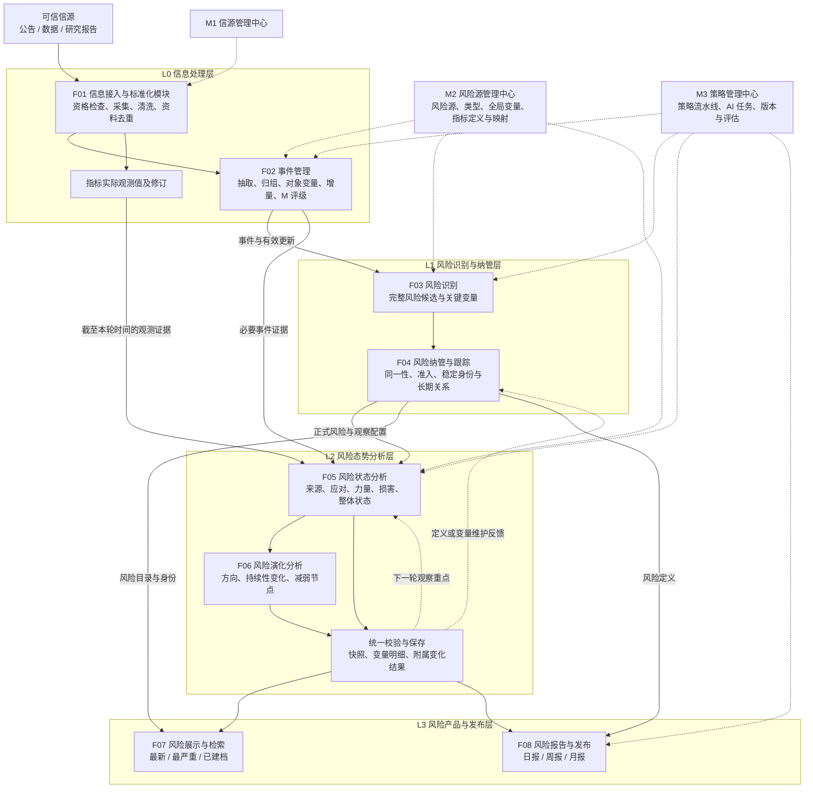
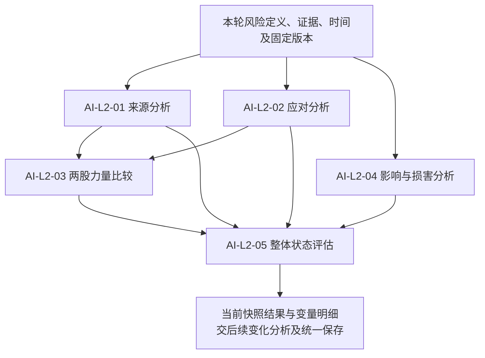
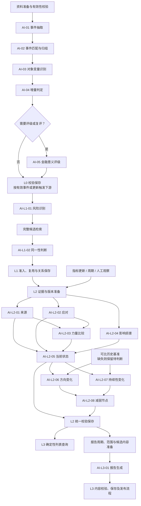

# 业务架构总览

> **系统名称**：RISKHOT（项目文档沿用 RiskHot）  
> **文档版本**：V1.0 · 业务架构汇总稿  
> **整理日期**：2026-10-16  
> **设计范围**：首版宏观经济金融风险；L0—L3、八个核心功能模块、三个支撑中心  
> **分析重点**：业务处理链、AI 任务、领域产物、执行依赖、规则与模型协作  
> **证据范围**：已通过 RiskHot Knowledge 读取项目上下文，并对照本地现行领域与功能设计；本文不代表源码实现或生产验收结论。

## 1. 文档定位与阅读口径

RiskHot 将可信信息转化为可持续观察的风险，再将有证据支撑的风险状态与变化组织为信息产品。业务主线是：

**原始资料与观测数据 → 结构化事件 → 风险识别与正式纳管 → 当前风险状态 → 历史变化与持续观察 → 风险列表与周期报告。**

本文参考 [[tools/RiskHot/aihot/AIHOT 业务处理架构与 AI 任务拆解 V2.0|AIHOT 业务处理架构与 AI 任务拆解 V2.0]] 的组织方式，将各层整理为“输入—处理步骤—AI 任务—程序规则—业务产物—执行依赖”。业务内容以 RiskHot 自身设计为准，保留现有 L0—L3 分层与 16 项逻辑 AI 任务编号。

### 1.1 设计依据与证据等级

| 标记 | 含义 | 使用方式 |
| --- | --- | --- |
| 现行设计 | L0—L3 领域文档、系统功能总览或 M3 功能设计已记载 | 汇总职责、任务、对象及约束；原文中的方案和待定状态仍保留 |
| 架构归纳 | 为跨层阅读整理的依赖图、交接表、运行追溯视图及案例 | 不增加新的正式任务、接口、字段或领域实体 |
| 待定 | 原文尚未确认的阈值、枚举、审批、技术协议或执行方案 | 不在本稿补设默认值，不作为已生效规则 |

本文是业务总览入口。具体字段、规则编号与任务输入输出以四份领域设计为准；模块边界见系统功能总览；技术承载见系统总体架构。引用入口集中在第 12 章。

### 1.2 首版边界

- **研究对象**：宏观经济金融风险。行业、企业和单项资产可以作为背景或影响证据，首版不据此独立纳管微观风险。
- **信息基础**：优先采用官方第一手信息、官方公开数据及权威机构公开研究，保留来源、原文位置和修订历史。
- **核心交付**：最新风险、最严重风险、已建档风险，以及风险日报、周报、月报。
- **人工职责**：沿用系统管理员与授权阅读者两类角色；维护、审核、复核和发布属于授权操作职责。具体审批条件仍按待定项处理。
- **首版排除**：独立的逐条事实可信度 C 评分、处理优先级 P 评分、传播热度排行、市场冲击预测、交易执行及持仓决策。

### 1.3 与 AIHOT 参考结构的对应

| AIHOT 参考文档的组织点 | RiskHot 对应处理 |
| --- | --- |
| L0—L7 八阶段 | 使用 RiskHot 已有 L0—L3 四层，不重新编号业务层 |
| 文章价值评分与精选 | 对应事件金融意义 M、风险识别及纳管，但三者的业务含义不同 |
| 事件归组与增量 | L0 维护 Event 身份、来源关联和有效更新 |
| 热度与事件综述 | 不迁入首版；RiskHot 核心是风险状态、变化及其证据 |
| 日周月报告 | L3 组织已有 L1/L2 结果，独立管理报告与发布 |
| Task / Strategy / Run | 以现行 M3 策略流水线与 AI 任务治理为准；真实运行归运行能力 |

## 2. L0—L3 总体业务处理架构

图中箭头表示业务依赖，不规定服务拆分、同步调用或数据库提交顺序。L2 的“形成当前状态”可以先产生待保存结果，再与变化分析统一校验保存。首次无历史基准不阻止保留当前状态；变化分析技术失败时是否允许当前状态独立发布仍待定。

### 2.1 阶段职责、功能模块与 AI 边界

| 业务层 | 核心问题 | 主责模块 | 正式产物或交付 | AI 任务 |
| --- | --- | --- | --- | --- |
| L0 信息处理 | 发生了什么？与已有事件是什么关系？有什么金融意义？ | F01 信息接入与标准化模块、F02 事件管理 | Information、Event、EventUpdate、EventRating、关联关系及观测值 | AI-01～AI-05 |
| L1 风险识别与纳管 | 存在什么风险？是否已纳管？长期跟踪什么？ | F03 风险识别、F04 风险纳管与跟踪 | MonitoredRisk、风险—事件关系、风险—风险源—变量关系 | AI-L1-01、AI-L1-02 |
| L2 风险态势分析 | 当前状态如何？相比历史改变了什么？ | F05 风险状态分析、F06 风险演化分析 | RiskSnapshot、变量分析明细、RiskAnalysisResult | AI-L2-01～AI-L2-08 |
| L3 风险产品与发布 | 怎样筛选、解释并交付已有风险结论？ | F07 风险展示与检索、F08 风险报告与发布 | 三类派生列表、日周月 RiskReport | AI-L3-01 |

### 2.2 全链路必须保持的语义边界

1. **信息不等于事件**：一份 Information 可以包含多个 Event，同一 Event 可以由多份 Information 支撑。
2. **事件不等于风险**：一个事件可识别出零到多项风险；多个事件也可影响同一项风险。
3. **金融意义不等于风险程度**：L0 的 M 评价服务于信息价值与研究排序，不能直接转成 L2 的 `risk_level`。
4. **跟踪状态不等于风险状态**：`tracking_status` 表达如何管理观察；暂停或关闭不意味着风险程度归零。
5. **当前状态不等于历史变化**：`risk_level`、`risk_stage`、`affected_scope`、`persistence_outlook` 描述当前；`trend`、`persistence_change` 描述比较结果。
6. **业务结论不等于模型响应**：AI 形成候选与解释，正式身份、关联、保存和发布由对应业务模块校验后执行。

## 3. AI 任务总清单

本表沿用现行领域设计的 **5 + 2 + 8 + 1 = 16 项逻辑任务**。任务数量不等于 Prompt 文件数量、Worker 数量或一次流程的模型调用次数。

| 编号 | 逻辑 AI 任务 | 主要输入 | 主要输出 | 依赖与交付边界 |
| --- | --- | --- | --- | --- |
| AI-01 | 事件抽取 | 标准化 Information、来源与原文 | 0..N 个事件候选、主体行为、阶段时间、原文定位 | 不直接创建正式事件身份 |
| AI-02 | 事件匹配与归组 | 事件候选、召回的既有事件及历史 | 新事件／同事件／待判定建议及依据 | 程序确认身份；增量冲突可回到本任务 |
| AI-03 | Target 与 Variable 识别 | 已归组事件、对象库、全局变量定义 | 观测主体、变量及直接关联候选 | 无可靠依据允许留空；不伪造正式 ID |
| AI-04 | 增量判定 | 当前材料、既有事件、来源与更新历史 | 新增、进展、补充、纠正、重复等分类及证据 | 不是每个分类都生成 EventUpdate |
| AI-05 | 金融意义评级 | 事件、评价范围、研究期限及适用方法 | M 维度判断、金融用途标签和解释 | 总分、范围及权重版本由程序校验；参数待校准 |
| AI-L1-01 | 风险识别 | 事件及更新、证据、风险源／类型／变量定义 | 完整风险候选、机制、损害对象、关键变量及不确定性 | 允许无风险；不输出正式 risk_id 或当前等级 |
| AI-L1-02 | 风险同一性判断 | 完整候选、检索出的 MonitoredRisk | 复用已有风险／不同风险／待复核建议 | 未匹配仍须准入校验，不能直接新建 |
| AI-L2-01 | 风险来源分析 | 风险定义、驱动／传导变量、指标及事件证据 | 当前来源压力、传导条件、变量状态和作用 | 与 02、04 在逻辑上可并行 |
| AI-L2-02 | 风险应对分析 | 缓冲变量、治理措施与实际效果证据 | 措施出现、实施、效果及限制 | 已宣布措施不直接算作已实现缓解 |
| AI-L2-03 | 两股力量比较 | 01 来源压力、02 实际应对效果 | 当前相对作用及理由 | 不直接生成历史 trend，也不替代风险等级 |
| AI-L2-04 | 风险影响与损害分析 | 风险机制、潜在损害对象、验证变量及事实 | 实际受影响主体与范围、损害兑现及限制 | 实际影响与已发生损害分别判断 |
| AI-L2-05 | 整体风险状态评估 | 01～04 结果、变量明细、截止时间及评级规则 | 程度、阶段、范围、持续性、status_summary | 正式快照身份及保存由程序管理 |
| AI-L2-06 | 风险方向变化分析 | 当前状态、可比历史快照及两期证据 | trend、比较基准、方向变化理由 | 无有效基准保留待判断 |
| AI-L2-07 | 风险持续性变化分析 | 当前与历史持续性展望、条件及证据 | persistence_change、比较依据与理由 | 区分预期修订和时间自然流逝 |
| AI-L2-08 | 风险减弱节点识别 | 方向与持续性变化、当前状态、历史观察重点 | 节点状态建议、依据、next_observation | 规则不足不自动确认节点，不自动关闭风险 |
| AI-L3-01 | 风险报告生成 | 周期、截止时间、L1 身份、L2 快照及变化结果 | 报告摘要、栏目、条目、引用与待复核事项 | 不重新评级、不推导缺失趋势、不决定发布 |

**编号提示**：L0 `AI-05` 是金融意义评级；旧 D6 曾把风险报告生成也称为 `AI-05`。本稿统一使用 `AI-L3-01` 表达报告任务，避免跨层歧义。旧材料提及的 `AI-06` 校验职责、M2 候选治理中的辅助 AI，均不在此扩列为新增已确认任务。

## 4. 分层详细处理

### 4.1 L0 信息处理层：把资料转成可追溯事件

**输入**：有效信源配置、原始公告与研究资料、指标数据、已有事件及全局定义。  
**处理链**：信源引用与接入校验 → 采集预处理 → 事件抽取与归组 → 对象变量识别 → 增量判定 → 适用时评级／复评 → 校验保存与分发。  
**主要产物**：Information、Event、EventInformation、EventTarget、EventTargetVariable、EventUpdate、EventRating；实际观测值及修订由信息接入能力维护。  
**依据**：[[tools/RiskHot/docs/system-design/02-业务架构与领域设计/RiskHot_L0_信息处理层_业务架构与领域设计V1.0|L0 领域设计]]，实际观测值的主责按现行系统功能总览补充。

| 步骤 | AI 分工 | 程序与规则分工 | 关键分支 |
| --- | --- | --- | --- |
| 信源与资料准备 | 无已确认的常规 AI 任务 | 读取 M1 有效版本，检查业务可用性和技术条件，采集、清洗、规范时间与链接、去重及留存修订 | 不可用信源停止；不可解析材料补采／复核；同版本重复不重复加工 |
| 事件抽取与归组 | AI-01 抽取；AI-02 比较身份 | 召回候选，验证字段、原文引用及 ID，按结果创建或复用事件 | 无宏观事件保留资料；多事件拆分处理；身份不清保留待归组 |
| 对象与变量关联 | AI-03 识别直接依据 | 校验宏观 Target 范围、正式变量及三元关联 | 对象可空；变量可缺；新变量作为候选交治理 |
| 增量处理 | AI-04 比较事实、阶段、数值、条件及出处 | 检查重复更新、时间序列和状态变化，保留历史 | 新来源不等于新进展；纠正保留旧依据；身份冲突返回 AI-02 |
| 金融意义评级 | AI-05 按范围与期限分析 | 检查分值、方法和版本，保存适用评级 | 首次或依据变化时评级／复评；权重、门槛及多 Target 粒度待定 |
| 保存与分发 | 无新增 AI 任务 | 幂等保存正式产物与关系，交付可引用的事件及有效更新 | 单个事件待复核不阻断同份材料中的其他事件 |

L0 识别的是“该事件在某个观测主体上直接涉及什么变量”。不为 Target 绑定固定变量全集，也不据此提前形成风险方向、传导结论或交易判断。

### 4.2 L1 风险识别与纳管层：形成稳定风险身份

**输入**：L0 Event／EventUpdate、原文证据、对象与变量线索、风险源及风险类型定义、已有风险目录。  
**处理链**：触发与去重 → 完整风险识别 → 既有风险检索 → 同一性判断 → 复用／准入／复核 → 长期变量与事件关联 → 交付 L2。  
**主要产物**：RiskIdentificationResult、MonitoredRisk、`risk_source_variable_relation`、`monitored_risk_event_relation`。  
**依据**：[[tools/RiskHot/docs/system-design/02-业务架构与领域设计/RiskHot_L1_风险识别与纳管层_业务架构与领域设计|L1 领域设计]]。

AI-L1-01 一次性形成完整候选：风险问题、观察对象、范围、潜在损害及其对象、风险来源、类型、形成与传导机制、关键变量和证据限制。先完成定义，再检索已有风险，避免凭名称相似直接合并。

AI-L1-02 以风险问题、观察对象和范围等核心语义判断同一性。程序据此处理四条路径：

| 结果 | 后续业务动作 |
| --- | --- |
| 无可识别风险 | 保存处理结果；不为每个事件强造风险 |
| 已有风险 | 复用 risk_id，建立或维护事件关系，按需维护长期观察配置 |
| 新风险候选 | 校验完整性、范围、必要变量与准入条件后纳管 |
| 身份或必要定义不明确 | 保留候选、依据和待复核问题，不抢先创建正式身份 |

关键变量按具体风险机制动态选择，可承担 `risk_driver`、`risk_transmission`、`risk_buffer`、`damage_verification` 四种角色。未匹配到正式变量时保留候选名称；必要变量缺失可使该风险暂缓纳管，补充线索缺失则按准入条件保留限制继续处理。

**正式纳管约束**：新风险身份、初始关键变量关系与初始事件关联应一致完成，才能向 L2 交付可用观察对象。自动准入条件、人工审批和事务协议仍待详细设计。

### 4.3 L2 风险态势分析层：先判断当前，再解释变化

**输入**：正式风险、长期变量关系、有效指标定义与映射、实际观测数据、事件事实、可比历史快照及规则版本。  
**触发**：新风险纳管、有效事件更新、指标更新、周期观察或人工请求；具体调度与阈值待定。  
**处理链**：固定观察范围与证据截止时间 → 准备证据 → 当前状态分析 → 历史变化分析 → 校验保存 → 下轮观察或维护反馈。  
**依据**：[[tools/RiskHot/docs/system-design/02-业务架构与领域设计/RiskHot_L2_风险态势分析层_业务架构与领域设计V1.0|L2 领域设计]]。

#### 4.3.1 当前风险状态：AI-L2-01～AI-L2-05

01、02、04 共用“证据 → 变量当前状态 → 按风险机制解释当前作用”的分析方式；可复用兼容的变量状态，但同一变量在不同风险中的作用须分别解释，不能把重复证据累计为多份压力。

| 当前状态内容 | 对应字段 | 解释边界 |
| --- | --- | --- |
| 程度 | `risk_level` | 按适用评级规则判断；规则或证据不足时保留待判断 |
| 阶段 | `risk_stage` | 表达积累、传导、兑现或修复等阶段；正式判据待定 |
| 范围 | `affected_scope` | 当前有证据支持的实际受影响主体、范围和环节 |
| 持续性 | `persistence_outlook` | 可能持续到何时、什么条件支撑持续、什么条件可能改变 |
| 综合说明 | `status_summary` | 来源、应对、力量比较、损害兑现及不确定性 |

损害兑现并入综合说明，不另增 `realization_degree`；不单列可信度维度，但持续保留证据、反证、缺口和限制。变量分析由 `risk_snapshot_variable_analysis` 承载，引用长期 `relation_id` 并保留本轮状态与作用。

#### 4.3.2 历史变化：AI-L2-06～AI-L2-08

| 分析 | 要回答的问题 | 结果归属与约束 |
| --- | --- | --- |
| 方向变化 | 相比可比历史状态，风险加剧、维持、减弱还是无法判断？ | `trend`；不能仅凭等级跨档或当前力量对比推导 |
| 持续性变化 | 对持续时间、窗口或条件的判断是否实质修订？ | `persistence_change`；剩余天数减少不自动表示持续性缩短 |
| 减弱节点 | 有利变化是否具备节点证据，还需要验证什么？ | `weakening_node_status`、`next_observation`；规则不足不自动 confirmed |

三项结果共同形成快照附属的 RiskAnalysisResult，保留比较基准与各部分 `change_reason`。首次观察无历史基准时，当前状态可以成立，历史变化保留待判断，不能默认 stable。

L2 不直接修改正式风险身份、长期观察范围或跟踪状态。发现定义、机制、变量或指标配置问题时，分别反馈 L1／M2；当前运行继续使用已锁定版本，后续修订不得无痕改写历史快照。

### 4.4 L3 风险产品与发布层：组织已有结论

**输入**：L1 风险身份、分类和跟踪状态；L2 有效快照、变化结果、证据及时间信息。  
**输出**：三类动态列表和三类独立周期报告。  
**依据**：[[tools/RiskHot/docs/system-design/02-业务架构与领域设计/RiskHot_L3_风险产品与发布层_业务架构与领域设计 V1.0|L3 领域设计]]。

#### 4.4.1 三类列表：确定性查询

| 产品 | 核心规则 | 不能混淆的情况 |
| --- | --- | --- |
| 最新风险 | 每风险取最新有效快照，按 `snapshot_time` 倒序 | 纳管时间、生成时间不代替评估截止时间；无快照不参与 |
| 最严重风险 | 等级口径可比时按严重度降序，同等级参考快照时间 | 无等级／不可比不强排；最终状态过滤和稳定排序细则待定 |
| 已建档风险 | 展示 L1 全部建档对象，支持分类及跟踪状态筛选 | 包括暂停、结束和无快照对象，显示其真实状态 |

列表及 RiskPublicationItem 是只读派生结果，无需 AI 排序，不额外创建独立 RiskRanking 聚合。页面显示评估截止时间、待评估及陈旧提示；陈旧阈值仍待定。

#### 4.4.2 日报、周报、月报：独立报告生命周期

**处理链**：明确周期与时区、数据截止时间 → 获取有效上游结果 → 按已明确规则组织候选条目 → AI-L3-01 生成栏目和摘要 → 程序校验与必要语义复核 → 保存报告版本 → 按授权流程发布／撤回。

报告条目保留 `riskId`、`snapshotId` 和适用的 `comparisonSnapshotId`。AI 可以摘要、分组和表述已有结论，不得重新定级、补造趋势，或把条件性判断写成确定事实。

RiskHot 当前报告纳入规则、固定栏目及空报告处理尚未完整确定，因此不能直接照搬 AIHOT“全部条目预先锁定后写作”的实现假设。可确认的原则是：**输入边界明确，引用可追溯，最终内容受业务规则校验，生成成功不等于发布成功。**

`RiskReport` 拥有独立身份、周期、版本和发布／撤回语义。强制人工审核范围、状态枚举、版本冻结、撤回后可见性及上游修订后的重新生成策略仍待定。

## 5. 核心业务对象与跨层交接

### 5.1 从资料到产品的对象链

| 业务对象或关系 | 主责 | 生命周期与作用 |
| --- | --- | --- |
| Information 与原始版本 | L0／F01 | 保存收到的材料、出处及修订 |
| 实际观测值与修订 | L0／F01 | 提供按时间、口径可追溯的数据，不承担指标定义治理 |
| Event 及来源、Target、Variable 关联 | L0／F02 | 表达事件身份和直接事实，支持多资料、多对象及变量关联 |
| EventUpdate、EventRating | L0／F02 | 记录有效变化和适用金融意义评价 |
| RiskIdentificationResult | L1／F03 | 风险识别过程候选，不代表已纳管 |
| MonitoredRisk | L1／F04 | 跨事件、跨周期复用的稳定风险身份 |
| 风险—事件、风险—风险源—变量关系 | L1／F04 | 分别记录触发证据和长期观察机制 |
| RiskSnapshot 与变量明细 | L2／F05 | 固定本轮证据截止时间下的当前状态 |
| RiskAnalysisResult | L2／F06 | 依附当前快照的历史变化分析；不新建独立 RiskEvolution 聚合 |
| RiskList、RiskPublicationItem、Timeline | L3 查询消费 | 派生展示，Timeline 由快照与变化结果组织 |
| RiskReport、ReportSection、ReportRiskItem | L3／F08 | 持久管理周期内容、引用、版本及发布语义 |

### 5.2 三组需要分开的身份

| 容易混用的概念 | 正确区分 |
| --- | --- |
| InformationSource 与 risk_source_config | 前者是资料来源，由 M1 管理；后者是风险形成来源的分类，由 M2 管理 |
| Event Target、风险 observation_target、damage_targets | 分别是事件的观测主体、风险判断针对的对象、潜在损害对象；范围与身份一致时才建立映射 |
| 变量定义、变量当前状态、变量对某风险的作用 | 分别由 M2 定义、L2 依据观测判断、L2 结合 L1 长期机制解释；不能用变量名称或角色代替当期结论 |

### 5.3 跨层交接的最小业务要求

| 交接 | 交付内容 | 接收方必须验证 |
| --- | --- | --- |
| L0 → L1 | 事件、有效更新、对象变量线索、原文定位 | 身份与引用有效、时间语义保留、重复输入可识别 |
| L1 → L2 | 正式风险、范围、机制、长期变量、事件关系 | 已完成纳管、必要关系完整、配置可用；候选不冒充正式身份 |
| L0／M2 → L2 | 观测值与事件证据／指标定义及映射 | 口径、单位、时间、版本与本轮观察一致，缺失数据明确标注 |
| L2 → L3 | 快照、附属变化、证据及截止时间 | 结果有效，当前与历史引用对应，待判断和不可比状态不被隐藏 |
| L2 → L1／M2 | 定义、机制或观测配置问题及证据 | 作为维护反馈进入主责流程，不直接改写长期定义 |

这些是业务交接要求，不等于定稿的 API、消息主题或 JSON Schema。

## 6. AI 执行依赖与工作流特征

### 6.1 全链路逻辑依赖

此图展开正常路径，不表示每个节点必跑。重复资料、无事件、无风险、身份不明和校验失败均按分支结束或等待处理；增量发现身份冲突时可回到归组；已纳管风险的指标或周期观察可直接进入 L2。L0 到 L1 的具体触发条件仍待定，不能据图认定所有更新都会重跑识别。

### 6.2 执行模式

| 模式 | 典型场景 | 应保留的追溯信息 |
| --- | --- | --- |
| 串行依赖 | 完整风险识别 → 检索 → 同一性 → 纳管 | 候选、召回集合、依据及准入结果 |
| 逻辑并行 | L2 来源／应对／影响损害；方向／持续性变化 | 共用上下文版本、独立结果与汇总关系 |
| 条件执行 | 金融意义复评、身份复核、历史比较 | 条件命中原因与跳过原因 |
| 结果复用 | 同一证据或兼容变量状态用于多项分析 | 原产物版本、适用范围与去重依据 |
| 反馈修订 | L2 发现机制缺口，反馈 L1／M2 | 本轮受限结果、维护建议、后续生效版本 |
| 运行恢复 | 超时、模型失败、写入失败后恢复 | 执行回执、失败步骤、已完成业务写入与恢复关联 |

并行粒度、合并调用、重试次数、缓存和成本限制属于执行设计，本文不设具体值。重新分析必须区分“同一输入恢复执行”和“采用新证据／新策略产生新结果”。

## 7. 支撑中心、策略与运行治理

### 7.1 三个支撑中心

| 支撑中心 | 管理内容 | 与主业务链的协作 |
| --- | --- | --- |
| M1 信源管理中心 | 信源身份、分类、可用性、范围及版本 | L0 引用有效信源；M2 引用允许的数据来源；技术连接检测由运行能力承担 |
| M2 风险源管理中心 | 风险源、风险类型、全局变量、候选治理、指标定义与映射 | L0/L1/L2 复用定义并反馈新候选；实际指标值留在信息接入能力 |
| M3 策略管理中心 | 策略流水线、AI 任务、Prompt／Skill、规则引用、版本与评估 | 引用 L0—L3 领域规则，指导处理过程；正式业务事实仍归各业务模块 |

全局变量治理形成持续反馈链：**业务发现因素 → 检索和语义匹配 → 复用正式变量或保留候选 → M2 治理 → 发布有效定义 → L1 按需维护长期关系 → L2 按新运行版本观察。**

变量获准入库不自动创建风险，也不自动建立长期观察关系。已有变量的指标定义与映射保持稳定版本，AI 提议不能在单次分析中直接替换正式配置。

### 7.2 Pipeline、Strategy、AI Task、Run 的对应

| 概念 | 在 RiskHot 中的含义 | 归属 |
| --- | --- | --- |
| 业务处理链 | L0—L3 的职责顺序、领域状态及产物依赖 | 领域设计 |
| Strategy／策略版本 | 面向具体场景，由程序、AI、人工、条件节点组成的处理蓝图 | M3-C01 策略设计与管理 |
| Pipeline／策略流水线 | 策略编排的图形与逻辑表达，不在本稿新增独立领域聚合 | M3-C01 |
| AI Task／任务版本 | 节点引用的智能分析能力：问题、输入、步骤、Prompt／Skill、输出与约束 | M3-C02 AI 智能分析管理 |
| Run／真实运行 | 使用固定版本处理一份输入的执行及回执；可包含多步模型或工具调用 | 运行与技术能力；具体对象协议待定 |
| Evaluation／策略评估 | 在固定评测集上比较结果、错误、证据质量及运行表现 | M3-C03 策略评估 |

架构关系可概括为：

**业务场景 → 生效策略版本 → 流水线节点 → 固定 AI Task／Prompt／Skill／Schema 版本 → 真实运行 → 业务模块校验与保存。**

这里的 Strategy 比“给单个任务选择模型和提示词”范围更大。现行 M3 已将它定义为业务协作流水线；模型能力要求可以在任务内声明，实际 API、模型路由、并发、限流、凭据及重试由技术／运行能力承担。

### 7.3 初始策略与任务映射

下列编码沿用 M3 的**建议目录**，不声明为已部署的策略注册标识。

| 建议策略 | 覆盖任务 | 业务结果主责 |
| --- | --- | --- |
| STR-L0-01 事件处理策略 | AI-01～AI-04 | F02 |
| STR-L0-02 金融意义评级策略 | AI-05 | F02 |
| STR-L1-01 风险识别与纳管策略 | AI-L1-01、AI-L1-02 | F03／F04 按候选与正式身份分工 |
| STR-L2-01 风险状态分析策略 | AI-L2-01～AI-L2-05 | F05 |
| STR-L2-02 风险演化分析策略 | AI-L2-06～AI-L2-08 | F06，与 F05 协调结果保存 |
| STR-L3-01 风险报告生成策略 | AI-L3-01 | F08 |

M3 统一表达 `PROGRAM`、`AI`、`HUMAN`、`CONDITION`、`START / END` 节点。在途任务保持受理时锁定的版本；评估结果不自动切换生效策略。人工节点的具体介入条件必须引用已确认业务规则，不能仅凭示例图推断所有报告强制人工审批。

## 8. AI 任务、分析资产与实现映射

RiskHot 当前可确认的是任务业务契约和功能归属。本文未逐项审计真实调用入口，因此不为这些任务补造 Prompt 文件名、函数名、HTTP 路径或模型供应商。

| 任务组 | 权威业务契约 | 功能模块 | 需要在详细设计／实现中核验的资产 |
| --- | --- | --- | --- |
| AI-01～AI-05 | L0 §6.1，逐项输入、分析步骤与输出 | F02 | 抽取／归组／对象变量／增量／M 评级的任务版本、Prompt 和正式 Schema |
| AI-L1-01～02 | L1 §6.1 | F03／F04 | 完整风险候选结构、检索上下文、身份比较及准入衔接 |
| AI-L2-01～05 | L2 §6.1.1—6.1.5 | F05 | 共用变量分析、来源／应对／损害及整体评估契约 |
| AI-L2-06～08 | L2 §6.1.6—6.1.8 | F06 | 历史基准、可比性、变化解释、节点判断及结果合并 |
| AI-L3-01 | L3 §6.1.1 | F08 | 周期上下文、栏目条目结构、引用校验及发布衔接 |
| 共用治理 | M3 §3.2、§3.3 | M3-C02／C03 | Prompt／Skill／Schema 固定版本、任务使用关系、评测集及版本对比 |

每次执行应能回溯输入对象及版本、证据截止时间、策略与任务版本、Prompt／Skill／Schema 版本、实际模型、工具步骤、输出及校验结果。耗时、Token、费用和失败恢复可作为运行观测项；字段命名、计费来源和存储协议须由技术设计确定。

## 9. 规则、AI 与人工的协作边界

**标准闭环**：准备可信上下文 → AI 分析与候选 → 程序验证结构、引用及可确定规则 → 按条件补齐／复核 → 主责模块正式写入 → 下游读取有效结果。

| 情况 | 处理原则 | 不应产生的误结论 |
| --- | --- | --- |
| 原文缺失或不可追溯 | 补采或复核，保留缺口 | 不生成无依据事件 |
| 事件／风险同一性不清 | 保留待判定与比较依据 | 不因名称近似强行合并 |
| 新变量未治理 | 保存候选；按是否必要决定暂缓或受限继续 | 不伪造 variable_id，不自动替换正式定义 |
| 观测数据缺失 | 标记证据缺口，允许受限或待判断结果 | 缺失不等于零、低风险或稳定 |
| 应对措施仅宣布 | 表达预期条件，继续观察落实与效果 | 公告不等于风险已缓解 |
| 首次无历史快照 | 保留当前状态，历史变化待判断 | 无历史不等于 stable |
| 两期口径不兼容 | 说明差异，分段比较或保留不可比 | 不把数据修订当真实风险变化 |
| 节点规则未确认 | 输出依据与后续观察，保留候选／待判断 | 不自行 confirmed，不自动关闭风险 |
| 报告与快照语义不一致 | 返回生成或复核，阻止越过发布校验 | 结构合法不等于论证正确 |
| 模型超时或异常 | 由运行能力恢复或按策略转人工 | 执行失败不等于“无风险”或“可以发布” |

程序可以校验 ID、引用、时间、单位、结构和明确阈值；“摘要是否忠实”“机制是否有证据”等语义问题仍需相应分析和复核，不能宣称格式校验足以保证结论正确。

## 10. 端到端业务示例

以下为**假设情境，仅用于验证业务职责**，不描述真实市场事件，也不构成评级参数或投资建议。

| 步骤 | 假设输入与处理 | 形成的结果 |
| --- | --- | --- |
| 1. 接入 | 启用的官方信源发布融资条件变化公告；随后发布修订版 | 两个可追溯资料版本及原文位置 |
| 2. 事件化 | AI 抽取变化内容、宣布时间和预计实施阶段；比较既有事件 | 新 Event 或已有 Event 的有效更新；仅新增出处不算实质进展 |
| 3. 直接关联与 M | 识别有依据的宏观观测主体和变量，按适用范围评价金融意义 | 事件关联与 EventRating；尚无风险严重度结论 |
| 4. 风险识别 | 从机制分析“某经济体融资收紧对偿付能力的潜在压力”，说明观察边界、损害对象与关键变量 | 完整候选；变量优先复用正式身份，缺失则提候选 |
| 5. 身份与纳管 | 检索已有同范围风险，比较问题、对象、范围和潜在损害 | 复用 risk_id，或在准入合格后新建并保存长期关系 |
| 6. 首次观察 | 固定截止时间，读取融资成本、再融资条件及缓冲措施等可用证据 | 当前快照；历史方向与持续性变化待判断 |
| 7. 后续观察 | 新数据及措施落实情况进入；按同一或可解释口径与历史比较 | 新快照、变化结果及下一轮验证重点；措施公告不自动确认为缓解 |
| 8. 产品交付 | 列表按有效快照和可比等级查询；报告组织选定周期内已有结论 | 带截止时间和证据引用的列表／报告；保存与发布分别管理 |

如果第 6 步所需指标缺失，该风险可以保留待判断或受限结论；其他具备证据的风险继续处理。数据补齐或口径修订后的重新观察形成可追溯的新结果，不覆盖当时的历史判断。

## 11. 待定事项与后续落地顺序

### 11.1 需要保留的未决设计

| 范围 | 待定内容 | 影响 |
| --- | --- | --- |
| L0 | M 维度、权重、锚点、门槛、多 Target 粒度；事件合并拆分与引用迁移 | 评级一致性、事件身份和历史复用 |
| L1 | 准入条件、自动与人工边界、暂停关闭恢复条件、候选持久化 | 正式风险质量与生命周期 |
| M2／跨层 | 候选治理细则、变量版本兼容、指标映射及变更协议、辅助 AI 编号 | 定义复用、观察稳定性和运行一致性 |
| L2 | 风险分级、阶段判据、历史主基准、显著性与减弱节点规则 | 状态和演化判断的可比性 |
| L2 保存交付 | 变化分析技术失败时当前状态能否单独发布，修订与有效结果选择 | 部分结果可用性与下游一致性 |
| L3 | 榜单状态过滤、跨规则等级映射、陈旧阈值、报告周期及纳入规则 | 产品排序和时间解释 |
| L3 发布 | 审校权限、状态机、内容冻结、撤回及重发、上游修订影响 | 发布可追溯性 |
| M3／运行 | 正式任务编码、Schema、Prompt、模型配置、调用合并、并发重试、Run 协议及预算 | 执行复现、成本与异常恢复 |
| 技术映射 | 最新 F01 实际观测值主责与历史技术模块的承载对齐 | 避免功能归属与代码写入权混用 |

### 11.2 建议实施与核验顺序

1. **固定业务契约**：核对四层对象、16 项任务、三中心主责和跨层交接；明确待定规则的处理结果。
2. **形成最小业务闭环**：选定宏观案例，从原始资料到事件、正式风险、首次快照和可查询产品贯通证据引用。
3. **补齐连续观察**：验证事件纠正、指标更新、可比历史、持续性修订、减弱节点及维护反馈。
4. **落地版本治理**：对齐策略、任务、Prompt／Skill、Schema、定义与运行回执，检查在途版本锁定和恢复幂等。
5. **完成产品规则与发布**：确认榜单可比性、报告周期、纳入条件、审核、撤回和历史版本引用。
6. **开展专项评测**：分别验证抽取完整性、事件／风险身份匹配、引用有效性、状态与变化口径、报告忠实度；具体指标和通过线另行确认。

建议验收至少覆盖：重复资料不重复建事件、同一风险跨事件复用、必要变量缺失不伪造身份、首次观察不虚构趋势、公告与效果分离、不可比等级不强排、报告不重评、策略升级不改写历史。

## 12. 参考依据与文档导航

1. [[tools/RiskHot/aihot/AIHOT 业务处理架构与 AI 任务拆解 V2.0|AIHOT 业务处理架构与 AI 任务拆解 V2.0]]：本文结构参考；不作为 RiskHot 业务规则来源。
2. [[tools/RiskHot/docs/system-design/02-业务架构与领域设计/RiskHot_L0_信息处理层_业务架构与领域设计V1.0|L0 信息处理层：业务架构与领域设计]]：事件、增量、金融意义与 AI-01～AI-05。
3. [[tools/RiskHot/docs/system-design/02-业务架构与领域设计/RiskHot_L1_风险识别与纳管层_业务架构与领域设计|L1 风险识别与纳管层：业务架构与领域设计]]：完整风险候选、同一性、纳管及全局变量使用。
4. [[tools/RiskHot/docs/system-design/02-业务架构与领域设计/RiskHot_L2_风险态势分析层_业务架构与领域设计V1.0|L2 风险态势分析层：业务架构与领域设计]]：四维当前状态、变化分析及八项 AI 职责。
5. [[tools/RiskHot/docs/system-design/02-业务架构与领域设计/RiskHot_L3_风险产品与发布层_业务架构与领域设计 V1.0|L3 风险产品与发布层：业务架构与领域设计]]：六类产品、列表规则、报告与发布边界。
6. [[tools/RiskHot/docs/system-design/03-系统功能架构/系统功能架构总览|系统功能架构总览]]：F01—F08、M1—M3、唯一业务主责及实际观测值归属。
7. [[tools/RiskHot/docs/system-design/03-系统功能架构/M3策略管理中心功能设计|M3 策略管理中心功能设计]]：策略流水线、AI 任务管理、固定版本、评估与技术运行边界。
8. [[tools/RiskHot/aihot/归档/旧版系统架构设计/00. 系统总体架构|系统总体架构]]：后续技术承载与实现映射的阅读入口；本稿不据此宣称实现完成。

---

*维护说明：本稿汇总现行设计，不替代各层领域规则。更新时应同步检查任务编号、跨层依赖、对象主责和待定事项，避免将原型表现、建议策略编码或模型输出误写为已实施的业务事实。*
