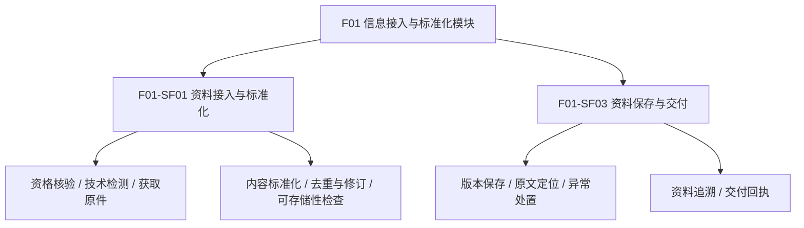
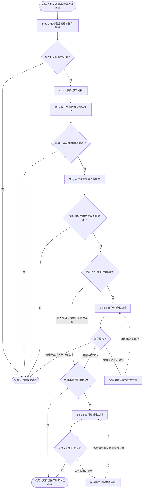

# F01 信息接入与标准化模块功能设计

> **模块目标**：接入原始信息，输出标准化、可存储、可追溯的资料（Information）。
> **版本说明**：V2.1 按信息接入职责组织全部功能、规则和验收。文件名与内容版本统一为 V2.1。
> **依据标记**：**[U]** 用户明确要求；**[B]** 沿用的领域/模块约束；**[P]** 本稿设计建议；**[D]** 实现细节待定。旧文档与本页 F01 职责冲突时，按本次 [U] 边界调整，相关同步项见第9章。
> **设计状态**：本页定义业务行为和逻辑资料契约，不表示接口、数据库或原型已经实现。

## 1. 模块定位与职责边界

### 1.1 模块定位

F01 负责把来自合格信源的网页、公告、报告、文件和结构化原始资料，整理成下游可以保存、读取和追溯的统一资料对象。接入是否成功，取决于资料是否取得、来源是否明确、内容是否可读取、结构是否满足保存要求。[U/B]

F01 处理资料载体与资料结构，完整保留正文、数字、表格、注释和附件，使标准化资料能够还原取得时的原始内容。[U]

### 1.2 输入与唯一业务输出

| 项目 | 内容 | 边界 |
|---|---|---|
| 输入 | M1 有效信源及配置版本、接入范围、链接/文件/原始响应、任务或提交者身份 | 自动采集与授权人工提交都须满足资格和权限要求 |
| 核心处理 | 获取原件、读取正文、整理结构、规范元数据、识别重复与修订、检查可存储性 | 清理网页噪声，不改写业务事实 |
| 唯一业务输出 | 标准化资料 Information，连同原件、来源、时间、版本及内容定位信息 | 所有输入形态遵循统一资料契约 |
| 执行附属结果 | 接入数量、阻断/失败原因、保存和交付回执 | 用于恢复与追踪，不作为第二类业务数据产品 |

“可存储”表示资料结构与必需信息已经满足保存契约；“已保存”表示存储能力已确认持久化。二者须分别记录。F01 定义资料保存要求并协调交付，物理文件、数据库和消息机制由公共技术能力承载。[P]

### 1.3 资料接入与交付职责

| 业务事项 | F01 职责 | 边界 |
|---|---|---|
| 信源资格 | 读取 M1 启停、范围及有效配置版本，核对当次接入资格 | 不创建或修改 M1 正式信源状态 |
| 资料获取 | 获取原始响应、正文及约定附件，接受授权补录 | 执行调度、凭据和通用重试由 S01/公共技术能力提供 |
| 资料标准化 | 统一资料结构、编码、元数据和内容定位 | 不用摘要替代原文，不凭空补齐来源或时间 |
| 去重与版本 | 识别资料重复、来源修订及处理版本，保留可追溯关系 | 独立保留不同来源的资料及其版本 |
| 保存与交付 | 输出可存储资料，记录保存回执，交付已保存的资料版本引用 | 不在未保存时通知下游读取成功 |

### 1.4 适用形态与使用者

支持形态包括网页、公告、文本、PDF 等文档，以及可解析的 JSON/CSV 等结构化原始资料；具体格式以适配能力为准。[P] 结构化资料与文章遵循同一输出契约，差别只在内容表示和解析方式。

系统执行者负责自动接入；授权人员负责人工提交与异常处置；研究人员及下游模块按权限读取资料。常规合格资料自动处理，不要求逐篇人工审批。[B/P]

## 2. 功能架构与详细清单

### 2.1 功能结构

### 2.2 末级功能清单

P0 为首版闭环必需，P1 为增强查询能力；优先级与详细拆分为设计建议。[P]

| 功能编号 | 二级功能 | 末级功能 | 优先级 | 完成标准 |
|---|---|---|---|---|
| F01-SF01.01 | 资料接入与标准化 | 信源资格与有效版本核验 | P0 | 启动、重试及正式保存前确认资格，阻断原因可查 |
| F01-SF01.02 | 资料接入与标准化 | 技术就绪检测 | P0 | 检查当前接入方式是否具备取得与解析资料的能力 |
| F01-SF01.03 | 资料接入与标准化 | 自动采集与授权补录 | P0 | 取得原始响应或文件，绑定来源和任务/提交者 |
| F01-SF01.04 | 资料接入与标准化 | 正文读取与资料标准化 | P0 | 生成统一资料结构，保留原始内容与来源字段 |
| F01-SF01.05 | 资料接入与标准化 | 资料重复与修订判别 | P0 | 区分重复、来源修订、处理版本和独立来源 |
| F01-SF01.06 | 资料接入与标准化 | 标准化资料可存储性检查 | P0 | 随Step 3完成内容、必需元数据和原件完整性检查，结果供保存使用 |
| F01-SF03.01 | 资料保存与交付 | 原件与标准化资料版本保存 | P0 | 保存回执明确，旧版本不可无痕覆盖 |
| F01-SF03.02 | 资料保存与交付 | 原始发布主体与内容定位 | P0 | 可返回当时原件及相应页码、段落或表格位置 |
| F01-SF03.03 | 资料保存与交付 | 接入异常与处置记录 | P0 | 区分业务阻断、技术失败、内容不完整及交付失败 |
| F01-SF03.04 | 资料保存与交付 | 资料、版本与任务追溯 | P1 | 按来源、任务、时间和版本查询已有资料链路 |
| F01-SF03.05 | 资料保存与交付 | 标准化资料交付与回执 | P0 | 仅交付已保存版本，失败可幂等补发 |

### 2.3 编号与功能范围

本版共 **2 组、11 项末级功能**：`F01-SF01.01～.06` 覆盖资料接入与标准化，`F01-SF03.01～.05` 覆盖资料保存与交付。编号保持稳定，功能范围以2.2清单为准。

## 3. 业务对象与信息组织

### 3.1 业务对象

| 对象 | 身份与关系 | 责任 |
|---|---|---|
| 信源配置 | `source_id` 与适用配置版本 | M1 维护，F01 只读核验并记录使用版本 |
| 原始资料 | 原始响应/文件及其来源引用 | 保留接入时取得的原貌，作为标准化依据 |
| 标准化资料 Information | `information_id` 与资料版本 | F01 产出，承载统一资料内容与元信息 |
| 内容定位 | 原件引用及页码/段落/表格/原始字段位置 | 关联具体版本，不把新版位置套到旧版 |
| 接入记录 | 任务/提交记录与逐条处理结果 | 记录原因、阶段及保存/交付回执，不重复维护 S01 运行状态 |

### 3.2 标准化资料契约

下表沿用 L0 的 Information 基础字段；附加项以业务含义描述，不预设数据库列、接口名称或字段枚举。[B/P]

| 字段或逻辑信息 | 要求 | 标准化规则 |
|---|---|---|
| `information_id` | 必需 | 系统分配稳定身份；同一来源同一资料修订沿用身份 |
| `source_id` | 必需 | 引用可核验的 M1 信源 |
| 适用信源配置版本 | 必需 | 记录实际使用版本；保存前再核对资格与变更影响 |
| `external_id` | 来源提供时保留 | 原始平台资料标识，不虚构 |
| `canonical_url` | 有原始链接时保留 | 规范化链接，同时保留原链接；文件可用可追溯来源凭据替代 |
| `title` | 来源有标题时保留 | 无标题明确缺失；系统展示名称不得伪装为原始标题 |
| `content` | 必需 | 可读取正文或可解析的结构化原始内容；保留数字、表格、层次及必要注释 |
| `published_at` | 允许未知 | 记录真实发布时间及已知精度；未知留空，不用取得时间代替 |
| `collected_at` | 必需 | 系统实际取得时间；历史补录不得倒填 |
| `content_hash` | 必需 | 内容指纹，用于辅助重复识别；算法与规范化规则版本待技术定版 |
| `raw_metadata` | 按来源保留 | 原始字段、原链接、时间原文及解析说明，不混入业务分析结论 |
| 原件与附件引用 | 必需原件引用；附件按采集范围 | 原始载体可检索；明确已取得、未取得及必需附件状态 |
| 资料版本与前版关系 | 必需版本身份 | 区分首次、来源修订和重新解析，避免覆盖旧版 |
| 格式与处理来源 | 必需 | 原始媒体类型、标准化格式、解析器/规则版本及处理时间 |
| 标准化检查结果 | 必需 | 内容可读性、必需项、正文与表格读取完整性、限制与未解决问题 |
| 任务或提交者引用 | 必需 | 可追溯本次获取行为，敏感凭据不进入资料正文或普通日志 |

“可存储”的最低条件：信源资格有效、来源链可核验、正文或结构化内容有效、原件已取得且引用可解析、取得时间真实、版本与内容指纹可生成、必需附件齐备。原件暂存位置应在保存完成前持续可访问；保存时建立持久引用。[P]

已取得文件但无法读取其中正文或结构化内容的，保留原件并标为“待处理”，不冒充已标准化资料。缺少非必需字段可带明确缺失说明通过；不得要求所有来源均具备标题、URL 和发布时间。[P]

### 3.3 内容保真与版本

1. **原始版本**保留取得时的正文、响应、文件及附件，不随清洗结果改变。
2. **标准化版本**记录对应原件和处理规则；仅规范编码、结构、时间表示及明确可剔除的导航/广告等噪声。
3. **来源修订**追加版本；**解析器改进**也保留新的处理版本与理由，两者分别标记。
4. **独立来源**分别保存；正文相似的资料也保留各自的来源身份、原件及版本。
5. 数字、单位、正负号、表格表头、脚注及缺失符号保持原始含义；不换算单位、不平均冲突数据、不把空白补为零。

原件与标准化内容的版本模型、复合唯一键和存储位置属于技术定版项，不能直接把上述逻辑名称当作已存在接口。[D]

## 4. 功能详细设计

### 4.1 总体流程

总体流程共六步：**核对接入条件 → 获取资料 → 正文读取与标准化 → 识别重复与版本 → 保存标准化资料 → 交付标准化资料**。完整性检查是标准化的完成条件，版本与原件关联随资料保存，回执记录是交付的完成条件，均不再单列步骤。[U/P]

实线表示本次处理路径，虚线表示失败后的恢复路径，由运行能力按权限和恢复策略执行。获取、读取、身份判断或资料关联失败时保留已有原件及原因，进入待处理；保存失败从 Step 5 恢复，交付或回执失败从 Step 6 恢复。[P]

重复资料只复用**完整保存**的版本：已确认交付则直接完成，否则进入 Step 6。临时原件或部分保存记录不能视为已完成；并发命中同版时读取已有保存与交付状态后续接。[P]

| 步骤 | 主要产出 | 对应功能 |
|---|---|---|
| Step 1 核对信源资格与接入条件 | 资格与技术就绪结果 | F01-SF01.01～.02 |
| Step 2 获取原始资料 | 原件、附件及获取记录 | F01-SF01.03 |
| Step 3 正文读取与资料标准化 | 内容、元数据及完整性检查通过的资料包 | F01-SF01.04、F01-SF01.06 |
| Step 4 识别重复与资料版本 | 资料身份、版本判定及后续路径 | F01-SF01.05 |
| Step 5 保存标准化资料 | 原件、内容及版本关联完整保存，取得保存回执 | F01-SF03.01～.02；追溯查询由F01-SF03.04支持 |
| Step 6 交付标准化资料 | 下游接收已确认，交付回执已记录 | F01-SF03.05 |

各步骤的异常统一由 `F01-SF03.03` 记录。功能清单描述能力范围，不要求每项能力都成为独立流程步骤。

### 4.2 Step 1：核对信源资格与接入条件

对应 `F01-SF01.01～.02`。

- 校验 `source_id`、有效配置版本、允许接入范围以及提交者/执行者权限。M1 为 `ACTIVE` 才允许新接入；`DISABLED` 阻断；历史 `PAUSED` 在迁移前按阻断处理。[B/D]
- 自动采集检查连接、授权、适配器及可支持的格式；人工提交检查来源凭据、文件可读性和提交权限，不要求存在自动采集连接器。[B/P]
- 业务资格与技术就绪分别显示。连接失败不能自动停用 M1 信源；来源不合格不能靠重试绕过。
- 启动、重试及正式保存前复核资格。配置变化影响本次范围时须重新核验；在途停用只保留诊断证据，不发布新的正式资料。

输出为“可接入”或带具体原因的阻断/待处理结果。

### 4.3 Step 2：获取原始资料

对应 `F01-SF01.03`。

按约定范围采集正文、原始响应和必要附件；支持授权链接提交、文件上传以及历史资料补采。每份资料绑定来源、原始标识或出处、实际取得时间、任务/提交者引用。[B/P]

部分文件失败时逐项记录；正文取得但必需附件缺失不能标记整份资料完成。历史补采按原始资料日期和接入范围执行。批量任务可部分成功，但每份资料的结果必须明确。

### 4.4 Step 3：正文读取与资料标准化

对应 `F01-SF01.04`、`F01-SF01.06`。

| 输入载体 | 处理 | 保留内容 |
|---|---|---|
| 网页、公告 | 读取正文，移除明确导航噪声，规范链接与元数据 | 标题、段落、表格、注释及原始页面引用 |
| PDF、文档、扫描件 | 在适配能力范围内读取文本和表格，必要时识别文字 | 页码、原件和读取限制；无法可靠读取的部分进入待处理 |
| JSON、CSV 等 | 校验语法、编码与结构，形成可读取的统一内容表示 | 原始字段名、层次、表头、数值表示、单位文字及原始响应 |
| 人工提交 | 执行同等来源与格式检查 | 原件、提交身份、原始时间及取得时间 |

日期格式可以规范，时区或精度不明确时保留原始表示及限制，不补造精确时间。文字识别或表格解析的不确定内容不得凭常识补全；若影响核心内容可读性，进入待处理。[P]

本步完成时按3.2检查正文/结构化内容、编码与格式、必需元数据、原件可读性和必需附件，缺失项明确记录。通过后输出标准化资料包；读取不完整或必需项不满足时进入待处理。资料身份与版本由 Step 4 判定，并在 Step 5 与持久原件引用一起保存。

检查结果随资料包传递。后续保存使用已通过的内容与元数据，不再重复正文读取、清洗或完整性检查；若资料内容、解析规则或必需附件发生变化，则返回本步更新结果，再执行 Step 4。

### 4.5 Step 4：识别重复与资料版本

对应 `F01-SF01.05`。按“确定资料身份 → 检查比较条件 → 判断重复或版本变化 → 确定后续处理”的顺序执行。标题相同、正文相似或内容指纹相同均不能单独证明是同一份资料。[B/P]

#### 4.5.1 资料身份识别

先按 `source_id` 限定来源，再使用下表中的识别依据。同一信源配置更新不自动产生新的资料身份；实际采用的配置版本记录在获取和处理记录中。[P]

| 优先顺序 | 识别依据 | 适用条件与限制 |
|---|---|---|
| 1 | 来源提供的 `external_id` | 使用公告编号、文章ID、报告编号等稳定标识；其唯一范围须明确，必要时包含来源栏目或资料类别。不同年份、栏目重复使用的编号不能直接视为同一资料 |
| 2 | 规范化详情页链接 `canonical_url` | 无可靠原始标识时使用；必须能稳定定位一份资料。保留原始链接，去除已明确的跟踪参数，保留影响资料内容的参数；首页、列表页及循环更新的公共下载地址不能单独作为资料身份 |
| 3 | 文件/内容指纹与出处凭据 | 前两项缺失时辅助核对重复上传或获取；须同时确认同来源、同一出处且没有其他独立资料标识冲突。指纹只提供候选匹配，证据不足进入待核对 |

原始标识与链接同时存在时应相互核验。原始标识相同但链接变更，且可确认是来源迁址，可沿用资料身份并记录链接变化；标识指向不同资料、链接被重复使用或对应关系不明确时，按4.5.4处理，不能直接降级使用较弱依据合并。

明确匹配已有资料时沿用 `information_id`；能够确认是独立新资料时，在后续保存环节分配新身份。不同信源分别建档，即使标题、正文或文件字节完全一致，也保留独立的资料身份与来源链。

#### 4.5.2 重复判断与比较范围

仅在身份明确、资料完整且比较规则一致时，判断是否为同一版本。[P]

| 比较项 | 规则 |
|---|---|
| 原件指纹 | 对取得的原始响应、文件及附件计算指纹，判断原始载体是否逐字节一致；原件差异用于定位变化，不能直接等同于资料正文修订 |
| 有效内容指纹 | 对正文、表格、必要附件内容及构成资料内容的标题/原始元信息生成可比较表示，计算 `content_hash`；保留数字、单位、正负号、表头、脚注、缺失符号和必要结构 |
| 排除项 | 排除本次采集时间、任务编号及已明确的网页导航、广告、跟踪参数；不得排除来源内容中的日期、数字或正文段落 |
| 比较规则版本 | 记录指纹算法、正文清理和规范化规则版本；跨规则版本不能直接比较摘要，须从保留的原件按同一规则重新比较，无法比较则待处理 |
| 完整性 | 必需附件缺失、正文截断、读取失败或指纹计算失败时，不能把不完整结果判为重复或来源修订 |
| 候选确认 | 指纹用于筛选候选；结合资料身份、内容范围和必要的内容核对确认。若指纹一致但实际内容不一致，按异常处理 |

重复获取的判定条件是：**同一资料身份、比较条件满足、有效内容及应交付的标准化结果与已有版本一致**。只有采集时间、网页噪声或处理程序版本号变化，而资料内容及交付结果未变时，记录新的获取/处理尝试，复用原资料版本。

同名文件、相似标题、近似正文可以提示核对，但不能自动合并。不同资料标识对应完全相同正文时，仍保留独立资料记录。指纹算法、规范化细则及唯一键属于实现待定项，业务判断按本节执行。[D/P]

#### 4.5.3 版本变化与后续处理

| 判断结果 | 身份与版本处理 | 后续路径 |
|---|---|---|
| 独立新资料 | 建立新资料身份，准备首个版本 | Step 5保存，Step 6交付 |
| 同一资料，内容和标准化结果均未变化 | 沿用身份和已有版本，记录本次获取依据 | 依据保存与交付状态决定完成或恢复，见下文 |
| 同一资料，来源正文、表格、标题等有效内容或必要附件发生变化 | 沿用身份，追加来源修订版本，记录变化内容和依据 | Step 5保存新版，Step 6交付，旧版保持可读 |
| 原件未变，解析或规范化调整导致标准化结果变化 | 沿用身份，追加处理版本，绑定同一原件与新的处理规则 | 使用Step 3的检查结果，经Step 5保存、Step 6交付；不得标为来源修订 |
| 原始响应字节变化，但仅为可确认的网页噪声或载体元信息变化 | 保留本次原始响应及获取记录，关联已有资料版本 | 有效内容和交付结果未变时复用；无法解释变化则待核对 |
| 取得内容匹配某个历史版本而非当前较新版本 | 关联匹配的历史版本，记录取得时间 | 不因晚抓到旧内容而覆盖或回退较新版本；若来源确实发布回退修订，须凭发布版本等证据追加修订记录 |

来源修订与处理规则同时变化时，分别记录两类变化依据；必要时用同一处理规则比较新旧原件，不能把解析差异全部归因于来源修改。

复用资料时继续核对执行状态：

- **完整保存且交付已确认**：复用已保存版本，记录本次获取，直接完成。
- **完整保存但交付尚未确认**：进入 Step 6 补交付同一版本，不重新建版或保存。
- **仅有临时原件或部分保存记录**：恢复未完成阶段，复用仍有效的处理中身份与记录；正式保存前重新核验资格，不走“重复已完成”路径。
- **多个任务并发处理同版**：Step 4 的结果作为候选判断，Step 5 按同一身份和版本执行幂等保存；冲突时读取已有保存/交付状态后续接，不产生两份正式版本。

#### 4.5.4 异常处理

| 异常 | 处理要求 | 恢复条件 |
|---|---|---|
| 原始标识、链接或出处互相冲突 | 保留原件、候选匹配及冲突原因，不覆盖或合并已有资料 | 核实来源标识范围、迁址关系或资料身份后重做判断 |
| 只有相同标题/指纹，无法确认同一资料 | 标记身份待核对，不直接判重复，也不为绕过核对重复建档 | 补齐可核验的出处或由授权人员记录身份确认依据 |
| 原件、正文或必需附件不完整 | 记录具体缺项，不发布修订版或重复成功结果 | 补采/重新读取后回到Step 3～4 |
| 指纹计算失败、规则不一致或旧原件不可读 | 记录比较失败，禁止用失败摘要或空值参与去重 | 恢复原件读取与统一比较规则后重试 |
| 指纹相同但实际内容不同，或变化原因不明确 | 保留差异证据并阻止自动复用 | 核对原件、规范化规则和摘要计算后重新判定 |
| 部分保存或并发写入冲突 | 保留已完成阶段，不误标为新的独立资料 | 按4.6的保存恢复与幂等规则继续处理 |

人工核对不能直接无痕改写原件、历史版本或来源身份。每次判定保留：本次任务、候选资料身份、使用的原始标识/链接、比较范围与规则版本、匹配版本、差异依据、判定结果和操作者/程序记录。这里是逻辑审计要求，具体字段和存储模型待技术定版。[P/D]

本步输出为“新资料、重复复用、来源修订、处理版本变化、待核对/待恢复”之一，连同身份依据、版本关系及下一处理阶段。身份或比较条件未确认时进入待处理，不进入正式保存交付。

### 4.6 Step 5：保存标准化资料

对应 `F01-SF03.01～.02`，追溯查询由 `F01-SF03.04` 支持。输入是 Step 3 已检查通过的资料包，以及 Step 4 给出的资料身份和版本判定。[P]

本步一次完成以下保存动作：

1. **落实版本关联**：按 Step 4 的判定分配或沿用资料身份与版本，绑定原件、附件、来源配置版本、任务及前版关系；沿用读取时取得的页码、段落、表格等定位，不重新判断重复或修订。
2. **提交保存**：确认关联齐备，并在提交前复核当前信源资格，防止处理期间停用或范围变化。将原件、标准化内容和关联信息一并持久化，暂存引用转换或确认为持久引用。
3. **确认结果**：只有上述内容及关联完整可读、保存回执明确时，才标记已保存并进入交付。基本来源和版本关联为必需；更深的跨任务追溯查询按P1范围扩展。

**失败与恢复**：资格失效或关联缺失进入待处理；存储失败、部分保存或回执不明确时，保留原因和恢复位置，不能交付。恢复时复核资格并按同版幂等续存；并发已保存同版时复用已有记录及交付状态。资料内容未变时不重复标准化和版本判断，发生变化则返回 Step 3～4。

### 4.7 Step 6：交付标准化资料

对应 `F01-SF03.05`。仅处理完整保存且尚未确认交付的资料版本；交付和回执记录作为同一步完成。[P]

向获授权接收方提供资料身份、版本、来源及配置版本、发布时间与取得时间、内容读取信息和原件定位。记录接收方、资料版本、交付尝试、回执时间及结果；只有取得约定确认并成功保存回执，才标记已交付。同版已确认的接收方不重复触发；如有多个必需接收方，分别记录状态，全部确认后完成。

**失败与恢复**：发送失败或确认超时保留待交付状态，只补发同一版本；接收已确认但本地回执记录失败时，优先恢复回执记录。结果无法确认而需补发时，由下游按资料身份与版本幂等接收。恢复本步不重新采集、标准化或保存资料，异常记录由 `F01-SF03.03` 承接，重试时机由 S01 维护。

### 4.8 处理状态与恢复

资料标准化、保存、交付分阶段记录：[P]

| 阶段/结果 | 含义 | 后续动作 |
|---|---|---|
| 阻断 | 资格、范围或权限不满足 | 修复条件后重新核验 |
| 待处理/处理失败 | 获取、解析或标准化未完成 | 保留原件与原因，恢复失败阶段 |
| 已标准化、待保存 | 已满足资料契约，未取得持久化成功回执 | 提交保存，不能通知可读取 |
| 保存失败 | 资料包存在，保存闭环未完成 | 恢复保存，不重新解释内容 |
| 已保存、待交付/交付失败 | 正式版本可读取，通知未完成 | 补发相同版本引用 |
| 已交付 | 资料通知或约定交付已确认 | 保留交付回执及对应资料版本引用 |
| 重复复用 | 已有相同有效版本 | 保留获取记录，按已有交付状态决定是否补发 |

批次汇总分别统计新资料、修订、重复、阻断和失败；“零新增”不等于执行失败。任务排队、取消、退避等运行状态由 S01 维护，F01 仅记录业务阶段与结果。

## 5. 页面与交互组织建议

沿用 M1 页面入口承载信源、任务、资料与异常查询的协作方式，具体布局引用[M1 页面与交互契约](../06%E4%BA%A7%E5%93%81UI%E5%8E%9F%E5%9E%8B%E8%AE%BE%E8%AE%A1/06-2-M1%E4%BF%A1%E6%BA%90%E7%AE%A1%E7%90%86%E4%B8%AD%E5%BF%83UI%E8%AE%BE%E8%AE%A1/EXPERIENCE.md)。本章仅定义新版 F01 的信息需求，不宣称既有原型已同步。[P]

| 业务视图 | 必需信息与操作 | 对应功能 |
|---|---|---|
| 接入入口 | 来源、接入方式、范围、资格、技术就绪；授权链接提交/文件上传 | F01-SF01.01～.03 |
| 接入任务结果 | 逐条资料结果、失败阶段、新增/修订/重复计数；按权限恢复 | F01-SF01.03、F01-SF03.03 |
| 资料列表 | 标题或明确的系统显示名、来源、格式、取得/发布时间、版本和保存/交付状态 | F01-SF01.04～.06、F01-SF03.04～.05 |
| 资料详情 | 原件与标准化内容、元数据、缺失说明、版本关系、定位和检查结果 | F01-SF03.01～.02、F01-SF03.04 |
| 异常处理 | 具体原因、影响资料、已完成阶段、建议操作和处置记录 | F01-SF03.03、F01-SF03.05 |

页面展示资料原文、元数据、版本和处理状态。读取失败、权限不足、记录不存在和真实空结果必须区分；不可用数据不填演示数字冒充真实结果。

## 6. 跨模块协作与交接契约

### 6.1 协作矩阵

| 协作方 | 输入 F01 | F01 提供 | 主责边界 |
|---|---|---|---|
| M1 信源管理 | 信源身份、启停、范围、有效版本 | 接入健康、来源异常与资料引用 | M1 唯一维护信源业务配置 |
| S01 公共运行能力 | 执行任务、授权上下文、运行回执 | 接入业务结果、失败原因与恢复要求 | S01 负责调度与运行，F01 负责业务处理 |
| 公共存储能力 | 保存/读取回执 | 标准化资料包、原件与版本关联 | F01 定义资料要求，技术层落实持久化 |
| 下游资料接收方 | 资料接收回执或引用关系（如已实现） | 已保存 Information 及版本、来源、时间和原件定位 | F01 负责标准化资料交付及回执记录 |

### 6.2 输出与交付约束

- **标准化输出**：第3章定义的 Information 资料包，包含原始载体引用和可读取内容；可内联正文或使用内容引用，技术形式待定。
- **保存回执**：能够确认具体资料身份、版本、持久原件引用及完整保存结果；回执不足时不标记已保存。
- **下游交付**：至少提供资料身份、资料版本、来源及配置版本、发布时间/取得时间、内容读取与原件定位信息。通知名称、API 和传输形式待技术定版。
- **一致性**：保存完成才允许发布可消费版本；保存与通知失败可恢复，生产和消费两端按同一资料版本去重。
- **权限**：共享引用不扩大访问权限；普通异常摘要不暴露凭据或受限正文。资格停用后的历史读取按既有权限政策执行，不擅自删除历史资料。

## 7. 核心业务规则

规则编号保持稳定，适用规则以本表为准。[P]

| 规则编号 | 规则 | 依据 |
|---|---|---|
| BR-L0-F01-01 | 启动、重试及正式保存前核对 M1 资格、范围和有效版本 | [B] |
| BR-L0-F01-02 | 业务启用与技术就绪分别判断，连接故障不改变信源启停 | [B] |
| BR-L0-F01-03 | 原件、标准化内容和修订可追溯；发布时间未知留空，历史原件不可被新版覆盖 | [B/P] |
| BR-L0-F01-04 | 同来源同资料同版幂等；修订追加；独立来源分别保存 | [B] |
| BR-L0-F01-07 | 人工提交遵守来源、资料版本、权限和原件规则 | [U/B] |
| BR-L0-F01-09 | 阻断、失败、重复、已标准化、已保存和已交付可区分并可追踪 | [B/P] |
| BR-L0-F01-11 | F01 统一输出包含原件引用、来源、时间和版本的标准化资料 | [U] |
| BR-L0-F01-13 | 原始数字、单位、表头、脚注和缺失符号在标准化后保持原意 | [U/P] |
| BR-L0-F01-14 | 未满足资料契约不得标为已标准化；未完整保存不得通知下游可读取 | [P] |
| BR-L0-F01-15 | 来源修订与解析规则变化分别记录，定位必须绑定版本 | [P] |
| BR-L0-F01-16 | 已保存资料的通知失败只重试交付；消费者按资料身份与版本幂等处理 | [B/P] |

## 8. 功能验收场景（建议）

验收覆盖资料接入、标准化、保存和交付。场景编号保持稳定；以下是待实现验收条件，不是测试通过记录。

| 场景编号 | 场景及触发 | 预期结果 |
|---|---|---|
| AC-F01-01 | M1 信源停用时启动采集 | 阻断新接入，原因可查，历史资料保留 |
| AC-F01-02 | 信源启用但自动连接不可用 | 技术失败与业务资格分别显示，不改变 M1 状态 |
| AC-F01-03 | 授权上传可核验公告，无自动连接器 | 按来源和文件条件接入，保留提交者及原件 |
| AC-F01-04 | 同一公告连续或并发获取三次 | 仅一份有效资料版本，多次获取可追溯，不重复触发下游 |
| AC-F01-05 | 同来源公告修改正文 | 追加来源修订版，旧版内容及定位可查 |
| AC-F01-06 | 两个独立信源提供内容相似的资料 | 分别保留来源、原件和资料身份，可独立读取与追溯 |
| AC-F01-07 | 原始发布时间未知 | 发布时间留空，取得时间真实，其他必需项满足即可通过 |
| AC-F01-13 | 资料已保存但通知失败 | 只补发同一版本，重复通知不会重复处理资料 |
| AC-F01-14 | 任务处理中途信源被停用 | 保存前复核阻断正式新资料，排障证据可留存 |
| AC-F01-15 | 报告正文同时包含文字、数字、表格与脚注 | 标准化后各类内容及其关联完整保留，均可定位至原件 |
| AC-F01-16 | 同一数据资料中的数字、空白与单位不同 | 忠实保留原始表示，不补零、换算或平均 |
| AC-F01-17 | 合法 JSON/CSV 包含多层结构或多列字段 | 输出统一 Information，保留字段结构、原始表示和完整响应 |
| AC-F01-18 | 原件可下载但内容解析失败/核心表格丢失 | 保留原件与原因，进入待处理，不标为已标准化 |
| AC-F01-19 | 人工文件无 URL、原始标题和发布时间，但出处可核验 | 不伪造缺失值，其他必需项满足时可通过 |
| AC-F01-20 | 来源无法核验或必需附件未取得 | 可存储性检查失败，明确缺项；不得正式交付 |
| AC-F01-21 | 原件不变但解析规则升级 | 新处理版本绑定同一原件，不冒充来源修订，旧内容定位仍可追溯 |
| AC-F01-22 | 标准化通过但保存失败或部分保存 | 显示保存失败，不通知下游；恢复不重复采集已取得资料 |
| AC-F01-23 | 批次全部重复或仅部分资料成功 | 分别显示零新增、重复及逐条失败；不把整个批次模糊标为失败/成功 |
| AC-F01-24 | 补录一份发布时间早于本次接入时间的历史报告 | 保留原始发布时间与真实取得时间，通过标准化检查后保存并交付 |
| AC-F01-25 | 无权用户尝试读取原件或恢复接入 | 拒绝越权，记录可审计结果，不泄露原件或凭据 |
| AC-F01-26 | 再次取得已保存但尚未确认交付的相同资料 | 复用已有版本，直接恢复交付；确认后完成，不重复保存 |
| AC-F01-27 | 新资料经Step 3标准化、Step 4判定后进入Step 5～6 | Step 5使用已有检查结果保存资料与版本关联；Step 6完成交付及回执记录后才标记已交付 |
| AC-F01-28 | 接收方已确认但本地回执记录失败 | 优先恢复回执记录；结果无法确认时按同版幂等补发，不能无依据标记已交付 |
| AC-F01-29 | 同来源同资料的链接仅跟踪参数不同，正文与附件一致 | 按规范链接和身份核对后复用同版；保留原始链接及本次获取记录 |
| AC-F01-30 | 同一公共下载地址先后发布不同编号的文件，或编号唯一范围不明确 | 不仅凭URL或裸编号合并；区分身份或进入待核对，旧资料保持不变 |
| AC-F01-31 | 不同资料编号对应相同正文，或不同信源提供相同文件 | 各自保留资料身份；相同指纹不能单独触发合并 |
| AC-F01-32 | 原始网页仅导航/广告变化，有效内容与交付结果一致 | 保留新获取证据并复用已有资料版本，不误报来源修订 |
| AC-F01-33 | 指纹规则升级、计算失败或必需附件未取得 | 统一规则重比或补齐资料；无法比较时待处理，不判重复成功 |
| AC-F01-34 | 同一原件重新解析，规则版本变化但交付内容未变 | 仅记录处理尝试并复用原版；结果变化时按处理版本保存 |
| AC-F01-35 | 晚取得的内容匹配历史版本，或来源与解析规则同时变化 | 不覆盖较新版；分别记录匹配关系及变化依据，原因不明时待核对 |
| AC-F01-36 | 原始标识与链接指向不同资料，或摘要一致但内容核对不一致 | 阻止自动合并/复用，保留冲突证据；确认后重新执行身份与版本判断 |

## 9. 待定事项与后续设计工作

### 9.1 实现待定事项

| 编号 | 待定问题 | 已明确约束 |
|---|---|---|
| D-F01-V2-01 | 资料身份键、原件与处理版本模型、指纹算法及规范化规则 | 同版幂等、历史不覆盖、来源修订与重新解析可区分 |
| D-F01-V2-02 | 资料格式、附件必需范围、正文与表格读取完整性与文字识别阈值 | 不可靠内容不补造，无法读取的原件留待处理 |
| D-F01-V2-03 | 保存提交、并发去重、失败恢复及通知机制 | 完整保存后交付，失败可恢复，消费按版本幂等 |
| D-F01-V2-04 | 连接器、补采范围和技术检测实现 | S01 负责运行，人工提交不强制依赖自动连接器 |
| D-F01-V2-05 | 权限、保存期限和异常处置角色 | 不扩大访问权限，不擅自删除历史资料 |
| D-F01-V2-06 | M1 历史 PAUSED 迁移与配置版本变化规则 | 未确认资格不得继续正式接入 |

### 9.2 关联文档与原型待同步

F01功能设计与全景原型已按六步流程同步；其余关联材料的状态如下：[D]

| 关联材料 | 待同步内容 |
|---|---|
| [系统功能架构总览](%E7%B3%BB%E7%BB%9F%E5%8A%9F%E8%83%BD%E6%9E%B6%E6%9E%84%E6%80%BB%E8%A7%88.md) | 将 F01 统一为资料接入与标准化，更新功能清单和资料交接关系 |
| [S01 功能设计](%E5%85%AC%E5%85%B1%E8%BF%90%E8%A1%8C%E8%83%BD%E5%8A%9B%E5%8A%9F%E8%83%BD%E8%AE%BE%E8%AE%A1.md) | 对齐标准化资料输出与执行回执分工 |
| [F02 功能设计](F02%20%E4%BA%8B%E4%BB%B6%E7%AE%A1%E7%90%86%E6%A8%A1%E5%9D%97%E5%8A%9F%E8%83%BD%E8%AE%BE%E8%AE%A1%20V1.0.md) | 输入统一引用 Information 及其资料版本 |
| [M1 页面与交互契约](../06%E4%BA%A7%E5%93%81UI%E5%8E%9F%E5%9E%8B%E8%AE%BE%E8%AE%A1/06-2-M1%E4%BF%A1%E6%BA%90%E7%AE%A1%E7%90%86%E4%B8%AD%E5%BF%83UI%E8%AE%BE%E8%AE%A1/EXPERIENCE.md) | 按本页11项功能更新页面映射和资料展示要求 |
| [流水线全景设计与原型](../06%E4%BA%A7%E5%93%81UI%E5%8E%9F%E5%9E%8B%E8%AE%BE%E8%AE%A1/06-1-%E6%B5%81%E6%B0%B4%E7%BA%BF%E5%85%A8%E6%99%AFui%E8%AE%BE%E8%AE%A1/00.%20%E9%98%85%E8%AF%BB%E5%AF%BC%E8%88%AA.md) | 已同步六步节点、详情、资料交付与恢复路径；旧输入分支已删除，验证见[F01 六步原型同步记录](../06%E4%BA%A7%E5%93%81UI%E5%8E%9F%E5%9E%8B%E8%AE%BE%E8%AE%A1/06-1-%E6%B5%81%E6%B0%B4%E7%BA%BF%E5%85%A8%E6%99%AFui%E8%AE%BE%E8%AE%A1/%E9%AA%8C%E8%AF%81/F01%E5%85%AD%E6%AD%A5%E6%B5%81%E7%A8%8B%E5%90%8C%E6%AD%A5%E8%AE%B0%E5%BD%95.md) |
| [系统总体架构](../../../aihot/%E5%BD%92%E6%A1%A3/%E6%97%A7%E7%89%88%E7%B3%BB%E7%BB%9F%E6%9E%B6%E6%9E%84%E8%AE%BE%E8%AE%A1/00.%20%E7%B3%BB%E7%BB%9F%E6%80%BB%E4%BD%93%E6%9E%B6%E6%9E%84.md) | 对齐资料保存契约、版本关系及存储回执 |

建议先统一上述职责依赖，再定版资料模型、保存/交付接口和页面契约，最后将第8章转为可执行验收。

## 10. 来源与追踪依据

1. **2026-10-22 用户明确要求 [U]**：“这一层只是为了信息接入，输出标准化可存储的资料，重构 F01 功能设计文档。”本版资料接入职责的直接依据。
2. [L0 信息处理层业务架构与领域设计](../02-%E4%B8%9A%E5%8A%A1%E6%9E%B6%E6%9E%84%E4%B8%8E%E9%A2%86%E5%9F%9F%E8%AE%BE%E8%AE%A1/RiskHot_L0_%E4%BF%A1%E6%81%AF%E5%A4%84%E7%90%86%E5%B1%82_%E4%B8%9A%E5%8A%A1%E6%9E%B6%E6%9E%84%E4%B8%8E%E9%A2%86%E5%9F%9F%E8%AE%BE%E8%AE%A1V1.0.md)：§2.2.1 的信息采集与预处理、§4.3.2 的 Information 基础字段、§5～6 的资料交接要求。
3. [M1 信源管理中心功能设计](M1%20%E4%BF%A1%E6%BA%90%E7%AE%A1%E7%90%86%E4%B8%AD%E5%BF%83%E5%8A%9F%E8%83%BD%E8%AE%BE%E8%AE%A1.md)：§4.3～4.4 的信源资格、有效二态、技术就绪与人工接入边界。
4. [S01 公共运行能力功能设计](%E5%85%AC%E5%85%B1%E8%BF%90%E8%A1%8C%E8%83%BD%E5%8A%9B%E5%8A%9F%E8%83%BD%E8%AE%BE%E8%AE%A1.md)：调度、运行、恢复与业务结果的责任划分；相关协作描述按9.2待同步。
5. [下游资料接收契约](F02%20%E4%BA%8B%E4%BB%B6%E7%AE%A1%E7%90%86%E6%A8%A1%E5%9D%97%E5%8A%9F%E8%83%BD%E8%AE%BE%E8%AE%A1%20V1.0.md)：Information 资料及版本的接收要求；原文件路径沿用 V1.0。
6. [系统功能架构总览](%E7%B3%BB%E7%BB%9F%E5%8A%9F%E8%83%BD%E6%9E%B6%E6%9E%84%E6%80%BB%E8%A7%88.md)：模块身份与功能编号来源；相关功能及交接关系按9.2待同步。

**交付范围**：本版重构 F01 的定位、11项功能、统一资料契约、处理流程、页面业务要求、交接边界、业务规则和验收场景；原型、代码、数据库及其他模块详细设计的同步状态见9.2。
