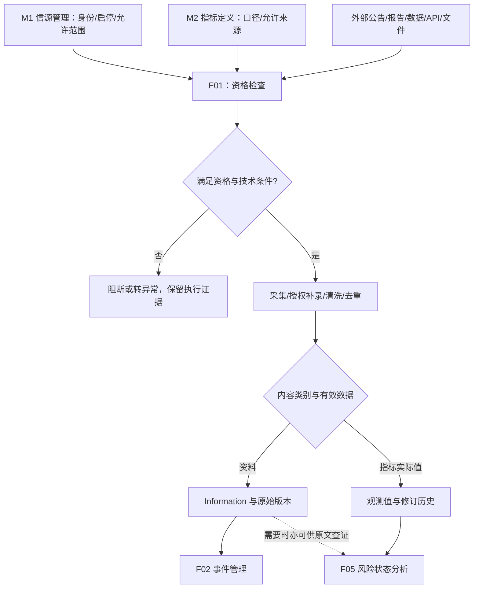
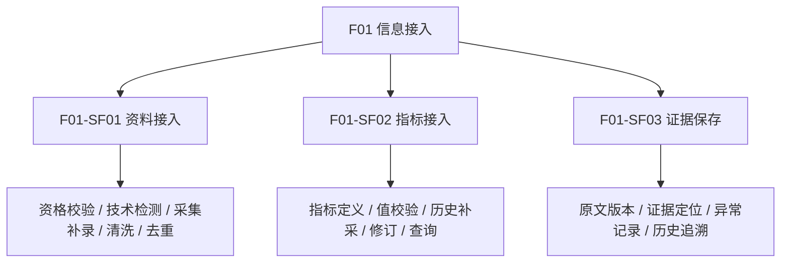

# F01 信息接入模块功能设计

> **文档定位**：RiskHot L0 信息处理层中 **F01 信息接入** 的独立功能设计。章节结构沿用 M1、M2 的十章组织方式。  
> **版本说明**：本稿从《F01 信息接入与 F02 事件管理模块功能设计》V1.0 拆分，保留现有 `F01-SF01～SF03` 二级编号、14 项末级功能，并按独立模块补充输入输出、规则和验收。  
> **依据标记**：**[B]** 已有领域/架构约束；**[P]** 本稿设计建议；**[D]** 尚待定版。`P0/P1` 是建议优先级。业务功能设计不宣称已有数据库、接口或运行实现已经完成。  
> **配套文档**：《F02 事件管理模块功能设计》V1.0；F01 为 F02 提供可追溯的 Information，同时独立向 F05 提供指标实际观测值。

## 1. 模块定位与职责边界

### 1.1 模块定位

**F01 信息接入**负责将已获业务使用资格的外部宏观金融资讯、公告、报告、文件和指标实际观测数据转换为可稳定引用、可核对来源、可追溯版本的业务输入。[B]

核心业务问题：

1. 当前信源是否允许接入，技术连接是否就绪？
2. 本次取得的资料或数据来自何处，原始内容与发布时间是什么？
3. 数据是否重复、修订、缺失，是否满足有效定义及口径？
4. 下游如何获取**当时可用**的资料版本或指标数值，而不被新修订悄然改写？

F01 的主要产物包括 `Information`、原始资料与附件版本、接入状态和异常、指标实际观测值及修订历史。[B] F01 以确定性资格校验、格式预处理、业务幂等和证据保存为主；运行任务与人工异常入口使用系统共享能力。[B/P]

### 1.2 上下游与业务流程

**两条业务出口**：

- `F01 → F02`：发布合格的 Information、原始版本和来源定位，供事件抽取与归组。[B]
- `F01 → F05`：提供具有真实指标身份、观测期、数据口径和可用时间的实际值与历史版本，供风险状态分析。[B]

**说明 [P]**：官方数据发布可能同时产生可存档的 Information 和指标实际值；若没有可独立识别的宏观行动、决定或状态变化，无需强制生成 Event。由 F02 依据 Event 定义判断是否形成事件。

### 1.3 主责与排除事项

| 范围 | F01 职责 | 其他主责或边界 |
|---|---|---|
| 信源身份、业务启停、等级、允许范围 | 只读消费并复核当次接入资格 | M1 唯一维护正式身份与启停 [B] |
| 连接检测、原文和资料接入 | F01 负责资格执行与接入业务结果 | 调度、凭据、重试由共享运行/技术能力承载 [B] |
| 指标定义、单位口径、变量—指标映射 | 读取已生效配置并校验实际值 | M2 维护定义、允许来源与映射 [B] |
| 实际指标值、修订、来源定位 | F01 负责业务接入和可追溯交付 | 现有技术 `observations` 的唯一写入端口待确认 [D] |
| Event 身份、事件归组、事件 M | 交付资料和版本 | F02 正式维护 Event/Update/Rating [B] |
| 风险等级、方向、快照和投资决策 | 提供证据，保留原始语义 | F03～F06 分别执行判断与分析 [B] |

F01 不重复建立信源档案，不自行审批指标定义，不为接入值推定变量对风险的作用方向，不引入逐条事实可信度 C 打分或独立处理优先级 P 评分。[B]

### 1.4 首版范围与使用者

- **覆盖范围**：宏观经济、货币/财政政策、金融体系、宏观市场及相关权威资料；优先官方第一手来源与权威机构。[B]
- **数据形态**：网页/API/公告/报告/结构化指标、支持可追溯的人工补录。[P，连接器类型以实际适配能力为准]
- **主要使用者**：系统自动执行任务、授权配置维护者、需要定位接入异常的运维/业务复核者、只读查询原始材料的研究人员。[P]
- **自动化原则**：常规合格资料自动接入；歧义、格式失败、口径冲突和授权不足进入待处理，不要求人工逐篇确认。[B/P]

## 2. 功能架构与详细清单

### 2.1 二级功能结构

### 2.2 末级功能清单

| 功能编号 | 二级功能 | 末级功能 | 优先级建议 | 输出或完成标准 |
|---|---|---|---|---|
| F01-SF01.01 | 资料接入 | 信源资格与有效版本核验 | P0 | 接入发起与入库前复核 `ACTIVE`、范围、源配置版本 |
| F01-SF01.02 | 资料接入 | 技术就绪检测 | P0 | 可用、未就绪、人工接入、未检测及故障原因 |
| F01-SF01.03 | 资料接入 | 自动采集与授权补录 | P0 | 原始响应/文件、采集任务和来源引用 |
| F01-SF01.04 | 资料接入 | 正文抽取与元数据规范化 | P0 | 正文/附件、原发主体、规范链接及双时间字段 |
| F01-SF01.05 | 资料接入 | 资料重复与修订判别 | P0 | 复用同版、登记修订或新来源，避免重复交付 |
| F01-SF02.01 | 指标接入 | 指标定义和允许来源校验 | P0 | 指标身份、定义版本、允许来源和适用范围 |
| F01-SF02.02 | 指标接入 | 实际值与口径质量校验 | P0 | 单位、观测对象、观测期、值/缺失与来源核验 |
| F01-SF02.03 | 指标接入 | 历史补采与幂等保存 | P0 | 按观测期保留历史记录，不重复写同一有效版本 |
| F01-SF02.04 | 指标接入 | 数据修订与多来源差异保留 | P0 | 新旧值版本链、来源差异及口径限制 |
| F01-SF02.05 | 指标接入 | 观测值查询与下游读取 | P0 | F05 按分析截止、定义版本与观测期取有效证据 |
| F01-SF03.01 | 证据保存 | 原始内容与附件版本化保存 | P0 | 原文/附件的历史版本可查且不可无痕覆盖 |
| F01-SF03.02 | 证据保存 | 原始发布主体与证据定位 | P0 | 原发/转载链、段落/页码/数据区块定位 |
| F01-SF03.03 | 证据保存 | 接入异常、缺口与处置记录 | P0 | 业务阻断、技术失败、口径冲突和待处理分开表达 |
| F01-SF03.04 | 证据保存 | 资料/数值/版本与任务追溯 | P1 | 从来源、任务到原始版本及下游使用关系的只读链路 |

**编号原则**：`F01-SF01～SF03` 为系统总览已有二级功能；`.01～.05` 是本稿末级拆解提案，暂不作为已批准需求编号。[B/P]

### 2.3 首版功能组合建议

首版必须打通两个闭环：[P]

1. **资料闭环**：已启用官方信源 → 合法采集 → 原文与版本保存 → 新资料通知 F02 → 从 Event 返回特定原文片段。
2. **指标闭环**：M2 有效指标定义及允许信源 → 实际值接入 → 口径和时间核验 → 修订链保存 → F05 依据固定截止时间查询。

接入健康趋势、批量操作和关系查询深度可以在不影响上述闭环的前提下逐步扩充。技术能力的物理拆分不作为首版先决条件。

## 3. 业务对象与信息组织

### 3.1 对象、身份与归属

| 业务对象 | 身份/版本 | F01 权限与行为 | 说明 |
|---|---|---|---|
| `information_source` | `source_id` + 有效版本 | 只读、资格执行 | M1 管理业务启停及允许范围 [B] |
| `information` | `information_id` | 新增/修订/检索 | 标准化资料及来源元信息，原文版本另行保留 [B] |
| 原始文件/正文版本 | `information_id` + 版本引用（技术待定） | 保存/追溯 | 历史证据不可被新修订覆盖 [B] |
| `indicator_config` | `indicator_id` + 定义版本 | 只读校验 | M2 维护定义与单位频率 [B] |
| 允许来源/指标映射 | 生效关系和版本 | 只读核对 | 不在 F01 新建映射 [B] |
| 指标实际观测值 | 技术唯一键与记录 ID 待定 | 业务接入、修订、对外读 | 现有 `observations` 写入归属待技术对齐 [B/D] |
| 接入执行和异常 | `run_id`/任务 ID（字段待定） | 查询业务结果 | 任务状态、授权及恢复调用共用能力 [P] |

### 3.2 Information 的建议基础字段 [B]

| 字段 | 业务含义 | 保存要求 |
|---|---|---|
| `information_id` | 稳定资料身份 | 应用服务生成，不能由 AI 编造 |
| `source_id` | M1 正式信源引用 | 必须真实有效，并保存适用来源版本 |
| `external_id` | 外部资料标识 | 有则保存，优先用于同来源去重 |
| `canonical_url` | 规范原文地址 | 保留原始 URL 与规范化结果（扩展存储待定） |
| `title` | 原始标题 | 不强制以标题判断资料唯一性 |
| `content` | 标准化正文 | 同时保留原始载体或其不可变引用 |
| `published_at` | 原始发布时间 | 未知保留空值，禁止用采集时间代替 |
| `collected_at` | 取得资料时间 | 与发布时间分开记录 |
| `content_hash` | 正文或版本指纹 | 用于内容变化检测，不独立决定事件归组 |
| `raw_metadata` | 来源特有元信息 | 记录原始版本、附件和出处定位等 |

**资料重复判断**：[B] 优先按 `(source_id, external_id)` 识别；辅以规范 URL 与内容指纹。同来源原文修订需要保留新旧版本；多个独立发布者引用同一宏观事件，应保留各自来源记录。F01 不在资料层决定 Event 同一性。

### 3.3 指标实际观测值的逻辑数据契约 [P/D]

指标值的逻辑字段如下。它们定义下游需要的信息，**当前不等同于已经通过评审的物理表字段**。

| 字段/业务项 | 要求 | 约束 |
|---|---|---|
| `indicator_id` | M2 正式指标身份 | 必须有适用的有效定义及版本 |
| `indicator_definition_version` | 适用的统计定义版本 | 不因后续定义调整静默回填旧值 |
| 观测范围/维度 | 国家、辖区、统计对象及细分条件 | 与指标定义相容 |
| `observation_period` | 数值对应的实际观测期 | 支持周期起止/单时点及精度 |
| `observed_value` | 原始数值或状态 | 真实 `0` 与缺失/不适用分别保存 |
| `unit`、原单位 | 单位及合法转换信息 | 留存原值、原单位和可追溯变换 |
| `source_id`、source version | 数据来源与使用资格 | 符合 M2 允许来源与 M1 生效范围 |
| 发布时间/数据发布日期 | 该版本实际对外发布的时点 | 与观测期、取得时间独立 |
| 取得时间 | 本系统获得数据的时点 | 用于重建历史分析可见状态 |
| 数据版本与修订关系 | 首发、修订与原值指向 | 不能覆盖旧值或隐去修订 |
| 原始文件/行/区块定位 | 证据出处 | 支持回到来源当时版本 |
| 质量限制/缺失原因 | 缺数、异常、口径冲突等 | 不能将其转换为风险判断 |

**时间视角必须分离**：[B/P] 观测期说明数值描述哪个经济时段；发布时间说明何时官方公开；取得时间说明系统何时获取；修订时间说明何时变更该数据版本。F05 的历史截止时点查询，应返回在该时点已发布且按系统回放规则可用的版本。具体选择口径与回溯算法待技术设计确认。

### 3.4 原文、资料与数值之间的关系

1. 同一信源 `1:N Information`，同一 Information 可在 F02 侧对应 `0..N Event`。[B]
2. 一个官方统计报告可以同时成为 Information 原始资料和多个指标值的原文依据；两类下游引用均指向原始资料和其版本。[P]
3. **数据值的发布不强制生成 Event**；事件识别由 F02 在取得适用 Information 后按主体、行为、时间条件执行。[B/P]
4. 同一指标、同一观测期可能因发布时间、来源和修订产生多个合法记录；不能只保留所谓“最新值”而丢弃早期可见版本。[B/P]

## 4. 功能详细设计

### 4.1 F01-SF01 资料接入（F01-SF01.01～.05）

**流程**：接入任务发起 → 读取 M1 当前信源 → 启用/范围检查 → 自动路径技术就绪检查 → 采集/补录 → 解析规范化 → 资料级去重与版本判别 → 合法保存 → 通知 F02。[B/P]

#### 4.1.1 信源资格与有效版本核验（.01）

- **输入**：`source_id`、所用配置版本、采集内容及范围、执行者/任务身份。
- **判定**：最新 M1 功能稿采用 `ACTIVE / DISABLED` 两态；只有 `ACTIVE` 允许新业务接入。自动采集仍需符合技术就绪条件。旧稿出现的 `PAUSED` 作为兼容待决值，业务上应阻断新采集。[B/D]
- **执行**：任务启动以及正式保存前均复查业务状态、范围和版本；在途任务遇到停用，保留必要任务/原始响应排障证据，停止形成可消费的新正式资料。[B]
- **异常**：身份不存在、版本已失效、访问范围不匹配和停用分别保存明确原因，不把失败状态写回 M1。

#### 4.1.2 技术就绪检测（.02）

- **检查**：是否具备适配器、入口能否访问、鉴权与格式条件是否满足、检测时间及原始错误。[P]
- **输出**：可用、未就绪、人工接入、未检测/未知；由 M1 只读展示。技术连接失败不自动停用信源。[B]
- **边界**：M1 的监测频率是建议业务配置；实际调度、重试、凭据与排程由运行能力管理。[B]

#### 4.1.3 自动采集与授权补录（.03）

- **自动路径**：从可用来源增量取得资料/附件/实际数据，任务受理和运行日志可查；按来源能力选择 API、网页、文件等适配方式。[P]
- **人工路径**：授权用户选取已启用来源，登记真实原文 URL 或上传可核验文件，填写来源、发布时间及必要范围说明；人工接入不绕过身份、范围、证据及去重校验。[B/P]
- **补采语义**：再次启用来源后需显式启动补采；重试同一次任务与重新采集不同时间窗口分别留痕。[B/P]

#### 4.1.4 正文抽取与元数据规范化（.04）

- **处理**：正文清洗、附件保留、标题/URL/时间规范化、原发主体与转载主体识别，记录来源载体和原始版本定位。[B]
- **原则**：规范化后的内容方便检索与 AI 消费；被清洗前的原始版本仍可回溯。`published_at` 缺失保留空值；时区或精度不明确保留不确定性。[B]
- **异常**：无法解析正文时原始载体和错误仍可追溯，不提供虚构正文。[P]

#### 4.1.5 资料重复与修订判别（.05）

- **同来源、同内容版本**：沿用已保存 Information/版本，并记录本次取得任务结果；不触发无意义的 F02 重分析。[B]
- **同来源、新正文修订**：保留旧版本，新版本标记修订关系，并交付 F02 识别是否涉及事件纠正。[B]
- **新来源/新资料**：独立保留来源引用；是否属于同一 Event 交 F02 判断。[B]
- **并发**：相同业务键的重复提交以幂等返回或显式冲突处理，防止重复资料与重复交付。[P]

### 4.2 F01-SF02 指标接入（F01-SF02.01～.05）

#### 4.2.1 指标定义与允许来源核验（.01）

读取 M2 的正式 `indicator_config`、统计对象、频率、单位、有效版本及允许信源。要求 `source_id` 在 M1 已启用且本指标允许来源范围内；不满足者保存来源/口径缺口或待处理，不伪装为有效观测值。[B]

#### 4.2.2 实际值与口径质量校验（.02）

- 核对指标 ID、对象、辖区、单位、观测期、数据发布时点、频率、原值及必要维度。[B/P]
- 区分 `0`、缺失、尚未公布、异常文本及无量纲状态；记录单位变换规则与原始值，不默认单位为百分比。[B]
- 出现数据不能解析、口径不兼容、对象范围不符或来源不被允许时标记具体异常；由确定性程序校验，不凭 AI 猜测修正正式原始值。[P]

#### 4.2.3 历史数据补采与幂等保存（.03）

对首次接入、增量接入、缺口补采和历史回补统一使用可追溯的接入命令，保留每个观测期的实际发布和取得记录。同一次历史文件重复导入应复用已确认版本；后补数据不能捏造“当时已经取得”的时间。[B/P]

#### 4.2.4 数据修订与来源差异保留（.04）

同一来源修订某观测期数值时追加修订记录，旧值及发布时间仍可回溯；不同来源、不同统计对象或不同口径的数据保持独立，不自动平均、覆盖或择一标记为唯一正确值。确需业务选择时由 F05 在锁定口径和截止时间后决定引用哪一项。[B]

#### 4.2.5 观测值检索与下游读取（.05）

支持按指标、范围、观测期、来源、定义版本、数据发布时间及任务分析截止条件查询；展示原值、修订链、数据缺口及限制，供 F05 固定证据输入。F01 的“数值变化”只描述客观数据，不给出风险阶段、压力方向和风险评级。[B/P]

### 4.3 F01-SF03 证据保存（F01-SF03.01～.04）

#### 4.3.1 原始内容与附件版本化保存（.01）

原始资料、附件和结构化数据须保留不可无痕覆盖的历史版本，至少具备来源、取得时间、指纹及特定版本定位；纠正以新记录表达。具体文件存储、hash 范围与保留期限属于技术待决项。[B/D]

#### 4.3.2 原始发布主体与证据定位（.02）

保留原始发布机构与转载渠道；可回源时优先原始文本。证据可定位到文章段落、PDF 页码、数据表或文件区块，每个下游业务引用需能解析对应历史原件。[B/P]

#### 4.3.3 接入异常、缺口与处置记录（.03）

建议区分 `业务资格阻断 / 技术失败 / 解析失败 / 定义缺失 / 来源不被允许 / 口径冲突 / 重复无变化 / 待补齐或复核 / 存储或交付失败` 等处理结果；操作包括重试、补采、查看证据、向 M1/M2 反馈。不同类型不能统一显示“采集失败”。[P]

#### 4.3.4 资料、版本与任务链查询（.04）

从资料或指标值详情反查来源、取得任务、原文版本、修订与消费关系；F01 对 Event、RiskSnapshot 等跨模块对象仅提供只读链接。具体跨模块查询能力按 P1 逐步建设。[P]

## 5. 页面与交互组织建议

### 5.1 页面结构

| 页面/入口 | 核心展示 | 允许操作 | 关键边界 |
|---|---|---|---|
| **接入概览** | 总批次、新有效资料、更新数值、异常数、来源技术状态 | 查看来源/批次、跳转任务详情 | 调度与执行控制使用公共运行能力 [P] |
| **原始资料库** | 标题、信源、原发者、发布时间、接入时间、正文版本、解析结果 | 搜索、筛选、打开原文、查看修订 | M1 身份启停只读 [P] |
| **指标观测数据** | 指标、观测范围/期、值/缺失、单位、来源、发布时间、数据版本 | 查历史/修订、过滤时点、回到原始来源 | 指标定义/映射只读；缺数单独表达 [P] |
| **接入异常/待处理** | 来源资格、技术/解析、定义或数值质量问题、处置状态 | 查看差异、重试、补采、发起维护反馈 | 例外才需要人工，权限校验保留 [P] |
| **资料/数值详情** | 原文、附件、元数据、修订 Timeline、来源引用、任务历史 | 历史比较、复制内部引用、只读跳转 F02/F05 | 保持原始版本不可无痕覆盖 [P] |

### 5.2 关键交互约束

1. 页面明确分列**业务启用**和**技术就绪**，不可混用一个“可用”状态。[B]
2. “无数据”“尚未接入”“缺失值”“值为零”“查询失败”分别显示；首次打开没有记录不虚构最新值。[B/P]
3. 修订对比至少显示新旧值/正文、发布与取得时间、差异、来源链接；历史分析引用仍指向旧版本。[B/P]
4. 主要人工动作集中在异常、补录和必要复核；常规可处理资料自动流转。[P]

## 6. 跨模块协作与交接契约

### 6.1 协作矩阵

| 协作方 | F01 消费 | F01 提供 | 写入边界 |
|---|---|---|---|
| M1 信源管理 | `source_id`、状态、范围、有效配置版本 | 技术就绪、实际资料引用（只读） | F01 不修改 M1 业务状态 |
| M2 风险源管理 | 指标定义、单位/频率、允许信源、生效映射引用 | 接入缺口、来源或口径差异 | F01 不修改正式定义与映射 |
| F02 事件管理 | 事件处理的反馈与信息引用 | 合格 Information、版本、来源及原文定位 | F02 唯一维护事件身份及增量 |
| F05 风险状态分析 | 截止时间、指标/范围/版本取证条件 | 合规数值、修订链、可用时间和缺口 | F05 决定证据使用及风险影响 |
| 公共运行/权限/审计 | 任务、授权和运行结果 | 状态、恢复入口、审计线索 | 正式写入仍由 F01 业务用例决定 |

### 6.2 逻辑输出契约（字段非正式 API Schema）

**F01 → F02（InformationAvailable）[P，通知名称待定]**：`information_id`、`source_id`、适用信源配置版本、`external_id`/`canonical_url`、内容版本、`published_at`、`collected_at`、原文/附件定位与内容状态。事件处理在消费时仍应校验有权使用该版本。[B/P]

**F01 → F05（IndicatorObservationAvailable）[P，通知名称待定]**：有效 `indicator_id` 与定义版本、观测范围/期、原值/缺失、单位/转换说明、`source_id`、源数据定位、实际发布时间、取得时间、数据修订链和口径限制。F05 还需自行锁定 M2 映射版本。[B/P]

**F01 → M1/M2 维护反馈**：仅反馈接入健康、允许来源失效、指标定义/单位/口径缺口及证据，不自动修改主数据。[B]

**执行一致性**：[B] 保存有效事实与下游通知分离；正式提交成功后才允许消费。失败的交付可以重试，必须保证幂等；具体 Outbox、Inbox、任务机制和业务键待技术定版。[D]

## 7. 核心业务规则

| 编号（本稿建议） | 业务规则 | 依据与状态 |
|---|---|---|
| BR-L0-F01-01 | 新采集启动及正式入库前，均核对 M1 的业务启用、范围与适用版本。 | M1 §4.3、L0 §3.1 [B] |
| BR-L0-F01-02 | 业务启用与技术就绪独立；连接故障不自动改变 M1 启停。 | M1 §4.4 [B] |
| BR-L0-F01-03 | 原文、附件及修订的历史来源与版本可追溯；发布时间未知须留空。 | L0 §3.1、§4.5.2 [B] |
| BR-L0-F01-04 | 同来源同版幂等；修订追加新版本；不同来源合法记录分别保留。 | L0 §2.2.1 [B] |
| BR-L0-F01-05 | 实际指标值必须核对 M2 定义和允许信源；缺失、零、异常与无量纲分别表达。 | M2 §4.4、架构总览 §5.2 [B] |
| BR-L0-F01-06 | 观测期、发布时间、取得时间和修订时间独立；多来源差异不静默覆盖。 | L2 BR-L2-02/04 [B] |
| BR-L0-F01-07 | 人工补录仍遵守信源、口径、版本、权限与证据规则。 | 本稿 [P] |
| BR-L0-F01-08 | 同一合法资料可供事件抽取和指标取证；指标新增值无需强制创建 Event。 | 架构总览 §5.2/§6.6；本稿拆分边界 [B/P] |
| BR-L0-F01-09 | 失败、受限、重复无变化和成功应有可区分的业务结果，能够恢复和审计。 | 架构总览 §9.3～9.6 [B/P] |
| BR-L0-F01-10 | 历史截止时点取证不得无痕替换为以后发布或接入的修订版本。 | L2 BR-L2-02/04 [B] |

## 8. 功能验收场景（建议）

| 场景编号 | 场景及触发 | 验收结果 |
|---|---|---|
| AC-F01-01 | M1 信源为 `DISABLED`；启动自动采集 | 阻断新业务接入；原因可查；历史资料不删除 |
| AC-F01-02 | M1 `ACTIVE`，但连接器不可达 | 显示技术未就绪，M1 业务状态保持不变 |
| AC-F01-03 | 信源人工上传可核验公告 | 仍按启用、来源与版本校验；记录补录者和原文 |
| AC-F01-04 | 同一公告重复获取三次，内容未变化 | 沿用有效 Information 版本，不重复通知 F02 |
| AC-F01-05 | 同来源公告修订关键正文 | 旧版可查，新版保存并提供独立证据定位 |
| AC-F01-06 | 两个独立信源发布同一政策信息 | 均保留合法资料/来源记录，是否同事件交 F02 |
| AC-F01-07 | 原始发布时间未知 | `published_at` 保留空值，`collected_at` 真实记录 |
| AC-F01-08 | 新指标值来源未列入 M2 允许信源 | 不写为有效证据；来源缺口或异常可查询 |
| AC-F01-09 | 指标数值真实为零，另一期缺数 | 显示 0 和缺失两种不同语义，原文可追溯 |
| AC-F01-10 | 同指标同观测期来自两来源，口径冲突 | 独立保存差异，不自动平均或覆盖 |
| AC-F01-11 | 某历史值在分析截止日后修订 | 历史截止查询返回当时适用版本，可见后来修订链 |
| AC-F01-12 | 官方同份报告提供多个指标值 | 每个值可追溯至正确指标定义、观测期和原文位置 |
| AC-F01-13 | 接入已保存，但向 F02/F05 交付失败 | 重试只补交付，不重复保存原资料或数值 |
| AC-F01-14 | 信源在采集任务执行中途被停用 | 保存排障证据、阻断正式新业务输入，既有历史可查 |

以上为建议场景，需结合接口、存储和权限设计落成可执行验收用例。

## 9. 待定事项与后续设计工作

| 待决编号 | 问题 | 现有约束/本版建议 | 建议收敛点 |
|---|---|---|---|
| D-F01-01 | M1 旧 `PAUSED` 状态如何兼容 | 最新 M1 `ACTIVE/DISABLED`；旧状态按阻断理解 [B/D] | 接口枚举/数据迁移评审 |
| D-F01-02 | 指标值唯一技术写入方 | F01 为业务接入主责，旧 `observations` 为技术承载；禁止双写 [B/D] | 数据所有权与端口定版 |
| D-F01-03 | 实际值复合唯一键与修订批次 | 区分指标、范围、观测期、来源、发布版本 [P/D] | 数据详细设计 |
| D-F01-04 | 原文存储、附件指纹与证据定位格式 | 历史不可覆盖、支持回到旧原件 [B] | 文件/证据模型定版 |
| D-F01-05 | 连接器形式、接入频率与补采策略 | M1 频率为参考；运行侧负责调度 [B] | 接入适配与运行设计 |
| D-F01-06 | 格式/口径质量检查可配置程度 | 区分确定性规则与人工例外 [P] | 指标与接入质量规则评审 |
| D-F01-07 | 历史截止时点查询、发布批次和取得时间处理 | 不得用未来修订覆盖历史 [B] | F01→F05 查询契约 |
| D-F01-08 | 接入通知、任务与幂等 DTO | 已保存事实才能交付，失败可重试 [B] | API/Outbox/Inbox 评审 |
| D-F01-09 | 例外处理角色与自动恢复权限 | 常规自动、异常可审核；精确授权条件待定 [P/D] | 权限/运行验收 |

**推荐实施顺序**：先落实 M1 资格校验、原文与版本入库及 F02 交接；同步明确 M2 指标配置读取、实际值唯一写入和 F05 截止查询；随后完善异常处理、可观测性和只读关系追溯。

## 10. 来源与追踪依据

1. `docs/system-design/03-系统功能架构/系统功能架构总览.md`：§5.1～5.6、§6.6、§7.4～7.5、§9.3～9.6、§11.4；F01 一级职责、交接与待决项。
2. `docs/system-design/02-业务架构与领域设计/RiskHot_L0_信息处理层_业务架构与领域设计V1.0.md`：§1.1～1.6、§2.2.1、§3.1、§4.5.2、§5～6；信源校验、Information、原文与版本。
3. `docs/system-design/03-系统功能架构/M1 信源管理中心功能设计.md`：§4.3～4.4、§6～8；信源有效二态、技术就绪、在途阻断与恢复约束。
4. `docs/system-design/03-系统功能架构/M2风险源管理中心功能设计.md`：§4.4、§6～8；关键指标定义、允许来源、多对多映射与实际值归属。
5. `docs/system-design/02-业务架构与领域设计/RiskHot_L2_风险态势分析层_业务架构与领域设计V1.0.md`：§3.2（BR-L2-02、BR-L2-04）；指标证据时点、映射版本、缺口与修订。
6. `docs/system-design/04-系统架构设计/00. 系统总体架构.md`：§2.4～2.5；`information`、`observations` 技术承载，业务归属与唯一写入边界。
7. 配套文档 `docs/system-design/03-系统功能架构/F02 事件管理模块功能设计.md`（建议保存位置）：F02 的独立功能清单与接收 F01 的 Information 契约。

---

**文档状态**：本稿为完整的 F01 独立设计评审稿；业务基线、14 项建议末级功能、页面建议和待决问题分别标明。尚未修改本地 RiskHot 项目、数据库、接口或运行代码。
