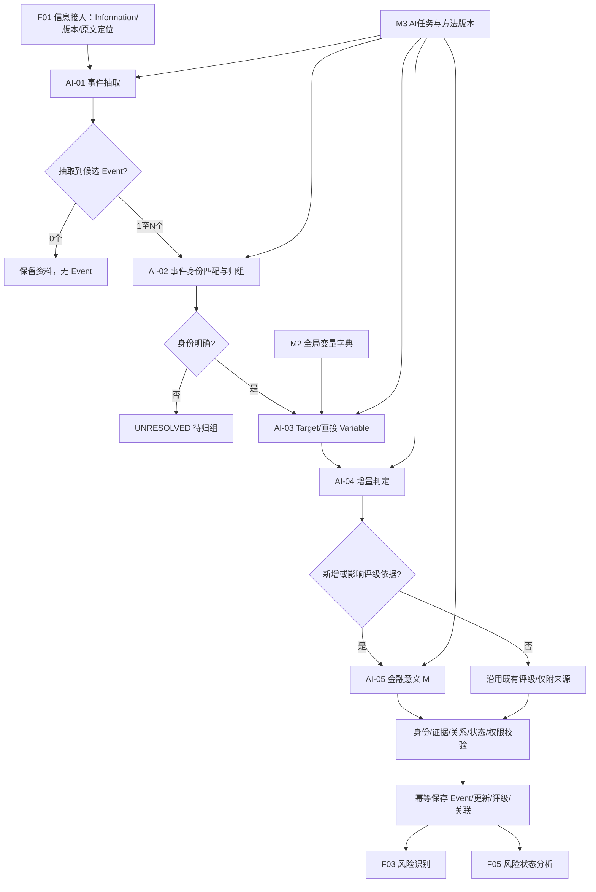
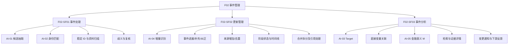
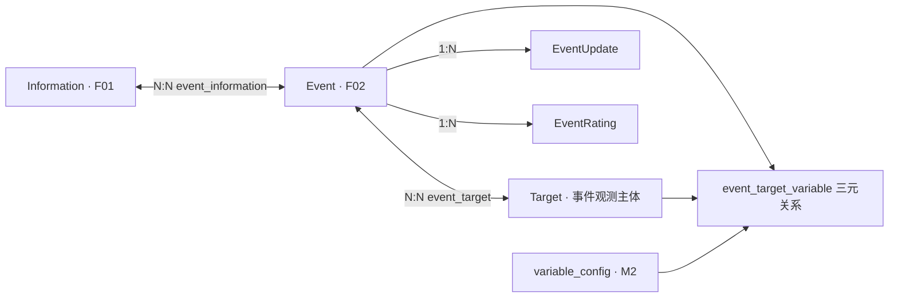

# F02 事件管理模块功能设计

> **文档定位**：RiskHot L0 信息处理层中 **F02 事件管理** 的独立功能设计。章节组织参照已形成的 M1、M2 十章结构。  
> **版本说明**：本稿由《F01 信息接入与 F02 事件管理模块功能设计》V1.0 拆分，保留既有 `F02-SF01～SF03` 三组二级功能和 14 项末级功能提案，补充独立的事件生命周期、数据契约、页面与验收。  
> **依据标记**：**[B]** 项目现有业务/架构约束；**[P]** 新增设计建议；**[D]** 保留待决。功能末级编号、P0/P1 优先级尚未审批，也不代表真实代码或数据库已实现。  
> **配套文档**：《F01 信息接入模块功能设计》V1.0；F02 只消费经过资格与版本处理的 Information，正式维护 Event、EventUpdate、EventRating 和直接对象变量关系。

## 1. 模块定位与职责边界

### 1.1 模块定位

**F02 事件管理**将 F01 交付的可追溯宏观资料组织为有稳定身份、有来源证据、可持续更新的宏观 Event；负责事件抽取、同一性判断、观测主体及直接变量关联、有效增量、纠正、金融意义 M，以及面向 F03/F05 的业务变化交付。[B]

F02 依次回答五个业务问题：

1. 资料里是否发生、宣布、计划或体现了可识别的宏观变化？
2. 这是一个独立新 Event，还是已有 Event 的再次报道或生命周期进展？
3. 它直接涉及哪些**事件观测主体 Target**和哪些有依据的**全局 Variable**？
4. 与此前记录相比，新增了实质事实、来源佐证、纠正，还是重复内容？
5. 在固定的观察范围与研究期限下，这次事件具有什么金融意义，并应向下游交付哪些变更？

### 1.2 在系统中的位置



**解释**：[B] 图中 AI-02、AI-03、AI-04 允许按身份与新证据回流复核；逻辑步骤不要求对应固定次数模型请求。正式 ID 的创建和有效关系写入由程序执行，并在统一持久化阶段完成最终校验。

### 1.3 主责、输入与输出

| 类型 | 内容 |
|---|---|
| 输入 | F01 的 `Information`、来源/正文版本与证据定位；既有 Event/Update；Target 字典、M2 有效 `variable_config`；M3 的 AI-01～05 与方法/Prompt 有效版本 |
| 正式主产物 | `Event`、`EventInformation`、`EventTarget`、`EventTargetVariable`、`EventUpdate`、`EventRating` |
| 业务副产物 | 待归组候选、Target/变量候选、证据缺口、方法反馈、处理记录和事件变化通知 |
| 下游 | F03 风险识别、F05 风险状态分析；M2 接收新变量/缺口反馈；M3 接收任务质量/方法问题反馈（使用范围依适用策略） |

### 1.4 职责边界

- [B] **原始资料的身份、采集、正文清洗、实际指标值及资料版本由 F01 管理**。F02 保存对 Information 原件及版本的引用和业务关系，禁止无痕改写 F01 原文。
- [B] **全局变量和指标定义由 M2 治理**。F02 只能匹配已有有效定义或提出候选，不能自造正式 `variable_id`。
- [B] F02 保留 Target 的事件观测语义；Event 行为主体 Subject 单独作为事件字段。Target 与风险层的 `risk.observation_target` 只有在身份与范围一致时才映射。
- [B] F02 的 M 是事件在指定观察范围的**金融研究重要性**。风险等级、风险方向、传导机制、风险纳管及当期状态分别由 F03～F05 判断。
- [B] 无直接证据时不推导融资成本、信用扩张等后续传导变量；也不预设 Target→Variable 固定归属，不独立建设通用 Entity 模型。
- [B] 首版重点覆盖宏观事件，不设计逐条事实 C 可信度评分、独立 P 优先级评分、投资建议或交易行为。
- [B/P] 任务调度、复核待办、权限、审计与恢复依托共享基础能力；F01/F02 可由同一技术组件承载，但逻辑写入边界分别明确。

## 2. 功能架构与清单

### 2.1 二级功能结构



### 2.2 14 项末级功能清单

| 编号 | 二级功能 | 具体功能 | 建议优先级 | 完成标准 |
|---|---|---|---|---|
| F02-SF01.01 | 事件处理 | AI-01 候选事件抽取 | P0 | 每份 Information 可输出 0..N 事件候选及证据定位 |
| F02-SF01.02 | 事件处理 | AI-02 同事件匹配与归组建议 | P0 | 新事件/已有事件/待判定及逐项比较依据 |
| F02-SF01.03 | 事件处理 | 正式事件身份与资料关联 | P0 | 稳定 `event_id` 和 N:N `event_information` |
| F02-SF01.04 | 事件处理 | 归组歧义隔离及复核 | P0 | `UNRESOLVED` 保留，清晰候选继续处理 |
| F02-SF02.01 | 更新管理 | AI-04 事件增量判定 | P0 | 七类增量结果及历史差异依据 |
| F02-SF02.02 | 更新管理 | 进展、实质补充与纠正 | P0 | `EventUpdate`、历史保留及状态调整 |
| F02-SF02.03 | 更新管理 | 仅来源新增与纯重复保护 | P0 | 只新增来源关系或幂等跳过，不制造实质进展 |
| F02-SF02.04 | 更新管理 | 事件生命周期与历史时间轴 | P0 | 业务时间、记录时间与阶段状态可查询 |
| F02-SF02.05 | 更新管理 | 合并/拆分核对与历史引用迁移 | P1 | 受控方案及审计；正式重定向规则先评审 [D] |
| F02-SF03.01 | 事件分析 | AI-03 Target 识别与事件关系 | P0 | `EventTarget`；允许 Target 暂不确定 |
| F02-SF03.02 | 事件分析 | 直接 Variable 三元关联及候选反馈 | P0 | 有效三元关系，缺定义进入 M2 候选 |
| F02-SF03.03 | 事件分析 | AI-05 金融意义 M 及用途标签 | P0 | `EventRating`、范围/方法版本/依据，规则未定允许空分 |
| F02-SF03.04 | 事件分析 | 事件中心、详情与证据追溯 | P0 | Event/Update/Target/Variable/M 及原文链可查 |
| F02-SF03.05 | 事件分析 | 变更交付、交付状态与反馈 | P0 | 持久化后向 F03/F05 交付，失败单独重试 |

**范围说明**：[B/P] `F02-SF01～SF03` 是系统总览已有的二级功能；`.01～.05` 为本轮评审提案。合并/拆分自动化的跨事件身份迁移涉及稳定引用，作为 P1 待决，不能将其视作自动归组所需的首版前置能力。

### 2.3 首版业务闭环

首版应完整覆盖：`官方资料 → 事件候选 → 事件同一性核验 → 正式 Event/来源关系 → Target/直接变量 → 增量和纠正 → M/用途 → 持久化和 F03/F05 消费`。对无事件、重复、仅新增来源、歧义和缺失变量定义的分支，应有合法且可查询的处理结果。[B/P]

## 3. 业务对象与信息组织

### 3.1 核心关系与所有权



| 对象 | 主键/核心引用 | F02 业务责任 |
|---|---|---|
| `information` | `information_id`、来源 ID、原文版本 | 只读引用，资料归 F01 [B] |
| `event` | `event_id` | 持有稳定事件身份、主体、行为、时间及当前状态 [B] |
| `target` | `target_id`、`target_code`、辖区与范围 | 事件观测主体身份的引用/候选处理；技术授权边界待确认 [B/D] |
| `variable_config` | `variable_id` | 只读 M2 正式全局变量 [B] |
| `event_information` | `(event_id, information_id)` | 事件与资料关系、证据定位、信息角色 [B] |
| `event_target` | `(event_id, target_id)` | 事件涉及哪些观测主体，可独立于变量关系存在 [B] |
| `event_target_variable` | `(event_id, target_id, variable_id)` | 有直接依据的本次事件—对象—变量关联 [B] |
| `event_update` | `event_update_id` | 进展、实质补充、纠正、阶段变化及历史双时间 [B] |
| `event_rating` | `rating_id` | 金融意义及金融用途、依据、方法与历史 [B] |

### 3.2 Event：稳定事件身份 [B]

**业务定义**：在明确时间语境下，由特定宏观主体发起或体现，具有相对完整行为、决定或状态变化且可追踪的事件单元。最小判断要素为 **Subject + Action + Time**。事件的核心属性包括：

| 字段 | 描述 |
|---|---|
| `event_id` | 正式稳定 ID，由应用用例创建或复用 |
| `title`、`description` | 事件名称、核心变化与范围 |
| `event_type` | 货币政策、财政政策、宏观统计、金融市场变化等可配置类型 |
| `subject_name`、`subject_type` | 发起、执行或体现变化的**行为主体** |
| `action_code` | 具体行动或变化分类 |
| `event_status` | `expected / announced / in_progress / effective / completed / cancelled / unknown` |
| `event_time` | 事件主要时间，无法精确判定可空 |
| `event_time_kind` | 宣布、预计、实施、实际发生等时间语义 |
| `event_time_precision` | 日/月/季度/年/未知等精度 |
| `first_seen_at`、`updated_at` | 首次发现与最近资料更新等系统时间 |

**判界**：同一政策在宣布、推进、实施和完成阶段可以保留同一 Event 并追加 EventUpdate；同一主体在不同时点形成独立决定时通常新建 Event。一篇综合材料可能包含多个 Event，主题词、发布机构或标题相近均不足以直接证明同一性。[B]

### 3.3 Target：事件的观测主体 [B]

Target 是被事件观测、用于记录事件作用范围及直接变量变化的宏观主体；与 Event 中行为主体 Subject 分开表达。首版五类对象：

| `target_type` | 业务类型 | 示例 |
|---|---|---|
| `economy` | 经济体 | 美国经济、中国经济 |
| `macro_institution` | 宏观政策主体 | 央行、政府部门 |
| `financial_system` | 金融体系 | 银行体系 |
| `financial_market` | 金融市场 | 国债市场、银行间市场 |
| `economic_sector` | 宏观经济部门 | 政府部门、居民部门 |

稳定身份按名称/代码、辖区、类型及明确范围共同识别。`EventTarget` 可以单独存在，即使暂时没有匹配任何全局变量；不为 Target 建立静态 Variable 归属。Target 与 L1 的风险观察对象只有经过范围核验才能相互映射。[B]

### 3.4 EventInformation：来源与原文证据 [B]

- 同一 Information 可关联多个 Event；同一 Event 可以有多个原始资料来源。
- `event_information` 至少有 `event_id`、`information_id`、`information_role`（初始来源/补充/进展/纠正）和 `evidence_locator`（段落、页码或数据区块）。
- 每条事件事实及 AI 判断需可定位到 F01 的**特定原文版本**；技术层可补充正式 `information_version_ref` 之类版本指针，但本稿不预先定物理字段名。[B/P]
- 转载资料保留原始发文主体和转载主体，能回源时优先原始版本；增加佐证不会自动变成事件实质变化。[B]

### 3.5 EventTargetVariable：直接变量关联 [B]

| 业务字段 | 要求 |
|---|---|
| `event_id` | 当前正式事件身份 |
| `target_id` | 对应已存在的 `(event_id,target_id)` 关系 |
| `variable_id` | 引用 M2 正式 `variable_config`，候选不能假扮正式 ID |
| `relation_type` | 直接改变、宣布调整、已观察变化等业务关系 |
| `change_direction` | 有明确依据时记录上升/下降/不变/未知 |
| `impact_status` | 预计、宣布、实施中或已有观测结果 |
| `description` | 具体直接变化及适用范围 |
| `information_id` | 已与该 Event 建立有效关系的来源资料 |

`event_target_variable` 的稳定三元关系只能记录**此次具体 Event 直接涉及的 Variable**。后续融资条件、信用扩张、传导路径等推演由风险分析层承担。变量不存在时记录候选、理由和 M2 反馈；Target 已明确时仍可先保留 `EventTarget`。[B]

### 3.6 EventUpdate：增量与两类时间 [B]

建议沿用 `event_update_id`、`event_id`、`information_id`、`update_type`、`summary`、`previous_status`、`current_status`、`effective_at`、`recorded_at`。`effective_at` 描述业务变化发生/适用的时间，`recorded_at` 描述系统发现并记录的时间。迟到公告、后来修订与历史回放不得混淆两者。

### 3.7 EventRating：金融意义历史 [B]

| 字段 | 含义及规则 |
|---|---|
| `rating_id`、`event_id` | 某事件的特定评级记录 |
| `assessment_scope` | 所评价的宏观观察范围 |
| 研究期限 | 评估所面向的时间范围，具体技术字段待定 |
| `financial_significance_m` | 金融意义总分；量化方法未批准时允许 `NULL` |
| `dimension_scores` | 维度评价/说明及候选分值 |
| `financial_usages` | `investment`、`financing`、`speculation_sentiment`；允许多标签或无法判断 |
| `reasoning_summary` | 为什么具有金融意义及原文证据 |
| `method_version` | 规则/权重/Prompt 所用适用版本 |
| `rating_status`、`evaluated_at` | 草案、已确认、待复评等状态与评价时间 |

同一事件可有多次历史评价；新增资料只有在改变评价依据时才考虑复评。[B]

## 4. 功能详细设计

### 4.1 F02-SF01 事件处理（F02-SF01.01～.04）

#### 4.1.1 AI-01 事件候选抽取（.01）

- **触发**：F01 保存并交付符合资格的 Information 新版本。[B]
- **输入**：`information_id`、`source_id`、标题、正文/附件内容、发布时间、采集时间、原文版本/定位、事件类型字典；正式身份与时间由程序提供。[B]
- **分析**：识别可定位的主体、决定、动作和状态变化；对报告中的独立行为分别切分；区分发生、宣布、预计和实施；提取初步 Target 范围线索。[B]
- **输出**：0..N 事件候选、`title`、`description`、`event_type`、`subject_name/type`、`action_code`、`event_status`、`event_time/kind/precision`、`information_id`、`evidence_locator`、不确定性说明。[B]
- **边界**：可合法输出 0 个候选；只有泛泛宏观评论且无具体行为或变化时保留 Information 即可。AI 不分配正式 `event_id`。[B]

#### 4.1.2 AI-02 匹配与归组（.02）

- **召回**：按主体、行为、时间、观测范围、政策/行动标识等召回已有 Event；比较对象由程序提供，不允许 AI 引用系统中不存在的 Event ID。[B]
- **比较**：逐项说明一致/差异：核心行为是否相同、是否为同一政策生命周期、是否同辖区及作用范围、时间能否连续解释、是否有稳定行动标识。[B]
- **结论**：`NEW_EVENT` / 归入已有事件 / `UNRESOLVED`；正式输出保留归组理由、证据定位及有冲突的候选项。[B]
- **失败策略**：同主题不同决定应分开；匹配阈值与精确自动通过条件保留待定，不自设未经评审的百分比阈值。[D]

#### 4.1.3 稳定身份与资料关系（.03）

- 对确认的新 Event，由程序创建真实且稳定的 `event_id`；对确认的已有 Event 复用身份。[B]
- `event_information(event_id,information_id)` 支持多对多，写入来源角色、证据定位，并执行真实 ID、版本和并发幂等校验。[B]
- 一个 Information 抽取多个 Event 后，每个事件的归组、增量及评级独立处理；某一候选异常不阻断其他合格结果。[B]

#### 4.1.4 归组歧义隔离及复核（.04）

`UNRESOLVED` 作为明确业务分支保存疑点、候选列表、原文位置和当时算法/Prompt 版本；复核人员查看相同与差异依据后，可批准复用、独立创建、要求补充信息或继续暂缓。批准后仍由 F02 程序重新校验身份和权限并正式写入。[B/P]

### 4.2 F02-SF02 更新管理（F02-SF02.01～.05）

#### 4.2.1 AI-04 增量判定（.01）

输入当前候选事件资料及已归组 Event 的状态、资料关系、更新历史；必要时调用 AI-02 回查事件身份。对比“新资料到底增加了哪项变化”，形成以下七类业务结果：[B]

| 类别 | 业务含义 | 默认保存动作 | 是否考虑 M 复评 |
|---|---|---|---|
| `NEW_EVENT` | 独立新事件 | 创建 Event、首条 EventUpdate、来源关联 | 首次评价 |
| `EVENT_PROGRESS` | 同事件实施或阶段推进 | 追加 EventUpdate，必要时调整状态 | 评级依据改变时 |
| `MATERIAL_ADDITION` | 新增关键数字、范围或条件 | 追加 EventUpdate | 评级依据改变时 |
| `SOURCE_ADDITION` | 新来源，实质事实无变化 | 仅新增 EventInformation | 通常沿用 |
| `CORRECTION` | 官方原始内容更正 | 保留旧原文/历史，追加纠正 | 按纠正影响决定 |
| `DUPLICATE` | 既有内容重复 | 幂等返回，无业务增量 | 不复评 |
| `UNRESOLVED` | 事件身份或新变化边界无法判断 | 保存待归组记录，不强行写正式变化 | 暂不复评 |

#### 4.2.2 进展、实质补充及纠正（.02）

对 `EVENT_PROGRESS`、`MATERIAL_ADDITION`、`CORRECTION` 保存 `EventUpdate` 及来源；仅在有合法阶段或内容依据时更新 Event 当前展示状态。纠正不得覆盖旧 EventUpdate 或旧来源原件，应说明原判断、修订内容、原文差异和业务有效时间。[B]

#### 4.2.3 来源增加与纯重复处理（.03）

- `SOURCE_ADDITION`：增加该事件的来源佐证关系并保留原文定位，不制造实质进展，不自动重算 M；若来源确实改变可被引用的核心事实，应重新判定增量类别。[B]
- `DUPLICATE`：同一来源同一资料版本重复执行时复用已保存结果，不新增 EventUpdate，不再发同一业务变更；仍可记录执行日志。[B]

#### 4.2.4 生命周期与历史时间轴（.04）

- 事件阶段枚举：`expected / announced / in_progress / effective / completed / cancelled / unknown`。[B]
- 区分计划时间、宣布时间、正式执行时间及更新写入时间，不能用 `published_at` 或 `recorded_at` 代替实际发生时间。[B]
- 显示“什么时候发生/生效”和“什么时候被系统获知”双时间轴；用户可回溯到旧原件、旧事件状态和修订原因。[B/P]
- Event 当前概述是对合法更新的当前视图，所有历史更新仍可查询。[B]

#### 4.2.5 合并/拆分及引用迁移核对（.05，P1）

允许将后续证据发现的误归组、同事件重复身份或独立决定误合并标为维护需求，记录候选源/目标 Event、原因、可能受影响的 `EventInformation`、EventUpdate 和下游引用。正式合并、拆分、旧 ID 重定向、历史有效性及权限边界待专题决策；首版不自动改写大批正式身份。[D/P]

### 4.3 F02-SF03 事件分析（F02-SF03.01～.05）

#### 4.3.1 AI-03 Target 身份与关系（.01）

读取事件直接变化、已有 Target 字典及证据；分清行为主体 Subject 与事件观测主体 Target。对匹配项核对名称、类型、辖区及范围；能够确定时建立 `EventTarget`。无法确定时保留事件与来源、记录 Target 缺口。新 Target 的正式身份分配及审核条件由 L0 的对象用例和后续授权规则决定。[B/D]

#### 4.3.2 AI-03 直接变量三元关系（.02）

- 仅引用事件直接宣布改变、直接涉及或有观测记录的统一变量；证据不足时保持为空。[B]
- 依据变量定义、观测边界和单位查询 M2 `variable_config`，正式关联使用真实 `variable_id`；没有匹配时向 M2 提交候选、原始证据与语义差异。[B]
- 建立 `(event_id,target_id,variable_id)` 前校验对应的 EventTarget 已有效存在，`information_id` 已关联当前 Event。[B]
- `relation_type`、变化方向和影响阶段仅记录有来源支持的描述；不替 F03/F05 推导传导或风险作用。[B]

#### 4.3.3 AI-05 金融意义 M 与用途（.03）

**评价目标**：衡量在固定 `assessment_scope` 和研究期限内，事件对货币、信用、财政、金融市场或重要经济约束的潜在金融研究意义。[B]

**已确认内容**：保留金融意义 M、方法版本、理由及金融用途标签；同一事件允许复评与历史追溯。`investment`、`financing`、`speculation_sentiment` 可以多选，不以标签数量直接决定 M。[B]

**待确认内容**：当前 L0 领域稿提出候选五维 `B` 底层变量关联、`D` 影响程度、`T` 持续时间、`W` 影响范围、`L` 作用落地；候选比例依次为 30%、25%、20%、15%、10%，尚未经真实数据或业务批准校准。**这些候选比例不得作为已定版正式评分公式使用**。可先保存维度评语、金融用途、原文依据、`rating_status=draft` 和空 `financial_significance_m`。[B/D]

**复评触发**：新 Event 通常初评；新增进展、实质变化和纠正只有在改变金融意义依据时复评；纯来源增加通常沿用既有评级。正式评级必须写明生效方法版本，不靠当前“最新 Prompt”替换旧版本。[B]

#### 4.3.4 事件检索详情与证据追溯（.04）

事件中心可按名称、行为主体、事件类型、观测主体、时间/阶段、最近实质增量和评级状态筛选；事件详情整合当前事实、双轴 Timeline、每条资料与证据、Target 与直接变量、M 历史和任务/复核记录。任何展示的结论可通过 `information_id` 与原文版本定位回到原件。[P]

#### 4.3.5 变更交付、消费状态和反馈（.05）

正式业务对象经结构、身份、证据、版本、权限与幂等性校验、持久化提交之后，根据**实际变化**向下游交付：[B]

| 业务通知建议名 | 触发语义 | 典型下游 |
|---|---|---|
| `event_created` | 新 Event 与首次来源建立 | F03、F05 |
| `event_updated` | 事件实质进展、状态或直接变量关系有效变化 | F03、F05 |
| `event_rating_updated` | 金融意义维度/用途/评分已更新 | F03/F05 的可引用信息更新 |
| `event_source_attached` | 同一事件仅增加佐证来源 | 已订阅该来源变化的消费者 |

业务通知命名来自 L0 领域设计，具体消息总线、Outbox、同步/异步方式和 DTO 待技术定版。若存储成功而下游交付失败，必须能单独重试交付，禁止因重试生成第二个 Event/Update。[B/D]

### 4.4 AI 与程序的职责边界

| AI 任务 | AI 负责 | 程序正式校验与执行 |
|---|---|---|
| AI-01 事件抽取 | 0..N 候选、核心要素、出处定位 | 字段和时间语义、资料 ID 有效性 |
| AI-02 事件匹配与归组 | 同事件/新事件/待判断及比较理由 | 已有 ID、归组业务约束、正式身份和幂等 |
| AI-03 Target 与 Variable 识别 | 对象/直接变量候选、关系说明及证据 | 范围、真实 ID、EventTarget 与三元关系约束 |
| AI-04 增量判定 | 七类变化建议、历史差异和时间依据 | 更新类型、状态合法性、时间与重复保护 |
| AI-05 金融意义 M | 维度解释、用途、评价理由及不确定性 | 固定范围/方法、分值范围、版本和评级状态 |

AI 可以提供候选结论与解释；正式事件身份、合法引用、事务保存和已授权操作由程序执行。身份冲突、证据不足或规则不充分应形成受限结果或复核，不虚构正式 ID。[B]

## 5. 页面与交互组织建议

### 5.1 页面结构

| 页面/入口 | 主要内容 | 核心交互 | 边界 |
|---|---|---|---|
| **事件中心** | 标题、主体、类型、阶段、关键时间、观测主体、最新实质增量、M 状态 | 检索、筛选、排序、打开详情 | M 不显示为风险等级 [P] |
| **事件详情** | 当前事实、来源/证据、Timeline、Target/直接变量、金融意义历史 | 查看原文版本、比较更新、受控复核 | 不直接修改 F01 原件或 M2 定义 [P] |
| **待归组/事件异常** | UNRESOLVED、候选事件对照、冲突依据、AI/字段/来源限制 | 查看证据、选择处理建议、提交复核 | 人工确认后仍进行程序正式校验 [P] |
| **事件处理轨迹** | AI-01～05 逻辑执行、方法版本、业务校验、保存和交付结果 | 查看任务、重试下游通知、审计定位 | 调度/权限能力复用公共模块 [P] |
| **来源侧联动入口** | 从 F01 Information 详情跳至相关 Event | 查看对应 Event 数与归组状态 | F01 只读关联，不修改事件身份 [P] |

### 5.2 事件详情推荐布局

```text
事件标题 / event_id / 主体与行动 / 事件类型 / 当前阶段 / 主要时间及精度
├── 事件演进 Timeline
│   ├── 新建、宣布、进展、实际实施、修订或结束
│   ├── 业务变化时间 effective_at
│   └── 系统记录时间 recorded_at
├── 信息来源与原文证据
│   ├── 官方来源/转载主体 / 发布时间 / 原文版本
│   └── 逐条更新对应的段落、页码或数据区块
├── 事件观测主体与直接变量
│   ├── Target 类型、辖区、范围和本次关系
│   └── Variable ID、关系、方向、阶段与原文支持
├── 金融意义 M
│   ├── 评价范围 / 研究期限 / 方法版本 / 维度解释
│   └── 用途标签、评分状态及评级历史
└── 处理与审计
    ├── 归组比较理由、待解决问题和复核记录
    └── 持久化、下游变更交付和恢复状态
```

### 5.3 人工介入最小化原则

- 正常、合法、无歧义的新 Event 或既有 Event 增量可依据授权规则自动流转；用户主要审阅待归组、来源证据冲突、缺失定义和重要修订。[B/P]
- 异常处理展示原文证据、多个匹配候选的差异、AI 理由和所用版本，减少无上下文的二次判断。[P]
- 下游引用链接只读，F02 内不设置风险纳管、风险方向或风险快照编辑器。[B]

## 6. 跨模块协作与业务契约

### 6.1 模块协作

| 协作方 | F02 消费 | F02 输出/反馈 | 不得越权 |
|---|---|---|---|
| F01 信息接入 | Information ID、源配置/原文版本、发布时间及证据定位 | 事件关联、归组处理状态（只读反馈） | 不能修改 F01 原文与指标实际值 |
| M2 风险源管理 | 统一 `variable_config`、有效版本与定义 | 候选变量、定义缺口、原始证据 | 不新建/编辑正式变量定义 |
| M3 策略管理 | AI-01～05、Prompt/Skill、输入/输出 Schema、方法版本 | 质量案例、歧义与方法反馈 | 不能自动修改 M3 已生效方法 |
| F03 风险识别 | 风险消费状态（若提供） | Event、EventUpdate、Target/变量关系、M、证据 | 不形成正式风险身份与风险等级 |
| F05 风险状态分析 | 对事件证据的读取需求及截止时间 | 有效事件事实和版本化证据 | 不决定当期风险压力、严重度与传导作用 |
| 公共运行与审计 | 任务、授权、重试与存储能力 | 处理结果、事件通知、复核记录和失败反馈 | 保存和下游交付分开追踪 |

### 6.2 F01 → F02 的最小输入契约

`information_id`、`source_id` 与有效信源版本、原始 URL/外部资料 ID、正文/附件版本、`published_at`、`collected_at`、原发者/转载信息及可解析的原文定位。[B] 对重复同版、非可用来源、新修订等情形，F01 应明确交付性质；F02 仍按自身规则判定业务事件增量。[P]

### 6.3 F02 → F03/F05 的最小输出契约

`event_id`、本次 `event_update_id`（如有）、增量类别、Event 当前阶段与时间种类、`target_id` 集合、直接关联的 `variable_id` 及三元关系、M 评价范围/用途/方法版本、所有关键 `information_id` 与原文版本定位。[B]

**下游理解约束**：`financial_significance_m` 衡量金融研究意义，不等于风险等级、损害程度或未来行情方向；F03/F05 必须自行核验风险身份、观察范围、变量角色、证据时点和解释边界。[B]

### 6.4 缺失定义与方法反馈

- `F02 → M2`：变量候选、目标范围、涉及 Event、语义与近义项差异、原始资料和直接依据；未审核前 `variable_id` 为空。[B]
- `F02 → M3`：AI 任务版本、出错节点、无法判断原因、样本证据和评估建议；正式变更经 M3 策略治理。[B/P]
- `F02 → 运行/复核`：任务身份、适用版本、候选/异常/正式保存结果、重试和业务审计关联。[B/P]

### 6.5 一致性及失败去向

- 正式 ID、来源版本、EventInformation、EventTarget、EventTargetVariable 和评级范围均需交叉校验。[B]
- `DUPLICATE` 无业务变更，`SOURCE_ADDITION` 为佐证变化；交付消息应反映真实增量类别。[B]
- 持久化成功后才交付业务通知，已保存数据不可因消费者失败被重复创建或无痕覆盖。[B]
- `UNRESOLVED`、待补定义、AI 结构失败、授权失败和下游交付失败各自可查，不合并成单一技术失败状态。[B/P]

## 7. 核心业务规则

| 规则编号（本稿建议） | 核心业务规则 | 依据与状态 |
|---|---|---|
| BR-L0-F02-01 | 事件身份以主体、行动/变化、时间语义为核心；同一生命周期可追加 EventUpdate，独立决定另建 Event。 | L0 §3.2 [B] |
| BR-L0-F02-02 | 归组同时比较主体、行为、观测范围、时间与政策标识；无法确认时保留 `UNRESOLVED`。 | L0 §3.5 [B] |
| BR-L0-F02-03 | `SOURCE_ADDITION` 只增加来源关系；`DUPLICATE` 幂等；`CORRECTION` 保留旧原件及增量历史。 | L0 §3.5 [B] |
| BR-L0-F02-04 | `EventTarget` 可独立存在；正式三元变量关联要求真实 EventTarget、有效 M2 变量及直接证据。 | L0 §3.3～3.4、§4.5.8 [B] |
| BR-L0-F02-05 | 新变量只提交 M2 候选；AI 禁止虚构正式 `variable_id`、`target_id` 或 `event_id`。 | L0 §6.2、M2 §4.3 [B] |
| BR-L0-F02-06 | M 评价固定范围、期限、方法版本和原文依据；权重未定可保留维度评估与空总分。 | L0 §3.6、§4.5.10 [B] |
| BR-L0-F02-07 | AI-01～05 输出经结构/引用/权限/幂等与业务校验后，才允许正式保存。 | L0 §6.2、M3 §3.2 [B] |
| BR-L0-F02-08 | 业务保存成功之后才交付变更，交付失败单独重试且不得再次创建已有 Event/Update。 | 架构总览 §7.5、§9.6 [B] |
| BR-L0-F02-09 | 金融意义 M 不能直接映射风险等级；风险识别及状态判断由 F03～F05 承担。 | 架构总览 §5.5、L0 §5.2 [B] |
| BR-L0-F02-10 | 一份 Information 可产生 0..N 个 Event，候选之间的歧义/失败相互隔离。 | L0 §2.2.2 [B] |
| BR-L0-F02-11 | 时间状态保留发生/宣布/预计/实施含义，更新的业务时间与系统记录时间独立。 | L0 §3.2、§4.5.9 [B] |
| BR-L0-F02-12 | 跨事件合并拆分及旧引用迁移须有身份、审计及受影响范围核对；自动化方案待批准。 | L0 §7.2；本稿 [B/D] |

## 8. 功能验收场景（建议）

| 编号 | 输入情境 | 验收预期 |
|---|---|---|
| AC-F02-01 | 一篇宏观评论只有观点，没有具体变化 | 保留 Information，AI-01 可输出 0 Event |
| AC-F02-02 | 一份报告同时包含两项独立政策决定 | 生成或匹配两个 Event，两条处理路径互不阻断 |
| AC-F02-03 | 相同政策被两家官方机构报道 | 归组至同一 Event，来源与原文关系分别保留 |
| AC-F02-04 | 同一机构在两日独立宣布不同措施，标题相似 | 不按标题合并，分别创建事件身份 |
| AC-F02-05 | 新资料只增加独立佐证，无核心事实变化 | 仅附来源，通常不生成新 EventUpdate 或 M 复评 |
| AC-F02-06 | 同一来源重复交付相同资料版本三次 | 结果幂等，不新增业务进展、不重复通知 |
| AC-F02-07 | 某政策先公布，下周正式实施 | 复用 Event，追加进展，阶段/时间语义准确 |
| AC-F02-08 | 原官方资料修订关键数字 | 新增 CORRECTION；旧来源版本和原更新仍可追溯 |
| AC-F02-09 | 可确认 Target，无法确认某个全局变量 | `EventTarget` 有效，三元关系可空，提交 M2 候选 |
| AC-F02-10 | AI 返回不存在的 `event_id` 或 `variable_id` | 校验失败，禁止写入虚构正式关系，保留异常依据 |
| AC-F02-11 | 本次事件作用于两个 Target，只有其中一个变量有直接依据 | 分别表达 EventTarget；仅有依据的关系建立三元引用 |
| AC-F02-12 | 新证据与多个历史 Event 均相似，无法排除冲突 | 转 `UNRESOLVED`，保存候选对比与证据，不强行合并 |
| AC-F02-13 | 某 Information 的两个事件中一个歧义、一个明确 | 明确事件完成处理，歧义事件待归组 |
| AC-F02-14 | 事件 M 的正式权重/分值阈值尚未确认 | 维度、用途、理由和草案可保存；总分为空且不宣称正式评级 |
| AC-F02-15 | 实质进展未改变金融意义依据 | EventUpdate 入库，沿用历史 M，保留未复评原因 |
| AC-F02-16 | Event 已提交，F03 消费通知失败 | 只重试通知/消费，不重复建 Event、Update 或 Rating |
| AC-F02-17 | 用户查阅几个月前的事件状态 | 可按业务/记录时间回到对应更新和原文版本 |
| AC-F02-18 | 人工处理错归组，拟合并两个 Event | 提示身份/历史/下游引用影响；自动正式重定向在审批前禁用 |

场景编号为本稿建议，与上一版合并稿 `AC-L0-*` 的语义保持兼容；最终可执行测试应以定版 Schema、权限和业务键为准。

## 9. 待定事项与后续设计工作

| 待决编号 | 问题 | 当前确认边界 | 待决内容 |
|---|---|---|---|
| D-F02-01 | Event 粒度与归组界限 | Subject + Action + Time；同一生命周期持续更新 [B] | 长期政策主题与单次决定的精确边界、召回与阈值 |
| D-F02-02 | Event 合并拆分 | 保留历史证据与审计 [B] | 旧 ID 处理、下游引用迁移、受控权限与回溯 |
| D-F02-03 | Target 字典与正式建档权限 | 限五类宏观范围；按辖区、类型、边界确认 [B] | 重名消歧、自动建档授权及维护端口 |
| D-F02-04 | M 方法学与量化 | M 和用途标签保留、规则版本可追溯 [B] | 五维权重/等级阈值、样本校准、分 Target 评分范围 |
| D-F02-05 | AI 自动正式写入授权 | AI 候选+程序校验；冲突受限/复核 [B] | 自动通过条件、审批角色、复核回放权限 |
| D-F02-06 | Prompt/Skill、任务 Schema 与输出包 | M3 管理 AI-01～05 的版本化任务 [B] | 精确字段、失败枚举、模型/工具权限与运行记录 |
| D-F02-07 | Event 更新幂等键与交付机制 | 存储成功后交付，不重复建事实 [B] | DTO、Outbox/Inbox、通知重试、去重键和顺序 |
| D-F02-08 | 证据引用到原文版本 | `information_id` + `evidence_locator`，历史不可覆写 [B] | 附件页码、段落、表格定位与版本指针格式 |
| D-F02-09 | 对象/变量候选回写反馈 | M2 唯一治理正式全局变量 [B] | 候选去重、反馈 DTO 与审核后重新关联触发 |
| D-F02-10 | 金融意义展示及跨模块语义 | M 是事件研究重要性 [B] | 多维度总分未定时 UI 的展示等级和排序 |

**推荐实施顺序**：稳定 Event/Information 关系 → AI-01/02 候选与正式身份 → AI-03 Target/直接变量 → AI-04 增量、来源增加及纠正 → AI-05 M 与历史 → F03/F05 下游变更交付 → 高复杂度合并/拆分及辅助治理。[B/P]

## 10. 来源与追踪依据

1. `docs/system-design/03-系统功能架构/系统功能架构总览.md`：§5.1～5.6、§6.3、§6.6、§7.4～7.5、§9.3～9.6；F02 一级职责、交付、异常与主责边界。
2. `docs/system-design/02-业务架构与领域设计/RiskHot_L0_信息处理层_业务架构与领域设计V1.0.md`：§1～7；Event/Target/Variable、更新七类、M、AI-01～05、数据关系及业务验收。
3. `docs/system-design/03-系统功能架构/M2风险源管理中心功能设计.md`：§4.3～4.4、§6～8；正式变量、候选与指标映射分工。
4. `docs/system-design/03-系统功能架构/M3策略管理中心功能设计.md`：§3.2；AI 任务、方法/Prompt/Skill/Schema 的版本与校验要求。
5. `docs/system-design/03-系统功能架构/M1 信源管理中心功能设计.md`：§4.3～4.4、§6～8；F01 所消费的有效信源身份与业务使用资格。
6. `docs/system-design/04-系统架构设计/00. 系统总体架构.md`：§2.4～2.5；`information` 技术承载、业务主责与共享运行能力。
7. 配套文档 `docs/system-design/03-系统功能架构/F01 信息接入模块功能设计.md`（建议保存位置）：Information 原件、指标实际值、原文版本和 F01→F02 交接契约。

---

**文档状态**：本稿为可单独阅读和评审的 F02 模块功能设计；14 项末级功能与页面交互作为新提案，业务基线、待决项和暂未实施范围均单独注明。尚未修改 Mac 本地 RiskHot 项目文件或技术实现。
