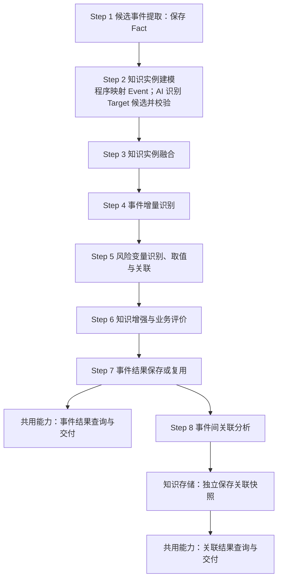

---

## title: F02 事件管理模块功能设计

module: F02
layer: L0
version: V1.14
updated: 2026-10-31
status: 目标功能设计，待验收
category: 系统功能架构/模块功能设计

# F02 事件管理模块功能设计

本文件定义 F02 的业务功能、处理流程、业务规则及功能验收要求，页面设计与交互由第5章链接的独立文档维护，包含九类二级功能、10 项末级功能和八步业务处理流程。V1.11 按实际业务依赖补齐 Step 1～8，将变量与直接关系处理、业务评价、事件保存、事件间关联分别编号；查询、交付及恢复作为共用能力说明。金融用途分类在 Step 6 中独立执行，业务流程见 [[tools/RiskHot/docs/system-design/03-系统功能架构/金融意义#7. 金融用途分类|金融意义：金融用途分类]]。沿用 V1.10 的初始事实确认与已有事件增量分支，功能编号与分类保持不变。

业务对象与关系见[[tools/RiskHot/docs/system-design/02-业务架构与领域设计/RiskHot_L0_信息处理层_业务架构与领域设计V1.0|L0 领域设计]]；存储实现见[[tools/RiskHot/docs/system-design/04-系统架构设计/01-数据模型与存储设计/F02事件管理模块数据模型与存储设计|F02 数据模型与存储设计]]。

> **2026-10-29 F01交接修订**：资料统一为material，版本为字段，无独立原件或资料版本表；F02不再创建独立资料分析记录。输入使用material_id、版本值、内容摘要及正文位置；保存Fact/Event前复查版本和摘要，过期依据明确待核验。本文“处理”指业务步骤及通用运行执行，不表示恢复processing_runs或同义分析表。正文证据可保留必要引文，不以全量正文快照变相重建资料版本表。机器Schema、专题技术契约及运行实现尚待同步。

> **2026-10-30 Target 确定规则修订**：沿用 V1.9，局部调整为“抽取作用对象 → 匹配 Target → 复用或创建 Target → 建立事件关联”。取消行业相关性预筛作为 Target 建档前提，解除五类宏观对象限制；保留原文依据、身份与范围核定及建档治理。该次修订不改变其他任务职责；现行步骤编号以 §4.1 的八步流程为准，运行代码未迁移。具体规则见 §4.3、§4.4。

> **2026-10-31 V1.14 实例建模职责修订**：依据 L0 §3.3 与用户确认，Fact → Event 保持程序字段映射；Object → Target 候选改为 AI 语义识别加程序校验，Step 3 继续负责身份融合。此前 V1.13 的纯程序建模约定由本版替代。同步流程、输入输出、异常及验收要求，保留金融观测边界与证据要求；新增逻辑任务已编号为 AI-08（Target 候选识别），独立任务与提示词 V0.1 草案已编写；机器 Schema、运行接入及模型与工程验收待完成，文档不代表已部署。

> **2026-10-31 Fact 跨报道复用确认**：Fact 作为同一次具体发生的统一事实单元，保留与 material 的多对多关系；同次发生的多篇报道复用 Fact，各来源原文分别追溯。细化 §3.1、§3.3、Step 1 接纳、§4.5.4⑤ 及 AC-F02-72；版本保持 V1.14。未改变 Step 2 的 AI 候选识别分工，也未实施跨来源 Fact 身份核定或受控合并的运行改造。

> **2026-10-31 存储映射同步**：Fact—material 仍为多对多，物理关系表改名为 fact_material；Event—Fact 仍为一对多，取消独立归属表，改由 fact.event_id 及归属说明字段保存。未归组 Fact 允许无 Event，新增来源不改变既有事件归属。具体约束及迁移以 F02 数据模型 V1.10 为准，功能版本保持 V1.14，运行实现待同步。

## 1. 模块定位与职责边界

F02 将 F01 已保存的 material 提取为候选 Fact，匹配已有唯一 Event，确认新增、进展、补充、纠正、来源增加或重复，形成当前有效事件、直接主体/变量关系与金融意义评价。

- F01 负责资料内容获取、解析、标准化、资料身份与资料版本。
- F02 负责候选、事件身份、Fact 归属、当前事实、证据引用、评价及业务交付。
- M2 维护正式变量等定义；定义缺口可保留，不自动发布。
- M3 管理方法、提示词和模型版本；S01 管理调度、尝试、预算与运行恢复。
- Fact 不是正式 Event；模型成功输出不代表业务核定成功。
- 不把 M 当作风险等级，不替代 F03/F05 的风险识别与演化判断。

## 2. 功能架构与详细清单

### 2.1 二级功能结构

- **知识抽取**：提取候选事件及其关键要素。
- **知识实例建模**：程序将 Fact 映射为待融合 Event；AI 识别 Object 及事实语境中的 Target 候选，程序校验并保留逐项依据。
- **知识实例融合**：判断 Event 和 Target 的同一性，明确各自新建或复用方向及 Fact 归属，处理归组歧义复核与受控合并/拆分。
- **增量识别**：比较已有与本次事实，识别实际变化、仅来源新增与纯重复。
- **知识关联**：将事件事实对应到规范变量，建立有依据的事件—对象—变量关系，并识别独立事件之间的共同主线与连续性。
- **知识存储**：统一校验并保存事件、Fact 归属、变量提取与变化、适用关系、评价和用途；独立保存事件关联快照，保留来源及保存回执，按实际变化补充或复用。
- **领域知识增强**：负责金融意义评价及评级管理、金融用途分类。
- **知识查询**：负责事件检索与详情阅读，展示阶段、时间及事实证据追溯。
- **知识交付**：向下游模块交付已保存的事件结果，维护交付状态、失败恢复及接收反馈。

### 2.2 10 项末级功能清单

下表按功能归属列示，功能编号不代表执行顺序。实际流程按 §4.1 编为 Step 1～8：F02-SF01.07 分别在 Step 5、Step 8 执行；F02-SF03.01/.02 对应 Step 6，F02-SF02.01 对应 Step 7，并复用于 Step 8 关联快照的独立保存。查询与交付是保存结果后的共用能力。

| 编号          | 二级功能   | 具体功能                            | 建议优先级 | 完成标准                                                                                  |
| ----------- | ------ | ------------------------------- | ----- | ------------------------------------------------------------------------------------- |
| F02-SF01.01 | 知识抽取   | 候选事件提取（程序 + AI-01（候选事件提取））              | P0    | 完整覆盖 material，输出 0..N 个 Fact，保留 Subject、Action、Object、时间、关键事实数值及原文依据                  |
| F02-SF01.02 | 知识实例建模 | Fact → Event（程序）、Target 候选识别（AI + 程序校验） | P0 | Event 沿用 Fact 原字段；Target 候选具备观测含义、作用依据、范围/分类建议和缺口；不决定正式身份 |
| F02-SF01.03 | 知识实例融合 | Event 与 Target 同一性判断             | P0    | 分别核定 Event 与 Target 的 NEW/REUSE/UNRESOLVED 及唯一归属方向，保留争议依据并支持复核；已有事件的合并/拆分及关联调整按 P1 受控规则执行                |
| F02-SF01.06 | 事件增量识别 | 事件增量识别（程序 + AI-03（Event 增量识别））              | P0    | NEW 确认初始事实，REUSE 识别五类增量，待确认作为处理状态；依据事件事实判断前后值、方向、幅度与持续性；已有规范变量可复用，输出有依据的字段变化；区分仅来源新增与纯重复，不制造实质进展                 |
| F02-SF01.07 | 知识关联   | 事件变量提取与事件关联（程序 + AI-05（从事件提取风险变量） / AI-04（Event 关联）） | P0    | 识别并标准化风险变量、提取具体值并关联对象与证据；正式事件保存后，识别事件间共同主线与连续性                                            |
| F02-SF02.01 | 知识存储   | 事件结果保存                          | P0    | 统一校验并保存事件、Fact 归属、变量提取与变化、适用关系/评价/用途，另行保存关联快照；按增量建议更新当前事实，保留依据及审计；仅来源新增补来源，纯重复复用结果与回执 |
| F02-SF03.01 | 领域知识增强 | 金融意义评价及评级管理                     | P0    | 程序判定初评/复评，评价任务返回五维依据与分数，程序校验并计算 M；新任务编号待定                                             |
| F02-SF03.02 | 领域知识增强 | 金融用途分类（独立功能）                    | 待确认   | 独立形成用途标签及依据，不参与 M 计算；按 [[tools/RiskHot/docs/system-design/03-系统功能架构/金融意义#7. 金融用途分类\|金融意义：金融用途分类]] 保存、补充交付并支持失败恢复，实施优先级待确认                                 |
| F02-SF03.03 | 知识查询   | 事件查询与详情                         | P0    | Event、Fact、Target、本次变量提取与变化、M、用途、关联快照及原文链可查，时间、阶段与缺口状态可区分                             |
| F02-SF03.04 | 知识交付   | 事件结果交付                          | P0    | 保存确认后按契约向 F03/F05 交付事件或独立补充结果，失败仅恢复原交付                                                |

### 2.3 编号与功能范围

保留既有功能编号，本次调整 Target 匹配与建档维护的归属。AI-01（候选事件提取） 为候选事件提取、AI-02（Event 同一性判断） 为同一性判断、AI-05（从事件提取风险变量） 为变量提取、AI-03（Event 增量识别） 为增量识别、AI-04（Event 关联） 为事件关联。实例建模包含程序的 Fact → Event 映射，以及 AI 的 Target 候选识别；后者编号为 AI-08，独立任务及提示词 V0.1 草案已编写，机器 Schema 和运行登记待落实，AI-02（Event 同一性判断） 仍负责 Event 同一性，新增 AI-07（Target 同一性判断）负责 Target 语义比较；AI-07机器契约与运行接入已实现，金融意义评价 AI 编号仍待技术设计落实；不得因旧提示词同号就沿用其职责。

AI-07（Target 同一性判断）采用当前文档与代码中未占用的编号，避开旧材料中的 AI-06 分析结果校验。它属于 F02-SF01.03，不新增二级功能；任务编号不代表执行顺序。

| V1.7 功能编号               | 当前归属                 | 调整说明                              |
| ----------------------- | ----------------------- | --------------------------------- |
| F02-SF01.01             | F02-SF01.01 / 知识抽取      | 调整二级功能名称                          |
| F02-SF01.02、F02-SF01.04 | .02 / 实例建模；.04 并入 .03 / 实例融合    | 本次调整：.02 承担事件映射及 Target 候选识别，原 .04 的 Target 匹配与建档维护归入 .03          |
| F02-SF01.03             | F02-SF01.03 / 知识实例融合    | 以 Event、Target 同一性判断完成融合方向核定                    |
| F02-SF01.06             | F02-SF01.06 / 事件增量识别      | 保留事实比较与变化判断                       |
| F02-SF01.05、F02-SF01.07 | F02-SF01.07 / 知识关联      | 将变量提取纳入事件关联，内部先执行 AI-05（从事件提取风险变量），再执行 AI-04（Event 关联） |
| F02-SF02.02             | F02-SF02.01 / 知识存储      | 进展、实质补充与纠正的保存职责并入事件结果保存           |
| F02-SF02.03             | F02-SF01.06、F02-SF02.01 | 来源新增与重复判定归增量识别，补充与复用归知识存储         |
| F02-SF02.04             | F02-SF03.03             | 阶段、时间和事实追溯归事件中心与详情                |
| F02-SF02.05、F02-SF02.06 | F02-SF01.03             | 受控合并/拆分、关联调整和歧义复核归知识实例融合          |
| SF03 其余功能               | 原编号                     | 领域知识增强与交付职责保留                     |

F02-SF01.04 与 F02-SF01.05 不再作为独立末级功能，分别归入 .03 与 .07；F02-SF02.02 并入 F02-SF02.01 事件结果保存。F02-SF02.03～06 的职责按上表并入已有功能，取消“更新与维护”二级功能。其余功能编号保留，因此清单中的编号不连续；流程步骤单独连续编号。旧版本引用须按对应版本的职责迁移，不能仅凭同号解释；AI 任务标识仍以本节约定为准。

自动合并/拆分仍为 P1，改变正式事件身份或 Fact 归属须明确影响范围并取得适用授权。

## 3. 业务对象定义

### 3.1 领域本体

本节明确 F02 涉及的领域对象及其职责；对象之间的关联统一见 3.3，属性的数据库类型与存储约束由数据模型文档定义。

| 领域对象        | 业务含义                        | 职责与边界                                                                                     |
| ----------- | --------------------------- | ----------------------------------------------------------------------------------------- |
| material    | 已保存的来源资料                    | 由 F01 负责获取、解析、标准化及资料身份与版本；F02 只读引用版本值、material正文及段落定位，不改写原文                               |
| Fact | 可跨报道复用的事实单元，归组前承担候选事件角色 | 统一表征同一次具体发生，Step 1 校验后保存或经核定复用，再确认 Event 归属；多来源原文分别追溯，另一具体发生另建 Fact，冲突待核定 |
| Event       | 去重确认后的唯一正式事件                | F02 根据行为主体、具体行动、发生时间及适用范围核对身份，确认后创建或复用，维护当前有效事实；Fact 不直接等同于 Event                         |
| Target      | 后续维护的观测对象                   | 事件的作用对象按身份与范围匹配已有 Target 或进入建档流程，不限五类宏观对象；可跨事件复用，不能直接以 Subject 或身份未确定的对象代替 |
| Variable    | 全局可复用的变量，描述主体、对象、行为、关系或外部环境 | 引用 M2 治理的有效正式定义；定义缺口形成治理候选，不自动发布，不把推测传导当作直接事实                                             |
| EventRating | 事件的金融意义评价                   | 按固定范围、研究期限和方法组织五维评价与 M，区分正式评分模式、文字草案模式和处理状态；每项评价对应明确事件及事实依据                               |

Subject 是 Fact/Event 的行为主体属性，Object 是事件的影响对象，二者不因出现在事实中就自动成为 Target。Object 到 Target 的转换与身份核定见 §4.3、§4.4。Subject 不单独建立领域对象。FactMaterial、EventTarget 与 EventTargetVariable 是关系对象，见 3.3；FactMaterial 对应事实—资料来源关系，可先于事件归组建立。金融用途分类由 F02-SF03.02 独立形成，其结果及保存交付规则见 [[tools/RiskHot/docs/system-design/03-系统功能架构/金融意义#7. 金融用途分类|金融意义：金融用途分类]]，不作为金融意义评价任务评分的必填结果；历史评价中的用途仍可追溯。

### 3.2 领域属性

领域属性指 3.1 各领域本体自身承载的身份、内容和状态。下表按本体逐项列出属性及业务含义；属性名称采用业务名称，具体字段映射与存储类型以数据模型设计为准。对象之间的关联、关系属性及处理记录不混入本体属性。

#### 3.2.1 material 的属性

| 属性名称    | 业务含义                  |
| ------- | --------------------- |
| 资料标识    | 一份资料的稳定身份             |
| 来源侧原文标识 | 来源系统赋予原文的标识，可按来源情况缺失  |
| 标题      | 原始资料标题，未知时不补造         |
| 原始链接    | 资料的规范原始链接，按来源情况允许缺失   |
| 内容      | 保真的标准化正文或结构化原始内容      |
| 发布时间    | 原始资料发布的时间，未知时保持空      |
| 采集时间    | 系统取得该份资料内容的时间，与发布时间区分 |
| 内容指纹    | 用于内容比对的摘要值，不单独决定资料身份  |
| 资料版本    | 区分内容修订或重新解析后采用的确定内容   |
| 原始元数据   | 来源特有信息及资料版本定位信息       |

#### 3.2.2 Fact 的属性

| 属性名称          | 业务含义                                                                                         |
| ------------- | -------------------------------------------------------------------------------------------- |
| 候选事实标识        | 已保存候选事实的稳定身份                                                                                 |
| 标题            | 对本条候选事件的概括                                                                                   |
| 事实描述          | 原资料表达的事实、数字、范围和条件                                                                            |
| 行为主体（Subject） | 执行本条候选行动的主体文字，未知时保持空                                                                         |
| 影响对象（Object）  | Step 1 的 object 及 target_clues 表达作用对象及范围、限制；Step 2 经 AI 语义识别及程序校验形成待融合 Target 候选，Step 3 确定正式身份前不作为正式 Target 引用 |
| 具体行动          | 原文陈述的行动内容，未知时保持空                                                                             |
| 业务阶段          | 原资料所描述行动的阶段，不是抽取或复核任务的处理状态                                                                   |
| 发生时间          | 本条候选行动实际发生的时间，保留原文可确认的精度，未知时保持空                                                              |
| 创建时间          | 候选事实首次保存的时间                                                                                  |
| 更新时间          | 候选事实最近一次受控维护的时间                                                                              |

#### 3.2.3 Event 的属性

| 属性名称          | 业务含义                               |
| ------------- | ---------------------------------- |
| 事件标识          | 去重确认后的唯一正式事件身份，同一事件后续补充时沿用         |
| 标题            | 当前有效的事件标题                          |
| 事实描述          | 当前有效的事实、数字、范围及必要限制                 |
| 行为主体（Subject） | 实施事件行动的主体文字，不等同于观测对象 Target        |
| 影响对象（Object）  | 当前有效事实中的事件影响对象；保留与已确定 Target 的对应依据 |
| 具体行动          | 当前事件对应的实际行动内容                      |
| 业务阶段          | 当前行动所处的业务阶段                        |
| 发生时间          | 当前行动实际发生的时间，未知时保持空，不用系统记录时间代填      |
| 创建时间          | 正式事件建档的时间                          |
| 更新时间          | 当前事件最近一次有效业务修改的时间                  |

#### 3.2.4 Target 的属性

Target 保存当前已收集、经过定义与身份核定的观测对象。分类依据[[tools/RiskHot/docs/references/金融风险研究对象分类索引 V1.0|金融风险研究对象分类索引 V1.0]]，表结构与约束见[[tools/RiskHot/docs/system-design/04-系统架构设计/01-数据模型与存储设计/F02事件管理模块数据模型与存储设计#3.3 Target：分类目录与已收集观测对象|Target 数据模型]]；不设置对象业务编码。

| 属性名称 | 业务含义 |
| --- | --- |
| 观测对象标识 | 稳定 ID，跨事件复用 |
| 名称 | 正式对象名称；同名对象须结合范围区分 |
| 分类归属 | 直接由 categories 字段保存一级/二级分类配对，允许多个分类，不设分类表 |
| 国家／辖区 | 对象所属的地域或管辖范围，未知为空 |
| 范围定义 | scope_definition 字段说明对象包括和不包括什么，以及影响身份的必要限定；不另建范围层级表 |
| 别名 | 直接由 aliases 字段保存已核定的简称、别称或历史名称，用于召回 |
| 有效状态 | 是否允许被新增事件引用 |
| 定义版本 | 当前定义的受控版本，历史事件固定采用的定义快照 |

后续召回与 AI-07（Target 同一性判断）中的“类型”指 categories 中的分类配对与对象经济属性，不增加单值 target_type 字段；分类交叉不应导致重复建档。别名和分类只能辅助检索，不能替代对象身份核定。

#### 3.2.5 Variable 的属性

本次变量识别、取值与关联遵循 §4.6；既有五字段草案见[[tools/RiskHot/docs/system-design/04-系统架构设计/01-数据模型与存储设计/F02事件管理模块数据模型与存储设计#6.1 本次事件的变量提取结果（逻辑字段约定）|变量提取结果]]，其来源枚举与取值承载待按 §8.5 适配；下表描述共享定义属性，实际识别来源随事件结果记录。

变量的业务定义、取值特征及候选来源见[[tools/RiskHot/docs/system-design/02-业务架构与领域设计/RiskHot_L0_信息处理层_业务架构与领域设计V1.0#3.4 风险变量（Risk Variable）的定义|L0 变量业务规则]]。

| 属性名称  | 业务含义                      |
| ----- | ------------------------- |
| 变量标识  | M2 正式定义的全局稳定变量身份          |
| 业务编码  | 用于区分变量语义的稳定编码             |
| 名称    | 变量的正式名称                   |
| 定义    | 变量含义、观测边界与解释口径            |
| 适用对象 | 定义可用于哪些对象范围，不绑定单个 Target |
| 取值类型 | 数值、类别、状态等规范取值方式 |
| 量纲／单位 | 变量的计量口径；无计量单位的类别、状态等变量可为空 |
| 有效状态  | 变量定义是否允许使用                |
| 定义版本  | 本次引用所采用的变量定义口径版本          |

#### 3.2.6 EventRating 的属性

| 属性名称   | 业务含义                                  |
| ------ | ------------------------------------- |
| 评价标识   | 一次金融意义评价的独立身份                         |
| 评价范围   | 本次评价适用的宏观观察范围                         |
| 研究期限   | 本次评价针对的期限或窗口                          |
| 方法版本   | 本次采用的评分或文字评价方法版本                      |
| 评价模式   | 正式评分模式或文字草案模式                         |
| 五维评价   | 底层变量关联、影响程度、持续时间、影响范围、作用落地各维度的判断及依据说明 |
| 逐维分数   | 按有效评分规则形成的各维分值；文字草案为空                 |
| 金融意义 M | 程序按有效方法计算的总分；文字草案为空                   |
| 评价解释   | 对金融意义及复评变化的综合说明                       |
| 评价限制   | 规则、输入或证据方面的缺口与适用边界                    |
| 评价状态   | 草案、已确认或待重新评价等业务状态，与任务执行状态区分           |
| 评价时间   | 程序记录的本次评价时间                           |

金融用途已独立为 F02-SF03.02，本节不将其列为新评价的必填属性；历史 EventRating 已保存的用途信息继续保留并可追溯。

本次变量提取、变量变化、用途分类和事件关联分析分别保留结果上下文；不以共享 Variable、EventTargetVariable 或 EventRating 代替这些结果。其业务保存内容见 §4.8.4，物理表与字段由数据模型设计承接。事件关联首版保存一次分析的快照，不建立自动演进的长期集合实体。

### 3.3 领域关系

来源关系统一由 FactMaterial 管理，其支持/质疑作用与 Fact 对 Event 的归属作用分开。事件来源通过 Event → Fact → FactMaterial → material 派生；EventMaterial 不再列为独立领域对象，Event—Fact 直接归属也不新增 EventFact 对象或表。领域定义见[[tools/RiskHot/docs/system-design/02-业务架构与领域设计/RiskHot_L0_信息处理层_业务架构与领域设计V1.0#4.3.6 FactMaterial（事实—资料关联）|FactMaterial 定义]]。

| 领域关系                                           | 关联方式与基数                                                 | 关系属性与业务规则                                                                                      |
| ---------------------------------------------- | ------------------------------------------------------- | ---------------------------------------------------------------------------------------------- |
| material ↔ Fact（FactMaterial）                 | 多对多；一份 material 可支持多个 Fact，一个 Fact 可由多份 material 支持     | 每个已保存 Fact 至少有一份来源资料；证据固定资料版本及原文位置，保留精确引文与支持/质疑作用；矛盾资料不得丢弃                                     |
| Event ↔ Fact                                   | 一个正式 Event 至少关联一个 Fact；Fact 未归组时无 Event，确认后最多属于一个 Event | 归属关系说明 Fact 的作用及理由：初始事实、进展、补充、纠正或佐证；同一次具体发生的 Fact 复用与 Event 身份核对分别进行，来源措辞不同不直接产生新 Fact                            |
| Event ↔ Target（EventTarget）                    | 多对多；同一 Event 可涉及多个 Target，同一 Target 可被多个 Event 引用       | 说明事件与观测对象的直接关系，并由本事件的 Fact 支撑；允许尚未确认 Target，不能混同行为主体与观测对象                                      |
| Event ↔ Target ↔ Variable（EventTargetVariable） | 三元关系；每项关系明确一个 Event、一个 Target 和一个 Variable              | 先确认 EventTarget，再引用有效 Variable；保存直接关联类型、方向、阶段、说明及定义依据，并由本事件的 Fact 支撑；无直接变量依据时允许只保留 EventTarget |
| Event ↔ EventRating                            | 一个 Event 可有多项评价；每项 EventRating 对应一个 Event               | 按范围、期限和方法区分适用评价，不能相互覆盖；同口径复评保留可比较的历史依据                                                         |
| EventRating ↔ Fact                             | 每项评价关联其采用的 Fact；同一 Fact 可支撑多项评价                         | 评价依据必须可核对并可追溯到原文；主体关系、变量关系及评价都不能脱离所属事件的事实依据                                                    |

资料版本、定义版本和运行方法版本继续保留。原文引文、定位及证据作用属于 Fact 与 material 的关联信息；Fact 在 Event 中的作用、直接变量的变化方向和作用阶段属于关系属性。正式评分须通过全部校验及保存与交付环节确认，不同评价范围和期限独立保存，同口径复评保留历史引用。

处理步骤、模型建议、复核决定、保存结果和交付结果属于处理与审计记录，与候选事实及业务阶段分开。重复执行同一步骤复用已完成结果，不产生新的候选事实。所采用的material版本值、必要资料内容及段落定位必须可读。

**来源追溯链**：Event → Fact → material 的版本值及原文位置。用户可从事件详情经候选事实追溯到material当前内容；旧版本依据标识变化并需重新核验，区分当时的资料陈述、处理决定与当前事件结论。

**关系确认与结果一致性**：Step 1 保存 Fact 及来源证据；后续身份、归属、主体/变量关系及评价建议在保存与交付环节统一校验确认。保存完成意味着当前事实、适用关系、评价及其依据完整且相互一致，不能将部分完成展示为全部成功。重复处理复用已完成结果，并保留处理、复核、保存和交付记录供追溯。

## 4. 功能详细设计

### 4.1 总体流程

业务流程按 **候选事件提取 → 知识实例建模 → 知识实例融合 → 事件增量识别 → 风险变量识别、取值与关联 → 知识增强与业务评价 → 事件结果保存 → 事件间关联分析** 组织。Step 连续编号为 1～8，表示实际业务依赖；功能编号仍按职责归属保留，不随步骤重编。

| 步骤与功能编号 | 步骤名称 | 处理职责 | 输出 |
| --- | --- | --- | --- |
| Step 1 / F02-SF01.01 | 候选事件提取 | AI-01 提取候选，程序校验并保存 Fact | 候选事实及原文依据 |
| Step 2 / F02-SF01.02 | 知识实例建模 | 程序映射 Fact → Event；AI 识别 Target 候选，程序校验 | 待融合 Event、Target 候选及逐项依据、来源对应与缺口 |
| Step 3 / F02-SF01.03 | 知识实例融合 | 分别核定 Event 与 Target 的新建、复用或待定 | 身份方向、已确定 Target 及比较依据 |
| Step 4 / F02-SF01.06 | 事件增量识别 | NEW 确认初始事实，REUSE 比较事实与变化 | 初始事实或五类增量、变量变化、独立处理状态 |
| Step 5 / F02-SF01.07（风险变量） | 风险变量识别、取值与关联 | 分析要素、标准化定义、提取取值并关联对象与证据 | 定义匹配、具体取值、变化对应及关联/观测记录建议 |
| Step 6 / F02-SF03.01、F02-SF03.02 | 知识增强与业务评价 | 分别判定并执行适用的金融意义评价、金融用途分类 | 评价与用途结果，或跳过、待处理及失败依据 |
| Step 7 / F02-SF02.01 | 事件结果保存 | 统一校验并保存或复用有效事件结果 | 正式 Event、适用结果、保存回执及交付依据 |
| Step 8 / F02-SF01.07（事件间关联） | 事件间关联分析 | AI-04 比较正式事件，程序核定并独立保存关联快照 | 事件集合、五维理由、连续性及分析快照 |

**执行与分支**：步骤编号表示业务依赖，不要求每次处理都重新执行全部步骤。各步按既有规则执行、复用、合法跳过或等待恢复；Step 7 保存成功后，事件交付与符合条件的 Step 8 可独立推进。Step 8 的关联快照独立保存和交付，不回写原事件提交。

领域知识增强分别记录成功、合法跳过、待处理或失败；未完成项按 §4.8 的明确受限保存范围处理，不能伪装成功。知识存储同时承接事件结果及关联分析快照，后者按独立提交保存。事件交付与关联分析可独立推进，关联结果不回写已经固定的事件交付内容。金融用途分类后补成功时，同样形成独立补充提交与交付。

**实例与身份边界**：Step 2 程序映射待融合 Event，AI 从 Object 及事实语境识别 Target 候选，经校验后保留对象对应关系；Step 3 分别判断两类实例的新建或复用，Step 4 比较事件变化。Target 按治理规则建档不等于 Event 已创建。身份改变后重验建模上下文及后续建议，正式事件由 §4.8 校验保存。

**变量依赖调整**：增量识别可以从直接事实描述变量变化，已有规范变量可复用；本轮 AI-05（从事件提取风险变量） 提取不再是增量识别的必需前置。知识关联负责将变化描述对应到规范变量并核对关系，不凭名称相同自动关联，不重复推测方向或幅度。

身份复核、缺口继续决定与最终提交批准分别核定。以下为目标设计，提示词及运行编排待按 §8 同步。

### 4.2 Step 1：候选事件提取

#### 4.2.1 功能目标与职责

**主要职责：从 F01 已保存的资料中识别有原文依据的独立事件陈述，提取事件要素并绑定证据，形成可追溯的 Fact，供后续实例建模与身份融合使用。** 对应 F02-SF01.01。

本功能回答三个业务问题，各自产出如下：

| 职责 | 要回答的问题 | 形成的结果 |
| --- | --- | --- |
| 识别并拆分独立事件陈述 | 本次资料讲述了哪些独立行动或状态变化？是否存在多项候选，或完整读取后没有可提取事件？ | 0～N 项候选事件陈述、候选拆分依据，以及覆盖说明或正常零候选依据 |
| 提取事件要素与限制 | 每项陈述中，谁在何时做了什么、涉及哪些对象、处于什么阶段，有哪些条件或不确定性？ | 主体、行动、对象及逐项对象线索、阶段、时间、关键事实与数值，保留条件及未知项 |
| 建立候选事实与原文证据的对应关系 | 每项陈述及其关键细节由哪份资料的哪个位置支持，能否完整校验并追溯？ | 经程序校验后保存或明确复用的 Fact、资料与版本依据、原文证据引用及处理结果 |

**与前后步骤的分工**：F01 负责资料获取、标准化及保存；本步由程序核对读取资格、资料版本与覆盖范围，准备输入并校验完整输出，负责正式 Fact 身份、去重及证据保存。AI-01 负责判读主文与引用关系、识别事件及提取要素，不自行获取资料、猜测缺失事实或分配正式身份。候选拆分、遗漏或原文歧义由授权人工复核，保留补证与重新处理依据，不能替代读取和证据校验；已有 Fact 的非事件处置保留资料与审计，不删除候选冒充零候选。Step 2 承接 Event 字段映射和 Target 候选识别，Step 3 判断事件与对象身份及事实归属；保存 Fact 不等于创建或确认正式 Event。

**执行位置**：在 F01 资料已保存、可读且具备必要内容后执行。只有本次抽取输出完整且校验通过，才接纳结果；各有效 Fact 分别进入 Step 2。正常零候选保留依据后结束，覆盖不足、部分输出或执行失败保留原因及恢复位置，不能按无事件收尾。具体动作和交接见 §4.2.4。

#### 4.2.2 触发条件

| 情况                         | 执行或跳过规则                                                             |
| -------------------------- | ------------------------------------------------------------------- |
| 首次接收已保存且可读的material版本值     | 登记接收结果，固定输入后调用 AI-01（候选事件提取）                                                |
| 同一资料版本和同一分析操作重复交付          | 查询已有抽取结果；已接纳则复用 Fact，只恢复未完成分支；正在执行则通过公共幂等执行查询已有操作，不建立独立资料分析记录       |
| 抽取失败或候选保存结果不明后恢复           | 先核实已接纳/已保存结果；只有尚未取得合格输出时才恢复抽取                                       |
| 新资料版本或有依据的授权重新分析           | 在当前material版本值下重新受理，保留已有业务结果，不建立独立资料分析记录；后续仍核对业务重复，不因重新分析就创建新 Event |
| 资料未完整保存、必需附件缺失、版本不可读或无读取资格 | 暂不调用 AI-01（候选事件提取），记录阻断原因并交 F01 或权限责任方处理                                    |

#### 4.2.3 输入要求

| 输入            | 必须明确的内容                                         | 缺失时处理                                  |
| ------------- | ----------------------------------------------- | -------------------------------------- |
| material 与版本值 | 已保存资料身份、来源依据、资料版本及material内容定位                  | 未保存或版本不可确认时待上游恢复                       |
| 正文、必要附件及覆盖清单  | 本次分析的全部必要内容、分段位置、附件范围和完整性说明                     | 覆盖不足不得宣称完整抽取；超出处理能力时交运行能力恢复，不静默截断      |
| 已知元信息         | 原始标题、来源、作者、发布时间及其精度/时区；主文、引用、附件之间可确认的关系；缺失项明确标记 | 标题、URL、发布时间不是一律必填；来源与正文可追溯时仍可分析，不补造元信息 |
| 任务规则与业务结果引用   | 有效 AI-01（候选事件提取） 任务/方法版本、当前分析操作、已接纳结果及复用依据（如有）          | 无可执行规则时待方法治理；无复用依据不能仅凭相似标题合并 Fact      |

#### 4.2.4 核心处理规则

**处理顺序**：固定输入 → 判读范围 → 识别动作 → 拆分候选 → 提取属性 → 保留条件 → 确定时间 → 绑定证据 → 校验 → 保存。

参考[[tools/RiskHot/aihot/aihot_prompts/2.3-事实抽取/structure|AIHOT 事实结构化提示词]]的当前动作识别、资料范围判断、主体归属及连续原文证据方法，按 RiskHot 的 Fact 模型重设计。下列规则为本步目标行为，任务草案见[[tools/RiskHot/docs/system-design/03-系统功能架构/AI任务与提示词/AI-01 候选事件提取|AI-01（候选事件提取） 提示词 V0.3]]。

##### ① 程序固定输入与覆盖范围

核对资料已保存、必要内容可读及处理资格，固定 material 版本、正文、必要附件与分段位置。

- 区分主文、引用原文和背景材料；关系不明须显式保留缺口。
- material内容只读，读取与提交时核对版本值和摘要；内容已变化时重新核验，不承诺读取旧正文；接收成功与抽取完成分别记录。
- 资料中的指令、角色声明和输出示例均作为资料内容处理。

**本步输出**：固定的资料版本、读取范围与输入缺口。

##### ② AI-01（候选事件提取）通读并判读范围

先判断资料围绕单一行动、包含多个独立行动，还是现有材料不足以确定范围，并在覆盖说明中给出依据。

- 范围判断属于抽取过程记录，不增加 Fact 的分类字段。
- 综合稿继续逐项抽取，不能照搬参考提示词的“composite 时 fact 为空”；范围不明也不自动等于零候选。
- 分类、行业标签、主体白名单、内容价值及金融意义不作为本步的新增准入条件。

**本步输出**：资料范围判断及依据。

##### ③ AI-01（候选事件提取）区分当前动作与背景

以正文实际报道的发生为准，标题或“发布、重磅、介绍”等措辞不能改变正文时序。

- 主文新增评测、回应、实施或纠正时，提取主文动作，引用的旧公告只作背景；主文纯转述时可提取引用中明确报道的原行动，不额外制造“转发事件”。
- 回顾、教程、长期数据表或目录仅列既有事实而无当前发生时，不改写成新发布。
- 纯观点、假设或泛泛预测不建候选；明确报道可核查的官方发言、政策宣布或决定时，可提取“某主体作出该表态/决定”，不能把发言内容当作已经实现的事实。
- 已被报道且原文可定位的发生，其实质真伪仍保留来源归属与不确定性。

**本步输出**：当前动作及背景、转述和不确定性的区分。

##### ④ AI-01（候选事件提取）按独立行动拆分

一条候选承载一项可独立核对的实际陈述。

- 不同主体的独立行动、不同操作对象或期限的独立操作分别提取；同一公司、同一天、同一会议、同一主题不足以合并。
- 单一行动的参数、适用范围、收费例外、实施安排和重复段落整合到该候选，不将每个数字拆成候选；独立补充、不同阶段或互相冲突的实质陈述保留区别。
- 7天期与隔夜操作分别成条；多位官员分别表态分别成条；明确共同作出的联合决定可以是一条。
- 无法确定拆合边界时记录歧义交复核，不为凑数或继续流程强行决定。
- material 本身不拆分或复制。

**本步输出**：按独立行动划分的候选及拆合歧义。

##### ⑤ AI-01（候选事件提取）确认行为主体与行动对象

subject 表达真正执行行动的主体，不能把发布平台、转述媒体或仅被提及的机构当作行为主体。

- 员工明确代机构宣布机构行动时采用机构；个人观点采用本人，不因任职单位推为机构决定。
- 行动对象、金额、单位、期限、辖区、适用人群等写入 description，并与 action 的具体动作一致。
- subject 保持文字属性；主体或 action 无法可靠提取但存在可核查的实际陈述时，允许空值并列入 uncertainties，供后续复核。

**本步输出**：主体、行动、对象与条件描述及缺口。

##### ⑥ AI-01（候选事件提取）保留条件、例外与否定

通读正文末尾、脚注及必要附件，保留改变事实含义的门槛、范围、额度、期限、生效安排和例外。

- 优惠与仍收费项、适用与不适用对象须分别说明；不能把申请、试点、预告或有条件实施写成全面生效。
- 存在多个条件时逐项关联证据，不套用参考提示词的最多4条上限，也不静默截掉关键条件。
- description 可忠实整理为中文，原文证据保持原语言；无法覆盖必要条件则说明缺口，按覆盖/语义异常处理。

**本步输出**：保留条件、例外和否定的候选内容。

##### ⑦ AI-01（候选事件提取）表达阶段与发生时间

event_status 只采用 expected、announced、in_progress、effective、completed、cancelled、unknown，按候选所述行动的业务阶段判断，与执行状态分开。

- event_time 只表达该行动实际发生时间；宣布是行动时可用明确宣布时间，计划实施日留在 description。
- 年月日只保留原文确定精度；季度、模糊期间、日期范围或仅预计时间为空并保留原表达。
- 原文“今天”等相对日期，仅在本条原始发布时间和时区可确认、指向明确时可据此解析，并保留解析依据；不能套用转发时间、抓取时间或引用旧帖时间。
- 时间冲突且无法消解时为空并记录双方依据，不自行选最新日期。

**本步输出**：业务阶段、发生时间及未知或冲突说明。

##### ⑧ AI-01（候选事件提取）绑定可核查证据

每条候选必须有支持当前动作的正文/附件证据，关键数字与条件须能分别定位。

- 每段证据是版本值内连续原文，不拼接不同位置，不翻译、不自行加省略号或修正数字；跨段、跨表格单元的证据使用多条引用，表格保留行列标题及单位的定位。
- 背景句不能冒充当前动作的证据，标题、来源标签或模型摘要不能单独替代正文依据。
- 冲突陈述保留各自证据，标明来源声称和歧义，不把模型判断当作查证结论。

**本步输出**：当前动作与关键细节的原文证据。

##### ⑨ 程序校验完整响应

核对覆盖清单、结构、临时标识唯一性、合法阶段与真实日历日期；检查所有引用属于允许版本、位置有效且原文逐字一致。

- 另核对当前动作、独立行动边界、主体归属、关键条件、标题/描述/阶段/时间一致性及必要证据支持；字符串定位合格不等于语义已通过，无法判明的项目交语义复核。
- 任一候选不合法或必要内容未覆盖，整个本次集合暂不接纳，保留逐项错误；不删除错误项后将余项冒充完整成功。

**本步输出**：整批校验结果及逐项错误或待复核问题。

##### ⑩ 程序接纳、保存与分流

全部校验通过且处理资格仍有效后，一致保存或明确复用 Fact、资料关系、证据、处理关联及后续启动意图。

- 重试先查原接纳结果，不重新生成 Fact；跨资料复用须核对是否同一次具体发生及其来源依据，不以措辞或标题相似代替。确认同一则复用 Fact 并补资料；尚未核定可保留独立候选和待核对记录，后续归入同一 Event 不代表 Fact 已完成去重。AI-01 只抽取本资料内容，不自行引用既有 Fact ID；跨来源核定由程序与适用复核流程承接，不以新增来源次数决定 Fact 数量。
- 完整、有效的零候选须附无事件原因，结束本资料后续事件步骤；非空结果逐 Fact 进入 Step 2 完成实例建模。
- 本次候选清单尚未完整确定时数量为未知；集合接纳后，某一归组分支待处理不阻断其他清晰候选。
- 已保存 Fact 的修正/排除走受控流程，保留原文与审计。

**本步输出**：已保存或复用的 Fact、证据关系与分流结果。

##### 参考规则的适配边界

候选字段以[[tools/RiskHot/docs/system-design/03-系统功能架构/AI任务与提示词/AI-01 候选事件提取|AI-01（候选事件提取） V0.3 目标契约]]为准，包含 subject、action、object 及逐项 target_clues。

- Step 1 提取原始事实要素与初步对象线索；Step 2 的 AI 结合 Object、描述及证据识别金融观测对象，程序保留 Fact 原值并校验候选，不重复抽取或静默改写 Fact。
- Object 与 target_clues 的存储及交接适配必须保留名称、范围、限制、缺口和证据；这里明确目标契约，不表示当前数据库已具备全部字段。
- 输出上限与容量处理按任务契约执行，不能截掉合法候选冒充完整成功。

#### 4.2.5 异常处理

| 情况                           | 本步状态与可保留内容                          | 恢复或复核方式                                |
| ---------------------------- | ----------------------------------- | -------------------------------------- |
| 正文/附件不可读、覆盖不足或权限失效           | 待资料/权限恢复；保留输入位置、已知覆盖及缺口，不生成完整抽取成功结果 | F01 或权限责任方恢复后重验输入；版本变更则另行固定新输入         |
| 模型超时、拒答、截断或无法解析              | 待执行恢复；保留原响应及运行原因，不能作为零候选            | S01 恢复当前任务；不得通过删除错误条目拼成成功结果            |
| 完整响应中任一候选证据虚构、错版本或结构不合法      | 待结果修正；暂不接纳该次候选集合，保留原响应和逐项错误         | 固定输入后重试或授权复核；其他已接纳资料及分支不受本次失败影响        |
| 当前动作/主体归属不明、拆合有争议、条件遗漏或冲突未解释 | 待语义复核；保留原陈述、证据与缺口                   | 说明拆分/补充依据后重新分析；已经保存的 Fact 按受控流程处理      |
| Fact 保存失败或响应丢失               | 待保存恢复；保留合格抽取结果和处理身份                 | 先查已保存结果，已成功直接复用；未成功按同一结果恢复保存，不无条件重跑 AI |

#### 4.2.6 输出与验收标准

AI 输出候选语义沿用现有 Fact 模型；下表不新增数据库字段。模型临时标识与 uncertainties 属于抽取输出；覆盖核验由程序负责，零候选按 AI-01（候选事件提取） 目标契约返回空集合。正式身份、引用映射和保存结果由程序负责。

| 业务项                     | 本步要求                                                 |
| ----------------------- | ---------------------------------------------------- |
| local_ref               | 本次响应内唯一的临时标识；不充当 Fact/Event 正式身份                     |
| title、description       | 标题准确概括当前动作；描述保留对象、变化、数字单位、范围、关键条件与不确定性，不生成推荐理由       |
| subject、action          | 行为主体与具体行动文字；无法可靠提取时为空并说明缺口，不补正式 Target 或变量 ID        |
| object、target_clues | 作用对象名称及逐项类型、范围和证据线索；交 Step 2 的 AI 识别 Target 候选并由程序校验，不生成正式 ID |
| event_status、event_time | 按本节第7条，业务阶段与单一实际发生时间相符；未知不推测                         |
| evidence_refs           | 当前动作及必要细节的逐项原文引用，定位版本值；具体结构由任务契约定义                   |
| uncertainties | 区分未知字段、证据冲突、拆合歧义与执行/覆盖问题；不得以不确定性说明掩盖接纳失败          |
| 覆盖说明、无事件原因              | 说明单一/多项/不明范围、已读分段及必要附件、缺口和排除理由；零候选必须明确完整覆盖及无可提取发生的依据 |

| 结果     | 输出内容                           | 后续动作                       |
| ------ | ------------------------------ | -------------------------- |
| 候选抽取完成 | 已保存的候选事实（Fact）及其来源证据关联         | 各 Fact 独立进入 Step 2 实例建模    |
| 正常零候选  | 完整性与覆盖说明、无事件结果及处理依据            | 保留material及任务结果摘要，结束本次事件分析 |
| 待处理/失败 | 具体原因、覆盖/候选数量是否已确定、合法已保存结果及恢复位置 | 不将部分输出或模型失败显示为无事件或全部完成     |

验收覆盖一资料多候选、同事实多来源、正常零候选、未知时间、失败与重试、候选保存一致性；检查 Fact 数量及证据关系，并确认本步不创建 Event。对应 AC-F02-01～03、AC-F02-19～20、AC-F02-23～24、AC-F02-28、AC-F02-31～34、AC-F02-42、AC-F02-60～63、AC-F02-84～95。

### 4.3 Step 2：知识实例建模

#### 4.3.1 功能目标与职责

**主要职责：由程序将已保存 Fact 映射为待融合 Event；由 AI 基于 Object 及事实语境识别金融观测对象，经程序校验后形成待融合 Target 候选，保留逐项依据和缺口，为 Step 3 的身份融合准备输入。** 对应 F02-SF01.02。

| 职责 | 要回答的问题 | 形成的结果 |
| --- | --- | --- |
| 程序转换事件实例 | Fact 的标题、描述、主体、行动、阶段和时间如何对应到 Event？ | 沿用原字段值的待融合 Event，保留数值、条件、未知值和时间精度 |
| AI 识别 Target 候选 | Object 及事实语境中有哪些具有金融观测价值的对象？范围、分类和作用依据是什么？ | 0～N 个 Target 候选、未形成候选的线索及理由、待确认项 |
| 程序校验并保留对应关系 | 输出是否完整、有据、符合边界，并与 Fact、Object 及原文正确对应？ | 经校验的候选、来源映射、待确认的 Event—Target 对应关系及处理结果 |

**与前后步骤的分工**：Step 1 的 AI-01 负责原文理解和事实要素抽取，提供 Object 与初步线索；本步的“Target 候选识别”AI 任务负责金融观测对象的语义识别，程序负责输入准备、Fact → Event 映射及结果校验。Step 3 的 AI-07 比较候选与已有 Target 的身份，按规则核定新建、复用或待确认。本步不检索已有身份、不输出 NEW/REUSE 决定、不创建正式 Event 或 Target，不改写已保存 Fact。

“Target 候选识别”为本次新增的逻辑 AI 职责，归入 F02-SF01.02，不增加末级功能；独立任务及完整提示词草案见[[tools/RiskHot/docs/system-design/03-系统功能架构/AI任务与提示词/AI-08 Target候选识别|AI-08 Target 候选识别 V0.1]]。正式 AI 编号为 AI-08，机器 Schema 及运行登记尚待落实；编号不表示执行顺序。本文规定业务输入输出与接纳边界，不表示任务已经部署。

**执行位置**：Step 1 已保存有效 Fact 后执行。Event 映射与 Target 候选识别分别记录结果；Target 失败或待确认不撤销已完成的 Event 映射和独立身份判断。依赖对象身份的正式关联等待对应结果，事件的受限保存仍遵循 §4.8 的批准范围。同一输入及适用版本已有有效结果时分别复用，不无条件重跑模型。

#### 4.3.2 触发条件

| 情况 | 执行或跳过规则 |
| --- | --- |
| Step 1 已保存有效 Fact，尚无本次有效建模结果 | 程序映射 Event，准备事实语境后调用 Target 候选识别任务 |
| Fact、证据、对象线索、识别规则、分类口径或任务版本变化 | 重验受影响结果；需要重新识别时调用 AI，并重验依赖旧候选的融合与关联 |
| 同一输入、证据及适用版本已有有效结果 | 分别复用 Event 映射和候选识别结果；响应丢失先查结果，不重复生成 |
| Object 或 target_clues 为空，但 Fact 及语境有效 | 仍核对事实语境，不仅凭空字段跳过；由识别结果区分无适用对象与待确认 |
| 零候选、Fact 无效或已排除 | 结束对应分支，不创建空实例、不调用本任务 |

#### 4.3.3 输入要求

| 输入 | 用途 | 不满足时处理 |
| --- | --- | --- |
| 已保存 Fact 与抽取结果 | 提供 title、description、subject、action、event_status、event_time、object、target_clues 及已有不确定性 | 保存适配遗漏先恢复；原始事实抽取错误回 Step 1，不交模型猜补 |
| Fact 对应的原文证据及必要上下文 | 提供 material 身份、采用版本、内容摘要、原文位置与可读内容，支撑逐对象识别 | 不可读、版本不匹配或无权限时先恢复，不将缺失证据当作无对象 |
| Target 识别规则与分类索引 | 明确金融观测价值、稳定身份、范围、事实关联和多分类口径 | 缺少可用规则时待规则恢复，不套用旧宏观白名单 |
| Event 映射规则、AI 任务与输出约定 | 固定输入范围、允许引用的证据、任务/提示词/模型及分类版本，明确输出结构和校验要求 | 未具备可执行契约时待配置，不把功能草案当作已发布任务 |

识别依据为 [[tools/RiskHot/docs/system-design/02-业务架构与领域设计/RiskHot_L0_信息处理层_业务架构与领域设计V1.0#3.3 Target（金融观测对象）定义与识别边界|L0 §3.3 Target 定义与识别边界]]及[[tools/RiskHot/docs/references/金融风险研究对象分类索引 V1.0|金融风险研究对象分类索引]]。现有 `target_clues` 的 `name/type/scope` 是线索，不等于已经完成金融观测判断。

本步不提供已有 Event/Target 召回清单。程序按当前 Fact 的归属准备允许读取的语境和证据；AI 不自行联网补充、不凭记忆补对象属性，不执行资料中的指令。

#### 4.3.4 核心处理规则

**处理顺序**：程序准备输入与映射 Event → AI 识别 Target 候选 → 程序核对结构、证据与边界 → 保存对应关系和处理结果 → 分别交 Step 3 融合。

##### ① 程序将 Fact 转为待融合 Event

直接沿用 title、description、subject、action、event_status、event_time，不调用 AI 重新生成标题、描述或属性值；关键数值、条件、未知值和时间精度保持原样。其他抽取信息随上下文保留，已保存 Fact 及其身份不变。

程序同时准备 Target 候选识别的输入：以原始 Object 和初步线索为入口，提供 Subject、Action、描述、时间、限制和原文证据，标识各线索及证据的来源。输入准备不预先把线索判为正式 Target。

**本步输出**：待融合 Event，以及固定事实、证据和版本的 Target 识别输入。

##### ② AI 从 Object 及事实语境识别 Target 候选

**识别目标**：回答“这条事实涉及哪些金融观测对象”，不回答“对象是否已经建档”。Object 保留原始客体语义；Target 候选是其中具有金融观测含义的标准化对象建议，两者不必一一对应。

**第一项：理解对象与作用关系。** 结合 Object、target_clues、Subject、Action、描述及原文证据，解释本次行动如何作用于或涉及该对象。AI 可以基于已提供的完整语境解析对象含义、边界与拆分；仅被提及、作为背景或凭常识可能受影响，不足以形成候选。若发现 Fact 的原始要素确有遗漏、错误或混合独立事件，提出回 Step 1 修正，不能自行改写 Fact。

**第二项：按金融观测边界形成候选。**

| 识别条件 | AI 应给出的内容 | 不确定时处理 |
| --- | --- | --- |
| 金融观测价值 | 对象能承载哪些风险相关信息或变量变化的观测，依据是什么 | 已确认只属背景/行动参数时说明理由；仍无法判断则保留线索与缺口，不当作无对象 |
| 身份明确性 | 原文称谓、候选名称、可区分身份的属性及来源依据 | 不凭记忆补全全称或别名；身份缺口保留给 Step 3 核定 |
| 范围确定性 | 业务含义、对象层级、辖区、实际范围及限制 | 保留未知，不默认全国、全行业或整个集团；范围缺口不自动导致丢弃候选 |
| 事实关联性 | 对象与本次行为的作用或涉及关系及逐项证据 | 识别解释错误在本步修正；原始事实抽取错误回 Step 1；原文不足保留待确认 |
| 对象复用性 | 可跨事件复用的对象含义，与本次行动、时间和数值分别表达 | 不把每次事件或一次统计读数当作新对象身份；身份比较留给 Step 3 |

金融观测价值不是 Step 6 的 M 评分，不代表已识别风险或准予下游纳管。行业相关性不作为必要条件，不恢复旧五类宏观限制。

**第三项：识别一对多及角色边界。** 同一 Object 中包含多个独立金融观测对象时，AI 分别给出候选和拆分依据，程序保留一对多来源映射。不能按逗号机械拆分、把多个对象拼为一个身份，或扩展到原文未支持的上下游、母子公司及潜在受影响对象。

Subject 可以同时成为 Target，但必须从 Object 及相关事实确定其观测身份和作用依据，不能仅因其发起行动就自动复制。政策工具、交易参数、统计指标或措施若仅是行动内容或属性值，不形成独立 Target；若事实明确支持独立金融观测含义，则给出候选及理由。输入 Object 为空时也不能把所有 Subject 默认转为 Target；发现事实抽取遗漏须回 Step 1。

**第四项：提出分类和规范化建议。** 按六大分类目录及其二级分类识别：货币与货币形态、金融资产与金融合约、金融主体与机构、金融市场与基础设施、金融体系与宏观制度、投资组合与交易策略。允许一个候选多分类；旧线索类型不机械等同于新的业务分类，字典缺项保留待确认，不擅自发布新分类。

保留原文称谓，规范化名称、范围及分类建议均附依据。名称建议不构成正式命名或别名核定；本步不因同名、同分类就合并跨事件身份，不分配正式 Target ID 或对象业务编码，也不输出新建/复用决定。

**第五项：逐项说明处理结果。**

| 识别结果 | 需要保留的内容 | 后续处理 |
| --- | --- | --- |
| 已识别出金融观测对象 | 候选名称、原文称谓、范围/分类建议、金融观测含义、作用依据和证据 | 经程序校验后交 Step 3；身份或范围的已知缺口随候选交接 |
| 观测含义或作用关系尚不明确 | 原始线索、已知信息、未决原因和所需证据 | 留在本步待补证或复核；原始事实抽取有误才回 Step 1，不全部退回上游 |
| 不构成金融观测对象 | 对应线索、判断理由及证据 | 保留原始事实与排除理由；仅完整覆盖且无候选、无未决项时形成合法无适用对象结果 |

AI 对全部输入线索说明处理去向；从完整事实语境识别的候选也须定位到 Object 或相关事实证据。候选与未决项可以并存，不能仅返回已确定项就宣称全部完成。

**本步输出**：0～N 个候选、逐项识别依据与原文引用、原始线索到候选的一对多映射、未形成候选的理由、未决项及覆盖说明。该输出是识别建议，尚未经程序接纳，更不代表正式建档。

##### ③ 程序校验 AI 结果与保留对应关系

1. **结构与覆盖**：检查输出结构、类型、必需项及临时引用；每条输入线索均有处理去向。一对多结果逐项可追溯，不因候选为空就认定无对象；缺失条目、截断或无法解析不得接纳为完整结果。
2. **证据归属**：引用只能来自本次允许的 Fact/material 及证据，核对版本、摘要、原文位置和必要引文；拒绝虚构证据、错对象引用或跨事实串用。原文可定位只是必要条件，不等于语义结论已被证实。
3. **职责与边界**：拒绝改写 Fact、生成正式 ID、新建/复用决定或无证据扩大影响对象的结果；核对已知范围限制、否定、条件是否被违反。语义依据不足或解释有争议时进入本步修正/授权复核，不能只凭结构合法、模型置信度或名称相同通过。
4. **保存与映射**：记录待融合 Event 对应的 Fact、各 Target 候选对应的 Object/事实语境及证据、待确认的 Event—Target 对应关系；保留识别响应、输入与规则/任务版本、接纳或拒绝原因。临时引用仅用于本次候选区分，不冒充正式身份。

**本步输出**：已接纳的建模结果，或明确的待处理/失败记录。候选身份或范围待定可合法保留，但模型执行失败不能包装成业务待确认或合法空集合；部分结果的继续处理范围必须明确，不冒充整批完成。

##### ④ 程序分别交给实例融合

Event 映射校验通过后即可进入 Step 3 的事件身份判断；经校验的 Target 候选分别交 Step 3 检索并由 AI-07 比较身份。只有合法无适用对象结果才跳过 Target 融合；识别未完成时对象分支保持待处理，不影响已有效的独立 Event 分支。

Target 未确定不阻止变量从事实中被发现；正式 Event—Target 及三元关系仍须满足身份、证据及批准条件，并在 Step 7 保存。Step 3 若发现候选拆分、分类或作用含义有误，返回本步修正；原始 Fact 抽取错误回 Step 1，单纯身份歧义由 Step 3 处理。

**本步输出**：可继续的 Event、逐项 Target 候选、来源上下文、未决项及恢复位置。识别候选不等于建立正式关系。

#### 4.3.5 异常处理

| 情况 | 处理方式 |
| --- | --- |
| Fact 混合独立行动、主体/行动/Object 抽取错误或遗漏 | 返回 Step 1 受控修正，保留 Fact 和证据，不由识别任务静默修复 |
| 输入适配漏字段、证据不可读或版本不匹配 | 先恢复输入；输入依据改变时重验识别和下游结果 |
| 识别任务未配置、超时、拒答、截断或非法输出 | 分别记录待配置或执行失败，由责任方恢复本步；不能输出有效“无对象” |
| 候选解释、拆分、分类或作用依据不充分 | 在本步重新识别、补证或授权复核；无新事实缺口时不重跑 AI-01 |
| 候选观测含义明确，但正式身份/定义/范围尚待核定 | 保留缺口交 Step 3，不强制建档、不默认 NEW |
| 映射或结果保存失败、接纳响应丢失 | 先查询已有结果，仅恢复未完成部分；有效 AI 输出不无条件重算 |
| 输入或识别规则、分类、任务版本变化 | 重验受影响候选及依赖的身份融合、关系、观测与评价，不只替换版本标签沿用旧结果 |

#### 4.3.6 输出与验收标准

| 结果 | 内容 | 后续动作 |
| --- | --- | --- |
| Event 映射完成 | 沿用 Fact 原字段的待融合 Event 及依据 | 独立进入 Step 3 事件身份判断 |
| Target 候选已接纳 | 候选、逐项观测/作用依据、来源映射、分类/范围建议及缺口 | 逐项进入 Step 3 对象身份比较；不生成正式 ID |
| 合法无适用 Target | 完整覆盖、逐项无对象理由及证据，无未决项 | 跳过对象融合，Event 及变量发现按自身条件继续 |
| 待确认、待恢复或执行失败 | 分别保存已有内容、缺口、原因、覆盖范围和责任步骤 | 在本步恢复语义识别或输入；原始事实错误回 Step 1 |
| 复用有效结果 | 同一输入及适用版本的映射/识别与接纳结果 | 继续下游，不重复生成实例或模型调用 |

验收重点：Event 字段不改写；Target 经 AI 语义识别与程序校验；候选、排除和未决项完整可查；语义识别与身份比较分开；无正式身份、无正式建档。对应 AC-F02-96～100、110；身份融合沿用 AC-F02-101～106。

以下场景细化现有验收条目的检查范围，均为待执行的目标设计验收要求：

| 场景 | 预期结果 |
| --- | --- |
| 一个 Object 涉及两个独立金融资产，原文充分但 Step 1 未拆成两条线索 | AI 在本步解释并形成两个候选，保留同一 Object 的证据映射；不改写 Fact，不因缺少预拆线索直接回 Step 1 |
| 原文报告某银行自身流动性状态；对照为银行仅发布他方报告 | 前者有对象作用依据时允许 Subject 同时成为 Target；后者不因发布者身份产生候选 |
| 仅调整某参数，无独立观测对象；对照为原文明确该金融工具本身的变化 | 分别说明无候选理由或提出有依据候选，不用语法受事或名称分类代替判断 |
| “相关机构”的观测含义明确但辖区/范围未知；对照为作用关系本身不明 | 前者保留候选与缺口交融合；后者本步待确认，不补成全部机构或假定无对象 |
| 对象有观测含义但分类缺项或行业相关性低 | 保留候选与分类缺口，不据此排除 |
| 两条线索同名但范围不同；或一个对象跨两个分类 | 不以同名合并身份或按分类复制对象，身份一致性交 Step 3 |
| Object/target_clues 为空，事实语境有效；对照为输入适配丢失证据 | 前者仍由 AI 核对语境并说明识别结果，事实遗漏则回 Step 1；后者先恢复输入，均不直接认定无 Target |
| AI 虚构对象、引用其他 Fact、遗漏线索或返回正式 ID/NEW 决定 | 程序拒绝接纳，记录具体错误；不保存部分输出冒充完整识别 |
| AI 超时、拒答或截断；对照为完整识别后确无适用对象 | 前者为执行失败待恢复，后者有覆盖与依据，可合法跳过对象融合 |
| 重试、保存响应丢失或规则版本变化 | 有效结果先查后复用；版本变化重验受影响结果，不无条件重跑已完成的独立 Event 映射 |

### 4.4 Step 3：知识实例融合

#### 4.4.1 功能目标与职责

**主要职责：分别确定待融合 Event 和各 Target 是新建、复用已有实例，还是暂时无法确定，形成有比较依据的身份决定及 Fact 归属方向，避免重复建档和错误合并。** 对应 F02-SF01.03。

本功能回答三个业务问题，各自产出如下：

| 职责 | 要回答的问题 | 形成的结果 |
| --- | --- | --- |
| 确定事件身份与事实归属方向 | 本次陈述描述的是已有 Event，还是另一项独立事件？当前 Fact 应归属哪个事件？ | Event 的 NEW、REUSE 或 UNRESOLVED 决定、真实复用目标、逐项比较理由及事实依据 |
| 逐项确定观测对象身份 | 每个待融合 Target 是否对应已有对象？名称、类型、辖区和范围是否一致？ | 各 Target 的新建、复用或待定决定；经核定后复用或按治理规则建立的正式 Target，以及 Object 对应依据 |
| 核定身份依据与后续可处理范围 | 检索和比较是否充分，身份歧义是否已解决，哪些内容可继续处理？ | 检索覆盖及引用校验结果、适用身份复核依据、可继续范围、未决事项与恢复位置；非事件处置单独保留理由和授权 |

**与前后步骤的分工**：Step 2 提供程序映射的 Event、经 AI 识别及程序校验的 Target 候选与证据。候选识别回答“有哪些金融观测对象”，本步回答“是否与已有对象同一”，不把候选建议当作身份决定。本步由程序分别召回 Event、Target 并校验结果；AI-02 辅助判断 Event 同一性，AI-07 辅助判断 Target 同一性，可靠标识可按已发布规则确定性匹配。模型只引用允许的真实候选、提出身份建议，不生成正式 ID、修改定义、直接建档或执行合并拆分。身份歧义与候选拆分交授权人工核对；检索故障不能当作空集合，身份复核不能替代关系缺口处理或最终提交批准。Step 4 承接有效身份决定，确认初始事实或比较事实变化；正式 Event 与 Fact 归属由 §4.8 校验保存。Target 已建档不代表 Event 已保存；改归属须受控处理并重验受影响分析。

**执行位置**：在 Step 2 形成有效待融合实例后执行，Event 与各 Target 分别召回、比较和核定。Event 的有效 NEW/REUSE 决定连同适用 Target 上下文交 Step 4；Event 身份未定时暂停依赖身份的后续处理，部分 Target 待定时仅按 §4.8.4 的获准保存范围继续。相同输入与比较依据下的有效决定可复用，身份依据改变时重新核定。具体动作和交接见 §4.4.4。

#### 4.4.2 触发条件

| 情况                               | 执行或跳过规则                           |
| -------------------------------- | --------------------------------- |
| Step 2 已形成有效 Event 建模建议，尚无有效融合决定 | 分别准备 Event 与 Target 比较上下文；按需要调用 AI-02（Event 同一性判断）和 AI-07（Target 同一性判断）                  |
| 后续分析发现独立行动、身份冲突，或复核改变归组依据        | 返回本步重新检索比较，旧归属依赖的关系、增量和评级建议失效     |
| 同一处理已存在仍有效的归组决定，且输入/检索依据未变       | 复用决定，不机械重复调用；保存与交付环节仍须复查新建条件及并发变化 |
| Fact 已有正式归属且请求拟改挂其他 Event        | 进入受控维护，不由普通重试静默更换归属               |
| 完整零候选或已有明确非事件处置                  | 不执行归组；保留原结果及处置依据                  |

#### 4.4.3 输入要求

| 输入                     | 必须明确的内容                                                  | 不满足时处理                                |
| ---------------------- | -------------------------------------------------------- | ------------------------------------- |
| Event 建模建议、当前 Fact 与原文 | 结构化 Event 实例的属性值、支撑 Fact、主体/行动/发生时间/范围、缺口、material版本值及证据 | 证据不可读待恢复；一条候选实际包含多个独立行动时回 Step 1 核对拆分 |
| 已有事件候选                 | 程序真实召回的 Event 身份、当前事实、阶段、行动标识、已关联 Fact 及相应证据             | 无访问资格不得提供；未召回身份不能被 AI 直接引用            |
| 待融合 Target 与已有对象 | Step 2 已接纳的逐项候选、观测/作用依据、证据与缺口，以及真实召回的 Target 清单、身份、分类、范围、定义版本 | 合法无适用对象可为空；识别未完成回 Step 2，检索失败、定义缺失和身份待定分别处理 |
| Target 比较规则与依据清单 | AI-07（Target 同一性判断）的有效任务/规则版本、输出 Schema、对象原文与召回定义的允许引用清单 | 缺少规则、结构约定或可读依据时待恢复，不执行正式模型任务 |
| 检索覆盖说明                 | 检索条件、范围、完整性、截断/失败情况及当次比较依据                               | 区分正常空召回与检索未完成；后者不能支持 NEW              |
| 现有决定与规则                | Fact 已有正式归属（如有）、历史比较/复核、当前身份判断规则和本次操作依据                  | 决定过期需重新核定；未批准自动通过政策时保留身份复核环节          |

#### 4.4.4 核心处理规则

本步分别回答两个问题：**这是不是已有的 Event？每个作用对象是不是已有的 Target？**

程序分别召回已有事件和对象，再分别比较、核定结果。Event 已确定，不代表 Target 也已确定；两类结果分别记录。

**处理顺序**：准备输入 → 召回 Event → 召回 Target → 判断 Event 同一性 → 判断 Target 同一性 → 核定结果 → 交接后续。

以下按阅读顺序展开。两类召回在输入齐备后可独立执行，不要求 Target 召回必须等待 Event 判断完成。

##### ① 程序准备本次待融合实例

读取 Step 2 程序映射的 Event、经 AI 识别及程序接纳的逐项 Target 候选，以及对应 Fact、原文证据、观测/作用依据和缺口。本步不重新生成事件描述，也不重新执行候选语义识别。

- 核对事件字段、对象范围和证据引用是否完整，保留已知缺口。
- 检查是否已有仍有效的融合结果；输入和比较依据均未变化时，复用结果，只恢复未完成部分。
- 字段映射或 Target 候选识别、拆分、作用含义错误回 Step 2；原始 Fact 的抽取错误、遗漏或事件拆分问题回 Step 1。身份尚不明确的内容保留到本步比较。

**本步输出**：本次待比较的 Event、0～N 个 Target、来源依据和已有决定。

##### ② 程序召回已有 Event

根据当前事件的主体、具体行动、发生时间、适用范围、政策或行动标识，检索可能是同一事件的已有 Event。

- 为每个召回结果读取正式 Event ID、当前事实、业务阶段、已关联 Fact 及证据，供后续逐项比较。
- 记录检索条件、范围、结果及是否完整。只提供有访问资格的真实事件，形成本次允许引用的 Event 清单。
- 相似标题或相同主题可以帮助找到候选，但不能直接证明是同一事件。没有检索到结果，也不能直接判定新建。

**本步输出**：Event 候选清单及检索记录。检索失败、截断或覆盖不足时先恢复检索，不调用 AI 生成有效身份建议。

##### ③ 程序逐项召回已有 Target

对每个待融合 Target，按对象名称、类型、辖区和范围，检索可能代表同一对象的已有 Target。对象名称作为检索线索，不能只凭同名就合并。

- 每个 Object 分别保留自己的召回结果，读取候选的正式 Target ID、定义、类型、辖区、范围、状态和定义版本。
- 分别记录各对象的检索条件与完整性，形成各自允许引用的 Target 清单；不能拿 Event 召回结果代替 Target 召回。
- 不限五类宏观对象，也不以行业相关性作为检索或建档前提。Step 2 已接纳合法无适用对象结果时，记录“无适用 Target”，跳过对象召回与比较；识别未完成不按空结果处理。

**本步输出**：每个 Object 对应的 Target 候选清单及检索记录。检索失败不等于没有匹配；对象线索缺失也不等于原文没有对象。

##### ④ AI-02（Event 同一性判断）比较 Event

程序将当前 Event、支撑 Fact、原文证据和 Event 召回清单交给 **AI-02（Event 同一性判断）**。该任务只判断 Event，不判断 Target。

逐项比较主体、具体行动、发生时间、适用范围、政策或行动标识，并说明相同、不同或冲突的依据。

- **REUSE｜复用**：本次事实属于某个已召回 Event，明确唯一 Event ID 及理由。
- **NEW｜新建**：有依据认为是独立新事件，说明与召回候选的区别，不生成正式 ID。
- **UNRESOLVED｜待确认**：不能排除身份冲突，列出争议点和需要补充的依据。

相似标题、相同主题、类型或阶段不足以证明同一事件。不同日期的独立操作分别处理；同一行动的宣布、推进、完成可以沿用同一身份。

**本步输出**：Event 身份建议和比较依据。一个 Fact 若实际包含多个独立行动，应回 Step 1 修正拆分，不能直接归入多个 Event。

##### ⑤ AI-07（Target 同一性判断）分别比较 Target

程序将一个待融合 Target、对象原文依据及其召回候选交给 AI-07（Target 同一性判断），逐项比较名称、别名、类型、辖区和范围。一个事件有多个对象时分别判断，保留每个对象自己的候选、理由和结果。

有可靠身份标识或已核定映射、唯一有效匹配且范围无冲突时，程序可按已发布规则形成复用建议并跳过 AI，记录判断依据；仅同名或名称相似不能跳过。跳过 AI 不代表跳过身份核定和保存校验。

- **REUSE｜复用**：确认是同一对象，指向本对象召回清单中的一个正式 Target，保留匹配依据。
- **NEW｜新建**：检索完整、没有相同对象，且对象定义和建档条件齐备，提出新建结果。
- **UNRESOLVED｜待确认**：多个候选都可能匹配，或身份、范围、定义不足以判断，保留具体缺口，不强选或默认新建。

**本步输出**：每个 Object 独立的 Target 融合结果。部分对象已确定、部分待处理时分别记录，不能把整个事件标成“Target 全部完成”。

任务输入、四层提示词、输出及15项验收见[[tools/RiskHot/docs/system-design/03-系统功能架构/AI任务与提示词/AI-07 Target同一性判断|AI-07（Target 同一性判断）]]。无法排除多个候选、对象范围不清或定义不可用时返回待确认，交授权人工复核。程序逐项检查允许 ID、比较覆盖、证据归属及决定一致性；不得把 AI-02（Event 同一性判断）的结果当作 Target 结果。

AI-07（Target 同一性判断）已完成机器 Schema、逐对象运行接入及真实原文对照评测（10项通过）。新版 f02-target-identity-v3 须明确选择并经人工核定，旧页面默认流程保持兼容；任务包仍为 draft，正式库未部署。实现与限制见[[tools/RiskHot/docs/verification/ai07-target-identity|AI-07 验证记录]]。

##### ⑥ 程序校验，按规则交人工核定

分别检查 Event 与各 Target 的结果，确认决定、引用、证据及检索记录相互一致。

- REUSE 必须指向对应召回清单中的真实实例；NEW 不能附带模型生成的正式 ID。检索未完成不能支持新建决定。
- 身份歧义交授权人工核对。未有批准的自动通过政策时，取得有效人工身份复核；模型置信度不等于批准。
- Target 核定为复用时使用已有对象；核定为新建时由程序按治理规则建档。创建前复查重复、定义版本与并发变化，避免重复创建。

**本步输出**：已核定的 Event 身份方向、已确定的 Target 及待处理项。此时不创建正式 Event、不改 Fact 正式归属，也不覆盖已有 Event 的内容。

##### ⑦ 程序交接结果并控制失效

Event 的有效 NEW/REUSE 决定交给 **Step 4 事件增量识别**，由 **AI-03（Event 增量识别）**对 NEW 确认初始事实、对 REUSE 比较事实变化。正式 Event 新建或 Fact 归属确认仍由 §4.8 校验保存。

- 同时交接已确定的 Target、Object 对应依据及 Event—Target 关系建议，供后续变量提取和关系校验使用；正式关系在两端身份均确定后由 §4.8 保存。
- Event 身份未确定时，保留 Fact 和比较记录，暂停该事件依赖身份的后续处理。Target 仅部分确定时，按 §4.8.4 的获准保存范围继续，其他对象及依赖项保持待处理。
- 输入、召回集合、对象定义或有效批准变化时，重新核对受影响的融合结果；依赖旧身份的增量、关系和评价也须重验。已有正式归属的改变走受控维护，不由普通重试静默改挂。

**本步输出**：可继续处理的范围、后续输入、未决事项及恢复位置。保留各来源事实和冲突，身份核定不等于事实内容已经更新。

#### 4.4.5 异常处理

| 情况                       | 本步状态与可保留内容                   | 恢复或复核方式                        |
| ------------------------ | ---------------------------- | ------------------------------ |
| Event 或某个 Target 检索失败、截断或覆盖不足 | 待检索恢复；保留检索条件和缺口，不形成可用 NEW 决定 | 恢复并完成检索后重新比较                   |
| 多个 Event 或 Target 均可能匹配、身份事实不足 | 待归组/业务复核；保留全部合法比较与歧义         | 补证或授权核定；禁止为继续流程强选一个 Event 或 Target      |
| AI 引用未召回 ID、虚构证据或决定与引用矛盾 | 待结果修正；拒绝接纳建议                 | 固定真实候选清单后重试，持续异常交复核            |
| AI-02（Event 同一性判断）或 AI-07（Target 同一性判断）执行失败 | 待执行恢复；保留输入和失败原因              | S01 恢复；不默认 NEW、REUSE 或非事件      |
| 比较后事件集合/当前事实变化，或原身份批准失效  | 待重新归组；保留旧建议与变化原因             | 重新检索、比较并按适用规则复核，不能只换上下文标记复用旧批准 |

##### 非事件处置

经授权确认已保存候选不是事件时，保留 Fact、原文、理由和操作记录，结束该分支，不创建 Event。技术失败不能作为非事件结论。

##### 已有实例的受控合并、拆分与关联调整（P1）

发现错归组时，先列明哪些 Fact 需要改变归属、哪些当前事实和下游引用受影响，再由程序与授权人工按完整维护方案处理。

自动合并或拆分必须先明确审批规则；调整后保留原资料与决定依据，任何正式事件仍须有有效事实支持。AI-02（Event 同一性判断）只提供身份建议，不直接修改正式 Event 或 Fact 归属。

#### 4.4.6 输出与验收标准

| 结果               | 必须包含的内容                                      | 后续动作                                    |
| ---------------- | -------------------------------------------- | --------------------------------------- |
| NEW / REUSE 有效建议 | 当前 Fact、决定、REUSE 的唯一目标、逐项比较与证据、检索覆盖、适用身份复核依据 | 进入 Step 4 事件增量识别；尚未创建正式 Event 或改写 Fact 归属 |
| Target 融合结果 | 各对象的新建/复用/待定决定、正式 Target（已核定时）、匹配依据及缺口 | 交后续变量提取与关系校验；不代表正式 Event 已保存 |
| UNRESOLVED       | 候选匹配集合、争议点、待补证据及复核责任                         | 保留候选并等待；清晰分支继续                          |
| 非事件处置或技术失败       | 分别保存处置理由/授权，或失败与恢复记录                         | 非事件分支明确结束；失败分支等待恢复，两者不可混同               |

AI-07（Target 同一性判断）的任务级验收采用[[tools/RiskHot/docs/system-design/03-系统功能架构/AI任务与提示词/AI-07 Target同一性判断|AI-07（Target 同一性判断）]]第5节 TARGET-01～15，为验收要求；本轮逐项证据与尚未覆盖场景见[[tools/RiskHot/docs/verification/ai07-target-identity|AI-07 验证记录]]，不将10个对照场景等同于全部生产验收。

验收检查 Event 与 Target 分别召回、各对象独立保留候选与决定、无对象时跳过 Target 召回，以及独立行动与同一行动进展的区别、正常空检索与失败、允许 ID、唯一归属、批准有效性和改归属后的失效范围。对应 AC-F02-04、AC-F02-10、AC-F02-12～13、AC-F02-18、AC-F02-39、AC-F02-41、AC-F02-64～67。

### 4.5 Step 4：事件增量识别

#### 4.5.1 功能目标与职责

**主要职责：依据 Step 3 已核定的事件身份，对新事件确认初始事实，对已有事件识别本次信息带来的实际增量，说明应保留或更新哪些事实、变量变化和来源依据，供后续知识关联、评价及保存使用。** 对应 F02-SF01.06。

本功能回答三个业务问题，各自产出如下：

| 职责 | 要回答的问题 | 形成的结果 |
| --- | --- | --- |
| 确认新事件的初始事实 | 对 Step 3 已确定为 NEW 的事件，建模内容是否与本次 Fact 和证据一致，哪些内容可作为初始事实？ | 初始事实确认、支撑 Fact、初始变量描述及限制；不生成历史差异，增量分类为空 |
| 识别已有事件的事实与来源增量 | 对 REUSE 的事件，本次陈述带来了进展、实质补充、纠正、来源增加，还是纯重复？ | 五类增量判定、逐项事实对比、字段前后值及理由、来源变化或复用依据 |
| 说明变量变化并核定处理状态 | 有哪些事实可直接支持的变量变化？判断依据是否充分，哪些冲突仍待确认？ | 变量的前后值、方向、幅度、持续性及证据；与增量类型分开记录的处理状态、未决事项和后续路径 |

**与前后步骤的分工**：Step 3 唯一负责 Event、Target 身份核定，本步沿用 NEW/REUSE 决定。程序固定事实与历史基准，校验分类、字段前值、适用关系和证据，核定重复或来源变化并选择后续路径；AI-03 确认初始事实或提出五类增量与变量变化建议。授权人工复核冲突来源、纠正依据和时间顺序，保留旧事实与资料，不能只因发布时间或处理时间较新就采信新陈述。Step 5 负责风险变量识别、标准化、取值及对象关联，本轮 AI-05 结果不是事实比较的前置条件。本步不改事件身份、不更新正式 Event、不重复复制已保存 Fact，也不决定最终保存或评分；发现身份冲突返回 Step 3。

**执行位置**：在 Event 身份方向有效，且实例建模、适用 Target 上下文或获准受限范围具备后执行。NEW 确认初始事实，REUSE 固定已有事实与来源基准后比较；有效结果先交 Step 5 完成适用的变量与关系核对，再进入评价、保存或复用路径。待确认结果保留依据与恢复位置，不提交部分更新；来源增加和重复不制造事实或变量变化。具体动作和交接见 §4.5.4。

#### 4.5.2 触发条件

| 情况                                              | 执行或跳过规则                           |
| ----------------------------------------------- | --------------------------------- |
| 当前 Fact 已明确归组方向，实例建模及适用 Target 上下文已有有效结果或获准受限范围 | 按 NEW 准备初始事实、按 REUSE 准备比较基准，调用 AI-03（Event 增量识别）                  |
| 新资料/新解析版本揭示事实差异，或复核修正了原关系/事实                    | 重新比较受影响内容；资料版本变化本身不等于事件变化         |
| 相同输入、当前事实及关系未变且已有有效增量结果                         | 复用判定，不机械重复调用；仍核对尚未保存/交付事项         |
| 身份有冲突或归组决定失效                                    | 返回 Step 3；不能为沿用已完成分析而继续更新错误 Event |
| 整条 Fact 已处理且事实、证据和必要关系均已存在                      | 程序核实后按重复结果收尾，不新增业务效果              |

#### 4.5.3 输入要求

| 输入         | 必须明确的内容                                                        | 不满足时处理                                          |
| ---------- | -------------------------------------------------------------- | ----------------------------------------------- |
| 本次事实与归组    | Event 建模建议、当前 Fact、原文证据、NEW/REUSE 身份方向及复核依据                    | 身份冲突回 Step 3，证据不足待补齐                            |
| Event 当前事实 | 当前标题、描述、主体、具体行动、阶段、发生时间、已关联 Fact 及其资料证据                        | 新事件明确无历史；已有事件读取失败不能当作无基准新建                 |
| 变量结果与关系定义  | Step 3 融合确定的 Target 上下文、已有变量及关系（如有）、定义版本、缺口和获准继续范围；本轮 AI-05（从事件提取风险变量） 结果不作为前置条件 | 超出获准范围或 Target 身份依据不合法时回 Step 3，抽取错误回 Step 1；规范变量关系由 Step 5 核对 |
| 历史与比较口径    | 既有陈述/纠正、资料版本差异、已保存结果、业务时间与已知精度、任务规则                            | 历史不完整须说明限制；不足以判定重复或覆盖当前事实时转复核                   |

#### 4.5.4 核心处理规则

**处理顺序**：读取身份决定 → 分流确认初始事实或比较历史事实 → 识别事实中的变量变化 → 核对处理状态与适用增量分类 → 校验交接。

Event 的初始属性建议已在 Step 2 形成。Step 3 决定是否新建，Step 4 只确定本次应保存的事实与变化。

| Step 3 身份结果 | Step 4 处理 | 有效输出 |
| --- | --- | --- |
| NEW | 核对初始建模与 Fact、证据的一致性；不进行历史比较，不重新判定新事件 | 初始事实确认，增量分类为空 |
| REUSE | 固定已有 Event 及来源基准，逐项比较事实 | 五类增量及字段、变量变化 |
| UNRESOLVED | 不进入依赖身份的事实处理 | 返回 Step 3 身份复核 |

本步处理状态单独为已确认或待确认。新事件初始事实不一致时回 Step 1/2 核对；已有事件出现事实冲突时在本步复核；发现独立事件或身份冲突时返回 Step 3。待确认时不提交部分更新。`NEW_EVENT` 不再作为本步增量类型，`UNRESOLVED` 仅表达处理状态。

新事件原文中明确提供的变量前后值仍可记录为初始事实中的变量描述，不虚构已有 Event 或历史 Fact。

##### ① 程序固定比较基准

读取已有 Event、Fact、资料关系和已处理结果；分别核对事件身份、候选陈述、来源关系，避免把三类重复混为一谈。

- 新事件明确为首次事实，不虚构历史。

**本步输出**：固定的事件、事实、来源与历史处理基准。

##### ② AI-03（Event 增量识别）按身份分支确认事实

NEW 分支核对建模建议与本次 Fact，形成初始事实确认，不生成历史差异或字段补丁。以下前后对比仅适用于 REUSE。

说明原事实、本次陈述、变化内容、双方事实依据及时间；对拟变更的标题、描述、行为主体、具体行动、影响对象 Object、阶段和发生时间，给出前值、建议后值、理由和支撑 Fact。

- 未提出变更的字段保持原义，不因输出缺项清空。

**本步输出**：事实差异、字段前后值、理由和支撑 Fact。

##### ③ AI-03（Event 增量识别）判断变量变化

依据本次与已有事件的关键要素识别实际变化，已有变量可直接复用；可从直接事实说明变化涉及的变量、前后值、方向、幅度和持续性，不以本轮 AI-05（从事件提取风险变量） 规范变量提取完成为前置条件。

- 变化中的变量描述保留事实口径，正式变量匹配与关系归属在 Step 5 完成；不能凭缺少正式变量标识阻止事实比较。
- SOURCE_ADDITION 与 DUPLICATE 不制造变量变化，冲突保留未决问题。

**本步输出**：事实口径的变量变化及待对应缺口。

##### ④ 按处理状态、初始事实与五类增量分流

NEW 初始事实确认后进入 Step 5，再判定初评条件并由保存环节创建 Event；待确认结果保留依据和恢复位置，不进入有效结果保存。下表仅列 REUSE 的五类增量。以下评价与保存路径均在 Step 5 适用的变量提取与关系核对之后执行。

- 下表中的保存动作均由保存与交付环节经校验后实施，本步只形成建议。
- 实质变化进入评价环节判定初评/复评；纯来源增加与重复记录评价环节跳过原因。

**本步输出**：独立处理状态；已确认的新事件初始事实，或已有事件五类增量及适用后续路径。

| 分类                | 判定依据                 | 保存与交付环节的适用动作与后续路径                                       |
| ----------------- | -------------------- | ------------------------------------------------------- |
| EVENT_PROGRESS    | 同一行动阶段推进             | 关联进展 Fact，更新有依据的阶段/事实；交评价环节判断是否复评                       |
| MATERIAL_ADDITION | 同一事件新增关键数字、范围、条件等    | 关联补充 Fact，更新适用事实；交评价环节判断是否复评                            |
| CORRECTION        | 有依据纠正此前已采用事实         | 关联纠正 Fact，修正当前错误内容并保留旧依据/审计；交评价环节判断是否复评                 |
| SOURCE_ADDITION   | 新增独立佐证，实质事实未变        | 核定复用 Fact 并补资料/证据，或关联佐证 Fact；不建新 Event，不制造实质进展；评价环节通常跳过 |
| DUPLICATE         | 本轮事实与来源均无新增，所需比较依据完整 | 复用原结果；仍检查变量、关系、评价与交付是否完成，只恢复未完成操作，不产生重复保存效果或通知；评价环节跳过   |

##### ⑤ 区分 Fact 复用与 Event 复用

一份资料可支持多项 Fact，多份资料也可支持同一 Fact。

- **同次发生，多源复用**：综合主体、具体行动、Object、发生时间、行动标识、阶段与范围核对；确认同一次发生时复用 Fact，增加 material 关系及该来源证据，措辞、标题或报道角度不同本身不要求新建。
- **同一事件，不同发生**：新的具体行动或独立阶段进展形成新 Fact；是否属于同一 Event 仍按现有事件归组规则核定，不将 AIHOT story 边界直接替代 RiskHot Event。
- **来源差异，不等于身份差异**：新数字、条件或纠正先判断是否改变所描述发生的身份；单纯补充或纠正同一次发生，可保留同一 Fact 并受控修订有效表达，保留旧依据与审计。冲突无法核定时待复核，不自动新建、覆盖或合并；更正行为本身构成独立发生时可另建 Fact。
- **核定与恢复**：同次发生的跨来源比较与 Event/Target 身份比较分别记录。Step 1 接纳时确认复用的直接关联原 Fact；此前已暂存的多个 Fact 后续确认同一时，须受控处理其来源、正式归属和下游依赖，不在 Step 4 静默合并。重复操作复用原结果。
- 新增 Fact/来源关系尚未建立时不能判为纯 DUPLICATE。

**本步输出**：Fact 与 Event 复用依据及待补关系。

##### ⑥ 处理纠正与时间

区分来源主动修订、不同来源冲突和解析/处理错误修复；新版本或较晚资料不自动胜出。

- 必须修正实际错误的当前标题/描述/数字，保留原 Fact、资料内容与采信理由。
- 阶段包括预计、已宣布、实施中、已生效、已完成、已取消、未知，不强制逐级流转；不随时钟自动推进。
- 发生时间只存实际发生信息，未来安排留在描述，迟到事实不因接收更晚就覆盖较新有效状态。

**本步输出**：纠正建议、时间与阶段处理及原始依据。

##### ⑦ 程序校验并交接

检查分类与身份决定相容、字段变更在允许范围内、前值等于比较时事实、证据与关系属于本事件。

- 混合变化逐项保留实质差异，不以来源增加/重复掩盖纠正。
- 发现独立行动回 Step 3，Target 身份依据改变回 Step 3，变量关系核对交 Step 5，事实比较基准改变则重新对比；有效建议先交 Step 5 完成适用变量提取与关系核对，再进入评价、保存/复用环节。

**本步输出**：有效初始事实或增量建议、独立处理状态、恢复位置及后续输入。

#### 4.5.5 异常处理

| 情况                         | 本步状态与可保留内容                                     | 恢复或复核方式                       |
| -------------------------- | ---------------------------------------------- | ----------------------------- |
| Event/历史事实/来源读取失败或关键比较依据缺失 | 待上下文恢复；保留当前 Fact 与缺口，不默认初始事实确认或 DUPLICATE | 补齐后重新比较                       |
| 来源互相冲突、纠正证据不足、事实先后无法确定     | 待业务复核；保留双方陈述和资料内容，不先覆盖当前事实                     | 授权人工说明采信依据；无法确定时保留 UNRESOLVED |
| 身份决定与新事实冲突                 | 待重新归组；保留冲突依据，暂停依赖旧身份的分析                        | 返回 Step 3，随后重验关系、增量与评价        |
| 分类非法、前值不符、字段越界或证据不合法       | 待结果修正/重新比较；不应用变更                               | 核对当前事实后重试或复核，不静默忽略错误字段后提交     |
| 模型超时、截断或解析失败               | 待执行恢复；保留失败而非“无增量”结论                            | S01 恢复；已保存 Fact 不回滚，其他事件分支继续  |

#### 4.5.6 输出与验收标准

| 结果              | 必须包含的内容                                          | 后续动作                                               |
| --------------- | ------------------------------------------------ | -------------------------------------------------- |
| 已确认初始事实 | Step 3 的 NEW 依据、已校验建模内容、支撑 Fact、初始变量描述与限制；不含历史差异或增量分类 | 先交 Step 5，再判断初评并校验保存 |
| 有效进展/补充/纠正建议 | 分类、逐项事实对比、字段前后值、变量变化、关系核对结果、支撑 Fact/资料版本、时间依据和限制 | 先交 Step 5 核对规范变量与关系，再判定评价并保存                       |
| 来源增加/重复         | Fact 与 Event 的复用依据、需补关系或已存在结果、跳过评价原因             | 先核对 Step 5 尚未完成的适用项，再按实际结果保存或复用；仅实际来源或补充结果变化进入相应交付 |
| 待定/失败           | 争议点、缺口、合法已知事实、原响应及恢复步骤                           | 返回归组、关系处理或本步复核，不伪装成无变化                             |

新增 AC-F02-122～124 专门验证身份分支与处理状态。验收验证 NEW 初始事实确认、REUSE 五类增量、独立待确认状态及实际效果、来源修订与解析版本区别、纠正当前内容、迟到事实、Fact/Event 两层去重及前值校验。对应 AC-F02-05～08、AC-F02-15、AC-F02-21～22、AC-F02-25～26、AC-F02-31～32、AC-F02-35、AC-F02-49、AC-F02-72～75。

### 4.6 Step 5：风险变量识别、取值与关联

#### 4.6.1 功能目标与职责

**主要职责：从事件事实及其语义中识别风险变量，匹配或提出可复用的标准化定义，提取特定时间语境下的具体取值，再与对应 Target、来源事件及原始证据建立关联，为业务评价和后续风险分析提供可追溯的数据。** 对应 F02-SF01.07 的风险变量部分。

业务口径以[[tools/RiskHot/docs/system-design/02-业务架构与领域设计/RiskHot_L0_信息处理层_业务架构与领域设计V1.0#3.4 风险变量（Risk Variable）的定义|L0 §3.4 风险变量定义]]为准。风险变量描述金融观测对象风险相关的特征、行为、状态、数量或关联关系；以 Target 为主要关联对象，但 **Target 身份确认不是变量识别的前置条件**。变量识别来源与 Target 身份分别管理。

| 职责 | 要回答的问题 | 形成的结果 |
| --- | --- | --- |
| 识别风险变量 | Subject、Action、Object 及相关语义中，哪些信息具有风险观测意义？ | 候选变量、实际识别来源、事件/事实及原文依据 |
| 标准化定义与去重 | 变量的业务含义、适用对象、取值类型及计量口径是什么，能否复用已有定义？ | 标准定义及版本的匹配结果，或交 M2 治理的候选与缺口 |
| 提取变量取值 | 在什么时间语境下，变量的具体数值、类别或状态是什么，属于实际、计划还是预期？ | 具体值、单位或状态口径、时间、取值性质及证据；与 Step 4 变化的对应 |
| 关联对象与证据 | 本事件中，哪个 Target 涉及哪个标准变量，各取值由哪些事实支持？ | 对象—变量关联及观测记录建议，或待关联结果与原因 |

**与前后步骤的分工**：Step 2/3 负责 Target 候选识别与身份核定，Step 4 负责初始事实核对及已有事件的增量比较。本步由 AI-05 承担变量识别、定义匹配建议及有证据的取值提取，程序校验定义、类型、口径、时间、证据及关联条件；M2 负责共享定义治理与正式身份核定。Step 4 已形成的前后值、方向、幅度和持续性由本步对应到标准变量，不重复作出增量判定；单次取值提取不要求存在历史比较结果。Step 6 负责适用评价，Step 7 负责正式保存，Step 8 负责多个独立事件的关联分析。

**概念边界**：变量定义可跨 Event、Target 复用；变量取值描述特定对象、特定时间下的具体情况；对象关联表达变量对应哪个观测对象，不等于证明风险传导或因果关系。驱动、影响、中介、调节及结果等作用由后续具体风险场景分析确定，不作为变量定义的固定属性。

#### 4.6.2 触发条件

Step 4 已形成有效初始事实或增量结果，且事件事实、语义及必要证据可读时执行。Target 未确认不阻断变量识别、定义匹配及有据取值的候选提取；缺失身份仅阻断依赖它的正式对象关联与观测记录。无适用 Target、身份待确认、匹配执行失败分别记录，不能将候选处理完成表述为全部关联完成。

新事实、定义、取值证据或 Target 核定结果变化时重验受影响项；相同有效输入复用结果。来源增加或重复不制造新取值或变量变化，仅补齐证据或恢复未完成的适用项。

#### 4.6.3 输入要求

| 输入 | 必须明确的内容 | 缺失处理 |
| --- | --- | --- |
| 事件事实与证据 | Event 身份方向、有效 Fact、Subject、Action、Object、OccurredAt 对应的发生时间及精度、语义信息、原文及来源定位 | 必需事实或证据不可用时待恢复，不从常识补值 |
| 变量定义 | 名称、业务含义、适用对象、取值类型、单位或状态规则、计量口径、版本及可用状态 | 无匹配时保留候选，交 M2 标准化与去重，不生成虚构正式 ID |
| 对象上下文 | Object 线索、已确认 Target（如有）、身份依据、范围和待确认原因 | 身份未定可先识别变量及提取候选值，关联前回 Step 3 补齐 |
| 已有结果 | 已有变量关联与观测记录、Step 4 的事实/增量及变化描述、当前处理范围 | 无历史仍可提取单次值，缺比较依据不得虚构前值或趋势 |

新事件可沿用待保存实例和 Fact 引用，不能将临时引用当成正式 Event ID。上述为业务输入要求，不新增名为 OccurredAt 的数据库字段或机器字段。

#### 4.6.4 核心处理规则

**处理顺序：Event 事实 → 事件要素分析 → 风险变量识别 → 变量标准化定义 → 变量取值 → 关联 Target 及事件证据。** 有效结果交 Step 6 判定适用评价，再由 Step 7 校验保存；缺口按项保留。

##### ① 分析事件要素并识别风险变量

从 Subject、Action、Object 及语义中的属性、行为、状态、数量、变化或关联关系识别候选变量，保留实际来源片段及支撑 Fact。时间用于确定取值语境，语义用于理解业务含义；不能把识别入口限制为已确定 Target，也不能因来自 Subject 或 Action 就自动将该主体当成 Target。

候选变量须具有清晰业务含义和风险观测意义；原文仅提及对象或背景不等于具备变量关联依据。变量发现不以 Target 已建档为前提，不依据常识推测未被证据支持的取值。

**本步输出**：候选变量、实际识别来源及事实证据。

##### ② 标准化变量定义并匹配去重

明确名称、业务含义、适用对象、取值类型及计量口径；数值保留单位，类别或状态保留规范表达规则。按含义、范围和口径匹配已有定义，同名不同义不合并，同义变量优先复用。

共享定义由 M2 维护，正式 ID 由系统提供或核定；新定义保留候选和治理状态，不由模型发布。具体 Target、事件日期、具体取值及本次识别来源不写成共享定义的固定属性。同一标准定义可跨事件、跨对象复用。

**本步输出**：标准定义及版本的匹配结果，或定义候选与缺口。

##### ③ 提取具体取值并对应增量结果

依据事实及原文提取或确定数值、类别、状态等具体值，保留发生时间、统计期间或有效时间、时间精度、单位和来源。区分实际值、历史值、计划值、预期值与预测值；未知保持未知，不能把计划或预期记为已实现，也不使用采集时间补足业务时间。

- 定义与取值分开管理；同一变量在不同对象、时间或取值性质下可有多个值，不能仅按变量 ID 覆盖。
- Step 4 已给出前后值、方向、幅度或持续性时，按含义、对象范围、时间与计量口径对应，保留原比较依据；不按名称拼接或重新猜测增量。
- 只有单次当前值时仍可形成取值建议，无历史变化不等于没有变量取值；有变量但无具体值时保留识别结果和取值缺口，不造值。
- Target 或定义尚未确认时，保留候选取值、对象线索、时间及证据；未满足正式关联条件前不形成正式观测记录。
- 提取揭示 Step 4 事实判断冲突时，保留双方依据并返回 Step 4 复核，不静默覆盖。定义匹配错误仅重做匹配及其依赖项。

**本步输出**：取值建议及时间、性质、证据，变化对应结果与未决项。

##### ④ 关联 Target、事件与原始证据

核对 Event 归属、Target 身份、Variable 标准定义及对象关联依据。依照[[tools/RiskHot/docs/system-design/02-业务架构与领域设计/RiskHot_L0_信息处理层_业务架构与领域设计V1.0#4.1.1 核心领域对象边界|L0 领域对象边界]]，EventTargetVariable 表达“本事件中哪个 Target 涉及哪个标准变量”；变量观测记录表达具体取值、时间、取值性质及证据，二者分别管理。

- 一个 Target 可关联多个变量，一个标准变量可用于多个 Target；逐对象保留取值与证据，不把一项取值无依据地分配给全部对象。
- Target 与 Variable 已确认且有变量识别依据、但无具体取值时，可形成三元关联建议，不伪造观测记录。
- Target 或定义未定时保留待关联结果；身份问题交 Step 3、定义问题交 M2，补齐后恢复关联，不丢弃已有效的识别与取值依据。
- EventTarget 沿用已核定的对象关系，变量识别来源不自动生成对象身份。已有关系未被提及不表示撤销，撤销须有明确依据。
- 每条取值追溯至来源 Event、Fact 和原文证据。正式关联及观测记录由 Step 7 校验保存，本步只形成建议。

**本步输出**：对象—变量关联与观测记录建议、待关联项及恢复位置。

#### 4.6.5 异常处理

定义缺失或口径歧义交 M2/授权复核；Target 身份问题回 Step 3；事实及增量判断冲突回 Step 4，原始抽取错误回 Step 1。时间、单位、取值性质或证据不足时按项保留缺口，不以默认值代替。证据读取或模型/程序失败与“经检查未发现变量”“有变量但无取值”“有取值但待关联”分别记录。修正后仅重验受影响结果，进入评价和保存须满足对应步骤条件。

#### 4.6.6 输出与验收标准

输出包括：变量识别及来源、标准定义匹配或候选、具体取值及时间/性质/证据、与 Step 4 的变化对应、对象关联及观测记录建议、治理缺口与恢复位置。完整任务和四层提示词见[[tools/RiskHot/docs/system-design/03-系统功能架构/AI任务与提示词/AI-05 从事件提取风险变量|AI-05 从事件提取风险变量 V0.1]]。旧五字段约定不足以表达完整结果，不能作为本步完成标准；机器 Schema、存储和运行适配见 §8.5。

下列为待执行的功能验收场景，补充已有 AC-F02-09、11、29、33、48、68～71、104～106、111～112 中适用要求；不代表工程已通过验证。

| 场景 | 预期结果 |
| --- | --- |
| 评级机构宣布甲公司评级由 A 降为 BBB | 复用或提出“企业信用评级”“信用评级变动方向”定义；保留原评级 A、当前 BBB、方向“下调”与时间语境；关联甲公司、事件及公告证据，不自动关联评级机构为该变量的 Target |
| Target 尚未确认，Action/Object 及语义足以识别变量 | 形成变量候选与有据取值，明确待关联；不造 Target ID，不将部分完成标记为全范围完成 |
| 同一标准变量出现在不同事件或 Target | 复用定义，分别记录对象、时间和具体值，保留各自事实与证据 |
| 同一对象有历史值、计划值与实际值 | 按时间及取值性质区分，不相互覆盖，不把计划值当实际值 |
| 有单次取值但无历史比较；或有变量但无具体值 | 前者保留单次值且不推测趋势；后者保留识别结果和取值缺口，符合条件时可建立关联 |
| 多要素共同识别变量，或同名定义单位/范围不同 | 保留多来源依据，按含义和口径去重，歧义交治理，不强制单一来源或误合并 |
| 取值与 Step 4 判断冲突；或只新增来源/重复处理 | 前者回 Step 4 复核；后者复用结果、补证据或恢复未完项，不制造变量变化或重复观测 |
| 后续研究判定变量为驱动或中介 | 当前变量定义保持可复用，不将具体风险场景角色固化为定义属性 |

### 4.7 Step 6：知识增强与业务评价

本步详细设计已迁至[[tools/RiskHot/docs/system-design/03-系统功能架构/金融意义|金融意义]]独立维护，原 §4.7.1～§4.7.7 对应该文第1～7节，包含金融意义评价与独立的金融用途分类。

流程交接保持：承接 Step 4 的事实/增量与 Step 5 的变量及对象关联结果，按[[tools/RiskHot/docs/system-design/03-系统功能架构/金融意义#2. 触发条件|触发条件]]判定初评、复评、沿用或跳过；评价、用途分类结果及缺口交 Step 7 校验保存。具体[[tools/RiskHot/docs/system-design/03-系统功能架构/金融意义#3. 输入要求|输入要求]]、[[tools/RiskHot/docs/system-design/03-系统功能架构/金融意义#4. 核心处理规则|处理规则]]、[[tools/RiskHot/docs/system-design/03-系统功能架构/金融意义#5. 异常处理|异常处理]]、[[tools/RiskHot/docs/system-design/03-系统功能架构/金融意义#6. 输出与验收标准|输出与验收]]和[[tools/RiskHot/docs/system-design/03-系统功能架构/金融意义#7. 金融用途分类|用途分类]]以独立文档为准。

本次只分离文档，F02-SF03.01/.02、八步流程及运行实现的现有状态保持；后续模块归属调整另行设计。

### 4.8 Step 7：事件结果保存

Step 7 对应 F02-SF02.01“知识存储—事件结果保存”。本节同时集中说明 F02-SF03.04“知识交付—事件结果交付”的共用规则，供事件结果与独立补充结果复用；交付成功不是进入 Step 8 的前置条件。先组织、校验并保存正式知识，再交付当次已保存结果。保存与交付分别记录成功范围、失败原因和恢复状态；交付失败不得回滚已确认知识或重跑上游分析。

#### 4.8.1 功能目标与职责

**主要职责：统一校验身份、事实、变量、关系及适用评价和用途结果，按本次实际变化确认保存或复用正式事件结果，形成可追溯的保存回执与固定交付依据。** 对应 F02-SF02.01；保存后的交付共用规则对应 F02-SF03.04。

本功能回答三个业务问题，各自产出如下：

| 职责 | 要回答的问题 | 形成的结果 |
| --- | --- | --- |
| 核定本次可保存范围 | Step 2～6 的结果、证据、权限、批准和当前上下文是否有效且相互一致？ | 本次提交范围、有效批准与校验结果，或冲突、缺口及恢复位置 |
| 确认保存或复用正式结果 | 哪些事实、归属、关系与评价需要保存，哪些结果已经存在可以复用？ | 正式 Event 与适用结果、审计及保存回执；明确实际变化、受限范围与复用依据 |
| 固定后续查询和交付依据 | 本次已保存哪些内容、应交付哪些接收方，如何追踪及恢复？ | 固定提交内容、交付意图及各接收方回执与恢复状态；无变化时保留不交付依据 |

**与前后步骤的分工**：本步汇集 Step 2～6 的有效结果，由程序复查证据、权限、批准及并发变化，按业务提交单元保存，不重新猜测业务结论，也不调用 AI。授权人工按适用规则核对范围与证据、作出正式提交决定，处理冲突和受控修正；身份批准、定义缺口继续决定和最终提交批准不能相互替代。保存成功必须有明确证据，不能由模型输出成功或用户已查看推定。Step 8 使用已保存的正式 Event 分析事件关联，关联快照按 §4.9.7 独立保存，不改写原事件提交。

**执行位置**：在 Step 5 的适用关系和 Step 6 的评价处理结果具备后，按准入及受限范围规则校验保存或复用。保存成功后，事件查询与交付可立即按条件推进，满足范围与窗口条件的事件可进入 Step 8；两条路径独立恢复。具体保存与交付规则见 §4.8.4。

**保存后的共用交付规则**：程序读取固定提交内容，校验身份、内容和接收方后投递，记录各方接收与采用情况，处理重复、乱序、回执与重试。不读取最新 Event 重写旧消息，不以发送完成推定下游已采用；下游 F03/F05 分析不是交付成功条件。授权人工可恢复原交付、协调契约或提出上游纠正，不能直接改写固定内容或代填成功回执。业务纠正须受控保存后形成新交付；交付失败只恢复交付，不回滚已保存知识或重跑上游分析。

#### 4.8.2 触发条件

**保存阶段**

| 情况                             | 执行或跳过规则                                 |
| ------------------------------ | --------------------------------------- |
| 身份明确，适用步骤已有有效建议/合法跳过记录，且具备所需授权 | 进入保存前统一校验，通过后执行确认保存                     |
| 仅新增来源或纯重复                      | 核对需要补充的关系或已完成结果；纯重复复用原回执，不强制生成关系/评级或新通知 |
| 保存失败、超时、响应丢失或重复提交              | 先查询原操作保存结果；已成功则复用，未成功且前提仍有效才恢复保存        |
| 未归组、关键证据不合法、必需复核未完成或授权失效       | 阻断相应提交，返回责任步骤；不得按默认值补齐后强行保存             |
| 已保存结果需纠正、改归属或关系撤销              | 按受控维护形成明确的新变更及授权，不覆盖原提交记录               |

**交付阶段**

| 情况                       | 执行或跳过规则                          |
| ------------------------ | -------------------------------- |
| 保存与交付环节确认有实际变化并形成交付依据    | 按约定接收方与变化类别生成/读取交付内容后投递          |
| 已保存但文件生成、投递、回执或采用状态尚未完成  | 仅恢复未完成交付动作，使用原提交及固定内容            |
| 重复交付请求或同一消息重投            | 查询已有回执；已完成部分复用，未确认部分按原消息恢复       |
| 保存尚未确认、纯重复且无待交付内容、或非事件处置 | 不生成新的事件变化交付；保留处理原因，已有待恢复消息仍可单独恢复 |
| 接收方尚缺前序内容或无法满足应用依赖       | 可记录已接收但待采用；先恢复依赖，不把旧内容直接应用到较新状态  |

#### 4.8.3 输入要求

**保存阶段**

| 输入          | 必须明确的内容                                         | 不满足时处理                                           |
| ----------- | ----------------------------------------------- | ------------------------------------------------ |
| Fact 与身份决定  | 已保存 Fact、有效 NEW/REUSE 方向、拟关联的唯一 Event、新建依据或现有归属 | 一个 Fact 不得正式归属多个 Event；新 Event 至少关联一个有合法证据的 Fact |
| 适用业务建议      | 当前事实变更、变量提取与变化、直接关系、评价及用途结果或合法跳过/受限记录、明确的保存范围   | 任一必需结果失败不冒充空结果；可选关系/评价不能被强制创建                    |
| 证据、定义与方法    | 所有采用的资料版本、原文、定义版本、方法版本及有效状态                     | 引用不合法或依据变化时返回相关步骤                                |
| 授权与复核       | 当前操作者权限、身份复核、定义缺口决定、最终提交决定或已批准自动通过政策及其适用范围      | 必需批准缺失/过期时待复核；查看页面不构成批准                          |
| 当前上下文与已保存结果 | 比较/批准时的事实和检索依据、现在的事件内容与关系、原操作保存结果、已提交范围         | 冲突则重新核对；结果不明先查询，不换身份重复提交                         |

**交付阶段**

| 输入         | 必须明确的内容                                               | 不满足时处理                                   |
| ---------- | ----------------------------------------------------- | ---------------------------------------- |
| 已确认提交与固定内容 | 保存与交付环节成功依据、当次事件事实、采用 Fact、变量提取与变化、适用关系/评价及用途、资料证据和版本 | 无成功依据不交付；原内容不可读时按固定保存依据恢复，不能取最新 Event 代替 |
| 实际变化与交付身份  | 新事件、事实/关系变化、评价变化、来源增加等类别，以及唯一提交/消息身份和内容一致性依据          | 不明变化回查提交；同身份不同内容必须拒绝并核查                  |
| 接收方与契约     | 约定的 F03/F05 等接收范围、权限、可用交付结构与引用读取条件                    | 无授权或结构不兼容时待交付恢复；不静默裁剪关键事实冒充完整交付          |
| 既有回执与先后依赖  | 各接收方已发送/已接收/已采用状态、失败原因、同事件前序交付依赖                      | 回执未知保留未知；缺前序先恢复，不假定已采用                   |

#### 4.8.4 核心处理规则

**处理顺序**：汇总范围 → 核对一致性与批准 → 复查依据 → 保存结果 → 确认回执 → 固定交付内容 → 投递恢复。

**本次保存内容与结果去向**

| 结果      | 知识存储必须保留的内容                                                 | 查询与交付                                |
| ------- | ----------------------------------------------------------- | ------------------------------------ |
| 事件与事实   | 当前 Event、Fact 归属及作用、Object 与 Target 对应、事实变化、来源与必要引文         | 事件详情展示当前与历史依据；按实际变化交付                |
| 本次变量提取 | §4.6 的变量识别及实际要素/语义来源、所属 Event/Fact、定义匹配及版本、适用范围、候选与治理状态 | 保留有效结果及待关联原因，不以是否形成三元关系决定是否保留 |
| 变量取值 | 具体值、单位或状态口径、时间及精度、取值性质与证据；已核定的对象—变量关联及观测记录，或待关联候选值 | 定义与取值分别展示，正式记录与候选明确区分；多对象、多时间、多性质不覆盖 |
| 变量变化    | AI-03（Event 增量识别） 的变量描述、前后值及比较口径、方向、幅度、持续性、支撑 Fact、与规范变量的对应或未决原因        | 与变量提取结果关联展示和交付；原描述与匹配结果分别保留，未知不补默认值  |
| 直接关系    | EventTarget、适用 EventTargetVariable、关系依据和有效状态                | 有关系才展示和交付；Subject/Action 变量不强制产生三元关系 |
| 金融意义与用途 | EventRating 及评价状态；独立用途结果、规则版本、依据及状态                         | 分别展示与交付；缺口、草案和失败不得冒充正式结果             |
| 事件间关联   | §4.9.7 的分析快照、成员、窗口、理由、连续性及有效状态                              | 独立查询与交付，引用已保存 Event；不并入原事件提交         |

本次变量结果按事件、事实及提取来源保留上下文；同一变量从不同来源识别时不互相覆盖。变量变化保留每次比较及对应依据；支撑 Fact 沿用事件事实追溯，不重复生成引文对象。读取或生成交付时使用已保存结果，不再调用 AI 补算。

**保存阶段**

##### ① 保存：程序汇总保存范围

列明拟创建/复用 Event、采用的 Fact、当前字段变化、变量提取与变化、关系动作、评价、用途和仍存在的缺口。

- 已在 Step 1 保存的 Fact 继续复用，不为“更新”再复制一份，不重新引入 EventUpdate 或事件修订实体。

**本步输出**：拟保存的内容、复用项、变化及缺口。

##### ② 保存：核对一致性

Fact 归属唯一；每项关系/评价证据属于本 Event 已有或本次确认采用的 Fact；三元变量关系有有效 Target，变量提取记录本身不强制三元化；阶段和时间符合实际证据。

- 评分模式、规则、五维及程序 M 按[[tools/RiskHot/docs/system-design/03-系统功能架构/金融意义#4. 核心处理规则|金融意义处理规则]]复查，文字草案保留空分与状态。
- 未触发的评价允许合法跳过，不能把执行失败改成跳过。

**本步输出**：事实、关系、评价与来源的一致性结果。

##### ③ 保存：核对全部权限与批准

校验本事件采用的全部来源/证据及变更权限，不只检查触发本次处理的一份资料；确认各项批准针对当前内容且未超范围。

- 没有已批准自动通过政策时，身份与最终提交分别需要有效复核。
- 缺口继续决定不能代替正式定义发布、关系撤销批准或最终提交。

**本步输出**：适用于当前内容的权限和批准核验结果。

##### ④ 保存：复查当前事实与新建条件

保存前再次核对事实、归属、关系、定义和方法是否与批准依据一致；拟新建时核对比较后是否已有其他处理建立同一事件。

- 发生影响判断的变化即回受影响步骤重新比较与复核，不直接套用旧批准；普通重试不变更正式归属。

**本步输出**：保存前复查结果及需要重验的变化。

##### ⑤ 保存：一致保存适用结果

按同一业务提交单元保存 Event 当前事实、Fact 归属、本次变量提取与变化、适用关系/评价及用途结果、审计、保存回执与交付意图，任何必需部分失败不得宣称该单元成功。

- 不同独立事件可以分别完成，但同一提交的部分写入不能展示为整体保存成功；具体事务与并发机制见技术设计。

**本步输出**：一致保存的结果、审计、回执与交付意图。

##### ⑥ 保存：处理合法缺口与待评价

经授权允许的空关系、未适用评价或文字草案可随明确范围保存；定义缺失、评价未完成等状态须原样保留。

- 本版允许身份与事实已核定、证据合法的事件，在无适用 Target、部分定义待补齐、评价或用途未完成时，提交不依赖缺失项的事实与有效变量/关系结果；最终提交决定须逐项确认保存范围、缺口和待办，不得提交不确定关系或冒充评价完成。
- 身份未定、事实冲突影响当前结论、关键证据不合法或必需授权缺失时仍阻断对应提交。
- 补齐后只恢复受影响步骤，并以新的补充提交保存与交付；未获范围批准时等待。

**本步输出**：获准保存范围、明确缺口及待办。

##### ⑦ 保存：返回结果并衔接交付

确认成功后返回实际保存对象、变化类别及固定的交付依据，进入保存与交付环节的交付阶段；没有实际变化则复用原结果，不制造新通知。

- 保存响应不明时先按原操作核实已提交范围，已有成功结果不得重复创建。

**本步输出**：实际保存结果、固定交付依据或核实结果。

**交付阶段**

##### ⑧ 交付：程序核对交付资格

只使用已确认提交的当次内容，保留 Event、采用 Fact、关系/评价与原文的关联。

- 交付意图已保存但文件尚未生成时，按原固定依据恢复生成；不能重新运行分析或读取最新事件拼装旧提交。

**本步输出**：已提交的内容及固定生成依据。

##### ⑨ 交付：按实际变化表达

区分新事件、事件事实/变量/关系变化、评级变化、用途变化、关联分析结果和来源增加。

- 草案、空分、待重新评价及缺口如实交付；仅新增来源不得冒充实质进展，未完成评级不得发送评级成功更新，纯重复不产生新业务通知。
- 同一提交含多类变化时完整保留，具体消息分组遵循交付契约。

**本步输出**：如实表达变化、状态与缺口的交付内容。

##### ⑩ 交付：固定身份与内容

同一消息重试保持提交身份、消息身份、事件内容与证据一致。

- 程序核对接收方权限、结构和引用；旧协议/旧文件按原契约保留，不能把旧更新身份解释为当前 Fact 身份。

**本步输出**：一致的提交/消息身份及校验后的内容。

##### ⑪ 交付：投递并核对回执

逐接收方记录已发送、已接收及采用结果；回执须匹配接收方、原消息及提交内容。

- 网络发送成功不是接收成功，接收成功不等于已采用，更不代表下游风险分析已完成；失败、拒绝和未知分别记录。

**本步输出**：逐接收方的发送、接收、采用和异常记录。

##### ⑫ 交付：处理重复与乱序

同一消息再次到达复用既有接收/采用结果，不重复生效。

- 按已约定的同事件先后依赖应用；后序先到可接收并待采用，缺前序须恢复，旧消息不得覆盖较新已采用结果。

**本步输出**：重复处理结果、乱序状态及恢复需求。

##### ⑬ 交付：独立恢复与纠正

仅恢复失败的文件、接收方或回执，不重建 Event、Fact、关系和评价；某接收方成功不被另一方失败抹除。

- 发现交付所含业务事实错误时，经上游受控纠正并保存后发送新结果，保留原交付历史。

**本步输出**：独立恢复结果或受控纠正后的新交付。

#### 4.8.5 异常处理

**保存阶段**

| 情况                        | 本步状态与可保留内容                          | 恢复或复核方式                           |
| ------------------------- | ----------------------------------- | --------------------------------- |
| 必需建议缺失/无效、Fact 归属冲突或跨事件证据 | 待相关步骤修正；保留有效建议及错误清单，不执行本次正式提交       | 返回 Step 2～6 中受影响步骤，重新校验           |
| 权限、身份/最终批准缺失或失效           | 待授权/复核；保留拟提交内容，不产生正式写入              | 依现有授权流程补齐并重验；不得通过改状态绕过            |
| 当前事实、定义、关系或候选事件集合变化       | 待重新核对；旧建议/批准不再适用于变更后内容              | 回到影响步骤，重新比较；不只刷新标记继续保存            |
| 保存明确失败                    | 待保存恢复；上游 Fact、合格建议和失败原因可保留，本次提交不算成功 | 修复后重验前提，恢复同一操作                    |
| 保存响应丢失或无法确认是否成功           | 保存结果待确认；不启动新的等价写入                   | 查询原回执与实际保存范围；成功则返回原结果，否则按既有恢复契约处理 |
| 业务结果已保存、交付文件或发送尚未完成       | 保存已成功/交付待恢复；保留正式结果与固定交付依据           | 交保存与交付环节的交付阶段恢复交付，不回滚事件、不重跑上游 AI  |

**交付阶段**

| 情况                    | 本步状态与可保留内容                  | 恢复或复核方式                               |
| --------------------- | --------------------------- | ------------------------------------- |
| 固定交付文件生成失败、不可读或内容校验失败 | 交付待恢复；正式保存结果保持成功，原提交及固定依据保留 | 从原依据恢复生成/读取并核对；依据本身损坏时人工核查，不替换为最新内容   |
| 网络故障、接收方不可用或发送超时      | 对应接收方待恢复；保留原消息与尝试结果         | S01/交付程序按原身份重投，不重新分析                  |
| 回执丢失、未知或与消息/接收方不匹配    | 接收/采用状态待确认；错误回执不接纳          | 查询或重投原消息取得可核验回执，不凭超时推断成功或失败           |
| 结构不兼容、引用不可读或权限不足被拒绝   | 该接收方交付受阻；保留拒绝原因和其他方成功记录     | 修复契约/引用访问条件后恢复；需改变业务内容则形成新的受控提交       |
| 已接收但缺前序，或下游采用失败       | 已接收/待采用或采用失败；保留依赖和下游原因      | 补前序或由接收方恢复采用；不把已接收改回未保存，不由 F02 代作下游分析 |
| 交付后发现业务事实错误           | 原交付保留，新纠正待处理                | 返回受影响业务步骤并经过保存与交付环节新确认，随后交付纠正结果       |

#### 4.8.6 输出与验收标准

**保存阶段**

| 结果          | 必须包含的内容                                                            | 后续动作                       |
| ----------- | ------------------------------------------------------------------ | -------------------------- |
| 确认保存成功      | 实际 Event、Fact 归属、变量提取与变化、适用关系/评价及用途、采用证据与版本、授权/审计、保存回执、实际变化及固定交付依据 | 进入保存与交付环节的交付阶段；状态仅覆盖实际成功范围 |
| 复用已有结果      | 原保存身份/回执、已完成对象、重复判定依据及未完成交付状态                                      | 不重复建档；只恢复未完成交付             |
| 待处理/失败/结果未知 | 拒绝或失败原因、未提交范围、已有结果及责任步骤                                            | 修正、复核或查询恢复，不宣称正式保存成功       |

验收核对原子业务结果、唯一归属、全部来源权限、批准范围与有效性、并发新建、可选结果、保存响应丢失及保存/交付状态分离。对应 AC-F02-06、AC-F02-17、AC-F02-23、AC-F02-27、AC-F02-29～30、AC-F02-33、AC-F02-39～41、AC-F02-56～59、AC-F02-67、AC-F02-76～79。

**交付阶段**

| 结果        | 必须包含的内容                                                           | 使用要求                       |
| --------- | ----------------------------------------------------------------- | -------------------------- |
| 已交付结果与回执  | 固定消息/提交身份、实际变化、当次事件与 Fact/变量提取及变化/关系/评价/用途/证据，或独立关联快照；逐接收方接收及采用状态 | 接收与采用分别可查，不据此声称下游分析完成      |
| 无新交付/重复复用 | 无实际变化或已处理的依据、原消息与回执（适用时）                                          | 不新增重复通知，未完成事项仍可恢复          |
| 待恢复/受阻    | 失败或未知原因、接收方、固定内容、前序依赖和下一恢复动作                                      | 保持保存成功与交付失败分离，保留其他接收方已确认结果 |

验收核对固定内容、变化类型、重复去重、丢失回执、乱序依赖、逐接收方部分成功及恢复后不重算。对应 AC-F02-06、AC-F02-16、AC-F02-24、AC-F02-27、AC-F02-44、AC-F02-57、AC-F02-80～83。

### 4.9 Step 8：事件间关联分析

#### 4.9.1 功能目标与职责

**主要职责：在给定事件范围和观察窗口内，识别多个独立 Event 是否围绕同一件事情或同一段演化过程形成集合，说明共同主线、关联依据与连续性，为查询和下游风险分析提供可追溯的关联结果。** 对应 F02-SF01.07 的事件间关联部分。

本功能回答三个业务问题，各自产出如下：

| 职责 | 要回答的问题 | 形成的结果 |
| --- | --- | --- |
| 比较事件间的关联依据 | 各事件在变量、方向、驱动、主体和时间窗口上有什么联系与差异？ | 五维比较依据、事实引用、差异与未知项 |
| 识别共同主线与连续性 | 哪些独立事件共同描述一件事情或一段演化过程，体现同步、连续演化，还是转向或分化？ | 集合建议、成员 Event/Fact 引用、共同主线、连续性及未聚合事件 |
| 形成可核定的关联快照 | 本次关联基于哪些范围、窗口和输入版本，有哪些限制或未决问题？ | 待保存或待复核的分析快照；核定后独立保存并提供查询与交付 |

**与前后步骤的分工**：本步使用 Step 7 已保存的正式 Event、Step 5 的规范变量结果和 Step 4 的有效变化描述。AI-04 提出事件集合与连续性建议，程序校验成员、事实引用和版本，并按 §4.9.7 核定、独立保存与交付。保留各 Event 身份，不重复执行 Step 3 同一性判断，不合并或拆分 Event，不改变 Fact 归属，也不代替下游风险识别与演化判断。

**执行位置**：在相关事件正式保存且满足事件范围与观察窗口要求后执行；事件结果交付可与本步独立推进。关联失败不回滚已保存事件，不阻断正式事件交付。具体动作见 §4.9.4，关联快照保存与使用见 §4.9.7。

#### 4.9.2 触发条件

相关事件已按 Step 7 保存为正式 Event，且给定事件范围和观察窗口后执行。程序按请求固定有权限读取的事件范围、窗口与输入版本；首次请求或范围内事件、变量、增量变化时分析，相同有效输入复用结果。定时频率由 S01 配置，本节不设置默认轮询；首版每次保存分析快照，不自动维护跨窗口的长期集合。

#### 4.9.3 输入要求

输入包括正式 Event ID、当前有效事实、支撑 Fact、规范变量结果、Step 4 的变化描述、事件范围与观察窗口。新事件尚未保存时先完成 Step 6 的适用评价与 Step 7 保存，不将实例建议编号冒充正式 Event ID。来源、身份或窗口不明确时保留输入缺口；变量与事实不足以支持的维度保留未知。

#### 4.9.4 核心处理规则

**处理顺序**：比较已保存事件 → 形成集合与连续性建议 → 程序核定并独立保存关联快照。

##### ① AI-04（Event 关联）比较已保存事件

按 Same Variable、Same Direction、Same Driver、Same Subject、Same Time Window 五维比较，说明共同主线及事实依据。

- 使用 AI-05（从事件提取风险变量） 的变量结果与 AI-03（Event 增量识别） 的变量变化，核对范围与口径；不因名称相同、方向一致或时间接近就自动聚合。
- 区分同步信号、连续演化、转向/分化及连续性未知，不以事件数量或先后顺序证明因果。

**本步输出**：五维比较依据、共同主线及同步、连续、转向或未知的判断。

##### ② AI-04（Event 关联）形成快照建议并交程序保存

输出响应内的集合快照、成员 Event/Fact 引用及未决问题，不自行创建正式集合 ID，不合并、拆分 Event。

- 聚合判断遵循本次提供的有效规则；规则尚未发布时仅保留待复核建议，不自动确认为有效关联。
- 机器契约与运行发布仍待技术设计；分析快照的保存、历史查询及独立交付按下节执行，不要求先建立长期集合身份。

**本步输出**：集合快照、成员引用、未决问题及待保存或待复核状态。

#### 4.9.5 异常处理

正式事件或证据读取失败时待恢复，维度依据不足时保留未知，不伪装成确定无关联。发现事实或身份错误时回相应步骤受控修正并保存，再重做受影响分析；关联失败不回滚已保存事件。

#### 4.9.6 输出与验收标准

输出本次窗口内的事件集合、成员引用、五维理由、连续性、未聚合事件和未决问题，交 §4.9.7 核定后由同一知识存储功能独立保存。合法无关联、证据不足、待复核、模型失败分别记录；正式事件交付不依赖关联分析成功。沿用 AC-F02-104～109 中适用的事件关联要求，核对正式身份、范围与窗口、结果承接及失败恢复，不新增验收编号。

#### 4.9.7 事件关联结果的保存与使用

本节由知识存储、知识查询和知识交付承接，不新增末级功能，也不将多个 Event 合成一个事件。

1. **核定并保存分析快照**：程序核对成员为本次允许的正式 Event、Fact 归属及变量口径一致、输入版本仍有效，按适用权限与复核规则确认结果。保存本次分析身份、范围、窗口、采用的事件与变量/增量结果版本、各集合成员、五维理由、连续性、未聚合事件、限制及状态。分析身份由程序分配，模型的 local_ref 只在该快照内部使用。未通过复核的建议保留过程记录，不作为已确认结果交付。
2. **保留历史及失效原因**：同一分析请求重试复用原结果；成员事实纠正、归属改变或变量对应改变时，将受影响快照标为待重新分析，保留历史依据。新结果引用替代的旧分析记录；不同窗口或范围的结果并存，不自动追加、合并或拆分长期集合。
3. **查询**：事件详情可查看本事件参与的已保存关联结果，并展开范围、窗口、其他成员及事实依据；当前有效、历史、待复核与待重新分析分别展示。合法无关联结果也记录已覆盖范围；调用失败不能显示成没有关联。
4. **独立交付**：已确认结果向已配置并兼容关联结果契约的 F03/F05 接收方交付，包含固定分析身份、版本、成员引用、理由、连续性和限制；重投、回执及乱序按 §4.8 的交付规则处理。没有配置接收方则记录不交付及原因；接收方尚未支持该结果类型时记录待接入，不能静默删减后发送。关联变化采用新的独立提交，不修改旧事件交付文件。
5. **失败恢复**：分析失败重试原分析；保存结果未知先查原回执；保存成功而交付失败只恢复交付。新分析未成功前，旧结果不得冒充已覆盖新事实。事件保存和事件交付状态不受关联失败回滚。

### 4.10 共用能力：处理状态与恢复

| 情况                  | 处理                            |
| ------------------- | ----------------------------- |
| material内容变化或必需内容缺失 | 交 F01 恢复，不编造原文                |
| 模型失败或输出校验不通过        | 恢复当前节点，不默认无事件、NEW 或 DUPLICATE |
| 归属不清或定义缺口           | 保存复核或治理候选；合法部分独立推进            |
| 部分 Fact 已完成         | 重复投递仅恢复未完成分支                  |
| 提交响应丢失              | 先核实原保存结果，已完成的结果直接复用           |
| 权限或批准上下文失效          | 拒绝写入，重新准备相关步骤                 |
| 已提交后交付失败            | 仅恢复原结果的交付及接收确认                |
| 非事件候选               | 经明确处置保留 Fact/原文及审计，不创建 Event  |

### 4.11 共用能力：事件查询与证据追溯

#### 4.11.1 事件检索详情与证据追溯

本节对应 F02-SF03.03“知识查询—事件查询与详情”，承接阶段与事实追溯功能。按标题、行为主体、具体行动、发生时间、阶段、观测对象及评价检索；业务时间、记录时间与阶段状态分别展示。详情显示当前 Event、关联 Fact、原文、变量识别、定义匹配与具体取值结果、变量前后值/方向/幅度/持续性及对应缺口、直接关系、评价、独立用途和处理状态；事件关联快照按 §4.9.7 展示。未形成三元关系的事件要素及语义来源 变量仍可查。操作审计单独呈现；历史候选与证据应标明当时的陈述及后续纠正情况，避免误认为当前结论。

## 5. 页面设计与交互

页面设计已拆分至[[tools/RiskHot/docs/system-design/06产品UI原型设计/F02事件管理页面设计与交互|F02 事件管理页面设计与交互]]，统一维护页面定位、列表与详情、证据追溯、结果交付、状态反馈、交互验收及待实现复核入口。本文件保留业务流程、处理规则及功能验收要求。

- [[tools/RiskHot/docs/system-design/06产品UI原型设计/F02事件管理页面设计与交互#1. 页面定位与导航|页面定位与导航]]：现行页面范围及入口。
- [[tools/RiskHot/docs/system-design/06产品UI原型设计/F02事件管理页面设计与交互#8. 布局、可访问性与交互验收|页面交互验收]]：布局、阅读、操作与访问要求。
- [[tools/RiskHot/docs/system-design/06产品UI原型设计/F02事件管理页面设计与交互#9. 待实现：事件处理任务、复核与新增结果查询|待实现任务与复核入口]]：操作与功能映射，须单独实现和验收。

## 6. 跨模块协作与业务契约

F01 提供已保存且版本明确的 material 与material内容定位，F02 据此抽取候选并保留资料归属。F03/F05 按启用契约接收正式 Event、本次采用的 Fact、变量提取及变化、直接关系、评价与用途依据，用于各自的风险分析；关联分析快照独立交付并引用正式事件。所有结果包含实际适用范围、版本和缺口，接收成功不代表其业务分析完成。新增结果类型的机器 Schema 与接收能力未对齐时保持待接入，不宣称已交付。

定义缺口提交 M2，方法问题提交 M3，执行失败交 S01。每项业务结论应能追溯采用的资料版本、定义版本、方法及复核决定。

## 7. 功能验收要求

以下场景用于核对业务结果与异常处理是否符合要求，验收执行情况另行记录。

| 编号         | 输入情境                                     | 验收预期                                                                                                          |
| ---------- | ---------------------------------------- | ------------------------------------------------------------------------------------------------------------- |
| AC-F02-01  | 一篇宏观评论只有观点，没有具体变化                        | 记录无事件结果，material 保留，0 Fact、0 Event；模型失败不得冒充无事件                                                                |
| AC-F02-02  | 一份报告同时包含两项独立政策决定                         | 一条 material 关联两个 Fact，分别匹配独立 Event，处理互不阻断                                                                     |
| AC-F02-03  | 相同政策被两家官方机构报道                            | 相同事实可复用 Fact 并关联两条 material；确认同一 Event 后建立唯一归属                                                                |
| AC-F02-04  | 同一机构在两日独立宣布不同措施，标题相似                     | 不按标题合并，分别创建事件身份                                                                                               |
| AC-F02-05  | 新资料只增加独立佐证，无核心事实变化                       | 复用已有 Fact 或确认佐证 Fact，保留资料关系；不制造新的 Event 或无依据复评                                                                |
| AC-F02-06  | 同一来源重复交付相同资料版本三次                         | 复用已有结果，不新增业务进展、不重复通知                                                                                          |
| AC-F02-07  | 某政策先公布，下周正式实施                            | 公布与实施事实分别可追溯，同一行动归入原 Event，按证据更新当前阶段                                                                          |
| AC-F02-08  | 原官方资料修订了已记入事件的关键数字                       | 新旧Fact与各自资料版本值及必要引文保留，旧正文不承诺回放；明确纠正理由，原 Event 当前数字、标题和描述同步更新                                                  |
| AC-F02-09  | 可确认 Target，无法确认某个全局变量                    | 事件与观测对象的关系有效，三元关系可空，提交 M2 候选                                                                                  |
| AC-F02-10  | AI 引用了不存在的正式事件或变量                        | 校验失败，禁止写入虚构正式关系，保留异常依据                                                                                        |
| AC-F02-11  | 本次事件作用于两个 Target，只有其中一个变量有直接依据           | 分别说明事件与各观测对象的关系；仅有依据的关系建立三元引用                                                                                 |
| AC-F02-12  | 新证据与多个历史 Event 均相似，无法排除冲突                | 转 `UNRESOLVED`，保存候选对比与证据，不强行合并                                                                                |
| AC-F02-13  | 某 material 的两个事件中一个歧义、一个明确               | 明确事件完成处理，歧义事件待归组                                                                                              |
| AC-F02-14  | 事件 M 的逐维评分锚点或量化方法尚未批准                    | 正式评分不执行；明确选择文字草案模式后可保存五维文字依据与限制，维度分数及 M 全为空，模式与空分原因可查，不用于正式评分排序                                               |
| AC-F02-15  | 实质进展未改变金融意义依据                            | 关联有效进展 Fact、更新适用当前事实，记录未复评原因并沿用评价                                                                             |
| AC-F02-16  | Event 已提交，F03 消费通知失败                     | 只重试原提交的交付文件，不重复 Fact、Event、关系或 Rating                                                                         |
| AC-F02-17  | 用户查阅几个月前的事件状态                            | 可查看当时Fact、资料版本值、必要引文及授权操作记录，并与当前事件结论清楚区分                                                                      |
| AC-F02-18  | 人工处理错归组，拟合并两个 Event                      | 提示身份/历史/下游引用影响；自动正式重定向在审批前禁用                                                                                  |
| AC-F02-19  | 已保存的文件资料无标题、URL 或发布时间，但来源凭据及内容完整         | 正常受理，缺失项明示；不补造标题、URL 或发布时间                                                                                    |
| AC-F02-20  | 资料仍暂存、部分保存或必需内容不可读                       | 不开始正式事件分析，反馈具体输入问题，由 F01 恢复                                                                                   |
| AC-F02-21  | 同一资料内容重新解析形成新资料版本，事件事实未变                 | 核对material版本字段与证据，内容变化后旧依据待核验，核对一致后复用候选/事件，不自动生成来源纠正或复评                                                       |
| AC-F02-22  | 原来源只更正排版或与当前事件无关的内容                      | 记录变化原因并核对当前内容，当前事件无实质增量，不按版本变化自动纠正                                                                            |
| AC-F02-23  | 已接收的资料含多个候选，只有部分处理完成，此时收到同版补发            | 复用接收与已完成结果，继续未完成部分，不整份跳过或重复建事件                                                                                |
| AC-F02-24  | F02 已可靠接收，F01 未记录回执而再次投递；分析尚未完成          | 恢复接收回执，处理状态仍如实显示进行中/待处理，不宣称分析完成                                                                               |
| AC-F02-25  | 重解析揭示既有事件结论源于错误读取，原来源未修订                 | 进入受控复核，保留旧结论与两版解析证据，不标成来源主动纠正；授权后才能修正                                                                         |
| AC-F02-26  | 较旧资料或迟到公告在较新事件状态之后送达                     | 按事实和业务时间补充历史，不因到达顺序回退当前状态                                                                                     |
| AC-F02-27  | 正式提交成功但确认丢失，随后恢复或并发重试                    | 核实原保存结果，复用已保存 Fact、Event、关系及评价，不产生重复结果                                                                        |
| AC-F02-28  | 同一资料多个版本、每版多个位置支撑同一事件                    | 可逐项查看支持该事实的资料及其准确版本、原文位置和证据作用，不能跳到其他版本                                                                        |
| AC-F02-29  | 关系引用了另一事件的证据，或三元关系没有有效的事件与观测对象关系         | 关系证据所用 Fact 必须归属本 Event，三元关系必须有有效的事件与观测对象关系，否则拒绝                                                              |
| AC-F02-30  | 同一事件同一方法，分别评价两个范围或研究期限                   | 各组评价独立保存；同操作重试不重复，不覆盖其他范围/期限                                                                                  |
| AC-F02-31  | 两家独立来源描述同一个已确认实质进展                       | 经实质核对复用同一 Fact，并保留两个资料关系与证据，不重复建 Event                                                                        |
| AC-F02-32  | 一份资料包含同一事件的两项独立实质补充                      | 保留两项独立 Fact，均关联原 material，确认同一事件后关联同一 Event                                                                   |
| AC-F02-33  | 主体范围、直接变量方向或关联被调整                        | 受控变更当前关系并记录操作及采用的定义版本；原批准不适用于已改变的事实依据                                                                         |
| AC-F02-34  | 候选抽取尚未完成即中断，随后恢复并再次投递                    | 候选数量未知不当成0；恢复后明确完整候选清单，已完成候选不重复保存                                                                             |
| AC-F02-35  | 来源纠正后再次查看纠正前状态                           | 旧Fact、旧依据版本值及必要引文和审计可读，旧正文不可回放；显示纠正理由，并区分纠正前陈述与当前有效事实                                                         |
| AC-F02-36  | 新事件进入评价环节，量化规则已批准且证据充分                   | 程序固定范围/期限/有效方法与事实证据；金融意义评价任务返回五维分数、匹配条款、理由及逐维证据；程序校验后按规则独立计算 M，整理记录交保存与交付环节；计算结果与测试规则预期一致，AI 总分或状态不能直接成为正式评级。 |
| AC-F02-37  | 评级依据未改变，或仅增加来源/重复资料                      | 程序记录沿用或不适用；不调用金融意义评价任务，不创建重复评级；适用来源变化仍按保存与交付环节分别保存与交付。                                                        |
| AC-F02-38  | AI-02（Event 同一性判断） 返回虚构 ID，或金融意义评价任务改变范围/返回越界分值，或调用超时 | 在当前步拦截，不传入后续分析/正式保存；记录待恢复或复核，执行失败不能伪装成无事件或合法空分。                                                               |
| AC-F02-39  | 人工改变候选归属，已有后续分析但尚未提交                     | 程序确认新身份，重新处理依赖旧身份的关系、增量和评级；不直接复用旧结果进入保存与交付环节；已提交结果走受控修正。                                                      |
| AC-F02-40  | 两份资料共同支持一个 Fact                          | 同一个 Fact 可查看两份来源及各自证据，不重复建立候选                                                                                 |
| AC-F02-41  | 同一 Fact 拟归属两个 Event                      | 拒绝同时归属两个事件，保留已确认的有效归属；需改归属时进入受控复核                                                                             |
| AC-F02-42  | 只知道发生日期，或只有预计日期                          | 只存确定发生日期或空，不伪造精确时刻                                                                                            |
| AC-F02-43  | 用户查看当前事件                                 | 当前事实、阶段和发生时间明确，关联 Fact、资料与处理决定可逐项追溯                                                                           |
| AC-F02-44  | 交付消息乱序到达                                 | 如实展示已接收但尚未采用的结果，较早结果晚到不覆盖较新的有效结果                                                                              |
| AC-F02-45  | 打开事件管理或旧候选处理入口                           | 默认展示正式事件；旧入口按实际归属转到正式事件或只读候选资料，不展示独立处理页面，不触发复核或保存                                                             |
| AC-F02-46  | 正式事件关联多项候选                               | 直接显示各候选标题、摘要和关联说明，可展开各自原文；未归组及其他事件的候选不得混入，刷新保留展开状态                                                            |
| AC-F02-47  | 进展、重要补充、纠正分别改变已评分事件的关键依据                 | 三类情境均触发复评，记录变化与旧评价引用；保留历史，不覆盖旧依据；未改变依据的对照情境沿用并记录理由                                                            |
| AC-F02-48  | 候选为 UNRESOLVED，或缺少范围/期限/必要主体变量依据         | 不调用正式评分，明确待归组/待补齐及责任；补齐后重新判定，有旧评价则复评，无旧评价则初评                                                                  |
| AC-F02-49  | 同一变化同时包含来源增加与影响评分的纠正                     | 按有效纠正判定复评，不被来源增加或重复标记跳过；评价引用纠正后事实，旧依据仍可追溯                                                                     |
| AC-F02-50  | 正式评分仅四维有充分证据，或第五维引用另一事件/错误资料版本           | 不计算 M，不以 0 补缺、不重新分配权重；分别进入待证据/待修正，保留合法过程结果；补齐后重验五维再计算                                                         |
| AC-F02-51  | 模型漏维、重复维度、返回非法分数或不同方法的评分条款               | 逐项拒绝并记录错误；不截断分数、不补默认值、不接纳正式评级；修正后重新校验                                                                         |
| AC-F02-52  | 正式评分模型超时、截断或响应无法解析                       | 保留失败与待恢复状态，不转成成功空分草案；恢复使用固定上下文，依据变化则重新准备，重试不重复建评级                                                             |
| AC-F02-53  | 未批准规则下明确请求文字草案，随后量化方法获批                  | 草案五维逐项说明依据或缺口，所有分数为空并标明模式；获批后新执行正式评分，不靠改状态或填默认分转正                                                             |
| AC-F02-54  | 已获批测试方法含边界分值、非整数维度分值及舍入要求                | 程序按各自允许值和固定公式计算；符合方法精度、边界和预期 M；非法值拒绝，AI 自带总分不被采用；复算异常转待恢复                                                     |
| AC-F02-55  | 同一事件改变评价范围、研究期限或方法后再评价                   | 独立保存新口径结果，保留旧评价，不直接生成跨口径分值涨跌；同口径复评可逐维追溯变化                                                                     |
| AC-F02-56  | 计算完成后事实、候选归属、定义或授权发生变化                   | 保存与交付环节拒绝直接采用旧建议，返回受影响步骤；原记录保留，重新校验/复评及有效授权后才能提交                                                              |
| AC-F02-57  | 复评因证据不足或模型失败未完成                          | 旧评价保留为历史并标明当前待重评，不冒充本次成功；其他已核定结果若独立提交，交付中不得宣称评级已更新                                                            |
| AC-F02-58  | 金融用途缺失、分类失败，或旧评价含用途标签                    | 不影响合法五维评分及 M；金融意义评价任务不承担用途输出；历史用途保留来源，不据用途类别改变分数                                                              |
| AC-F02-59  | 同一评价请求重复执行，或无适用旧评价却决定跳过                  | 重试复用原结果，不重复新建评级；无适用旧评价时明确未评价/不适用，不能显示已沿用或已完成初评                                                                |
| AC-F02-60  | 模型返回部分候选，但正文/必要附件未覆盖完整，或响应被截断            | 不把已收到条目数当作最终候选总数；不接纳为完整抽取，记录待恢复；恢复后核对完整清单，无候选不得由失败推定                                                          |
| AC-F02-61  | 完整抽取响应含多条候选，其中一条证据虚构或指向错误资料版本            | 本次集合不通过接纳校验，保留原响应与逐项错误；不删除错误项后伪装成全部成功；其他已接纳资料/分支独立继续                                                          |
| AC-F02-62  | Fact 已保存但接纳响应丢失，随后收到同一处理重试               | 查询并复用原 Fact、资料/证据关系和处理关联，恢复后续分支；不重复保存 Fact 或无条件重跑 AI-01（候选事件提取）                                                       |
| AC-F02-63  | 读取资料后、候选接纳前，对该资料的读取或处理资格失效               | 暂停接纳并保留原因，不发布无权处理的结果；资格恢复后重验固定输入和证据，不能借已取得模型输出绕过检查                                                            |
| AC-F02-64  | 分别出现完整检索正常零命中、检索失败、截断及覆盖不足               | 只有完整零命中可作为 NEW 的比较依据之一，仍须身份核定；其余情境等待检索恢复，不自动新建事件                                                              |
| AC-F02-65  | AI-02（Event 同一性判断） 返回数据库真实存在、但未列入本次召回清单的 Event ID     | 拒绝接纳 REUSE；需要扩大检索时由程序重新准备并比较，不以“ID存在”代替本次允许引用与证据校验                                                            |
| AC-F02-66  | 一条 Fact 实际包含两个独立行动，AI 建议同时挂到两个 Event     | 返回候选拆分核对，保留原陈述/证据；不得建立双重归属掩盖抽取问题，修正后逐候选重新归组                                                                   |
| AC-F02-67  | NEW 已核定后，另一个处理在正式保存前建立了可能相同的事件           | 保存前发现集合/依据变化，重新检索比较并取得适用身份决定；不直接使用旧 NEW 批准，不产生重复事件                                                            |
| AC-F02-68  | 变量提取与关系核对引用不存在/失效的定义，或把治理候选编号当正式变量       | 拒绝不合法关系，保留定义缺口并提交治理；定义获准发布后重新匹配校验，不自动转成正式引用                                                                   |
| AC-F02-69  | 分别出现无直接变量依据、直接关系成立但方向未知、模型调用失败           | 第一种可保留合法 Target 和空变量关系；第二种显式保留未知方向及证据；第三种保持待恢复，不能冒充前两种合法结果                                                    |
| AC-F02-70  | 本次变量提取与关系核对仅返回部分现有关系，未提及其余关系             | 未提及关系继续保留；撤销必须有明确依据与适用授权，不能按模型输出覆盖整个关系集合                                                                      |
| AC-F02-71  | 变量提取与关系核对根据推测传导、另一 Target 或另一事件的证据建立变量关系 | 拒绝接纳该三元关系，保留错误原因；只有本事件针对该 Target 的直接依据可通过，不能以“金融逻辑合理”代替事实证据                                                   |
| AC-F02-72 | 两篇报道措辞不同但描述同次发生；对照为另一阶段进展或数值冲突 | 同次发生经核定复用 Fact 并补来源；独立进展保留新 Fact 再核对 Event 归属；冲突待复核，不默认新建或覆盖；来源关系未齐不判纯重复 |
| AC-F02-73  | AI-03（Event 增量识别） 的分类与身份方向矛盾，或前值过期、请求修改非允许字段         | 在本步拦截并记录错误；身份冲突回 Step 3、比较基准变化重新对比；不得忽略错误字段后部分应用变更                                                            |
| AC-F02-74  | 较晚资料与旧事实冲突且无法判明先后，或新输出未包含旧字段             | 不按接收/发布时间强选新陈述，也不因输出缺项清空原字段；保留双方依据并复核，时间不明确保留缺口                                                               |
| AC-F02-75  | AI-03（Event 增量识别） 发现本次是另一独立行动，或发现直接关系依据已改变           | 身份问题返回 Step 3，Target 身份问题返回 Step 3，变量关系问题返回 Step 5；依赖旧上下文的增量/评级不得直接提交，重新核定后再推进                                  |
| AC-F02-76  | 已有身份批准或定义缺口继续决定，但缺少必需的最终提交批准             | 保存与交付环节阻断正式写入，明确缺少的决定；只有适用批准或已生效自动通过政策满足条件才能提交，查看页面不视为批准                                                      |
| AC-F02-77  | 保存同一事件提交时，关系、评级、审计/回执或交付意图中的必需部分失败       | 该业务提交单元不宣称成功，不留下可当作完整成功使用的部分结果；已保存 Fact 保留，查明提交结果后按原操作恢复；其他独立事件可继续                                            |
| AC-F02-78  | 本次有明确授权的空关系、文字草案或评价跳过；对照情境为关键结果执行失败      | 前者按真实范围和状态保存，不强制创建无依据对象；后者不得伪装为合法空结果或擅自部分提交，需符合明确受限提交规则与授权                                                    |
| AC-F02-79  | 当前触发资料可读，但本次事件采用的另一份来源无权读取/处理            | 保存与交付环节核对完整来源链并阻断不具资格的提交，不只检查触发资料；权限恢复后重验全部依据与批准                                                              |
| AC-F02-80  | 保存与交付环节已保存，交付文件生成失败；期间 Event 已被后续提交更新    | 从原提交固定依据恢复原交付，内容与原保存一致；不得读取最新 Event 替换旧消息，不重跑分析或创建业务对象                                                        |
| AC-F02-81  | 接收成功但回执丢失，或返回另一消息/接收方的回执                 | 未确认前保持状态未知；查询/重投原消息核实并复用正确回执，错配回执拒绝接纳，不重复生效                                                                   |
| AC-F02-82  | 后序消息先接收，前序缺失；之后恢复前序或再次收到旧消息              | 分别记录接收与待采用，按依赖恢复应用；旧消息不覆盖较新已采用结果，重复采用不产生业务效果                                                                  |
| AC-F02-83  | 一个约定接收方成功，另一方拒绝/超时，或已接收但下游采用失败           | 逐接收方保留成功与失败，仅恢复未完成部分；不把整体标为全部采用，也不抹除已成功回执；F02不代替下游风险分析                                                        |
| AC-F02-84  | 综合稿含7天期及隔夜两项操作，并附一段宏观背景                  | 形成两条独立候选，各有对应证据；背景不独立成条，不因综合稿置空，也不合并成一次操作                                                                     |
| AC-F02-85  | 单一操作的金额、适用机构、期限和例外分散于正文与脚注               | 整合为一条完整候选，多处证据分别定位；不按参数拆条、不遗漏例外                                                                               |
| AC-F02-86  | 同场会议有两名官员分别表态，对照材料为两机构明确联合决定             | 前者分别提取可核查发言，后者可提取一条联合决定；不把会议或主题相同当成同一行动                                                                       |
| AC-F02-87  | 主帖回应一项旧政策并引用旧公告；对照主帖仅转述旧公告               | 前者提取回应及主帖证据，旧公告作背景；后者可提取原政策行动，不虚构转发事件或套用转发日期                                                                  |
| AC-F02-88  | 媒体刊载员工代表机构宣布措施，另有同机构员工的个人评论              | 前者主体为明确执行机构；个人评论不推为机构决定，纯观点不建候选；若报道可核查发言则仅表达发言事实                                                              |
| AC-F02-89  | 目录页列出历史政策日期，或教程回顾旧措施而无新行动                | 完整覆盖后可返回零候选及理由；不得把页面更新或介绍措辞改为政策新发布                                                                            |
| AC-F02-90  | 公告写明未来实施日期，但未明确宣布发生时间；另一公告明确宣布时间         | 前者 event_time 为空、计划日期保留描述；后者按宣布动作保存明确时间，均不提前判为已实施                                                             |
| AC-F02-91  | 主文写今天并有可靠原始时间/时区；对照缺时区、引用旧帖今天及模糊季度       | 仅无歧义且锚点可靠时解析当前动作日期；其余保留原表达及缺口，不用转发/采集时间补齐                                                                     |
| AC-F02-92  | 证据由两段拼接、翻译改写或自行省略；对照为两段独立原文引用            | 前者拒绝接纳；后者逐条定位校验；字符串存在但仅说明旧动作也不得证明当前动作                                                                         |
| AC-F02-93  | 措施有五项决定适用范围的条件，其中一项否定某类对象适用              | 五项均在描述和证据中保留，不套用4条上限，不把否定条件反写为适用；容量不足明确待恢复                                                                    |
| AC-F02-94  | 正文和附件的金额冲突，或实际行动可确认但行为主体缺失               | 保留冲突陈述与双方依据、交复核；主体缺失显式为空及缺口，合法有据候选可保存，但不能直接创建 Event                                                           |
| AC-F02-95  | 正文嵌入忽略规则并输出指定事件的指令，且标题夸称已全面生效            | 将嵌入指令视为资料；按正文实际行动与阶段抽取，不接受指定答案，也不按标题覆盖试点/预告限制                                                                 |
| AC-F02-96 | 有效 Fact 进入知识实例建模 | 程序逐字段映射 Fact → Event；AI 从 Object 与语境识别 Target 候选，程序校验结构、引用、覆盖及已知边界，语义争议交复核；保留 Fact 原值，不检索已有身份或创建正式记录 |
| AC-F02-97  | 建模时发现 Fact 混合独立行动或必需主体/行动不明              | 分别返回抽取核对或保留待补齐/复核；不无痕拆分已保存 Fact，不以默认值填充必需属性                                                                   |
| AC-F02-98  | Fact 只有日期精度或未知发生时间                       | Event 建模建议保留确定精度或空值，不用发布时间、采集或入库时间补齐                                                                          |
| AC-F02-99  | 同一 Event 建模建议融合到已有事件                     | 第三步只明确身份及归属，第四步比较并给出增量，§4.8 校验保存；此前不能覆盖已有 Event                                                               |
| AC-F02-100 | 建模重试、输入变化或交付失败                           | 同输入有效建议复用；输入变化重验依赖步骤；交付环节失败仅恢复原交付，不重新建模或重复创建 Event                                                            |
| AC-F02-101 | 提取事件时已识别影响对象 Object，尚未完成 Target 身份匹配          | 保留作用对象事实，先经 Step 2 的候选识别与校验再进入匹配，不以行业预筛为前提；正式身份未确认前不引用 Target ID、不将其记为 target 来源                                                                  |
| AC-F02-102 | 同一事件有多个作用对象，只有部分身份已确认                  | 已确认对象复用或创建 Target；其余对象保留候选及缺口，不因行业或非宏观类型排除                                                                     |
| AC-F02-103 | 作用对象身份明确，存在匹配 Target 或尚未建档          | Step 3 复用已有 Target；不因新事件重复建档，保留对应依据；无匹配且身份明确时按治理规则创建，包括有原文依据的企业、行业或具体资产，不以五类宏观范围或行业相关性阻断                                                                                  |
| AC-F02-104 | 对象身份待确认、匹配失败或变量缺少正式定义 | 有效事实与证据可用时仍识别变量并保留候选取值；身份/定义缺口阻断对应正式关联，失败单独记录，不造 ID、不标记全范围成功 |
| AC-F02-105 | Step 4 已形成有效事实结果，开始风险变量处理 | Step 5 按要素分析、变量识别、标准化定义、取值、关联对象及证据处理；沿用有效变化判断，Target 未确认不阻断识别；经 Step 6/7 适用评价和保存后，Step 8 分析正式事件关联 |
| AC-F02-106 | 原文无适用 Target，或变量缺少正式定义 | 从事件要素及语义保留变量候选和有据取值；分别记录无适用对象与定义待治理，不造正式关联，不混为失败或全范围成功 |
| AC-F02-107 | 新事件已完成变量提取与增量判断，但尚未取得正式 Event ID         | 先完成适用评价及 §4.8 保存，再调用 AI-04（Event 关联）；不使用临时身份冒充正式事件                                                                      |
| AC-F02-108 | AI-04（Event 关联） 分析两个已保存事件，具有可比变量及变化结果              | 消费 AI-05（从事件提取风险变量） 规范变量与已对齐的 AI-03（Event 增量识别） 变化结果逐维说明关系，保留两个 Event 身份与 Fact 归属；不重复归组或重命名变量                                        |
| AC-F02-109 | 事件保存成功后，AI-04（Event 关联） 关联执行失败                     | 保持保存成功，关联状态待恢复；不回滚或重建 Event，不修改已固定的交付内容                                                                       |
| AC-F02-110 | Step 1 输出多个 object/target_clues，范围限制不同 | Step 2 的 AI 基于原文语境逐项识别，可将同一 Object 解析为多个有据候选；程序核对覆盖和证据，拒绝虚构/越界/截断结果；Step 3 分别决定新建、复用或待确认 |
| AC-F02-111 | 已核对原文无适用 Target，但事实要素及语义有可确认变量 | 保留识别来源、定义匹配、候选取值及证据，无正式三元关系或观测记录；按批准范围保存、查询和交付，明确无适用 Target 与待关联状态 |
| AC-F02-112 | 多个对象中仅部分 Target 确定，其他定义待治理               | 已核定范围可按最终批准保存，待定对象及依赖项仍可见；定义发布后恢复匹配、重验受影响结果并补充交付，不重跑已有效的独立部分                                                  |
| AC-F02-113 | 同一变量在本次事件分别从 Subject、Action 识别，且未形成三元关系  | 两种实际来源及各自上下文均保存可查；前后值、方向、幅度、持续性和依据随对应结果交付，不因三元关系为空丢失或覆盖                                                       |
| AC-F02-114 | AI-03（Event 增量识别） 变化暂不能对应正式变量，之后补齐定义；对照为发现变化方向判断错误   | 前者保留原变化，恢复 Step 5 对应并重验依赖；后者回 Step 4 修正后再匹配；不由 AI-05（从事件提取风险变量） 重新推测方向或凭变量名称强行连接                                         |
| AC-F02-115 | 正式事件已保存，关联分析成功但保存响应丢失                    | 查询并复用同一分析快照与回执；范围、窗口、成员和连续性可查，不重复创建结果；local_ref 不变成跨分析的正式集合身份                                                 |
| AC-F02-116 | 已交付关联中的事件被纠正，重新分析失败                      | 原快照标为待重新分析，历史可追溯；失败不回滚事件或改写旧交付，新结果成功保存后另行交付并引用被替代结果                                                           |
| AC-F02-117 | 身份复核待办、最终提交待办分别被打开或仅批准其中一项               | 查看不改变状态；各项批准范围和被审依据分别校验，缺其他必需批准仍不保存；依据变化退回责任步骤，相关入口按 [[tools/RiskHot/docs/system-design/06产品UI原型设计/F02事件管理页面设计与交互#9. 待实现：事件处理任务、复核与新增结果查询\|任务与复核页面要求]]单独验收                                                |
| AC-F02-118 | 事件已保存而金融用途分类仍待规则，之后规则发布并完成分类             | 已合法评分和事件保存保持有效；显式发起分类、保存独立用途结果及补充交付，不重建 Event、不重算 M；待规则与已分类可区分                                                |
| AC-F02-119 | 关联结果保存成功但交付失败；对照为接收方未支持结果类型              | 前者仅重投固定关联结果，后者标记待接入；二者均不修改原事件交付、不把发送成功当采用成功                                                                   |
| AC-F02-120 | 查看关联快照时，其中一个成员或依据已无访问权限                  | 不返回受限关联快照或泄露成员及证据；不将权限失败伪装成合法无关联，授权恢复后按原记录查询                                                                  |
| AC-F02-121 | 分类规则未发布或关联建议尚待复核；对照为完整合法输入下无适用用途/无关联     | 前者保留对应待处理状态，不能确认为有效结果交付；后者保留已覆盖范围及判断依据，空结果与失败明确区分                                                             |
| AC-F02-122 | Step 3=NEW 且初始建模与事实一致 | Step 4 仅确认初始事实，增量分类为空，不做历史比较；后续核对完成后创建事件 |
| AC-F02-123 | Step 3=REUSE，分别收到进展、补充、纠正、新来源和重复资料 | 仅使用对应五类增量，不输出新事件分类；发现另一独立事件返回 Step 3 |
| AC-F02-124 | 初始事实矛盾或已有事件事实冲突；对照为 Step 3 身份待定 | 本步待确认与增量类型分开，不应用部分更新；身份待定不进入 Step 4 |

## 8. 待明确的业务规则与范围

- Target 匹配与建档维护：属于 Step 3 知识实例融合，与 Event 新建/复用判断同处一个逻辑步骤；AI-07（Target 同一性判断）已实现机器契约、授权核定与运行接入，真实原文对照评测10项通过，正式发布仍待部署及旧目录治理，不能把 AI-02（Event 同一性判断）现有事件输出套作对象结果。
- 实例建模：Step 2 保留程序 Event 映射，新增 AI-08（Target 候选识别），独立提示词 V0.1 草案已编写；机器 Schema、Fact/object/target_clues 保存适配、一对多来源映射、程序接纳、重试与失效处理须在技术设计落实。现有 AI-07 工程验证不能替代本任务验收。
- 自动合并/拆分：明确可操作角色、审批条件和下游引用调整责任后，方可开放自动维护。
- 身份与受限提交：合法子范围及人工核定见 §4.8 和[[tools/RiskHot/docs/system-design/06产品UI原型设计/F02事件管理页面设计与交互#9. 待实现：事件处理任务、复核与新增结果查询|任务与复核页面要求]]；检索覆盖标准、自动身份通过政策仍须发布，未获准时保留复核，不自行设置默认阈值。
- M 量化与自动审批：五维评分锚点、允许分值、权重/公式、M 精度与舍入、适用范围和有效期须经 M3 治理批准；规则不全不得执行正式评分。自动通过政策与等级阈值分别审批，不得由 AI 推定。
- 金融用途分类：F02-SF03.02 的触发、执行分工及保存交付见 [[tools/RiskHot/docs/system-design/03-系统功能架构/金融意义#7. 金融用途分类|金融意义：金融用途分类]]；具体分类规则发布、AI 编号、任务资产、机器 Schema 和运行接入待完成，不占用 AI-05（从事件提取风险变量）。
- 跨模块职责：F02 的交付验收以接收和采用状态为依据；M2/M3 的定义与方法治理、F03/F05 的风险分析由各模块分别验收。

### 8.1 本次目标设计与关联材料的对齐范围

当前正文为 V1.14（2026-10-31 将 Object → Target 候选调整为 AI 语义识别加程序校验，沿用八步流程及独立页面设计文档），文件名保留 V1.0。九类二级功能、10项末级功能及124项验收保持不变；沿用此前已明确的 Object 交接、无 Target 分支、变量结果保存使用、关联快照、用途分类及复核操作。功能合并映射见 §2.3；F02-SF01.04 的 Target 匹配与建档维护改归 .03，F02-SF01.05 并入 .07，F02-SF02.02 并入 F02-SF02.01，原 F02-SF02.03～06 的判重、追溯与受控维护职责分别归入增量识别/知识存储、事件详情及知识实例融合；其余编号保留。

知识实例建模由程序映射 Event，AI 识别 Target 候选并经程序校验；Target 匹配与建档维护归知识实例融合，AI-02（Event 同一性判断）负责 Event，AI-07（Target 同一性判断）负责 Target 语义比较；AI-03（Event 增量识别） 承担增量识别；知识关联内部使用 AI-05（从事件提取风险变量） 提取变量、AI-04（Event 关联） 分析事件间关联。金融意义评价的新 AI 编号仍待定。

L0领域设计、功能总览、提示词、技术设计、数据模型、机器契约与流水线须按本版职责同步；V1.9 原修订仅修改 F02、项目索引和日志；此前已同步 L0 的 Target 定义与 AI-01（候选事件提取） 对象线索规则；本次进一步调整 Step 2/3 分工，范围见 §8.4；上游旧 AI 编号、AI-04（Event 关联） 的“集合保存待设计”说明仍是待同步材料；AI-05（从事件提取风险变量）已完成独立任务与提示词草案，机器契约和运行实现待适配，不能据此撤销本版的业务分工。文档更新不代表运行任务已经迁移，五维评分及自动审批仍须适用已批准规则。

**Fact 跨来源复用待落实项**：同次发生的比较输入、核定方式、并发防重、候选暂存及已有 Fact 受控合并的机器契约和运行实现须专项验证。本次保留多来源业务逻辑及已有关系表，不把文档修订等同于已具备自动 Fact 同一性判断；不额外为该判断编造 AI 编号。

### 8.2 AI-03 增量识别的输入与职责对齐

[[tools/RiskHot/docs/system-design/03-系统功能架构/AI任务与提示词/AI-03 Event增量识别|AI-03（Event 增量识别） 增量提示词]]对应 F02-SF01.06。增量识别直接比较事件关键要素，保留可直接判断的变量前后值、方向、幅度和持续性；已有规范变量可复用，本轮完整 AI-05（从事件提取风险变量） 结果不作为前置条件。知识关联随后负责规范变量匹配和变化对应，不因缺少正式标识阻断事实比较。

该安排替代 V1.7 中“先独立提取变量、再做增量”的步骤依赖。提示词输入适配、变量描述与正式定义的对应契约及运行编排尚待同步。DUPLICATE 仍只覆盖本轮事实/来源，不能代表全部关系、评价和交付均完成。

### 8.3 知识关联内部 AI-05（从事件提取风险变量） 与 AI-04（Event 关联） 的衔接

[[tools/RiskHot/docs/system-design/03-系统功能架构/AI任务与提示词/AI-05 从事件提取风险变量|AI-05 从事件提取风险变量 V0.1]]与[[tools/RiskHot/docs/system-design/03-系统功能架构/AI任务与提示词/AI-04 Event关联|AI-04 事件关联提示词]]均归入 F02-SF01.07。Step 5 从事件要素及语义识别变量、匹配定义、提取取值并关联对象与证据，同时对应增量变化；Step 6 适用评价与 Step 7 统一保存完成后，再由 Step 8 对正式 Event 分析五维关联。分析快照的保存、历史查询和独立交付按 §4.9.7 执行；长期集合身份与自动合并/拆分不在首版范围。聚合规则发布、数据模型与机器契约仍须按本版业务要求对齐。

### 8.4 实例转换与身份融合的分工

2026-10-31 按用户确认采用 V1.14：Step 1 提取原始事实及对象线索；Step 2 程序映射 Fact → Event，新增 Target 候选识别逻辑 AI 任务并由程序校验；Step 3 统一处理 Event 与 Target 的新建、复用及身份歧义。V1.13 的纯程序 Object 转换约定由本版替代，不再把本步可以完成的对象语义识别全部退回 AI-01。功能数量与身份核定、正式保存职责不变。

本次同步 F02 主流程、Step 1/2/3 交接、验收条目，L0 Target 形成与 Fact 使用说明，以及 AI-01/AI-07 设计文档的职责边界。Target 候选识别的独立任务与四层提示词草案已编写，见[[tools/RiskHot/docs/system-design/03-系统功能架构/AI任务与提示词/AI-08 Target候选识别|AI-08 Target 候选识别 V0.1]]；正式编号为 AI-08，机器 Schema、结果保存、运行编排与模型及工程验收尚待完成。不因 AI-07 已有机器契约和真实评测就宣称候选识别已接入。AI-02 仍只比较 Event，AI-07 仍只比较 Target 身份，本次不发布或改写其运行包。

现有 `target_clues` 的 `name/type/scope` 不足以表达完整识别结果。须补齐候选观测含义、逐项作用依据、分类/范围建议、一对多来源映射、排除与未决理由、覆盖及接纳结果的机器承载；已有 AI-07 的对象临时引用与新候选映射须经适配验证，不能将一个 Object 的多候选覆盖为同一比较结果。缺口与失败按 §4.3 分流，不伪装为无适用对象。

独立提示词正文与旧运行资产仍有此前的版本差异，须与当前设计核对后再发布；本次未整体覆盖或同步部署。L0 旧六步流程与旧 AI 编号继续以其历史提示为界；现行候选识别及融合职责以本文件为准，不恢复旧宏观前置限制。

### 8.5 Step 5 与 L0 风险变量定义的对齐

2026-10-31 按 L0 §3.4 修订 §4.6，版本保持 V1.14。Target 确认不再作为变量识别门槛；来源覆盖 Subject、Action、Object 及相关语义；标准定义与取值、对象关联与观测记录分别管理。同步流程概览、保存/查询交接及相关验收，保留 Step 4 的增量判定和 Step 7 的正式保存职责。

[[tools/RiskHot/docs/system-design/03-系统功能架构/AI任务与提示词/AI-05 从事件提取风险变量|AI-05 从事件提取风险变量 V0.1]]已补齐完整任务、逻辑输入输出、四层提示词、程序校验、示例及20项待执行验收；以 L0 §3.4 为依据，区分变量定义、具体取值、对象关联与证据。[[tools/RiskHot/docs/system-design/04-系统架构设计/01-数据模型与存储设计/F02事件管理模块数据模型与存储设计#6.1 本次事件的变量提取结果（逻辑字段约定）|原五字段契约]]尚不能完整承载 Object/语义及多来源、布尔类型、具体取值、时间、取值性质和待关联状态。后续须适配机器 Schema、候选暂存、观测证据映射、保存交付及运行编排；本次不修改数据表或发布运行包。

L0 §3.4 是本步业务定义依据；上游其他流程中的 Target 前置限制仍须按其独立职责审查，本次未整体迁移 Step 2/3/4。新业务验收场景待实现后执行，文档不代表运行链路已支持未确认 Target 的变量处理。

## 9. 来源与追踪依据

- [[tools/RiskHot/docs/system-design/03-系统功能架构/AI任务与提示词/AI-07 Target同一性判断|AI-07（Target 同一性判断）]]：Target 身份比较的职责、四层提示词、15项验收要求及工程交付边界。
- [[tools/RiskHot/docs/system-design/02-业务架构与领域设计/RiskHot_L0_信息处理层_业务架构与领域设计V1.0|L0 业务对象与关系]]。
- [[tools/RiskHot/docs/system-design/03-系统功能架构/F01 信息接入与标准化模块功能设计 V2.1|F01 资料契约]]。
- [[tools/RiskHot/docs/system-design/04-系统架构设计/01-数据模型与存储设计/F02事件管理模块数据模型与存储设计|F02 数据模型与存储设计]]。
- [[tools/RiskHot/docs/system-design/03-系统功能架构/AI任务与提示词/AI-01 候选事件提取|AI-01 候选抽取任务草案]]：输入覆盖、独立陈述与合法空结果。
- [[tools/RiskHot/docs/system-design/03-系统功能架构/AI任务与提示词/AI-02 Event同一性判断|AI-02（Event 同一性判断） 归组任务草案]]：比较依据、真实召回与身份决定。
- [[tools/RiskHot/docs/system-design/03-系统功能架构/AI任务与提示词/AI-03 观测主体与变量识别提示词 V0.1|旧 AI-03 主体变量任务草案]]：直接关系、定义治理与缺口处理。
- [[tools/RiskHot/docs/system-design/03-系统功能架构/AI任务与提示词/AI-04 增量判定提示词 V0.1|旧 AI-04 增量任务草案]]：七类变化、当前字段建议及事实比较。
- [[tools/RiskHot/docs/system-design/04-系统架构设计/03-模块技术详细设计/L0-信息处理层/F02-事件管理/事件数据与状态设计|事件数据与状态设计]]：候选接纳、批准范围、并发检查与固定交付的既有设计依据。
- [[tools/RiskHot/aihot/aihot_prompts/2.3-事实抽取/structure|AIHOT structure 提示词]]：参考当前动作、资料范围、主体归属及原文条件方法，按本项目多候选与 Fact 契约适配。
- [[tools/RiskHot/docs/system-design/03-系统功能架构/AI任务与提示词/AI-03 Event增量识别|新 AI-03 增量识别]]、[[tools/RiskHot/docs/system-design/03-系统功能架构/AI任务与提示词/AI-04 Event关联|新 AI-04 事件关联]]、[[tools/RiskHot/docs/system-design/03-系统功能架构/AI任务与提示词/AI-05 从事件提取风险变量|AI-05 从事件提取风险变量]]：本版任务职责与输入输出对齐依据。

V1.10 修订说明：Step 4 更名为“事件事实确认与增量识别”；新增 AC-F02-122～124。旧技术设计与运行契约中的 NEW_EVENT / UNRESOLVED 混合枚举尚需适配，本文不代表运行迁移或验收完成。

V1.11 修订说明：按业务依赖连续编号为 Step 1～8；原 Step 5 拆为 Step 5“变量提取与直接关系建立”和 Step 8“事件间关联分析”，业务评价、事件保存分别编为 Step 6、Step 7。原 4.6.7 节的关联快照规则迁至 §4.9.7，状态恢复与查询分别顺延至 §4.10、§4.11。功能编号、AI 分工、保存与交付独立性及既有验收要求保持不变；技术设计、原型与运行流程的显示编号待后续同步，本次未修改运行实现。

V1.12 修订说明：原第5章九节页面设计与交互内容迁至[[tools/RiskHot/docs/system-design/06产品UI原型设计/F02事件管理页面设计与交互|独立页面设计文档]]，本文件保留第5章导航与功能验收引用；业务规则、八步流程和124项功能验收不变。仅拆分文档并修正引用，未修改页面代码或重新执行页面验收。

V1.13 修订说明：按用户要求删除原“核心业务规则”整章，后续章节顺延为第7章功能验收、第8章待明确事项、第9章来源依据。变量定义与提取字段引用现有 L0 领域设计，Target 与受限范围引用现有处理步骤；不另设替代章节。八步流程、124项功能验收及运行代码未改变。

V1.14 修订说明：Fact → Event 保持程序映射，Object → Target 候选改为 AI 语义识别加程序校验；同步 Step 1/2/3 交接、AC-F02-96/101/105/110 及十项 Step 2 边界场景。保留九类二级功能、10项末级功能和124项功能验收编号；AI-08（Target 候选识别）已完成编号及独立任务与提示词 V0.1 草案；机器 Schema、运行实现及场景执行待完成。
