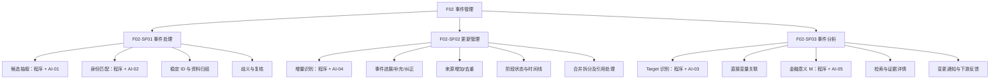
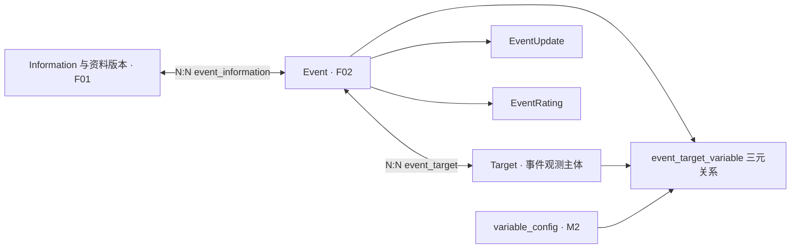
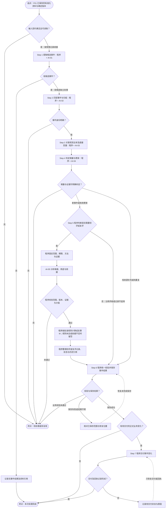

# F02 事件管理模块功能设计

> **文档定位**：RiskHot L0 信息处理层中 **F02 事件管理** 的功能设计，说明事件处理、更新管理和事件分析的业务行为。保留三组二级功能、14 项末级功能及既有追踪编号；文件版本维持 V1.0，本轮修订日期见页首。
> **依据与分工**：[F01 V2.1](F01%20%E4%BF%A1%E6%81%AF%E6%8E%A5%E5%85%A5%E4%B8%8E%E6%A0%87%E5%87%86%E5%8C%96%E6%A8%A1%E5%9D%97%E5%8A%9F%E8%83%BD%E8%AE%BE%E8%AE%A1%20V2.1.md) 定义接入职责及标准化 Information 契约；[L0 业务架构与领域设计](../02-%E4%B8%9A%E5%8A%A1%E6%9E%B6%E6%9E%84%E4%B8%8E%E9%A2%86%E5%9F%9F%E8%AE%BE%E8%AE%A1/RiskHot_L0_%E4%BF%A1%E6%81%AF%E5%A4%84%E7%90%86%E5%B1%82_%E4%B8%9A%E5%8A%A1%E6%9E%B6%E6%9E%84%E4%B8%8E%E9%A2%86%E5%9F%9F%E8%AE%BE%E8%AE%A1V1.0.md) 定义事件、关系、增量和金融意义。本文第 3 章承接领域定义并补齐逻辑表结构，第 4 章按执行顺序说明程序、AI 与人工复核的分工及交接，第 6 章定义交接与协作，第 7 章仅索引规则。
> **依据标记**：**[B]** 现有业务约束；**[P]** 本稿建议细则；**[D]** 待决。末级功能编号、优先级及新增验收场景仍为评审提案，不代表技术实现或方法审批已完成。

## 1. 模块定位与职责边界

### 1.1 模块定位

**F02 事件管理**将 F01 已保存并交付的标准化宏观资料组织为有稳定身份、有来源证据、可持续更新的宏观 Event；负责事件抽取、同一性判断、观测主体及直接变量关联、有效增量、纠正、金融意义 M，以及面向 F03/F05 的业务变化交付。[B]

F02 依次回答五个业务问题：

1. 资料里是否发生、宣布、计划或体现了可识别的宏观变化？
2. 这是一个独立新 Event，还是已有 Event 的再次报道或生命周期进展？
3. 它直接涉及哪些**事件观测主体 Target**和哪些有依据的**全局 Variable**？
4. 与此前记录相比，新增了实质事实、来源佐证、纠正，还是重复内容？
5. 在固定的观察范围与研究期限下，这次事件具有什么金融意义，并应向下游交付哪些变更？

### 1.2 在系统中的位置

F02 承接 F01 已保存的标准化资料，维护事件事实与历史，向 F03/F05 交付实际业务变化；M2 提供正式变量定义，M3 提供任务与方法版本，S01 和存储/交付能力提供执行支撑。完整处理流程见 §4.1，协作契约见第 6 章。[B/P]

### 1.3 主责、输入与输出

| 类型 | 内容 |
|---|---|
| 输入 | F01 已保存的标准化 `Information` 及确定的资料版本、前版关系和证据引用；既有 Event/Update；Target 字典、M2 有效 `variable_config`；M3 提供的适用任务与方法版本。详见 §6.2 |
| 正式主产物 | `Event`、`EventInformation`、`EventTarget`、`EventTargetVariable`、`EventUpdate`、`EventRating` |
| 业务副产物 | 待归组候选、Target/变量候选、证据缺口、方法反馈、处理记录和事件变化通知 |
| 下游 | F03 风险识别、F05 风险状态分析；M2 接收新变量/缺口反馈；M3 接收任务质量/方法问题反馈（使用范围依适用策略） |

### 1.4 职责边界

- [B] **资料获取、标准化、资料去重与版本、保存和交付由 F01 负责**。F02 接收已保存的标准化 Information，负责事件同一性与业务增量；只引用 F01 保留的原件、附件和确定版本，不另行接入、重新标准化或维护第二份原件真值。
- [B] **全局变量和指标定义由 M2 治理**。F02 只能匹配已有有效定义或提出候选，不能自造正式 `variable_id`。
- [B] F02 保留 Target 的事件观测语义；Event 行为主体 Subject 单独作为事件字段。Target 与风险层的 `risk.observation_target` 只有在身份与范围一致时才映射。
- [B] F02 的 M 是事件在指定观察范围的**金融研究重要性**。风险等级、风险方向、传导机制、风险纳管及当期状态分别由 F03～F05 判断。
- [B] 无直接证据时不推导融资成本、信用扩张等后续传导变量；也不预设 Target→Variable 固定归属，不独立建设通用 Entity 模型。
- [B] 首版重点覆盖宏观事件，不设计逐条事实 C 可信度评分、独立 P 优先级评分、投资建议或交易行为。
- [B/P] F02 定义业务校验、正式写入条件、复核决定及恢复要求；任务调度与执行恢复依赖 S01，方法治理依赖 M3，存储与消息机制依赖技术架构。协作分工见 §6.1，技术待办见 §9.2。

## 2. 功能架构与详细清单

### 2.1 二级功能结构



### 2.2 14 项末级功能清单

| 编号 | 二级功能 | 具体功能 | 建议优先级 | 完成标准 |
|---|---|---|---|---|
| F02-SF01.01 | 事件处理 | 候选事件抽取（程序 + AI-01） | P0 | 每份 Information 可输出 0..N 事件候选及证据定位 |
| F02-SF01.02 | 事件处理 | 同事件匹配与归组（程序 + AI-02） | P0 | 新事件/已有事件/待判定及逐项比较依据 |
| F02-SF01.03 | 事件处理 | 正式事件身份与资料关联 | P0 | 稳定 `event_id` 和 N:N `event_information` |
| F02-SF01.04 | 事件处理 | 归组歧义隔离及复核 | P0 | `UNRESOLVED` 保留，清晰候选继续处理 |
| F02-SF02.01 | 更新管理 | 事件增量判定（程序 + AI-04） | P0 | 七类增量结果及历史差异依据 |
| F02-SF02.02 | 更新管理 | 进展、实质补充与纠正 | P0 | `EventUpdate`、历史保留及状态调整 |
| F02-SF02.03 | 更新管理 | 仅来源新增与纯重复保护 | P0 | 只新增来源关系或幂等跳过，不制造实质进展 |
| F02-SF02.04 | 更新管理 | 事件生命周期与历史时间轴 | P0 | 业务时间、记录时间与阶段状态可查询 |
| F02-SF02.05 | 更新管理 | 合并/拆分核对与历史引用迁移 | P1 | 受控方案及审计；正式重定向规则先评审 [D] |
| F02-SF03.01 | 事件分析 | Target 识别与事件关系（程序 + AI-03） | P0 | `EventTarget`；允许 Target 暂不确定 |
| F02-SF03.02 | 事件分析 | 直接 Variable 三元关联及候选反馈 | P0 | 有效三元关系，缺定义进入 M2 候选 |
| F02-SF03.03 | 事件分析 | 金融意义评价及评级管理（程序 + AI-05） | P0 | 程序确定初评/复评、校验或计算 M，形成含范围/期限/方法版本/依据的 `EventRating`；规则未定允许空分 |
| F02-SF03.04 | 事件分析 | 事件中心、详情与证据追溯 | P0 | Event/Update/Target/Variable/M 及原文链可查 |
| F02-SF03.05 | 事件分析 | 变更交付、交付状态与反馈 | P0 | 持久化后向 F03/F05 交付，失败单独重试 |

**范围说明**：[B/P] `F02-SF01～SF03` 是系统总览已有的二级功能；`.01～.05` 为本轮评审提案。合并/拆分自动化的跨事件身份迁移涉及稳定引用，作为 P1 待决，不能将其视作自动归组所需的首版前置能力。

### 2.3 编号与功能范围

首版保留事件处理、更新管理、事件分析三组共 14 项功能；七步处理顺序及功能映射统一见 §4.1。无事件、重复、仅新增来源、歧义和缺失变量定义均有合法处理分支。查询和受控维护单列，不新增流水线必经步骤。[B/P]

## 3. 业务对象与信息组织

### 3.1 核心关系与所有权



| 对象 | 中文名称 | 对象含义与 F02 职责 | 定义依据 |
|---|---|---|---|
| Information 与资料版本 | 标准化资料及版本 | 资料由 F01 管理；F02 只读消费，保留确定版本及原件引用 | [F01 V2.1](F01%20%E4%BF%A1%E6%81%AF%E6%8E%A5%E5%85%A5%E4%B8%8E%E6%A0%87%E5%87%86%E5%8C%96%E6%A8%A1%E5%9D%97%E5%8A%9F%E8%83%BD%E8%AE%BE%E8%AE%A1%20V2.1.md) §3.2～3.3、§4.5～4.7 |
| Event | 事件 | 创建或复用稳定事件身份，维护当前事实与状态 | [L0](../02-%E4%B8%9A%E5%8A%A1%E6%9E%B6%E6%9E%84%E4%B8%8E%E9%A2%86%E5%9F%9F%E8%AE%BE%E8%AE%A1/RiskHot_L0_%E4%BF%A1%E6%81%AF%E5%A4%84%E7%90%86%E5%B1%82_%E4%B8%9A%E5%8A%A1%E6%9E%B6%E6%9E%84%E4%B8%8E%E9%A2%86%E5%9F%9F%E8%AE%BE%E8%AE%A1V1.0.md) §3.2、§4.3.3 |
| Target | 事件的观测主体 | 对象定义：记录可被多个事件引用的主体身份、类型、辖区和范围。F02 匹配已有主体或提出候选；新主体正式建档授权待决 | [L0](../02-%E4%B8%9A%E5%8A%A1%E6%9E%B6%E6%9E%84%E4%B8%8E%E9%A2%86%E5%9F%9F%E8%AE%BE%E8%AE%A1/RiskHot_L0_%E4%BF%A1%E6%81%AF%E5%A4%84%E7%90%86%E5%B1%82_%E4%B8%9A%E5%8A%A1%E6%9E%B6%E6%9E%84%E4%B8%8E%E9%A2%86%E5%9F%9F%E8%AE%BE%E8%AE%A1V1.0.md) §3.3、§4.3.4 |
| EventTarget | 事件—观测主体关联 | 事件关联：记录某事件涉及哪些观测主体。由 F02 维护，可在尚无直接变量关联时独立存在，不改写主体定义 | [L0](../02-%E4%B8%9A%E5%8A%A1%E6%9E%B6%E6%9E%84%E4%B8%8E%E9%A2%86%E5%9F%9F%E8%AE%BE%E8%AE%A1/RiskHot_L0_%E4%BF%A1%E6%81%AF%E5%A4%84%E7%90%86%E5%B1%82_%E4%B8%9A%E5%8A%A1%E6%9E%B6%E6%9E%84%E4%B8%8E%E9%A2%86%E5%9F%9F%E8%AE%BE%E8%AE%A1V1.0.md) §3.3、§4.3.7 |
| Variable | 全局变量 | 对象定义：名称、定义、单位及解释口径由 M2 统一治理。F02 只读引用正式变量或提交候选，不修改定义，不设置固定的主体归属 | [L0](../02-%E4%B8%9A%E5%8A%A1%E6%9E%B6%E6%9E%84%E4%B8%8E%E9%A2%86%E5%9F%9F%E8%AE%BE%E8%AE%A1/RiskHot_L0_%E4%BF%A1%E6%81%AF%E5%A4%84%E7%90%86%E5%B1%82_%E4%B8%9A%E5%8A%A1%E6%9E%B6%E6%9E%84%E4%B8%8E%E9%A2%86%E5%9F%9F%E8%AE%BE%E8%AE%A1V1.0.md) §3.4、§4.3.5 |
| EventTargetVariable | 事件—观测主体—变量关联 | 事件关联：记录本次事件对特定观测主体直接涉及的变量及变化。F02 根据证据维护三元关系，须引用有效 EventTarget 和 M2 正式变量，不改写变量定义 | [L0](../02-%E4%B8%9A%E5%8A%A1%E6%9E%B6%E6%9E%84%E4%B8%8E%E9%A2%86%E5%9F%9F%E8%AE%BE%E8%AE%A1/RiskHot_L0_%E4%BF%A1%E6%81%AF%E5%A4%84%E7%90%86%E5%B1%82_%E4%B8%9A%E5%8A%A1%E6%9E%B6%E6%9E%84%E4%B8%8E%E9%A2%86%E5%9F%9F%E8%AE%BE%E8%AE%A1V1.0.md) §3.4、§4.3.8 |
| EventInformation | 事件—资料关联 | 维护事件与资料的多对多关系、来源角色及版本化证据定位 | [L0](../02-%E4%B8%9A%E5%8A%A1%E6%9E%B6%E6%9E%84%E4%B8%8E%E9%A2%86%E5%9F%9F%E8%AE%BE%E8%AE%A1/RiskHot_L0_%E4%BF%A1%E6%81%AF%E5%A4%84%E7%90%86%E5%B1%82_%E4%B8%9A%E5%8A%A1%E6%9E%B6%E6%9E%84%E4%B8%8E%E9%A2%86%E5%9F%9F%E8%AE%BE%E8%AE%A1V1.0.md) §4.3.6；本文 §6.2 |
| EventUpdate | 事件更新 | 追加事件进展、实质补充、纠正及历史 | [L0](../02-%E4%B8%9A%E5%8A%A1%E6%9E%B6%E6%9E%84%E4%B8%8E%E9%A2%86%E5%9F%9F%E8%AE%BE%E8%AE%A1/RiskHot_L0_%E4%BF%A1%E6%81%AF%E5%A4%84%E7%90%86%E5%B1%82_%E4%B8%9A%E5%8A%A1%E6%9E%B6%E6%9E%84%E4%B8%8E%E9%A2%86%E5%9F%9F%E8%AE%BE%E8%AE%A1V1.0.md) §3.5、§4.3.9 |
| EventRating | 事件金融意义评价 | 保存金融意义、用途、评价依据及历史 | [L0](../02-%E4%B8%9A%E5%8A%A1%E6%9E%B6%E6%9E%84%E4%B8%8E%E9%A2%86%E5%9F%9F%E8%AE%BE%E8%AE%A1/RiskHot_L0_%E4%BF%A1%E6%81%AF%E5%A4%84%E7%90%86%E5%B1%82_%E4%B8%9A%E5%8A%A1%E6%9E%B6%E6%9E%84%E4%B8%8E%E9%A2%86%E5%9F%9F%E8%AE%BE%E8%AE%A1V1.0.md) §3.6、§4.3.10 |

本章按用户要求补齐可评审的逻辑表结构：基础字段沿用 L0 §4.3，新增或细化项标为 [P]；类型、可空性、主键、引用、唯一约束与历史规则如下。PK 表示主键，FK 表示外键；跨模块“引用”表示业务校验契约，不预设跨库外键。中文名称用于阅读，英文名用于逻辑映射，尚不代表独立物理表已建成。

核心表共七张（含共用 Target 定义），§3.9 明确上游只读引用，§3.10 补充证据、修订、资料处理与候选四张逻辑表；存储映射与通用约束见 §3.11。

### 3.2 Event：稳定事件身份 [B]

Event 是具有明确时间语境、主体和完整行动或状态变化的宏观事件单元，核心识别要素为 **Subject + Action + Time**。同一生命周期的进展延续身份，独立决定分别建档；归组行为见 §4.3.1～4.3.2。

**逻辑表：`event`｜事件主表**。F02 维护当前有效事实；历史状态由 §3.10.2 的修订记录保留。

| 字段 | 建议类型 / 可空性 | 中文含义 | 规则 |
|---|---|---|---|
| `event_id` | UUID，必填，PK | 事件标识 | 稳定身份，不由 AI 编造 |
| `title` | VARCHAR(300)，必填 | 事件标题 | F02 生成的业务标题，不冒充来源原始标题 |
| `description` | TEXT，必填 | 事件描述 | 当前核心事实、行动及范围 |
| `event_type` | VARCHAR，必填 | 事件类型 | 引用适用分类；不能以类型相同判定同一事件 |
| `subject_name` | VARCHAR，必填 | 行为主体名称 | 与 Target 观测主体分开 |
| `subject_type` | VARCHAR，可空 | 行为主体类型 | 证据不足时不猜测 |
| `action_code` | VARCHAR，必填 | 行动或变化分类 | 对应可识别的行动、决定或状态变化 |
| `event_status` | 枚举，必填 | 事件阶段 | 沿用 §4.5.4 的七种阶段；不是运行状态 |
| `event_time` | TIMESTAMPTZ，可空 | 主要事件时间 | 能确定具体时点时填写，不能以采集时间代替 |
| `event_time_kind` | 枚举，必填 | 时间语义 | 实际发生、宣布、预计、实施或未知；存储编码待定 |
| `event_time_precision` | 枚举，必填 | 时间精度 | 日、月、季度、年或未知等原始精度 |
| `event_time_text` | TEXT，可空 | 原始时间表达 | [P] 如“2027年一季度”；精度不足时保留原表达，不伪造具体日期 |
| `first_seen_at` | TIMESTAMPTZ，必填 | 首次识别时间 | 系统首次识别本事件的真实时间 |
| `updated_at` | TIMESTAMPTZ，必填 | 最近业务修改时间 | 只在有效业务结果提交时更新，不因重复投递刷新 |
| `revision_no` | BIGINT，必填 | 当前业务修订号 | [P] 正整数；对应本事件已保存的 `event_revision` |

**主键与约束**：PK `event_id`；不能对标题或 Subject + Action + Time 直接设置自动合并唯一键。正式新事件至少有一个资料关联和一条有效证据；身份、初始更新及首版修订在 Step 6 一并提交。建议查询索引为 `(event_type,event_time,event_id)`、`(event_status,updated_at,event_id)`。[B/P]

### 3.3 Target：事件的观测主体 [B]

Target 表示事件涉及的宏观观测主体，与发起或执行行为的 Subject 分开。类型、辖区和范围共同参与身份核对；处理见 §4.4.1。

**逻辑表：`target`｜观测主体定义表**。跨事件共用，F02 匹配或提出候选；正式建档与定义修订权限仍由 D-F02-03 决定，不因补表结构而自动授权。

| 字段 | 建议类型 / 可空性 | 中文含义 | 规则 |
|---|---|---|---|
| `target_id` | UUID，必填，PK | 主体标识 | 跨事件稳定复用 |
| `target_code` | VARCHAR，必填，UNIQUE | 主体编码 | 经治理的稳定编码，不按名称临时拼接 |
| `target_name` | VARCHAR，必填 | 主体名称 | 名称相同不代表身份相同 |
| `target_type` | 枚举，必填 | 主体类型 | `economy`、`macro_institution`、`financial_system`、`financial_market`、`economic_sector` |
| `jurisdiction` | VARCHAR，必填 | 国家或辖区 | 与主体范围一起核验 |
| `scope_definition` | TEXT，必填 | 主体范围 | 说明包含范围及边界 |
| `parent_target_id` | UUID，可空，FK | 上级主体 | 引用 `target.target_id`，禁止自引用和循环；不强制完整树 |
| `is_active` | BOOLEAN，必填 | 是否允许新增引用 | 停用不删除历史事件引用 |
| `definition_version` | 版本引用，必填 | 主体定义版本 | [P] 由主体治理方提供，历史定义可读取；关联记录固定实际采用版本 |

**主键与约束**：PK `target_id`，唯一 `target_code`；名称/类型/辖区索引用于候选核对，不能取代范围判断。没有 `variable_ids` 字段或静态 TargetVariable 表。定义版本存储复用主体治理的版本能力，不在 F02 复制第二套主体字典。[B/P]

### 3.4 EventInformation：来源与原文证据 [B]

一份资料可支撑多个事件，一个事件可关联多份资料。资料身份关系与每次引用的版本化证据分开保存，避免一份资料修订后覆盖旧判断。

**逻辑表：`event_information`｜事件—资料关联表**。保留 L0 的联合主键；具体版本及多处证据放在 §3.10.1。

| 字段 | 建议类型 / 可空性 | 中文含义 | 规则 |
|---|---|---|---|
| `event_id` | UUID，必填，PK/FK | 事件标识 | 引用 `event.event_id` |
| `information_id` | 上游 ID，必填，PK/引用 | 资料标识 | 引用 F01 稳定资料身份 |
| `information_role` | 枚举，必填 | 首次关联角色 | 初始来源、补充、进展或纠正来源；[P] 明确为首次角色，后续各次角色记录在证据表 |
| `evidence_locator` | JSONB，可空 | 首次证据定位摘要 | 保留 L0 字段兼容；[P] 仅供展示，必须与首次证据一致，完整版本引用以证据表为准 |
| `created_at` | TIMESTAMPTZ，必填 | 首次建立时间 | [P] 重复同一关系不重新建立 |

**主键与约束**：PK `(event_id,information_id)`；同一资料新版本沿用此关系，追加证据行。独立来源各有资料身份，不因事件内容相同被丢弃。反向索引 `(information_id,event_id)` 支持从 F01 查询事件。所有正式关系至少有一条有效证据，在同一业务提交中检查。[B/P]

### 3.5 EventTargetVariable：直接变量关联 [B]

三元关系表达本次事件直接涉及、宣布调整或有观测依据的变量变化；处理见 §4.4.2。

**逻辑表：`event_target_variable`｜事件—观测主体—变量关联表**。F02 维护当前关系，修订历史由 §3.10.2 固定。

| 字段 | 建议类型 / 可空性 | 中文含义 | 规则 |
|---|---|---|---|
| `event_id` | UUID，必填，PK/FK | 事件标识 | 与 `target_id` 组成复合引用 |
| `target_id` | UUID，必填，PK/FK | 观测主体标识 | `(event_id,target_id)` 必须存在于 `event_target` |
| `variable_id` | 上游 ID，必填，PK/引用 | 核心驱动变量标识 | 引用 M2 正式 `variable_config`；候选不能写入此表 |
| `variable_version_ref` | 版本引用，必填 | 变量定义版本 | [P] 固定本次实际采用的 M2 定义版本 |
| `relation_type` | 枚举，可空 | 直接关联类型 | 直接改变、宣布调整、已观察变化等；无依据不补造 |
| `change_direction` | 枚举，可空 | 直接变化方向 | 上升、下降、不变、未知；不是风险方向 |
| `impact_status` | 枚举，可空 | 变化阶段 | 预计、已宣布、实施中或已有观测结果 |
| `description` | TEXT，可空 | 关联说明 | 具体直接变化、适用范围及限制 |
| `information_id` | 上游 ID，可空 | 主要来源资料 | 沿用 L0 字段；若填写须属于本事件且出现在证据引用中 |
| `evidence_refs` | UUID 列表，必填 | 支持证据集合 | [P] 至少一条，均属于本事件的 `event_evidence`，可引用多份资料 |
| `created_at` | TIMESTAMPTZ，必填 | 建立时间 | 首次关联时间 |
| `updated_at` | TIMESTAMPTZ，必填 | 最近关系修改时间 | [P] 变化提交前保留旧版关系快照 |

**主键与约束**：PK `(event_id,target_id,variable_id)`；FK `(event_id,target_id)` → `event_target`；有主要资料时 FK `(event_id,information_id)` → `event_information`。不设置静态 `(target_id,variable_id)` 前置表。建议反向索引 `(variable_id,event_id,target_id)`。方向或阶段修订沿用关系身份，旧状态可从事件修订中恢复；没有直接证据不得创建正式关系。[B/P]

### 3.6 EventUpdate：增量与两类时间 [B]

EventUpdate 记录有业务意义的事件变化；业务时间与记录时间分开，处理见 §4.5.2、§4.5.4。

**逻辑表：`event_update`｜事件更新表**。追加保存，正式记录不无痕覆盖。

| 字段 | 建议类型 / 可空性 | 中文含义 | 规则 |
|---|---|---|---|
| `event_update_id` | UUID，必填，PK | 更新标识 | 一项已确认变化的稳定身份 |
| `event_id` | UUID，必填，FK | 所属事件 | 引用 `event.event_id` |
| `information_id` | 上游 ID，可空 | 引发更新的主要资料 | 必须已关联本事件，并包含于证据集合 |
| `update_type` | 枚举，必填 | 更新类型 | 新事件、进展、实质补充、纠正；具体动作沿用 §4.5.1；状态变化归入相应进展/纠正 |
| `summary` | TEXT，必填 | 增量说明 | 相比既有事件究竟改变了什么 |
| `previous_status` | 事件阶段，可空 | 变更前阶段 | 初始更新可空；其余按事实填写 |
| `current_status` | 事件阶段，可空 | 变更后阶段 | 无阶段变化时不强制填新阶段 |
| `effective_at` | TIMESTAMPTZ，可空 | 业务发生/适用时间 | 不以 `recorded_at` 补齐 |
| `effective_time_kind` | 枚举，必填 | 业务时间语义 | [P] 实际、宣布、预计、实施或未知 |
| `effective_time_precision` | 枚举，必填 | 业务时间精度 | [P] 保留来源精度 |
| `effective_time_text` | TEXT，可空 | 原时间表达 | [P] 无法精确定位时保留，例如某月/季度 |
| `recorded_at` | TIMESTAMPTZ，必填 | 系统记录时间 | 真实提交时间，用于“何时获知”查询 |
| `evidence_refs` | UUID 列表，必填 | 增量证据 | [P] 至少一条本事件的版本化证据 |
| `supersedes_update_ids` | UUID 列表，必填，可为空列表 | 被纠正的更新 | [P] 来源纠正时至少引用一条本事件既有更新；不能自引用、跨事件或成环 |
| `business_change_key` | TEXT，必填 | 增量幂等键 | [P] F02 对实际变化确认后固定，见 §3.11；重复来源/投递复用 |

**主键与约束**：PK `event_update_id`，唯一 `(event_id,business_change_key)`；建议增加唯一 `(event_id,event_update_id)` 供同事件复合引用。`SOURCE_ADDITION`、`DUPLICATE`、`UNRESOLVED` 不在此表造更新。解析错误引起的历史结论修复按 D-F02-05 授权，记录修订原因，不能伪装成来源 `CORRECTION`。索引 `(event_id,effective_at,event_update_id)`、`(event_id,recorded_at,event_update_id)` 分别支持双时间查询。[B/P]

### 3.7 EventRating：金融意义历史 [B]

EventRating 保存固定观察范围与研究期限下的金融研究意义、用途、依据和方法版本；处理见 §4.6。

**逻辑表：`event_rating`｜事件金融意义评价表**。每次评价独立追加；旧评价和旧依据保持可读。

| 字段 | 建议类型 / 可空性 | 中文含义 | 规则 |
|---|---|---|---|
| `rating_id` | UUID，必填，PK | 评价标识 | 稳定评价身份 |
| `event_id` | UUID，必填，FK | 被评价事件 | 引用 `event.event_id` |
| `assessment_scope` | TEXT，必填 | 宏观观察范围 | 明确主体、辖区与范围，不用单个 Target ID 替代范围说明 |
| `research_horizon` | TEXT，必填 | 研究期限 | [P] 明确期限/区间及其语义，不能空缺或只填“默认” |
| `financial_significance_m` | NUMERIC，可空 | 金融意义总分 | 量化方法未批准时为空；使用 L0 候选百分制时限定 0～100 |
| `dimension_scores` | JSONB，可空 | 维度评价 | 维度代码、说明、可空分值和证据引用；引用须为本次评价证据集合的子集，分值范围按方法版本校验 |
| `financial_usages` | 枚举列表，必填，可为空列表 | 金融用途 | `investment`、`financing`、`speculation_sentiment`；去重，不按标签数决定 M |
| `reasoning_summary` | TEXT，必填 | 评价依据 | 说明范围、重要性、用途及不确定性；空用途须说明无法判断 |
| `method_version` | 版本引用，必填 | 方法版本 | 固定规则/权重版本；Prompt、模型版本通过执行依据引用追溯 |
| `rating_status` | 枚举，必填 | 评价状态 | 草案、已确认、待复评；不能将未批准方法的分数标为正式结论 |
| `evaluated_at` | TIMESTAMPTZ，必填 | 评价时间 | 本次实际评价时间 |
| `basis_revision_no` | BIGINT，必填 | 评价依据的事件修订 | [P] `(event_id,basis_revision_no)` 引用已有或本次原子提交的事件修订 |
| `evidence_refs` | UUID 列表，必填 | 评价证据集合 | [P] 至少一条本事件的版本化证据 |
| `assessment_key` | TEXT，必填 | 评价操作幂等键 | [P] 固定范围、期限、依据和方法后的评价操作身份；重试复用，授权复评新建 |
| `supersedes_rating_id` | UUID，可空 | 前次被替代评价 | [P] 必须属于同一事件及同一范围/期限，不删除旧记录 |

**主键与约束**：PK `rating_id`，唯一 `(event_id,assessment_key)`；不能将 `event_id` 或 `(event_id,method_version)` 设为唯一，否则会阻止多范围和历史复评。范围/期限变更是另一组评价，不能覆盖旧组；状态变更也须保留历史版本。索引 `(event_id,assessment_scope,research_horizon,evaluated_at,rating_id)`；较长文本的物理索引实现可使用另行定义并校验的稳定范围键。[B/P]

### 3.8 EventTarget：事件—观测主体关联 [B/P]

**逻辑表：`event_target`｜事件—观测主体关联表**。由 F02 维护，表达“这个事件涉及哪个观测主体”，可独立于变量关系存在。

| 字段 | 建议类型 / 可空性 | 中文含义 | 规则 |
|---|---|---|---|
| `event_id` | UUID，必填，PK/FK | 事件标识 | 引用 `event.event_id` |
| `target_id` | UUID，必填，PK/引用 | 观测主体标识 | 引用正式 `target.target_id` |
| `relation_note` | TEXT，可空 | 关联说明 | 事件如何涉及该主体 |
| `target_version_ref` | 版本引用，必填 | 主体定义版本 | [P] 与本次引用的主体身份、辖区和范围一致 |
| `evidence_refs` | UUID 列表，必填 | 主体关联证据 | [P] 至少一条本事件的版本化证据 |
| `created_at` | TIMESTAMPTZ，必填 | 建立时间 | [P] 首次建立关系的时间 |
| `updated_at` | TIMESTAMPTZ，必填 | 最近关联修改时间 | [P] 修改保留在事件修订快照中 |

**主键与约束**：PK `(event_id,target_id)`；反向索引 `(target_id,event_id)`。Target 暂不明确时不插入占位关系。存在有效三元变量关系时不能单独移除其 EventTarget；纠错须同一业务提交校验受影响关系并保留历史。

### 3.9 上游只读引用契约

以下不是 F02 新建的业务表。这里补齐读取要求，不复制 F01 原件或 M2 字典。

| 逻辑对象 / 主责 | 必须读取的身份与版本 | 业务字段及可空性 | 引用约束 |
|---|---|---|---|
| Information / F01 | `information_id`、确定资料版本、前版及变化性质、信源与配置版本 | 标准化内容、原件/附件引用、取得时间、处理来源、内容指纹、检查结果；原始标题/URL/发布时间按来源可空 | 仅完整保存且可读的资料版本进入分析，完整输入见 §6.2 |
| Target 定义及历史 / 主体治理 | `target_id`、`definition_version` | 字段见 §3.3；停用后历史版本仍可追溯 | F02 正式建档权限待决，已有身份和版本必须真实存在 |
| `variable_config` / M2 | `variable_id`、实际定义版本 | `variable_code`、`variable_name`、`definition`、`unit`、`status`；状态变量单位可空 | 正式变量及定义版本由 M2 治理；无匹配时记录候选，不造正式 ID |

**版本引用类型**：[P] 本章“版本引用”是上游发布的不可变标识，具体采用整数、文本或版本实体 ID 由共享契约落实；F02 不自行编号。逻辑上始终按“对象身份 + 版本”定位。资料发布修订和资料重新解析的版本区别沿用 F01 V2.1。

### 3.10 证据、修订与处理记录 [P]

下列为本轮补充的逻辑存储建议，用于完成现有功能的证据追溯、历史查看和分项恢复。表名和字段尚非已部署结构；运行计划、通用审核、Outbox/Inbox 等仍复用协作能力。

#### 3.10.1 `event_evidence`：事件版本化证据表

同一事件—资料关系可有多个版本、多处定位和不同用途；保留 §3.4 的稳定联合键，在本表追加不可变证据。

| 字段 | 建议类型 / 可空性 | 中文含义 | 规则 |
|---|---|---|---|
| `evidence_id` | UUID，必填，PK | 证据标识 | 正式引用后不可无痕改写 |
| `event_id` | UUID，必填，FK | 所属事件 | 与资料组成复合引用 |
| `information_id` | 上游 ID，必填，引用 | 来源资料 | `(event_id,information_id)` 引用 `event_information` |
| `information_version_ref` | 版本引用，必填 | 来源资料版本 | 必须确属该资料，固定标准化内容及对应原件 |
| `evidence_locator` | JSONB，必填 | 证据位置 | 包含载体引用、位置类型和位置值；类型可为正文段落/页码/表格记录/整份资料；整份资料也须显式标明 |
| `locator_key` | TEXT，必填 | 位置规范键 | 将同版同位置规范化以防重复；规则版本包含在键中，碰撞必须核对完整位置 |
| `information_role` | 枚举，必填 | 本次证据角色 | 初始、补充、进展或纠正；各次用途独立于首次资料关系角色 |
| `content_hash` | TEXT，必填 | 固定内容指纹 | 记录所引用资料版本的指纹；原文仍由 F01 保存 |
| `created_at` | TIMESTAMPTZ，必填 | 证据登记时间 | 不当作原始发布时间 |

PK `evidence_id`；唯一 `(event_id,evidence_id)` 供同事件引用；去重键 `(event_id,information_id,information_version_ref,locator_key,information_role)`。`evidence_refs` 是去重后的 ID 集合：每项必须存在、属于同一事件、版本可读、权限及时间条件满足。物理上可实现为子关联表；若用 JSONB/数组承载，程序必须逐项校验，不能声称普通外键已经保证数组元素有效。

#### 3.10.2 `event_revision`：事件业务修订表

固定每次已提交的事件及关系快照。EventUpdate 解释“事件发生了什么变化”，本表解释“当时保存的完整结果是什么”；只增加来源或修正关系也可产生修订，不强制产生 EventUpdate。

| 字段 | 建议类型 / 可空性 | 中文含义 | 规则 |
|---|---|---|---|
| `event_id` | UUID，必填，PK/FK | 所属事件 | 引用 Event |
| `revision_no` | BIGINT，必填，PK | 修订号 | 正整数，每个事件内单调递增；与当前 Event 修订号一致 |
| `previous_revision_no` | BIGINT，可空 | 前版修订号 | 首版为空，其他引用本事件已保存前版 |
| `change_reason` | TEXT，必填 | 修订原因 | 创建、进展、来源增加、关系调整或授权记录修复等具体依据 |
| `snapshot` | JSONB，必填 | 完整业务快照 | 固定事件字段、资料关系及证据 ID、EventTarget（含定义版本）、三元关系（含变量版本）、截至本次的 Update/Rating ID及状态版本引用 |
| `snapshot_schema_version` | TEXT，必填 | 快照格式版本 | 支持历史结构解释，不能用新结构默读旧快照 |
| `recorded_at` | TIMESTAMPTZ，必填 | 修订记录时间 | 按系统获知时间查询历史；不替代业务时间 |
| `operation_ref` | 运行侧引用，必填 | 正式业务操作 | 引用共享操作/审计记录，可追踪授权与实际方法版本；同一操作可处理多个候选 |
| `commit_key` | TEXT，必填 | 本次业务提交键 | 固定本次候选或维护提交身份；失败重试沿用，多候选独立提交分别取键 |

PK `(event_id,revision_no)`，唯一 `(event_id,commit_key)`，防止同一提交重复产生修订；不能对 `operation_ref` 单独唯一，以免同一运行中的多个候选相互阻断。业务数据、快照、当前修订号和变更交付意图须在同一原子提交中落实；并发使用预期修订号校验。纯重试/无变化不产生新修订。快照引用必须指向不可变行或明确版本，不能只存可变对象的当前 ID；评级若依据本次修订产生，可在同一提交内校验，避免评价引用不存在的版本。

#### 3.10.3 `f02_processing_result`：资料版本处理结果表

记录 F02 对一份资料版本的业务处理结果，支持无事件、部分完成与重算；不承载 S01 调度、模型执行日志或交付重试次数。

| 字段 | 建议类型 / 可空性 | 中文含义 | 规则 |
|---|---|---|---|
| `processing_id` | UUID，必填，PK | 处理标识 | 一次逻辑分析操作的稳定身份 |
| `information_id` | 上游 ID，必填 | 资料身份 | 与确定版本绑定 |
| `information_version_ref` | 版本引用，必填 | 资料版本 | 校验已保存并可读取 |
| `analysis_key` | TEXT，必填 | 分析业务键 | 首次处理使用固定首次键；显式授权重算新建键，重试复用原键 |
| `parent_processing_id` | UUID，可空，FK | 原处理记录 | 重算时指向原处理，不覆盖其结果；禁止循环 |
| `operation_ref` | 运行侧引用，必填 | 受理与执行关联 | 连接 S01/共享操作记录，接收回执不等于处理完成 |
| `method_manifest_ref` | 固定版本引用，必填 | 方法与运行依据 | 固定任务、Prompt、模型及规则版本；不跟随“最新配置”漂移 |
| `extraction_status` | 枚举，必填 | 候选抽取完成状态 | 建议待处理/完成/待恢复；只有完成后候选总数才确定 |
| `candidate_count` | INTEGER，可空 | 候选总数 | 抽取未完成为空；完成后非负，0表示明确无事件 |
| `result_status` | 枚举，必填 | 业务结果状态 | 建议待处理、处理中、部分完成、待复核、已完成、待恢复；按候选结果汇总，不借用任务运行状态 |
| `result_summary` | TEXT，可空 | 结果或阻断原因 | 无事件、待复核、部分完成和失败时有可解释说明 |
| `accepted_at` | TIMESTAMPTZ，必填 | 接收记录时间 | 可靠登记后才返回约定接收确认 |
| `updated_at` | TIMESTAMPTZ，必填 | 结果变更时间 | 与执行日志更新时间分开 |
| `completed_at` | TIMESTAMPTZ，可空 | 分析完成时间 | 已完成时填写，不代表全部下游交付完成 |

PK `processing_id`，唯一 `(information_id,information_version_ref,analysis_key)`；索引 `(result_status,updated_at,processing_id)`。同版重投解析到既有首次处理键，不因方法升级生成隐式重算。候选清单及数量在抽取完成时一并保存；总数不明不能判“无事件”。候选状态变化与汇总在同一提交中更新。

#### 3.10.4 `event_candidate`：候选事件处理记录表

每个候选独立记录归组、缺口与处理去向，支持 §4.3.3 和 §4.9。

| 字段 | 建议类型 / 可空性 | 中文含义 | 规则 |
|---|---|---|---|
| `candidate_id` | UUID，必填，PK | 候选标识 | 不代替正式 `event_id` |
| `processing_id` | UUID，必填，FK | 所属资料处理 | 引用 `f02_processing_result` |
| `candidate_key` | TEXT，必填 | 本次抽取内候选键 | 与候选清单一起固定，恢复不重编号；不以标题作为全局唯一键 |
| `candidate_payload` | JSONB，必填 | 抽取结果 | 对应 §4.2 的主体、行为、时间、类型、范围及不确定性 |
| `input_evidence_locators` | JSONB 列表，必填 | 输入资料证据位置 | 至少一处；以所属处理的资料及版本定位，未有正式事件时不造 EventEvidence |
| `matching_candidates` | JSONB 列表，必填，可为空列表 | 归组比较记录 | 已有 Event ID、比较时修订号及差异依据；记录不等于关联已获批准 |
| `resolved_event_id` | UUID，可空，FK | 已确认归属事件 | 指向正式 Event；未归组时为空，新事件在正式提交时回填 |
| `increment_type` | 七类增量枚举，可空 | 增量结果 | 尚未判断时为空；七类取值沿用 §4.5.1 |
| `definition_candidates` | JSONB 列表，必填，可为空列表 | 主体/变量缺口 | 保存类型、语义、理由、证据及治理反馈引用；不填虚假正式 ID |
| `processing_status` | 枚举，必填 | 候选业务状态 | 建议待处理、待归组、待复核、待恢复、已完成；与事件阶段独立 |
| `resume_step` | INTEGER，可空 | 恢复步骤 | 1～6；已完成为空，只表示分析/保存续接位置，S01 决定调度；Step 7 交付恢复独立追踪 |
| `saved_result_refs` | JSONB，必填 | 已保存结果引用 | 保存实际 Event/修订/Update/Rating 身份；未保存为空对象，重复结果可引用既有产物 |
| `review_ref` | 共享复核引用，可空 | 复核记录 | 指向通用审核记录，F02 校验有效决定后正式提交 |
| `reason` | TEXT，可空 | 异常或判定理由 | 待归组、待复核和待恢复必须有原因 |
| `created_at`、`updated_at` | TIMESTAMPTZ，必填 | 记录时间 | 真实创建及变更时间 |

PK `candidate_id`，唯一 `(processing_id,candidate_key)`；索引 `(processing_id,processing_status)`。`UNRESOLVED` 不得同时标“已完成”；Target/变量缺口可以保留而不阻断其他合法结果。正式业务提交与该候选的已保存引用一并落账；同版重投只恢复未完成候选，交付状态另查共享交付记录。

### 3.11 数据一致性、版本与存储映射 [B/P]

**命名与落地范围**：§3.2～3.8 包含六张 F02 主责业务表和一张共用主体定义表，§3.10 是四张补充逻辑表；F01 Information、M2 变量字典及共享运行能力按契约引用。基础字段来源为 L0 §4.3，标注 [P] 的字段及 §3.10 全部是为本稿功能补齐的设计建议。未标可空的字段必须有真实值；可空不等于空字符串、零或虚构 ID。版本与约束的物理实现见 D-F02-07～08。

1. **正式关系与证据**：新 Event 至少一份资料和一条证据；EventTarget 和三元关系各自至少一条同事件证据；每条 Update/Rating 的证据集合固定版本。跨事件混引、资料身份与版本不匹配、候选充当正式 ID 都拒绝提交。证据列表不得重复。
2. **幂等分层**：资料受理按资料身份/版本/分析键；候选按处理身份/候选键；来源按事件/资料关系；实际增量按事件/变化键；评价按事件/评价键。`business_change_key` 由归组和增量比较后分配并复用，不按“资料 ID + 增量类型”直接生成，以免把多来源同一变化写成多个更新。独立变化即使同一资料同一类别也有不同变化键。语义不能确认时复核，不靠哈希强行裁决；并发对同一事件进行修订校验后重新比较。
3. **版本历史**：资料原件和标准化版本由 F01 保留；主体/变量定义由治理方保留。F02 保留事件修订、版本化证据、更新与评级历史。正式纠正追加记录并指向被纠正对象；关系修改/移除保留旧快照，不能级联删除历史证据或下游引用。停用字典不影响获授权历史阅读。
4. **时间**：系统时间用带时区时间戳，按 UTC 保存；业务时间保留原语义、时区与精度。月/季度不伪造具体日；按“当时已知”查询须约束资料可获知时间和记录时间，不能只按业务生效时间拼入后来证据。
5. **状态与并发**：事件阶段、资料处理、候选处理、评级状态和交付状态分别维护。编辑/复核带预期版本；业务写入、必要关系、修订快照、候选完成记录及交付意图原子提交，冲突时重新核对，不盲目覆盖。每个候选可独立完成，不要求整份资料所有候选同时成功。
6. **共享能力**：方法/模型/Prompt 版本、运行尝试、通用审核、审计和 Outbox/Inbox 通过固定引用使用。F02 不新增调度表、模型配置表或第二套交付重试账本。所有新增引用须能回查实际生效版本，日志不承载原件真值。

**当前仓库映射**：截至本次检查，[初始迁移](../../../database/migrations/001_initial.sql) 使用各领域 `records/history` 及公共操作、审计、Outbox、工件表；[现有信息领域处理](../../../packages/domains/information/index.ts) 将事件、更新和待归组结果保存为通用记录，部分关系嵌于业务数据。上述独立逻辑表尚不能视为已建成的物理表。可先由类型化业务数据与事务校验承载，再按评审结果拆独立表；使用通用存储时必须校验记录类型、复合唯一性和引用版本，不能仅因 UUID 存在就认为对象正确。[B/P]

关系联合键仍是业务唯一键；映射到通用 `records.id` 时可另有技术记录 ID，但不能替代复合唯一约束。逻辑修订可映射到领域历史存储，须确保快照包含全部相关版本，单独保存主表历史并不能自动保证关联历史完整。实施时需核对旧 `source_refs`、`targets`、`phase` 等嵌套字段及既有幂等键的转换，保留原身份与历史；迁移脚本、DDL 和数据库执行不在本次文档补充中宣称完成。

## 4. 功能详细设计

### 4.1 总体流程

总体流程共七步：**提取候选事件 → 匹配事件与归组 → 关联观测主体及直接变量 → 判定增量与更新 → 评价金融意义 M → 校验并保存事件结果 → 交付事件变化**。第 2 章按能力分组，第 4 章按实际处理顺序展开；同一功能可以支撑多个步骤，功能编号保持不变。[B/P]

**执行分工**：Step 是一项完整的系统功能。Step 1～5 均由“程序准备输入 → AI 给出分析建议 → 程序校验并决定去向”共同完成；Step 6～7 由程序完成保存和交付。需要人工判断时进入既有复核流程，复核决定仍由程序检查后执行。AI 内部分析职责以 L0 为准，下文说明这些任务如何在 F02 中运行。[B/P]

**交接约定**：每步结果通过本步程序检查后才能交给下一步；Step 6 再统一检查对象之间的一致性、权限与并发版本。Step 2～5 的关系、更新和评级先形成待保存结果，正式提交仍集中在 Step 6；运行中间结果由共享执行记录追踪。新事件提交前沿用候选处理关联，不让 AI 编造正式 ID；任务接口对该关联的映射随 D-F02-06～07 定版。[B/P]



图中 Step 5 从程序判断是否需要评价开始，到程序整理评级记录结束；AI-05 是其中的分析环节。各步未通过程序检查的结果按 §4.9 处理，不传入后续 AI。实线为本次处理路径，虚线为恢复路径。接收前提及回执见 §6.2；重复投递先核对处理记录，按 §4.9 续接未完成候选或交付，不能从 Step 1 重做已完成业务。[P]

Target 或变量缺失时保留合法空关系/候选，继续其他可完成分析；M 方法未批准时可保存草案及空分。事件身份、关键事实或校验存在冲突时进入待处理，复核后返回相应步骤。Step 2～5 形成待保存结果，正式业务提交集中在 Step 6；纯重复只保留处理记录，不产生业务变化通知。[B/P]

| 步骤 | 主要产出 | 对应功能 |
|---|---|---|
| Step 1 提取候选事件 | 0..N 候选、证据与不确定性；或无事件结果 | F02-SF01.01 |
| Step 2 匹配事件与归组 | 新建/复用事件身份的决定、资料关系及歧义结果 | F02-SF01.02～.04 |
| Step 3 关联观测主体及直接变量 | EventTarget、直接变量关联或候选缺口 | F02-SF03.01～.02 |
| Step 4 判定增量与更新 | 七类增量结果、事件更新及状态/时间调整方案 | F02-SF02.01～.04 |
| Step 5 评价金融意义 M | 程序确定初评/复评或沿用；AI 分析；程序校验、计算或留空，整理评级记录 | F02-SF03.03 |
| Step 6 校验并保存事件结果 | 适用的正式事件、关系、更新、评级及处理结果已保存 | F02-SF01.03；统一提交上述步骤的适用产物 |
| Step 7 交付事件变化 | 按实际变化交付，记录接收回执及交付状态 | F02-SF03.05 |

事件检索 `F02-SF03.04` 与受控合并拆分 `F02-SF02.05` 是持续查询和维护能力，见 §4.10，不作为每份资料必经的流水线步骤。

### 4.2 Step 1：提取候选事件

对应 `F02-SF01.01`，由程序与 AI-01 共同完成。业务依据：[L0 §6.1.1 AI-01 定义](../02-%E4%B8%9A%E5%8A%A1%E6%9E%B6%E6%9E%84%E4%B8%8E%E9%A2%86%E5%9F%9F%E8%AE%BE%E8%AE%A1/RiskHot_L0_%E4%BF%A1%E6%81%AF%E5%A4%84%E7%90%86%E5%B1%82_%E4%B8%9A%E5%8A%A1%E6%9E%B6%E6%9E%84%E4%B8%8E%E9%A2%86%E5%9F%9F%E8%AE%BE%E8%AE%A1V1.0.md#611-ai-01-%E4%BA%8B%E4%BB%B6%E6%8A%BD%E5%8F%96-%E5%AE%9A%E4%B9%89)。

**提示词引用**：[AI-01 候选事件提取提示词 V0.1](AI%E4%BB%BB%E5%8A%A1%E4%B8%8E%E6%8F%90%E7%A4%BA%E8%AF%8D/AI-01%20%E5%80%99%E9%80%89%E4%BA%8B%E4%BB%B6%E6%8F%90%E5%8F%96%E6%8F%90%E7%A4%BA%E8%AF%8D%20V0.1.md)，由 M3-C02 管理；当前为未发布草案，不改变本节业务职责或原型 AI-01@1.0 的固定引用。

**启动条件**：接收符合 §6.2 的已保存资料版本；程序先查受理记录，只恢复未完成部分。授权重算另建分析关联并固定方法版本。[B/P]

| 顺序 | 执行方 | 处理动作与交接 |
|---|---|---|
| 1 | 程序 | 读取确定版本正文、来源、原件定位和事件类型字典，固定任务与方法版本；资料 ID 和取得时间由程序提供，标题、URL、发布时间按 F01 规则允许为空。 |
| 2 | AI-01 | 识别主体、行为及状态变化，切分 0..N 个候选；返回标题、描述、事件类型、主体、行为、事件时间及精度、状态、初步 Target 线索、证据定位与不确定性。分析细则引用上述 L0 定义。 |
| 3 | 程序 | 检查输出完整性、字段、时间语义、资料版本与原文定位；调用失败或输出未完成不得当作 0 个候选。 |
| 4 | 程序 | 检查通过后固定候选清单、候选键及数量，交 Step 2 逐项归组；合法的 0 候选记录“无事件”及资料引用后结束，不创建正式 Event。 |

**异常去向**：输入不可读由 F01 恢复；执行失败、格式或引用不合法按 §4.9 待恢复或复核。AI 不分配正式 `event_id`。[B/P]

### 4.3 Step 2：匹配事件与归组

对应 `F02-SF01.02～.04`，由程序与 AI-02 共同完成。形成新建或复用身份、资料关系的待保存结果；正式创建及提交在 Step 6 完成。业务依据：[L0 §6.1.2 AI-02 定义](../02-%E4%B8%9A%E5%8A%A1%E6%9E%B6%E6%9E%84%E4%B8%8E%E9%A2%86%E5%9F%9F%E8%AE%BE%E8%AE%A1/RiskHot_L0_%E4%BF%A1%E6%81%AF%E5%A4%84%E7%90%86%E5%B1%82_%E4%B8%9A%E5%8A%A1%E6%9E%B6%E6%9E%84%E4%B8%8E%E9%A2%86%E5%9F%9F%E8%AE%BE%E8%AE%A1V1.0.md#612-ai-02-%E4%BA%8B%E4%BB%B6%E5%8C%B9%E9%85%8D%E4%B8%8E%E5%BD%92%E7%BB%84-%E5%AE%9A%E4%B9%89)。

**提示词引用**：[AI-02 事件匹配与归组提示词 V0.1](AI%E4%BB%BB%E5%8A%A1%E4%B8%8E%E6%8F%90%E7%A4%BA%E8%AF%8D/AI-02%20%E4%BA%8B%E4%BB%B6%E5%8C%B9%E9%85%8D%E4%B8%8E%E5%BD%92%E7%BB%84%E6%8F%90%E7%A4%BA%E8%AF%8D%20V0.1.md)，由 M3-C02 管理；覆盖新事件、复用已有事件与待判定建议。当前为未发布草案，不改变业务职责或原型 AI-02@1.0 的固定引用。

**执行顺序与交接**：[B/P]

| 顺序 | 执行方 | 处理动作与交接 |
|---|---|---|
| 1 | 程序 | 接收通过 Step 1 检查的候选，召回已有事件、修订版本及历史依据，交 AI-02 比较；召回失败进入待恢复，不能当成“无匹配事件”。 |
| 2 | AI-02 | 比较候选与已有事件，给出新事件、归入已有事件或待判定建议，以及逐项差异和证据。 |
| 3 | 程序 | 核对已有 ID、比较时版本、证据、幂等性及适用归组规则；达到已批准的通过条件才接受身份决定，虚构 ID 当场拦截。 |
| 4 | 程序／复核人员 | 身份明确的候选交 Step 3；歧义或缺少自动通过授权时进入复核。人工决定经程序校验后续接，后续结果受影响时按 §4.9 重新处理。 |

#### 4.3.1 匹配与归组

- **召回**：按主体、行为、时间、观测范围、政策/行动标识等召回已有 Event；比较对象由程序提供，不允许 AI 引用系统中不存在的 Event ID。[B]
- **比较**：逐项说明一致/差异：核心行为是否相同、是否为同一政策生命周期、是否同辖区及作用范围、时间能否连续解释、是否有稳定行动标识。[B]
- **结论**：`NEW_EVENT` / 归入已有事件 / `UNRESOLVED`；正式输出保留归组理由、证据定位及有冲突的候选项。[B]
- **失败策略**：同主题不同决定应分开；匹配阈值与精确自动通过条件保留待定，不自设未经评审的百分比阈值。[D]

#### 4.3.2 稳定身份与资料关系

- 对确认的新 Event，形成创建稳定 `event_id` 的决定；对确认的已有 Event 复用身份。正式 ID 由程序在 Step 6 校验并落实。[B]
- `event_information(event_id,information_id)` 支持多对多；各项证据绑定具体资料版本、来源角色与位置，后续版本不覆盖历史证据。写入前校验真实 ID、版本及并发幂等。[B]
- 一个 Information 抽取多个 Event 后，每个事件的归组、增量及评级独立处理；某一候选异常不阻断其他合格结果。[B]

#### 4.3.3 归组歧义隔离及复核

`UNRESOLVED` 作为明确业务分支保存疑点、候选列表、确定资料版本、原文位置和当时任务/方法版本；复核人员查看相同与差异依据后，可批准复用、独立创建、要求补充信息或继续暂缓。批准后仍由 F02 程序重新校验身份和权限并正式写入。[B/P]

### 4.4 Step 3：关联观测主体及直接变量

对应 `F02-SF03.01～.02`，由程序与 AI-03 共同完成。业务依据：[L0 §6.1.3 AI-03 定义](../02-%E4%B8%9A%E5%8A%A1%E6%9E%B6%E6%9E%84%E4%B8%8E%E9%A2%86%E5%9F%9F%E8%AE%BE%E8%AE%A1/RiskHot_L0_%E4%BF%A1%E6%81%AF%E5%A4%84%E7%90%86%E5%B1%82_%E4%B8%9A%E5%8A%A1%E6%9E%B6%E6%9E%84%E4%B8%8E%E9%A2%86%E5%9F%9F%E8%AE%BE%E8%AE%A1V1.0.md#613-ai-03-target-%E4%B8%8E-variable-%E8%AF%86%E5%88%AB-%E5%AE%9A%E4%B9%89)。

| 顺序 | 执行方 | 处理动作与交接 |
|---|---|---|
| 1 | 程序 | 接收 Step 2 已确认的身份决定与事实，读取 Target 字典、M2 有效变量定义及版本、原文证据，准备本次分析上下文。 |
| 2 | AI-03 | 识别观测主体与直接变量，提出复用定义、关系及方向建议；无法匹配时给出候选缺口和依据。 |
| 3 | 程序 | 检查 Target 类型、范围、定义有效性、变量存在性和证据；核对三元关系所依赖的 EventTarget 与资料关系，区分已保存关系和本次待提交关系。 |
| 4 | 程序 | 合格关系建议随候选交 Step 4，正式关系在 Step 6 建立；缺定义项交相应治理流程，合法空关系及其他合格结果可继续，非法正式引用不得继续流转。 |

以下规则约束本步处理，AI 不创建正式 Target 或 Variable。[B/P]

#### 4.4.1 Target 身份与关系

读取事件直接变化、已有 Target 字典及证据；分清行为主体 Subject 与事件观测主体 Target。对匹配项核对名称、类型、辖区及范围；能够确定时建立 `EventTarget`。无法确定时保留事件与来源、记录 Target 缺口。新 Target 的正式身份分配及审核条件由 L0 的对象用例和后续授权规则决定。[B/D]

#### 4.4.2 直接变量三元关系

- 仅引用事件直接宣布改变、直接涉及或有观测记录的统一变量；证据不足时保持为空。[B]
- 依据变量定义、观测边界和单位查询 M2 `variable_config`，正式关联使用真实 `variable_id`；没有匹配时向 M2 提交候选、原始证据与语义差异。[B]
- 建立 `(event_id,target_id,variable_id)` 前校验对应的 EventTarget 已有效存在，`information_id` 已关联当前 Event。[B]
- `relation_type`、变化方向和影响阶段仅记录有来源支持的描述；不替 F03/F05 推导传导或风险作用。[B]

### 4.5 Step 4：判定增量与更新

对应 `F02-SF02.01～.04`，由程序与 AI-04 共同完成。业务依据：[L0 §6.1.4 AI-04 定义](../02-%E4%B8%9A%E5%8A%A1%E6%9E%B6%E6%9E%84%E4%B8%8E%E9%A2%86%E5%9F%9F%E8%AE%BE%E8%AE%A1/RiskHot_L0_%E4%BF%A1%E6%81%AF%E5%A4%84%E7%90%86%E5%B1%82_%E4%B8%9A%E5%8A%A1%E6%9E%B6%E6%9E%84%E4%B8%8E%E9%A2%86%E5%9F%9F%E8%AE%BE%E8%AE%A1V1.0.md#614-ai-04-%E5%A2%9E%E9%87%8F%E5%88%A4%E5%AE%9A-%E5%AE%9A%E4%B9%89)。

| 顺序 | 执行方 | 处理动作与交接 |
|---|---|---|
| 1 | 程序 | 汇集当前资料及前版关系、已确认的事件身份、Step 3 合格关系建议、事件状态和历史更新，固定比较版本。 |
| 2 | AI-04 | 对比事实、数字、范围和阶段，提出七类增量、前后差异、状态变化及证据；身份存疑时提出返回 Step 2 复核。 |
| 3 | 程序 | 检查同一变化是否已记录、证据与时间序列是否一致、状态变化是否合法；身份冲突回 Step 2，增量仍不明确时待复核。 |
| 4 | 程序 | 按下表形成更新、来源或重复处理方案；新增事件和有效更新交 Step 5 判断是否评价，纯来源补充或纯重复直接交 Step 6 执行适用保存动作，不机械生成更新或评级。 |

下述保存动作由 Step 6 执行，AI-04 不分配正式更新 ID 或写入历史。[B/P]

#### 4.5.1 增量判定

输入确定版本的标准化资料、前版关系及变更性质，结合已归组 Event 的状态、证据和更新历史；新证据导致身份存疑时回到 §4.3.1。[B]

先区分资料变化与事件变化：[B/P]

- **首次资料或独立新来源**：根据所述事实判断新事件、已有事件增量或来源佐证；资料新建不等于事件新建。
- **来源修订**：比较修订前后与当前事件有关的事实。更正先前事件内容时才判为纠正；仅排版、无关段落或未改变事件事实的变化，不制造 EventUpdate。
- **处理版本变化**：原件未变、重新解析或标准化产生新输出时，核对证据差异。不能自动认定来源发布了纠正；无事件事实变化时仅保留处理及证据版本记录。若发现此前遗漏事实，按实际事实重新判断；若发现既有事件结论错误，进入受控复核，保留旧结论、修正原因和两个处理版本，授权细则见 D-F02-05。

七类增量及默认业务动作集中维护于下表，不按资料版本号直接映射：[B/P]

| 类别 | 业务含义 | 默认保存动作 | 是否考虑 M 复评 |
|---|---|---|---|
| `NEW_EVENT` | 独立新事件 | 创建 Event、首条 EventUpdate、来源关联 | 首次评价 |
| `EVENT_PROGRESS` | 同事件实施或阶段推进 | 追加 EventUpdate，必要时调整状态 | 评级依据改变时 |
| `MATERIAL_ADDITION` | 新增关键数字、范围或条件 | 追加 EventUpdate | 评级依据改变时 |
| `SOURCE_ADDITION` | 新来源，实质事实无变化 | 仅新增 EventInformation | 通常沿用 |
| `CORRECTION` | 原来源修订或更正了先前事件事实 | 引用 F01 保留的新旧版本，追加纠正并保留事件历史 | 按纠正影响决定 |
| `DUPLICATE` | 既有内容重复 | 幂等返回，无业务增量 | 不复评 |
| `UNRESOLVED` | 事件身份或新变化边界无法判断 | 保存待归组记录，不强行写正式变化 | 暂不复评 |

#### 4.5.2 进展、实质补充及纠正

对 §4.5.1 中需要事件更新的结果追加 EventUpdate，记录变化内容、前后差异、证据版本及业务时间；只在有明确依据时调整 Event 当前事实和状态。F02 保留旧事件判断及更新历史，F01 保留原件和资料版本，二者通过证据引用追溯。版本无法读取或差异无法确认时进入待处理，不能覆盖旧结果。[B/P]

#### 4.5.3 来源增加与纯重复处理

F01 的去重对象是资料身份与版本，F02 的比较对象是事件及其业务事实。同一事件的独立来源应保留各自 Information 引用，不能因事件内容相同而丢弃新来源；无实质变化时按 §4.5.1 处理。[B]

同一资料版本再次投递时复用已完成结果；若只完成部分候选，按 §4.9 恢复其余候选。重复执行不新增已存在的 EventUpdate 或业务通知，来源关系已存在时只保留必要的处理记录。[B/P]

#### 4.5.4 生命周期与历史时间轴

- 事件阶段枚举：`expected / announced / in_progress / effective / completed / cancelled / unknown`。[B]
- 区分计划时间、宣布时间、正式执行时间及更新写入时间，不能用 `published_at` 或 `recorded_at` 代替实际发生时间。[B]
- 显示“什么时候发生/生效”和“什么时候被系统获知”双时间轴；用户可回溯到旧原件、旧事件状态和修订原因。[B/P]
- Event 当前概述是对合法更新的当前视图，所有历史更新仍可查询。迟到资料按其实际时间和事实纳入历史，不因后接收而自动覆盖较新的状态。[B/P]

### 4.6 Step 5：评价金融意义 M

对应 `F02-SF03.03`，由程序与 AI-05 共同完成。业务依据：[L0 §2.2.5 金融意义评级流程](../02-%E4%B8%9A%E5%8A%A1%E6%9E%B6%E6%9E%84%E4%B8%8E%E9%A2%86%E5%9F%9F%E8%AE%BE%E8%AE%A1/RiskHot_L0_%E4%BF%A1%E6%81%AF%E5%A4%84%E7%90%86%E5%B1%82_%E4%B8%9A%E5%8A%A1%E6%9E%B6%E6%9E%84%E4%B8%8E%E9%A2%86%E5%9F%9F%E8%AE%BE%E8%AE%A1V1.0.md#225-%E5%9B%BE%E2%91%A4%E9%87%91%E8%9E%8D%E6%84%8F%E4%B9%89%E8%AF%84%E7%BA%A7)、[L0 §6.1.5 AI-05 定义](../02-%E4%B8%9A%E5%8A%A1%E6%9E%B6%E6%9E%84%E4%B8%8E%E9%A2%86%E5%9F%9F%E8%AE%BE%E8%AE%A1/RiskHot_L0_%E4%BF%A1%E6%81%AF%E5%A4%84%E7%90%86%E5%B1%82_%E4%B8%9A%E5%8A%A1%E6%9E%B6%E6%9E%84%E4%B8%8E%E9%A2%86%E5%9F%9F%E8%AE%BE%E8%AE%A1V1.0.md#615-ai-05-%E9%87%91%E8%9E%8D%E6%84%8F%E4%B9%89%E8%AF%84%E7%BA%A7-%E5%AE%9A%E4%B9%89)、[L0 §3.6 金融意义方法](../02-%E4%B8%9A%E5%8A%A1%E6%9E%B6%E6%9E%84%E4%B8%8E%E9%A2%86%E5%9F%9F%E8%AE%BE%E8%AE%A1/RiskHot_L0_%E4%BF%A1%E6%81%AF%E5%A4%84%E7%90%86%E5%B1%82_%E4%B8%9A%E5%8A%A1%E6%9E%B6%E6%9E%84%E4%B8%8E%E9%A2%86%E5%9F%9F%E8%AE%BE%E8%AE%A1V1.0.md#36-%E9%87%91%E8%9E%8D%E6%84%8F%E4%B9%89-m-%E5%8F%8A%E9%87%91%E8%9E%8D%E7%94%A8%E9%80%94)。

**本步要完成的事**：针对一项新增事件或有效更新，先决定是否需要评价；需要时取得 AI 的维度判断，再由程序校验、计算和整理初评／复评记录，交 Step 6 保存。M 衡量固定宏观范围和研究期限内的金融研究意义。[B]

#### 4.6.1 执行顺序与分工

以下分工依据 L0；按七步流程整理为本稿执行与交接细则。[B/P]

| 顺序 | 执行方 | 具体动作 | 完成后交给谁 |
|---|---|---|---|
| 1. 判断是否评价 | 程序 | 结合新事件标记、Step 4 增量结果、已有评级及适用规则判断初评／复评。新事件通常初评；进展、实质补充或纠正只有改变评级依据时才复评。 | 需要评价则进入第 2 项；不需要则记录沿用或不适用原因，直接交 Step 6。 |
| 2. 准备评价上下文 | 程序 | 固定 `assessment_scope`、研究期限及 `method_version`；汇集事件事实、阶段、Target 范围、直接变量定义与方向、确定版本证据、评分规则与锚点。复评同时提供旧评级和本次变化。 | 完整上下文交 AI-05；必需上下文缺失时先待处理，不让 AI 自行补造范围或规则。 |
| 3. 分析维度与用途 | AI-05 | 按本轮规则分析各维度，返回 `dimension_scores`、`financial_usages`、`reasoning_summary` 和证据；复评说明哪些依据改变。规则与证据充分时可提出维度分值建议，未定时给文字判断。 | 分析建议交程序检查；AI 不审批方法、不改变范围或版本、不自行确定评级状态。 |
| 4. 校验分析结果 | 程序 | 核对事件关联、范围、期限和方法版本与输入一致，检查维度结构、证据定位、分值范围及用途标签；未知用途显式保留，不能按标签数量推算 M。 | 合格结果进入第 5 项；字段、证据或范围冲突按 §4.9 重试或复核，不直接保存评级。 |
| 5. 计算或复算 M | 程序 | 只有量化规则已批准且输入充分时，按固定规则执行确定性加权计算；AI 若提供总分建议，程序独立复算，不能直接采用。规则未批准或量化依据不足时，保留文字评价、限制和空的 `financial_significance_m`。 | 形成可解释、可复核的分值或空分结果；计算不一致时查明原因并记录处理依据，不能静默接受 AI 总分。 |
| 6. 整理评级记录 | 程序／既有复核流程 | 整理初评或复评的 EventRating 待保存结果，带上范围、期限、方法、证据、用途、理由和旧评级引用。`rating_id`、`evaluated_at`、`rating_status` 由程序及复核流程管理；未经批准的方法结果保持草案。 | 合格记录交 Step 6，与事件及必要关系统一保存；Step 5 完成不表示正式评级已入库。 |

#### 4.6.2 沿用、空分与异常处理

- **无需复评**：程序引用适用的既有评级并记录原因，不再调用 AI-05，不创建重复评级。纯来源增加及纯重复按 Step 4 分流，不触发评价。[B]
- **规则未批准**：可调用 AI-05 形成文字维度评价与用途建议，程序保持草案与空分；候选五维、权重、公式和等级阈值继续引用 L0，不因写入功能设计而生效。[B/D]
- **执行失败或输出不合法**：记录待恢复或待复核，不把失败包装成“规则未定的空分评级”；其他候选按既有独立处理规则继续。[B/P]
- **复评与重试**：复评追加历史，保留旧记录和旧证据；技术重试沿用本次评价关联与方法版本。范围、期限或上游事实改变后，先核对原分析是否仍适用，再按 §4.9 重新处理；不借重试静默切换“最新 Prompt”。[B/P]

**交付结果**：本步向 Step 6 交付“初评／复评待保存记录”或“沿用／不适用的处理决定”。记录中的用途可多选，M 不等于风险等级、行情方向或收益概率。[B/P]

### 4.7 Step 6：校验并保存事件结果

由 `F02-SF01.03` 落实正式事件身份与资料关系，统一提交 Step 3～5 对应功能的适用产物；不增加新的末级功能编号。[P]

AI-01～05 提供候选、比较依据、关系和评价建议；任务业务语义及逐项校验以 [L0 AI 任务定义](../02-%E4%B8%9A%E5%8A%A1%E6%9E%B6%E6%9E%84%E4%B8%8E%E9%A2%86%E5%9F%9F%E8%AE%BE%E8%AE%A1/RiskHot_L0_%E4%BF%A1%E6%81%AF%E5%A4%84%E7%90%86%E5%B1%82_%E4%B8%9A%E5%8A%A1%E6%9E%B6%E6%9E%84%E4%B8%8E%E9%A2%86%E5%9F%9F%E8%AE%BE%E8%AE%A1V1.0.md#61-ai-%E4%BB%BB%E5%8A%A1%E5%AE%9A%E4%B9%89)、[L0 结果校验](../02-%E4%B8%9A%E5%8A%A1%E6%9E%B6%E6%9E%84%E4%B8%8E%E9%A2%86%E5%9F%9F%E8%AE%BE%E8%AE%A1/RiskHot_L0_%E4%BF%A1%E6%81%AF%E5%A4%84%E7%90%86%E5%B1%82_%E4%B8%9A%E5%8A%A1%E6%9E%B6%E6%9E%84%E4%B8%8E%E9%A2%86%E5%9F%9F%E8%AE%BE%E8%AE%A1V1.0.md#62-ai-%E4%B8%9A%E5%8A%A1%E7%BA%A6%E6%9D%9F) 为准。[B]

**1. 程序汇总与复查**：接收前序步骤已检查的待保存结果，复查资料版本、事件身份、证据关系、时间状态、M 范围及业务权限；准备创建或复用正式 ID。证据不足、身份冲突或未获授权时保留受限结果或复核，不由 AI 直接写入正式关系。方法与模型版本由协作能力提供并记录，技术执行成功不代替业务校验。[B/P]

**2. 程序统一提交**：按已确认的增量结果保存适用的 Event、EventInformation、EventTarget、EventTargetVariable、EventUpdate、EventRating 及处理记录。仅来源增加、纯重复和合法空关系按 Step 4 的动作执行，不强制创建所有对象。只有业务结果及其必要关联保存明确成功，才可进入 Step 7。[B/P]

**3. 程序确认与交接**：确认已保存对象和实际变化，有待交付变更时进入 Step 7，无变化则完成本次处理。保存失败、并发冲突或回执不明时，先查询实际已提交范围，按 §4.9 恢复未完成部分；不能重新创建已存在的事件、更新或评级。本步不重新调用 AI 分析；前序结果失效时返回相应步骤。

### 4.8 Step 7：交付事件变化

对应 `F02-SF03.05`，由程序完成。执行顺序为：读取 Step 6 已确认保存的变更 → 按下表确定通知与接收方 → 调用共享交付能力 → 记录回执并完成或进入交付恢复。本步不调用 AI，也不重新生成事件结果。

正式业务对象经结构、身份、证据、版本、权限与幂等性校验、持久化提交之后，根据**实际变化**向下游交付：[B]

| 业务通知建议名 | 触发语义 | 典型下游 |
|---|---|---|
| `event_created` | 新 Event 与首次来源建立 | F03、F05 |
| `event_updated` | 事件实质进展、状态或直接变量关系有效变化 | F03、F05 |
| `event_rating_updated` | 金融意义维度/用途/评分已更新 | F03/F05 的可引用信息更新 |
| `event_source_attached` | 同一事件仅增加佐证来源 | 已订阅该来源变化的消费者 |

业务通知命名来自 L0 领域设计，交付协议与实现机制作为协作依赖见 §9.2。若存储成功而下游交付失败，必须能单独重试交付，禁止因重试生成第二个 Event/Update。[B/D]

本步记录接收方、本次已保存变更、交付尝试及回执结果。已确认的交付不重复触发；完成约定交付并记录回执后结束。保存成功但交付失败或结果不明时，只恢复同一变更的交付/回执，不重新分析或保存事件结果。[P]

### 4.9 处理状态与恢复

| 情况 | F02 业务处理 | 协作及恢复要求 |
|---|---|---|
| 资料尚未完整保存、版本/必需引用缺失或不可读取 | 不进入正式分析，记录输入问题 | F01 恢复资料保存/读取；不要求重新采集已可复用的原件 |
| 0 个事件、无实质增量 | 保留可查询的正常处理结果 | 接收与处理可以成功，不因零新增报失败 |
| 身份歧义、证据冲突或缺定义 | 分别保存待归组、待复核或候选；合法部分可继续 | 依据复核或治理结果恢复，不伪造正式身份 |
| AI 调用超时、模型/工具/召回执行失败 | 记录当前步骤待恢复，不当作无候选、无匹配或合法空分 | S01 按执行策略恢复；固定输入和方法版本，不能跳过失败步骤 |
| AI 输出格式、字段、引用或评分校验未通过 | 本步拦截受影响结果，不传给下一 AI 或正式保存 | F02 记录校验问题并决定重试或复核；S01/M3 提供执行与版本记录，重试仍不通过时保留待恢复/复核状态 |
| 权限失效 | 停止受影响的读取或提交 | 经授权恢复后程序重新校验，不由 AI 或技术重试绕过权限 |
| 一份资料的部分候选已完成 | 保留每个候选的处理关联及已保存结果 | 同版重投仅恢复未完成部分；不能将整份资料一律判为已完成重复 |
| 保存失败、并发冲突或提交回执不明 | 核对实际已保存的 Event、关系及更新，避免重复业务效果 | 存储与 S01 支撑查验和恢复；不得盲目重建 |
| 正式保存成功、下游交付失败或回执不明 | 业务成功与交付待恢复分别记录 | 仅恢复原变更交付/回执，接收方按约定身份去重 |

**恢复时的前后依赖**：[P] 程序按候选关联、固定输入、方法版本和已完成步骤判断复用范围。相同输入下仅执行失败，可恢复当前步骤；人工修改归组身份后，从 Step 2 的决定重新校验，Step 3～5 中依赖旧身份的结果必须重新处理；事件事实、关系或增量改变时，重新检查后续评价是否仍适用。已保存的正式结果不得由恢复流程直接覆盖，应进入既有授权修正流程。复核只解决相应判断，不免除后续校验和 Step 6 提交。

重复资料投递、重复事件事实和一次交付的技术重试是不同判定对象；F02 定义业务效果不重复的条件，具体键格式、并发约束与恢复协议由 §9.2 联合落实。[B/P]

### 4.10 事件查询与受控维护

以下能力支撑事件管理全生命周期，独立于单份资料的七步处理流程。

#### 4.10.1 事件检索详情与证据追溯

对应 `F02-SF03.04`。

事件中心可按名称、行为主体、事件类型、观测主体、时间/阶段、最近实质增量和评级状态筛选；事件详情整合当前事实、双轴 Timeline、每条资料与证据、Target 与直接变量、M 历史和任务/复核记录。任何展示的结论可通过 `information_id` 与原文版本定位回到原件。[P]

#### 4.10.2 合并/拆分及引用迁移核对

对应 `F02-SF02.05`，P1 待决。

允许将后续证据发现的误归组、同事件重复身份或独立决定误合并标为维护需求，记录候选源/目标 Event、原因、可能受影响的 `EventInformation`、EventUpdate 和下游引用。正式合并、拆分、旧 ID 重定向、历史有效性及权限边界待专题决策；首版不自动改写大批正式身份。[D/P]

## 5. 页面与交互组织建议

### 5.1 页面结构

| 页面/入口 | 主要内容 | 核心交互 | 边界 |
|---|---|---|---|
| **事件中心** | 标题、主体、类型、阶段、关键时间、观测主体、最新实质增量、M 状态 | 检索、筛选、排序、打开详情 | M 不显示为风险等级 [P] |
| **事件详情** | 当前事实、来源/证据、Timeline、Target/直接变量、金融意义历史 | 查看原文版本、比较更新、受控复核 | 不直接修改 F01 原件或 M2 定义 [P] |
| **待归组/事件异常** | UNRESOLVED、候选事件对照、冲突依据、AI/字段/来源限制 | 查看证据、选择处理建议、提交复核 | 人工确认后仍进行程序正式校验 [P] |
| **事件处理轨迹** | AI-01～05 逻辑执行、方法版本、业务校验、保存和交付结果 | 查看任务、重试下游通知、审计定位 | 调度/权限能力复用公共模块 [P] |
| **来源侧联动入口** | 从 F01 Information 详情跳至相关 Event | 查看对应 Event 数与归组状态 | F01 只读关联，不修改事件身份 [P] |

### 5.2 事件详情推荐布局

```text
事件标题 / event_id / 主体与行动 / 事件类型 / 当前阶段 / 主要时间及精度
├── 事件演进 Timeline
│   ├── 新建、宣布、进展、实际实施、修订或结束
│   ├── 业务变化时间 effective_at
│   └── 系统记录时间 recorded_at
├── 信息来源与原文证据
│   ├── 官方来源/转载主体 / 发布时间 / 原文版本
│   └── 逐条更新对应的段落、页码或数据区块
├── 事件观测主体与直接变量
│   ├── Target 类型、辖区、范围和本次关系
│   └── Variable ID、关系、方向、阶段与原文支持
├── 金融意义 M
│   ├── 评价范围 / 研究期限 / 方法版本 / 维度解释
│   └── 用途标签、评分状态及评级历史
└── 处理与审计
    ├── 归组比较理由、待解决问题和复核记录
    └── 持久化、下游变更交付和恢复状态
```

### 5.3 人工介入最小化原则

- 正常、合法、无歧义的新 Event 或既有 Event 增量可依据授权规则自动流转；用户主要审阅待归组、来源证据冲突、缺失定义和重要修订。[B/P]
- 异常处理展示原文证据、多个匹配候选的差异、AI 理由和所用版本，减少无上下文的二次判断。[P]
- 下游引用链接只读，F02 内不设置风险纳管、风险方向或风险快照编辑器。[B]

## 6. 跨模块协作与业务契约

### 6.1 模块协作

| 协作方 | 提供能力或输入 | F02 保留的业务责任与反馈 |
|---|---|---|
| F01 信息接入与标准化 | 已保存的标准化 Information、资料版本关系、原件与读取信息 | 按 §6.2 接收；反馈接收回执及独立的事件处理状态，只读引用资料 |
| M2 风险源管理 | 正式 `variable_config`、有效版本和定义 | 判断本事件直接关联，提交变量候选与证据；不修改正式字典 |
| M3 策略管理 | 版本化任务、方法、Prompt/Skill 与输出约束；关联技术设计提供模型/工具执行配置 | 提出业务输入输出及校验要求，记录实际使用版本并反馈质量案例；不自动修改生效方法 |
| F03 风险识别 / F05 风险状态分析 | 下游消费需求、范围与消费状态（若提供） | 交付 §6.3 的事件结果和证据；风险身份、等级、状态及传导由下游判断 |
| S01 公共运行与共享权限/审计能力 | 调度、执行记录、恢复、待办及通用权限/审计支撑 | 定义可恢复范围、复核决定和提交条件；分别反馈业务结果与交付状态 |
| 存储与交付技术能力 | 持久保存、版本定位、事务/并发保护、消息传递及回执机制 | 定义正式业务对象、关系一致性、重复效果判定与保存后交付要求；实现方案见 §9.2 |

F02 规定“什么业务结果可保存、重试后什么结果不可重复”；M3/S01 及技术架构落实“用什么模型、如何调度、如何存储和传递”。既有通用实现约束沿用协作文档，不在 F02 另建一套。[B/P]

### 6.2 F01 → F02 的最小输入契约

**接收前提**：只接受 F01 已完成标准化检查、完整保存且内容和关联可读取的确定资料版本。“可存储”、暂存成功或部分保存均不等于已保存；这些结果由 F01 恢复，不能进入正式事件分析。本文对输入职责及可空性的解释以 [F01 V2.1](F01%20%E4%BF%A1%E6%81%AF%E6%8E%A5%E5%85%A5%E4%B8%8E%E6%A0%87%E5%87%86%E5%8C%96%E6%A8%A1%E5%9D%97%E5%8A%9F%E8%83%BD%E8%AE%BE%E8%AE%A1%20V2.1.md) §3.2～3.3、§4.5～4.7 为准。[B]

交付可以提供内容本身或持久读取引用，下列信息须可按同一确定版本取得；这是逻辑契约，不要求把全部字段复制进通知载荷。[B/P]

| 输入信息 | 接收要求 | F02 使用方式 |
|---|---|---|
| `information_id`、资料版本及前版关系 | 必需；能确定首次资料、来源修订或处理版本变化等交付性质 | 固定分析输入与受理身份，按 §4.5.1 判断事件变化 |
| `source_id`、实际使用的信源配置版本 | 必需；来源链可核验 | 使用 F01 留存的接入依据；历史读取仍受当前授权约束 |
| 标准化 `content` 或其读取引用 | 必需；正文或结构化内容可读，保留表格、数字、单位及必要注释 | 作为事件抽取输入；证据不足时保留业务不确定性 |
| 原件引用、证据定位与附件状态 | 原件必需；附件按 F01 采集范围与完整性规则 | 回查来源，事实与判断绑定具体版本及段落/页码/数据区块 |
| `collected_at`、`published_at` 及精度 | 取得时间必需；发布时间允许未知 | 不用取得时间填补发布时间，也不将发布时间自动当成事件时间 |
| `title`、`canonical_url`、`external_id` | 来源提供时保留；文件可用可追溯来源凭据替代 URL | 缺标题、URL 或发布时间不单独构成拒收理由；不虚构原始字段 |
| `content_hash`、格式、解析/规则版本及处理时间 | 沿用 F01 已保存的标准化记录 | 用于溯源与差异解释；指纹不能代替事件同一性判断 |
| `raw_metadata`、标准化检查结果、限制及未解决问题 | 原始字段按来源保留，检查结果与限制可查询 | 保留原发者/转载主体与输入限制，不自行重新采集、标准化或补造缺失内容 |
| 任务或提交者引用、保存结果及交付关联 | 必需可追溯；物理字段与协议待协作定版 | 记录受理和恢复关联，向 F01 返回约定回执 |

**回执与恢复**：[P] F02 按资料身份与版本幂等受理，可靠记录接收结果后返回约定回执。接收确认表示交付已被承接，不代表事件分析完成，也不要求产生 Event。回执丢失后的同版补发应复用受理记录；未完成候选继续处理，已完成业务结果不重建。授权重算另行关联原记录和所用方法版本，不能借重复交付隐式切换方法。

### 6.3 F02 → F03/F05 的最小输出契约

对已保存的正式业务变化，提供 `event_id`、本次 `event_update_id`（如有）、增量类别、当前阶段与时间语义、Target 集合、直接 Variable 三元关系、M 的范围/期限/用途/方法版本和状态，以及关键证据的 `information_id`、**资料版本与原件定位**。同时提供可定位本次已保存变更及其交付状态的关联信息；技术格式见 §9.2。[B/P]

Target 或变量尚不确定时相应关系可为空，M 量化方法未批准时总分可为空，均显式标明原因。无事件与待归组是处理结果，不伪造成正式 Event 变化通知。四类通知及触发语义统一见 §4.8。[B/P]

**下游理解约束**：M 衡量金融研究意义，不等于风险等级、损害程度或未来行情方向；F03/F05 自行核验风险身份、观察范围、变量角色、证据时点和解释边界。[B]

### 6.4 缺失定义与方法反馈

- `F02 → M2`：变量候选、目标范围、涉及 Event、与近义项的语义差异、确定资料版本及直接依据；未审核前不得填写正式 `variable_id`。[B]
- `F02 → M3`：实际任务/方法版本、出错节点、无法判断原因、证据和评估建议；方法变更经 M3 治理。[B/P]
- `F02 → S01/复核`：处理关联、适用版本、候选及已保存范围、异常原因与允许恢复位置；复核通过后由 F02 再校验和提交业务结果。[B/P]

### 6.5 一致性及失败去向

处理状态、失败分类与分阶段恢复统一见 §4.9；接收确认与事件处理分离见 §6.2。协作方提供执行和恢复能力，F02 保留正式业务提交的校验与裁决职责。

## 7. 核心业务规则

本表保留原有规则编号作为追踪索引，完整条件与例外在指定章节维护，不另写第二套规则。

| 规则编号（本稿建议） | 规则主题 | 规范位置 |
|---|---|---|
| BR-L0-F02-01 | 稳定事件身份与生命周期边界 | §3.2、§4.3.1～4.3.2 |
| BR-L0-F02-02 | 归组比较与歧义隔离 | §4.3.1、§4.3.3 |
| BR-L0-F02-03 | 资料版本、来源增加、重复与事件纠正 | §4.5.1～4.5.3 |
| BR-L0-F02-04 | EventTarget 与直接变量关系约束 | §4.4.1～4.4.2 |
| BR-L0-F02-05 | 正式身份与变量候选治理 | §4.3.2、§4.4.1～4.4.2、§6.4 |
| BR-L0-F02-06 | M 的范围、方法、空分与复评 | §4.6 |
| BR-L0-F02-07 | AI 建议与正式业务提交 | §4.7、§4.9 |
| BR-L0-F02-08 | 保存后交付、幂等受理及恢复 | §4.8、§6.2、§4.9 |
| BR-L0-F02-09 | 金融意义与下游风险职责 | §1.4、§6.3 |
| BR-L0-F02-10 | 0..N 事件与候选独立处理 | §4.2、§4.3.2、§4.9 |
| BR-L0-F02-11 | 时间语义、迟到资料及历史状态 | §3.6、§4.5.4 |
| BR-L0-F02-12 | 合并拆分与历史引用保护 | §4.10.2、D-F02-02 |

## 8. 功能验收场景（建议）

| 编号 | 输入情境 | 验收预期 |
|---|---|---|
| AC-F02-01 | 一篇宏观评论只有观点，没有具体变化 | 记录无事件结果并引用 F01 资料，AI-01 可输出 0 Event |
| AC-F02-02 | 一份报告同时包含两项独立政策决定 | 生成或匹配两个 Event，两条处理路径互不阻断 |
| AC-F02-03 | 相同政策被两家官方机构报道 | 归组至同一 Event，来源与原文关系分别保留 |
| AC-F02-04 | 同一机构在两日独立宣布不同措施，标题相似 | 不按标题合并，分别创建事件身份 |
| AC-F02-05 | 新资料只增加独立佐证，无核心事实变化 | 仅附来源，通常不生成新 EventUpdate 或 M 复评 |
| AC-F02-06 | 同一来源重复交付相同资料版本三次 | 结果幂等，不新增业务进展、不重复通知 |
| AC-F02-07 | 某政策先公布，下周正式实施 | 复用 Event，追加进展，阶段/时间语义准确 |
| AC-F02-08 | 原官方资料修订了已记入事件的关键数字 | 对比事实后追加 CORRECTION；新旧 F01 资料版本、旧事件判断和更新可追溯 |
| AC-F02-09 | 可确认 Target，无法确认某个全局变量 | `EventTarget` 有效，三元关系可空，提交 M2 候选 |
| AC-F02-10 | AI 返回不存在的 `event_id` 或 `variable_id` | 校验失败，禁止写入虚构正式关系，保留异常依据 |
| AC-F02-11 | 本次事件作用于两个 Target，只有其中一个变量有直接依据 | 分别表达 EventTarget；仅有依据的关系建立三元引用 |
| AC-F02-12 | 新证据与多个历史 Event 均相似，无法排除冲突 | 转 `UNRESOLVED`，保存候选对比与证据，不强行合并 |
| AC-F02-13 | 某 Information 的两个事件中一个歧义、一个明确 | 明确事件完成处理，歧义事件待归组 |
| AC-F02-14 | 事件 M 的正式权重/分值阈值尚未确认 | 维度、用途、理由和草案可保存；总分为空且不宣称正式评级 |
| AC-F02-15 | 实质进展未改变金融意义依据 | EventUpdate 入库，沿用历史 M，保留未复评原因 |
| AC-F02-16 | Event 已提交，F03 消费通知失败 | 只重试通知/消费，不重复建 Event、Update 或 Rating |
| AC-F02-17 | 用户查阅几个月前的事件状态 | 可按业务/记录时间回到对应更新和原文版本 |
| AC-F02-18 | 人工处理错归组，拟合并两个 Event | 提示身份/历史/下游引用影响；自动正式重定向在审批前禁用 |

上述 AC-F02-01～18 保留原编号；下列补充 F01 V2.1 契约与恢复场景。[P]

| 编号 | 输入情境 | 验收预期 |
|---|---|---|
| AC-F02-19 | 已保存的文件资料无标题、URL 或发布时间，但来源凭据及内容完整 | 正常受理，缺失项明示；不补造标题、URL 或发布时间 |
| AC-F02-20 | 资料仍暂存、部分保存或必需内容不可读 | 不开始正式事件分析，反馈具体输入问题，由 F01 恢复 |
| AC-F02-21 | 同一原件重新解析形成新资料版本，事件事实未变 | 保留处理/证据版本记录，不产生来源 CORRECTION、新 EventUpdate 或 M 复评 |
| AC-F02-22 | 原来源只更正排版或与当前事件无关的内容 | 保留版本对照，当前事件无实质增量，不按版本变化自动纠正 |
| AC-F02-23 | 已接收的资料含多个候选，只有部分处理完成，此时收到同版补发 | 复用接收与已完成结果，继续未完成部分，不整份跳过或重复建事件 |
| AC-F02-24 | F02 已可靠接收，F01 未记录回执而再次投递；分析尚未完成 | 恢复接收回执，处理状态仍如实显示进行中/待处理，不宣称分析完成 |
| AC-F02-25 | 重解析揭示既有事件结论源于错误读取，原来源未修订 | 进入受控复核，保留旧结论与两版解析证据，不标成来源主动纠正；授权后才能修正 |
| AC-F02-26 | 较旧资料或迟到公告在较新事件状态之后送达 | 按事实和业务时间补充历史，不因到达顺序回退当前状态 |
| AC-F02-27 | 正式提交成功但确认丢失，随后恢复或并发重试 | 先查询实际业务结果，复用已存在的身份/更新/关系，再继续未完成动作 |

表结构补充验收：[P]

| 编号 | 输入情境 | 验收预期 |
|---|---|---|
| AC-F02-28 | 同一资料多个版本、每版多个位置支撑同一事件 | EventInformation 保持一条身份关系，EventEvidence 按版本/位置/角色分别留存；旧判断不跳到最新版 |
| AC-F02-29 | 关系引用了另一事件的证据，或三元关系没有有效 EventTarget | 拒绝正式提交，指出不一致引用；不因 ID 存在而放行 |
| AC-F02-30 | 同一事件同一方法，分别评价两个范围或研究期限 | 各组评价独立保存；同操作重试不重复，不覆盖其他范围/期限 |
| AC-F02-31 | 两家独立来源描述同一个已确认实质进展 | 保留两个资料关系与证据，复用同一实际变化身份，不重复生成 EventUpdate |
| AC-F02-32 | 一份资料包含同一事件的两项独立实质补充 | 分别固定业务变化键，不因资料和增量类别相同而丢弃其中一项 |
| AC-F02-33 | 某次修订后主体范围、直接变量方向或关联被调整 | 历史修订仍还原当时关系、定义版本及证据；并发旧版本提交被拒绝 |
| AC-F02-34 | 候选抽取尚未完成即中断，随后恢复并再次投递 | 候选数量未知不当成0；清单完成后固定候选键，已完成候选不重复保存 |
| AC-F02-35 | 来源纠正后再次查看纠正前状态 | 旧更新、旧资料版本和证据保持可读；纠正记录明确同事件被替代更新，不循环或跨事件引用 |

程序与 AI 分工补充验收：[P]

| 编号 | 输入情境 | 验收预期 |
|---|---|---|
| AC-F02-36 | 新事件进入 Step 5，量化规则已批准且证据充分 | 程序固定范围/期限/方法并准备输入；AI-05 给出维度与用途依据；程序校验和独立计算，整理评级记录后交 Step 6；AI 总分或状态不能直接成为正式评级。 |
| AC-F02-37 | 评级依据未改变，或仅增加来源/重复资料 | 程序记录沿用或不适用；不调用 AI-05，不创建重复评级；适用来源变化仍按 Step 6～7 保存交付。 |
| AC-F02-38 | AI-02 返回虚构 ID，或 AI-05 改变范围/返回越界分值，或调用超时 | 在当前步拦截，不传入后续分析/正式保存；记录待恢复或复核，执行失败不能伪装成无事件或合法空分。 |
| AC-F02-39 | 人工改变候选归属，已有后续分析但尚未提交 | 程序确认新身份，重新处理依赖旧身份的关系、增量和评级；不直接复用旧结果进入 Step 6；已提交结果走受控修正。 |

场景是文档验收要求，不代表产品已执行通过；最终自动化测试以定版业务键、权限和交接协议为准。

## 9. 待定事项与后续设计工作

### 9.1 F02 业务待决

| 待决编号 | 问题 | 当前确认边界 | 待决内容 |
|---|---|---|---|
| D-F02-01 | Event 粒度与归组 | 稳定事件身份及生命周期规则 | 长期主题与独立决定边界、归组自动通过条件 |
| D-F02-02 | Event 合并拆分 | 保留历史证据与审计 | 旧 ID、下游引用迁移、权限与回溯 |
| D-F02-03 | Target 正式建档 | 五类宏观范围及身份核对 | 重名消歧、自动建档授权及维护入口 |
| D-F02-04 | M 方法学 | 范围/期限/版本固定，方法未定可空分 | 量化规则、样本校准、分 Target 评分范围；候选方案引用 [L0](../02-%E4%B8%9A%E5%8A%A1%E6%9E%B6%E6%9E%84%E4%B8%8E%E9%A2%86%E5%9F%9F%E8%AE%BE%E8%AE%A1/RiskHot_L0_%E4%BF%A1%E6%81%AF%E5%A4%84%E7%90%86%E5%B1%82_%E4%B8%9A%E5%8A%A1%E6%9E%B6%E6%9E%84%E4%B8%8E%E9%A2%86%E5%9F%9F%E8%AE%BE%E8%AE%A1V1.0.md) §3.6 |
| D-F02-05 | 自动正式写入与历史修正 | AI 建议经程序校验，冲突复核 | 自动通过与审批角色；处理错误引发的历史修正分类、授权及重算范围 |
| D-F02-09 | 对象/变量候选反馈 | M2 治理正式全局变量 | 候选核对、审核后重新关联条件；接口实现由协作方落实 |
| D-F02-10 | M 的业务展示 | 研究重要性，不是风险等级 | 空分/草案时的展示与排序、跨模块一致含义 |

### 9.2 协作依赖与技术待办

沿用既有 D-F02-06～08 编号追踪依赖，不再列为 F02 自建的技术功能。

| 追踪编号 | 协作主责 | F02 提供的业务要求 | 协作方落实事项 |
|---|---|---|---|
| D-F02-06 | M3；模型执行与安全能力 | AI-01～05 的输入输出语义、固定版本、证据及校验要求 | Prompt/Skill、精确 Schema、模型/工具权限和执行记录；遵循已有技术架构 |
| D-F02-07 | S01、存储与消息交付能力；F02 联合定义业务重复边界 | 同资料同版幂等受理、候选分项恢复、正式结果不重复、保存后交付、接收与处理分离 | 按 §3.10～3.11 逻辑设计评审物理映射、业务键规范化、事务/并发、DTO、回执及既定 Outbox/Inbox 接入；评估通用记录到独立表的迁移 |
| D-F02-08 | F01、存储/证据读取能力 | 确定资料版本、前版及变更性质、原件和定位可回查 | 按 §3.9～3.10.1 评审上游版本引用及持久定位协议、读取权限；F02 仅保存证据引用，不复制维护原件 |

**推荐实施顺序**：先定 F01→F02 输入与受理契约 → 事件候选与正式身份 → Target/直接变量 → 增量与历史 → M 评价 → 保存及下游交付；合并拆分按 P1 另行评审。[P]

### 9.3 流水线全景原型同步状态（2026-10-23）

本地全景已按本文程序与AI分工同步：F02仍为Step 1～7，展开26个节点、21个实际动作。Step 1～4各包含程序准备、AI分析、程序校验；Step 5展开判断、准备、AI分析、校验、计算及评级记录整理6项动作；Step 6～7使用程序节点。内部连续动作使用Step N.1、N.2等编号，无事件支路为Step 1A.1。AI-01～05仍引用固定@1.0，任务定义继续展示L0原文职责。

模块内分支直接连接真实节点，跨模块保留入口；无需评价、身份复核、保存恢复与交付恢复均有对应路径。新增程序与判断节点配有详情；说明及验证入口见[流水线全景交互原型说明](../06%E4%BA%A7%E5%93%81UI%E5%8E%9F%E5%9E%8B%E8%AE%BE%E8%AE%A1/06-1-%E6%B5%81%E6%B0%B4%E7%BA%BF%E5%85%A8%E6%99%AFui%E8%AE%BE%E8%AE%A1/02.%20%E4%BA%A4%E4%BA%92%E5%8E%9F%E5%9E%8B%E8%AF%B4%E6%98%8E.md)。

本次同步业务阅读原型，未改变原C01策略版本。事件中心实际CRUD、受控合并拆分及§9.2所列精确协议、Schema、数据库映射和执行能力，仍以各自实施状态为准。


## 10. 来源与追踪依据

1. [F01 信息接入与标准化模块功能设计 V2.1](F01%20%E4%BF%A1%E6%81%AF%E6%8E%A5%E5%85%A5%E4%B8%8E%E6%A0%87%E5%87%86%E5%8C%96%E6%A8%A1%E5%9D%97%E5%8A%9F%E8%83%BD%E8%AE%BE%E8%AE%A1%20V2.1.md)：§3.2～3.3、§4.5～4.8；标准化资料、版本区分、已保存条件与交付回执。本轮输入契约对齐依据。
2. [L0 信息处理层业务架构与领域设计](../02-%E4%B8%9A%E5%8A%A1%E6%9E%B6%E6%9E%84%E4%B8%8E%E9%A2%86%E5%9F%9F%E8%AE%BE%E8%AE%A1/RiskHot_L0_%E4%BF%A1%E6%81%AF%E5%A4%84%E7%90%86%E5%B1%82_%E4%B8%9A%E5%8A%A1%E6%9E%B6%E6%9E%84%E4%B8%8E%E9%A2%86%E5%9F%9F%E8%AE%BE%E8%AE%A1V1.0.md)：§2～6；Event/Target/Variable 定义、七类增量、M、AI-01～05 及业务关系的基线。
3. [系统功能架构总览](%E7%B3%BB%E7%BB%9F%E5%8A%9F%E8%83%BD%E6%9E%B6%E6%9E%84%E6%80%BB%E8%A7%88.md)：F02 一级职责与三个二级功能；旧接入职责描述与 F01 V2.1 不一致时，本稿接入契约采用 V2.1。
4. [M2 风险源管理中心功能设计](M2%E9%A3%8E%E9%99%A9%E6%BA%90%E7%AE%A1%E7%90%86%E4%B8%AD%E5%BF%83%E5%8A%9F%E8%83%BD%E8%AE%BE%E8%AE%A1.md)：正式变量与候选治理协作。
5. [M3 策略管理中心功能设计](M3%E7%AD%96%E7%95%A5%E7%AE%A1%E7%90%86%E4%B8%AD%E5%BF%83%E5%8A%9F%E8%83%BD%E8%AE%BE%E8%AE%A1.md)：AI 任务与方法版本治理协作。
6. [S01 公共运行能力功能设计](%E5%85%AC%E5%85%B1%E8%BF%90%E8%A1%8C%E8%83%BD%E5%8A%9B%E5%8A%9F%E8%83%BD%E8%AE%BE%E8%AE%A1.md)：调度、运行、恢复及审计协作；引用共享能力，不沿用其未同步的旧 F01 职责描述。
7. [系统总体架构](../04-%E7%B3%BB%E7%BB%9F%E6%9E%B6%E6%9E%84%E8%AE%BE%E8%AE%A1/00.%20%E7%B3%BB%E7%BB%9F%E6%80%BB%E4%BD%93%E6%9E%B6%E6%9E%84.md)：正式保存、共享运行与消息交付等技术承载。
8. [契约与数据](../04-%E7%B3%BB%E7%BB%9F%E6%9E%B6%E6%9E%84%E8%AE%BE%E8%AE%A1/03.%20%E5%A5%91%E7%BA%A6%E4%B8%8E%E6%95%B0%E6%8D%AE.md)：§8.3～8.4、§9.1～9.5，幂等、版本、证据与共享运行侧存储边界；现有仓库映射见 §3.11。

---

**文档状态**：已按 F01 V2.1 和 L0 业务边界收敛功能设计，保留 14 项末级功能及事件管理主链。新增契约细则和验收要求仍需评审，相关技术协议仍待落实；流水线全景原型的局部同步范围见§9.3。
