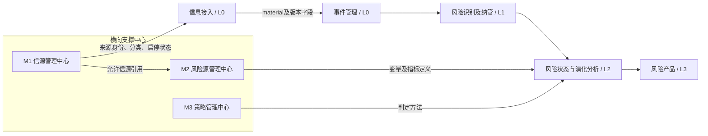
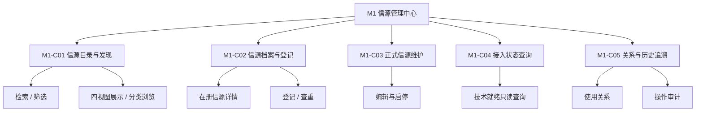
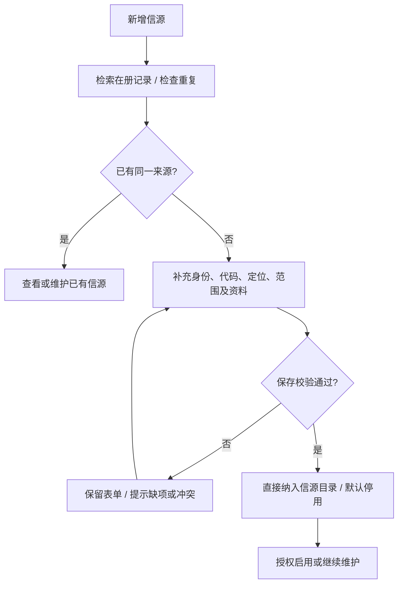
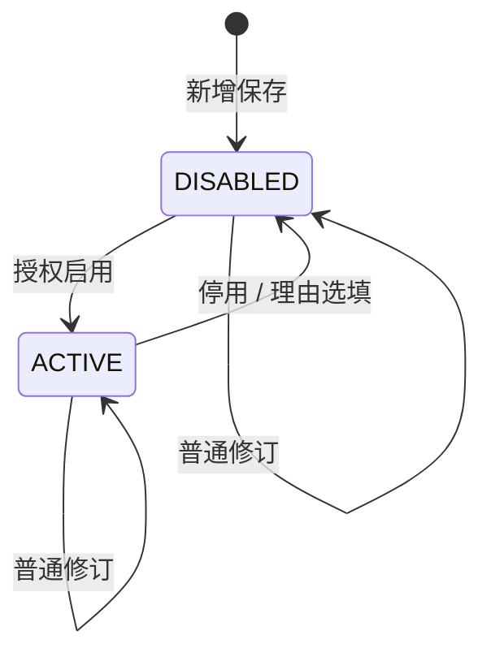

# M1 信源管理中心功能设计

> **文档定位**：RiskHot 系统功能架构的模块级功能设计。
>
> **对应一级模块**：M1 信源管理中心（横向跨层支撑中心）。
>
> **设计依据**：RiskHot L0 业务架构 §3.1、§4.3.1，系统架构 §5.1.1，信源产品 UI 规格 §2，以及本轮已讨论的 11 项功能清单。
>
> **本次修订**：按F01确认清单取消信源版本、配置内容与历史；保留当前字段和操作审计。任务、计划的业务主责为F01，M1提供页面入口。本机当前档案、更新时间校验及单源计划入口已接入schema5，具体验证范围见[[tools/RiskHot/docs/verification/ingestion-migration|迁移验证记录]]。
>
> **当前状态**：架构与业务边界已有依据；新增的模块功能编号、P0/P1 优先级和若干交互细则作为待评审建议。本文不代表数据库迁移或软件验收完成。

## 1. 模块定位与职责边界

### 1.1 模块定位

M1 统一管理 RiskHot 使用的金融信息来源，形成可查询、可分类、可登记、可启停、可追溯的**信源档案与业务使用资格**。M1 面向系统管理员和授权阅读者；系统管理员按操作权限维护信源、执行启停，授权阅读者只读查询已授权信源资料。M1 为 L0 信息接入提供有效信源身份、允许范围及状态。

模块核心问题：**有哪些在册信源？当前哪些启用或停用？允许使用哪些内容？如何持续维护来源身份与状态？**

### 1.2 系统中的位置

> 图示箭头表示业务引用或交付关系；不规定网络调用方式与技术部署边界。L0～L3 用于映射现有业务处理阶段，M1 为独立一级功能模块。

### 1.3 职责范围

| M1 负责 | M1 仅查看或引用 | 归属其他模块 |
|---|---|---|
| 信源目录与分类、检索、筛选和视图排序 | 官方入口及来源核验材料 | 外部网站内容的抓取、解析、原文保存：L0 |
| 信源档案、正式登记、重复检查 | 连接可达性及技术就绪状态 | 连接检测、连接器、凭据、采集、补采：L0／运行侧 |
| 信源业务范围、来源依据及启用／停用 | 相关指标配置、已接入资料的引用情况 | 核心驱动变量、关键指标和指标口径：M2 |
| 当前信源档案和操作审计 | 运行记录、采集异常和任务状态 | 采集计划与信息采集任务：F01；通用调度：S01 |

**明确边界**：M1 不维护指标实际观测值，不生成风险判断，不执行采集任务；本版不设置信源信用评分、信息价值评分或智能综合排名。

### 1.4 设计来源与确认状态

| 内容 | 状态 | 说明 |
|---|---|---|
| M1 为独立横向支撑中心 | 已确认 | 系统功能架构讨论口径 |
| 信源六项分类维度 | 已有领域设计 | 等级、金融属性、观察层级、关注优先级、监测频率、信息功能 |
| `ACTIVE / DISABLED` 单一启停状态 | 已确认 | 启用即取得业务使用资格；新登记默认停用 |
| 单一信源目录 | 用户已确认（2026-10-13） | 所有在册信源均视为已登记，不再保留参考／正式转换步骤 |
| 本文 M1-F01～M1-F11 的功能拆分 | 本版建议 | 承接已讨论的 11 项能力，需纳入正式功能需求追踪 |
| P0/P1 候选优先级 | 本版建议 | 当前讨论中的优先级，未声明已完成产品审批 |

## 2. 功能架构与清单

### 2.1 一级、二级、三级功能结构

### 2.2 详细功能清单

| 功能编号 | 二级能力 | 具体功能 | 需求摘要 | 建议优先级 |
|---|---|---|---|---|
| M1-F01 | M1-C01 | 信源检索 | 按名称、发布主体、稳定编码检索 | P0 |
| M1-F02 | M1-C01 | 多维筛选 | 按等级、金融属性、观察层级、优先级、频率组合过滤 | P0 |
| M1-F03 | M1-C01 | 多视图排序 | 全部、事实核验、日常监测、专题研究切换 | P0 |
| M1-F04 | M1-C01 | 分类浏览 | 分类折叠、展开／收起、数量统计 | P0 |
| M1-F05 | M1-C02 | 信源详情 | 查看在册身份、分类、状态、信息内容、观察用途及入口 | P0 |
| M1-F06 | M1-C02 | 新增信源 | 新增资料并直接纳入同一信源目录 | P0 |
| M1-F07 | M1-C03 | 在册信源管理 | 查看、编辑、启用、停用 | P0 |
| M1-F08 | M1-C02 | 重复登记检查 | 代码唯一校验、主体及入口相似项提示 | P0 |
| M1-F09 | M1-C04 | 技术接入状态查询 | 只读展示技术就绪结果并跳转 L0 检测 | P1 |
| M1-F10 | M1-C05 | 使用关系 | 反查指标允许来源、原始资料等引用 | P1 |
| M1-F11 | M1-C05 | 操作审计记录 | 查询档案编辑与启停的操作者、时间及理由，不提供配置版本快照 | P1 |

**编号约定**：`M1-Fxx` 用于本模块功能拆分与评审；已有 `FR-L0-01` 保留历史编号，正式需求调整时建立映射，不直接替换既有 FR/AC。

## 3. 业务对象与信息组织

### 3.1 单一在册信源

所有出现在 M1 信源目录中的条目都视为已登记信源 `InformationSource`，具有稳定身份、编码及当前业务状态；不设置信源版本、配置内容或配置历史。目录内不再保留“参考条目／正式信源”的生命周期划分，也不需要再次执行“登记为正式信源”。

| 对象 | 身份与状态 | 可执行的操作 |
|---|---|---|
| 在册信源 `InformationSource` | `source_id`、`source_code`；启用／停用 | 检索、分类、查看、编辑、启停、引用与历史追溯 |
| 原始资料 `Information` | 独立资料标识、来源引用与发布时间 | L0 维护；M1 只读反查 |

纳入目录即完成登记；新增保存默认停用。登记身份与启停状态分别记录，不再增设准入审批或候选转正式步骤。

### 3.2 六项分类字段

| 维度／字段 | 枚举值 | 单／多选 | 用途 |
|---|---|---|---|
| `source_tier` | `T1`、`T1_5`、`T2` | 单选 | 来源获取和事实回源路径 |
| `financial_dimensions` | `QUANTITY`、`PRICE`、`FLOW` | 多选 | 钱的数量、钱的价格、钱的流向 |
| `observation_levels` | `MACRO`、`MESO`、`MICRO` | 多选 | 宏观／中观／微观覆盖范围 |
| `attention_priority` | `CORE`、`HIGH`、`NORMAL` | 单选 | 核心、重点、一般关注 |
| `monitor_frequency` | `REALTIME`、`DAILY`、`WEEKLY`、`MONTHLY`、`IRREGULAR` | 单选 | 计划监测／检查频率的业务配置 |
| `information_functions` | `RAW_DATA`、`POLICY`、`EVENT`、`ANALYSIS` | 多选 | 原始数据、政策、事件、观点分析 |

**分类规则**：信源等级、关注优先级、金融属性分别维护；关注优先级可以高于同级信源，但不会改变其来源层级。多选维度下，一条信源可出现在多个分组；分组累计数可能高于去重后的总量。

**来源层级特例**：发布主体官网可作为 T1；该主体的官方认证账号可作为 T1.5；媒体及博主通常归 T2。FRED 等聚合查询平台按“辅助入口”单列，必须追溯具体序列的底层发布者，避免给整个平台统一套用 T1 证据身份。

### 3.3 正式信源的业务字段建议

| 字段 | 属性 | 说明／边界 |
|---|---|---|
| `source_id` | 现有字段 | 正式信源唯一身份 |
| `source_code` | 现有字段 | 稳定编码、唯一；长期引用 |
| `source_name` | 现有字段 | 信源显示名称 |
| `source_type` | 现有字段 | 机构／站点／媒体／博主／平台等类型；具体枚举需统一 |
| `source_tier` | 已有设计 | 普通来源维护有效等级；辅助查询用途单列，不强制伪造 T1 等级 |
| `financial_dimensions`、`observation_levels` | 已有设计 | 多选覆盖分类 |
| `attention_priority`、`monitor_frequency`、`information_functions` | 已有设计 | 关注、时效和信息形式配置 |
| `official_url` | 现有字段 | 主要定位入口；人工材料也可采用可核验材料编号 |
| `admission_status` | 已确认 | `ACTIVE` / `DISABLED`，默认 `DISABLED` |
| `created_at`、`updated_at` | 现有字段 | 创建／修改时间 |
| `publisher_name`、`reposter_name` | **建议补充** | 原始发布主体与转载主体分别记录，不同主体不混淆 |
| `channel_type` | **建议补充** | 官网、官方账号、媒体平台、人工材料等渠道 |
| `business_scope`、`material_types` | **建议补充** | 可用的业务范围和资料类型 |
| `access_mode`、`source_basis`、`source_basis_ref` | **建议补充** | 人工／自动接入属性及来源身份依据 |
| `source_description`、`caliber_notes`、`observation_purpose` | **建议补充** | 主要内容、使用场景、数据口径注意事项，避免重复叙述 |
| `last_verified_at` | **建议补充** | 最近来源核验时间；不设version或通用config字段 |

`source_credit_score` 为既有 L0 文档中的历史可选字段。按本轮产品决定，**M1 V1 不显示、不计算、不依据该字段排序或限制启用**；如需物理删除，应另行处理数据库迁移与历史兼容性。

指标定义属于 M2；指标实际值属于 L0 的实际输入处理。信源档案中的“重点数据”仅描述可提供内容，不能代替 `indicator_config` 的准确口径或实际数值。

## 4. 功能详细设计

### 4.1 M1-C01 信源目录与发现（M1-F01～F04）

**目标**：能够从来源档案中找到所需信源，确认其分层和业务覆盖，并进入统一详情或编辑流程。

| 功能 | 输入／操作 | 业务处理与输出 | 异常或边界 |
|---|---|---|---|
| M1-F01 检索 | 名称、发布主体、稳定编码 | 返回匹配条目；可清除关键词；保留当前结果数 | 无结果提示及重置入口；请求失败显示重试 |
| M1-F02 筛选 | 等级、金融属性、观察层级、优先级、监测频率 | 不同维度组合筛选；同维度多选按“匹配任一所选值”的候选规则 | 多选语义需在 UI 评审确认，筛选不得改动业务配置 |
| M1-F03 多视图排序 | 全部、事实核验、日常监测、专题研究 | 与搜索筛选共用工具区；全部平铺，其余按场景采用分组、排序和标注 | 分类匹配属于过滤／分组，不生成信源价值评分 |
| M1-F04 分类浏览 | 分类展开／折叠、展开全部／收起全部 | 展示分类结构、条目和去重后总数 | 重复落入多个类别须标注“分组计数可重叠” |

**四种视图：**

| 视图 | 建议组织规则 | 显示重点 | 需要确认的边界 |
|---|---|---|---|
| 全部 | 按来源清单稳定次序平铺，不展示分类树 | 每个信源身份只显示一条，含辅助入口 | 保留搜索、分类和启停筛选及分页；隐藏树展开／收起与分组重叠说明 |
| 事实核验 | 信源等级 → 来源类别；详情显示原始材料与数据口径 | 回源入口、发布主体、等级、适用材料 | 既有 UI 规格还提出按“原始发布时间”排序；该时间属于具体资料，纯信源清单需结合 L0 才能精确排序 |
| 日常监测 | 关注优先级 → 监测频率 → 信源等级 | 核心／重点／一般，以及检查频率 | 监测频率表示业务偏好，正式任务时间表由运行侧维护 |
| 专题研究（默认） | 金融属性 → 观察层级 → 关注优先级 | 分类命中、观察范围和重点来源 | 当前不设计相关度打分，按标签匹配及稳定次序组织 |

**列表状态**：加载中、正常、空列表、筛选无结果、读取失败应分开显示；视图切换保留搜索、筛选条件与所选身份，不改变信源身份或启停状态。

### 4.2 M1-C02 信源档案与登记（M1-F05、F06、F08）

#### 4.2.1 M1-F05 信源详情

在册信源采用统一六段式信息结构，并常驻展示业务状态和技术状态：

1. **信源身份**：名称、发布主体、机构／渠道类型、信源等级、稳定编码与 ID。
2. **信源分类**：金融属性、观察层级、信息功能。
3. **监测配置**：关注优先级、监测频率。
4. **信息内容**：可用资料、允许业务范围及接入方式。
5. **观察用途和口径**：用途、期限、统计范围与注意事项。
6. **来源入口与操作**：官方链接、核验入口、编辑资料、启用或停用。

详情设档案、技术接入、使用关系、变更记录页签；不再展示“尚未登记”标记或“登记为正式信源”按钮。

#### 4.2.2 M1-F06 新增信源

- 已在目录中的信源无须重复新增；未在册来源从“新增信源”维护资料并保存。
- 名称、编码、发布主体、类别、定位、业务范围／资料类型、接入方式依现有规则校验，保存生成稳定身份，不创建配置版本。
- 新增保存默认 `DISABLED`；业务状态仅由启用／停用管理，不增加登记审批或转换流程。
- 保留来源依据、权限与当前档案检查。FRED 等辅助检索用途同样属于在册信源，但不因此被统一认定为 T1 原始证据。

#### 4.2.3 M1-F08 重复登记检查

- **强约束**：`source_code` 不得冲突；同代码异发布主体拒绝保存，并显示既有记录。
- **相似性提示**：按发布主体、频道／账号与定位地址识别潜在重复，提示复用与查看差异；只依名称相似不得直接合并。
- **并发重复**：提交时再次核查当前记录及更新时间；同一请求重试不重复创建正式身份。
- **渠道差异**：同一机构官网与其官方社交账号可以登记为不同渠道来源，但应保留相同发布主体及可解释关系。

### 4.3 M1-C03 正式信源维护（M1-F07）

#### 4.3.1 已登记信源列表

建议主列：名称／稳定编码、信源等级、接入方式、启停状态、技术就绪辅助信息。支持状态筛选（启用／停用）与查看详情。

#### 4.3.2 编辑当前档案

- 管理员按已有权限修改信源身份资料、分类、业务范围、来源依据及建议监测配置；保存更新当前字段并产生操作审计，不保存档案版本快照。
- 修改原始发布主体、业务范围或必要启用资料缺失等实质性变更时，应提示重新核验，并按既有 UI 规格将业务状态退回 `DISABLED`；具体“实质性变更”字段清单需在详细规则中定版。
- 修改接入方式／定位时，应提示技术就绪可能失效，并由 L0 重新检测；M1 不据连接失败自动变更启停状态。
- 已有资料保留来源身份与当时内容依据；信源当前档案直接更新，长期ID不随编辑变化，不承诺读取历史配置。

#### 4.3.3 启停状态机

| 状态 | 业务语义 | 新采集／新自动分析 | 历史资料及引用 |
|---|---|---|---|
| `ACTIVE` | 已启用，允许范围内使用 | 自动采集还需技术就绪 | 可查 |
| `DISABLED` | 已登记但停用 | 禁止 | 可查 |

1. 管理员新增／编辑；具备启停权限的人员直接启用或停用，可兼任。
2. 启用仍检查身份、来源依据、当前范围与权限，失败保留原状态；不增加独立业务准入状态。
3. 停用前说明新采集与在途影响；启用／停用的操作理由选填，空白不阻断确认，操作者、时间与状态变化始终记录；历史材料、证据、结论及来源身份均保留。
4. L0 启动和在途提交均检查业务状态；停用后的响应可保留待查，不继续自动分析。
5. 再次启用不自动补采，补采由运行计划显式发起。
6. 当前 M1 不提供暂停／恢复操作。真实存量如存在旧 `PAUSED`，切换时按停用兼容，具体数据迁移由技术设计落实。

### 4.4 M1-C04 接入状态查询（M1-F09）

M1 只读展示来自 L0／运行侧的技术接入结果，例如“连接可达”“接入未就绪”“人工接入”“未检测／未知”，并提供查看检测记录或前往 L0 检测的入口。

**自动接入条件**：`admission_status = ACTIVE` 且技术就绪条件满足。人工来源可以在有可核验出处时启用，缺少自动连接器不影响其业务状态；仍不能启动不具备连接器的自动采集。

技术状态与业务状态独立显示；检测超时、失败和暂未检测不得伪装为来源被停用。检测由 L0 负责，采集计划由运行管理能力负责。

### 4.5 M1-C05 关系与历史追溯（M1-F10、F11）

**M1-F10 使用关系**：从正式信源详情查看当前哪些关键指标将其配置为允许来源，以及哪些原始资料实际引用该信源。若未取得后端数据，应明确“暂不可查询”或“暂无引用”，两者不能混同。关系跳转为只读，后续指标与 L0 对象维护由原模块负责。

**M1-F11 操作审计**：记录操作者、动作、时间、启停前后状态与选填理由；不保存通用config、配置版本或历史档案快照。

## 5. 页面设计与交互

### 5.1 工作区结构与导航

产品侧栏按“内容”“配置”常驻分组展示，标题仅作展示、不可点击或折叠。“内容”下的“全部”进入现有正式事件列表，“配置”下的“信源管理中心”进入M1；没有实际产品页面的模块不显示占位菜单。M1与F02使用一致的名称、顺序与当前项表达，窄屏仍可访问两个目的地。“全部”不代表新增原文、Fact和Event混排能力。

M1顶部依次提供“信源目录”“信息采集任务”“事件处理任务”三个页签，其中事件处理任务按用户要求作为空白预留页（#event-tasks），不展示列表、子分组或操作，也不读取业务数据。信息采集任务下依次提供“任务计划设置”“手动发起采集”“任务执行记录”三个子分组，分别承接原计划、原手动任务和原信息采集任务页面；默认进入任务执行记录。信源目录不展示任务内容，顶部取消手动任务页签。业务职责不因页面合并改变：M1管理信源身份和资格，F01获取与标准化资料，F02管理候选和正式事件，公共运行能力维护调度、执行和恢复。

| 工作区 | 内容 | 主要操作 |
| --- | --- | --- |
| 信源目录 | 统一搜索、业务状态、更多筛选、四种分组方式、主从详情 | 新增、编辑、业务启停、历史和关联资料 |
| 信息采集任务·任务计划设置 | 每个信源一份计划，展示启停、周期及下次时点 | 行内启用／暂停、保存周期、查看任务执行记录 |
| 信息采集任务·任务执行记录 | 原信息采集任务列表及详情，自动与手动共用单信源任务模型 | 查看任务状态、资料、任务控制与异常处理 |
| 信息采集任务·手动发起采集 | 原手动任务页面，包含信源选择及手动采集记录 | 多选信源分别开启任务，查看手动任务结果 |

旧任务地址仍可进入信息接入，旧计划地址自动跳转到#intake-tasks?view=plans，旧#manual-tasks跳转到#intake-tasks?view=manual；任务执行记录使用#intake-tasks，各分组均高亮“信息采集任务”；浏览器前进、后退及刷新保持工作区和有效条件。详情内的归属和返回保持F02既有规则，见[[tools/RiskHot/docs/system-design/06产品UI原型设计/F02事件管理页面设计与交互|F02页面设计与交互]]。

### 5.2 信源目录：检索、视图与分类浏览

目录仅展示信源档案、等级、分组、业务启停与接入条件，不展示计划状态、执行周期、任务执行记录或任务计划入口。目录按名称、发布主体和稳定编码搜索，按等级筛选；默认全部平铺，保留信源等级、日常监测、专题研究三种分组方式；连续没有区分价值的待补充分组压平。业务状态常驻，其余维度置于“更多筛选”，存在已选条件时显示数量并展开，避免隐藏生效条件。

桌面列表与详情并列，窄屏选择信源打开独立详情层。身份按信源去重，分组计数可重叠；切换分组不修改分类数据，缺项如实标注待补充。无匹配、读取失败及无权限分别表达，不使用演示数据补位。

### 5.3 信源详情、资料维护与启停

详情常驻名称、稳定编码、当前业务状态与技术状态。业务启用不代表连接就绪或已完成采集。

| 页签 | 展示与操作 | 边界 |
| --- | --- | --- |
| 档案 | 来源身份、发布主体、来源定位与依据，业务范围、分类、关注内容和使用背景 | 有效网址可打开，缺项待补充；监测偏好不等于正式周期 |
| 接入设置 | 技术条件、连接器、范围及限制 | 仅说明信源接入条件，任务计划与执行记录在任务工作区管理 |
| 关联资料 | 已保存资料的真实引用、版本及时间，可打开统一阅读器 | 指标引用查询尚未接通时明示待确认，不补零 |
| 历史 | 档案操作审计，不提供配置历史快照 | 保留操作者、时间和理由，不提供回滚按钮 |

底部按权限提供编辑资料和启用／停用；“开启任务”统一在信息采集任务的手动发起采集分组，避免将全部信源动作放入单源详情。新增默认停用；编辑使用更新时间等并发校验，重复身份和冲突不覆盖，失败保留输入。保存档案不自动修改计划或开始采集；关闭未保存表单先确认，关闭后恢复焦点。

### 5.4 信息采集任务：执行概览、批次历史与详情

页面“批次”仅为单信源任务的展示别名，一行一次任务。显示信源、触发方式、计划时间、任务状态、结果摘要和关联material；按来源、时间及状态筛选。取消多信源父任务、任务信源项及逐资料处理记录详情。任务详情只读material和任务结果，发现零资料与失败分别表达。

### 5.5 手动发起采集分组与动态反馈

选择N个信源分别创建N个信息采集任务，自动与手动共用任务模型；按任务返回受理及控制结果。开启、暂停、继续和重试按各任务授权，不建立整轮业务父任务。状态与更新时间真实展示，不模拟六步进度。

### 5.6 结果统计与计数口径

任务计数以任务身份为单位，material累计按资料身份去重；同份资料跨任务复用不能累加。任务业务结果由F01解释，F02候选及事件统计来自既有业务结果，不依赖已取消的资料分析记录。未知值不补零。

### 5.7 任务计划：周期、状态与运行定位

从“信息采集任务”进入任务计划，返回时回到任务列表。每源一计划，一行展示启停、周期、下次时点及“任务执行记录”入口；周期范围一分钟至一天。保存计划不触发立即采集，暂停计划不暂停已有任务。存量周期一天为运行调整待办；本次只更新设计。计划到期直接受理单信源任务，不另建触发记录。

### 5.8 资料与候选统一阅读

读取material当前正文、表格、来源、发布时间、取得时间及版本字段；不提供原件下载、旧正文版本回放或六步进度。候选与事件引用内容版本值和位置，内容更新后明确提示旧依据待核验。

### 5.9 刷新、错误反馈与操作保护

刷新保留筛选及阅读状态，输入中不强制覆盖。未知受理结果沿原幂等键查询／重试，后端重新核对权限和资格。读取失败、空结果、无权限分别反馈；多任务批量操作逐项反馈，不将部分成功显示为全部完成。

### 5.10 布局、可访问性与交互验收

导航已标识的页面不再增加“页名＋介绍”版块：信息采集任务、手动任务和自动接入直接进入视图、操作及数据，保留无障碍页面名称；有操作时单独显示操作栏，没有操作不占空白行。列表统计、真实对象标题、错误/空状态及必要范围提示保留。

沿用深绿导航和浅色操作区，桌面目录主从阅读、自动接入及执行记录紧凑表格；窄屏导航常驻可达、记录纵向排列、详情及阅读层独立阅读。长名称、原因和按钮换行，统计窄屏上下排。

搜索与表单有标签，分组标题不进入交互焦点；链接、页签、模式与当前项可感知。对话层约束焦点、提供关闭，输入草稿和返回焦点不被刷新打断。状态同时使用文字，运行进度不只依赖动画。

具体验收与真实工程证据见[[tools/RiskHot/docs/verification/m1-navigation|M1页面整合与导航验证]]；覆盖两组侧栏、三个工作区、旧计划入口、计划保存、任务级查询与独立详情、未知回执、资料与候选、每轮统计、角色权限及1440／390／320宽度。细化设计见[[tools/RiskHot/docs/system-design/06产品UI原型设计/06-2-M1信源管理中心UI设计/信息接入任务与计划页面设计|信息接入与自动计划页面设计]]。

## 6. 跨模块协作

| 协作方 | M1 提供 | M1 消费 | 权责约束 |
|---|---|---|---|
| **L0 信息接入与事件管理** | 正式 `source_id`、当前状态、允许范围及来源定位 | 技术接入状态与实际资料引用（只读） | M1 决定业务使用资格；L0 管理采集、原文、接入检测 |
| **M2 风险源管理中心** | 可选的正式允许信源引用 | 关键指标对信源的只读引用关系 | M2 定义变量、指标及允许来源；M1 管理信源身份 |
| **运行管理能力** | 业务状态与监测频率建议 | 计划执行、异常和连接检测查询入口 | F01维护计划和单信源任务业务，S01提供通用执行，凭据由技术设施维护 |
| **权限与审计能力** | 启停／编辑的业务操作结果 | 角色授权、用户身份、统一审计能力 | 后端必须重新校验权限和当前档案；并发编辑可按updated_at条件更新 |

**接口契约要求**：跨模块使用稳定source_id与当前档案字段，不传递source_version，记录时间与来源；具体 API、消息、物理表结构归系统架构和详细技术设计。M1 的业务状态变更必须能阻断后续不合资格的采集操作。

## 7. 核心业务规则

| 规则编号 | 业务规则 |
|---|---|
| BR-M1-01 | 所有在册信源均认作已登记；统一目录、身份和启停，不存在参考转正式步骤。 |
| BR-M1-02 | 一个正式信源只有一份有效身份；稳定编码唯一；重复请求复用结果或返回冲突。 |
| BR-M1-03 | 等级、金融属性、层级、优先级、监测频率和信息功能分别维护，不相互推导。 |
| BR-M1-04 | 新登记默认 `DISABLED`；启用即允许业务使用，不新增单独准入审批状态。 |
| BR-M1-05 | `DISABLED` 阻断新采集及后续自动分析；历史证据保留。 |
| BR-M1-06 | 自动采集资格同时受业务状态和技术就绪约束；人工接入可以保留合法业务资格。 |
| BR-M1-07 | 修改当前身份或范围时记录操作审计，重大变化重新核验；技术检测失败不自动改变业务状态。 |
| BR-M1-08 | 转载信息保留原始发布主体与转载主体；能够回源时优先原始材料。 |
| BR-M1-09 | T1／T1.5／T2 用于来源核验路径；不自动决定事件评级、风险等级或交易行为。 |
| BR-M1-10 | 多选维度分组允许重复出现，但正式信源总量按唯一 `source_id` 统计。 |
| BR-M1-11 | 关注优先级用于人工关注和监测组织，不等于长期信用或自动计算的信息价值。 |
| BR-M1-12 | M1 不写入原始资料、指标实际观测值、风险定义、快照或报告。 |
| BR-M1-13 | 来源依据、启停操作与资料引用可追溯，不建立配置版本历史；启停理由选填，填写后保留，不执行无痕覆盖。 |
| BR-M1-14 | 状态变更按当前身份、业务范围及授权重新校验；失败不得显示成功。 |

## 8. 功能验收场景（建议）

| 场景编号 | 对应功能 | 验收预期 |
|---|---|---|
| AC-M1-01 | F01 | 输入名称／主体／代码均可检索；无结果有清空条件入口。 |
| AC-M1-02 | F02 | 组合筛选结果正确；含多个金融属性的信源能在相应类别被检索到。 |
| AC-M1-03 | F03 | 四视图按钮与搜索筛选共用工具区；全部平铺且每个身份只显示一条，其他视图保留分组；切换保留条件，排序与标注符合配置，不修改信源。 |
| AC-M1-04 | F04 | 分类折叠、展开全部、收起全部可用；分组数与去重总数口径明确。 |
| AC-M1-05 | F05 | 统一详情完整显示身份、分类、内容、用途、口径、来源入口、当前启停状态。 |
| AC-M1-06 | F06 | 目录中所有条目均已登记；新增保存直接纳入同一目录，默认 `DISABLED`，无再次登记步骤。 |
| AC-M1-07 | F08 | 同编码或确认同一来源不能重复创建；并发重复保存返回已有记录或明确冲突。 |
| AC-M1-08 | F07 | 仅授权人员可启停；启用核验缺项，停用保留历史。 |
| AC-M1-09 | F07 | 已停用来源提交在途采集时，后续自动分析被阻断；再次启用不自动补采。 |
| AC-M1-10 | F09 | 业务状态与技术就绪可同时查看；ACTIVE 且未就绪不得自动采集。 |
| AC-M1-11 | F09 | 人工来源可在具备业务依据时启用，无连接器不允许自动采集。 |
| AC-M1-12 | F10 | 能区分“无引用”和“暂不可查询”；可查看关联指标及资料而不直接编辑。 |
| AC-M1-13 | F11 | 编辑与启停均记录动作、时间与操作者，不保存前后配置版本；启停理由选填，未填也可确认，已填理由保留，历史可查。 |
| AC-M1-14 | F06/F07 | 更改主体、业务范围或关键依据时触发重新核验；技术连接问题单独提示。 |
| AC-M1-15 | F03/F05 | 对 FRED 辅助入口不作统一 T1 归类，显示需逐序列回源核验提示。 |

以上 AC 为 **M1 功能设计建议验收项**。正式落地时应与历史 `FR-L0-01` 及其 AC 建立一对一或一对多追踪，防止重复定义、遗漏原有约束。原型 UI 测试通过仅代表原型行为通过，不能替代 API、权限、采集阻断及数据库联调测试。

## 9. 待定事项与后续设计工作

| 编号 | 待确认问题 | 建议处理位置 |
|---|---|---|
| D-M1-01 | 单一在册目录已确认；新增及资料导入的实现方式待技术设计，不再设计参考／正式映射或登记审批。 | M1 业务需求 |
| D-M1-02 | 事实核验视图“原始发布时间”的取值范围：信源目录或关联资料？ | M1 与 L0 的查询契约 |
| D-M1-03 | 多选筛选采用“同维度任一匹配”还是可切换“全部匹配”？ | M1 交互设计 |
| D-M1-04 | 哪些身份与业务范围字段变化必须退回 `DISABLED`？ | M1 业务规则 |
| D-M1-05 | 信源类别、渠道类型、接入方式、资料类型的最终枚举与约束 | 领域／数据设计 |
| D-M1-06 | 多选维度的存储方式及updated_at并发校验；取消信源版本与config历史 | D-08 数据与版本设计 |
| D-M1-07 | 旧 `source_credit_score` 的物理去留以及老数据兼容 | 需求与数据迁移评审 |
| D-M1-08 | P0/P1 的正式范围、四视图展示及新增信源交互验收 | 产品／需求评审 |

## 10. 来源与追踪依据

以下均为项目中已能读取的资料；当中部分目录存在历史名称，正式文档归档应统一链接路径。

1. `docs/system-design/02-业务架构与领域设计/RiskHot_L0_信息处理层_业务架构与领域设计V1.0.md`：§3.1 信源准入、六项分类维度；§4.3.1 `information_source` 字段。
2. `docs/system-design/04-系统架构设计/RiskHot_系统架构设计_V1.0.md`：§5.1.1 M1 对应配置业务由 `reference` 唯一写入；L0 消费、技术接入独立。
3. `docs/system-design/06产品UI原型设计/06-1-配置模块产品UI设计/02. 页面规格与交互流程_V1.0.md`：§2 信源列表、三视图、主从详情、登记与启停。
4. `docs/system-design/06产品UI原型设计/06-1-配置模块产品UI设计/验证/原型验证记录.md`：参考清单 40 条资料快照与原型验证情况；数量随资料版本变化。
5. [[tools/RiskHot/src/data/source-catalog.js|信源清单]]：从《金融信息》信源章节整理的展示快照，未赋予业务准入；原型从项目 `src/data` 引用，演示分类及状态预设单独维护在[[tools/RiskHot/src/data/source-demo.js|信源演示配置]]。
6. [[tools/RiskHot/docs/system-design/03-系统功能架构/系统功能架构总览|系统功能架构总览]]：§4.5、§5.3 的 M1 横向支撑定位及信源、风险源、策略三中心约定。
7. 本轮对话确定的 11 项信源管理功能以及“不做信源信息价值评分”的产品决策。

---

**文档结论**：所有在册均已登记，统一目录仅以启用／停用管理；M1 以“信源目录与发现 → 信源档案与登记 → 正式信源维护 → 接入状态查询 → 关系与历史追溯”构建完整功能闭环。正式信源业务状态独立于 L0 技术接入；横向支撑中心仍限定为 M1 信源管理、M2 风险源管理和 M3 策略管理。
