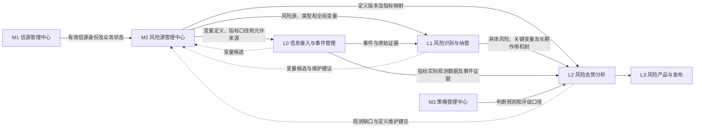
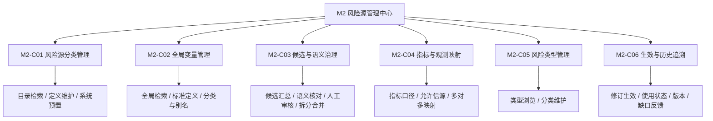
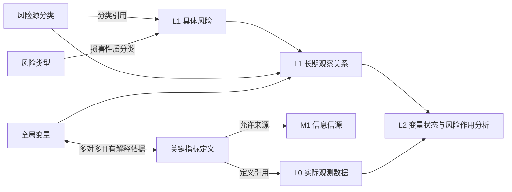
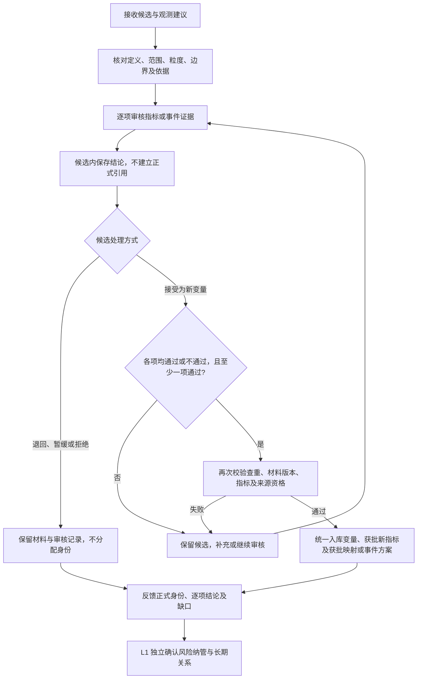
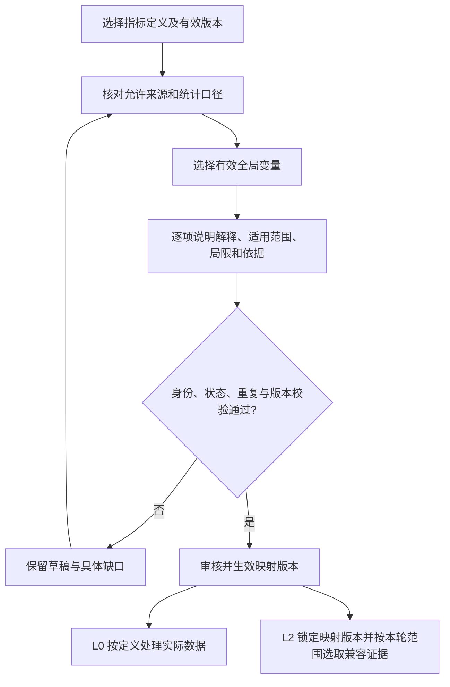
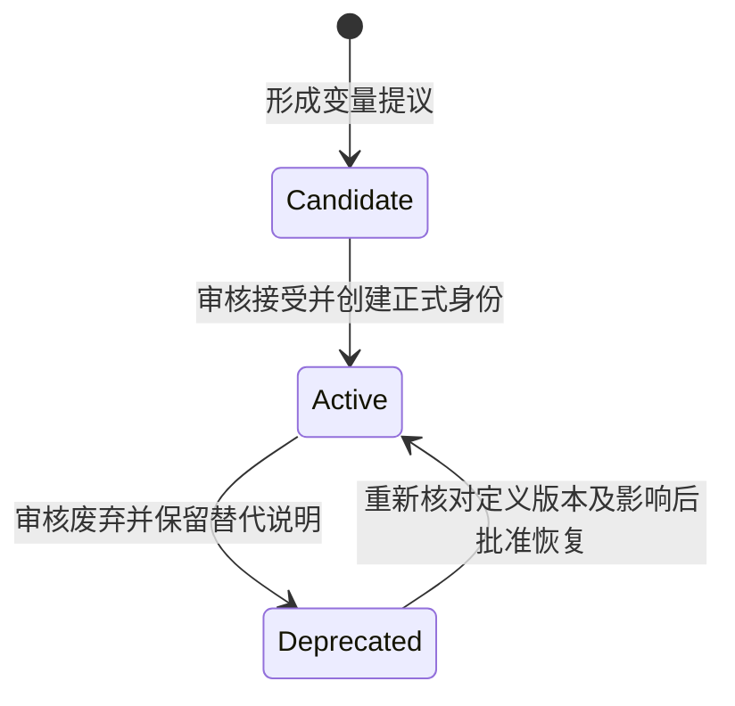
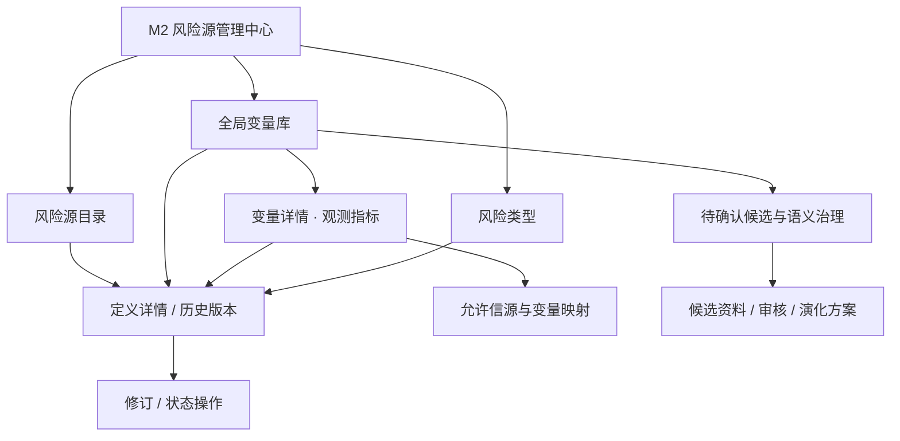

# M2 风险源管理中心功能设计

> **文档定位**：RiskHot 系统功能架构的模块级功能设计，章节结构参照 [[tools/RiskHot/docs/system-design/03-系统功能架构/M1 信源管理中心功能设计|M1 信源管理中心功能设计]]。
>
> **对应一级模块**：M2 风险源管理中心（横向跨层支撑中心）。
>
> **设计依据**：[[tools/RiskHot/docs/system-design/02-业务架构与领域设计/RiskHot_L1_风险识别与纳管层_业务架构与领域设计|L1 业务架构]] §3.4、§4.4、§4.6、§4.8、§4.9，以及 L0、L2、系统功能架构总览和配置页面规格，具体见第 10 章。
>
> **当前状态**：已有业务原则与本版功能建议分别标记。功能编号、P0/P1、页面组织及治理交互为本版建议，不代表产品审批、接口实现或数据库迁移已经完成。

> **首版范围调整（2026-10-14）**：按用户要求，M2-F18 使用关系查询及独立依赖／变更影响查询界面移出第一版，保留编号和历史设计供后续版本参考。AC-M2-22 不纳入首版验收。历史版本、定义维护与指标映射保留；变更操作所需的身份／引用有效性校验仍由相关治理流程承担，不要求首版提供通用引用浏览器。

> **风险源默认使用（2026-10-14）**：按用户要求，正式风险源定义默认可用，不提供启用／停用操作、状态标识或状态筛选；草稿和待审修订仍与有效定义分开。2026-10-15 按用户要求，正式风险类型同样默认可用，移除启停标识及使用状态筛选；变量生命周期、指标状态和 M1 信源启停各自保留。

> **预置定义（2026-10-14）**：按用户确认，首版取消面向用户的初始化预览／初始化操作。系统直接预置八类宏观风险源和四类风险类型，用户进入目录即可查询和维护。M2-F03 保留为部署时后台建档要求，不是页面功能；预置不覆盖已有人工修订。此处是产品约定，不表示真实部署初始化或数据库迁移已经实现。

## 1. 模块定位与职责边界

### 1.1 模块定位

M2 统一管理 RiskHot 的**风险观察定义体系**，包括风险源分类、全局核心驱动变量、关键指标定义、变量与指标映射、允许信源和风险类型，为 L0、L1、L2 提供身份稳定、含义清晰、可追溯版本的共享定义。

模块核心问题：**风险可能从哪类变化产生？用哪些稳定因素描述和观察？通过什么指标及来源取得证据？按什么损害性质分类？这些定义如何持续治理与复用？**

M2 面向系统管理员和授权阅读者。系统管理员按具体操作权限承担研究、配置维护及变量治理审核，授权阅读者只读查询已授权定义与历史。初期候选变量采用“AI 提议、程序校验、人工审核”，正式身份由系统在治理通过后分配。

### 1.2 系统中的位置

图中箭头表示业务交付或反馈，不规定 API、消息主题与部署边界。M2 属于横向定义治理，不作为 L1 风险识别流程中新增的强制业务环节。

### 1.3 职责范围

| M2 负责 | M2 仅查看或引用 | 归属其他模块 |
|---|---|---|
| 风险源类别、层次、定义与分类边界 | 具体风险采用了哪些风险源 | 具体风险身份、定义、纳管与跟踪状态：L1 |
| 全局变量身份、定义、别名、语义去重与候选治理 | 事件或具体风险引用变量的情况 | 事件—对象—变量关联：L0；风险长期变量选择与角色：L1 |
| 变量分类／标签、拆分、合并、废弃与版本 | 当期变量分析及历史快照的引用依据 | 变量当前状态、当前风险作用和整项风险评估：L2 |
| 指标定义、统计口径、允许信源及多对多变量映射 | 来源业务状态、数据接入缺口 | 信源身份与启停：M1；指标实际值、修订与接入：L0 |
| 风险类型定义、识别依据与分类边界 | 正式风险使用的类型 | 风险评级、判断阈值和分析方法：M3；执行判断：L2 |
| 定义修订、影响检查、历史和变更反馈 | 执行任务所用配置版本、统一审计记录 | 任务调度、重试和运行版本编排：运行侧 |

**明确边界**：风险源不是信息信源，也不是具体风险；全局变量不是固定隶属于某个风险源的子项。M2 不要求风险源预配置推荐变量，不保存指标实际值、当期风险等级或交易建议。

### 1.4 设计来源与确认状态

| 内容 | 状态 | 本文处理 |
|---|---|---|
| M2 负责共享定义，实际观测数据归 L0 | 已有系统功能架构约定 | 按最新功能边界设计 |
| 全局变量统一身份、可选分类、动态选择、候选治理 | L1 §3.4 已明确 | 承接 BR-L1-11～BR-L1-22，不另建同义规则 |
| 宏观八类风险源、四类风险类型 | L1 §4.8、§4.9 已有初始配置设计 | 系统预置基线，提供查询和维护；不提供用户初始化入口，不伪造实际配置 ID |
| 变量与指标多对多、稳定配置且需解释依据 | 2026-10-14 用户确认稳定配置与审核变更原则 | 按 §4.4.3 维护映射版本；关系结构与运行取证实现待定 |
| Candidate／Active／Deprecated 生命周期 | L1 §3.4.10 已明确业务语义 | 与审批状态、配置启停及风险跟踪状态分开 |
| M2-C01～C06、M2-F01～F20 和 P0/P1 | 本版建议 | 用于评审和后续需求追踪 |
| 审批权限、分类／指标状态枚举、版本发布方式 | 尚未定版 | 给出功能要求，物理字段与实施细则留待设计 |

**来源差异处理**：旧配置页面仍包含“推荐核心驱动变量”、固定树形入口，以及独立数据管理的跳转表达。本版以最新 L1 的全局字典和动态选择原则、系统功能架构的 L0 数据归属为准；旧页面的查询、审核和差异对照交互可复用，推荐清单及强制层级不作为 M2 前置要求。M1 的两态启停不直接套用到变量生命周期。

## 2. 功能架构与清单

### 2.1 一级、二级、三级功能结构

### 2.2 详细功能清单

| 功能编号 | 二级能力 | 具体功能 | 需求摘要 | 建议优先级 |
|---|---|---|---|---|
| M2-F01 | M2-C01 | 风险源检索与分类浏览 | 按名称、编码和分析层次查询；正式风险源默认可用 | P0 |
| M2-F02 | M2-C01 | 风险源定义维护 | 新增、修订定义、核心问题与同层父分类 | P0 |
| M2-F03 | M2-C01 | 宏观风险源系统预置 | 部署时后台按八类基线查重建档，保留人工修订；不提供用户初始化入口 | P0（后台预置） |
| M2-F04 | M2-C02 | 全局变量检索与详情 | 名称、编码、别名、定义及适用范围辅助检索 | P0 |
| M2-F05 | M2-C02 | 变量标准定义维护 | 稳定语义、边界、粒度、观测依据和身份管理 | P0 |
| M2-F06 | M2-C02 | 变量分类与别名维护 | 可选标签／分类及历史名称，不强制父子树 | P1 |
| M2-F07 | M2-C03 | 候选接收与归并 | 汇总 L0／L1／L2 及人工提议，保留各条依据 | P0 |
| M2-F08 | M2-C03 | 相似变量对照（首版移除） | 移除相似变量选择、对照和差异展示，保留原编号追溯 | 首版移除 |
| M2-F09 | M2-C03 | 候选审核与身份确认 | 先逐项审核，再统一新建与通过配置；退回、暂缓、拒绝；最终查重 | P0 |
| M2-F10 | M2-C03 | 变量拆分合并治理 | 比较语义、拟定身份方案、审核映射与影响 | P1 |
| M2-F11 | M2-C04 | 关键指标定义维护 | 统计对象、口径、单位、频率与时间语义 | P0 |
| M2-F12 | M2-C04 | 指标允许信源配置 | 引用 M1 有效信源，说明适用材料和口径限制 | P0 |
| M2-F13 | M2-C04 | 变量与指标映射 | 多对多、逐关系解释、适用范围、局限与版本 | P0 |
| M2-F14 | M2-C05 | 风险类型检索与详情 | 浏览四类损害性质及分类边界 | P0 |
| M2-F15 | M2-C05 | 风险类型维护 | 系统预置四类；维护稳定编码、定义、核心问题，支持增修及重复检查 | P0 |
| M2-F16 | M2-C06 | 修订审核与生效 | 草稿与当前有效定义分开，针对明确版本审核 | P0 |
| M2-F17 | M2-C06 | 使用状态与生命周期 | 指标启停、变量废弃及恢复核对；风险源与风险类型默认可用 | P0 |
| M2-F18 | M2-C06 | 使用关系与影响检查（后续版本） | 首版移除通用引用查询；原查询设计保留追踪 | 后续版本，不纳入首版 |
| M2-F19 | M2-C06 | 变更与版本追溯 | 历史定义、映射、操作依据和生效记录 | P0 |
| M2-F20 | M2-C06 | 观测缺口与维护反馈 | 区分定义、映射、来源、实际证据和判断规则缺口 | P1 |

本表保留 20 个历史功能编号，M2-F18 已移出首版；P0/P1 表示其余功能的实施排序建议；P1 尚未实现时也必须遵守身份和历史保护规则。例如不具备受控拆分功能时，应保留维护申请，不能直接覆写旧身份。

**编号约定**：本版功能编号用于模块设计追踪；保留 L1 原规则编号。旧页面引用的 FR-CFG-02／03／04／07 仅作历史映射线索，不能把其全部旧语义认作本版已确认要求；对应差异见第 9、10 章。

## 3. 业务对象与信息组织

### 3.1 对象、身份与业务归属

| 对象 | 已有名称／身份 | 核心语义 | 维护方 |
|---|---|---|---|
| 风险源 | `risk_source_config`；`source_id`、`source_code` | 哪一类变化可能引起损害 | M2 |
| 全局变量 | `variable_config`；`variable_id` | 可跨事件、风险和周期复用的稳定因素 | M2 |
| 变量候选 | L1 使用 `candidate_variable_name` 表达未匹配项 | 尚未确认的因素提议；候选载体待设计 | M2 治理，上游提出 |
| 关键指标 | `indicator_config` | 衡量因素的统计／数据定义 | M2 |
| 变量—指标映射 | 已明确多对多原则，关系载体待设计 | 指标为什么能够观察变量以及适用限制 | M2 |
| 风险类型 | `risk_dimension_config`；`dimension_id`、`dimension_code` | 潜在损害属于哪一方面 | M2 |
| 信息信源 | `InformationSource`／`information_source` | 资料来自哪个发布渠道 | M1；M2 引用 |
| 具体风险及长期变量关系 | `MonitoredRisk`、`risk_source_variable_relation` | 观察谁的什么风险，选择什么变量及其角色 | L1；M2 只读反查 |

风险源配置与信息信源均出现 `source_id`／`source_code`，但不是同一个对象空间。跨模块引用必须标明对象类型并校验真实身份，不能仅凭字段同名关联；统一传输字段命名留待契约设计。

风险源与变量的实际关系仍由 L1 管理；M2 的反查能力留待后续版本，首版不展示；不据此建立变量的固定所有者，也不把风险源分类树变成因果网络。

### 3.2 风险源与风险类型的定义字段

| 对象 | 当前领域设计已列字段 | 本版功能所需但须补充定版的信息 |
|---|---|---|
| 风险源 | `source_id`、`source_code`、`source_name`、`analysis_level`、`parent_source_id`、`definition`、`core_question`、`created_at`、`updated_at` | 分类边界、识别依据、示例、排序、定义版本与变更依据（风险源不设启停） |
| 风险类型 | `dimension_id`、`dimension_code`、`dimension_name`、`definition`、`core_question`、`created_at`、`updated_at` | 识别依据、分类边界、参考路径、知识依据、排序与版本 |

风险源 `analysis_level` 仅允许 `macro`／`meso`／`micro`，无默认值；`parent_source_id` 表示**同一分析层次内**的分类父节点，不表示宏观包含中观、中观包含微观。首版八类均为宏观一级分类，父分类为空。

L1 旧初始配置段落提到 `status=enabled` 和 `sort_order`；本版风险源和风险类型改为默认可用、不提供启停，旧状态字段的技术兼容留待设计。风险类型初始内容还列出识别依据、边界、路径和知识引用，但当前基础字段表未完整包含这些信息。本版承接其业务用途，不将其描述为已实施数据库字段；是否扩展字段或采用独立版本载体，见 D-M2-02。

### 3.3 全局变量与候选的信息要求

| 信息组 | 内容 | 约束与来源状态 |
|---|---|---|
| 正式身份 | `variable_id`、标准名称、稳定编码 | 沿用 L0 §4.5.5；`variable_code` 为建议保留项，具体格式待定 |
| 语义定义 | 稳定含义、边界、适用范围、观察粒度 | L1 已有要求；不以“正在收紧”等当期状态命名 |
| 观测依据 | 可用指标、事件或其他可核验依据及解释 | 不强制每个变量必须有量化指标；缺少一切可解释依据时保留候选 |
| 单位与观测方式 | 量纲、定量／综合／事件定性说明 | L0 允许状态项单位为空；“未填写”与“确实不适用”分别表达 |
| 检索组织 | 别名、历史名、可选分类或标签 | 分类可多选或不填，不决定变量是否存在 |
| 治理与历史 | 生命周期、定义版本、审核记录、替代关系 | L1 已有业务要求；不宣称已具备完整存储字段 |
| 候选材料 | 建议名称与定义、范围、粒度、提出原因、来源、事件／风险依据、原始依据及待确认事项 | 未取得正式身份时，`variable_id` 留空；候选记录标识不冒充正式 ID |

变量角色 `risk_driver`、`risk_transmission`、`risk_buffer`、`damage_verification` 属于 L1 的具体风险关系；不作为全局变量字段。变量的分类、因素分解关系和因果机制分别表达；首版不要求完整的因素树或因果网络。

### 3.4 指标与映射的信息要求

以下是功能层的信息组织，来源于 L2 指标定义边界及既有配置页面规格，不是新增物理表结构。

| 信息组 | 必须能够说明的内容 | 使用限制 |
|---|---|---|
| 指标身份与定义 | 稳定身份／编码、名称、统计含义、统计对象 | 同名不同统计含义不能直接合并 |
| 统计口径 | 地域、市场、币种、单位、频率、期限及适用转换说明 | 频率不是采集调度；转换定义不是风险评分公式 |
| 时间语义 | 观测期、发布时间、可用时间的解释规则 | 此处保存规则；每笔实际时间及修订记录归 L0 |
| 允许信源 | M1 正式身份与版本依据、适用资料和口径限制 | 新增有效来源须校验启用资格，不代表数据已经接入 |
| 变量映射 | 正式变量引用、解释、范围、局限、依据、关系版本 | 一个指标可观察多个变量，反向也允许多个指标 |
| 治理信息 | 生效范围、变更理由、审核与历史版本 | 无痕覆盖旧口径或历史映射不可接受 |

“允许来源”与“本次实际来源”分别管理：前者归 M2 配置，后者由 L0 数据与证据记录保留。缺映射、缺实际数据、数据冲突和不能判断当前作用应分别显示。

## 4. 功能详细设计

### 4.1 M2-C01 风险源分类管理（M2-F01～F03）

**目标**：形成统一的风险来源分类，支持 L1 解释风险形成机制，避免把具体事件、风险严重度或信息来源当成类别。

| 功能 | 输入／操作 | 业务处理与输出 | 异常或边界 |
|---|---|---|---|
| M2-F01 检索与浏览 | 名称、编码、分析层次 | 展示名称、核心问题、层次、父分类及版本 | 加载、空库、无匹配、失败分别显示；分类树不展示为传导图 |
| M2-F02 定义维护 | 新增或修订名称、编码、定义、核心问题及边界 | 检查稳定编码唯一、必填语义、分析层次；正式修订走审核与影响确认 | 禁止自指、循环及跨层次父分类；不通过改名把旧 ID 分配给新语义 |
| M2-F03 系统预置 | 部署时后台核对八类基线，用户无需操作 | 缺失项受控建档，已有项保留，新身份由系统分配 | 重复部署不重复创建，不覆盖已有修订；同代码异义交后台维护核对 |

**首版八类基线：**

| 稳定编码 | 名称 | 核心问题 |
|---|---|---|
| `macro_economic_growth` | 经济增长风险 | 经济是否在减速或衰退？ |
| `macro_inflation_supply` | 通胀与供给风险 | 成本和物价是否出现异常？ |
| `macro_monetary_policy` | 货币政策风险 | 央行是否改变资金价格、数量及流动性条件？ |
| `macro_fiscal_sovereign_debt` | 财政与主权债务风险 | 政府财政和债务是否形成压力？ |
| `macro_credit_financial_system` | 信用与金融体系风险 | 银行、非银与信用体系是否出现问题？ |
| `macro_fx_cross_border_capital` | 汇率与跨境资本风险 | 全球资金是否发生异常流动？ |
| `macro_market_structure_funding` | 市场结构与资金供需风险 | 市场资金供需、跨资产配置与风险偏好是否发生不利变化？ |
| `macro_geopolitical_policy_event` | 地缘政治与政策事件风险 | 是否存在突发外生冲击？ |

以上名称、编码和核心问题沿用 L1 §4.9.3，详细定义以该节为依据；不表示现实中八类风险同时存在。宏观／中观／微观是定义可表达的分析层次，首版自动风险识别仅使用宏观范围；中观／微观资料是否开放维护为待定范围，不扩展 L1 纳管边界。

**不设置推荐变量前置步骤**：分类生效不以推荐变量数量为条件；“暂无实际引用”不是定义缺失。后续版本可考虑在风险源详情反查 L1 已采用的变量及其风险上下文；首版不提供该入口，但不提供“将推荐变量同步至所有风险”的动作。

### 4.2 M2-C02 全局变量管理（M2-F04～F06）

#### 4.2.1 M2-F04 全局检索与统一详情

检索覆盖标准名、编码、别名、历史名、定义和适用范围；生命周期和可选分类作为筛选条件。相似项仅为候选结果，不以名称命中或相似度直接认定语义相同。

首版详情按五组组织：

1. **变量身份**：标准名称、正式身份、稳定编码、生命周期与有效版本。
2. **定义与范围**：稳定含义、语义边界、地域／市场／币种／期限及粒度。
3. **观测依据**：可用指标、事件定性依据、解释与限制。
4. **检索组织**：别名、历史名称、分类／标签；允许未分类。
5. **治理记录**：候选来源、定义修订、替代关系、审核与历史版本。

首版不展示跨模块使用关系及引用计数；后续提供查询时，“暂无引用”与“引用暂不可查询”须分开显示。废弃变量仍可检索并查看替代说明，但不能作为新正式引用的有效选择。

#### 4.2.2 M2-F05 标准定义与基础变量池

- 新建变量先形成提议或草稿，经查重、语义核对与人工审核后进入正式库；人工录入同样不能绕过身份治理。
- 基础变量池优先覆盖首批宏观分析需要。L1 给出的经济增长、通胀压力、美元流动性、信用扩张能力等是候选参考，不直接赋予正式身份或默认启用。
- 正式定义至少包含稳定含义、语义边界和可解释的观测依据；定性因素可通过事件及证据观察，不因没有数值型指标而被一概排除。
- 同一变量可服务多个风险源、观察对象和周期；不因使用场景变化复制身份。范围或粒度有实质差异时进入语义核对，不能自动复用。
- 对已有直接观测型变量逐项核对其含义与历史用途，不批量改成指标；改名、定义演化和新增指标是不同操作。

#### 4.2.3 M2-F06 分类与别名

分类／标签可空、可多选，用于组织和召回；维护分类不改变正式变量身份。别名保留来源和理由，歧义别名允许召回多个待核对项，不据此直接合并变量。

如需因素分解或通用因果机制，独立记录关系语义、适用条件及依据；未经验证的因果解释标为假设。首版只保证相关说明可留存，不要求构建完整关系网络，具体模型留待详细设计。

### 4.3 M2-C03 候选与语义治理（M2-F07～F10）

#### 4.3.1 M2-F07 候选接收与归并

接收 L0 事件识别、L1 风险识别、L2 观测反馈和人工录入的变量提议，保留原文／事件／风险引用、提出时间、原因和材料版本。L1 未匹配项沿用 `variable_id` 为空、`candidate_variable_name` 有值的约定；候选正式载体不在本文定表。

候选审核单页以“AI 观测指标审核”为标题展示待审建议，不以身份确认作为查看建议的前提；列表区分引用已有指标、新指标建议和事件证据方案，给出观测理由与来源待确认事项。完整解释、范围与局限可查看；变量身份未分配时即可逐项审核，结论先保存在候选内，最后统一确认变量及审核通过的观测配置。

AI 提出新变量候选时，同时提交建议观测方案：优先引用已有正式指标，逐项说明解释依据、适用范围、口径及来源；未找到合适指标时保留新指标定义建议或观测缺口。定性变量可提出可核验的事件证据方案。上述内容均为待审核建议，不能冒充正式指标身份、有效映射或已接入数据。

同一输入重复提交应复用处理结果；多任务提出语义相同候选时汇总提议和证据，不丢失各自上下文。同名不同范围的候选保留各自材料，不自动归并；新建仍须通过名称与别名查重；观测方案存在差异时保留各项建议及其来源，不自动拼成已批准配置。

#### 4.3.2 M2-F08 相似变量对照（首版移除）

2026-10-15 按用户要求，候选审核移除“已有相似变量”选择框、已有变量对照栏和语义差异提示，不提供相似项召回或排序入口；依赖选中已有变量的“复用已有变量”和“转已有定义维护”操作一并移除。原编号保留追溯。

候选资料按单栏展示名称、稳定定义、范围、粒度、边界、来源及版本。正式变量库的独立检索、有效身份检查和新建前查重继续保留；重复名称或别名命中时阻止新建，保留候选并提示退回或暂缓。移除对照界面不构成重复建档许可，也不自动建立到已有变量的关系。

#### 4.3.3 M2-F09 候选审核与身份确认

2026-10-15 用户确认：**核对变量资料 → 逐条审核指标／事件证据 → 统一确认变量及观测指标**。审核期间使用候选身份，正式身份只在最终入库时分配。以下规则适用于首次配置；后续正式变量的映射维护仍按 §4.4.3 执行。

**首次指标审核业务规则（本节局部编号，仅用于条款引用）：**

| 编号 | 规则 | 失败或未完成处理 |
|---|---|---|
| 审核-01 | 候选处于待核对时即可审核指标、定义及事件证据，无需正式变量 ID；逐项结论与变量处理结论分别记录 | 候选退回、暂缓、拒绝或已入库后只读；不得借页面绕过状态校验 |
| 审核-02 | 每项只提供“审核通过”和“审核不通过”两种处理，均须理由；通过还须核对解释、适用范围、局限、引用依据及当前版本。改动实质依据须重新确认 | 未提交输入不算审核完成；单项指标不提供暂缓、退回或更多处理；这些候选级处理仍保留在变量审核中 |
| 审核-03 | 已有指标通过前核对真实身份、启用状态、定义版本和有效允许来源；新指标先单独审核完整定义、口径与允许来源，再审核本候选的适用关系 | 定义审核不自动通过关系；来源停用、身份无效或版本冲突阻止通过，仍可记录不通过 |
| 审核-04 | 新指标定义、逐项通过结论先保存在候选内，不提前创建共享指标、正式变量或正式映射；已处理项在统一提交前可再次点击同一组通过／不通过按钮修改结论并保留历史，不增加独立“重新审核”按钮 | 关闭再打开保留候选内结论；重新审核后原结论失去本次提交资格 |
| 审核-05 | 接受为新变量时，各项均须形成通过或不通过的结论，并至少一项指标或事件证据通过；审核完成不要求全部通过 | 无建议、全不通过或待审项均阻止入库，提示补充或暂缓；定性变量可仅通过事件证据，无须强配量化指标 |
| 审核-06 | 点击“确认变量及观测指标”时再次检查候选及建议材料版本、审核资格、变量名称／别名重复、指标身份／版本／来源、获批新指标重复及等价关系重复；既有正式变量新增映射仍要求有效正式身份 | 任一检查失败，全部保留在候选内，不产生部分正式身份或映射；不能用相似项自动替换 |
| 审核-07 | 全部校验通过后，一次提交正式变量、审核通过的新指标定义，以及通过的映射或事件方案；不通过项仅保留结论及依据 | 重复提交不重复建档；后端需保证原子生效、幂等及并发唯一性，失败或结果未知不能显示已入库 |
| 审核-08 | 候选或建议、指标、来源发生实质变化时，绑定旧版本的通过结论须重新审核；审核人员、理由、时间、被审版本及最终生效版本可追溯 | 保留输入与历史，不沿用旧批准；正式配置生效不表示已有实际数据或足够当期证据 |

**首次观测配置衔接：**

| 步骤 | 责任与确认内容 | 结果及边界 |
|---|---|---|
| AI 提出候选与观测方案（F07） | 提出变量及指标／事件证据，说明依据、范围、口径、来源和缺口 | 仅形成提议，不分配正式 ID |
| 核对资料与逐项审核（F09、F11～F13） | M2 有相应操作权限的系统管理员核对变量语义，审核指标定义、来源和适用关系或事件方案 | 结论在候选内保存，定义与关系分别审核，不产生正式引用 |
| 统一确认入库（F09、F13、F16、F19） | 审核人员选择接受为新变量并确认，程序按审核-05／06再次校验 | 一次提交正式变量与通过配置，失败不部分生效；退回、暂缓、拒绝不建档 |
| 生效后使用（F20） | 反馈正式身份、逐项审核记录和缺口 | L1 独立核对长期关系；L2 使用有效版本；实际数据接入由 L0 确认 |

单页按变量资料、“变量审核”和AI观测指标审核表排列，五列展示指标／事件证据、定义与口径、为什么适用、数据来源与待解决问题、审核。每项审核区域仅保留“审核通过／审核不通过”两个按钮，理由在当前行填写；不提供单项暂缓、退回、更多处理或独立重新审核按钮。入库前可通过同一组按钮重审，开始修改即撤销当前结论的本次提交资格，保留历史。新指标定义与允许来源仍独立核对，入口位于“数据来源与待解决问题”列。底部选择接受为新变量时显示“确认变量及观测指标”，其他方式显示“确认处理结果”，退回／暂缓／拒绝无需完成全部指标审核。

候选获批不自动创建风险、不自动建立 L1 长期关系、不重跑历史分析。拒绝不删除原始事件或既有风险。两类角色的具体操作权限与持久化结构仍待详细设计；本节确定业务顺序及一致性要求，不新增物理表或状态枚举。历史上已先入库而配置未完成的变量不删除，按正式变量观测维护补齐；新候选不再走先分配身份、后审核首次指标的路径。

#### 4.3.4 M2-F10 拆分、合并与语义演化

按“比较语义变化 → 拟定身份方案 → 查看依赖影响 → 人工审核 → 保存新旧映射与生效依据 → 反馈依赖方”处理。

| 变更 | 身份处理 | 历史及关联处理 |
|---|---|---|
| 同义改名、补别名或解释 | 语义不变保留 ID | 留存旧名与定义版本 |
| 调整分类／标签 | 保留 ID | 不改变已有风险关联 |
| 拆分出独立因素 | 新因素取得各自正式身份 | 原身份与拆分关系保留，既有关联逐项复核 |
| 合并等价变量 | 选择保留身份并记录替代映射 | 旧身份不删除，不自动改写历史引用 |
| 合并后形成新含义／实质改变范围 | 评估新身份或并存方案 | 标记历史可比性限制，不借旧 ID 表达新因素 |

变更前检查 L0 事件引用、L1 长期关系、指标映射、L2 历史快照和在途任务。变量演化不自动拆分或合并 MonitoredRisk，不批量迁移所有风险关系；依赖方按具体范围确认后续使用。

### 4.4 M2-C04 指标与观测映射（M2-F11～F13）

#### 4.4.1 M2-F11 指标定义维护

支持共享指标定义检索、新建、口径修订与详情查询，保留 `indicator_config` 的全局身份。页面入口统一放在变量详情的“观测指标”：按该变量的有效映射展示关联指标，打开指标详情核对统计对象、地域、单位、频率、来源覆盖及有效版本；点击“添加观测指标”时选择已有正式定义，不因入口位于变量下而复制指标。候选首次观测方案中的新指标先在候选内审核定义与允许来源，再审核映射适用性；仅通过项在统一入库时取得共享指标身份，见 §4.3.3 审核-03～07。

保存前检查身份重复、定义完整、统计范围、单位与频率是否适用。缺单位不能默认百分比或零；无量纲、定性说明与缺失分别表达。统计含义改变时进入兼容性核对，必要时创建新身份；旧值不按新口径重新解释。

转换／派生说明可以记录输入定义和业务口径，实际计算、采集与原值修订归 L0；风险等级阈值、评分及判断规则归 M3。指标定义中不设置最新值、涨跌结论或风险评分字段。

#### 4.4.2 M2-F12 允许信源配置

候选审核的“数据来源与待解决问题”列展示数据提供方、允许使用状态、资料口径，以及来源待确认、来源停用、定义待补或尚未接通采集等具体问题；用于判断数据获取条件，不替代指标推荐的引用依据。

从 M1 检索正式信源并查看当前业务状态、资料范围及来源依据。逐项说明该信源可提供的指标材料与口径限制；保存有效允许来源时重新校验其身份、启用状态及版本。无可用来源时可保存草稿和缺口，不显示为已具备完整可用资格。

M1 停用后，历史映射与证据仍保留；新增来源使用受限，指标显示来源缺口。仍有其他有效来源时可按兼容口径继续使用；无有效来源时由 L0 阻断相应新接入，并向 L2 说明证据缺口。M2 不自动替换来源，不删除指标，也不把信源停用直接解释为风险缓和。

技术可达性归 L0；M1 已启用但技术未就绪不等于已取得数据。多个来源的同名数据也不能直接平均，须由 L0 保留来源差异及修订依据，L2 按证据可比性使用。

#### 4.4.3 M2-F13 多对多变量映射

每条正式映射生效时须具备真实、有效的变量身份；候选内可先审核关系而不建立正式引用。分别记录解释依据、适用范围、局限、引用材料及版本。同一指标可用于观察多个变量，同一变量可使用多个指标；不得根据名称相近自动生效。

首次配置由候选审核流程承接，先逐项审核再统一确认入库，步骤与规则见 §4.3.3；后续新增、替换或停用沿用本节映射维护流程。指标定义、允许来源与变量映射分别确认，映射正式生效前必须已具备真实、有效的变量和指标引用。

**稳定配置原则（2026-10-14 用户确认）**：变量的观测指标由 M2 预先配置并长期复用，不在每次风险分析时重新生成映射。稳定不等于永久不变；映射调整作为独立维护事项审核生效。

| 层次 | 变化规则 | 业务主责 |
|---|---|---|
| 变量关联哪些观测指标 | 长期稳定；新增、替换、停用或实质调整映射均需审核并形成新版本 | M2 |
| 某次分析采用哪些指标证据 | 在本任务锁定的有效映射中，按范围、口径、时点和数据可用性选取，并保留选取依据及缺口 | L2 |
| 指标的实际观测值 | 随观测时间更新；数据修订保留原值与来源，不因数值更新修改映射 | L0 |

**映射维护与生效：**

1. 发现更有解释力的指标、指标统计口径改变、变量定义或适用范围变化，或原指标长期失效时，可以提出映射维护。单次数据缺失、数值涨跌及风险结论变化不直接触发映射替换。
2. AI 可以提出新增、替换或停用建议，说明依据、范围、局限及受影响的现有映射；建议进入 M2 审核流程，审核前不得作为正式观测映射使用。临时发现的未配置指标保留为线索和维护建议，不由 L2 自动建立或替换生效关系。
3. 变更须核对变量与指标身份、定义版本、口径兼容性及使用影响，保留变更前后内容、理由、审核记录和生效范围；未经批准的修订不覆盖当前有效映射。停用关系保留历史记录。
4. 分析任务锁定所用变量定义、指标定义及映射版本；分析期间新版本生效不替换当前任务输入，后续任务按生效范围使用新版本。显式重新分析须记录采用的新版本及与原结果的关系，不无痕改写旧快照。
5. 本轮缺少某项数据时，记录缺失、过期或不兼容原因；可在同一锁定版本内使用其他适用指标，但仍须判断证据是否充分，不能把“选到指标”等同于“证据充分”。没有可用映射时反馈映射缺口；定性变量仍可依据可核验事件分析，不为满足形式要求强配量化指标。

**正式变量后续映射维护流程（首次候选配置见 §4.3.3）：**

映射生效不生成实际观测值，也不证明当期证据充分。定性变量可以依靠事件证据；量化指标已充分时不强制再附事件。变量与指标的存储关系、版本引用方式、维护建议载体、时效和充分性门槛仍待详细设计，不在本版给出未经确认的数值阈值。

### 4.5 M2-C05 风险类型管理（M2-F14、F15）

风险类型独立于风险来源，用于描述可能受损的性质。2026-10-15 用户确认：正式风险类型默认可用，无启用／停用操作、状态标识或使用状态筛选；列表及详情仅展示版本等定义信息。旧页面保存的类型状态筛选不再限制查询，草稿和待审修订仍不替代当前有效定义。沿用 L1 §4.8 的初始配置：

| 编码 | 名称 | 核心问题 |
|---|---|---|
| `fundamental` | 基本面风险 | 经营与价值基础是否受到不利影响？ |
| `liquidity` | 流动性风险 | 能否及时获得资金、履行支付义务或完成交易退出？ |
| `valuation` | 估值风险 | 当前价格是否仍有合理的价值与定价假设支撑？ |
| `sentiment` | 情绪风险 | 群体预期和交易行为是否形成放大损失的机制？ |

**M2-F14 浏览详情**：按名称和编码查询，展示定义、核心问题、识别依据、相邻分类边界、示例；引用情况查询留待后续版本。不通过颜色把四类类型暗示为四档严重度。

**M2-F15 类型维护**：检查代码唯一、定义和核心问题完整；“高／中／低”“加剧／减弱”和当期数值不得作为损害类型。程序校验字段与引用，人工核对语义；四类类型由系统预置，重复部署保留已有身份及人工修订，页面不提供初始化入口。

L1 候选输出单个 `dimension_code`，解析为正式 `dimension_id` 后进入 MonitoredRisk 的 `risk_dimension_ids` 数组；M2 不擅自改变候选 Schema，也不因类型不同重复创建同一风险。未知代码须待核对，不伪造配置身份。

### 4.6 M2-C06 生效与历史追溯（M2-F16～F20）

#### 4.6.1 M2-F16 修订审核与生效

当前有效定义与待审核修订分开显示。修订展示字段差异、关系增删、理由、适用范围和依赖影响，审核针对明确版本；未生效草稿不能替代下游当前有效定义。

建议采用“保存草稿 → 校验与影响检查 → 提交审核 → 批准生效／退回”的交互。变量新增、演化和废弃的受控人工审核来自 L1 既有要求；风险源、指标、类型是否每次修订均需相同审核以及谁可审核，属于本版建议及 D-M2-03 待定内容。不得将 M1 的直接启停例外扩展为变量免审核入库。

版本过期保留本地输入并显示差异；权限变化、依赖失效或材料变更时重新校验。超时仅表示结果未知，查询原操作结果或安全重试，不能默认失败并重复创建身份。

#### 4.6.2 M2-F17 使用状态与变量生命周期

图示仅表达变量业务生命周期；候选接受为新变量、退回、暂缓或拒绝是**治理处理结果**，不据此增加未经确认的生命周期枚举。候选页首版已移除复用和转维护入口，既有正式变量及历史关系保留。

| 状态维度 | 业务含义 | 使用约束 |
|---|---|---|
| 变量 Candidate | 尚未确认的因素提议 | 不允许建立正式变量引用 |
| 变量 Active | 已审核生效的正式变量 | 新引用仍须校验适用范围、版本及其他有效资格 |
| 变量 Deprecated | 停止新增引用的正式变量 | 历史可查，替代项需独立核对 |
| 配置修订状态 | 草稿、待审、退回、生效等交互语义 | 不与上述生命周期混成一个字段；正式枚举待定 |
| 风险源默认可用 | 正式风险源无需另行启用即可使用 | 不设置启停；草稿／待审修订不替代有效定义 |
| 风险类型默认可用 | 正式风险类型无需另行启用即可使用 | 不设置启停；不展示启停标识或使用状态筛选；草稿／待审修订不替代有效定义 |
| 指标启停 | 是否允许新增业务使用 | 具体枚举及默认值待定，不沿用风险跟踪状态 |

停用或废弃前显示影响并留理由，执行时复查权限与版本；已有引用保留，不自动更换已有风险类型、变量或来源。恢复须核对当前定义和依赖，不采用“撤销操作”绕过审核。

当前在途分析保持已锁定的输入版本，新版本供后续任务使用；若受 M1 信源停用等运行规则约束，仍由对应消费模块执行阻断。配置版本锁定不构成绕过业务资格的许可。

#### 4.6.3 M2-F18 使用关系与影响检查（后续版本）

**首版不提供本功能的页面、标签、引用计数及独立影响查询。以下为保留的后续设计，非首版交付要求。**

从定义详情反查 L0 事件引用、L1 长期风险关系、指标映射、L2 快照及在途任务；各类关系显示所属模块、身份、所用版本与可访问入口。M2 不直接编辑这些主业务对象。

区分当前依赖与历史引用；引用查询失败不得显示为零引用。对拆分、合并、废弃等依赖检查必要的动作，本版建议在关键影响范围无法确认时保留草稿并阻止生效；常规修订的具体阻断范围待规则定版。

#### 4.6.4 M2-F19 变更与版本记录

记录对象身份、原版本／新版本、字段与关系差异、变更原因、操作与审核主体、处理结论、记录时间、生效依据及替代映射。历史详情应能还原当时定义和关系，不使用最新版补写旧快照。

定义、映射或统计口径不兼容时标记可比性差异；重新分析必须显式发起并保留新的运行依据。版本回退若有必要，应形成有记录的生效动作，不删除已发生的历史。

#### 4.6.5 M2-F20 观测缺口与维护反馈

| 缺口或建议 | M2 处理 | 交还的主责方 |
|---|---|---|
| 新因素未定义／已有变量含义混杂 | 候选治理或语义演化 | 反馈 L0／L1／L2 提出方 |
| 指标定义或映射解释不足 | 补充口径、范围及关系依据 | 后续使用方重新核对 |
| 允许信源全部不可用 | 标记来源缺口，转来源维护或选择其他兼容信源 | M1 管理业务资格，L0 管理技术接入 |
| 指标没有本期值／原值有误 | 保留数据缺口及定位 | L0 补充或修订实际数据 |
| 变量与具体风险关联不适用 | 提供定义变更与差异说明 | L1 决定长期关联维护 |
| 变量当前作用无法确认 | 保留证据或机制疑问 | L2 分析；判断方法需调整时由 M3 维护 |

缺口不得以零值、中性状态、相似变量或默认评分填补；反馈只提出维护需求，不直接生成风险结论。

## 5. 页面与交互组织建议

顶层仅保留风险源目录、全局变量库、风险类型三个入口；移除“关键指标”独立 tab，指标查看与维护集中在变量详情的“观测指标”。底层共享指标库、多对多映射及稳定指标 ID 保留，不迁移为变量私有定义。候选治理在全局变量下提供候选列表、行内详情审核抽屉与待处理计数；跨页可进入修订审核与维护记录。变量不嵌入风险源私有子表。

| 页面 | 主信息 | 核心操作 |
|---|---|---|
| 风险源目录与详情 | 层次、分类、定义、核心问题、有效版本 | 搜索、新增、修订 |
| 全局变量库与详情 | 标准名称、范围、生命周期、观测依据、版本；详情含观测指标 | 检索复用、查看候选、维护定义与别名、查看与维护关联指标、废弃影响确认 |
| 候选列表及审核详情抽屉 | 名称、来源、范围、提交时间、变量身份与观测方案；原提议、候选定义与边界、观测建议 | 在“变量审核”与指标审核单页中先逐项通过／不通过，再统一确认变量及通过配置；待审项阻止新建；新指标先在候选内审核定义与来源 |
| 变量详情 → 观测指标 → 指标详情／维护 | 共享指标 ID、统计口径、允许信源、关系版本与局限 | 关联已有共享指标、修订共享定义或允许来源、维护当前变量映射、查询历史、记录缺口；实际数据跳转须待 L0 真实路由接入 |
| 风险类型目录与详情 | 损害性质、核心问题、分类边界 | 新增、修订；独立影响查询留待后续 |
| 修订及历史面板 | 当前生效、待审差异与历史版本 | 提交、审核、查看历史及操作结果 |

新增风险源或风险类型采用弹框录入；新指标由候选观测方案确认，共享指标修订从变量详情内打开弹框，背景目录保留；变量候选主要由AI在分析流程提出，正式变量页和候选页不提供手动新增按钮，仍由候选审核确认正式身份。保存草稿或提交成功关闭弹框，校验失败保留输入。支持取消、关闭按钮、Esc和遮罩关闭，关闭后焦点回到发起按钮，筛选与定位保持。手机弹框单列排布并保持底部操作可达。桌面沿用列表配详情；候选用列表展示，支持名称搜索、变量身份／观测状态／来源筛选、默认20条分页，可选50／100条；按提交时间倒序，条件变化重置首页，处理后修正失效页码。点击行内审核打开详情抽屉，去掉横向候选按钮；关闭后保留候选列表条件、页码和滚动，恢复审核行焦点，当前行不可见时恢复搜索框焦点。抽屉按变量身份区、AI 指标与证据建议表单页排列，去掉步骤标签和详情跳转；身份未确认时即可逐项审核，进度区展示通过、不通过与待审核数；通过结论及新指标定义先保存在候选内，最终通过统一校验后才入库，无可用观察依据时阻止新建。抽屉保留未提交输入，可按当前搜索和筛选范围连续审核下一项。复杂拆分合并方案仍按独立维护流程设计，窄屏按候选材料、身份处理、指标建议顺序呈现。返回列表保留筛选与定位；表单失败保留输入，结果未知保持可查询状态。

指标弹框关闭后回到原变量的观测指标，保留变量筛选、选中项与滚动位置。共享定义或允许来源修订须说明对其他采用变量的影响；当前变量映射修订绑定该变量与关系版本，不自动覆盖其他变量关系。关联或维护提交先形成待审材料，审核前不改变有效定义、来源和映射。定性变量保留事件证据方式；无指标映射时明确显示缺口，不用空列表冒充观测就绪。

列表须区分加载中、尚无数据、筛选无结果、读取失败、无权限。授权阅读者可查已授权定义与历史，不能通过隐藏按钮代替后端权限校验。键盘操作、字段标签、错误定位和关闭后的焦点恢复作为交互要求；状态不只依赖颜色区分。

## 6. 跨模块协作

| 协作方 | M2 提供 | M2 消费 | 权责约束 |
|---|---|---|---|
| M1 信源管理中心 | 指标对允许信源的引用信息 | 正式信源身份、版本、业务状态和范围 | M2 不修改信源档案或启停；技术就绪不等于业务资格 |
| L0 信息接入与事件管理 | 全局变量、指标口径、允许来源及有效映射版本 | 候选变量、事件与原始证据引用、实际数据缺口 | L0 保留事件关联及实际数值，不直接修改正式定义 |
| L1 风险识别与纳管 | 风险源、类型、正式变量及候选治理结果 | 候选建议、具体风险和长期关系的引用信息 | L1 选择关键变量与角色，独立执行风险纳管及关联维护 |
| L2 风险态势分析 | 定义、映射、历史版本、变更影响说明 | 新因素线索、证据缺口、口径与机制维护建议 | L2 判断当期状态及作用，不能直接修改 M2 定义或 L1 关系 |
| M3 策略管理中心 | 规则适用的变量与指标定义引用 | 规则所依赖的定义及版本影响 | M2 不维护风险评级阈值；M3 不能改写变量稳定含义 |
| 运行、权限与审计能力 | 定义变更、审核结果和可追溯业务记录 | 用户权限、操作结果查询、任务所用版本及审计入口 | 运行调度与执行恢复独立，实际写入仍由所属模块完成 |

**接口契约要求：**

1. 稳定身份、对象类型、有效版本与适用范围一同交付；代码解析必须检查真实存在性，不能用候选名称替代正式 ID。
2. M2 返回变量治理结果及定义变更信息；L1 收到结果后仍须校验风险范围和长期关联，不能将“变量已入库”解释为“风险已纳管”。
3. 变更反馈应包含受影响身份、版本、原因与生效范围；具体通知事件名、服务调用、消息机制和重试补偿待设计。
4. 候选单值维度代码与正式风险多维度数组、风险源代码与正式来源 ID 的转换遵守 L1 §4.6，不在本功能稿新增另一套输出 Schema。
5. 技术架构中既有 `reference`／`observations` 划分与新 M2／L0 功能边界仍需映射。本版定义业务主责，不声称技术模块已拆迁，也不提供未核实的 API。

## 7. 核心业务规则

本表是 M2 功能对现有规则的承接索引；L1 已有规则保留原编号。本版新增交互约束以“本版建议”标记，不另建一套同义 BR-M2 编号。

| 规则依据 | M2 承接要求 | 对应功能 |
|---|---|---|
| BR-L1-11 | 稳定因素统一身份，不因状态变化或换一种表达重复创建 | F04、F05、F08、F09 |
| BR-L1-12 | 分类可选、多标签可用；范围和粒度差异须语义核对 | F04、F05、F06、F08 |
| BR-L1-13 | 基础变量池渐进建设，不预建缺少依据的大量因素 | F05、F07、F09 |
| BR-L1-14 | AI 先检索匹配；未匹配保留候选，禁止虚构 ID | F07、F09；F08 候选对照首版移除 |
| BR-L1-15 | 候选统一治理，初期人工审核；新变量入库与风险纳管分别校验 | F07、F09、F16 |
| BR-L1-16 | 拆分合并保留旧身份与映射，既有风险关联逐项复核 | F10、F18、F19 |
| BR-L1-17 | 变量跨风险源复用；风险源不设推荐变量前置清单；角色归具体风险关系 | F01、F02、F04、F18 |
| BR-L1-18 | 全局定义、长期机制、当期状态、实际风险作用分离 | F05、F11、F20 |
| BR-L1-19 | 分类、因素分解和因果分别表达，假设不能冒充已验证机制 | F06、F10 |
| BR-L1-20 | Candidate／Active／Deprecated 分别处理，保留版本与历史分析依据 | F16、F17、F19 |
| BR-L1-21 | M2 唯一治理全局定义，L0／L1／L2 提议并消费 | F07、F16、F20 |
| BR-L1-22 | 无效引用、观测缺口、版本不兼容和证据重复使用分别处理 | F08、F13、F17、F18、F20 |
| L1 §4.8、§4.9 | 类型与来源分别管理；稳定编码唯一；系统预置宏观八类与四类类型，重复部署保留身份与修订 | F01、F02、F03、F14、F15 |
| L1 §3.4.13；L2 BR-L2-04／05；2026-10-14 用户确认 | 多对多映射稳定配置、变更审核版本化；分析按锁定版本取证；指标方向不直接等于风险作用方向 | F11、F12、F13、F16、F19 |
| 系统功能架构 §2；M1 §4.3、§4.4 | 指标定义归 M2，实际值归 L0；允许信源引用受 M1 资格约束 | F11、F12、F20 |
| 系统架构 §8、§9；本版交互建议 | 版本冲突不静默覆盖、重复提交不重复建档、结果未知可查询、关键影响无法确认时不草率生效 | F03、F09、F15、F16、F18、F19 |

## 8. 功能验收场景（建议）

| 场景编号 | 对应功能 | 验收预期 |
|---|---|---|
| AC-M2-01 | F01 | 风险源默认可用，无启停操作与状态筛选；名称、编码和层次检索正确；空库、无结果及失败分别显示，检索不修改定义。 |
| AC-M2-02 | F02 | 缺定义或核心问题无法生效；同编码冲突、自指、循环或跨分析层次父分类被拒绝并定位原因。 |
| AC-M2-03 | F03 | 首次进入目录即可查询八类基线，无初始化按钮；后台重复部署复用既有身份，同代码异义复核，人工修订不被基线覆盖（后台校验另行验收）。 |
| AC-M2-04 | F01/F02/F04 | 无推荐变量清单仍可使用有效风险源；同一正式变量能被多个风险引用，风险源变化不复制变量。 |
| AC-M2-05 | F04/F05/F06 | 未分类变量可被检索和引用；补别名或分类不改变身份；同标签不自动产生因果关系。 |
| AC-M2-06 | F05 | 定性变量有可核验事件依据时可进入治理；缺少一切观测依据时保留缺口；状态或事件名称不直接成为正式因素。 |
| AC-M2-07 | F07 | 重复输入复用处理结果；多个来源提出同义候选保留各自依据；候选无虚假正式 ID。 |
| AC-M2-08 | F08（首版移除） | 相似变量检索对照已移除；原编号保留追溯。当前候选页不展示选择框、对照栏及差异提示，不提供复用／转维护。 |
| AC-M2-09 | F07/F09/F11/F12/F13 | 新建、退回、暂缓、拒绝均有记录；新建查重，其他处理不分配正式身份。“变量审核”保留候选级新建、退回、暂缓、拒绝；指标仅通过／不通过，身份未分配即可逐项审核，新指标定义与来源先在候选内确认；各项通过／不通过且至少一项通过后统一确认变量及通过配置。待审、空方案和全不通过阻止新建；不通过项不入库。 |
| AC-M2-10 | F09/F16 | 并发审核同义候选不会重复建立正式身份；候选或建议材料版本变化不能沿用旧批准；最终指标版本、来源状态或新指标名称冲突时整次提交失败，无部分建档；重复提交不重复入库。 |
| AC-M2-11 | F09 | 候选获批不自动创建 MonitoredRisk 或长期变量关系，也不自动批准全部观测建议；候选内通过不生成正式身份或映射，统一入库只生效通过项；待审项须继续处理后才能新建。定性变量可确认事件证据方案，无量化映射不强制补建；拒绝不删除原始事件或既有风险。 |
| AC-M2-12 | F10 | 拆分保留原身份和新旧关系；等价合并保存替代映射；实质改变含义不复用旧 ID；风险身份不被自动拆合。 |
| AC-M2-13 | F11 | 顶层无“关键指标”tab；从变量详情“观测指标”查看统计对象、范围、单位、频率、时间口径及历史。多变量引用相同指标 ID，关联不复制定义；共享定义／来源与当前变量映射修订分别记录，未审核不覆盖有效版本。保存定义不生成实际值；不同统计含义不能只按名称合并。 |
| AC-M2-14 | F12 | 允许信源必须指向 M1 真实身份；停用信源不可新增有效使用；未接入不显示为已有观测数据。 |
| AC-M2-15 | F12/F20 | 唯一允许信源停用时提示来源缺口并向主责方反馈；历史保留，不自动替换来源或删除指标。 |
| AC-M2-16 | F13 | 一个指标可映射多个变量且每条有解释，一个变量可用多个指标；等价重复关系不重复生效。重复分析及观测值更新不改变配置映射；新增、替换或停用建议未经审核不得生效，获批后形成可追溯的新版本。 |
| AC-M2-17 | F13/F17 | 指向 Candidate／Deprecated 或提交时已失效变量的新增正式映射被阻止；不以相似变量自动替换。 |
| AC-M2-18 | F14/F15 | 四类预置风险类型默认可用且不表示严重度；无启停标识、使用状态筛选或用户初始化入口，旧类型状态筛选不隐藏定义；修订及历史版本保留，后台重复部署不覆盖修订；未知代码不伪造 ID。 |
| AC-M2-19 | F15 | 高／中／低及加剧／减弱不作为损害类型生效；候选代码解析遵守 L1 单值到正式多维度引用的既有约定。 |
| AC-M2-20 | F16 | 当前有效定义与草稿分别显示；无权限不能提交生效；版本冲突保留输入并要求重新核对。 |
| AC-M2-21 | F17 | 变量废弃后禁止新增正式引用，历史可读；恢复重新核对定义、版本与影响；风险跟踪状态不受自动变更。 |
| AC-M2-22 | F18（后续版本，不纳入首版） | 变更影响区分 L0、L1、L2、指标映射和在途引用；查询失败不伪装为零引用。 |
| AC-M2-23 | F19 | 能还原旧定义、关系版本及审核依据；新版生效不覆盖旧快照，口径不兼容有明确提示。 |
| AC-M2-24 | F16/F19 | 分析期间变量定义、指标定义或映射修订不替换已锁定输入；后续任务按生效范围使用新版本；显式重新分析使用新版本并留记录，后来的信息不混入当时依据。 |
| AC-M2-25 | F16 | 保存超时可查询原操作或安全重试，不重复创建；失败和未知均不显示“已生效”。 |
| AC-M2-26 | F20 | 定义、映射、来源、实际数值、风险关联和判断方法缺口分别路由；不填零值或中性结论掩盖缺失。单次缺数不自动替换映射，可从锁定版本内选用其他适用指标并保留缺口；未配置指标只作为维护线索，定性变量仍可使用事件证据。 |
| AC-M2-27 | F04/F09/F16 | 窄屏可完成查看候选材料、审核和返回；错误可定位、焦点可恢复，状态不只依靠颜色。 |

上述保留 27 个历史验收编号；其中 AC-M2-08 为首版移除项、AC-M2-22 为后续版本项，均不纳入首版验收，其余建议场景按功能范围评审；首次指标审核按 §4.3.3 审核-01～08 验收；本文完成仅代表设计文档已生成。初始化、并发唯一性、权限、生效原子性、跨模块反馈和历史回放需要后续业务接口与持久化联调，不能用静态文档或演示页面替代验收。

## 9. 待定事项与后续设计工作

| 编号 | 待确认问题 | 建议处理位置 |
|---|---|---|
| D-M2-01 | 候选载体、重复提议归并方式、稳定编码／别名结构；候选相似对照已移出首版 | M2 领域／数据及 AI 任务设计 |
| D-M2-02 | 风险源及风险类型默认可用与旧 status 字段如何兼容；风险类型基础字段与排序、识别依据等如何一致；指标状态与默认值 | 领域字段及初始化基线设计 |
| D-M2-03 | 变量生命周期、修订审批和配置启停的独立存储与映射；系统管理员的具体审核权限、是否双人复核及非变量修订审批粒度 | 业务治理与权限设计 |
| D-M2-04 | 稳定配置及首次观测方案随候选审核确认已明确；待定为关系存储、版本引用、等价重复判据及观测建议／审核结果载体与反馈接口 | M2／L2 契约与数据设计 |
| D-M2-05 | 指标口径、时间规则、转换定义的字段及精度；证据时效／充分性方法与 M3 的具体划分 | M2／L0／M3 联合设计 |
| D-M2-06 | 变量拆分合并的身份及替代映射模型；因素分解、通用机制是否需要独立载体 | 变量治理与详细数据设计 |
| D-M2-07 | 版本生效、恢复／回退、在途一致性、变更通知与重试补偿的技术实现 | 系统架构及跨模块契约 |
| D-M2-08 | 影响查询范围、跨模块不可用时的阻断条件、依赖方维护责任与闭环记录 | M2／L0／L1／L2 联合设计 |
| D-M2-09 | 旧“风险源推荐变量”及变量树页面如何调整；历史 FR-CFG-03 和推荐关系 AC 如何修订映射 | 后续需求与 UI 对齐，保留历史编号和差异 |
| D-M2-10 | 旧 `reference`／`observations` 技术边界与 M2 定义、L0 实际数据业务归属如何适配 | 系统架构、代码组织与迁移设计 |
| D-M2-11 | 首批正式变量与指标清单、中观／微观配置维护是否开放、P0/P1 最终范围 | 产品与业务评审 |

2026-10-14 观测指标规则已同步 M2、L1／L2 设计；随后按用户要求将首次配置流程接入候选审核原型。2026-10-15 按用户确认改为候选内先审核指标，最终统一确认变量与通过配置；仅为页面内存演示，真实代码服务、权限与数据结构适配未完成。

## 10. 来源与追踪依据

1. [[tools/RiskHot/docs/system-design/03-系统功能架构/M1 信源管理中心功能设计|M1 信源管理中心功能设计]]：沿用十章结构、功能编号形式、跨模块边界和验收表达；M1 仅向 M2 提供有效信源身份与资格。
2. [[tools/RiskHot/docs/system-design/03-系统功能架构/系统功能架构总览|系统功能架构总览]]：第3章、§4.5 的三个横向支撑中心、定义与运行分离，以及实际观测数据归 L0 的约定。
3. [[tools/RiskHot/docs/system-design/02-业务架构与领域设计/RiskHot_L1_风险识别与纳管层_业务架构与领域设计|L1 风险识别与纳管层业务架构]]：§3.4 BR-L1-11～22 为变量治理主依据；§4.4 明确 L1 长期关系；§4.6 明确候选与正式身份衔接；§4.8、§4.9 提供四类类型及八类宏观来源。
4. [[tools/RiskHot/docs/system-design/02-业务架构与领域设计/RiskHot_L0_信息处理层_业务架构与领域设计V1.0|L0 信息处理层业务架构]]：§4.5.5 沿用统一 `variable_config`，§4.5.8 维护事件—对象—变量关联；未匹配因素先形成候选。
5. [[tools/RiskHot/docs/system-design/02-业务架构与领域设计/RiskHot_L2_风险态势分析层_业务架构与领域设计V1.0|L2 风险态势分析层业务架构]]：BR-L2-03／04／05、§4.4.1、§5 的变量机制、指标与事件证据、当前状态和风险作用分离；映射与证据门槛仍有未决项。
6. [[tools/RiskHot/docs/system-design/06产品UI原型设计/06-1-配置模块产品UI设计/02. 页面规格与交互流程_V1.0|既有配置页面规格与交互流程]]：§1、§3～6 的定义表单、候选核对、映射、版本、失败恢复和影响确认。其风险源推荐变量及树形设计按最新 L1 调整，不整体照搬。
7. [[tools/RiskHot/docs/system-design/06产品UI原型设计/06-1-配置模块产品UI设计/03. 需求覆盖与设计验收_V1.0|既有配置需求覆盖与设计验收]]：历史 FR-CFG-02／03／04／07 与 AC 的页面映射线索；推荐关系相关验收需后续修订。本轮未读取到其所引用的独立需求分册，不将间接编号引用表述为已核验完整需求原文。
8. [[tools/RiskHot/docs/system-design/04-系统架构设计/03. 契约与数据|系统架构：契约与数据]]：§8、§9 的稳定版本引用、幂等、并发校验、时间语义及历史证据约束；字段别名与物理映射需要后续正式定版。

---

**文档结论**：M2 通过“风险源分类 → 全局变量与候选治理 → 指标及观测映射 → 风险类型 → 生效与追溯”维护可共享的观察定义体系。L1 动态选择具体风险的关键变量，L0 提供实际证据，L2 分析当期状态与作用；共享定义修订保留身份、依据和历史版本。
