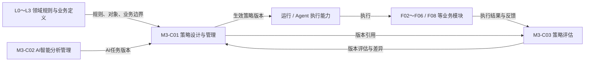
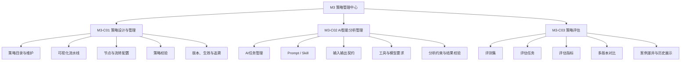
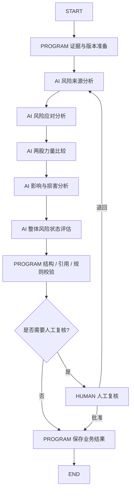
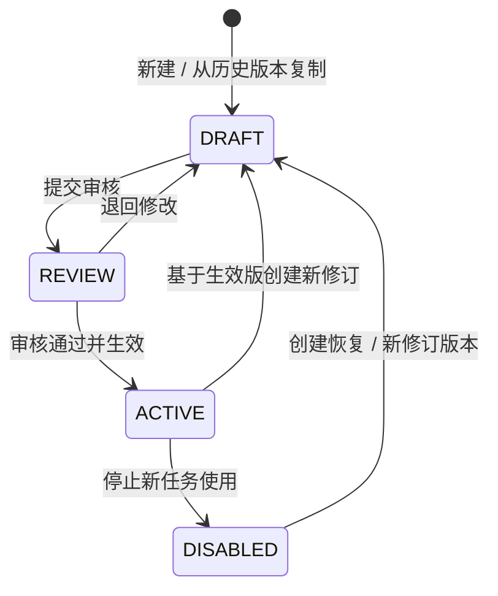

# M3 策略管理中心功能设计

> **文档定位**：RiskHot 系统功能架构的模块级功能设计，承接《系统功能架构总览》中 M3 的横向支撑定位。
>
> **本版核心结论**：M3 负责全系统策略的可视化设计与治理、AI 智能分析能力的统一管理，以及不同策略版本的评估与对比展示。策略通过可视化流水线明确程序、AI、人工在各业务环节中的分工与流转关系。
>
> **设计边界**：领域业务规则、领域对象及业务结果仍由 L0～L3 领域与业务模块定义和维护；M3 通过引用这些定义形成可执行策略。任务调度、模型真实调用、凭据、超时重试及运行基础设施归运行与技术能力。

## 1. 模块定位与功能边界

### 1.1 模块定位

M3 策略管理中心是 RiskHot 的**决策策略设计与治理中心**，统一回答三个问题：

1. 某个业务场景应按照怎样的处理流水线执行；
2. 流水线中的 AI 节点应怎样分析；
3. 新旧策略版本的实际效果有什么差异。

M3 中的“策略”定义为：

> **面向明确业务场景，由程序节点、AI 节点、人工节点和条件节点组成，引用领域规则及 AI 智能分析定义，并具有明确适用范围和版本的处理蓝图。**

策略版本用于指导后续业务运行；业务模块仍拥有最终业务事实及状态变更权。

### 1.2 系统中的位置



图中箭头表达业务引用和治理关系，不规定网络调用、服务拆分或运行部署方式。

### 1.3 职责范围

| M3 负责 | M3 引用 | 归属其他模块 / 能力 |
|---|---|---|
| 策略目录、创建、修改、复制及版本治理 | L0～L3 已确认业务流程和业务规则 | 领域规则本身：对应 L0～L3 |
| 程序 / AI / 人工节点的可视化流水线设计 | M1 信源资格、M2 风险源 / 变量 / 指标定义 | 业务对象和正式业务结果：F01～F08 |
| 节点间流转、判断分支和人工介入位置 | 各业务模块的输入输出契约 | 任务调度、队列、重试、超时、补偿：运行能力 |
| AI 任务、Prompt / Skill、输入输出、工具、模型要求及分析约束 | 领域证据要求和业务校验要求 | 模型 API、供应商凭据、模型适配：技术 / 运行能力 |
| 策略版本的评测集、评估结果、多版本对比和案例差异 | 历史运行结果及人工复核结果 | 业务历史结果的修改：对应事实拥有模块 |

**明确边界：**

- M3 不重写 L0～L3 已确认业务规则；策略通过规则引用使用它们。
- M3 不直接生成或修改 `Event`、`MonitoredRisk`、`RiskSnapshot`、`RiskAnalysisResult`、`RiskReport` 等正式业务事实。
- M3 不直接执行模型调用、调度、重试、超时或补偿。
- M3 中 AI 节点的定义不能自行扩大 AI 的业务授权。正式业务命令仍由对应业务模块完成资格、状态和权限校验。
- 策略评估结果提供版本选择依据，不自动改变当前生效版本。

### 1.4 设计原则

1. **策略即协作流水线**：程序、AI、人工的职责分工直接表达在策略节点和流转关系中，不另设独立的人机协作配置体系。
2. **领域规则单一来源**：策略引用领域规则编号及版本，不复制维护同义规则。
3. **AI 能力可复用**：AI 智能分析任务独立管理，可被一个或多个策略版本引用。
4. **版本可复现**：历史运行能够还原当时使用的策略、AI 任务、Prompt / Skill、Schema 和必要配置版本。
5. **在途版本锁定**：新版本生效后，新运行采用新版本；已经开始的任务继续使用受理时锁定的版本，除非业务明确发起重新分析。
6. **评估与生效分离**：策略评估负责展示效果及差异，版本生效仍由具备相应权限的系统管理员执行。
7. **角色口径统一**：系统参与角色沿用“系统管理员”和“授权阅读者”。审核、维护、运行管理属于操作职责，不新增业务角色。

## 2. 功能架构与功能清单

### 2.1 功能架构



### 2.2 二级能力

| 编号 | 二级能力 | 核心职责 |
|---|---|---|
| **M3-C01** | **策略设计与管理** | 策略创建、可视化流水线设计、程序 / AI / 人工节点编排、分支条件、适用范围、依赖及使用关系，同时管理版本、生效、停用和历史追溯 |
| **M3-C02** | **AI智能分析管理** | 统一管理 AI 任务、Prompt / Skill、输入输出、工具、模型要求、分析约束及结果校验 |
| **M3-C03** | **策略评估** | 管理策略版本的评测、结果展示、版本对比和案例级差异，为策略优化及版本选择提供依据 |

### 2.3 详细功能清单

| 功能编号 | 二级能力 | 功能 | 功能摘要 |
|---|---|---|---|
| M3-F01 | C01 | 策略目录与检索 | 按名称、编码、业务模块、状态和版本查询策略 |
| M3-F02 | C01 | 新建与复制策略 | 创建新策略，或基于已有策略 / 版本生成新的设计草稿 |
| M3-F03 | C01 | 策略基本信息与适用范围 | 维护策略目标、业务场景、主责模块、适用范围和使用说明 |
| M3-F04 | C01 | 可视化策略流水线设计 | 通过节点和连线组织完整处理流程 |
| M3-F05 | C01 | 节点配置 | 配置程序、AI、人工、条件及开始 / 结束节点的职责和输入输出 |
| M3-F06 | C01 | 流转与分支配置 | 配置正常流转、失败流转、人工复核、条件判断和终止路径 |
| M3-F07 | C01 | 依赖与使用关系 | 查看策略引用的 AI 任务、规则及被哪些业务模块 / 运行任务使用 |
| M3-F08 | C01 | 策略完整性校验 | 校验节点、路径、依赖、版本引用和输入输出兼容性 |
| M3-F09 | C01 | 策略版本与生效管理 | 生成新版本、审核、生效、停用及锁定历史引用 |
| M3-F10 | C01 | 策略变更与历史追溯 | 查看版本差异、变更原因、操作记录和历史使用情况 |
| M3-F11 | C02 | AI任务目录 | 统一浏览 L0～L3 已定义的 AI 分析任务及使用关系 |
| M3-F12 | C02 | AI任务定义 | 管理任务目标、分析步骤、输入、输出和后续处理要求 |
| M3-F13 | C02 | Prompt / Skill 管理 | 管理 AI 任务使用的 Prompt、Skill 及其版本 |
| M3-F14 | C02 | 输入上下文与输出 Schema | 定义 AI 可读取的上下文及结构化输出要求 |
| M3-F15 | C02 | AI工具与模型要求 | 定义允许使用的工具、模型能力要求及可选模型配置引用 |
| M3-F16 | C02 | 分析约束与证据要求 | 配置证据引用、禁止事项、不确定性和领域规则引用 |
| M3-F17 | C02 | AI结果校验与兜底 | 配置程序校验要求、无结果处理及转人工复核条件 |
| M3-F18 | C03 | 评测集管理 | 维护用于策略评估的标准案例、历史案例和参考结果 |
| M3-F19 | C03 | 评估任务管理 | 选择策略版本及评测集，发起并记录一次可追溯评估 |
| M3-F20 | C03 | 评估指标管理 | 定义业务质量、人机协作、稳定性和效率类评估指标 |
| M3-F21 | C03 | 策略版本评估与对比 | 对同一策略的多个版本进行统一指标比较 |
| M3-F22 | C03 | 案例级差异与退化分析 | 对同一案例查看不同版本输出、依据、执行路径和结果差异 |
| M3-F23 | C03 | 评估结果展示与历史 | 展示版本评估摘要、趋势、改进 / 退化案例及历史记录 |

## 3. 功能详细设计

### 3.1 M3-C01 策略设计与管理

#### 3.1.1 策略目录与基础信息

策略目录提供 M3 的统一入口。每条策略至少展示：

- 策略名称及稳定编码；
- 业务场景及主责模块；
- 当前生效版本；
- 当前状态；
- 最近修改时间；
- 关联 AI 任务数量；
- 使用模块 / 运行引用；
- 最近一次策略评估结论摘要。

策略支持按业务层、业务模块、状态、版本和关键字检索。目录中的“评估状态”只展示 C03 的最近结果，不参与自动生效判断。

#### 3.1.2 初始策略目录建议

以下作为 M3 首批策略目录基线，编码为本版建议，后续可在正式策略对象设计时确认：

| 建议策略 | 主要业务场景 | 当前已知 AI 任务 |
|---|---|---|
| STR-L0-01 事件处理策略 | 事件抽取、归组、对象变量识别、增量判断 | AI-01～AI-04 |
| STR-L0-02 金融意义评级策略 | 事件金融意义 M 及用途评价 | AI-05 |
| STR-L1-01 风险识别与纳管策略 | 风险识别、同一性判断、复用 / 纳管与复核 | AI-L1-01、AI-L1-02 |
| STR-L2-01 风险状态分析策略 | 来源、应对、力量比较、损害及整体状态 | AI-L2-01～AI-L2-05 |
| STR-L2-02 风险演化分析策略 | 方向、持续性变化及减弱节点 | AI-L2-06～AI-L2-08 |
| STR-L3-01 风险报告生成策略 | 周期报告组织、AI表述、程序校验及人工发布 | AI-L3-01 |

M2 候选变量治理中已存在 AI 辅助行为，其正式 AI 任务编号及是否形成独立策略，在 M2 AI 任务设计完成后纳入本目录。

#### 3.1.3 策略基本信息与适用范围

每个策略版本应维护以下逻辑信息：

| 类别 | 内容 |
|---|---|
| 身份 | 策略名称、稳定编码、版本、状态 |
| 目标 | 解决的业务问题、期望业务结果 |
| 适用范围 | 业务层、模块、场景、触发类型及可选范围条件 |
| 输入边界 | 策略启动时需要具备的业务上下文 |
| 输出边界 | 策略结束时向主责业务模块交付的结果或命令意图 |
| 规则引用 | 依赖的领域规则、配置定义及版本要求 |
| AI引用 | 使用的 AI 任务及固定版本 |
| 治理信息 | 版本说明、变更原因、审核 / 生效记录 |

策略适用范围用于确定“哪一类业务运行应该引用哪个策略版本”。具体运行路由和调度方式由运行能力实现。

#### 3.1.4 可视化策略流水线

策略以可视化流水线表达。首版支持以下节点：

| 节点类型 | 业务语义 | 典型用途 |
|---|---|---|
| `PROGRAM` | 确定性程序步骤 | 数据读取、去重、ID校验、结构校验、规则校验、正式保存 |
| `AI` | AI 智能分析步骤 | 事件抽取、风险识别、风险分析、报告生成等 |
| `HUMAN` | 人工操作 / 复核步骤 | 歧义确认、审核、批准、发布等 |
| `CONDITION` | 条件判断步骤 | 是否校验通过、是否存在歧义、是否需要人工介入 |
| `START / END` | 流程边界 | 定义策略入口及结束结果 |

示例：风险状态分析策略



策略设计界面需要清楚标识每个节点的执行主体，使程序、AI、人工职责在一张流水线上可读、可检查、可追溯。

#### 3.1.5 节点配置

**程序节点**至少配置：

- 节点名称和目的；
- 需要的输入；
- 执行后输出；
- 引用的领域规则 / 校验规则；
- 成功、失败、无结果后的流向。

程序节点只描述需要完成的确定性业务动作，具体代码、服务、事务和部署由技术设计承接。

**AI 节点**至少配置：

- 引用的 `AI Task` 及版本；
- 节点输入与 AI 任务输入映射；
- AI 输出与下游节点输入映射；
- 允许继续、转人工或失败的条件。

AI 节点只引用 C02 中已经定义并可用的 AI 任务版本，不能在策略画布内复制维护完整 Prompt。

**人工节点**至少配置：

- 需要人工介入的原因；
- 具备相应操作权限的系统管理员可执行的操作；
- 人工处理时必须看到的输入、证据、版本及差异；
- 批准、退回、暂缓或其他已获业务授权处理后的流向。

授权阅读者只能查看授权范围内的策略及评估结果，不能执行策略维护、生效或人工业务命令。

#### 3.1.6 流转与分支配置

策略连线用于表达节点之间的业务流转。至少支持：

- 成功继续；
- 失败退出或进入恢复路径；
- 无结果 / 数据不足；
- 业务歧义转人工；
- 人工批准；
- 人工退回；
- 条件判断后的多分支。

分支条件可以引用程序可确定的校验结果、AI 输出中的结构化字段，以及领域规则形成的业务条件。未经领域确认的业务阈值不能通过 M3 配置直接升级为正式规则。

#### 3.1.7 策略完整性校验

策略提交审核或生效前至少检查：

1. 存在唯一有效入口，所有业务结束路径可达；
2. 不存在无后继且未声明结束语义的悬空节点；
3. AI 节点引用真实、有效的 AI 任务版本；
4. 节点之间输入输出可以映射；
5. 所引用领域规则、配置定义和版本存在；
6. 人工节点具有明确的处理结果及后继路径；
7. 条件节点覆盖必要分支，避免未定义结果直接进入正式业务命令；
8. 已生效版本被业务运行引用时，修改必须形成新版本；
9. 停用或替换版本时展示当前使用关系和影响范围。

结构校验通过仅代表策略定义完整。策略中的业务语义仍需按领域规则和人工评审确认。

#### 3.1.8 策略版本与生效

首版建议采用以下生命周期，最终状态枚举在详细数据设计时确认：



版本治理遵循：

- 生效策略版本在历史引用范围内保持不可变；
- 修改流程结构、节点职责、AI任务引用、关键分支、适用范围或实质规则引用时形成新版本；
- 新版本生效后用于新运行；在途任务继续保持受理时锁定的版本；
- 停用只限制新的策略选择，不删除历史运行和评估记录；
- 策略版本生效时记录操作者、审核依据、变更摘要和关联评估结果；
- C03 的评估结果可以作为生效依据之一，系统不依据单一评分自动切换版本。

#### 3.1.9 依赖、使用关系与历史追溯

策略详情应能够反查：

- 引用哪些 AI 任务版本；
- 引用哪些领域规则及关键配置定义；
- 被哪些业务模块引用；
- 当前有哪些在途 / 历史运行使用该版本；
- 该版本关联哪些策略评估；
- 后续哪个版本替代了它。

历史对比至少展示策略基本信息、流水线结构、节点配置、AI引用、规则引用和适用范围的变更差异。

### 3.2 M3-C02 AI智能分析管理

#### 3.2.1 AI任务定位

AI 任务是可被策略 AI 节点引用的**可版本化智能分析能力定义**。AI 任务描述“AI 要解决什么问题、读取什么、怎样分析、输出什么、必须遵守哪些约束”。

AI 任务编号表达逻辑分析职责，不要求与实际模型调用次数一一对应。运行时可以根据技术设计进行合并调用、并行或复用中间结果，但必须保留可追溯的逻辑任务和版本关系。

#### 3.2.2 当前 AI 任务基线

| 业务层 | AI任务 | 主要职责 |
|---|---|---|
| L0 | AI-01 事件抽取 | 从 Information 提取事件候选及核心要素 |
| L0 | AI-02 事件匹配与归组 | 判断新事件、同事件或待判定 |
| L0 | AI-03 Target 与 Variable 识别 | 识别对象、变量及直接关联 |
| L0 | AI-04 增量判定 | 判断事件进展、纠正或来源增加 |
| L0 | AI-05 金融意义评级 | 形成 M 各维判断、金融用途标签及解释 |
| L1 | AI-L1-01 风险识别 | 形成完整风险候选定义 |
| L1 | AI-L1-02 风险同一性判断 | 给出已有风险匹配建议及依据 |
| L2 | AI-L2-01 风险来源分析 | 分析驱动 / 传导变量及当前作用 |
| L2 | AI-L2-02 风险应对分析 | 分析缓冲、治理措施、实施及效果 |
| L2 | AI-L2-03 两股力量比较 | 比较风险压力与缓解力量 |
| L2 | AI-L2-04 风险影响与损害分析 | 分析实际受影响主体、范围及损害 |
| L2 | AI-L2-05 整体风险状态评估 | 形成风险程度、阶段、范围、持续性及摘要 |
| L2 | AI-L2-06 风险方向变化分析 | 比较当前与历史快照形成方向变化 |
| L2 | AI-L2-07 风险持续性变化分析 | 分析持续性预期的实质变化 |
| L2 | AI-L2-08 风险减弱节点识别 | 识别候选减弱节点及后续观察重点 |
| L3 | AI-L3-01 风险报告生成 | 基于已确认上游结果组织周期报告内容 |

AI任务目录还应展示被哪些策略版本引用，避免在修改或停用时丢失影响范围。

#### 3.2.3 AI任务定义

每个 AI 任务至少维护：

| 类别 | 内容 |
|---|---|
| 身份 | AI任务编号、名称、版本、状态 |
| 业务目标 | 分析问题及完成标准 |
| 输入 | 允许读取的业务上下文及必要版本 |
| 分析步骤 | 逻辑分析过程、方法或研究指引 |
| Prompt / Skill | 使用的 Prompt / Skill 及其固定版本 |
| 输出 | 结构化输出 Schema 和业务解释要求 |
| 工具 | 可使用的查询、检索、计算或其他工具能力 |
| 模型要求 | 结构化输出、上下文、工具调用、推理等能力要求 |
| 证据约束 | 引用要求、禁止推断、缺口及不确定性处理 |
| 结果校验 | 程序校验、人工复核及失败处理要求 |

#### 3.2.4 Prompt / Skill 管理

Prompt / Skill 是 AI任务内部可版本化的分析资产。

首版应支持：

- Prompt 文本及用途管理；
- Skill / 方法论引用；
- 变量占位与上下文要求；
- Prompt / Skill 版本历史；
- 变更摘要与原因；
- AI任务对具体版本的引用；
- Prompt / Skill 变化对策略使用关系的反查。

AI任务生效版本应固定 Prompt / Skill 版本，运行时不能通过“最新版本”别名无痕替换历史任务使用的内容。

**提示词文档草案**：[[tools/RiskHot/docs/system-design/03-系统功能架构/AI任务与提示词/AI-01 候选事件提取提示词 V0.1|AI-01 候选事件提取提示词 V0.1]]，服务 F02 Step 1；完整正文集中维护于该资产文档。本草案尚未绑定生效任务，不替换原型 AI-01@1.0；精确 Schema 与发布绑定仍待确认。

**AI-02 提示词草案**：[[tools/RiskHot/docs/system-design/03-系统功能架构/AI任务与提示词/AI-02 事件匹配与归组提示词 V0.1|AI-02 事件匹配与归组提示词 V0.1]]，服务 F02 Step 2 及新证据身份复核；完整正文集中维护于该资产文档。本草案尚未绑定生效任务，不替换原型 AI-02@1.0；精确 Schema、枚举映射及发布绑定仍待确认。

**AI-03 提示词草案**：[[tools/RiskHot/docs/system-design/03-系统功能架构/AI任务与提示词/AI-03 观测主体与变量识别提示词 V0.1|AI-03 观测主体与变量识别提示词 V0.1]]，服务 F02 Step 3；完整正文集中维护于该资产文档。尚未绑定生效任务，不替换原型 AI-03@1.0；精确 Schema、枚举映射及发布绑定仍待确认。

**AI-04 提示词草案**：[[tools/RiskHot/docs/system-design/03-系统功能架构/AI任务与提示词/AI-04 增量判定提示词 V0.1|AI-04 增量判定提示词 V0.1]]，服务 F02 Step 4；完整正文集中维护于该资产文档。尚未绑定生效任务，不替换原型 AI-04@1.0；完整 Schema、分类映射及发布绑定仍待确认。

**AI-05 提示词草案**：[[tools/RiskHot/docs/system-design/03-系统功能架构/AI任务与提示词/AI-05 金融意义评级提示词 V0.1|AI-05 金融意义评级提示词 V0.1]]，服务 F02 Step 5；完整正文集中维护于该资产文档。尚未绑定生效任务，不替换原型 AI-05@1.0；不批准候选权重、公式或阈值，完整 Schema 与发布绑定仍待确认。

#### 3.2.5 输入上下文与输出 Schema

AI任务输入配置回答“AI 在本任务中可以看到什么”。至少区分：

- 当前主业务对象；
- 上游正式结果；
- 原始证据；
- M1 / M2 配置定义；
- 当前策略和领域规则引用；
- 历史对比数据；
- 可选辅助上下文。

输出 Schema 用于定义 AI 必须返回的结构、必填字段、枚举、引用字段、不确定性表达和错误容忍要求。系统可以校验结构和引用，但结构校验不能替代语义证据判断。

#### 3.2.6 AI工具与模型要求

M3 管理 AI任务需要的**逻辑工具能力和模型能力要求**，包括：

- 是否允许查询内部业务对象；
- 是否允许读取证据原文；
- 是否允许计算或结构化转换；
- 是否需要工具调用；
- 是否要求结构化输出；
- 上下文规模、推理能力等模型要求；
- 可选的模型配置引用。

供应商凭据、实际模型 API、模型路由、并发、限流和 Secret 管理归技术 / 运行能力。每次真实运行应记录实际使用的模型信息，供历史追溯和 C03 评估分析。

#### 3.2.7 分析约束、证据要求与结果校验

AI任务可引用领域规则，并补充任务级执行约束。例如：

- 输出正式对象 ID 前必须引用真实存在的身份；
- 证据缺失时允许输出无结果、待判断或受限结论；
- 不得将数据缺失解释成零值、低风险或风险稳定；
- 不得通过单条证据直接推导未授权结论；
- 必须保留关键证据引用和不确定性；
- 正式业务结果形成前仍经过对应业务模块程序校验。

结果校验可配置三类结果：

1. **通过**：满足结构、引用及业务继续条件；
2. **受限结果**：数据不足、无结果或存在已知限制，按策略进入补齐或受限路径；
3. **人工复核**：身份歧义、证据冲突、规则不充分或策略明确要求人工确认。

AI 不直接批准自身生成的结论。

### 3.3 M3-C03 策略评估

#### 3.3.1 功能定位

策略评估用于回答：

> **同一策略修改后，新版本相对旧版本在哪些方面改善、保持或退化？**

C03 以“版本可比”为前提统一管理评测案例、评估任务、评估指标和结果展示。评估结果服务于策略优化和版本选择，不改变历史业务结果。

#### 3.3.2 评测集管理

评测集可以由以下来源构成：

- 经人工确认的典型业务案例；
- 历史真实运行案例的固定快照；
- 场景验证测试中的标准案例；
- 专门构造的边界、异常及退化案例。

每个评测案例至少需要：

- 稳定案例 ID；
- 适用业务场景；
- 固定输入或输入快照；
- 必要的领域配置 / 证据版本；
- 参考结果、人工标注或可验证约束；
- 案例标签，如正常、边界、证据缺失、冲突、歧义；
- 案例版本。

评测集本身应版本化。新增或修订案例后，旧评估仍引用原评测集版本。

#### 3.3.3 评估任务

一次策略评估至少记录：

- 被评估策略及版本；
- 对比基线版本，可为空；
- 评测集及版本；
- 被策略锁定的 AI任务、Prompt / Skill 和 Schema 版本；
- 评估时使用的模型 / 运行配置记录；
- 评估开始、结束及执行状态；
- 评估结果及异常记录。

对两个策略版本进行直接比较时，应尽量保持评测集、领域输入和运行条件一致。存在影响结论的模型、数据或配置差异时，评估结果必须标记比较限制，避免把环境变化误判成策略优化。

#### 3.3.4 评估指标

首版指标建议分为四类，具体公式和达标阈值后续确认：

| 指标类别 | 示例 |
|---|---|
| 业务质量 | 场景通过率、人工确认正确率、证据忠实度、领域规则符合率 |
| 人机协作 | 自动完成率、人工复核率、人工接受率、退回率 |
| 稳定性 | Schema 通过率、无结果率、失败率、重复执行一致性 |
| 效率 | 平均耗时、模型调用量、Token / 成本等运行指标 |

评估指标允许按策略类型配置适用项。例如风险报告生成更关注忠实度和引用完整性，风险同一性判断更关注匹配正确性和人工复核率。

#### 3.3.5 多版本评估与对比

策略评估页应支持选择同一策略的两个或多个版本，并在统一视图中展示：

- 版本基本信息和变更摘要；
- 使用的 AI任务 / Prompt / Skill 版本差异；
- 各项评估指标；
- 通过 / 失败 / 待复核案例数量；
- 相对基线的提升、持平和退化数量；
- 典型改进案例；
- 典型退化案例；
- 当前生效版本标识。

展示层可以提供“总体摘要 + 指标对比 + 案例差异”三级查看方式。

#### 3.3.6 案例级差异分析

选择具体案例后，应能够对比不同版本的：

- 相同输入及证据；
- 实际执行的策略节点路径；
- AI任务及 Prompt / Skill 版本；
- AI结构化输出；
- 程序校验结果；
- 是否进入人工复核；
- 人工处理结果；
- 最终业务输出或评估输出；
- 各项指标得分及差异原因。

对于从通过变为失败、从自动完成变为人工复核、从有结论变为无结果等情况，应标记为**退化候选**，供人工进一步判断。

#### 3.3.7 评估结果展示与历史

策略详情应持续展示历史版本评估：

```text
V1.0 ── 基线评估
  │
V1.1 ── 改进 12 / 持平 83 / 退化 5
  │
V1.2 ── 改进 18 / 持平 80 / 退化 2   ← 当前生效
  │
V2.0 ── 改进 21 / 持平 74 / 退化 5   ← 候选版本
```

同一版本可以存在多次评估；每次评估均保留评测集、模型、AI任务和运行条件，以支持后续解释结果差异。

#### 3.3.8 策略评估边界

- 评估结果不修改对应业务模块已经保存的历史事实；
- 评估失败不自动停用当前版本；
- 评估通过不自动将候选版本生效；
- C01 生效操作可以要求引用最近评估，但是否强制以及最低阈值仍待确认；
- 生产运行统计可以作为评估参考来源，必须与离线标准评测结果分开展示；
- 不同版本缺少可比条件时，应显示“比较受限”及原因。

## 4. 跨模块协作、验收与待定事项

### 4.1 与核心业务模块的协作

| 消费方 | M3 提供 | 业务模块反馈 | 业务事实主责 |
|---|---|---|---|
| F02 事件管理 | 事件处理 / 金融意义评级策略及 AI任务版本 | 执行结果、歧义、方法缺口 | F02 |
| F03 风险识别 | 风险识别策略及 AI-L1-01 | 识别质量、候选缺口、复核情况 | F03 |
| F04 风险纳管与跟踪 | 同一性判断及人工复核流程策略 | 匹配歧义、准入反馈 | F04 |
| F05 风险状态分析 | 状态分析策略、AI-L2-01～05 | 分析缺口、规则反馈、复核情况 | F05 |
| F06 风险演化分析 | 演化策略、AI-L2-06～08 | 可比性、节点判断及规则反馈 | F06 |
| F08 风险报告与发布 | 报告生成策略、AI-L3-01 | 生成质量、引用冲突、发布复核反馈 | F08 |

F01 信息接入与标准化模块和 F07 风险展示当前以确定性能力为主。若后续出现需要独立治理的处理策略，可纳入 C01；M3 不要求每个模块必须存在 AI 节点。

### 4.2 与运行 / 技术能力的边界

| 事项 | M3 | 运行 / 技术能力 | 业务模块 |
|---|---|---|---|
| 流水线定义 | 主责 | 读取并执行 | 按业务场景调用 |
| 人 / 程序 / AI节点职责 | 主责 | 承载执行 | 提供业务命令 |
| AI任务与 Prompt / Skill | 主责 | 加载执行 | 提供业务上下文 |
| 模型能力要求 | 主责定义 | 选择 / 路由真实模型 | — |
| 模型凭据 | — | 主责 | — |
| 调度、队列、重试、超时 | 定义必要业务分支 | 主责实现 | 接收运行状态 |
| 领域业务规则 | 引用 | 执行可程序化部分 | 对应领域 / 模块主责 |
| 正式业务结果 | 不持有 | 不持有 | 主责持久化 |
| 策略评估 | 主责 | 提供运行指标和执行记录 | 提供结果 / 人工反馈引用 |

### 4.3 关键功能验收场景

| 验收编号 | 场景 | 预期结果 |
|---|---|---|
| AC-M3-01 | 查询策略目录 | 可以按模块、状态和关键字找到策略并查看当前版本 |
| AC-M3-02 | 新建策略流水线 | 可以使用 PROGRAM / AI / HUMAN / CONDITION 节点形成完整流程 |
| AC-M3-03 | 配置人机AI分工 | 每个节点的执行主体、输入输出及流转条件清晰可查 |
| AC-M3-04 | AI节点引用 | AI节点只能选择真实 AI任务版本，并显示 Prompt / Skill 等关键依赖 |
| AC-M3-05 | 策略校验 | 悬空节点、缺失 AI版本、无出口分支或输入输出不兼容时阻止生效 |
| AC-M3-06 | 新策略版本 | 已生效策略修改后形成新版本，旧版本保持可追溯 |
| AC-M3-07 | 在途版本锁定 | 新版本生效后，已开始运行仍引用受理时版本 |
| AC-M3-08 | AI任务独立版本 | AI任务或 Prompt 更新不会无痕改变已经生效的策略版本 |
| AC-M3-09 | 评测集版本 | 修订评测案例后，新评估使用新评测集版本，历史评估仍可还原 |
| AC-M3-10 | 多版本评估 | 对相同评测集运行 V1 与 V2 后可以统一展示各项指标 |
| AC-M3-11 | 案例差异分析 | 可以查看同一案例在 V1 / V2 中的执行路径、AI输出及最终差异 |
| AC-M3-12 | 退化案例识别 | 新版本出现通过转失败或人工复核增加时可以定位相关案例 |
| AC-M3-13 | 评估与生效分离 | 候选版本评估通过后仍需要授权操作才能生效 |
| AC-M3-14 | 历史运行追溯 | 可以从历史业务运行反查所用策略、AI任务及关键版本 |
| AC-M3-15 | 阅读权限 | 授权阅读者可以查看授权范围内策略和评估，但不能编辑或生效 |

### 4.4 待定事项

| 编号 | 待定事项 | 影响 |
|---|---|---|
| D-M3-01 | 策略正式领域对象、物理表及 DSL / JSON 表达方式 | C01 / 数据设计 |
| D-M3-02 | `DRAFT / REVIEW / ACTIVE / DISABLED` 是否作为正式状态枚举 | C01 |
| D-M3-03 | 同一策略同一适用范围是否只允许一个生效版本，是否支持灰度 / A-B | C01 / 运行 |
| D-M3-04 | 条件节点的表达式语言及可引用字段范围 | C01 / 技术设计 |
| D-M3-05 | AI任务全局编号规范以及 L0 旧 AI-xx 与分层编号的统一方案 | C02 |
| D-M3-06 | Prompt / Skill 的存储格式、敏感内容查看权限和发布流程 | C02 / 权限 |
| D-M3-07 | AI工具权限的逻辑配置与运行侧真实 Tool 权限如何映射 | C02 / 技术设计 |
| D-M3-08 | 模型配置引用、实际模型版本和运行路由的绑定粒度 | C02 / 运行 |
| D-M3-09 | 标准评测集来源、人工金标形成方式和版本维护责任 | C03 |
| D-M3-10 | 业务质量、人工接受率、证据忠实度等指标公式与正式阈值 | C03 |
| D-M3-11 | 策略生效是否必须达到特定评估门槛 | C01 / C03 |
| D-M3-12 | 生产运行反馈是否自动纳入策略评估，以及与离线评测如何分层展示 | C03 / 运行 |
| D-M3-13 | M2 变量候选治理的 AI任务和策略是否正式纳入 M3 首版 | M2 / C02 |
| D-M3-14 | F02、F08 当前“范围待定”的 M3 支撑边界如何同步回系统功能架构总览 | 总体架构追踪 |

## 附录 A：设计依据与追踪

1. [[tools/RiskHot/docs/system-design/03-系统功能架构/系统功能架构总览|系统功能架构总览]]：M3 横向支撑定位、方法 / 规则 / 模板治理、人机协作、AI 授权边界、版本及历史要求。
2. [[tools/RiskHot/docs/system-design/02-业务架构与领域设计/RiskHot_L0_信息处理层_业务架构与领域设计V1.0|L0 业务架构与领域设计]]：AI-01～AI-05、统一 AI 任务契约、Prompt 版本、输出 Schema 及业务校验模式。
3. [[tools/RiskHot/docs/system-design/02-业务架构与领域设计/RiskHot_L1_风险识别与纳管层_业务架构与领域设计|L1 业务架构与领域设计]]：AI-L1-01、AI-L1-02、Prompt / Schema / AI 执行与质量保障待讨论项。
4. [[tools/RiskHot/docs/system-design/02-业务架构与领域设计/RiskHot_L2_风险态势分析层_业务架构与领域设计V1.0|L2 业务架构与领域设计]]：AI-L2-01～08、逻辑任务编号、程序 / AI / 人工分工、评测样本和质量指标需求。
5. [[tools/RiskHot/docs/system-design/02-业务架构与领域设计/RiskHot_L3 业务架构与领域设计 V1.0|L3 业务架构与领域设计]]：AI-L3-01、报告生成边界、结构与引用校验及质量评测需求。
6. `README.md`：现有策略中心维护评估规则和分析模板的实现基线；本设计在此基础上扩展为策略流水线治理、AI智能分析管理和策略版本评估。
7. 现有 `FR-CFG-05`：继续保留需求追踪，后续需求文档应将原“判断方法、评级规则和模板”映射到本版 M3-F01～M3-F23。

---

**文档结论**：M3 以“策略设计与管理 → AI智能分析管理 → 策略评估”形成闭环。C01 用一条可视化流水线定义程序、AI、人工如何协作并治理版本；C02 提供可复用、可版本化的 AI 智能分析能力；C03 使用统一评测集和指标展示不同策略版本的效果与案例差异。策略负责定义处理方法和协作方式，运行能力负责实际执行，各业务模块继续拥有领域事实与正式业务结果。
