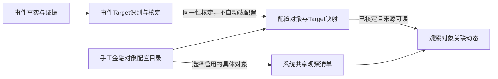

# M4 金融对象配置中心与观察管理功能设计

## 1. 目的与确认范围

当前 `information.target` 保存事件处理链路中识别并核定的金融对象，多个事件可以引用同一Target。刚完成的“观测对象”页面也能直接向该表手工建档，尚未区分“可配置的对象全集”和“系统实际选择观察的对象”。

本次新增**金融对象配置中心**：先手工维护一份稳定、可按层级浏览的金融对象目录，再从目录选择具体对象建立观察。**用户已确认：系统共享一份观察清单，不按个人维护。**

本稿只完成功能设计，不创建配置表、不迁移数据、不修改运行页面。本文中新增能力均为待实施，现有代码仍按上一版运行。

### 1.1 输入依据

| 依据 | 本稿采用内容 |
| --- | --- |
| 2026-11-05本轮用户要求与目录树截图 | 手工配置金融对象；增加配置中心；从配置目录筛选并建立观察；分层导航 |
| 用户对共享范围的补充确认 | 全系统共享一份观察清单 |
| [[tools/RiskHot/docs/system-design/02-业务架构与领域设计/业务架构总览\|业务架构总览]] | 配置定义、事件事实与持续观察分开表达 |
| [[tools/RiskHot/docs/system-design/02-业务架构与领域设计/RiskHot_L0_信息处理层_业务架构与领域设计V1.0#3.3 Target（金融观测对象）定义与识别边界\|L0 Target定义]] | 事件识别、身份与范围、跨事件复用、事实及原文证据 |
| [[tools/RiskHot/docs/system-design/03-系统功能架构/0.系统功能架构总览\|功能总览]]、[[tools/RiskHot/docs/system-design/03-系统功能架构/F02 事件管理模块功能设计 V1.0\|F02功能设计]] | 继承已有事件链路及模块交接，新增职责不得冒充已发布 |
| [[tools/RiskHot/docs/references/金融风险研究对象分类索引 V1.0\|金融对象分类索引]] | 六大类、对象身份与范围、可交叉分类 |
| [[tools/RiskHot/docs/system-design/04-系统架构设计/05-架构治理与验证/架构决策记录/ADR-Target-001-分类目录与观测对象分离\|既有Target分类存储决策]] | 不把新的对象配置目录误写成恢复旧Target分类拆表方案 |
| [[tools/RiskHot/docs/system-design/06产品UI原型设计/观测对象浏览与维护页面设计\|现有观测对象页面设计]] | 当前实际页面与直接手工维护Target能力，是后续改造基线 |

### 1.2 本次变化与不变边界

- 新增手工金融对象配置目录；它不要求先出现事件。
- 新增系统共享的观察选择关系；一个配置对象可以从未观察变为观察中。
- 保留事件Target、EventTarget、Fact与原文证据；建立观察不制造事件事实。
- 将手工对象定义维护从当前内容页移到配置中心；内容页管理“观察什么”，配置中心管理“对象是什么”。
- 目录父子关系只帮助组织和查找，不自动形成金融身份、风险传导或事件关联。
- 不自动为全部配置对象或全部事件Target建立观察。

## 2. 三类业务对象与职责

| 业务对象 | 回答的问题 | 形成方式 | 是否要求已有事件 | 是否代表正在观察 |
| --- | --- | --- | --- | --- |
| 金融对象配置项 | 系统允许配置和选择哪些金融对象，各自范围是什么？ | 授权维护者手工配置 | 否 | 否 |
| 事件Target | 哪个金融对象被本次事实涉及，身份是否已核定？ | 从事件识别、匹配和核定；现有载体为information.target | 需有候选/Fact证据，不要求Event已保存 | 否 |
| 对象观察记录 | 系统当前选择持续关注哪个配置对象？ | 从启用的配置对象中选择建立 | 否 | 由观察状态决定 |

**例子**：配置中心先建立“美元”，范围限定为美元这一货币单位；内容页选择它并建立观察。没有相关事件时仍可观察，显示“尚无已核定关联动态”。后续事件Target经核定与该配置对象身份相同，相关事件才进入它的动态；不能把“美元融资市场”仅凭含有“美元”三个字归入。



## 3. 功能清单

| 编号 | 功能 | 业务结果 |
| --- | --- | --- |
| FOC-01 | 浏览与检索配置目录 | 按层级、名称/别名、金融分类、地区、状态找到对象 |
| FOC-02 | 维护目录节点 | 新增、改名、移动、排序，保持合法树结构 |
| FOC-03 | 手工新建金融对象 | 保存明确身份、范围、分类和配置状态 |
| FOC-04 | 编辑与版本管理 | 合法修订形成版本并保留审计，历史依据可追溯 |
| FOC-05 | 查重与范围核对 | 复用已有对象，保留同名不同范围对象，不自动合并 |
| FOC-06 | 配置启用与停用 | 控制哪些对象允许被新选来观察 |
| OBS-01 | 从目录添加观察 | 只选择启用的具体对象，建立系统共享观察记录 |
| OBS-02 | 浏览观察清单与详情 | 展示观察状态、配置依据和可读关联动态 |
| OBS-03 | 暂停、结束与恢复观察 | 改变共享关注状态，保留对象与事件历史 |
| OBS-04 | 重复选择与并发处理 | 同一配置对象不产生并行重复观察 |
| OBS-05 | 配置变化交接 | 停用、版本变化、范围澄清都有明确处理结果 |
| EVT-01 | 核定配置对象与事件Target映射 | 事件只依据有效身份映射进入观察对象动态 |
| EVT-02 | 处理无匹配与歧义 | 保留事实和待补配置问题，不阻断Event保存或猜测关联 |

## 4. 配置目录与逻辑属性

### 4.1 一个配置目录，两种条目

逻辑上使用一份金融对象配置目录，条目区分：

- **目录节点**：组织对象，例如“A－货币与货币形态”“法定货币”。可含子目录或对象，不能直接建立观察。
- **金融对象条目**：具有独立名称、范围和稳定身份的具体对象，例如“美元”“人民币”。可以建立观察，首版作为树的叶子。

截图中的“货币研究主题”“货币研究入口”属于研究或导航语义，不因出现在树中就自动成为金融对象。本稿不增加主题页或研究入口配置功能；需在后续单独明确其业务含义。

示意如下，均为设计示例，不表示已导入：

```text
金融对象配置
├─ A－货币与货币形态〔目录〕
│  ├─ 法定货币〔目录〕
│  │  ├─ 美元〔金融对象〕
│  │  └─ 人民币〔金融对象〕
│  └─ 货币性资产〔目录〕
│     └─ 商业银行存款〔金融对象，须另行明确地区、范围〕
└─ B－金融资产与金融合约〔目录〕
   └─ 主权债务工具〔目录〕
      ├─ 美国国债〔金融对象〕
      └─ 中国国债〔金融对象〕
```

### 4.2 配置项业务属性

以下为逻辑属性。金融对象配置主表的字段类型、约束、索引、快照及基础DDL现已集中写入[[tools/RiskHot/docs/system-design/04-系统架构设计/01-数据模型与存储设计/全局配置表数据模型与存储设计|全局配置表数据模型与存储设计]]；该技术方案仍为设计草案，未执行迁移。观察与映射的完整物理表结构继续由后续技术设计补齐。

| 属性 | 目录节点 | 金融对象条目 | 规则 |
| --- | --- | --- | --- |
| 稳定身份 | 必需 | 必需 | 名称、移动、排序不改变身份；不新增对象业务编码 |
| 条目类型 | 目录 | 金融对象 | 已有引用后不得随意互换类型 |
| 显示名称 | 必需 | 必需 | 名称不单独决定金融对象身份 |
| 上级目录 | 根节点可空 | 必需 | 不得指向自身、后代或金融对象条目 |
| 排序 | 支持 | 支持 | 只影响目录呈现 |
| 别名 | 不作为金融身份别名 | 支持多值 | 为对象检索、核对服务，不能仅凭别名直接核定映射 |
| 金融分类 | 可用于导航说明 | 至少一项有效配对 | 对象沿用一级/二级金融分类；目录路径不能替代分类属性 |
| 国家或辖区 | 可选说明 | 按身份需要明确 | 可确认为不限定；不以缺失值猜测全球范围 |
| 范围定义 | 目录用途说明 | 必需 | 说明纳入、排除及区分同名对象的限定 |
| 配置状态 | 草稿、启用、停用 | 草稿、启用、停用 | 草稿与停用对象不可新选来观察 |
| 配置版本 | 必需 | 必需 | 修订可追溯，不覆盖已采用版本的依据 |
| 维护信息 | 必需 | 必需 | 维护者、时间、变更原因及变更前后内容 |

**分类兼容**：截图的“法定货币”“货币性资产”可作为目录名称；现行金融分类仍使用“货币单位”等已登记配对。修改目录不等于发布新的金融分类。六大类与33个二级分类可作为初始化参考，具体目录和对象应由维护者确认，不把全部示例自动导入。

### 4.3 共享观察记录

| 属性 | 规则 |
| --- | --- |
| 观察记录身份 | 标识一份共享关注记录，不替代金融对象身份 |
| 所选配置对象 | 必需；必须引用金融对象条目，不能只保存对象名称或事件Target身份 |
| 采用配置版本 | 保留建立/恢复时核对的定义依据 |
| 观察状态 | 观察中、已暂停、已结束 |
| 状态原因 | 区分手工操作、配置停用、定义待确认 |
| 开始、暂停、结束及恢复记录 | 保留每次状态变化的操作者、时间和说明 |
| 观察备注 | 说明关注目的；不得借备注修改配置对象的身份与范围 |

首版全系统共用同一观察记录；“由谁添加”只用于审计，不决定个人私有范围。读者能看到同一共享清单，但其中事件内容与数量仍按当前账号权限计算。

### 4.4 配置对象与事件Target的核定映射

建议同一身份、同一范围采用：一个配置对象至多核定对应一个正式Target，一个正式Target至多核定对应一个配置对象。尚未出现事件时可以没有Target映射。

映射必须保留双方身份及版本、核对依据、核定者、时间和结果。多个历史Target争议地指向同一配置对象时，先记录映射冲突，不为展示聚合而静默合并。身份模型及物理约束待技术设计确认。

## 5. 主要业务流程

### 5.1 手工配置金融对象

1. 在“配置 → 金融对象配置中心”定位目录，选择新增金融对象。
2. 填写名称、别名、金融分类、国家/辖区和范围，核对同名或近似对象。
3. 若已有同一身份与范围的对象，返回已有记录，不重复建档；同名但范围不同则明确限定后分别保存。
4. 字段未完整可保存草稿；核对完成后启用，记录维护者与版本。
5. 保存配置不创建事件Target、不建立EventTarget、不自动加入共享观察清单。

### 5.2 从配置目录建立观察

1. 在“内容 → 观测对象”点击“添加观察”。
2. 选择器从配置目录读取启用的具体金融对象；提供树形浏览、检索及范围预览。
3. 目录节点只能展开，草稿、停用条目不可勾选；允许多选具体对象，但不能通过选择父目录自动订阅整棵子树。
4. 提交前再次检查条目类型、状态、版本、观察管理权限与已有观察。
5. 新对象建立共享观察；已观察对象返回已有记录，已暂停/结束对象引导恢复原记录，不生成并行重复记录。
6. 显示本次已添加、已存在、需处理和失败项；部分失败保留逐项原因，重试不重复添加成功项。
7. 无相关事件时保存观察成功，显示“尚无已核定关联动态”。

### 5.3 事件识别与配置目录衔接

1. F02依据事实与原文识别并核定事件Target，继续保留当前证据链。
2. 将正式Target与配置目录中的对象进行身份/范围核对；可复用已有检索与核定能力，不在本稿指定新的AI任务编号。
3. 已有有效映射且版本依据仍适用时复用；没有映射时提出建议，首版建议由授权人员核定。
4. 名称、分类、范围、辖区有歧义时保留未决；无配置对象时提示“待补配置”，由配置中心手工补充后再核定。
5. 未匹配不阻断Event保存；不自动建配置项，也不自动建立共享观察。
6. 核定成功后，该对象的观察详情可展示已保存且有权读取的相关事件。

### 5.4 暂停、结束与恢复观察

- **暂停**：从默认活跃观察范围移出；保留配置引用、历史状态与事件查阅入口。
- **结束**：退出当前观察清单，保留可查历史；不是删除配置对象，也不是删除事件Target。
- **恢复**：重新校验配置启用状态、采用版本和权限，恢复原共享记录并保留新的开始记录。
- 暂停或结束不停止F01/F02继续采集、保存相关事件；手动详情仍可查询已有资料，不定义为冻结数据快照。
- 首版默认展示全部可读、已核定直接关联的历史事件，可再按时间筛选；观察开始时间不冒充事件发生时间。

## 6. 状态与关键业务规则

### 6.1 配置状态

| 状态 | 是否可被新选来观察 | 已有引用处理 |
| --- | --- | --- |
| 草稿 | 否 | 不应已有正式观察引用；不能把在用对象直接退回草稿绕过停用规则 |
| 启用 | 是 | 允许建立/恢复观察；事件仍须独立核定关联 |
| 停用 | 否 | 保留历史引用，禁止新观察与恢复；不删除事实或历史配置版本 |

对象有效可选的前提是自身和全部上级目录均已启用；目录为草稿或停用时，其下对象即使自身标为启用，也必须明确显示不可选及上级原因。

目录停用时先显示受影响的下级配置与共享观察。首版建议整体停用该分支的可选择资格，活跃观察按下述规则暂停；保留各条目原状态，恢复目录不自动启用此前独立停用的对象。

### 6.2 观察状态

| 当前状态 | 操作或变化 | 结果 |
| --- | --- | --- |
| 未建立 | 选择启用对象 | 观察中；没有事件也可成功 |
| 观察中 | 手工暂停 | 已暂停，原因保留 |
| 观察中 | 配置对象/上级目录停用 | 已暂停，原因标明配置不可用 |
| 观察中 | 定义变更影响观察口径 | 已暂停，原因标明定义待确认；按本稿建议执行 |
| 观察中/已暂停 | 结束观察 | 已结束，保留历史 |
| 已暂停/已结束 | 明确恢复且前提通过 | 观察中，记录本次采用版本与恢复原因 |
| 已暂停/已结束 | 配置重新启用 | 保持原观察状态，不自动恢复 |

配置导致的暂停不能抹掉原有手工暂停或已结束状态。观察状态不表示风险等级，也不表示相关事件不存在。

### 6.3 目录、身份与版本规则

1. 移动节点不得产生循环、孤儿或多个不明确的父目录；同级目录重名提示核对。对象移动只调整组织位置，不改金融身份。
2. 对象可有多个金融分类，但不因交叉分类复制对象身份或共享观察；目录检索结果与勾选集合按稳定身份去重。
3. 同一身份的范围澄清形成新版本，保留历史依据；若实际变成另一对象，应新建对象，不得沿用旧身份覆盖。
4. 纯目录排序或在可用性不变的目录间移动，不改变对象定义或观察状态。若移动使对象进入未启用分支，先展示并确认影响，再按配置不可用规则暂停相关观察；未经确认不执行。名称/别名的同身份修订可同步显示，但保留历史原称与版本记录。
5. 影响范围、辖区或观察口径的定义修订须给出影响清单；本稿建议先暂停相关活跃观察，核对采用新版本后显式恢复。
6. 配置停用与事件Target的有效状态分开管理；不能因不再允许观察而删除Target或禁止保存既有事件事实。
7. 有子项、有观察记录、有映射或历史引用的配置项不物理删除；首版使用停用，目录结构调整应先处理子项。
8. 建立观察和保存事件都应校验最新状态；打开选择器时可选，不代表提交时仍然可选。

### 6.4 关联动态规则

- 只采用核定成功、身份范围一致且版本依据有效的映射；不通过名称字符串直接联表。
- 目录下的对象、母子主体、总体与子集、不同期限资产、同类资产之间，不自动相互继承动态。
- 首版不自动扩展到“间接影响”“主题相关”或风险传导事件；此类扩展需要另行定义证据与范围。
- 事件及其所有采用来源必须对当前账号可读；数量、列表、详情和导出遵循同一规则。
- 同一事件经多条证据引用同一对象，只计一条动态；多次模型调用不增加事件数量。
- 读取失败、权限不足、映射未核定和合法零事件分别显示，不能都显示为“没有动态”。

### 6.5 权限与审计

| 职责 | 允许行为 | 禁止的隐式行为 |
| --- | --- | --- |
| 配置维护 | 管理目录与金融对象定义、启停、版本 | 不因配置操作批准事件事实或映射 |
| 观察管理 | 从目录添加、暂停、结束和恢复共享观察 | 不借观察备注修改对象定义 |
| 事件/映射核定 | 核对Target与配置对象身份、范围与依据 | 不因新Target自动建立观察或配置对象 |
| 只读 | 查看获授权的目录、共享观察及可读动态 | 不显示或接受维护、核定写操作 |

同一账号可兼具多项职责；具体权限标识在技术设计中落定，不默认沿用现有页面的event_review处理所有新职责。新建、编辑、移动、启停、添加观察、状态变化、映射核定与冲突处理均保留操作者、时间、依据版本和说明；重复操作不得重复产生业务记录。

## 7. 页面与操作映射

本节确定功能与信息架构，视觉布局与可点击原型在后续UI阶段设计。

### 7.1 导航

- 内容：全部动态、观测对象。
- 配置：信源管理中心、**金融对象配置中心**、流水线全景。

“金融对象配置中心”采用用户指定的M4标识；后续在功能总览与技术设计中同步其职责及跨模块交接。

### 7.2 金融对象配置中心

- 树形导航展示目录与对象，名称前使用能区分条目类型的图标；支持展开/收起及保留定位。
- 列表/详情展示对象的名称、别名、分类、地区、范围、状态、版本、是否已观察和有效映射情况。
- 目录动作：新增下级目录、改名、移动、排序、停用及影响预览。
- 对象动作：新增、编辑、保存草稿、启用、停用、查看版本与变更记录。
- 配置完整且有观察管理权限时，可提供“添加观察”的快捷入口，但调用同一共享观察流程。
- 配置中心显示“已观察”不代替事件关联；未出现事件的配置对象正常保留。

### 7.3 观测对象

- 默认展示系统共享、正在观察的配置对象；可筛选暂停或结束记录。
- 现有“新建观测对象”改为“添加观察”，打开配置目录选择器；不再直接输入名称创建Target。
- 详情展示采用的配置定义、观察状态、观察备注和可读关联动态。
- 动作包括暂停、结束、恢复、编辑观察备注；“编辑对象定义”改为有权限时跳往配置中心。
- 无对象时引导“从配置目录添加观察”；未配置对象时引导有权限者进入配置中心。
- 无关联事件时解释已建立观察但暂无核定动态，不将其作为建档失败。

### 7.4 选择器与异常

| 场景 | 页面反馈与恢复 |
| --- | --- |
| 选择目录节点 | 只展开或预览，不允许建立观察 |
| 选择已观察对象 | 标明已观察，可跳转已有记录，不重复勾选创建 |
| 选择暂停/结束对象 | 提供恢复原记录路径，并展示前提 |
| 提交时对象被停用/修订 | 阻止过期项，保留其他选择，要求重新核对该项 |
| 批量添加部分失败 | 显示逐项结果，原请求重试不重复成功项 |
| 权限被撤销 | 清除受限内容和写入口，提交也独立拒绝 |
| 网络失败、结果未确认 | 区分读取重试与原保存请求重试，保留选择及表单 |
| 同名或多义对象 | 展示范围、地区和版本，不按名字默认合并 |

## 8. 与现有实现及文档的差异

| 当前情况 | 本次目标 | 实施前必须处理 |
| --- | --- | --- |
| information.target承担事件核定对象，现有页面也可手工写入 | 手工对象定义进入配置目录；Target回归事件对象身份 | 分离写入入口与权限；不能只改页面标题 |
| 内容页列出所有Target | 内容页只列共享观察记录 | 新观察选择关系与查询范围；不把全Target当已观察 |
| 新建直接写Target | 从配置目录选择建立观察 | 替换前端动作及后端契约，旧直接手工入口需受控调整 |
| 六大类/33个二级分类为已有分类口径 | 新增可维护的层级对象目录 | 区分组织目录与金融分类；原Target分类字段方案保留 |
| EventTarget表示事件与Target事实关联 | 观察通过核定映射读取事件 | 明确映射依据、冲突、版本及读取权限 |
| 尚无独立共享观察状态 | 观察中/暂停/结束 | 操作审计、停用传播、恢复与重复选择规则 |

本需求新增的是**手工对象配置目录**，不是恢复既有ADR已撤回的Target分类、别名或范围拆表。最终物理表名、字段类型、外键、索引和迁移脚本，按项目约定进入数据模型与技术设计文档，本稿不先行定SQL。

### 8.1 存量与切换要求

1. 实施前重新盘点配置、Target、事件引用、已手工建立对象及历史快照；本轮此前只读盘点Target为0，不能据此省略上线时盘点。
2. 不删除或覆盖现有Target、EventTarget、Fact、证据、定义快照与审计。
3. 已有Target可提出配置建档建议，由维护者核对；不能把事件中抽取到的全部对象自动写入配置表。
4. 存量手工Target需明确归属、配置映射与保留方式；不能因为曾经手工建立就自动生成共享观察。
5. 先完成配置目录与核定映射准备，再切换内容页的数据来源与观察动作；校验新旧入口没有同时把“新增观察”写回Target。
6. 上线验证新建配置不创建观察、建立观察不创建事件、事件Target不自动创建配置，保证三条路径独立。
7. 若切换失败，保全新配置、观察和映射记录，停用新入口后按已验证方案回退；不能只回退页面导致记录不可访问或混写。

## 9. 验收场景

下列均为待执行验收，不表示本轮已实现或通过。

| 编号 | 场景 | 预期结果 |
| --- | --- | --- |
| AC-01 | 未出现任何事件，手工配置“美元”并启用 | 配置成功，不产生Target/事件/观察 |
| AC-02 | 从配置目录选择“美元”建立观察 | 共享观察成功，零事件为空状态 |
| AC-03 | 另一授权用户查看共享观察 | 看到同一观察记录，不新建个人副本 |
| AC-04 | 尝试选择“A－货币与货币形态”目录 | 不允许建立观察，可展开子项 |
| AC-05 | 草稿、停用对象或未启用目录下对象 | 不可新选或恢复观察，原因明确 |
| AC-06 | 相同名称但地区/范围不同 | 可区分建档，不自动合并 |
| AC-07 | 重复提交、并发选择同一配置对象 | 至多一份共享观察，返回已有结果 |
| AC-08 | 暂停/结束后再次选择 | 恢复原记录流程，不生成并行重复 |
| AC-09 | 停用正在观察的配置对象 | 观察暂停，原因是配置不可用，历史仍可查 |
| AC-10 | 重新启用配置对象 | 观察不自动恢复，需明确操作 |
| AC-11 | 对象或观察原先已手工暂停/结束 | 配置状态变化不抹掉原管理状态 |
| AC-12 | 移动目录到其后代 | 拒绝循环，原树保持合法 |
| AC-13 | 在启用目录间移动对象或目录排序 | 稳定身份、金融分类及观察状态不变 |
| AC-14 | 修改定义版本但仍为同一身份 | 旧采用依据保留；影响口径时暂停待确认 |
| AC-15 | 试图把旧对象范围改成另一个对象 | 要求新对象身份，不覆盖旧事件或观察 |
| AC-16 | 事件核定出尚未配置的Target | Event正常保存，提示待补配置，无自动观察 |
| AC-17 | Target与配置对象核定同一性 | 可用映射进入对应观察动态，保留依据 |
| AC-18 | 美元、美元融资市场、美国国债同类或同词 | 不仅凭名称/分类/目录关系互相归入 |
| AC-19 | 一个配置对象出现多个冲突Target映射 | 保留冲突，未核定内容不进入动态 |
| AC-20 | 已保存历史事件在观察建立前发生 | 按权限可查，不冒充新采集或观察后发生 |
| AC-21 | 事件含一处当前用户无权读取的来源 | 数量、列表、详情均不显示该事件 |
| AC-22 | 同一事件多份Fact/证据指向同一对象 | 动态只计一次 |
| AC-23 | 选择器打开后配置停用或版本变化 | 提交时重新校验，过期项不落入观察 |
| AC-24 | 批量观察中有一项失败 | 成功项保留、失败逐项提示，重试不建重 |
| AC-25 | 配置维护者没有观察管理权限 | 可配置但不能新增共享观察 |
| AC-26 | 观察管理者没有配置维护权限 | 可选择/管理观察，不能修改对象定义 |
| AC-27 | 读取失败或映射未决 | 显示真实原因，不能伪装零动态 |
| AC-28 | 暂停/结束观察后新事件入库 | F02正常保存；历史查阅不被冻结或删除 |
| AC-29 | 截图中的研究主题/入口节点 | 不当作可观察金融对象导入 |
| AC-30 | 旧手工Target入口仍被调用 | 按切换方案受控处理，不继续静默混写配置和观察 |
| AC-31 | 正在观察的对象移到未启用分支 | 先确认影响，执行后按配置不可用暂停，稳定身份和历史保留 |

## 10. 首版边界与待确认

### 10.1 首版范围

层级配置目录、手工对象定义、共享观察选择与生命周期、核定映射、直接关联动态、权限审计及已有页面改造。沿用现有界面语言，具体视觉设计另行承接。

不包含批量导入外部对象库、研究主题/入口页面、按父目录自动观察后代、个人私有观察、关键词或间接影响自动关联、定时抓取新规则、主动通知、变量指标新配置、自动风险评级、交易或投资建议。建立观察本身不触发这些能力。

### 10.2 已确认、方案建议与下一阶段

- **用户已确认**：新增手工金融对象配置目录和独立配置中心；观测对象从目录选择建立观察；系统共享一份观察清单；本轮先写功能设计。
- **本稿方案建议**：目录/对象条目区分；状态与版本规则；有效映射的一对一约束；首版人工核定映射；影响观察口径的定义修订先暂停待确认。均需功能评审确认，不能直接视为已发布规则。
- **功能评审重点**：明确哪些定义澄清可同步、哪些必须暂停并重新确认；确认是否采用本稿建议的映射约束。
- **下一阶段才确定**：跨模块交接、物理表与迁移、权限标识、接口及路由、映射候选的程序/AI实现、具体页面布局；需同步L0/F02、数据模型、相关AI契约和原页面设计。

## 11. 版本记录

| 版本 | 日期 | 内容 | 实施状态 |
| --- | --- | --- | --- |
| V0.1 | 2026-11-05 | 首次区分配置对象、事件Target与共享观察，给出树形目录、流程、状态、页面映射、切换与31项验收 | 只完成文档，待评审、未实施 |
