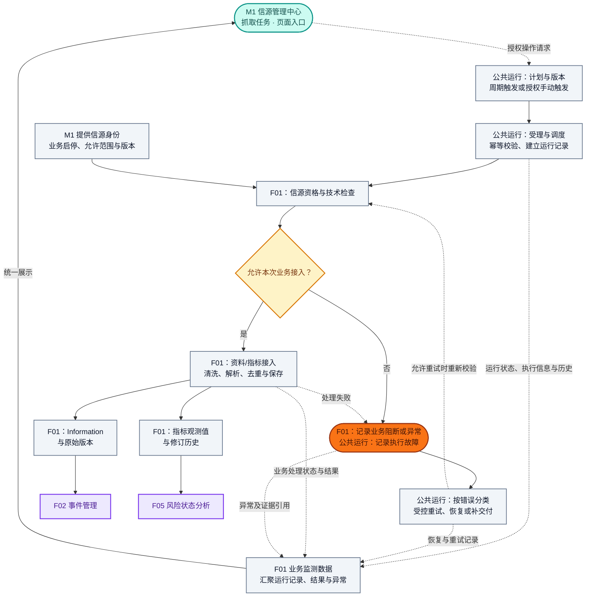
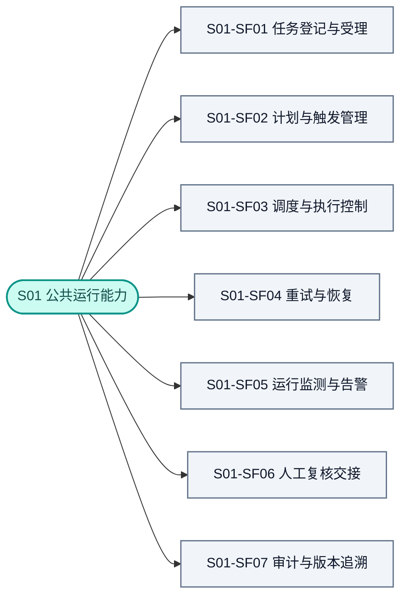

# S01 公共运行能力功能设计

> **文档定位**：RiskHot 系统级公共支撑模块的独立功能设计，沿用 F01、M1 等模块的十章结构，统一任务、计划、执行控制、运行监测、恢复、复核交接与审计追溯。  
> **编号约定**：模块编号为 **S01**，S 表示系统支撑；`S01-SFxx` 为二级功能，`S01-SFxx.xx` 为末级功能，`BR-S01-xx`、`AC-S01-xx`、`D-S01-xx` 分别追踪规则、验收与待决项。原临时 OPS 前缀统一映射为 S01，各项序号不变；编号已在系统功能架构总览登记，功能细则仍为设计评审稿。  
> **依据标记**：**[B]** 已有领域/架构约束；**[P]** 本稿设计建议；**[D]** 尚待定版。`P0/P1` 为建议优先级。逻辑对象、字段和交接名称用于功能设计，不代表已建表、已实现 API 或已完成验收。

## 1. 模块定位与职责边界

### 1.1 模块定位

**S01 公共运行能力**负责让各业务模块的任务按计划、按权限、可追踪地执行，并在失败、超时、等待和交付中断后按明确规则恢复。[B/P] 模块回答“何时运行、当前运行到哪一步、为何受阻、可以怎样恢复、由谁操作”，业务模块回答“处理什么、业务上是否合格、保存什么结果”。

主要产物是任务登记、计划版本、运行与尝试记录、执行状态、恢复记录、复核待办投影、告警及审计关联。[P] 现有技术承载包括 `operations`、Temporal、Worker、Outbox Relay 和状态投影；授权依赖 `identity`，凭据依赖受控秘密管理与适配器。[B] 公共运行能力作为系统支撑模块独立设计，不增加第四个横向业务中心，也不要求新增独立服务。

### 1.2 上下游与业务流程

**采集任务业务入口：M1 信源管理中心 → 抓取任务。** F01 业务监测数据供该视图统一展示运行状态、执行结果、异常和任务历史。[B，沿用 F01 §1.2 已有约定]

实线表示业务执行或交付，虚线表示授权请求、条件恢复或监测信息。图中的恢复并不承诺所有异常自动重试：资格、权限和口径问题须先解决；已保存的资料交付失败只补交付，不重新采集。[B/P]

### 1.3 主责与排除事项

| 能力 | 公共运行能力 | F01 信息接入与标准化模块 | M1 信源管理中心 |
|---|---|---|---|
| 信源身份、启停、允许范围 | 引用有效身份及授权上下文 | 启动、重试及正式提交前复核 | 唯一维护正式信源身份和业务资格 [B] |
| 任务类型与业务处理 | 登记业务模块提供的任务类型、处理入口及版本 | 定义采集范围、资料/指标处理规则及业务结果 | 展示所属信源与任务关系 [B/P] |
| 采集计划与触发 | 唯一维护正式计划、版本、时区、触发、调度和重试规则 | 校验计划参数是否能被接入用例执行 | 提供监测频率建议；界面可提交受控操作请求，不保存另一份正式计划 [B/P] |
| 技术就绪与实际接入 | 提供连接器、凭据引用与执行设施；记录技术执行故障 | 负责业务上的技术检查及检查结论，执行采集、解析、清洗、去重与保存 | 只读展示技术就绪和检测记录 [B] |
| 运行状态与历史 | 主责维护通用运行记录、尝试、耗时及恢复记录 | 引用运行记录，补充业务处理阶段与结果 | 查询展示，不自行推导或修改任务状态 [B/P] |
| 接入结果与异常 | 保存结果引用及执行层错误；不改写领域事实 | 主责维护新增、重复、修订、业务阻断及接入异常 | 展示 F01 解释后的结果和异常 [B/P] |
| 采集业务监测 | 提供运行状态、执行历史、告警和恢复信息 | 汇聚为 F01 业务监测数据，解释接入结果与数据质量 | 在「抓取任务」视图统一展示 [B/P] |
| 重试与补采 | 执行通用恢复，维护幂等和执行控制 | 决定业务上能否补采、补采范围与提交资格 | 提供授权入口，调用受控命令 [B/P] |
| 正式业务输出 | 可靠执行保存后的交付；不拥有输出事实 | 向 F02 提供 Information，向 F05 提供指标观测值 | 不写入资料或指标值 [B] |

公共运行模块不维护信源主档、指标定义、资料正文、指标实际值、事件、风险结论或报告；不代替领域模块作批准和正式业务提交。权限模型、凭据值、模型适配内部实现及基础设施部署继续由相应技术能力负责，本模块只定义调用和运行约束。[B]

### 1.4 首版范围与使用者

- **首版业务落点**：优先覆盖 F01 资料/指标采集的周期执行、手动执行、重试和历史补采；通用身份、状态、审计与恢复契约可供其他业务模块引用。[P]
- **系统管理员**：在已授权的对象和操作范围内维护计划、处置异常、执行恢复和查看审计；不新增单独的“运维管理员”业务角色。[B/P]
- **授权阅读者**：只读查询获授权的任务、结果摘要和历史；技术日志、证据原件与审计仍按具体资源权限过滤。[B]
- **自动执行者**：使用限权服务身份并保留原始发起者和授权上下文；计划触发不会自动取得人的审批权限。[B]

## 2. 功能架构与详细清单

### 2.1 二级功能结构

### 2.2 末级功能清单

以下 20 项末级功能及优先级为本稿建议 [P]。

| 功能编号 | 二级功能 | 末级功能 | 优先级建议 | 输出或完成标准 |
|---|---|---|---|---|
| S01-SF01.01 | 任务登记与受理 | 任务类型及业务入口登记 | P0 | 类型、业务主责、参数规则及处理入口有明确归属 |
| S01-SF01.02 | 任务登记与受理 | 授权触发与任务受理 | P0 | 校验请求后生成可查询的运行身份及受理回执 |
| S01-SF01.03 | 任务登记与受理 | 重复请求与操作幂等 | P0 | 同一操作复用回执，不重复创建业务效果 |
| S01-SF02.01 | 计划与触发管理 | 计划配置与版本维护 | P0 | 周期、时区、范围引用、重叠和漏期策略可追溯 |
| S01-SF02.02 | 计划与触发管理 | 计划启停与生效对账 | P0 | 保存版本与执行引擎生效版本分别可查 |
| S01-SF02.03 | 计划与触发管理 | 计划漏执行检测与补执行 | P0 | 预期周期与受理记录核对，补执行有周期身份 |
| S01-SF03.01 | 调度与执行控制 | 排队、并发与调度 | P0 | 按资源与重叠策略执行，排队原因可查询 |
| S01-SF03.02 | 调度与执行控制 | 执行阶段与进度记录 | P0 | 最近阶段、尝试、开始/结束时间及耗时可查 |
| S01-SF03.03 | 调度与执行控制 | 阶段超时与等待控制 | P0 | 超时、重试等待和人工等待分别记录 |
| S01-SF03.04 | 调度与执行控制 | 暂停、恢复与取消 | P0 | 计划暂停、运行挂起、取消请求和实际确认区分 |
| S01-SF04.01 | 重试与恢复 | 技术重试与失败恢复 | P0 | 可重试错误有次数、范围、预算和原操作关联 |
| S01-SF04.02 | 重试与恢复 | 补交付与投影重建 | P0 | 从已保存事实恢复，不重复执行成功业务 |
| S01-SF04.03 | 重试与恢复 | 历史补采与业务重算交接 | P0 | 领域校验后显式建立新运行，保留原运行关系 |
| S01-SF05.01 | 运行监测与告警 | 任务、运行及异常查询 | P0 | 按模块、对象、状态、触发方式和时间筛选 |
| S01-SF05.02 | 运行监测与告警 | 规则告警与处置跟踪 | P0 | 漏执行、超时、连续失败和投影延迟按规则聚合 |
| S01-SF05.03 | 运行监测与告警 | 数据质量监测信息接收 | P0 | 接收 F01 判断的数据异常，不以零新增自动判失败 |
| S01-SF06.01 | 人工复核交接 | 领域待办投影与定位 | P0 | 只投影确需复核的业务事项及其原模块入口 |
| S01-SF06.02 | 人工复核交接 | 复核回执与执行唤醒 | P0 | 领域提交决定后唤醒，重复或过期回执不误执行 |
| S01-SF07.01 | 审计与版本追溯 | 运行操作与配置版本追溯 | P0 | 操作者、前后状态、版本及结果可追踪 |
| S01-SF07.02 | 审计与版本追溯 | 跨模块关联链查询 | P1 | 从运行定位业务结果、证据、交付及历史修订 |

### 2.3 首版功能组合建议

P0 先形成“计划 → 受理 → 执行 → 结果回执 → 监测 → 恢复”的闭环，人工复核仅在业务模块要求时出现。P1 完善跨模块关系导航和历史查询规模；不以“先做监控”为由省略资格校验、幂等、取消控制和审计。[P]

## 3. 业务对象与信息组织

### 3.1 对象、身份与归属

以下为逻辑模型建议 [P]，具体字段名和物理存储由详细设计定版。

| 对象 | 身份及主要内容 | 唯一事实归属 |
|---|---|---|
| 任务定义 | `task_id`、任务类型、`owner_module`、业务对象引用、参数模板版本 | 公共运行登记；业务处理语义由所属模块定义 |
| 任务计划 | `schedule_id`、`revision`、周期、时区、启停、执行与漏期策略 | 公共运行；Temporal Schedule 为时钟执行权威 [B] |
| 业务操作 | `operation_id`、请求幂等身份、受理与业务终态回执 | 按领域操作登记并与公共运行关联；领域幂等裁决仍由领域用例负责 |
| 运行实例 | `run_id`、任务/计划版本、触发者、状态、阶段、起止时间 | 公共运行 |
| 阶段尝试 | `attempt_id`、所属运行/阶段、次数、错误及重试时点 | 公共运行；错误业务解释引用领域模块 |
| 恢复记录 | 原运行、恢复运行、恢复范围、动作类型、理由及授权结果 | 公共运行；业务重算/补采批准由业务模块负责 |
| 复核待办与告警 | 领域事项引用或运行规则命中、处置状态、定位入口 | 待办为领域事实投影；运行告警由公共运行维护 |
| 接入处理结果与监测数据 | 数量、业务异常、资料/数值引用、汇聚的运行信息 | F01；M1 只读展示 |

`task_id` 表示可重复执行的任务定义，一次触发产生一个逻辑 `run_id`，阶段重试追加 `attempt_id`。本文逻辑 `run_id` 不直接等同于 Temporal 的 Workflow Run ID；技术关联须另存明确映射，避免将引擎重启误计为新的业务采集。[P]

### 3.2 计划与运行的建议基础字段

| 类别 | 字段或信息组 | 约束 |
|---|---|---|
| 归属 | 任务类型、所属模块、`source_id`/业务对象引用 | 使用正式 ID；不复制维护 M1 信源档案 |
| 计划 | 周期表达、时区、有效期、启停、并发/重叠、漏期处理、重试策略引用 | 均随 `schedule_id + revision` 版本化；M1 监测频率只是建议输入 |
| 生效 | 期望版本、引擎确认版本、同步状态及确认时间 | 区分待同步、已生效、同步失败；未确认不显示“计划已执行生效” |
| 触发 | 计划/手动/补执行/补采/重算、`scheduled_for`、实际受理时间、触发者 | 周期时间、实际执行和补采目标时间分别记录 |
| 执行 | 状态、当前阶段、阶段尝试、队列原因、开始/结束、更新时间 | 未启动时耗时为空；失联或延迟不伪装为成功 |
| 授权与版本 | 发起者、服务身份引用、输入/规则版本、取消状态、提交资格与代次引用 | 不保存凭据值；执行和提交须复核关键授权 |
| 结果 | 领域结果引用、异常分类、保存回执、交付状态及监测更新时间 | 正文和实际观测值仍回源 F01；无法取得时显示未知或延迟 |

计划应明确使用的时区，并保存时间偏移或可还原的标准时间；夏令时重复/缺失时段、跨日周期和补执行归属需按明确策略处理，策略选项与默认值列入 §9。[P/D]

### 3.3 状态分层与展示口径

任务定义、计划、单次运行、F01 处理结果和下游交付分别表达。[P] 本稿状态名称是逻辑建议，不作为已存在的接口枚举。

| 层次 | 建议状态或结果 | 主责与说明 |
|---|---|---|
| 计划状态 | 启用、暂停、到期；另列同步状态 | 公共运行维护；与 M1 `ACTIVE/DISABLED` 独立 |
| 运行非终态 | 已受理、排队中、运行中、等待重试、等待复核、已挂起、取消请求中 | 公共运行维护；请求取消不代表已取消 |
| 运行终态 | 成功、失败、业务阻断、已取消 | 公共运行依据执行证据及领域回执归档；业务阻断须保留 F01 原因 |
| F01 业务结果 | 成功有新增、成功无新增、重复无变化、部分成功、业务阻断、解析/口径异常等 | F01 定义与统计；部分成功需展示已保存与未完成范围 |
| 交付状态 | 待交付、交付中、已交付、交付失败、无需交付 | 依据领域保存回执和可靠交付记录展示；不能替代业务保存状态 |

运行成功须满足该任务版本规定的必需阶段。F01 已保存而下游交付失败时，同时展示“业务已保存”和“交付失败”；若交付属于必需阶段，运行不能标成功。终态保留历史，恢复追加记录；引擎失联或状态投影过期时显示“状态待确认”，不据此改写终态。[B/P]

### 3.4 采集执行结果与计数口径

F01 提供获取、新增、重复、修订、失败的计数及相应结果引用，公共运行保留关联，M1 展示。[P] 数量必须注明统计单位、统计阶段与目标范围；原始资料数、解析出的指标观测值数和阶段尝试次数不能混加，也不预设“获取数＝各结果数之和”。

空响应、未到发布时间、尚未执行、重复无变化及预期数据缺失分别记录。正常执行且新增为 0 可为成功；“持续空结果是否异常”由 F01 结合信源发布预期判断，公共运行按其规则引用生成告警。[B/P]

## 4. 功能详细设计

### 4.1 S01-SF01 任务登记与受理（.01～.03）

业务模块登记可执行任务类型、参数校验规则、业务处理入口及结果约定。F01 定义采集目标、资料/指标类别、连接器适用条件和范围校验，公共运行负责登记和调用；不允许通过通用任务表填写任意脚本来绕过业务用例。[P]

计划触发与手动执行均经过受控受理。手动操作检查当前用户、对象、参数与版本；自动触发使用限权服务身份及计划版本。拒绝请求保留必要审计；受理成功返回可查询身份，不能把“已受理”提示为“已完成”。[B/P]

同一请求幂等身份重复提交复用原运行/操作回执；同身份但参数不同返回冲突。执行结果不明确时先核对原操作与领域回执，不能新建任务盲目重做。长期去重以业务库记录为准，不依赖引擎历史永久保留。[B]

### 4.2 S01-SF02 计划与触发管理（.01～.03）

计划配置至少明确任务、对象范围、周期与时区、有效期、重叠策略、漏期策略和恢复策略。F01 校验接入参数及其适用性，公共运行保存正式计划版本；M1 的建议监测频率不能直接覆盖已生效计划。[B/P]

计划保存后通过可靠交接同步执行引擎，以 `schedule_id + revision` 对账。页面分别显示“保存成功”和“执行生效”；旧同步回执不得覆盖新版本。沿用既有架构：计划在 `operations` 版本化保存，Temporal Schedule 负责时钟触发，不另启 cron 或轮询作第二调度权威。[B]

暂停计划只阻止确认生效之后的新周期触发，不自动取消已受理运行；取消在途任务使用独立命令。M1 停用信源由 F01 阻断新接入和在途正式提交，不能仅依赖计划暂停；再次启用信源不自动补采。[B/P]

漏执行按“计划有效且处于启用周期 → 预期触发时点 → 容忍窗口 → 是否存在对应受理记录”判断。已经受理但仍在排队、执行受阻和计划同步失败应分别定位；主动暂停、到期及已明确跳过的周期不误报为漏执行。周期键用于重复触发和补执行去重，补执行必须记录原计划周期与实际执行时间。[P]

### 4.3 S01-SF03 调度与执行控制（.01～.04）

按任务类型、资源队列、业务对象并发约束及计划重叠策略调度。相同周期的重复投递复用原受理记录；不同周期发生重叠时按已配置的排队、跳过或其他受控策略处理并留记录，不临时决定重复并发。[B/P]

记录阶段开始、结束、尝试、最近进展及失败原因。F01 可报告连接、抓取、解析、去重、保存和下游交付等阶段；公共运行提供通用阶段容器与时间信息，具体阶段顺序、可选性和业务完成标准由 F01 定义。无可计算总量时展示当前阶段，不制造百分比进度。[P]

超时是错误原因与恢复判断依据：尚可重试则进入等待重试，额度耗尽则失败或待处置；人工等待单独挂起，不占用持续工作的执行线程。超时数值、重试次数和预算按任务类型配置，不把技术文档中的建议值当全任务固定参数。[B/P]

单次运行暂停仅在任务声明的安全检查点生效；不支持暂停的类型明确返回不支持。取消区分请求、执行停止和业务提交裁决：已完成的外部抓取或已提交事实不承诺撤销。领域用例在正式提交时检查权限、取消、提交资格与有效代次；若提交先成功，保留完成结果并记录取消未生效，不删除已保存资料。[B/P]

### 4.4 S01-SF04 重试与恢复（.01～.03）

| 动作 | 使用条件 | 身份与执行范围 |
|---|---|---|
| 技术重试 | 瞬时网络、可恢复限流等错误；仍有资格和预算 | 沿用原 `operation_id`；在原逻辑运行追加阶段尝试，先复查是否已产生结果 |
| 故障恢复 | 引擎/Worker 中断或原执行结果不明确 | 核对运行、领域回执及保存记录后续行；需新建恢复运行时关联原运行，保持原操作去重 |
| 补交付 | 领域结果已保存，下游未确认收到 | 仅重投已保存结果及版本；不重新采集或保存 |
| 投影重建 | 查询状态或读模型损坏 | 从权威记录重建；不触发资料接入或业务重算 |
| 历史补采 | F01 校验通过的明确历史范围 | 建立新的补采操作与运行，记录范围、原缺口/运行；逐条业务幂等 |
| 业务重算 | 业务模块批准使用指定输入、规则或模型重新处理 | 新操作、新运行及版本，关联原结果；仍由对应领域决定正式提交 |

上表动作语义沿用已有恢复边界 [B]，补采运行的逻辑组织为本稿建议 [P]。缺权限、信源停用、无效指标定义和口径冲突不做技术盲重试；纠正后通过领域用例显式恢复。每次重试、补采或重算均保留操作人/服务身份、原因、范围、尝试、结果和原运行关系。[B/P]

历史补执行与历史补采分别表达：前者补未执行的计划周期，后者取得指定历史资料或观测期数据，二者可能不同。后补取得时间如实记录，不能伪装成当时已经接入。[B/P]

### 4.5 S01-SF05 运行监测与告警（.01～.03）

任务查询区分任务定义与单次运行，支持按业务模块、信源、类型、计划、状态、触发方式及时间范围筛选；保留最近运行、下次计划触发、历史入口及未更新提示。[P]

告警至少覆盖计划漏执行、长时间排队、阶段超时、连续失败、交付积压、计划版本不同步及状态投影延迟。按任务/规则聚合相同问题，保存首次、最近发生、影响周期、恢复和处置记录；确认已读与问题已恢复分别表达。阈值、升级和通知渠道按 §9 定版，首版不默认开启外部通知渠道。[B/P]

F01 负责识别持续空内容、解析比例异常、预期指标未出现等接入业务问题，并提供判断规则、时间窗口、对象及证据引用。公共运行负责规则运行、告警归并和处置记录；M1 展示 F01 汇聚后的结果。“新增为 0”本身不触发失败告警。[B/P]

### 4.6 S01-SF06 人工复核交接（.01～.02）

仅当 F01 或其他领域明确要求人工处理时，公共运行投影待办并提供原领域入口。保存业务对象、版本、待确认事项及可执行操作引用，不把每次采集都转成人工审批。[B/P]

用户在原领域命令入口提交决定；领域事务提交决定、审计及可靠唤醒意图后，公共运行才继续执行。通用待办表不能直接批准资料或修改正式业务结果；过期、重复和迟到信号须回查当前领域状态。等待期限到达可提醒或挂起，不能默认批准。[B]

### 4.7 S01-SF07 审计与版本追溯（.01～.02）

计划维护、手动触发、暂停、取消、恢复和告警处置保留操作者、时间、对象、前后状态、配置版本、结果及关联身份。操作原因按具体规则采集，M1 信源启停理由仍为选填，不因公共审计统一入口改成强制填写。[B/P]

通过请求/操作/任务/运行/阶段身份关联领域结果、证据及下游交付；业务审计与技术日志分别保存，日志采样不丢失审计。技术日志和任务参数只暴露获授权的摘要与引用，不输出凭据、完整原文、Prompt 或模型响应；正文回到受控工件或领域读取入口。[B]

## 5. 页面与交互组织建议

### 5.1 入口与页面结构

| 页面/入口 | 展示与操作 | 功能主责 |
|---|---|---|
| **M1 → 抓取任务视图** | 采集任务列表、计划摘要、运行状态、执行结果、异常及历史；按权限发起执行/恢复 | M1 提供页面；F01 提供业务监测数据；公共运行提供运行底座 |
| **任务详情抽屉/详情页** | 任务定义、计划及生效版本、历次运行、阶段、结果计数、错误、恢复和证据链接 | 可复用的公共运行详情能力，业务结果由 F01 解释 |
| **采集计划配置入口** | 在 M1 任务上下文打开表单，维护周期、时区、重叠及重试策略 | 页面位置不改变主责；提交至公共运行，业务参数经 F01 校验 |
| **运行管理聚合入口** | 跨模块执行故障、积压、告警、审计与恢复查询 | 后续统一入口建议 [P/D]，首版不要求增加独立顶级菜单 |
| **复核事项入口** | 待处理摘要及原领域定位，显示当前决定与执行等待状态 | 公共运行提供待办投影，业务模块受理决定 |

以上为功能入口建议 [P]。本次文档新增不代表 M1 既有原型和全部章节已经同步；M1 现有功能设计仍以信源目录为主，后续需依据本契约补齐「抓取任务」交互和验收，见 §9。

### 5.2 关键交互约束

1. “业务启用”“技术就绪”“计划启用”“计划已生效”“运行状态”分开显示，不用同一个开关表达。[B/P]
2. 任务卡片/列表中的最近执行与下次计划触发分别标注；下次触发不是承诺的实际开始时间，排队需有说明。[P]
3. 手动触发、重试、补交付、历史补采、业务重算使用明确名称，展示目标范围和关联原运行；仅对需要确认影响的操作使用确认步骤。[B/P]
4. 操作受理后展示回执和实际状态；暂停/取消尚未生效、计划待同步、状态过期和权限不足均明确表达。[B/P]
5. 正常零新增、部分成功、业务已保存但交付失败分别显示，未知数量使用空值或“待确认”，不填 0。[B/P]
6. M1 任务视图和跨模块聚合入口引用同一运行身份与权限过滤结果，不能生成各自独立的任务状态或调度器。[B/P]

## 6. 跨模块协作与交接契约

### 6.1 协作矩阵

| 协作方 | 向公共运行提供 | 公共运行提供 | 写入与裁决边界 |
|---|---|---|---|
| F01 信息接入与标准化模块 | 任务业务类型、参数规则、资格/技术检查结果、阶段、计数、保存回执及异常 | 计划、受理、调度、运行/尝试、恢复与告警信息 | F01 唯一裁决接入资格与领域结果；公共运行不写资料/观测值 |
| M1 信源管理中心 | 有效信源身份、启停、范围、版本与监测频率建议；授权界面请求 | 计划与运行查询能力、受理/恢复回执，供 F01 汇聚监测 | M1 唯一维护信源资格；正式计划与运行状态由公共运行维护 |
| M2/M3 | 指标/方法的有效定义与版本引用 | 执行所用版本、失败反馈及追溯信息 | 公共运行不批准定义，不因任务恢复静默切换规则 |
| F02～F08 | 所属领域的任务、复核决定与结果回执 | 共用执行、恢复、待办与审计关联 | Event、风险、快照和报告仍由所属领域唯一维护 |
| identity、秘密管理及适配器 | 授权判定、限权身份、凭据引用和受控连接能力 | 原发起者、对象范围、执行上下文与审计关联 | 公共运行不维护另一套用户权限或明文凭据 |
| Temporal、Worker、Relay | 执行历史、活动回执、启动/交付确认 | 固定计划与运行上下文、受控执行及恢复意图 | 沿用唯一执行编排权威；正式业务保存仍经领域用例 |

### 6.2 逻辑交接信息

以下名称仅表示信息组 [P]，不是已存在的 API、事件名或数据库 Schema。

| 交接方向 | 最小信息组 | 接收方约束 |
|---|---|---|
| 业务用例/页面 → 公共运行：受理请求 | 所属模块、任务类型、业务对象/范围、触发方式、幂等身份、配置版本、发起者及权限上下文 | 授权、参数、版本和重复请求校验后才受理 |
| 公共运行 → F01：执行上下文 | `task_id`、`run_id`、`operation_id`、阶段尝试、计划及输入版本、目标范围、取消/提交资格引用 | F01 再查 M1 状态/范围及技术条件；指标接入另查 M2 定义；正式提交前复核 |
| F01 → 公共运行：业务处理回执 | 业务状态、计数及统计单位、已保存范围、结果/证据引用、异常分类、允许恢复范围 | 通用运行只引用结果；错误分类依据 F01 判断，不绕过提交资格 |
| 公共运行 → F01：运行监测信息 | 计划与生效版本、运行状态、触发/起止/阶段时间、尝试、执行故障、历史与恢复记录 | F01 关联接入结果，汇聚为业务监测数据 |
| F01 → M1：采集业务监测视图 | 信源/任务/运行身份，运行、业务与交付状态，计数、异常、计划摘要、历史定位及更新时间 | M1 统一展示；读模型可以组合查询或投影，不能复制出第二份可写事实 |
| M1 → F01/公共运行：管理操作 | 操作类型、目标任务/运行/范围、预期版本、幂等身份及当前用户 | 计划、触发与取消由公共运行受理；补采等先经 F01 业务校验；界面不能直接改状态 |

### 6.3 一致性与技术承载

沿用已有总体架构：[B] 受理/业务变更、审计及 Outbox 在相应本地事务中提交，Relay 可靠交接至 Temporal；Worker 通过领域用例执行。数据库、执行引擎、对象存储之间不假设统一事务，重投和重试通过操作回执及领域幂等处理。

计划定义、业务事实、执行历史和查询投影分别有权威来源。投影可重建，不能据页面缓存决定业务资格；恢复代次失效、取消或权限变更后的旧执行不能正式提交。引擎历史丢失时按业务账本对账并形成明确恢复记录，不伪造旧执行历史。[B]

## 7. 核心业务规则

| 编号（本稿建议） | 规则 | 依据与状态 |
|---|---|---|
| BR-S01-01 | 公共运行是系统支撑模块；任务运行控制与领域业务裁决分别归属。 | 总览 §4.5；总体架构 §5.1 [B] |
| BR-S01-02 | 正式计划版本在公共运行维护，Temporal 是时钟与持久执行编排权威。 | 安全与运行 §17.3；执行与恢复 §10.1 [B] |
| BR-S01-03 | 计划暂停、信源停用、运行暂停和取消分别表达；启用信源不自动补采。 | M1 §4.3～4.4；本稿 [B/P] |
| BR-S01-04 | F01 在启动、重试及正式提交时核对适用资格；调度成功不代表接入获准。 | F01 §1.2、§4.1；M1 §4.3 [B] |
| BR-S01-05 | 同操作重复投递复用原回执；技术恢复不重复正式业务效果，业务重算建立新操作。 | 执行与恢复 §10.2～10.5 [B] |
| BR-S01-06 | 已保存结果交付失败只补交付，投影损坏只重建，不重新执行成功业务。 | 总体架构 §4.2、§5.2 [B] |
| BR-S01-07 | 运行、业务结果、交付与数据质量分别展示；零新增不能直接判失败。 | F01 §1.2、§4.3；本稿 [B/P] |
| BR-S01-08 | 漏执行以预期周期和受理记录判断，排队、主动跳过与同步失败单独记录。 | 安全与运行 §17.2～17.3；本稿 [B/P] |
| BR-S01-09 | 取消请求与实际确认分离；正式提交由领域事务复查资格和代次，已提交结果不因取消删除。 | 执行与恢复 §10.4 [B] |
| BR-S01-10 | 复核决定由原领域命令提交；超时和唤醒信号不构成业务批准。 | 总体架构 §5.1；执行与恢复 §10.4 [B] |
| BR-S01-11 | M1 统一展示 F01 业务监测数据，公共运行提供执行记录，双方均不重复建调度真值。 | F01 §1.2；M1 §1.3、§6 [B/P] |
| BR-S01-12 | 参数、配置、规则、输入和结果引用固定版本；恢复不得静默使用新配置。 | 总体架构 §4.3；执行与恢复 §10.5 [B] |
| BR-S01-13 | 后台任务保留原发起者和限权服务身份；权限、对象状态和证据读取按当前授权检查。 | 安全与运行 §16.1 [B] |
| BR-S01-14 | 操作审计与技术日志分别保存；追溯使用关联身份，凭据和正文不进入通用日志。 | 安全与运行 §16.3、§17.1 [B] |

## 8. 功能验收场景（建议）

| 场景编号 | 场景及触发 | 验收结果 | 关联功能 |
|---|---|---|---|
| AC-S01-01 | F01 合法采集任务按启用计划到期 | 建立一次周期运行，经 F01 检查后执行；时间、版本和触发身份可查 | SF01、SF02 |
| AC-S01-02 | 用户重复提交同一手动执行请求 | 复用原操作回执；同幂等身份但参数不同返回冲突 | SF01 |
| AC-S01-03 | 计划已保存但执行引擎同步失败 | 显示期望/生效版本和同步失败；不宣称新版本已执行生效 | SF02 |
| AC-S01-04 | 新旧计划版本回执乱序到达 | 旧回执不覆盖新版；对账按计划身份和修订进行 | SF02 |
| AC-S01-05 | 启用周期过容忍窗口但没有受理记录 | 生成漏执行告警；补执行关联原周期且重复请求不重复运行 | SF02、SF05 |
| AC-S01-06 | 周期已受理但在排队；另有主动暂停计划 | 前者显示排队/积压，后者不误报漏执行 | SF02、SF03、SF05 |
| AC-S01-07 | 两周期重叠且配置不允许并发 | 按计划策略排队或显式跳过，保留两周期记录，不重复并发采集 | SF02、SF03 |
| AC-S01-08 | M1 信源在计划启用期间停用 | F01 阻断新接入；计划状态单独展示；历史资料与运行可查 | SF03；F01、M1 |
| AC-S01-09 | 采集在途时信源停用或用户权限失效 | F01 正式提交前复核，拒绝失效提交；保存允许保留的排障证据 | SF03；F01、M1 |
| AC-S01-10 | M1 再次启用信源 | 不自动补历史数据；显式补采须校验范围并建立新运行 | SF02、SF04；M1 |
| AC-S01-11 | 任务正常完成，发现 0 条新增 | 显示成功无新增，保留运行与计数；不产生零新增失败告警 | SF05；F01 |
| AC-S01-12 | 持续空响应且 F01 发布预期规则命中 | 依据 F01 规则和证据形成数据异常，保留执行成功与质量异常的区别 | SF05；F01 |
| AC-S01-13 | 瞬时超时后重试成功 | 原操作身份可追溯，各阶段尝试独立；不重复保存有效资料 | SF03、SF04 |
| AC-S01-14 | 信源停用、缺权限或指标口径无效 | 记录业务阻断/异常，不做技术盲重试 | SF04；F01 |
| AC-S01-15 | F01 部分资料保存成功，其余解析失败 | 同时展示已保存、失败范围及计数单位；恢复仅处理允许范围 | SF04、SF05；F01 |
| AC-S01-16 | Information 已保存但 F02 接收失败 | 明示业务已保存、交付失败；只补交付，不重新采集 | SF04；F01 |
| AC-S01-17 | 观测值已保存但 F05 交付失败 | 指向原观测版本补交付；不产生重复观测值或虚构 Event | SF04；F01 |
| AC-S01-18 | 暂停计划时已有运行在途 | 计划生效后不再触发新周期，在途运行按独立暂停/取消命令处理 | SF02、SF03 |
| AC-S01-19 | 取消请求与正式提交并发 | 依据领域事务裁决展示已取消或完成且取消未生效；无无痕删除 | SF03 |
| AC-S01-20 | 人工等待超时、重复或迟到批准信号 | 不默认批准；回查领域有效决定和版本后才继续 | SF06 |
| AC-S01-21 | 请求历史补采或业务重算 | 先由所属领域校验，新操作/运行关联原运行，实际取得时间真实 | SF04 |
| AC-S01-22 | 执行引擎历史过期或 Worker 中断 | 先查业务账本/回执；不因查不到引擎历史盲目重启已完成业务 | SF01、SF04 |
| AC-S01-23 | M1 页面和运行聚合入口查询同一运行 | 身份、执行状态、业务结果引用一致；显示投影更新时间及延迟 | SF05、SF07 |
| AC-S01-24 | 查询投影损坏，随后恢复 | 从权威记录重建；不重新采集、不调用业务重算 | SF04、SF05 |
| AC-S01-25 | 授权阅读者尝试改计划或重试任务 | 写操作被拒绝；只可读取获授权摘要和证据引用 | SF01、SF07 |
| AC-S01-26 | 查看计划历史、恢复记录和错误摘要 | 版本、操作者、原运行与结果可追踪，日志无凭据或未授权正文 | SF07 |
| AC-S01-27 | 更改采集计划或监测视图中的运行设置 | 计划版本只写公共运行；不修改 M1 启停及 F01 资料/数值事实 | SF02；F01、M1 |
| AC-S01-28 | 请求任务类型不支持的单次暂停 | 明确提示不支持，不伪造已暂停；支持类型在安全点确认后才显示挂起 | SF03 |

以上为功能验收建议 [P]，须结合正式接口、权限、并发和恢复演练落实为可执行用例。

## 9. 待定事项与后续设计工作

| 待决编号 | 问题 | 已有约束或本版建议 | 收敛位置 |
|---|---|---|---|
| D-S01-01（已落实） | 公共支撑模块编号与总览登记 | 已统一为 S01，功能分解、依赖、职责与追踪已登记；与 F/M 分组编号 | 系统功能架构总览 V3.1；后续保留编号稳定 |
| D-S01-02 | 逻辑状态、身份与技术表/API 的映射 | 运行/业务/交付分层；逻辑 run_id 与引擎身份明确映射 | 契约与数据详细设计 |
| D-S01-03 | 任务类型参数、阶段和结果 Schema | F01 定义接入业务语义，公共运行定义通用包装；禁止双写 | F01/公共运行接口评审 |
| D-S01-04 | 时区、夏令时、重叠、漏期及补执行策略默认值 | 单时钟权威，计划版本化，漏期有周期身份；默认策略不隐含 | 计划配置与边界用例评审 |
| D-S01-05 | 超时、重试、并发、总预算和告警阈值 | 按任务类型及来源特点配置；技术建议数字不作统一生产值 | 运行配置与容量评审 |
| D-S01-06 | 阶段可暂停性及终态恢复协议 | 取消区分请求和确认；原终态保留，恢复关联原操作/运行 | 领域提交与恢复详细设计 |
| D-S01-07 | M1「抓取任务」视图与表单的完整页面契约 | 沿用 F01 §1.2 入口；M1 只展示/提交请求，F01 汇聚监测 | M1 功能设计、原型后续同步 |
| D-S01-08 | F01 监测信息的查询/投影及数量口径 | 运行数据由公共运行提供，接入业务结果由 F01 提供；不建第二事实库 | F01 功能设计 §5～6 后续同步 |
| D-S01-09 | 跨模块运行聚合入口、告警升级与通知渠道 | 可共用详情，不要求新增顶级菜单；外部通知须显式配置 | 公共运行页面与权限设计 |
| D-S01-10 | 历史、日志和投影保留及恢复演练 | 正式依据与结果遵守现有保留规则；日志期限和恢复能力实测 | 数据治理与运维设计 |

建议先定任务/计划/运行/回执契约和 F01、M1 写入边界，再完成采集计划、执行与监测闭环；随后覆盖人工交接、跨模块聚合和恢复演练。[P] S01 编号及总览登记已同步；M1/F01 独立文档的页面与接口细则仍按本表后续收敛，尚不代表原型、接口或运行代码已经实现。

## 10. 来源与追踪依据

| 依据 | 相关章节 | 支撑范围 |
|---|---|---|
| [[tools/RiskHot/docs/system-design/03-系统功能架构/系统功能架构总览\|系统功能架构总览]] | §2.3、§4.5 | 两类用户角色、M1～M3 业务主责、跨模块技术与运行能力定位 |
| [[tools/RiskHot/docs/system-design/03-系统功能架构/F01 信息接入与标准化模块功能设计 V2.1\|F01 信息接入与标准化模块功能设计]] | §1.2～1.3、§4.1～4.3、§5～9 | 接入与检查、两条业务输出、F01 监测汇聚、M1 抓取任务入口、补采/异常与待决项 |
| [[tools/RiskHot/docs/system-design/03-系统功能架构/M1 信源管理中心功能设计\|M1 信源管理中心功能设计]] | §1.3、§4.3～4.4、§6～8 | 信源资格、技术就绪、停用阻断、再次启用不自动补采、M1 与运行侧边界 |
| [[tools/RiskHot/aihot/归档/旧版系统架构设计/00. 系统总体架构\|系统总体架构]] | §2.2、§2.4～2.5、§4、§5.1～5.2 | operations/identity 与运行单元、领域写入、幂等交付、复核和故障恢复边界 |
| [[tools/RiskHot/aihot/归档/旧版系统架构设计/04. 执行与恢复\|执行与恢复]] | §10.1～10.5 | 单一编排权威、长期幂等、受理/保存/交付、重试、取消代次、等待和重算 |
| [[tools/RiskHot/aihot/归档/旧版系统架构设计/07. 安全与运行\|安全与运行]] | §16.1～16.3、§17.1～17.3、§18.4～18.5 | 授权、凭据与审计、运行指标、计划版本与 Temporal Schedule、对账及恢复 |
| [[tools/RiskHot/docs/system-design/02-业务架构与领域设计/RiskHot_L0_信息处理层_业务架构与领域设计V1.0\|L0 信息处理层业务架构与领域设计]] | §2.2.1、§2.2.6 | 入口/处理/分支/异常/下游的 Mermaid 样式定义；程序采集与存储分发职责 |

**评审状态**：已有职责与技术约束标为 [B]；7 组能力、20 项末级功能、逻辑状态、交接信息和 28 个验收场景为本稿设计建议，编号已在总览登记，接口、状态映射及页面同步事项见 §9。
