# RiskHot 系统功能架构总览

> 2026-10-27：F02采用Fact与唯一Event模型，具体表结构见 [[tools/RiskHot/docs/system-design/04-系统架构设计/01-数据模型与存储设计/F02事件管理模块数据模型与存储设计|F02 数据模型与存储设计]]。下游仅将已确认归属于正式Event的Fact作为事件依据；运行代码尚未迁移。

> **版本**：V3.1（补充 S01 公共运行能力及跨模块职责）
> **状态**：待评审；范围、优先级及验收建议不代表已实现或通过。  
> **阅读顺序**：第1～4章了解定位与全貌；第5～9章查看模块、流程、契约和数据；第10～11章用于范围、追踪与评审；附录提供编号、功能追踪和图文导航。

## 1. 文档概述

### 1.1 文档目的

本文件作为 RiskHot 系统功能架构的统一入口，说明系统能做什么、功能如何划分、业务对象由谁维护、模块如何交接，以及功能如何追踪到依据与验收场景。为后续模块功能设计、功能契约与系统技术设计提供可评审的边界。

### 1.2 适用范围

适用于首版宏观经济金融风险研究系统的功能架构评审。保留四个业务阶段、八个核心模块及三个横向支撑中心，单列 S01 公共运行能力作为跨模块系统支撑。本文不展开数据库字段、完整 API、页面布局或部署实施；这些内容分别由领域、模块、UI 和技术文档承接。功能模块不直接等同物理服务。

### 1.3 设计依据与参考文档

| 来源编号 | 依据性质 | 文档 | 使用范围 |
|---|---|---|---|
| SRC-L0 | 业务基线 [B] | [[tools/RiskHot/docs/system-design/02-业务架构与领域设计/RiskHot_L0_信息处理层_业务架构与领域设计V1.0\|L0 信息处理层]] | 事件、资料、直接对象变量关系 |
| SRC-L1 | 业务基线 [B] | [[tools/RiskHot/docs/system-design/02-业务架构与领域设计/RiskHot_L1_风险识别与纳管层_业务架构与领域设计\|L1 风险识别与纳管层]] | 风险同一性、长期关系、全局变量治理 |
| SRC-L2 | 业务基线 [B] | [[tools/RiskHot/docs/system-design/02-业务架构与领域设计/RiskHot_L2_风险态势分析层_业务架构与领域设计V1.0\|L2 风险态势分析层]] | 当前四维、证据、变化分析 |
| SRC-L3 | 业务基线 [B] | [[tools/RiskHot/docs/system-design/02-业务架构与领域设计/RiskHot_L3 业务架构与领域设计 V1.0\|L3 风险产品与发布层]] | 目录、详情、时间线、周期报告 |
| SRC-M1 | 功能约定 [F] | [[tools/RiskHot/docs/system-design/03-系统功能架构/M1 信源管理中心功能设计\|M1 信源管理中心功能设计]] | 单一在册信源、启停、分类、追溯 |
| SRC-M2 | 功能约定 [F] | [[tools/RiskHot/docs/system-design/03-系统功能架构/M2风险源管理中心功能设计\|M2 风险源管理中心功能设计]] | 定义、候选治理、指标映射、生效与版本 |
| SRC-F01 | 功能约定 [F] | [[tools/RiskHot/docs/system-design/03-系统功能架构/F01 信息接入与标准化模块功能设计 V2.1\|F01 信息接入与标准化模块功能设计]] | 接入资格与技术检查、资料/指标接入、业务监测汇聚及 M1 抓取任务入口 |
| SRC-S01 | 功能设计 [F] | [[tools/RiskHot/docs/system-design/03-系统功能架构/公共运行能力功能设计\|S01 公共运行能力功能设计]] | 任务、计划、调度、恢复、运行监测、复核交接与审计；细则仍为设计建议 |
| SRC-T | 技术提案 [T] | [[tools/RiskHot/aihot/归档/旧版系统架构设计/00. 系统总体架构\|系统总体架构]] | 组件承载、执行、安全恢复与部署 |

[B] 表示业务基线，[F] 表示当前功能约定，[T] 表示技术提案，[D] 表示待决。来源冲突须保留并提交评审；技术提案不能作为已部署或已验收的证据。既有需求／功能编号只在已核实的原文范围内引用；新增 Fxx、SFxx、SC 编号仅为本稿导航与追踪标识。

### 1.4 术语与定义

| 术语 | 定义与边界 |
|---|---|
| 业务阶段 L0～L3 | 信息与事件 → 风险识别与纳管 → 风险态势分析 → 风险产品与发布 |
| 核心功能模块 F01～F08 | 本稿对八项核心职责的导航编号，不取代领域对象或正式需求编号 |
| 支撑中心 M1／M2／M3 | 分别治理信源、风险观察定义、判断方法 |
| 系统支撑模块 S01 | 公共运行能力；管理计划、调度、执行记录与恢复，不拥有领域业务结果 |
| 信源／风险源 | InformationSource 表示资料来源；risk_source_config 表示风险形成类别，身份不可混用 |
| 全局变量／指标／实际值 | 变量是风险观察语义；指标是观测口径；实际值是带观测期与来源的运行事实 |
| 当前状态／历史变化 | RiskSnapshot 保存当前四维；RiskAnalysisResult 保存方向与持续性变化 |
| 业务主责／技术写入权 | 前者决定业务事实由谁维护；后者由技术架构映射，二者需对齐但不混为一谈 |

### 1.5 版本记录与文档状态

| 版本 | 日期 | 主要变化 | 状态 |
|---|---|---|---|
| V2.1 | 2026-10-14 | 合并两份功能总览，统一四阶段、八模块、三中心 | 历史稿 |
| V2.2 | 2026-10-14 | 技术承载、执行及部署内容归入系统总体架构 | 重构输入稿 |
| V3.0 | 2026-10-14 | 按十一章模板重构；补齐模块卡片、依赖、功能追踪及验收建议 | 历史设计稿 |
| V3.1 | 2026-10-16 | 登记 S01 公共运行能力；同步 F01/M1 职责、依赖、数据主责、65项功能追踪及11个验收建议场景 | 待评审 |

本文是设计评审稿。功能范围不代表开发完成，验收场景为建议且尚未执行；M3、权限矩阵、发布状态机及技术归属等未决项见 §11.4。

## 2. 系统定位与功能边界

### 2.1 系统建设目标

RiskHot 把可追溯的金融信息转化为结构化宏观事件，识别并正式纳管需要持续关注的风险，利用指标与事件证据形成当前快照及历史变化分析，最终提供风险目录、详情、Timeline 和周期报告。[B]

**系统交付的核心特性**：来源可追溯、正式业务身份稳定、变量跨场景复用、判断口径与时间明确、历史结论可回溯、模型建议受业务校验约束。

### 2.2 系统业务定位

RiskHot 面向宏观经济金融风险研究，把资料、事件和观测证据转为可持续跟踪的风险信息产品。正式风险身份、当前观察结论与历史变化分别维护，产品层引用这些事实形成查询与报告。交易决策、自动下单及独立企业／单资产微观风险纳管不在本版范围。

### 2.3 系统参与角色

| 角色 | 参与功能 | 授权边界 |
|---|---|---|
| 系统管理员 | 发起研究与观察、校正资料、候选及定义审核、报告复核与发布、信源和配置维护、权限与运行管理 | 按具体操作与对象校验权限；批准绑定可追溯版本，技术恢复不得绕过业务流程 |
| 授权阅读者 | 查询授权范围内的风险、报告及可见证据 | 只读授权范围，不得写入、审核、发布或执行管理操作 |

研究、维护和审核是系统管理员承担的功能职责，不再分别设置为系统参与角色；每次操作记录实际用户、权限及被审版本。

### 2.4 系统上下文图（System Context）

**图 FA-D01：2.4 系统上下文图（System Context）**

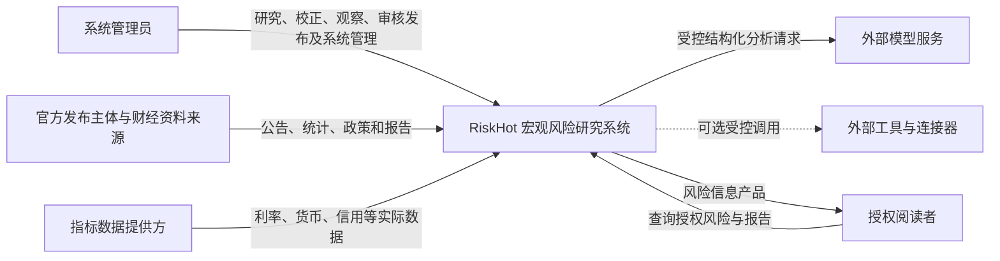

**边界约束**：RiskHot 保存采集证据和分析产物，不拥有外部发布机构的原始发布权；模型产出候选及解释，业务身份建立、状态变更、批准与发布仍需程序校验及授权。[B/T]

### 2.5 系统功能范围

本版覆盖信息与指标接入、事件管理、风险识别、风险纳管、当前状态与演化分析、风险展示与报告发布，以及 M1／M2／M3 定义治理。权限、任务、人工复核、审计和恢复是共用能力。边界以第5章模块卡片为准，本期与后续内容见第10章。

### 2.6 系统外部依赖与边界

| 外部依赖 | 系统接收／交付 | 边界与失败影响 |
|---|---|---|
| 官方发布主体、财经资料来源 | 原始资料、发布信息；内部保存证据版本 | 不拥有原始发布权；不可得或纠正需记录 |
| 指标数据提供方 | 实际观测值及口径、时间、来源 | 可用性与业务允许使用资格分开；缺失进入受限判断 |
| 模型服务 | 受控输入、结构化候选或解释 | 不授予正式业务身份和写入权；异常可复核或重试 |
| 工具与连接器 | 经授权的补充信息或执行反馈 | 可选接入；权限、凭据、适配与网络实现见技术架构 |

## 3. 功能架构设计原则

### 3.1 功能分层与分域原则

按 L0～L3 四个业务阶段组织主链路，每阶段两个核心模块；M1、M2、M3 作为横向定义治理中心。跨层证据交付按真实依赖表达，不强制逐层转发。

### 3.2 功能模块划分原则

按业务目标、主责产物及变化原因划分功能。信息与事件、候选与正式风险、当前状态与历史变化、查询与持久报告分别建边界。页面菜单、任务步骤和部署进程不作为唯一划分依据。

### 3.3 模块高内聚、低耦合原则

同一业务事实的创建、校验和维护集中于主责模块；下游通过稳定身份、版本与功能契约消费。反馈返回事实拥有者，禁止通过共享存储绕过业务用例修改。

### 3.4 职责单一与数据归属原则

指标定义、口径、允许来源和映射归 M2；实际观测数据接入、校验、保存及修订归 F01。具体风险长期定义归 F04，快照归 F05，变化归 F06，报告归 F08。业务归属与技术写入权分别评审。

### 3.5 公共能力复用原则

共用身份授权、任务、复核、审计、恢复及模型适配；不额外增加第四个横向业务中心。L2 消费定义和证据，维护建议返回 M1／M2／M3 或 F04。

### 3.6 可扩展与可演进原则

通过稳定身份、版本化定义、可追溯证据和明确契约扩展数据源、方法及产品。新范围先确认业务边界，再演进功能和技术承载；历史快照、报告仍能解释当时结论。

## 4. 系统功能总体架构

### 4.1 系统功能架构全景图

**图 FA-D02：4.1 系统功能架构全景图**

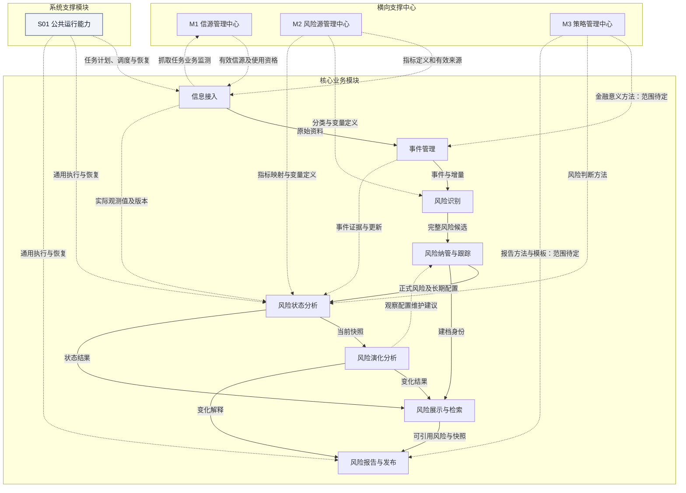

> **说明**：[F] 四个业务阶段下划分八个核心功能模块；三个 M 中心治理业务定义，S01 提供跨模块运行支撑，图中重点展示其对接入、观察和报告的执行支持。L0～L3 表达处理阶段，八模块表达具体功能职责。箭头表示语义依赖或数据交付；不表示每个模块都必须成为单独微服务。M3 对 L0/L2/L3 提供相应方法定义的具体范围仍需在 M3 功能设计中定稿。

### 4.2 功能分层与功能域划分

**图 FA-D03：4.2 功能分层与功能域划分**

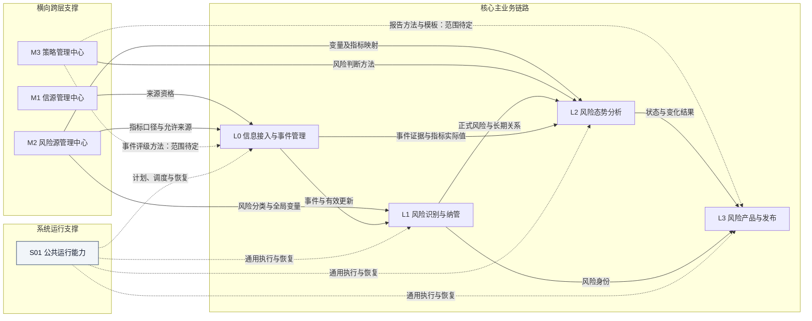

主链路展示业务阶段顺序，直接跨层交付展示真实的数据依赖。M3 对 L0、L3 的支撑是合并前长文提出的补充范围，尚待 M3 功能设计确认；L2 的具体方法、规则与版本边界也须在该模块设计中细化。

| 层次     | 模块           | 定位       | 核心职责                             |
| ------ | ------------ | -------- | -------------------------------- |
| 核心主链路  | L0 信息接入与事件管理 | 输入处理层    | 接入原始资讯、公告、报告、指标实际观测数据，形成结构化信息、事件及可用指标实际值 |
| 核心主链路  | L1 风险识别与纳管   | 风险对象形成层  | 识别风险、建立风险身份、纳入跟踪范围               |
| 核心主链路  | L2 风险态势分析    | 风险判断层    | 基于事件和指标证据分析风险当前状态及变化             |
| 核心主链路  | L3 风险产品与发布   | 结果输出层    | 输出风险列表、风险详情、时间线、报告等产品            |
| 横向跨层支撑 | 信源管理中心       | 来源治理     | 管理信息从哪里来、哪些来源允许使用                |
| 横向跨层支撑 | 风险源管理中心      | 风险观察定义治理 | 管理风险源、核心驱动变量、关键指标、风险类型等定义体系        |
| 横向跨层支撑 | 策略管理中心       | 判断方法治理   | 管理分析模板、判断规则、评级口径、适用范围            |
| 系统级支撑 | S01 公共运行能力 | 跨模块运行管理 | 任务受理、计划、调度、执行控制、监测、恢复与审计追溯 |

### 4.3 功能分解结构（Functional Decomposition）

**图 FA-D04：4.3 功能分解结构（Functional Decomposition）**

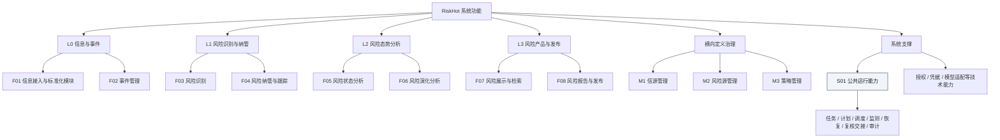

二级功能逐项列于 §5.4；M1／M2 沿用已存在功能编号，其他模块采用本稿的分解编号。

### 4.4 核心功能模块清单

| 模块编号 | 模块名称 | 业务阶段 | 主责产物 |
|---|---|---|---|
| F01 | 信息接入 | L0 | Information、原始资料版本、指标实际观测值及修订、接入结果/异常及业务监测数据 |
| F02 | 事件管理 | L0 | Event、Fact、EventRating、FactInformation、EventFact、EventTarget、EventTargetVariable |
| F03 | 风险识别 | L1 | 风险候选及识别过程记录（不等同正式风险） |
| F04 | 风险纳管与跟踪 | L1 | MonitoredRisk、monitored_risk_event_relation、risk_source_variable_relation |
| F05 | 风险状态分析 | L2 | RiskSnapshot、risk_snapshot_variable_analysis |
| F06 | 风险演化分析 | L2 | RiskAnalysisResult（快照附属变化结果） |
| F07 | 风险展示与检索 | L3 | 只读风险目录、详情及时间线投影 |
| F08 | 风险报告与发布 | L3 | RiskReport、ReportSection、ReportRiskItem、报告版本与发布记录 |

### 4.5 横向公共与支撑功能

**图 FA-D05：4.5 横向公共与支撑功能**

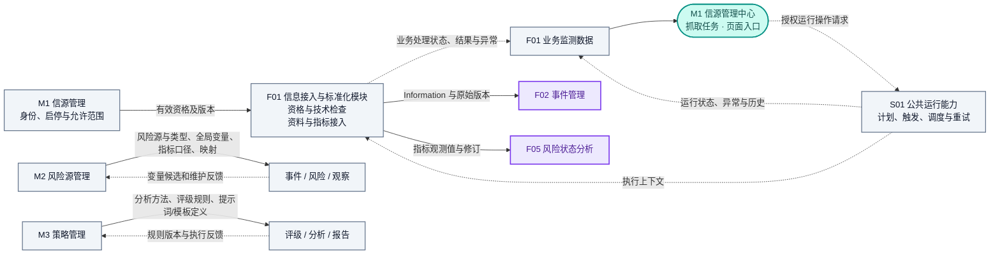

| 支撑中心／系统支撑模块 | 唯一主责 | 消费方／协作方 | 关键边界 |
|---|---|---|---|
| **M1 信源管理中心** | 信源身份、分类、业务使用资格、范围、版本 | 信息接入；M2 允许来源配置 | 不负责检测、采集或调度；以单一在册目录维护资格，在抓取任务视图展示 F01 业务监测数据 |
| **M2 风险源管理中心** | 风险源分类、风险类型、全局变量、候选治理、指标定义与变量映射 | 信息接入、事件管理、风险识别、状态分析 | 全局变量允许跨风险复用；风险源不必预设推荐变量清单；不维护当期实际指标值 |
| **M3 策略管理中心** | 业务判断方法、规则与分析模板的治理（范围待细化） | 事件评级、风险分析、报告生成 | 方法定义与当期结论分别维护；模型执行及调度依运行能力 |
| **S01 公共运行能力** | 任务登记、计划、调度、执行控制、运行记录、恢复、告警、复核交接与审计关联 | F01～F08；M1 任务入口 | 不修改信源资格、接入事实或业务结论；权限与凭据使用既有技术能力 |

**采集职责链 [F]**：S01 负责何时执行及如何恢复；F01 负责信源资格/技术检查、资料/指标接入、处理状态、结果及业务异常，并汇聚 S01 执行信息形成业务监测数据；M1 在「抓取任务」视图统一展示运行状态、执行结果、异常和历史，授权操作通过 F01/S01 受理。M1 不维护第二份正式计划或调度状态。

权限校验、凭据、连接器、模型适配及基础设施继续作为技术能力复用；S01 调用这些能力并通过各业务模块的授权命令执行，不接管领域事实。四个业务阶段、八个核心模块、三个业务支撑中心及一个 S01 系统支撑模块共同组成当前功能架构；模块划分不规定物理服务数量。详见 [[tools/RiskHot/docs/system-design/03-系统功能架构/公共运行能力功能设计|S01 公共运行能力功能设计]]。

### 4.6 功能模块依赖关系

核心交付链为 F01 → F02 → F03 → F04 → F05 → F06 → F07／F08。F01 的指标证据和 F02 的事件证据直接供 F05 使用；F04 的身份、F05 的快照、F06 的变化分别供 F07／F08 引用。M1／M2／M3 提供治理后的定义，反馈返回主责模块。S01 提供通用任务执行、状态与恢复，F01 向其反馈接入回执，并将运行信息汇聚后交 M1 展示。完整方向与依赖类型见 §7.2。

### 4.7 业务能力与系统功能映射

| 一级功能模块 | 对应业务层 | 负责的核心能力 | 主要产出 | 主要来源 |
|---|---|---|---|---|
| 信息接入 | L0 | 来源资格检查、原始资料及指标实际值接入、原文保存 | `Information`、实际观测数据及来源版本 | L0 §1.2；最新功能约定 |
| 事件管理 | L0 | 事件抽取、归组、增量更新、金融意义 M、直接对象变量关联 | `Event`、`Fact`、`EventRating` | L0 §1～4 |
| 风险识别 | L1 | 识别风险问题、观察对象、潜在损害及机制，形成候选 | 完整风险候选定义 | L1 §1～3 |
| 风险纳管与跟踪 | L1 | 风险同一性匹配、身份复用/建立、长期关系、跟踪状态 | `MonitoredRisk` 与关联 | L1 §1～4 |
| 风险状态分析 | L2 | 证据准备、来源与应对、损害、当前四维状态 | `RiskSnapshot`、变量分析记录 | L2 §1～4 |
| 风险演化分析 | L2 | 前后快照比较、方向及持续性变化、减弱节点 | `RiskAnalysisResult` | L2 §2～4 |
| 风险展示与检索 | L3 | 最新/最严重/全部目录、详情和时间线 | `RiskList`、`RiskPublicationItem` | L3 §1～5 |
| 风险报告与发布 | L3 | 日周月报告编制、校验、版本、发布与撤回 | `RiskReport` | L3 §1～5 |

上述能力的模块编号见 §4.4；每一模块的设计依据及边界见 §5.2，功能级追踪见附录 B。

## 5. 功能模块职责与边界设计

### 5.1 模块划分总表

| 模块编号 | 模块名称 | 所属层／域 | 类型 | 主责目标 |
|---|---|---|---|---|
| F01 | 信息接入 | L0 | 核心 | 把具备使用资格的外部资料和实际观测数据转为可追溯输入 |
| F02 | 事件管理 | L0 | 核心 | 形成稳定事件身份和可消费的事实更新 |
| F03 | 风险识别 | L1 | 核心 | 把事件的风险含义组织成可核验的完整候选 |
| F04 | 风险纳管与跟踪 | L1 | 核心 | 维护稳定风险身份、长期观察定义及跟踪资格 |
| F05 | 风险状态分析 | L2 | 核心 | 在固定截止时间和证据版本下形成当前风险判断 |
| F06 | 风险演化分析 | L2 | 核心 | 解释同一风险相对可比历史的变化 |
| F07 | 风险展示与检索 | L3 | 核心 | 提供可解释、可追溯的风险目录与详情 |
| F08 | 风险报告与发布 | L3 | 核心 | 把已确认的风险判断组织成可回溯的周期产品 |
| M1 | 信源管理中心 | 横向 | 支撑 | 提供统一、可追溯的信源身份和业务使用资格 |
| M2 | 风险源管理中心 | 横向 | 支撑 | 治理跨场景共享的风险观察定义和稳定语义 |
| M3 | 策略管理中心 | 横向 | 支撑 | 使判断方法与当期业务结论分开治理 |
| S01 | 公共运行能力 | 跨模块系统支撑 | 系统支撑 | 统一计划、调度、执行控制、监测与恢复，保留领域业务裁决边界 |

### 5.2 核心模块职责说明

#### F01 信息接入与标准化模块

- **模块编号与名称**：F01 信息接入与标准化模块
- **模块定位与目标**：把具备使用资格的外部资料和实际观测数据转为可追溯输入
- **核心职责**：来源资格及技术检查；资料/指标采集或补录；校验、保存及修订原始版本；维护业务处理状态、结果和异常，汇聚业务监测数据
- **主要功能及二级功能**：资料接入：检查信源资格、取得资讯公告报告并保存原文；指标接入：按指标定义校验对象、单位、观测期及允许来源；证据保存：保存来源、取得时间和修订版本，供下游稳定引用。逐项编号见 §5.4
- **输入与输出**：输入：M1 信源、M2 指标定义、S01 执行上下文/运行记录及外部资料；输出：Information、指标实际值及版本、业务回执和监测数据
- **上游与下游依赖**：上游：M1、M2、S01 执行上下文与运行信息、外部发布主体与数据提供方；下游：F02 接收 Information，F05 接收指标观测值；向 S01 反馈业务回执，向 M1 提供业务监测数据
- **负责的业务对象及数据**：Information、原始资料版本、指标实际观测值及修订、接入结果/异常及业务监测数据
- **职责边界与排除事项**：不维护信源或指标定义，不自建调度/重试系统；正式接入与提交资格仍由 F01 裁决；不做风险判断，实际值技术写入权待对齐
- **对应业务需求及设计依据**：SRC-L0 §1.2；SRC-M2 指标定义与实际值分离；最新功能约定 [F]；验收建议：SC-01、SC-02、SC-05

#### F02 事件管理

- **模块编号与名称**：F02 事件管理
- **模块定位与目标**：形成稳定事件身份和可消费的事实更新
- **核心职责**：事件抽取、归组；区分进展、来源增加和纠正；维护金融意义及直接对象变量关系
- **主要功能及二级功能**：事件处理：抽取要素、同一事件归组、处理重复与歧义；更新管理：追加进展、来源关联及纠正，保留历史；事件分析：形成 M 及事件—对象—变量关联，缺失定义反馈 M2。逐项编号见 §5.4
- **输入与输出**：输入：Information、变量定义、适用方法；输出：Event、Fact、EventRating 及引用
- **上游与下游依赖**：上游：F01、M2；M3 事件方法范围待定；下游：F03、F05；向 M2 提交候选，向 M3 提交方法反馈（范围待定）
- **负责的业务对象及数据**：Event、Fact、EventRating、FactInformation、EventFact、EventTarget、EventTargetVariable
- **职责边界与排除事项**：不把事件 M 当风险等级；不建立永久 Target→Variable 归属；不创建正式风险
- **对应业务需求及设计依据**：SRC-L0 §1～4；SRC-M2 候选接收；验收建议：SC-02、SC-03

#### F03 风险识别

- **模块编号与名称**：F03 风险识别
- **模块定位与目标**：把事件的风险含义组织成可核验的完整候选
- **核心职责**：识别具体风险问题、观察对象、范围、机制、损害与关键变量
- **主要功能及二级功能**：候选识别：允许无具体风险或产生多个候选；机制分析：明确观察范围、损害对象、传导机制及关键变量；候选交付：交付候选及依据，缺失全局变量提交 M2 治理。逐项编号见 §5.4
- **输入与输出**：输入：有效事件更新、风险分类和全局变量；输出：完整风险候选及证据
- **上游与下游依赖**：上游：F02、M2；下游：F04；向 M2 提交变量候选
- **负责的业务对象及数据**：风险候选及识别过程记录（不等同正式风险）
- **职责边界与排除事项**：不直接分配正式 risk_id；不把候选变量直接写入全局定义
- **对应业务需求及设计依据**：SRC-L1 §1～3、§4.6；SRC-M2 候选治理；验收建议：SC-03、SC-04

#### F04 风险纳管与跟踪

- **模块编号与名称**：F04 风险纳管与跟踪
- **模块定位与目标**：维护稳定风险身份、长期观察定义及跟踪资格
- **核心职责**：同一性匹配、复用或新建风险；维护长期关系和跟踪状态
- **主要功能及二级功能**：风险纳管：核对定义、对象、范围及机制，歧义转复核；关系维护：维护风险—事件及风险—来源—变量关系；跟踪维护：维护跟踪状态、观察配置和上游反馈处理。逐项编号见 §5.4
- **输入与输出**：输入：风险候选、全局定义、观察维护反馈；输出：MonitoredRisk 与有效长期关系
- **上游与下游依赖**：上游：F03、M2；F06 维护反馈；下游：F05、F07、F08
- **负责的业务对象及数据**：MonitoredRisk、monitored_risk_event_relation、risk_source_variable_relation
- **职责边界与排除事项**：不计算当前风险程度或历史方向；风险减弱不自动关闭跟踪
- **对应业务需求及设计依据**：SRC-L1 §1～4；SRC-L2 观察定义反馈；验收建议：SC-03、SC-04、SC-09

#### F05 风险状态分析

- **模块编号与名称**：F05 风险状态分析
- **模块定位与目标**：在固定截止时间和证据版本下形成当前风险判断
- **核心职责**：准备证据；分析变量、来源压力、应对及损害；生成四维当前快照
- **主要功能及二级功能**：证据准备：固定风险、关系、定义、指标和事件引用及截止时间；当前分析：分析压力与应对、损害及风险程度／阶段／范围／持续性展望；快照保存：校验与保存快照和变量明细，记录缺口并反馈责任模块。逐项编号见 §5.4
- **输入与输出**：输入：风险定义、长期关系、事件、指标值及方法；输出：RiskSnapshot、变量分析记录
- **上游与下游依赖**：上游：F04、F01、F02、M2、M3；下游：F06、F07、F08；向 M2、M3 提交定义或规则维护反馈
- **负责的业务对象及数据**：RiskSnapshot、risk_snapshot_variable_analysis
- **职责边界与排除事项**：不改长期关系；不重定义变量；当前四维不包含历史 trend；数据缺失不按零处理
- **对应业务需求及设计依据**：SRC-L2 §1～4；SRC-M2 观测缺口反馈；验收建议：SC-05、SC-06、SC-09

#### F06 风险演化分析

- **模块编号与名称**：F06 风险演化分析
- **模块定位与目标**：解释同一风险相对可比历史的变化
- **核心职责**：判断可比性；比较方向及持续性变化；判定减弱节点；提出观察维护建议
- **主要功能及二级功能**：可比性检查：核对同一风险、截止时间、定义版本与历史基准；变化分析：输出方向、持续性变化、比较原因与减弱节点；维护反馈：记录待判断原因；向风险纳管返回配置维护建议。逐项编号见 §5.4
- **输入与输出**：输入：当前与可比历史快照；输出：RiskAnalysisResult 及配置维护建议
- **上游与下游依赖**：上游：F05；下游：F07、F08；向 F04 提交维护反馈
- **负责的业务对象及数据**：RiskAnalysisResult（快照附属变化结果）
- **职责边界与排除事项**：首次或不可比不写“维持”；方向减弱不自动成为减弱节点；不新增 RiskEvolution 核心实体
- **对应业务需求及设计依据**：SRC-L2 §2～4；验收建议：SC-06、SC-07、SC-09

#### F07 风险展示与检索

- **模块编号与名称**：F07 风险展示与检索
- **模块定位与目标**：提供可解释、可追溯的风险目录与详情
- **核心职责**：确定性组织最新、最严重、全部目录，提供详情与时间线
- **主要功能及二级功能**：目录查询：按有效快照时间及可比严重度查询，完整目录保留无快照风险；详情展示：组合风险身份、当前状态、变化解释及证据入口；时间线查询：串联历次快照和附属变化结果。逐项编号见 §5.4
- **输入与输出**：输入：正式风险、快照及变化结果；输出：RiskList、RiskPublicationItem 和查询视图
- **上游与下游依赖**：上游：F04、F05、F06；下游：授权阅读者、F08
- **负责的业务对象及数据**：只读风险目录、详情及时间线投影
- **职责边界与排除事项**：不改写上游结论；无快照不等于低风险；不可比严重度不强行排序
- **对应业务需求及设计依据**：SRC-L3 §1～5；验收建议：SC-07、SC-08

#### F08 风险报告与发布

- **模块编号与名称**：F08 风险报告与发布
- **模块定位与目标**：把已确认的风险判断组织成可回溯的周期产品
- **核心职责**：日周月报告编制、引用校验、版本维护、授权发布与撤回
- **主要功能及二级功能**：报告编制：按周期和数据截止组织已有风险结论；内容校验：核对风险、快照、比较依据及一致性；发布管理：固定报告引用和版本，保留修订及撤回历史。逐项编号见 §5.4
- **输入与输出**：输入：风险身份、快照、变化、查询结果及适用模板；输出：RiskReport 与发布记录
- **上游与下游依赖**：上游：F04、F05、F06、F07；M3 模板范围待定；下游：授权阅读者；向 M3 提交模板反馈（范围待定）
- **负责的业务对象及数据**：RiskReport、ReportSection、ReportRiskItem、报告版本与发布记录
- **职责边界与排除事项**：不重新评级；不随上游更新无痕改写已发布报告；完整发布状态机待定
- **对应业务需求及设计依据**：SRC-L3 §1～5；M3 报告模板范围 [D]；验收建议：SC-08、SC-09

### 5.3 支撑模块职责说明

#### M1 信源管理中心

- **模块编号与名称**：M1 信源管理中心
- **模块定位与目标**：提供统一、可追溯的信源身份和业务使用资格
- **核心职责**：管理单一在册目录、分类档案、登记编辑、启停、引用与历史；在「抓取任务」视图展示 F01 业务监测数据，提供授权运行操作入口
- **主要功能及二级功能**：目录档案：搜索筛选、分类、多视图、详情与登记；资格维护：校验重复、编辑及 ACTIVE／DISABLED 启停；只读追溯：查询技术就绪状态、使用关系与版本。逐项编号见 §5.4
- **输入与输出**：输入：信源维护请求、F01 业务监测数据和 S01 计划/受理回执；输出：信源 ID、分类、资格与适用版本，以及经授权的运行操作请求
- **上游与下游依赖**：上游：授权维护者、F01 业务监测与 S01 计划查询；下游：F01、M2；运行操作交 F01/S01 受理
- **负责的业务对象及数据**：InformationSource、信源分类、业务状态及版本
- **职责边界与排除事项**：不执行接入检测、采集或调度，不维护正式运行状态，不保存指标实际值；业务停用、技术就绪、计划启停与执行状态分开
- **对应业务需求及设计依据**：SRC-M1 M1-F01～M1-F11；SRC-L0 来源边界；验收建议：SC-01、SC-09

#### M2 风险源管理中心

- **模块编号与名称**：M2 风险源管理中心
- **模块定位与目标**：治理跨场景共享的风险观察定义和稳定语义
- **核心职责**：风险源及风险类型；全局变量及候选；指标定义、来源限制、映射和版本治理
- **主要功能及二级功能**：定义治理：分类、全局变量及风险类型的检索维护；候选治理：接收、归并、消歧、审核及拆分合并；证据定义治理：指标定义、允许来源、变量映射及生效追溯。逐项编号见 §5.4
- **输入与输出**：输入：定义维护请求、变量候选及缺口、M1 信源；输出：已确认定义、映射及版本
- **上游与下游依赖**：上游：M1；F02、F03、F05 候选及反馈；下游：F01、F02、F03、F04、F05
- **负责的业务对象及数据**：risk_source_config、risk_dimension_config、variable_config、候选、指标定义与映射
- **职责边界与排除事项**：不维护指标实际值；不接管具体风险长期关系；不强制风险源推荐变量清单
- **对应业务需求及设计依据**：SRC-M2 M2-F01～M2-F20；SRC-L1 全局变量治理；验收建议：SC-01、SC-04、SC-05、SC-09

#### M3 策略管理中心

- **模块编号与名称**：M3 策略管理中心
- **模块定位与目标**：使判断方法与当期业务结论分开治理
- **核心职责**：管理业务方法、规则、模板、适用范围及版本；完整功能设计待确认
- **主要功能及二级功能**：方法定义：组织风险判断与分析方法、评级口径和版本；适用范围：定义适用业务、版本选择及维护反馈处理；模板治理：管理事件方法和报告模板的候选范围，评审后落地。逐项编号见 §5.4
- **输入与输出**：输入：授权方法维护及执行反馈；输出：适用方法、规则或模板版本
- **上游与下游依赖**：上游：授权维护者；F02、F05、F08 反馈（事件与报告范围待定）；下游：F05；F02、F08 的支撑范围待定
- **负责的业务对象及数据**：方法、规则、模板及版本（具体对象模型待 M3 设计确认）
- **职责边界与排除事项**：不执行任务调度或模型适配；不拥有当期风险结论；等级字典归属待决
- **对应业务需求及设计依据**：现有功能总览 [F]；SRC-L0／SRC-L2／SRC-L3 方法需求；第11.4节 [D]；验收建议：SC-05、SC-08

#### S01 公共运行能力

- **模块编号与名称**：S01 公共运行能力；S 表示系统支撑模块，与 F 核心模块、M 业务支撑中心分组编号
- **模块定位与目标**：统一跨模块任务计划、执行控制、监测与恢复，使运行过程可查询、可恢复、可追踪
- **核心职责**：任务受理与幂等；正式计划及版本；调度、阶段、超时、暂停/取消；重试、补交付；告警、复核交接与审计关联
- **主要功能及二级功能**：S01-SF01～SF07 共七组，详细设计含20项末级功能；总览仅逐项登记七组二级功能，见 §5.4
- **输入与输出**：输入：业务模块任务语义、参数规则、业务回执及授权操作请求；输出：计划版本、执行上下文、运行/尝试记录、恢复回执与告警
- **上游与下游依赖**：与 F01～F08 按任务契约协作，M1 提供身份/资格及授权界面请求；采集运行信息交 F01 汇聚，在 M1 抓取任务视图展示
- **负责的对象及数据**：任务定义、正式计划、运行、尝试、恢复和运行告警；复核待办是领域决定的投影，领域回执只保留引用
- **职责边界与排除事项**：不维护 M1 信源资格，不写 F01 资料/观测值，不替代领域批准；授权、凭据和模型适配仍复用技术能力
- **对应需求及设计依据**：SRC-S01 §1～8；SRC-F01 §1.2；SRC-M1 §1.3、§6；SRC-T §5.1；验收建议：SC-10、SC-11及 AC-S01-01～28

### 5.4 模块功能分解清单

每行是一项功能追踪条目。Fxx-SFxx、M3-SFxx 与 S01-SFxx 为架构分解编号；M1-Fxx、M2-Fxx 沿用模块稿。新增 S01 七组二级功能后共65项，其中 S01 的20项末级功能在独立文档展开，不重复计入本表。不同模块保留原有分解粒度，条目数不等于全系统末级需求总数，也不代表已批准。

| 功能编号 | 主责模块 | 二级功能 | 功能说明 |
|---|---|---|---|
| F01-SF01 | F01 | 资料接入 | 检查信源资格、取得资讯公告报告并保存原文 |
| F01-SF02 | F01 | 指标接入 | 按指标定义校验对象、单位、观测期及允许来源 |
| F01-SF03 | F01 | 证据保存 | 保存来源、取得时间和修订版本，供下游稳定引用 |
| F02-SF01 | F02 | 事件处理 | 抽取要素、同一事件归组、处理重复与歧义 |
| F02-SF02 | F02 | 更新管理 | 追加进展、来源关联及纠正，保留历史 |
| F02-SF03 | F02 | 事件分析 | 形成 M 及事件—对象—变量关联，缺失定义反馈 M2 |
| F03-SF01 | F03 | 候选识别 | 允许无具体风险或产生多个候选 |
| F03-SF02 | F03 | 机制分析 | 明确观察范围、损害对象、传导机制及关键变量 |
| F03-SF03 | F03 | 候选交付 | 交付候选及依据，缺失全局变量提交 M2 治理 |
| F04-SF01 | F04 | 风险纳管 | 核对定义、对象、范围及机制，歧义转复核 |
| F04-SF02 | F04 | 关系维护 | 维护风险—事件及风险—来源—变量关系 |
| F04-SF03 | F04 | 跟踪维护 | 维护跟踪状态、观察配置和上游反馈处理 |
| F05-SF01 | F05 | 证据准备 | 固定风险、关系、定义、指标和事件引用及截止时间 |
| F05-SF02 | F05 | 当前分析 | 分析压力与应对、损害及风险程度／阶段／范围／持续性展望 |
| F05-SF03 | F05 | 快照保存 | 校验与保存快照和变量明细，记录缺口并反馈责任模块 |
| F06-SF01 | F06 | 可比性检查 | 核对同一风险、截止时间、定义版本与历史基准 |
| F06-SF02 | F06 | 变化分析 | 输出方向、持续性变化、比较原因与减弱节点 |
| F06-SF03 | F06 | 维护反馈 | 记录待判断原因；向风险纳管返回配置维护建议 |
| F07-SF01 | F07 | 目录查询 | 按有效快照时间及可比严重度查询，完整目录保留无快照风险 |
| F07-SF02 | F07 | 详情展示 | 组合风险身份、当前状态、变化解释及证据入口 |
| F07-SF03 | F07 | 时间线查询 | 串联历次快照和附属变化结果 |
| F08-SF01 | F08 | 报告编制 | 按周期和数据截止组织已有风险结论 |
| F08-SF02 | F08 | 内容校验 | 核对风险、快照、比较依据及一致性 |
| F08-SF03 | F08 | 发布管理 | 固定报告引用和版本，保留修订及撤回历史 |
| M1-F01 | M1 | 信源检索 | 按名称、发布主体、稳定编码检索 |
| M1-F02 | M1 | 多维筛选 | 按等级、金融属性、观察层级、优先级、频率组合过滤 |
| M1-F03 | M1 | 多视图排序 | 全部、事实核验、日常监测、专题研究切换 |
| M1-F04 | M1 | 分类浏览 | 分类折叠、展开／收起、数量统计 |
| M1-F05 | M1 | 信源详情 | 查看在册身份、分类、状态、信息内容、观察用途及入口 |
| M1-F06 | M1 | 新增信源 | 新增资料并直接纳入同一信源目录 |
| M1-F07 | M1 | 在册信源管理 | 查看、编辑、启用、停用 |
| M1-F08 | M1 | 重复登记检查 | 代码唯一校验、主体及入口相似项提示 |
| M1-F09 | M1 | 技术接入状态查询 | 只读展示技术就绪结果并跳转 L0 检测 |
| M1-F10 | M1 | 使用关系 | 反查指标允许来源、原始资料等引用 |
| M1-F11 | M1 | 变更与版本记录 | 查询配置变更、状态操作、历史版本 |
| M2-F01 | M2 | 风险源检索与分类浏览 | 按名称、编码和分析层次查询；正式风险源默认可用 |
| M2-F02 | M2 | 风险源定义维护 | 新增、修订定义、核心问题与同层父分类 |
| M2-F03 | M2 | 宏观风险源系统预置 | 部署时后台核对八类基线，保留修订；无用户初始化入口 |
| M2-F04 | M2 | 全局变量检索与详情 | 名称、编码、别名、定义及适用范围辅助检索 |
| M2-F05 | M2 | 变量标准定义维护 | 稳定语义、边界、粒度、观测依据和身份管理 |
| M2-F06 | M2 | 变量分类与别名维护 | 可选标签／分类及历史名称，不强制父子树 |
| M2-F07 | M2 | 候选接收与归并 | 汇总 L0／L1／L2 及人工提议，保留各条依据 |
| M2-F08 | M2 | 语义匹配与消歧 | 核对名称、定义、范围、粒度和替代关系 |
| M2-F09 | M2 | 候选审核与身份确认 | 复用、新建、转维护、退回／暂缓、拒绝 |
| M2-F10 | M2 | 变量拆分合并治理 | 比较语义、拟定身份方案、审核映射与影响 |
| M2-F11 | M2 | 关键指标定义维护 | 统计对象、口径、单位、频率与时间语义 |
| M2-F12 | M2 | 指标允许信源配置 | 引用 M1 有效信源，说明适用材料和口径限制 |
| M2-F13 | M2 | 变量与指标映射 | 多对多、逐关系解释、适用范围、局限与版本 |
| M2-F14 | M2 | 风险类型检索与详情 | 浏览四类损害性质及分类边界 |
| M2-F15 | M2 | 风险类型维护 | 四类由系统预置，支持稳定编码、定义和核心问题增修及查重 |
| M2-F16 | M2 | 修订审核与生效 | 草稿与当前有效定义分开，针对明确版本审核 |
| M2-F17 | M2 | 使用状态与生命周期 | 风险类型／指标启停、变量废弃及恢复核对；风险源默认可用 |
| M2-F18 | M2 | 使用关系与影响检查（后续版本） | 按用户要求移出首版，保留原编号追踪 |
| M2-F19 | M2 | 变更与版本追溯 | 历史定义、映射、操作依据和生效记录 |
| M2-F20 | M2 | 观测缺口与维护反馈 | 区分定义、映射、来源、实际证据和判断规则缺口 |
| M3-SF01 | M3 | 方法定义 | 组织风险判断与分析方法、评级口径和版本 |
| M3-SF02 | M3 | 适用范围 | 定义适用业务、版本选择及维护反馈处理 |
| M3-SF03 | M3 | 模板治理 | 管理事件方法和报告模板的候选范围，评审后落地 |
| S01-SF01 | S01 | 任务登记与受理 | 任务类型、授权受理、操作身份与重复请求幂等 |
| S01-SF02 | S01 | 计划与触发管理 | 正式计划、版本、生效对账、周期及漏执行/补执行 |
| S01-SF03 | S01 | 调度与执行控制 | 排队、并发、阶段、超时、暂停/恢复与取消 |
| S01-SF04 | S01 | 重试与恢复 | 技术重试、故障恢复、补交付、投影重建及领域补采/重算交接 |
| S01-SF05 | S01 | 运行监测与告警 | 运行/异常查询、告警聚合，接收 F01 数据质量判断 |
| S01-SF06 | S01 | 人工复核交接 | 投影领域待办，领域提交决定后受控唤醒 |
| S01-SF07 | S01 | 审计与版本追溯 | 操作、版本、运行、证据及下游结果的关联追溯 |

M1「抓取任务」视图的功能约定来自 SRC-F01 与 SRC-S01；M1 独立稿的功能编号和交互仍待后续同步，本次不把调度能力扩入 M1 编号。

### 5.5 模块职责边界

| 易混淆职责 | 边界规则 | 争议处理 |
|---|---|---|
| 信源资格／接入就绪 | M1 决定业务资格，F01 负责资格/技术检查及接入，S01 提供执行设施 | 技术失败不自动停用；F01 在启动、重试及提交前复核资格 |
| 计划／业务处理／页面入口 | S01 管正式计划、触发、调度和重试；F01 管接入与业务监测汇聚；M1 展示及提交授权请求 | 计划启停、信源启停和运行状态分开；M1 不维护第二套调度状态 |
| 执行记录／业务结果／交付 | S01 管运行/尝试与恢复，F01 管接入事实、计数及业务异常；M1 统一展示 | 正常零新增不判失败；已保存但交付失败只补交付，不重复采集 |
| 变量定义／风险关系 | M2 治理变量身份；F04 维护特定风险长期作用关系 | 缺定义先治理；关系维护仍回 F04 |
| 指标口径／实际数据 | M2 治理定义与映射；F01 接入和修订实际值 | 技术 observations 归属待适配，不改业务职责 |
| 事件 M／风险等级／跟踪状态 | F02、F05、F04 各自维护不同业务含义 | 禁止相互自动转换 |
| 当前判断／历史比较／产品表达 | F05、F06、F07／F08 各自保存或组合对应结果 | 产品层不重算上游，演化不覆写快照 |

### 5.6 模块输入、输出及依赖

| 模块 | 输入与输出 | 上游 | 下游／反馈 |
|---|---|---|---|
| F01 | 输入：M1 信源、M2 指标定义、S01 执行上下文与运行记录、外部资料；输出：Information、指标实际值/版本、业务回执及监测数据 | M1、M2、S01；外部发布主体与数据提供方 | F02、F05；向 S01 反馈回执，向 M1 提供监测数据 |
| F02 | 输入：Information、变量定义、适用方法；输出：Event、Fact、EventRating 及引用 | F01、M2；M3 事件方法范围待定 | F03、F05；向 M2 提交候选，向 M3 提交方法反馈（范围待定） |
| F03 | 输入：有效事件更新、风险分类和全局变量；输出：完整风险候选及证据 | F02、M2 | F04；向 M2 提交变量候选 |
| F04 | 输入：风险候选、全局定义、观察维护反馈；输出：MonitoredRisk 与有效长期关系 | F03、M2；F06 维护反馈 | F05、F07、F08 |
| F05 | 输入：风险定义、长期关系、事件、指标值及方法；输出：RiskSnapshot、变量分析记录 | F04、F01、F02、M2、M3 | F06、F07、F08；向 M2、M3 提交定义或规则维护反馈 |
| F06 | 输入：当前与可比历史快照；输出：RiskAnalysisResult 及配置维护建议 | F05 | F07、F08；向 F04 提交维护反馈 |
| F07 | 输入：正式风险、快照及变化结果；输出：RiskList、RiskPublicationItem 和查询视图 | F04、F05、F06 | 授权阅读者、F08 |
| F08 | 输入：风险身份、快照、变化、查询结果及适用模板；输出：RiskReport 与发布记录 | F04、F05、F06、F07；M3 模板范围待定 | 授权阅读者；向 M3 提交模板反馈（范围待定） |
| M1 | 输入：信源维护请求、F01 业务监测与 S01 计划摘要/受理回执；输出：信源身份、资格/版本及授权操作请求 | 授权维护者；F01、S01 | F01、M2；运行操作交 F01/S01 |
| M2 | 输入：定义维护请求、变量候选及缺口、M1 信源；输出：已确认定义、映射及版本 | M1；F02、F03、F05 候选及反馈 | F01、F02、F03、F04、F05 |
| M3 | 输入：授权方法维护及执行反馈；输出：适用方法、规则或模板版本 | 授权维护者；F02、F05、F08 反馈（事件与报告范围待定） | F05；F02、F08 的支撑范围待定 |
| S01 | 输入：业务任务、校验规则、领域回执和授权请求；输出：计划、执行上下文、运行记录、恢复及告警 | M1 资格引用；F01～F08 业务契约；权限等技术能力 | F01～F08；采集运行信息经 F01 汇聚供 M1 展示 |

业务交付的最小内容见 §6.6，身份／版本／校验契约见 §7.4。

## 6. 核心业务场景与功能流程

### 6.1 关键业务场景清单

| 场景编号 | 场景 | 协作模块 | 重点分支 |
|---|---|---|---|
| SC-01 | 信源资格与接入 | M1、M2、F01 | 停用、技术失败与在途提交分别处理 |
| SC-02 | 事件归组与纠正 | F01、F02 | 同一内容重复、仅新增来源、实质进展、纠正 |
| SC-03 | 风险识别与纳管 | F02、F03、F04 | 无风险、多候选、已有身份、全新风险、身份歧义 |
| SC-04 | 变量候选治理 | F03、M2、F04 | 识别引用不存在变量、同义变量或待审候选 |
| SC-05 | 证据与当前观察 | M2、F01、F05、M3 | 指标冲突、缺失、口径或方法版本变化 |
| SC-06 | 历史变化分析 | F05、F06 | 首次、不可比历史、方向减弱 |
| SC-07 | 风险目录与详情 | F04、F05、F06、F07 | 最新、最严重、全部目录及无快照风险 |
| SC-08 | 周期报告发布与撤回 | F05、F06、F07、F08、M3 | 固定截止编制、上游后续修订、授权撤回 |
| SC-09 | 授权、修订与恢复 | M1、M2、F04、F05、F06、F08 | 无权限变更、旧配置修改、结果已保存而交付失败 |
| SC-10 | 采集计划与任务监测 | S01、F01、M1 | 计划生效、漏执行、正常零新增与业务监测汇聚 |
| SC-11 | 采集恢复与取消 | S01、F01、M1、F02、F05 | 技术重试、资格阻断、保存后补交付及取消竞态 |

SC 编号为本稿架构验收场景建议，详细断言见 §10.5。

### 6.2 系统端到端功能流程

**图 FA-D06：6.2 系统端到端功能流程**

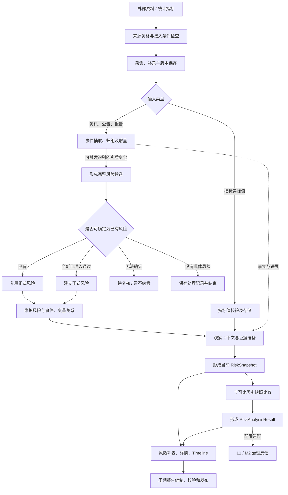

**处理原则**：允许事件识别无具体风险、同一事件形成多个候选、首次风险观察没有历史基准、部分证据不足时受限判断。无结果、待复核、技术失败和已完成应区别表达。[B]

### 6.3 主要业务处理链路

#### 事件归组、增量与纠正

**图 FA-D07：事件归组、增量与纠正**

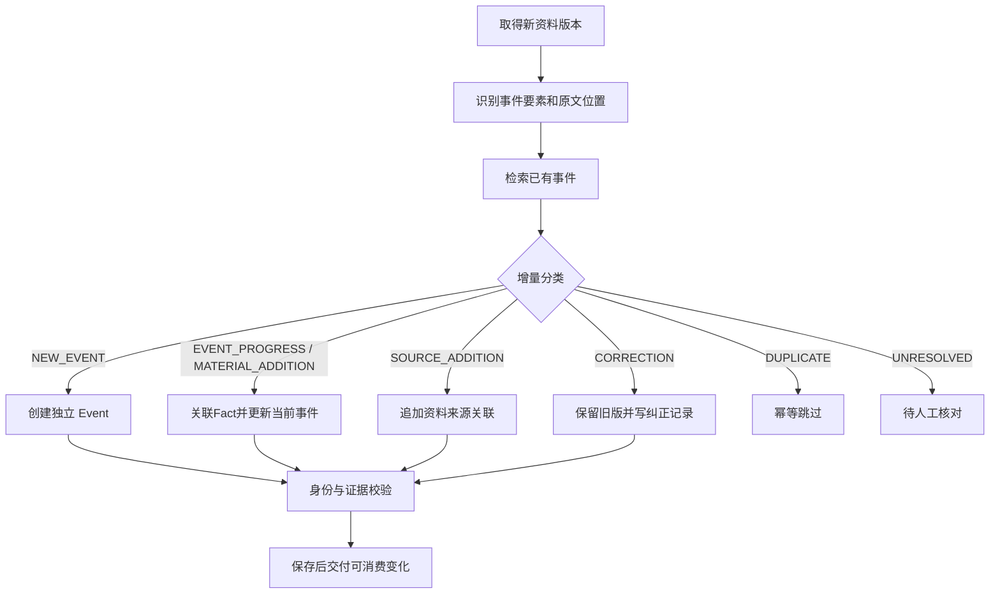

归组依据同时考虑主体、行为、对象、时间、行动标识；仅来源增加不自动算作事件实质进展。候选事件名称仅表示业务语义，技术通知格式待确认。[B]

#### 风险同一性、纳管与长期关系

**图 FA-D08：风险同一性、纳管与长期关系**

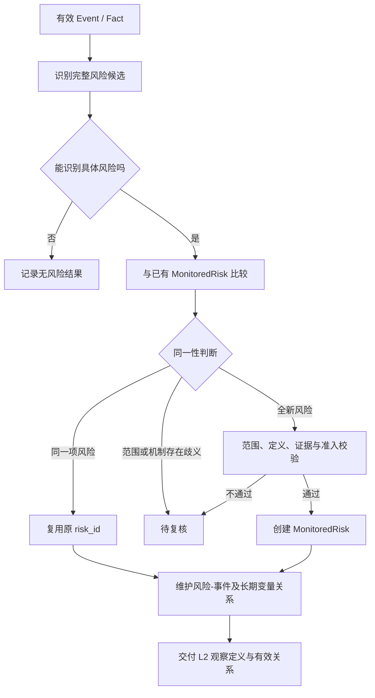

关键变量由 L1 按具体风险机制动态选择，并引用 M2 已确认的全局定义。候选变量先进入 M2 治理流程，变量获批与风险纳管分别完成资格校验；风险源无需提前维护推荐变量清单。[B/F]

#### 状态分析、变化分析与发布

**图 FA-D09：状态分析、变化分析与发布**

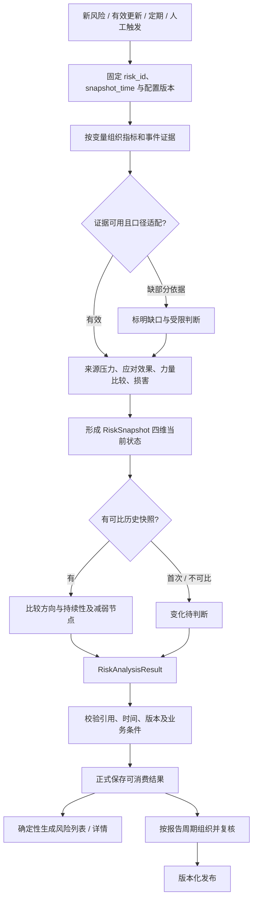

四维状态与整项风险方向分别存储。风险程度、当前压力和风险跟踪状态不能相互自动转换。首次观察不应生成“维持风险”结论；减弱方向也不会自动确认减弱节点。[B]

### 6.4 跨模块功能调用与协作流程

| 协作步骤 | 提供方 → 接收方 | 交接规则 |
|---|---|---|
| 任务执行 | M1 授权入口／有效计划 → S01 → F01 | S01 受理、幂等、触发及调度；F01 独立校验接入参数与提交资格 |
| 资格准备 | M1／M2 → F01 | 核对业务启用、技术就绪、口径和允许来源；启动、重试及正式提交前复查 |
| 采集监测 | S01 运行信息＋F01 接入结果 → F01 业务监测 → M1 抓取任务视图 | 统一展示运行状态、结果、异常和历史；M1 不裁决运行状态 |
| 采集恢复 | M1 授权入口 → F01／S01 | F01 判定补采范围与业务资格，S01 执行受控恢复；已保存结果只补交付 |
| 事件驱动 | F02 → F03 → F04 | 保存可消费更新后识别；先匹配正式风险身份再维护关系 |
| 观察执行 | F04＋F01＋F02＋M2＋M3 → F05 → F06 | 固定上下文与截止时间；当前判断完成后才解释历史变化 |
| 结果产品化 | F04／F05／F06 → F07／F08 | 查询只读组合；报告固定引用并单独管理发布状态 |
| 治理反馈 | F02／F03／F05 → M2；F06 → F04 | 反馈作为候选或维护请求，审核生效后才能参与后续运行 |
| 方法反馈 | F02／F05／F08 → M3 | 执行结果与方法定义分开；事件与报告范围仍待确认 |

### 6.5 关键业务分支与异常场景

无具体风险、多个候选、身份歧义、首次观察、不可比历史、证据不足均是可表达的业务分支，不统一包装为技术失败。来源增加不得伪装成事件进展；纠正须保留旧证据；指标缺失不能推导风险稳定。技术故障、保存后交付中断及撤回恢复见 §9.6。

### 6.6 关键功能产物与交接节点

| 交付路径 | 最小业务内容 | 所有权与下游约束 |
|---|---|---|
| 信息接入 → 事件管理 | 信源身份、原始 URL/资料标识、发布时间、取得时间、正文版本、原文定位 | 信息/事件侧保存原文版本；后续结论不可替换原件 |
| 事件管理 → 风险识别 | `Event`、`Fact`、Target、直接变量关联、M、证据引用 | 事件侧维护身份；M 仅表达事件金融意义 |
| 风险识别 → 风险纳管 | 完整风险候选、定义、范围、机制、潜在损害、关键变量及引用 | 匹配已有身份优先；AI 候选不得直接指定正式新 ID |
| 风险纳管 → 状态分析 | `MonitoredRisk`、长期变量关系、关联事件、跟踪状态及定义版本 | L2 只读风险长期定义；维护建议返回 L1 |
| 指标接入 → 状态分析 | 有效观测值、单位、对象范围、观测期、发布时间、来源、版本 | 指标口径由 M2；实际值业务归属按最新功能约定为信息接入；技术承载待定 |
| 状态分析 → 演化分析 | 当前快照、变量明细、截止时间、证据及规则版本 | 风险当前四维在快照，历史方向在附属变化结果 |
| L1/L2 → 风险展示 | 风险身份、当前有效快照、变化结果和追溯引用 | L3 只读组合，不重算风险结论 |
| 风险展示/分析 → 报告 | 周期、数据截止、风险 ID、快照 ID、比较依据、现有结论 | 报告是独立持久业务产物，发布需明确状态和版本 |

## 7. 模块协作与功能契约

### 7.1 模块协作关系总览

**图 FA-D10：7.1 模块协作关系总览**

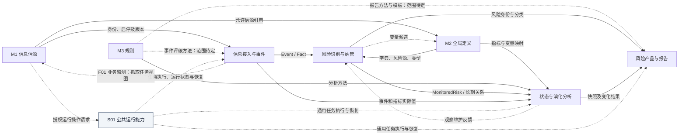

### 7.2 模块依赖矩阵

行是提供方，列是消费方。V＝治理定义，R＝业务结果，F＝维护反馈或运行状态查询结果；E＝通用任务执行与恢复；Q＝授权运行操作请求；*＝范围待确认，—＝本稿无直接交付。此表表示功能依赖，不表示代码导入或同步 API 调用。

| 提供方＼消费方 | F01 | F02 | F03 | F04 | F05 | F06 | F07 | F08 | M1 | M2 | M3 | S01 |
|---|---|---|---|---|---|---|---|---|---|---|---| --- |
| F01 | — | R | — | — | R | — | — | — | F | — | — | R/F |
| F02 | — | — | R | — | R | — | — | — | — | F | F* | R/F |
| F03 | — | — | — | R | — | — | — | — | — | F | — | R/F |
| F04 | — | — | — | — | R | — | R | R | — | — | — | R/F |
| F05 | — | — | — | — | — | R | R | R | — | F | F | R/F |
| F06 | — | — | — | F | — | — | R | R | — | — | — | R/F |
| F07 | — | — | — | — | — | — | — | R | — | — | — | R/F |
| F08 | — | — | — | — | — | — | — | — | — | — | F* | R/F |
| M1 | V/Q | — | — | — | — | — | — | — | — | V | — | V/Q |
| M2 | V | V | V | V | V | — | — | — | — | — | — | V |
| M3 | — | V* | — | — | V | — | — | V* | — | — | — | V |
| S01 | E/F | E/F | E/F | E/F | E/F | E/F | E/F | E/F | F | F | F | — |

S01 的 E 表示公共执行能力契约，具体业务类型按模块登记，并不意味着所有任务已经实现。M1→F01/S01 的 V 为信源资格/版本引用，Q 为经页面提交的授权请求（补采先由 F01 校验）；S01→M1 的 F 限于计划摘要与受理回执，采集业务监测仍由 S01→F01→M1 汇聚展示。

### 7.3 功能交互与触发机制

| 触发来源 | 目标能力 | 条件与控制 |
|---|---|---|
| 资料或指标到达／人工补录 | F01、F02 | 检查资格、输入版本、重复与纠正类型 |
| 有效事件或实质更新 | F03、F04 | 区分无风险、多个候选和身份复核；纯来源增加不自动当实质进展 |
| 新风险、有效更新、定期或人工请求 | F05、F06 | 固定观察上下文；合法触发不代表可跳过证据校验 |
| 定义治理获批 | 相应下游模块 | 新版本用于后续运行；是否重跑须按业务规则明确，不追改历史 |
| 报告周期或授权发起 | F08 | 固定周期和数据截止；审批与发布规则待详细设计 |
| 有效采集计划或 M1 授权请求 | S01 受理调度，F01 处理接入 | 计划版本及授权有效；F01 复核信源资格与技术条件 |
| 失败恢复／重新交付 | 原事实拥有者＋S01 | 技术重试复用原操作；业务重算新建运行；补交付不重复保存，重新检查权限、资格和版本 |

触发频率、通知格式、同步／异步、幂等键及任务编排由功能契约与系统总体架构继续细化。

### 7.4 跨模块输入与输出契约

每次交付必须能回答“谁的哪一版本、在什么时间、依据什么、允许如何使用”。下表是功能契约，不是 API 字段定义。

| 契约编号 | 交付边界 | 输入／输出要求 | 接收校验与失败去向 |
|---|---|---|---|
| CT-01 | M1／M2 → F01 | 来源身份与业务状态、指标口径、允许来源及版本 | 无效来源阻断；口径不适配记录差异；F01 执行资格/技术检查，S01 提供执行设施 |
| CT-02 | F01／F02 → 下游 | 原始资料定位、事件身份与更新类型、实际值及单位／观测期／发布与取得时间 | 校验真实引用和语义；纠正保留旧版；不足转受限或复核 |
| CT-03 | F03 → F04 | 完整候选、定义、对象范围、机制、损害、变量及证据 | 核对同一性与准入；不接受模型虚构正式身份 |
| CT-04 | F04／M2 → F05 | 正式风险、长期关系、变量／指标定义及适用版本 | 风险身份真实、关系有效；缺定义回治理；历史字段适配待定 |
| CT-05 | F05 → F06／F07／F08 | 当前四维、分析截止、变量明细、证据和方法版本 | 保存后可消费；比较须可比；失败不重建已存在事实 |
| CT-06 | F06 → F07／F08／F04 | 变化结果、比较基准、待判断原因；配置维护建议 | 变化与当前程度分离；反馈不直接修改长期定义 |
| CT-07 | F07／上游结果 → F08 | 报告周期、风险与快照身份、比较依据及既有结论 | 检查引用与一致性；发布固定版本；失败不得宣称已发布 |
| CT-08 | 业务模块 → M2／M3 | 候选／缺口类型、依据、来源业务与相关版本 | 按主责治理，不把建议自动生效；M3 具体范围待定 |
| CT-09 | 业务模块／M1 授权入口 ↔ S01 | 任务归属、操作/运行身份、计划版本、授权范围、执行上下文、阶段、回执、恢复及审计关联 | 调度不等于业务获准；正式提交仍由原领域裁决；计划与资格分别维护 |
| CT-10 | S01 → F01 → M1 抓取任务视图 | S01 提供运行状态/历史，F01 关联接入结果、异常、计数和证据，形成业务监测数据 | 正常零新增不误报；结果/交付分层；M1 只展示，不写计划或运行真值 |

### 7.5 跨模块业务状态与一致性约束

| 约束 | 功能协作要求 | 技术细节状态 |
|---|---|---|
| 身份 | 下游使用稳定 ID、有效版本和真实存在的外键语义 | 具体 DTO 与迁移待定 |
| 时间 | 区分事件发生/计划、资料发布/采集、指标观测期、分析截止、报告发布 | 时间精度/时区/窗口待定 |
| 状态 | 信源启停、计划启停、运行/业务/交付状态、L1 跟踪状态、L2 风险程度/方向和报告发布状态各自独立 | 状态映射与完整枚举待定，运行建议见 SRC-S01 §3.3 |
| 证据 | 任何正式判断可追溯到原文、指标及适用定义版本 | 证据引用结构待定 |
| 校验 | AI 结果先校验，授权的应用用例再决定正式写入 | 具体 Schema/权限待定 |
| 幂等 | 相同业务输入/重试不得重复建事件、风险、快照、发布结果 | 业务键与 Inbox/Outbox 实现待定 |
| 更新 | 修改已有定义或修订数据保留旧版，历史快照和报告继续引用当时内容 | 快照冻结和修订兼容细则待定 |
| 交付 | 数据保存成功后才交付可消费变化；消费失败允许重试 | 同步/异步与补偿方式待定 |

### 7.6 外部系统功能集成边界

外部资料与指标输入由 F01 统一接入并保留来源；M1 提供业务使用资格，M2 提供口径和来源限制。模型及工具结果只能作为候选／证据，须经业务校验才形成正式结果。报告向授权阅读者交付；外部自动分发渠道尚未形成明确功能基线，不在本稿自行增加。凭据、网络、接口协议与适配器由系统总体架构承接。

## 8. 核心业务对象与数据归属

### 8.1 核心业务对象概览

本章对象用于解释功能语义，不批准物理表结构。完整字段与规则见 §1.3 来源文档。

#### 信息、事件与全局变量模型

**图 FA-D11：信息、事件与全局变量模型**

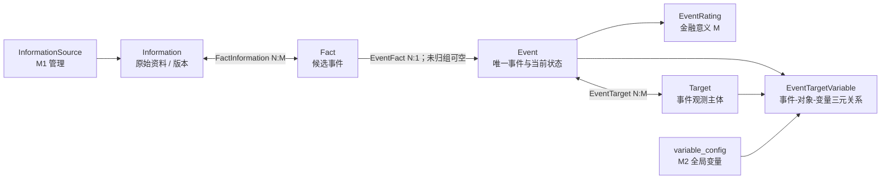

**必须保持的语义**：[B] `Target` 为事件的观测主体，`Event.subject` 为行为主体；同一 Target 可在不同 Event 中关联不同 Variable。`EventTargetVariable` 体现特定事件语境，系统不预设永久的 Target→Variable 归属。`Fact`承载资料候选，经EventFact归入唯一Event；Event当前事实按证据更新，不建立事件版本链；`EventRating.M` 与风险等级独立。

#### 风险定义、长期变量关联与事件关联

**图 FA-D12：风险定义、长期变量关联与事件关联**

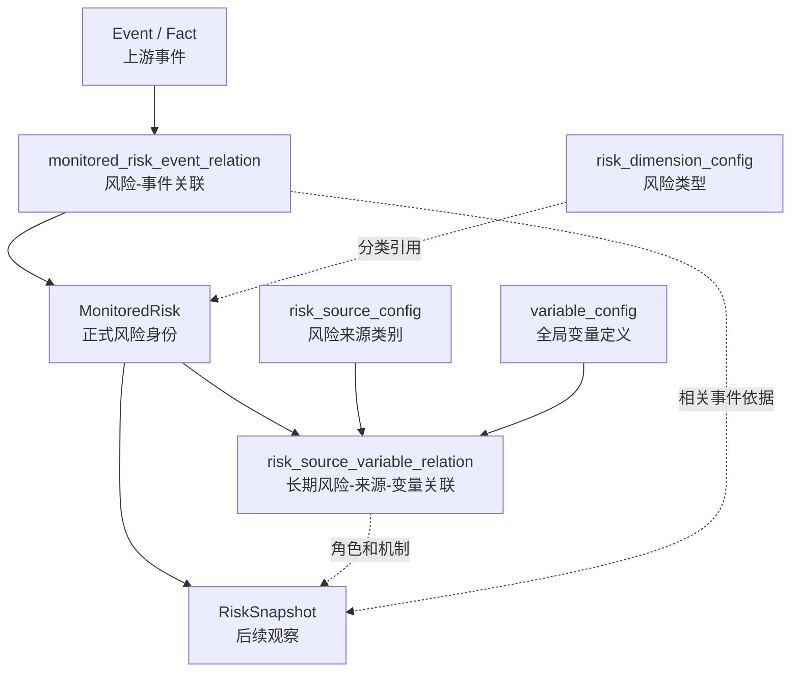

- **L1 事实拥有者**：`MonitoredRisk`、风险—事件关联、风险—风险源—变量长期关系。[B]
- **风险同一性核心依据**：风险定义、观察对象、观察范围；标题、来源、分类及变量作为辅助。损害对象及机制须参与语义核对。[B]
- **风险状态**：`tracking_status` 是 L1 的跟踪状态；`risk_level` 和 `trend` 分别在 L2 当前状态与历史变化分析中确定。[B]
- **映射差异 [D]**：L1 关系表保留 `variable_impact_on_risk`、`risk_source_code` 的历史字段表述，L2 读取 `impact_mechanism`、`risk_source_id`；技术契约须明确规范名、兼容适配和迁移规则。

#### 当前快照、变量分析与附属变化结果

**图 FA-D13：当前快照、变量分析与附属变化结果**

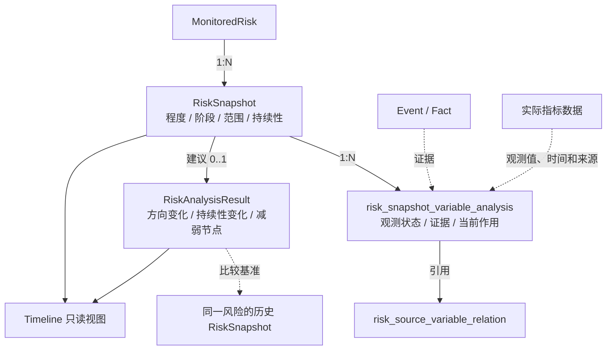

[B] `RiskSnapshot` 只表达本次观察截止时间的四个状态维度：**风险程度、阶段、实际影响范围、持续性展望**。损害兑现进入 `status_summary`，不新增独立 `realization_degree`；缺口写入分析说明，不新增独立可信度分。历史方向 `trend`、`persistence_change`、比较原因和减弱节点归 `RiskAnalysisResult`。Timeline 使用历次快照与附属变化结果，首版不新增 `RiskEvolution` 核心实体。

#### 风险产品和报告模型

**图 FA-D14：风险产品和报告模型**

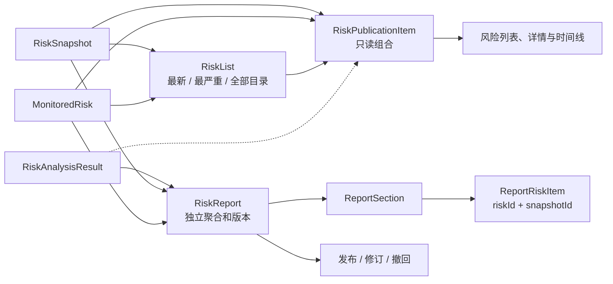

[B] 三类列表为确定性查询派生结果；最新按有效 `snapshot_time`，最严重按可比较严重度排序，完整目录包含无快照及暂停或关闭跟踪的风险。日报、周报、月报属于持久报告聚合；AI 仅组织既有结论的表达，不重新评级。

### 8.2 业务对象与功能模块映射

| 主责模块 | 业务对象／数据 | 性质 |
|---|---|---|
| F01 | Information、原始资料版本、指标实际观测值及修订、接入结果/异常及业务监测数据 | 接入事实；业务监测为结果/运行信息的组合或投影 |
| F02 | Event、Fact、EventRating、FactInformation、EventFact、EventTarget、EventTargetVariable | 业务事实／定义 |
| F03 | 风险候选及识别过程记录（不等同正式风险） | 候选过程记录 |
| F04 | MonitoredRisk、monitored_risk_event_relation、risk_source_variable_relation | 业务事实／定义 |
| F05 | RiskSnapshot、risk_snapshot_variable_analysis | 业务事实／定义 |
| F06 | RiskAnalysisResult（快照附属变化结果） | 业务事实／定义 |
| F07 | 只读风险目录、详情及时间线投影 | 查询派生 |
| F08 | RiskReport、ReportSection、ReportRiskItem、报告版本与发布记录 | 业务事实／定义 |
| M1 | InformationSource、信源分类、业务状态及版本 | 业务事实／定义 |
| M2 | risk_source_config、risk_dimension_config、variable_config、候选、指标定义与映射 | 业务事实／定义 |
| M3 | 方法、规则、模板及版本（具体对象模型待 M3 设计确认） | 治理定义（模型待确认） |
| S01 | 任务、计划版本、运行/尝试、恢复、告警及审计关联 | 系统运行事实；复核待办为领域投影 |

### 8.3 数据所有权与维护职责

| 业务事实／对象 | 唯一业务主责 | 其他模块允许的行为 | 承载说明 |
|---|---|---|---|
| 信源定义、分类、启停及版本 | M1 | L0 和 M2 按身份及适用版本引用 | 原型和历史技术写入权须对齐 |
| 风险源、风险类型、全局变量、指标定义及映射 | M2 | L0/L1/L2 引用；提出候选和维护建议 | 共享定义与运行数据分离 |
| 评级方法、分析模板及规则版本 | M3（功能归属） | L0/L2/L3 读取适用方法并记录版本 | 等级字典与规则归属细节待确认 |
| 原始资料、事件、事件更新与金融意义 | 信息接入 / 事件管理（L0） | L1/L2/L3 通过稳定引用消费 | 原始版本不能无痕覆盖 |
| 指标实际观测值及修订 | 信息接入业务能力（最新约定） | L2 读取数据和历史；M2 维护定义口径 | 与旧 `observations` 技术归属需单独适配 [D] |
| 正式风险、长期变量关系、风险事件关系 | 风险纳管与跟踪（L1） | L2/L3 只读；L2 可提交维护反馈 | `MonitoredRisk` 稳定 `risk_id` |
| 当前风险快照及变量分析 | 风险状态分析（L2） | L3 只读 | 以本轮 `snapshot_time` 固定证据 |
| 快照附属变化结果 | 风险演化分析（L2） | L3 只读 | 不新增独立演化聚合 |
| 三类风险列表 | 风险展示与检索（L3 查询能力） | 页面读取 | 可派生或缓存，非必建主实体 |
| 日周月报告及发布记录 | 风险报告与发布（L3） | 授权用户阅读；上游仅被引用 | 报告身份、内容、版本和状态独立 |
| 任务计划、运行、尝试及恢复记录 | S01 公共运行能力 | 业务模块提供语义/回执；M1 可查询或提交授权操作 | S01 管运行真值，领域正式事实不转移给 S01 |
| 采集业务结果、异常与监测数据 | F01 信息接入与标准化模块 | S01 提供执行记录；M1 展示汇聚后的业务监测 | 监测可组合查询或投影，不建第二份可写接入事实 |

> **命名防混淆**：`InformationSource`（M1 信源：资料从哪里来）与 `risk_source_config`（M2 风险源：风险可能从哪里形成）承担不同业务含义，二者 ID 不可混用。

原始资料由 F01、事件及事件关系由 F02 分别主责；上表 L0 合并项不表示共同写入同一事实。技术层写入权的映射与迁移见系统总体架构及 D-ARCH-04。

### 8.4 跨模块数据流转关系

**图 FA-D15：8.4 跨模块数据流转关系**

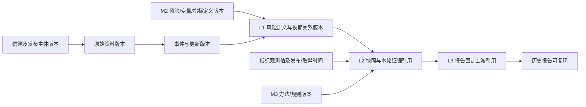

**最小可追溯链**：`reportId/version → riskId → snapshotId → relationId/variableId → Event/Information 或指标记录 → 来源及当时有效规则版本`。缺乏来源或时间的证据，按对应业务的证据资格规则限制使用，不补造确定结论。[B/T]

### 8.5 业务状态与生命周期归属

| 对象／状态 | 主责 | 生命周期要求 |
|---|---|---|
| 信源业务资格 | M1 | 本稿采用最新 ACTIVE／DISABLED；旧 PAUSED 兼容待决；技术就绪单独表达 |
| 变量候选与正式定义 | M2 | 候选接收、消歧、审核；复用／新建／转维护／暂缓／拒绝；正式版本独立生效 |
| 事件及更新 | F02 | 身份稳定，进展追加，重复跳过，纠正留痕，歧义待核对 |
| 风险 tracking_status | F04 | 跟踪启停及长期定义变更由 F04；完整枚举以领域设计及后续契约为准 |
| 当前快照与变化 | F05／F06 分别主责 | 固定观察截止与版本；首次或不可比的变化保留待判断原因 |
| 报告与发布 | F08 | 独立报告身份、修订与撤回历史；完整状态机和冻结细则待决 |
| 计划与运行 | S01 | 正式计划版本、生效、周期、运行与尝试独立；暂停/取消区分请求与确认 |
| 接入结果与异常 | F01 | 与通用执行、下游交付分层；零新增可成功，资格阻断不能技术盲重试 |

### 8.6 数据共享、引用与变更边界

下游通过稳定 ID 与明确版本引用主责事实；共享读取不产生共享修改权。新定义、新指标修订或事件纠正不得无痕替换历史观察依据；是否重做观察／报告另行触发并形成可追踪版本。变量拆分合并须由 M2 确认身份映射与影响，F04 再维护风险关系。派生列表和缓存可重建，不能作为反向覆盖正式结论的依据。

## 9. 横向共性功能与人机协作

### 9.1 配置与规则管理能力

M1 管理来源身份与资格；M2 管理风险源、类型、变量、指标及映射；M3 管理方法、规则及模板。配置维护应保留版本、适用范围、变更者与依据，区分草稿、审核结果和当前有效版本。风险长期关系仍由 F04 维护；等级字典、方法版本选择及回溯重跑规则仍需 M3／L2 评审。

### 9.2 用户角色与授权操作边界

| 操作类别 | 业务责任 | 必须核验 |
|---|---|---|
| 查询与证据查看 | 系统管理员／授权阅读者 | 数据和产品的可见范围 |
| 信源、变量、关系及方法维护 | 系统管理员 | 对象主责、输入版本、变更权限及历史记录 |
| 歧义确认、定义批准、报告发布 | 具备相应操作权限的系统管理员 | 批准具体版本、校验依据与适用条件 |
| 重试、取消、恢复 | 具备相应操作权限的系统管理员 | 业务资格与状态；恢复不扩大业务修改权限 |

2026-10-15 用户确认系统参与角色仅为系统管理员和授权阅读者；表中维护、审核和运行管理是操作职责，不另设角色。具体资源权限、是否双人复核及自动批准条件纳入 §11.4。

### 9.3 自动化处理与人工参与机制

程序可执行资格检查、去重、稳定引用校验及满足授权规则的正式命令。AI 可提供候选与解释；身份歧义、缺失定义、重大口径冲突或需审批的发布进入人工复核。人工处理需看到原始依据、版本、差异及可选处置；批准后仍由主责模块校验和保存。无结果、待补齐、待复核、技术失败应可分别查询。具体自动化批准条件未明确前，不推定全自动生效。

### 9.4 AI 能力的功能定位（适用时）

**图 FA-D16：9.4 AI 能力的功能定位（适用时）**

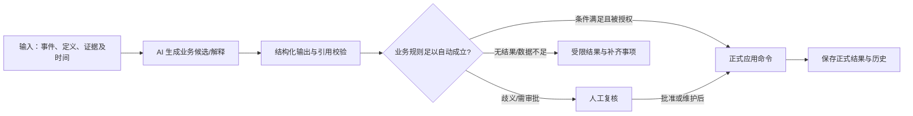

| 业务位置 | AI 可承担的分析 | 正式结果形成条件 |
|---|---|---|
| L0 事件管理 | 事件抽取、归组建议、直接对象变量关联、M 的候选解释 | 稳定事件身份、合法关系、来源定位及业务校验 |
| L1 风险识别 | 完整风险候选、已有风险匹配建议、变量候选 | 同一性、宏观范围、身份复用/建立及纳管权限 |
| L2 风险态势分析 | 变量、来源、应对、损害、快照与变化解释 | 证据时间、口径、已定义作用机制、状态与历史可比性核验 |
| L3 报告编制 | 汇总已确认的风险状态及变化、生成报告文字 | 引用合法、一致性核验、授权发布 |
| M2 候选治理 | 提议新变量、归并线索、语义差异解释 | 程序去重、人工审核及正式变量身份确认 |

**授权边界**：[B] AI 不自行分配正式风险或变量 ID、不直接批准自身生成的结论、不把已有风险状态改写为新风险、不因单条证据直接形成交易决定。复核触发条件、模型供应商、Prompt 与工具权限仍待模块级设计。[D]

### 9.5 审核、追溯与审计功能

**图 FA-D17：9.5 审核、追溯与审计功能**

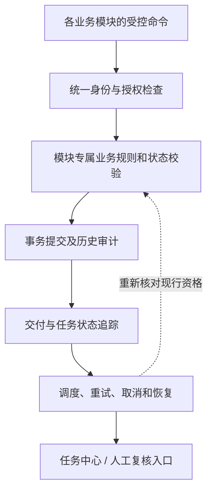

[B/T] 正式业务变更由负责该事实的模块执行；权限、审计、复核待办和运行计划可提供横向共用能力。技术连接失败不能自动撤销信源业务资格，数据缺失不能默认变成零、低风险或风险稳定。已发布报告撤回不删除 L1/L2 的历史结论。

审计应能关联操作者／发起来源、目标业务身份与版本、操作结果、变更前后信息及处理依据；M1 原稿允许的可选备注不意味着可省略系统审计。复核必须绑定当时版本，记录批准、退回或暂缓结果。日志字段、保留期限与权限实现由后续详细设计确认。

### 9.6 异常处理与恢复的功能要求

| 场景 | 防护与恢复要求 | 归属 |
|---|---|---|
| 信源停用或技术接入失效 | 拒绝不合资格的新采集；在途提交复查状态；技术问题独立告知 | M1 定业务资格，L0/运行侧执行检查 |
| 相同资讯重复抓取 | 通过来源/版本/业务键幂等处理，避免重复 Fact | 信息接入、事件管理 |
| 模型返回不存在的变量或风险 ID | 先查询真实身份；无法匹配则候选/待复核 | M2、风险识别 |
| 已有风险匹配歧义 | 保存完整候选及差异，待人工判断 | 风险纳管 |
| 指标口径冲突或部分缺失 | 保留原值及差异，标注限制，按业务规则决定可否继续 | 信息接入、状态分析 |
| 快照写入成功但交付中断 | 保存与交付分离，对账和重试不重建已保存事实 | L2、S01 |
| 采集计划漏执行或未生效 | S01 对账计划版本、预期周期与受理记录；排队、暂停、跳过分别表达 | S01；M1 展示 |
| 采集正常但无新增 | F01 给出成功无新增；持续空响应是否异常按业务预期判断 | F01 解释，S01 告警，M1 展示 |
| 资料/指标已保存但交付失败 | 从原保存回执补交付至 F02/F05，不重复采集或写入 | F01＋S01 |
| 已发布报告被要求撤回 | 执行授权撤回语义，保留报告版本和上游快照 | L3 |
| 旧配置被修改 | 新版用于新运行，历史结果保留原引用和可比性约束 | 各事实拥有者 |

业务侧要求可查询处理状态、保留输入与已完成产物、区分重试和重新观察、恢复时复查资格。实现机制见 [[tools/RiskHot/aihot/归档/旧版系统架构设计/00. 系统总体架构#4. 任务执行、正式写入与一致性|系统总体架构第4～6章]]。

## 10. 功能范围、需求映射与演进规划

### 10.1 功能需求覆盖矩阵

| 来源／需求依据 | 功能范围 | 主责模块 | 验收建议 | 追踪状态 |
|---|---|---|---|---|
| SRC-L0 §1～4 | 原始资料、事件、更新、M、对象变量关系 | F01、F02 | SC-01、SC-02 | 按领域章节映射；正式需求编号对账待完成 |
| SRC-L1 §1～4 | 风险候选、同一性、身份、长期关系 | F03、F04 | SC-03、SC-04 | 按领域章节映射；不能视为全量 BR／FR 覆盖 |
| SRC-L2 §1～4 | 证据、当前四维、比较与变化 | F05、F06 | SC-05、SC-06 | 详细判断方法与评测待确认 |
| SRC-L3 §1～5 | 查询、时间线、报告与发布 | F07、F08 | SC-07、SC-08 | 发布状态机与冻结规则待定 |
| SRC-M1 M1-F01～F11 | 信源治理与追溯 | M1 | SC-01、SC-09；原稿建议 AC-M1-01～15 | 保留已有功能编号及优先级建议 |
| SRC-M2 M2-F01～F20 | 定义、候选、指标映射与版本 | M2 | SC-04、SC-05、SC-09；原稿建议 AC-M2-01～27 | 保留已有功能编号及优先级建议 |
| 现有功能总览；SRC-L0／L2／L3 方法需要 | 判断方法和模板治理 | M3 | SC-05、SC-08 | 仅架构分解；独立功能设计未定 |
| SRC-S01 §2～8；SRC-F01 §1.2；SRC-T | 任务、计划、执行、监测与恢复 | S01；F01/M1 按业务和页面协作 | SC-10、SC-11；AC-S01-01～28 | S01 编号已登记；状态映射、接口及页面细则待评审 |
| 各层业务约束；SRC-T 技术提案 | 授权及领域事实约束 | 各业务主责＋既有技术能力 | SC-09 | 权限不转交 S01 作第二裁决，具体技术契约待定 |

附录 B 逐项连接 §5.4 的65项功能追踪条目、来源、范围及场景（原58项加 S01 的7组二级功能；其20项末级功能由 SRC-S01 单独追踪）。该矩阵只说明本稿已纳入功能的追踪完整性，不宣称覆盖全部正式业务需求，也不证明实现或验收通过。

### 10.2 功能优先级与版本范围

| 范围 | 优先级口径 | 版本状态 |
|---|---|---|
| F01～F08 核心闭环 | 首版核心链路；模块内顺序随依赖评审 | 设计范围明确，具体排期未批准 |
| M1／M2 功能 | 沿用模块稿 P0／P1 建议，逐项见附录 B | 建议优先级不等于已承诺交付时间 |
| M3 风险分析支撑 | 主链路依赖的方法治理需要先明确 | 详细规则与版本范围待评审 |
| M3 事件方法与报告模板 | 保留候选支撑关系 | 范围未定，不计入已批准交付承诺 |
| S01 公共运行能力 | 优先形成 F01 采集计划/执行/监测/恢复闭环；详见 SRC-S01 P0/P1 | 七组二级功能已登记，实施及验收未完成 |
| 共用授权与技术安全 | 业务闭环必要约束，与 S01 受控集成 | 具体实现按技术架构及模块契约落地 |

### 10.3 本期实现范围

本期目标是首版宏观风险闭环：接入证据、形成事件、识别并纳管风险、完成当前与历史观察、提供三类目录与日周月报告，并具备必要的定义治理和运行保障。这里描述目标范围，不报告实现进度；代码、联调和验收证据需在后续交付中补齐。排期锁定前应解决影响闭环的身份、指标归属、方法选择和发布状态等关键待决项。

### 10.4 后续扩展功能

后续候选方向包括更广的信源与指标覆盖、更丰富的方法和报告模板、更多经评审的输出渠道。M3 事件／报告支撑及其他候选范围须先确认使用场景、主责与验收条件。微观独立风险纳管和交易执行属于范围变更，不能借“扩展”默认纳入。

### 10.5 关键功能验收场景

以下11个场景为架构验收建议，全部尚未执行。M1／M2 及 S01 的详细 AC 条件继续以各自模块文档为准，S01 的28个场景见 SRC-S01 §8。

| 场景编号 | 参与模块 | 输入／操作 | 预期结果 | 执行状态 |
|---|---|---|---|---|
| SC-01 | M1、M2、F01 | 停用、技术失败与在途提交分别处理 | 不合资格新输入被阻断，历史引用保留，技术失败不自动停用 | 未执行（建议） |
| SC-02 | F01、F02 | 同一内容重复、仅新增来源、实质进展、纠正 | 不重复建事件；实质进展与来源增加分开；纠正保留旧证据 | 未执行（建议） |
| SC-03 | F02、F03、F04 | 无风险、多候选、已有身份、全新风险、身份歧义 | 无风险有记录；已有身份复用；新建通过准入；歧义待复核 | 未执行（建议） |
| SC-04 | F03、M2、F04 | 识别引用不存在变量、同义变量或待审候选 | 不伪造正式变量 ID；确认变量与正式风险纳管分别校验 | 未执行（建议） |
| SC-05 | M2、F01、F05、M3 | 指标冲突、缺失、口径或方法版本变化 | 记录证据版本及缺口；缺值不作零；按适用规则形成受限判断或待补齐 | 未执行（建议） |
| SC-06 | F05、F06 | 首次、不可比历史、方向减弱 | 首次／不可比不误报维持；减弱不自动确认减弱节点 | 未执行（建议） |
| SC-07 | F04、F05、F06、F07 | 最新、最严重、全部目录及无快照风险 | 按有效时间和可比严重度展示；无快照风险仍可查且不默认低风险 | 未执行（建议） |
| SC-08 | F05、F06、F07、F08、M3 | 固定截止编制、上游后续修订、授权撤回 | 报告固定引用可回溯；发布后不被上游无痕改写；撤回保留上游事实 | 未执行（建议） |
| SC-09 | M1、M2、F04、F05、F06、F08 | 无权限变更、旧配置修改、结果已保存而交付失败 | 拒绝越权；历史版本保留；恢复不重复创建事实且重新核对资格 | 未执行（建议） |
| SC-10 | S01、F01、M1 | 修改计划、同步失败/漏执行、正常零新增、查看历史 | 正式计划仅在 S01 维护；F01 汇聚运行与业务结果，M1 展示；状态分层且零新增不判失败 | 未执行（建议） |
| SC-11 | S01、F01、M1、F02、F05 | 技术重试、在途停用、保存后交付失败、取消与提交并发 | F01 复核资格并裁决提交；S01 幂等恢复/只补交付；M1 不改变资格或执行真值 | 未执行（建议） |

### 10.6 功能架构演进方向

先审定业务边界与主责，再补齐各模块用例和功能契约，最后形成技术承载与验收基线。新增功能优先复用现有定义与证据链；改变模块边界、对象所有权或状态语义时，必须同步依赖矩阵、追踪矩阵、流程、引用与待决项。演进步骤和交付物见 §11.6。

## 11. 架构约束、风险与评审

### 11.1 关键设计约束与假设

| 类型 | 约束／假设 | 验证或约束位置 |
|---|---|---|
| 范围约束 | 首版宏观经济金融风险，不包含自动交易 | §2.2、§2.5；范围变更评审 |
| 事实约束 | 事件金融意义、跟踪状态、当前程度和历史方向相互独立 | 第5、7、8章；SC-02、SC-06 |
| 证据约束 | 时间、来源、版本及语义适配可追溯 | CT-01～CT-07；SC-05、SC-08 |
| 能力假设 | 来源和模型可能不可用，允许无结果或受限判断 | §9.6；SC-01、SC-05、SC-09 |
| 技术假设 | 已有组件与持久执行路线是候选技术基线 | SRC-T；不得据此推定代码或迁移已完成 |
| 状态假设 | 自动化审批、方法门槛、发布状态机尚未全部定稿 | §11.4；详细设计前核实 |

### 11.2 跨模块职责冲突及解决方案

已形成的功能取舍包括：M1 统一来源资格、M2 统一共享定义、F01 接入实际值、F04 维护具体风险长期关系、F05／F06 分开当前与变化、F07／F08 只读引用上游判断。出现跨模块修改需求时，先交由事实拥有者处理；对旧领域、UI 或技术文档的冲突保留 D-ARCH 编号，通过主责文档评审和兼容迁移解决，不以本稿静默覆盖。

### 11.3 关键架构决策

| 决策标识 | 决定与理由 | 状态／影响 |
|---|---|---|
| FA-DEC-01 | 四阶段、八核心模块、三支撑中心；区分业务处理和定义治理 | 沿用现有功能约定；不决定服务数量 |
| FA-DEC-02 | 定义、实际值、当前分析与产品引用分开主责 | 沿用功能约定；技术写入权仍需 D-ARCH-04 对齐 |
| FA-DEC-03 | 风险身份稳定，优先匹配复用；全局变量复用而风险关系动态建立 | 继承领域基线；身份歧义进入复核 |
| FA-DEC-04 | 四维快照与变化结果分离；首版不另建 RiskEvolution | 继承 L2 基线；首次和不可比必须可表达 |
| FA-DEC-05 | 报告持久化、版本化并固定上游引用；查询层确定性组合 | 继承 L3 原则；冻结和发布细节待定 |
| FA-DEC-06 | AI 提建议，主责模块在授权和校验后形成正式事实 | 继承业务基线；自动批准条件待细化 |
| FA-DEC-07 | S01 为公共运行系统支撑模块；S01 管执行，F01 管接入及监测汇聚，M1 提供抓取任务入口 | 本次模块编号与职责登记；不增加业务中心，不转移领域事实主责 |

FA-DEC 为本稿导航标识，不取代正式 ADR 或新增批准记录。

### 11.4 待确认问题与风险

以下保留合并前文档记录的差异与待决项，后续以对应主责文档的评审结论更新，**不以本稿修改源领域文档，也不推定已有代码已完成迁移**。

| 编号 | 来源差异／待决项 | 当前能够确认的内容 | 需在何处决定 |
|---|---|---|---|
| **D-ARCH-01** | **M1 启停状态**：最新 M1 文件采用 `ACTIVE / DISABLED` 两态；L0 领域设计及旧 UI 曾采用 `ACTIVE / PAUSED / DISABLED` | 两者都要求停用阻断新采集、保留历史、技术就绪独立；正式状态兼容策略尚需统一 | M1 规则、API 契约、存量数据迁移 |
| **D-ARCH-02** | **M1 金融属性**：最新 M1 文件列 `QUANTITY / PRICE / FLOW`，L0 领域设计还列 `RISK_APPETITE / ALLOCATION` | 枚举集合发生变化，需统一筛选、字段校验及旧数据 | M1 业务确认与数据迁移 |
| **D-ARCH-03** | **信源目录形态**：最新 M1 采用单一在册信源目录，旧 UI 曾分参考清单和已登记信源 | 采用最新 M1 单一目录作为本稿功能约定；旧原型及迁移需后续检查 | M1 UI 与旧文档修订 |
| **D-ARCH-04** | **指标实际观测数据业务归属**：L2 原领域文档写明接入归属待讨论，最新功能设计把实际值接入归 L0；现有技术 `observations` 拥有观测值 | 业务职责已在最新功能设计形成方案；写库主责、读取端口及迁移路径仍待技术确认 | M2/L0/技术模块与数据设计 |
| **D-ARCH-05** | **变量—指标映射**：L2 原文件留待讨论，最新 M2 功能稿提出多对多与逐关系解释 | 定义和运行值分开、指标可多对多提供依据；具体配置实体和运行时匹配待定 | M2 与 L2 契约设计 |
| **D-ARCH-06** | **长期变量作用机制命名**：L1 历史字段 `variable_impact_on_risk`、`risk_source_code`，L2 使用 `impact_mechanism`、`risk_source_id` | 业务语义相近，正式 DTO 与历史适配不可直接推断 | L1/L2 字段与兼容规则 |
| **D-ARCH-07** | **风险程度、阶段与减弱节点**：原则已有，细化算法、确认门槛及基准选择未定 | 先允许明确缺口与待判断，不设假定公式 | M3/L2 业务规则及评测 |
| **D-ARCH-08** | **L3 报告发布状态**：报告版本与发布撤回语义已定义，完整状态机及冻结策略未定 | 报告持久身份独立；历史快照不可无痕替换 | L3 发布规则与数据设计 |
| **D-ARCH-09** | **模型/接口/调度细节**：总体架构已有版本化 API、Outbox/Inbox 与持久执行路线；模块事件、业务幂等键、Prompt、Schema、运行计划仍需定版 | 本稿确认业务责任与必需语义；已有技术方案不等于各模块契约已确认 | 系统总体架构、M3、各模块契约 |
| **D-ARCH-10** | **M2 风险源推荐变量**：较旧配置资料保留推荐清单要求，最新 L1 §3.4 明确无需预设 | 以最新 L1 变量动态选择与 M2 全局治理为本稿依据；旧需求和 UI 需改版对账 | M2 需求追踪与旧原型 |
| **D-ARCH-11** | **S01 与 F01/M1 详细契约同步**：模块及编号已登记，M1 独立稿尚未完整展开抓取任务视图，运行状态/计数/恢复接口仍为设计建议 | S01 管计划/执行，F01 管接入与监测汇聚，M1 管展示；编号不再待决 | SRC-S01 §9；F01/M1 功能设计与接口、页面后续评审 |

**M3 支撑范围待细化 [D]**：原简版总览仅画出 M3→L2，长文进一步提出 M3→L0 事件评级及 M3→L3 报告方法与模板。本稿保留这些关系并标注待定，具体治理对象、调用边界与版本责任由 M3 功能设计确认，不因本次合并视为已批准。

以下补齐决策责任与收敛节点；责任为建议的角色／模块，不虚构人员或日期。

| 待决编号 | 建议主责 | 收敛节点 | 未解决时的处理 |
|---|---|---|---|
| D-ARCH-01～03 | M1 业务负责人＋UI／数据设计 | M1 规则和迁移评审前 | 本稿采用最新 M1，保留旧值差异；不宣称完成迁移 |
| D-ARCH-04～05 | F01／M2／F05 功能负责人＋技术架构 | 指标契约与写入权定版前 | 实际值业务归 F01；具体存储与匹配适配不得自行假定 |
| D-ARCH-06 | F04／F05 契约负责人 | L1→L2 联调前 | 保留双重历史名称，不假定等价迁移 |
| D-ARCH-07 | M3／F05／F06 业务规则负责人 | 分析规则和评测定版前 | 允许待判断，不补造评级公式或阈值 |
| D-ARCH-08 | F08 业务负责人＋数据设计 | 发布用例实现与验收前 | 保留报告历史，完整状态与冻结策略须确认 |
| D-ARCH-09 | 技术架构＋S01及各业务模块负责人 | API／任务契约定版前 | 仅沿用业务语义，禁止假定接口或调度已完成 |
| D-ARCH-10 | M2 需求与 UI 负责人 | 旧需求／原型改版对账时 | 以最新 L1 动态选择为本稿依据，保留历史差异 |
| D-ARCH-11 | S01／F01／M1 功能与契约负责人 | 采集任务契约及页面设计同步前 | S01 编号与主责已登记；未定状态、计数及操作细则继续按模块待决项收敛 |
| M3 支撑范围（未编号） | M3＋F02／F05／F08 功能负责人 | M3 功能设计评审前 | 事件和报告支撑继续标为待定，不计作已批准功能 |
| 两类角色的细化权限与自动化批准条件（新增待决） | 业务权限负责人＋各模块负责人 | 授权和审核用例定版前 | 仅执行已明确授权的变更；不推定全自动批准 |

### 11.5 功能架构评审核对表

| 检查项 | 通过条件 |
|---|---|
| 系统边界 | 只在首版宏观风险范围内运转；不隐含交易执行或独立微观风险纳管 |
| 模块归属 | F01～F08、M1～M3、S01 分组明确；S01 调度/恢复、F01 接入/监测、M1 展示入口无重复主责 |
| 领域事实 | 每种正式身份、状态、版本有明确唯一业务写入主责 |
| 事件与风险关系 | Event 与 MonitoredRisk 可多对多关联；事件 Target 与风险观察对象分开 |
| 变量定义与分析 | M2 全局变量统一治理，L1 按风险动态选择，L2 分析当前状态；不存在固定 Target–Variable 归属 |
| 证据与实际值 | 指标定义/实际值分离，数据时点和来源可追溯，旧新归属差异有迁移计划 |
| 状态 | M、tracking_status、risk_level、trend、报告发布状态相互独立 |
| 过程可靠性 | 重复处理有幂等路径，失败和未知有查询/恢复入口，正式结果保存后交付 |
| 历史与审计 | 从报告能回溯快照、风险、变量、事件/指标、原始来源及版本 |
| 未决与批准 | D-ARCH-01～11 及 M3 支撑范围均有负责模块、验证方案与明确审批记录 |

本次结构检查只证明章节、模块字段、追踪引用与保留内容的完整性。上述业务检查项须由相应评审确认，不能用文档校验代替业务批准或功能测试。

### 11.6 后续详细设计与交付计划

| 文档层次 | 主要职责 | 与本总览的关系 |
|---|---|---|
| L0～L3 业务架构与领域设计 | 定义业务语义、规则、对象与业务交接 | 本文提炼其功能职责和跨模块约束，不重复展开全部规则 |
| 系统功能架构总览（本文） | 四阶段、八核心模块、三业务中心及 S01 系统支撑的功能全貌、协作、数据主责与边界 | 作为功能架构统一入口 |
| 各模块功能设计 | 用例、输入输出、操作规则、功能清单与验收条件 | 沿本文边界逐项展开；F01、M1、M2、S01 已有设计稿，F01/M1 任务页面契约待同步，M3 既有待决范围另行收敛 |
| 系统总体架构及技术专题 | 应用组件、接口、存储、执行、部署、安全与恢复机制 | 将功能职责映射到技术承载，统一维护执行、恢复与部署方案 |
| UI 与场景验证 | 页面、交互、角色操作及端到端验收 | 按模块功能与交接约束落实和验证 |

**图 FA-D18：11.6 后续详细设计与交付计划**

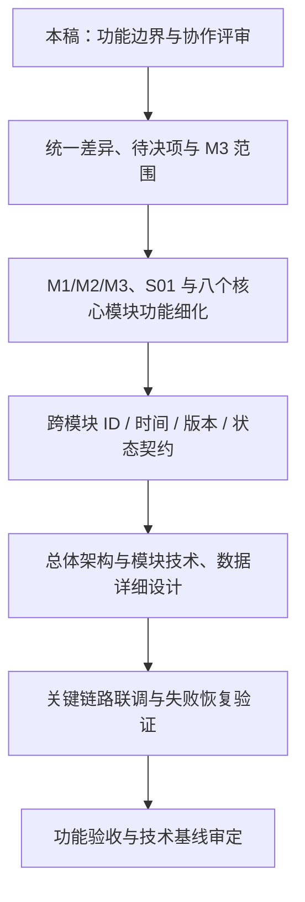

建议优先完成 **M1—L0 信源资格与接入检查**、**M2—L0/L2 指标定义与实际数据**、**L0—L1 事件与风险识别**、**L1—L2 定义及变量引用**、**L2—L3 当前状态与报告引用** 五组契约，再展开 API、数据库和任务编排的详细设计。所有细节都应能追溯到本稿的数据所有权和领域语义。

| 阶段 | 交付物 | 完成依据 |
|---|---|---|
| 功能评审 | 本稿、待决清单、M3 范围及责任确认 | 对照 §11.5 留存结论 |
| 模块细化 | 八核心模块及 M1／M2／M3 用例、状态、权限、功能验收 | 功能逐项对应来源和可验证条件 |
| 契约与技术设计 | 五组优先契约、技术映射、兼容迁移与执行恢复方案 | 身份／版本／状态一致，写入主责无冲突 |
| 联调与验收 | SC 场景及模块 AC 的执行证据、缺陷和回归记录 | 明确已通过、未执行或待解决，不以设计稿代替结果 |

## 附录

### 附录 A：功能模块编号与命名规范

F01～F08 为八个核心功能模块，M1～M3 为三个业务支撑中心；Sxx 为系统支撑模块编号，本版登记 **S01 公共运行能力**。L0～L3 仍表示业务阶段，不与模块编号混用。UI 文档的局部页面 S01 等编号须带所属模块/页面上下文，不作为全局模块身份。

S01-SF01～S01-SF07 为七组二级功能，末级采用 `S01-SFxx.xx`；规则采用 `BR-S01-xx`，验收采用 `AC-S01-xx`，待决采用 `D-S01-xx`。公共运行文档的临时 OPS 前缀统一映射为 S01，原功能/规则/验收序号保持不变；历史日志中的 OPS 保留为当时记录。

Fxx-SFxx、M3-SFxx 为架构分解编号，M1-Fxx／M2-Fxx 沿用现有功能稿；SC、CT、FA-D、SRC、FA-DEC 分别用于场景、契约、图、来源和决策追踪。模块编号登记不等于功能细则、正式需求或实现已批准；名称变化保持编号稳定，合并、拆分和废弃须记录映射。

### 附录 B：功能清单与需求追踪矩阵

下表逐项对应 §5.4。M1／M2 优先级来自模块设计建议；其他功能范围来自当前架构分解。场景是架构级验证入口，还需细化为模块用例；核心模块尚未逐条对账全部正式 BR／FR。

| 功能编号 | 主责模块 | 设计依据 | 优先级／范围 | 验收场景 |
|---|---|---|---|---|
| F01-SF01 | F01 | SRC-L0 §1.2；SRC-M2 指标定义与实际值分离；最新功能约定 [F] | 首版核心链路（排期待确认） | SC-01、SC-02、SC-05 |
| F01-SF02 | F01 | SRC-L0 §1.2；SRC-M2 指标定义与实际值分离；最新功能约定 [F] | 首版核心链路（排期待确认） | SC-01、SC-02、SC-05 |
| F01-SF03 | F01 | SRC-L0 §1.2；SRC-M2 指标定义与实际值分离；最新功能约定 [F] | 首版核心链路（排期待确认） | SC-01、SC-02、SC-05 |
| F02-SF01 | F02 | SRC-L0 §1～4；SRC-M2 候选接收 | 首版核心链路（排期待确认） | SC-02、SC-03 |
| F02-SF02 | F02 | SRC-L0 §1～4；SRC-M2 候选接收 | 首版核心链路（排期待确认） | SC-02、SC-03 |
| F02-SF03 | F02 | SRC-L0 §1～4；SRC-M2 候选接收 | 首版核心链路（排期待确认） | SC-02、SC-03 |
| F03-SF01 | F03 | SRC-L1 §1～3、§4.6；SRC-M2 候选治理 | 首版核心链路（排期待确认） | SC-03、SC-04 |
| F03-SF02 | F03 | SRC-L1 §1～3、§4.6；SRC-M2 候选治理 | 首版核心链路（排期待确认） | SC-03、SC-04 |
| F03-SF03 | F03 | SRC-L1 §1～3、§4.6；SRC-M2 候选治理 | 首版核心链路（排期待确认） | SC-03、SC-04 |
| F04-SF01 | F04 | SRC-L1 §1～4；SRC-L2 观察定义反馈 | 首版核心链路（排期待确认） | SC-03、SC-04、SC-09 |
| F04-SF02 | F04 | SRC-L1 §1～4；SRC-L2 观察定义反馈 | 首版核心链路（排期待确认） | SC-03、SC-04、SC-09 |
| F04-SF03 | F04 | SRC-L1 §1～4；SRC-L2 观察定义反馈 | 首版核心链路（排期待确认） | SC-03、SC-04、SC-09 |
| F05-SF01 | F05 | SRC-L2 §1～4；SRC-M2 观测缺口反馈 | 首版核心链路（排期待确认） | SC-05、SC-06、SC-09 |
| F05-SF02 | F05 | SRC-L2 §1～4；SRC-M2 观测缺口反馈 | 首版核心链路（排期待确认） | SC-05、SC-06、SC-09 |
| F05-SF03 | F05 | SRC-L2 §1～4；SRC-M2 观测缺口反馈 | 首版核心链路（排期待确认） | SC-05、SC-06、SC-09 |
| F06-SF01 | F06 | SRC-L2 §2～4 | 首版核心链路（排期待确认） | SC-06、SC-07、SC-09 |
| F06-SF02 | F06 | SRC-L2 §2～4 | 首版核心链路（排期待确认） | SC-06、SC-07、SC-09 |
| F06-SF03 | F06 | SRC-L2 §2～4 | 首版核心链路（排期待确认） | SC-06、SC-07、SC-09 |
| F07-SF01 | F07 | SRC-L3 §1～5 | 首版核心链路（排期待确认） | SC-07、SC-08 |
| F07-SF02 | F07 | SRC-L3 §1～5 | 首版核心链路（排期待确认） | SC-07、SC-08 |
| F07-SF03 | F07 | SRC-L3 §1～5 | 首版核心链路（排期待确认） | SC-07、SC-08 |
| F08-SF01 | F08 | SRC-L3 §1～5；M3 报告模板范围 [D] | 首版核心链路（排期待确认） | SC-08、SC-09 |
| F08-SF02 | F08 | SRC-L3 §1～5；M3 报告模板范围 [D] | 首版核心链路（排期待确认） | SC-08、SC-09 |
| F08-SF03 | F08 | SRC-L3 §1～5；M3 报告模板范围 [D] | 首版核心链路（排期待确认） | SC-08、SC-09 |
| M1-F01 | M1 | SRC-M1 §2.2 | P0（原稿建议） | SC-01、SC-09 |
| M1-F02 | M1 | SRC-M1 §2.2 | P0（原稿建议） | SC-01、SC-09 |
| M1-F03 | M1 | SRC-M1 §2.2 | P0（原稿建议） | SC-01、SC-09 |
| M1-F04 | M1 | SRC-M1 §2.2 | P0（原稿建议） | SC-01、SC-09 |
| M1-F05 | M1 | SRC-M1 §2.2 | P0（原稿建议） | SC-01、SC-09 |
| M1-F06 | M1 | SRC-M1 §2.2 | P0（原稿建议） | SC-01、SC-09 |
| M1-F07 | M1 | SRC-M1 §2.2 | P0（原稿建议） | SC-01、SC-09 |
| M1-F08 | M1 | SRC-M1 §2.2 | P0（原稿建议） | SC-01、SC-09 |
| M1-F09 | M1 | SRC-M1 §2.2 | P1（原稿建议） | SC-01、SC-09 |
| M1-F10 | M1 | SRC-M1 §2.2 | P1（原稿建议） | SC-01、SC-09 |
| M1-F11 | M1 | SRC-M1 §2.2 | P1（原稿建议） | SC-01、SC-09 |
| M2-F01 | M2 | SRC-M2 §2.2 | P0（原稿建议） | SC-01、SC-04、SC-05、SC-09 |
| M2-F02 | M2 | SRC-M2 §2.2 | P0（原稿建议） | SC-01、SC-04、SC-05、SC-09 |
| M2-F03 | M2 | SRC-M2 §2.2 | P0（后台预置，无用户页面） | SC-01、SC-04、SC-05、SC-09 |
| M2-F04 | M2 | SRC-M2 §2.2 | P0（原稿建议） | SC-01、SC-04、SC-05、SC-09 |
| M2-F05 | M2 | SRC-M2 §2.2 | P0（原稿建议） | SC-01、SC-04、SC-05、SC-09 |
| M2-F06 | M2 | SRC-M2 §2.2 | P1（原稿建议） | SC-01、SC-04、SC-05、SC-09 |
| M2-F07 | M2 | SRC-M2 §2.2 | P0（原稿建议） | SC-01、SC-04、SC-05、SC-09 |
| M2-F08 | M2 | SRC-M2 §2.2 | P0（原稿建议） | SC-01、SC-04、SC-05、SC-09 |
| M2-F09 | M2 | SRC-M2 §2.2 | P0（原稿建议） | SC-01、SC-04、SC-05、SC-09 |
| M2-F10 | M2 | SRC-M2 §2.2 | P1（原稿建议） | SC-01、SC-04、SC-05、SC-09 |
| M2-F11 | M2 | SRC-M2 §2.2 | P0（原稿建议） | SC-01、SC-04、SC-05、SC-09 |
| M2-F12 | M2 | SRC-M2 §2.2 | P0（原稿建议） | SC-01、SC-04、SC-05、SC-09 |
| M2-F13 | M2 | SRC-M2 §2.2 | P0（原稿建议） | SC-01、SC-04、SC-05、SC-09 |
| M2-F14 | M2 | SRC-M2 §2.2 | P0（原稿建议） | SC-01、SC-04、SC-05、SC-09 |
| M2-F15 | M2 | SRC-M2 §2.2 | P0（原稿建议） | SC-01、SC-04、SC-05、SC-09 |
| M2-F16 | M2 | SRC-M2 §2.2 | P0（原稿建议） | SC-01、SC-04、SC-05、SC-09 |
| M2-F17 | M2 | SRC-M2 §2.2 | P0（原稿建议） | SC-01、SC-04、SC-05、SC-09 |
| M2-F18 | M2 | SRC-M2 §2.2 | 后续版本，不纳入首版（2026-10-14 用户调整） | 后续设计参考：SC-01、SC-04、SC-05、SC-09 |
| M2-F19 | M2 | SRC-M2 §2.2 | P0（原稿建议） | SC-01、SC-04、SC-05、SC-09 |
| M2-F20 | M2 | SRC-M2 §2.2 | P1（原稿建议） | SC-01、SC-04、SC-05、SC-09 |
| M3-SF01 | M3 | 现有功能总览 [F]；SRC-L0／SRC-L2／SRC-L3 方法需求；第11.4节 [D] | 待 M3 评审 | SC-05、SC-08 |
| M3-SF02 | M3 | 现有功能总览 [F]；SRC-L0／SRC-L2／SRC-L3 方法需求；第11.4节 [D] | 待 M3 评审 | SC-05、SC-08 |
| M3-SF03 | M3 | 现有功能总览 [F]；SRC-L0／SRC-L2／SRC-L3 方法需求；第11.4节 [D] | 待 M3 评审 | SC-05、SC-08 |
| S01-SF01 | S01 | SRC-S01 §4.1；SRC-F01 §1.2；SRC-T | P0/P1 详见模块末级清单（建议） | SC-10、SC-11；AC-S01-01～28 中对应场景 |
| S01-SF02 | S01 | SRC-S01 §4.2；SRC-F01 §1.2；SRC-T | P0/P1 详见模块末级清单（建议） | SC-10、SC-11；AC-S01-01～28 中对应场景 |
| S01-SF03 | S01 | SRC-S01 §4.3；SRC-F01 §1.2；SRC-T | P0/P1 详见模块末级清单（建议） | SC-10、SC-11；AC-S01-01～28 中对应场景 |
| S01-SF04 | S01 | SRC-S01 §4.4；SRC-F01 §1.2；SRC-T | P0/P1 详见模块末级清单（建议） | SC-10、SC-11；AC-S01-01～28 中对应场景 |
| S01-SF05 | S01 | SRC-S01 §4.5；SRC-F01 §1.2；SRC-T | P0/P1 详见模块末级清单（建议） | SC-10、SC-11；AC-S01-01～28 中对应场景 |
| S01-SF06 | S01 | SRC-S01 §4.6；SRC-F01 §1.2；SRC-T | P0/P1 详见模块末级清单（建议） | SC-10、SC-11；AC-S01-01～28 中对应场景 |
| S01-SF07 | S01 | SRC-S01 §4.7；SRC-F01 §1.2；SRC-T | P0/P1 详见模块末级清单（建议） | SC-10、SC-11；AC-S01-01～28 中对应场景 |

### 附录 C：主要架构图索引

| 图编号 | 所在章节 |
|---|---|
| FA-D01 | [[tools/RiskHot/docs/system-design/03-系统功能架构/系统功能架构总览#2.4 系统上下文图（System Context）\|2.4 系统上下文图（System Context）]] |
| FA-D02 | [[tools/RiskHot/docs/system-design/03-系统功能架构/系统功能架构总览#4.1 系统功能架构全景图\|4.1 系统功能架构全景图]] |
| FA-D03 | [[tools/RiskHot/docs/system-design/03-系统功能架构/系统功能架构总览#4.2 功能分层与功能域划分\|4.2 功能分层与功能域划分]] |
| FA-D04 | [[tools/RiskHot/docs/system-design/03-系统功能架构/系统功能架构总览#4.3 功能分解结构（Functional Decomposition）\|4.3 功能分解结构（Functional Decomposition）]] |
| FA-D05 | [[tools/RiskHot/docs/system-design/03-系统功能架构/系统功能架构总览#4.5 横向公共与支撑功能\|4.5 横向公共与支撑功能]] |
| FA-D06 | [[tools/RiskHot/docs/system-design/03-系统功能架构/系统功能架构总览#6.2 系统端到端功能流程\|6.2 系统端到端功能流程]] |
| FA-D07 | [[tools/RiskHot/docs/system-design/03-系统功能架构/系统功能架构总览#事件归组、增量与纠正\|事件归组、增量与纠正]] |
| FA-D08 | [[tools/RiskHot/docs/system-design/03-系统功能架构/系统功能架构总览#风险同一性、纳管与长期关系\|风险同一性、纳管与长期关系]] |
| FA-D09 | [[tools/RiskHot/docs/system-design/03-系统功能架构/系统功能架构总览#状态分析、变化分析与发布\|状态分析、变化分析与发布]] |
| FA-D10 | [[tools/RiskHot/docs/system-design/03-系统功能架构/系统功能架构总览#7.1 模块协作关系总览\|7.1 模块协作关系总览]] |
| FA-D11 | [[tools/RiskHot/docs/system-design/03-系统功能架构/系统功能架构总览#信息、事件与全局变量模型\|信息、事件与全局变量模型]] |
| FA-D12 | [[tools/RiskHot/docs/system-design/03-系统功能架构/系统功能架构总览#风险定义、长期变量关联与事件关联\|风险定义、长期变量关联与事件关联]] |
| FA-D13 | [[tools/RiskHot/docs/system-design/03-系统功能架构/系统功能架构总览#当前快照、变量分析与附属变化结果\|当前快照、变量分析与附属变化结果]] |
| FA-D14 | [[tools/RiskHot/docs/system-design/03-系统功能架构/系统功能架构总览#风险产品和报告模型\|风险产品和报告模型]] |
| FA-D15 | [[tools/RiskHot/docs/system-design/03-系统功能架构/系统功能架构总览#8.4 跨模块数据流转关系\|8.4 跨模块数据流转关系]] |
| FA-D16 | [[tools/RiskHot/docs/system-design/03-系统功能架构/系统功能架构总览#9.4 AI 能力的功能定位（适用时）\|9.4 AI 能力的功能定位（适用时）]] |
| FA-D17 | [[tools/RiskHot/docs/system-design/03-系统功能架构/系统功能架构总览#9.5 审核、追溯与审计功能\|9.5 审核、追溯与审计功能]] |
| FA-D18 | [[tools/RiskHot/docs/system-design/03-系统功能架构/系统功能架构总览#11.6 后续详细设计与交付计划\|11.6 后续详细设计与交付计划]] |

### 附录 D：参考文档及术语表

**业务架构与领域设计（首要依据）**

1. [[tools/RiskHot/docs/system-design/02-业务架构与领域设计/RiskHot_L0_信息处理层_业务架构与领域设计V1.0|RiskHot_L0_信息处理层_业务架构与领域设计V1.0]]：信息处理、事件与观测主体、全局变量关联及上下游交接。
2. [[tools/RiskHot/docs/system-design/02-业务架构与领域设计/RiskHot_L1_风险识别与纳管层_业务架构与领域设计|RiskHot_L1_风险识别与纳管层_业务架构与领域设计]]：风险同一性、全局变量动态选择、正式风险与长期关系。
3. [[tools/RiskHot/docs/system-design/02-业务架构与领域设计/RiskHot_L2_风险态势分析层_业务架构与领域设计V1.0|RiskHot_L2_风险态势分析层_业务架构与领域设计V1.0]]：证据消费、四维快照、变化分析及输入输出。
4. [[tools/RiskHot/docs/system-design/02-业务架构与领域设计/RiskHot_L3 业务架构与领域设计 V1.0|RiskHot_L3 业务架构与领域设计 V1.0]]：风险列表、详情、时间线、报告与发布。

**最新模块约定（辅助依据）**

5. [[tools/RiskHot/docs/system-design/03-系统功能架构/M1 信源管理中心功能设计|M1 信源管理中心功能设计]]：单一在册信源、两态启停、信源数据归属；功能编号为评审建议。
6. [[tools/RiskHot/docs/system-design/03-系统功能架构/M2风险源管理中心功能设计|M2风险源管理中心功能设计]]：风险源与变量治理、指标定义、多对多映射，实际值归 L0；功能编号为评审建议。

- [[tools/RiskHot/docs/system-design/03-系统功能架构/F01 信息接入与标准化模块功能设计 V2.1|F01 信息接入与标准化模块功能设计]]：资格/技术检查、两条业务输出、业务监测汇聚与 M1 抓取任务入口。
- [[tools/RiskHot/docs/system-design/03-系统功能架构/公共运行能力功能设计|S01 公共运行能力功能设计]]：七组二级功能、20项末级功能、任务运行与 F01/M1 边界、28个验收建议场景。

**现有技术提案（供评审，非业务依据）**

7. [[tools/RiskHot/aihot/归档/旧版系统架构设计/00. 系统总体架构|00. 系统总体架构]]：上下文、功能技术映射、运行单元、通信、正式写入、运行恢复及部署演进。
8. [[tools/RiskHot/aihot/归档/旧版系统架构设计/01. 基础与决策|01. 基础与决策]]、[[tools/RiskHot/aihot/归档/旧版系统架构设计/02. 模块与代码组织|02. 模块与代码组织]]、[[tools/RiskHot/aihot/归档/旧版系统架构设计/03. 契约与数据|03. 契约与数据]]、[[tools/RiskHot/aihot/归档/旧版系统架构设计/04. 执行与恢复|04. 执行与恢复]]：技术基线候选、契约及可靠性机制。

术语定义见 §1.4，对象语义见第8章；技术细节进入系统总体架构。重构前后内容对照如下，旧章节定位不再作为现行引用。

| V2.2 内容 | V3.0 位置 |
|---|---|
| 第0～1章：目标、边界、原则 | 第1～3章 |
| 第2章：总体结构与模块 | 第4～5章 |
| 第3章、第5章：主流程及子流程 | 第6章 |
| 第4章：领域对象与所有权 | 第8章 |
| 第6章：协作、契约、版本链 | 第7章、§8.4 |
| 第7～8章：AI、共用能力与异常 | 第9章 |
| 第9～11章：待决、评审与后续设计 | 第11章、附录D |
| 新增模块卡片、功能分解及追踪 | 第5章、第10章、附录A～C |

本次重构保留原稿业务图、边界与 D-ARCH-01～10；不修改源领域文档，不代表代码、原型、数据库或技术部署已完成迁移。原技术附录继续统一维护于系统总体架构。
