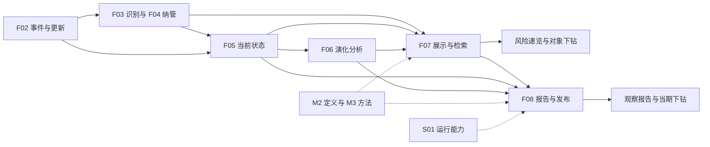
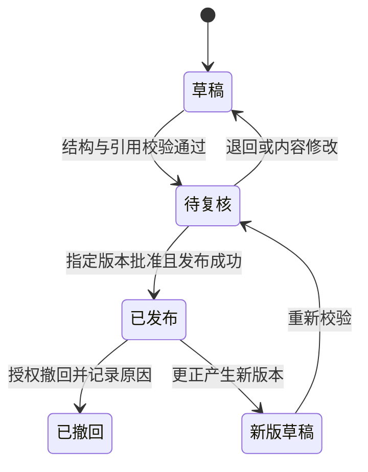
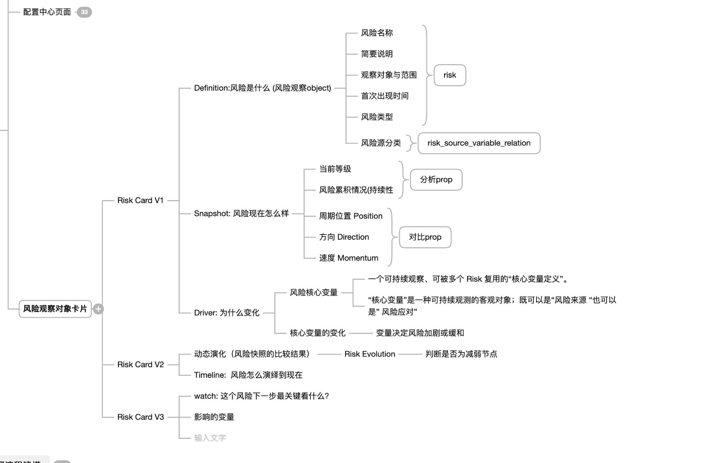
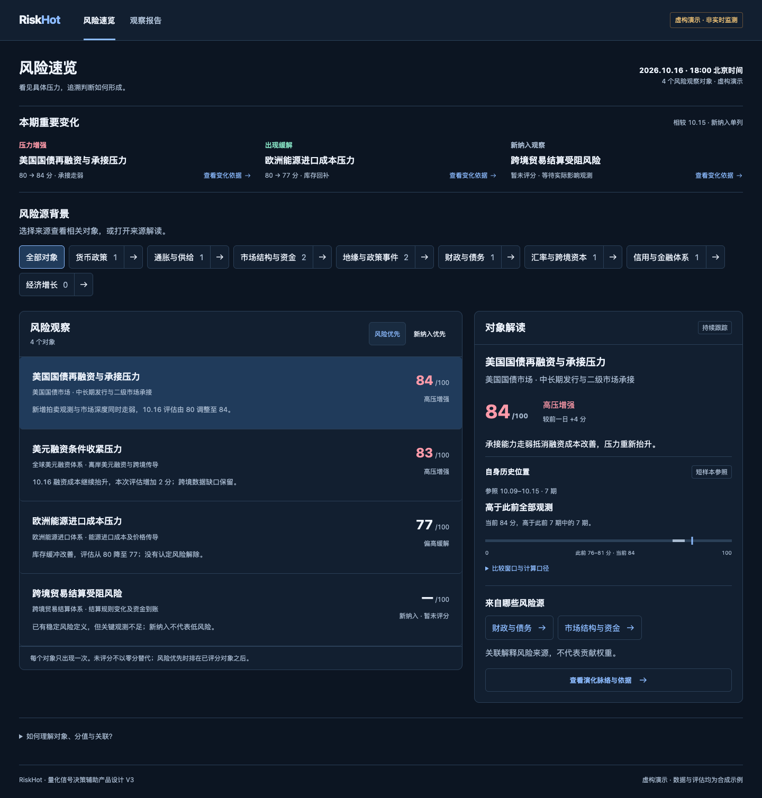

# 风险产品与交付模块功能设计

> **定位**：以《量化信号决策辅助产品设计 V3》和用户提供的风险观察对象卡片结构图为产品依据，细化 F07「风险展示与检索」与 F08「风险报告与发布」。这是一个产品交付域下的两项模块职责，不新增 F09，也不将两个模块合并为已确定的物理服务。
>
> **约束**：阅读端只有「风险速览」「观察报告」两个一级入口，打开即用，无“我的关注”、个人阈值配置或初始化向导。对象详情、来源详情和演化脉络均为入口内的下钻内容。
>
> **依据标记**：[B] 现行领域/功能架构基线；[U] 用户要求及原型表达；[P] 本文新增功能建议；[D] 尚需决策。末级功能编号、优先级及状态机为本稿建议，不代表正式接口、数据库或生产功能已实现。原型中的合成分值与阈值不升级为业务规则。

## 1. 模块定位与职责边界

### 1.1 产品目标

为需要量化信息辅助判断的阅读者，交付可持续跟踪的宏观风险对象及其状态、变化、依据和下一步观察重点。用户无需理解后台分析流程，即可回答：

1. 当前有哪些具体风险，应该先读哪一项？
2. 这个风险是什么，针对谁、观察到什么范围？
3. 当前程度、发展阶段、影响范围和持续条件怎样？
4. 为什么发生变化，哪些变量与事件支持判断，哪些证据构成限制？
5. 它如何演化到现在，下一步什么变化会影响判断？
6. 本期报告当时得出了什么结论，其依据能否还原？

**核心交付单位是稳定风险观察对象，而不是新闻、关键词主题或风险源类别。** 底层资料与事件经识别、身份匹配、纳管形成对象；后续证据归入同一对象，不为每条新闻创建一张新风险卡。[B/U]

### 1.2 模块关系

箭头表示信息依赖，不表示每次请求都重新执行上游分析。F07/F08 引用已有合法业务结果；S01 承担任务运行，不决定风险判断或发布资格。

### 1.3 输入、输出与责任

| 主责 | 本模块消费的输入 | 本模块输出/使用方式 | 不得越界 |
|---|---|---|---|
| F04 | MonitoredRisk、定义版本、观察目标/范围、纳管状态、长期变量与来源关系 | 对象身份、目录、定义区、关联导航 | 不新建或合并风险，不修改纳管状态 |
| F05 | RiskSnapshot、变量分析与证据引用 | 当前程度/阶段/影响范围/持续性、Driver | 不重算等级，不由事件热度评级 |
| F06 | RiskAnalysisResult、比较基准、减弱节点、next_observation | Direction、Evolution、Watch | 不从分差直接推导正式方向或减弱节点 |
| F01/F02 | 被上游引用的资料、观测、事件及其版本 | 证据展开、事件更新记录 | 不重新聚类、不改写原文或事件 |
| M2 | 风险源、变量、指标、类型有效定义 | 分类名称、变量语义与观测口径 | 不自行创建正式变量与分类 |
| F07 | 上述业务结果与查询上下文 | RiskList、RiskPublicationItem、详情/时间线只读视图 | 列表不是持久化排名聚合 |
| F08 | 固定周期与引用集合、模板/方法版本 | RiskReport、栏目、条目、版本与发布记录 | 不覆盖上游快照或无痕修订已发报告 |
| S01/共享授权 | 执行、恢复、操作身份、可见范围 | 任务回执、失败恢复、访问控制 | 技术重试不等于批准发布 |

### 1.4 角色与首版范围

- **授权阅读者**：只读可见对象、来源、证据与已发布报告；产品不要求个人关注或偏好配置。打开即用不等于免授权，身份与权限复用系统能力。
- **系统管理员**：在既有管理侧执行报告编制、复核、发布、修订与撤回等获授权操作；这些操作不增加阅读端第三入口。[B/P]
- **系统任务**：依正式计划准备报告、校验引用、更新查询投影；不以任务成功代替业务发布完成。

首版保留宏观经济、市场、金融体系与宏观主体范围。企业、产业、资产可作为证据或受影响环节，不据本模块独立纳管微观风险。不建设交易执行、持仓建议、热度排行、市场冲击预测或推送订阅。

## 2. 功能架构与清单

### 2.1 分组与编号

沿用总览六组编号：F07-SF01 目录查询、F07-SF02 详情展示、F07-SF03 时间线查询；F08-SF01 报告编制、F08-SF02 内容校验、F08-SF03 发布管理。以下 F07-Fxx、F08-Fxx 为新增末级追踪编号。[P]

P0 表示建议首版核心；P1 表示完成上游口径后扩展，不是已批准排期。

| 编号 | 所属组 | 功能 | 输入 → 输出 | 优先级/依据 |
|---|---|---|---|---|
| F07-F01 | SF01 | 默认速览组装 | 有效对象/结果 → 重要变化、列表、默认解读 | P0 [U/P] |
| F07-F02 | SF01 | 目录与排序 | 对象/等级顺序/时间 → 去重列表及排序说明 | P0 [B/U] |
| F07-F03 | SF01 | 重要变化选取 | 已确认变化/新纳入 → 有原因的变化条目 | P0 [U/P] |
| F07-F04 | SF01 | 风险源关联筛选 | 来源/关系版本 → 相关对象与计数 | P0 [U/P] |
| F07-F05 | SF01 | 完整目录与检索 | 名称/目标/状态 → 授权范围结果 | P1 [B/P] |
| F07-F06 | SF02 | Definition 展示 | 对象定义/版本 → 名称、目标、范围与类型 | P0 [B/U] |
| F07-F07 | SF02 | Snapshot 展示 | 当前快照/有效性 → 状态卡与时间说明 | P0 [B/U] |
| F07-F08 | SF02 | Driver 与证据 | 变量分析/证据 → 来源、应对及变化解释 | P0 [B/U] |
| F07-F09 | SF02 | 历史位置展示 | 可比快照/统计结果 → 窗口、样本与位置 | P0，分值依赖待定 [U/P/D] |
| F07-F10 | SF02 | 对象/来源双向关联 | 同时点关系 → 来源详情与同源对象 | P0 [U/P] |
| F07-F11 | SF02 | Watch 与影响说明 | 后续观察/当前影响 → 条件与待观察变量 | P0 [B/U] |
| F07-F12 | SF02 | 阅读上下文保持 | 选择、排序、筛选、报告版本 → 连续下钻与返回 | P0 [U/P] |
| F07-F13 | SF03 | 对象演化脉络 | 纳管/事件/快照/变化 → 分类时间线 | P0 [B/U] |
| F07-F14 | SF03 | 比较与节点解释 | 两快照及分析 → 方向、持续性与节点依据 | P0；Momentum P1 [B/U/D] |
| F08-F01 | SF01 | 周期与数据准备 | 报告类型/周期/截止 → 固定候选引用集 | P0 [B/P] |
| F08-F02 | SF01 | 对象选取与栏目组织 | 变化与纳入理由 → 去重栏目条目 | P0 [U/P] |
| F08-F03 | SF01 | 报告内容组织 | 上游结果/模板 → 摘要、解读、下一期重点 | P0 [B] |
| F08-F04 | SF02 | 引用与语义校验 | 草稿/引用版本 → 校验结果与阻断原因 | P0 [B/P] |
| F08-F05 | SF02 | 复核与修订 | 校验结果/指定版本 → 批准或退回记录 | P0，流程待定 [P/D] |
| F08-F06 | SF03 | 发布与目录交付 | 已符合发布条件版本 → 可见报告与目录 | P0 [B/P] |
| F08-F07 | SF03 | 历史报告阅读 | reportId/version → 当期报告与关联快照 | P0 [B/U/P] |
| F08-F08 | SF03 | 撤回与更正 | 原版本/原因 → 留痕撤回或新版本 | P0 [B/P] |
| F08-F09 | SF03 | 运行恢复与交付追踪 | 幂等请求/业务回执 → 一致的发布结果 | P0 [B/P] |

### 2.2 两入口与六类产品的关系

L3 基线中的“最新风险、最严重风险、已建档风险、日报、周报、月报”是业务产品类型，不必各占一个一级菜单。[B/U]

| 业务产品 | 承载位置 | V3 现状与本稿设计 |
|---|---|---|
| 最严重风险 | 风险速览默认排序 | 原型按演示分值；正式按可比较严重度口径 |
| 最新风险 | 风险速览列表内切换 | 按有效评估截止时间；V3 的“新纳入优先”并非此含义 |
| 已建档风险 | 风险速览目录能力 | 包含无快照及各纳管状态；完整目录扩展不得增设一级入口 |
| 日/周/月报告 | 观察报告内周期选择 | V3 只演示两期周报；日/月报保留功能范围，不声称原型已实现 |

## 3. 业务对象与信息组织

### 3.1 风险卡片信息模型

风险卡片是阅读投影，不新建 Risk 实体，也不改变 MonitoredRisk 的稳定身份。图中的 Risk Card V1/V2/V3 是卡片信息能力的逐步丰富，与交互 HTML 文件 V1/V2/V3 不一一对应。[U/P]

| 卡片区块 | 用户问题 | 展示内容 | 主要来源/约束 |
|---|---|---|---|
| Definition | 风险是什么？ | 风险名称、简述、目标、范围、首次记录、类型、来源分类 | F04 定义与关系；分类字典来自 M2 |
| Snapshot | 风险现在怎样？ | 当前程度、阶段、当前影响范围、持续性展望、截止时间 | F05；四维不能压缩成一项分值 |
| Driver | 为什么变化？ | 关键变量、来源压力、应对因素、观测变化、反证 | F05 变量分析；整项变化理由来自 F06 |
| Evolution | 与以前相比怎样？ | 方向、持续性变化、比较基准、减弱节点 | F06；节点不由方向减弱自动确认 |
| Timeline | 如何演化到现在？ | 纳管、事件更新、评估更新、修订记录 | F04/F02/F05/F06 的版本化投影 |
| Watch | 下一步关键看什么？ | 变量、事件、条件、可能改变判断的证据 | F06 next_observation；非个人关注清单 |
| 影响说明 | 影响哪些环节？ | 当前实际影响、潜在传导及各自证据/条件 | F05；实际与潜在分开，禁止直接复制观察目标 |

### 3.2 用户原图到功能字段的映射与澄清

| 原图术语 | 本文落实方式 | 与现行模型的关系 |
|---|---|---|
| risk | 稳定风险身份与 Definition 视图 | 沿用 MonitoredRisk，不将原图标记视为已定表名 |
| 风险名称、简要说明、观察对象与范围、风险类型 | 对象定义字段只读展示 | 绑定定义版本，不混入当期判断 |
| 首次出现时间 | 区分“首次证据时间”“首次识别时间”“正式纳入时间” | 前两者是否有可靠记录待核；首版至少显示已知纳入时间，不互相代填 |
| risk_source_variable_relation | 风险—来源—变量关系的逻辑线索 | 原图名称不构成 DDL；以已有效的关系与版本组织视图，多对多 |
| 当前等级 | risk_level，允许待判断 | 0–100 分与等级映射未定，不用示例 80 分固定生产阈值 |
| 风险累积情况（持续性） | 阶段证据 + persistence_outlook | “积累”可能是阶段；“持续性”是时间/条件展望，不能合并为累计分数 |
| 周期位置 Position | 暂拆为“发展阶段”与“自身历史位置” | 前者 risk_stage；后者为可比窗口中的统计位置，均不等于市场周期预测 |
| 方向 Direction | RiskAnalysisResult.trend | 引用上游比较结论；分差只作为数值变化辅助信息 |
| 速度 Momentum | 独立变化强度/速率能力候选 | 当前正式字段与方法未定；持续性变化不是速度，不将分差称作加速度 |
| 核心驱动变量 | M2 全局变量 + F04 长期关系 + F05 当期分析 | 同一变量跨风险复用，实际作用取决于对象、时点与证据 |
| 核心驱动变量的变化 | 指标/变量观测变化和对风险的作用说明 | 变量上涨不天然表示风险加剧；区分压力/缓解/中性/待判断 |
| Risk Evolution、减弱节点 | 方向/持续性变化及 weakening_node_status | 候选、确认、未发现、待判断的正式取值和判据仍待定 |
| 影响的变量 | 分开表达“驱动变量”和“受影响变量/环节” | 含义有歧义，按因果角色展示，字段扩展需上游确认 |
| watch | 系统提供的下一步观察重点 | 不增加“我的关注”或用户配置 |
| 配置中心页面、输入文字 | 视为原图上下文/占位内容 | 不据此增加阅读端配置入口或输入表单 |

### 3.3 最小阅读数据契约

以下是逻辑信息需求，不是已存在 API 或物理字段命名。新增版本及可见性字段标为 [P]，在技术设计中映射。

| 信息组 | 最小内容 | 缺失/约束 |
|---|---|---|
| 身份 | risk_id、名称、定义版本[P]、目标、范围、类型、tracking_status、纳入时间 | 无正式身份不进入对象列表；定义信息不随分值改写 |
| 当前快照 | snapshot_id、snapshot_time、created_at、risk_level、risk_stage、affected_scope、persistence_outlook、status_summary | 无快照展示待评估；快照时间与生成时间分开 |
| 比较结果 | 当前快照引用、comparison_snapshot_id、trend、persistence_change、change_reason、weakening_node_status、next_observation | 缺比较结果标待判断，不从数值自动补结论 |
| 量化扩展[P/D] | 可空 score、单位、模型/规则版本、适用范围、可比组、基准与时效 | 仅上游正式提供且校准后启用；否则只展示等级 |
| 变量解释 | variable_id、定义版本[P]、当期角色/作用、观测时间、值/单位、依据与限制 | 原始观测来自 F01；定义和实际值不能混为一个字段 |
| 关系上下文[P] | source_id、risk_id、variable_id（适用时）、关系版本、有效时间、关联说明 | 同时点下钻，两端使用同一关系集合 |
| 证据引用 | 事件/更新/资料/指标身份与版本、发生/观测时间、可获得时间[P]、原文定位 | 不把后续修订或截止后才获知的资料塞入历史 |
| 阅读上下文[P] | 当前/历史模式、报告身份/版本、截止时间、引用清单标识、筛选/排序/选择 | 报告下钻不得自动切为当前模式 |
| 数据可用性[P] | 完整/部分/缺失/过期/不可比及原因、各信息块截止时间 | 不用统一更新时间掩盖各块时效差异 |

### 3.4 时间和版本约束

报告周期、数据截止时间、单项快照截止时间、资料可获得时间、记录生成时间、发布时间分别表达。报告截止为 T 时：

- 选用截止时间不晚于 T、并在约定资料可获得边界内的结果；报告允许生成于 T 之后，不能因此加入 T 后事实。[P]
- 固定 risk_id、定义/关系版本、snapshot_id、comparison_snapshot_id、分析版本及证据引用集合。新增版本字段是历史还原所需信息，不声称现有领域表已具备。[U/P]
- 历史页使用固定引用集合，而不只是把“最新查询”加一个日期筛选。若当时引用已不可获得，显示缺口，不用当前结果代填。
- 迟到资料和后续更正进入新版本处理，旧报告仍保留“当时已知”的内容及修订说明；安全撤回时按可见性策略限制正文，版本记录继续保留。[P]

## 4. 功能详细设计

### 4.1 默认速览与对象目录（F07-F01～F05）

**入口**：打开风险速览。**前置**：已完成访问范围校验。**输出**：截至明确时点的变化条目、对象列表及默认对象解读。

1. 读取有效正式对象，按 risk_id 去重；只在有同口径且有效等级的集合内排序。
2. 默认显示本期值得阅读的变化和风险程度排序；观察中/持续跟踪作为默认集合是建议，paused/closed 应可在完整目录追溯，不能物理删除。[P/D]
3. 默认选中首个可读对象；切换行更新预览，完整详情保持同一对象和时点。
4. 来源选择只改变当前查询；清除即回到全部可见对象。计数与列表执行同一过滤和权限口径。
5. 查询分页/继续加载不能重复对象；排序相同则使用固定身份作为最终稳定顺序，避免翻页跳项。[P]

**排序定义**：

| 选项 | 正式含义 | 不能混同 |
|---|---|---|
| 按风险程度（原型名“风险优先”） | 按有效且可比等级顺序；同等级按 snapshot_time 倒序，再按稳定身份 | 事件热度、发生概率、买卖顺序 |
| 新纳入优先 | 按正式纳入时间倒序 | 最近完成评估、首次证据出现 |
| 最近评估 | 按最新有效 snapshot_time 倒序；无快照单列 | 报告发布时间、数据接入时间 |

若正式启用数值评分，须先确认跨对象可比模型和同等级细排规则；不能直接沿用原型对所有数字全局降序。未评估、过期、不可比单列并解释原因；新纳入排序可将未评估对象置前，脚注随排序说明变化。

**重要变化**：引用 F06 已确认的方向/持续性/节点变化与 F04 新纳入记录，每项给出比较期、纳入理由及对象链接；同对象去重，默认展示不超过三项是产品建议。不能由前端跨越示例分界直接宣布风险升级。无重要变化展示中性说明，不制造警报。[P]

### 4.2 Definition 与 Snapshot（F07-F06～F07）

**触发**：选中对象或打开详情。**输出**：稳定定义和当期判断分区展示。

Definition 至少提供名称、简述、目标、范围、类型、纳入时间及来源分类。Snapshot 至少表达当前程度、阶段、实际影响范围、持续性展望和证据限制；首屏采用简洁综合说明，详细维度按需展开。纳管状态单独标注，不能将“暂停跟踪”显示为低风险。

当分值可用时与等级一起显示量纲和截止；当分值缺失而等级有效时，保留等级，不整张卡标无数据。仅有分值而无正式变化分析时，显示“数值变化”，方向仍为待判断。历史详情使用“当期判断”，避免误读为今天。

### 4.3 Driver、变量与证据（F07-F08）

**输入**：当前快照变量分析及比较结果。**输出**：可追溯的变化解释。

按照“变量 → 当期观测 → 对本风险的作用 → 支持证据/反证”展开。来源因素和应对因素分别标明；同一全局变量可在不同风险或时点承担不同角色，不能把变量永久归类为利空/利好。

每项证据显示来源、时间、版本、指标单位或原文定位。有新事件但尚无新评估时，保留旧评估截止时间并显示“新增证据待评估”；不得自动上调分值。仅新增转载来源不计为新风险事件。证据不可访问时给出权限或失效原因，不暴露不可见资料标题与内容。

### 4.4 历史位置（F07-F09）

展示当前观测、比较窗口、有效样本数、范围与缺口。原型“此前 7 期”只作为演示，正式窗口/最小样本要求由统一规则提供，无阅读者设置。[P/D]

具备正式评分、单位与可比性时，可由产品查询按已批准的确定性展示规则计算“此前有效样本中低于当前的数量”，或消费上游统计投影；这不产生新的风险等级、趋势或减弱结论。示例：此前 7 个有效值中 5 个小于当前，则显示“高于此前 7 期中的 5 期”，相等值单列，不称“超过 71% 的全部历史”。[P]

当前值不计入历史样本；不规则采样标明实际日期，不冒充每日值；缺失不补零，图线遇到缺口应断开。首次观测显示单点；样本不足不判断历史位置；定义/范围/方法变化后不能跨断点比较，除非上游明确给出可比映射及依据。

### 4.5 风险源与对象双向关联（F07-F10、F12）

**路径**：对象 → 关联风险源 → 同源对象 → 详情；风险速览 → 来源筛选 → 对象。

来源页展示来源定义、关联对象及其当期状态。来源自身的评分并非现行 L3 必备产物：仅在有明确上游来源级评估契约时展示，缺失则保留分类与关联，不平均对象分值补造来源分值。[P/D]

关系是多对多，一项对象在全部列表出现一次；各来源计数可重叠，不能相加当对象总数。分类关联不等于因果证明、变量贡献权重或共同方向。

一次浏览链保留对象、来源、查询条件、列表位置及报告上下文；返回恢复原选择。历史链的来源关系、同源对象和分值均采用同一截止范围，截止后新纳入对象不出现。来源失效或历史关系缺失时展示解释和返回入口，不静默跳当前关系。

### 4.6 Watch 与影响（F07-F11）

默认提供一至三项后续验证重点，来自 F06 next_observation；每项说明观察什么、何种变化可能强化/缓解判断、需要的证据和当前缺口。[P]

“影响的变量”分为已证实的受影响环节与有条件的潜在传导，引用 F05 分析；若上游尚未结构化提供，就保留有依据的文本，不编造变量身份。Watch 是系统随评估提供的内容，不要求用户关注、订阅、设置提醒或填写阈值。没有上游重点时显示“尚未形成下一步观察建议”。

### 4.7 演化脉络与节点（F07-F13～F14）

| 记录类型 | 内容 | 判断边界 |
|---|---|---|
| 纳入/定义变更 | 首次纳入、身份与范围修订 | 定义变化不自动等于风险变化；重大修订提示历史可比性断点 |
| 事件更新 | 实质新事实、进展、纠正和证据变化 | 新证据不必然产生新评估，不自动推断增强 |
| 评估更新 | 当前等级、阶段、范围、持续性及新快照引用 | 允许“评估维持”；必须显示截止与生成时间差异 |
| 演化分析 | 基准、方向、持续性变化、节点及原因 | 同一快照可附分析结果，不创造另一套风险身份 |
| 更正/撤销 | 旧版本、修订原因、替代关系 | 保留原记录可追溯性，不将更正误读为业务进展 |

默认按业务时间由新到旧，同时间以明确序号稳定展示；同时保留可获得时间，历史阅读先按可获得性过滤。可按记录类型临时收拢，但无需配置。只有上游明确确认才展示“减弱节点已确认”；风险减弱不等于节点确认，更不等于风险解除。Momentum 暂不提供生产数值；方法定义完成前不以趋势箭头或单日分差冒充速度。

### 4.8 周期报告准备与编制（F08-F01～F03）

1. 接收报告类型、周期、时区、截止时间及覆盖范围；复用 S01 正式计划或授权手动触发。
2. 固定候选对象、定义与关系版本、可用快照及分析引用；记录缺失、过期、不可比和排除原因。
3. 围绕对象组织“本期概况、重要变化、新纳入、出现缓解、下一步验证、覆盖与限制”等栏目；栏目是模板建议，不要求六块同时存在。[P]
4. 同一对象选一个主条目，其余栏目使用引用，不重复计数；同一事件关联多个对象时保留不同解释，事件总量按 event_id 去重。
5. 使用已有结果生成摘要与解读。L3 业务任务沿用 AI-L3-01 风险报告生成；不据旧 AI-05 编号擅自新建全局任务。M3 模板支撑范围待确认。
6. 保存草稿及引用集合，进入内容校验。生成失败不影响已发布报告可读性。

报告中的新纳入未评估对象需要独立“暂无快照”条目表达；现行 ReportRiskItem.snapshotId 的可空性尚未确定，应先确认契约，不能伪造 snapshot_id 或快照。[D]

### 4.9 校验与复核（F08-F04～F05）

**阻断条件建议**：[P]

- 对象/快照/比较基准身份不匹配，引用不存在或超越可见权限。
- 当前或比较快照不符合截止时间/可获得性边界，使用未来证据。
- 摘要与上游等级、方向、持续性、节点状态冲突；把待判断改为确定结论。
- 缺乏评分可比性却生成统一风险排名；以局部改善覆盖其他对象压力。
- 存在未解决的关键引用失效，或报告版本/发布授权不符合要求。

非关键证据缺口可在业务规则允许时带限制交付，须保留缺口说明；不得把全部缺失当作低风险。复核针对指定草稿版本及引用清单，内容修改后原批准失效。是否所有报告必须人工复核是待决事项；本文建议首版由管理员复核后发布，不将建议写成既有强制流程。[P/D]

### 4.10 发布、历史与恢复（F08-F06～F09）

建议采用以下最小生命周期，正式枚举及权限仍待评审：

已发布内容和引用冻结，修订生成新版本并建立替代关系，不覆盖旧版。历史链接带 reportId 与 version；目录可指向最新有效版本，旧链接说明修订情况。撤回页保留报告身份、版本、撤回原因与时间；正文可见性由发布策略决定，不把撤回页变成“从未存在”。

发布业务提交与页面可见状态应一致：同一请求重试不得生成重复版本；业务已保存但目录投影失败时补交付，不重新生成内容或重复发布。失败期间继续提供上一有效版本并注明最新版本尚未可用；不得把旧版标作新一期。执行记录归 S01，报告发布事实归 F08。[P]

## 5. 页面与交互组织

### 5.1 页面映射

| 页面/区块 | 默认内容 | 阅读动作 | 功能 |
|---|---|---|---|
| 风险速览 | 时点、本期变化、对象列表与默认预览 | 选对象、临时排序/来源筛选、查看详情 | F07-F01～F04、F12 |
| 对象预览 | 定义摘要、当前判断、历史位置、关联来源 | 打开完整解读 | F07-F06～F10 |
| 对象详情 | Definition/Snapshot/Driver、演化、Watch、影响与依据 | 展开证据、查看来源、返回 | F07-F06～F14 |
| 来源详情 | 来源说明、当期关联对象、可用时的来源评估 | 进入同源对象 | F07-F10、F12 |
| 观察报告 | 默认最新有效报告、周期与历史目录 | 阅读、选期、打开当期对象 | F08-F06～F07 |
| 历史对象/来源 | 报告截止提示和固定版本内容 | 保持当期继续下钻、返回原报告 | F07-F12、F08-F07 |

入口默认只展示阅读所需的信息，详细口径和证据按需展开。数量增多时采用列表内加载与可选检索，不弹出强制配置。手机选对象后应定位到解读并提供返回列表，桌面可采用列表/预览双栏。状态同时用文字与颜色表达，方向不能只靠箭头或红绿。

### 5.2 用户提供的产品原型图

**图 1：风险观察对象卡片的能力结构（用户提供，原图完整保留）**

原始附件：`codex-clipboard-8791ca62-fb2e-43e2-ba7f-e944b0a966ed.png`；接收日期：2026-10-16。图中 Definition / Snapshot / Driver / Evolution / Timeline / Watch 已映射至 §3 与 §4。图中的配置中心文字不改变“两入口、免配置”的阅读产品约束。

### 5.3 已有 V3 交互原型

**图 2：V3 风险速览，默认风险排序及对象预览（合成演示数据）**

来源为 V3 已保存的桌面审核截图，非本次重新生成的界面。对应设计与交互文件：

- [[tools/RiskHot/docs/system-design/06产品UI原型设计/06-5 产品交付页面设计构思/量化信号决策辅助产品设计V3|V3 产品设计说明]]。
- [打开 V3 离线交互原型](../06产品UI原型设计/06-5%20产品交付页面设计构思/量化信号决策辅助产品设计V3.html)。

### 5.4 原型与功能设计差异

| 项目 | 原型现状 | 功能设计要求 |
|---|---|---|
| 风险优先 | 演示分值降序 | 建议名“按风险程度”，正式遵循等级可比性与排序规则 |
| 方向 | 根据演示分差表达 | 引用 F06 正式方向；数值增减独立展示 |
| 风险卡片 | 状态、历史位置、解释、演化已演示 | 补齐类型/阶段/持续性/变量/Watch 的字段责任与缺口 |
| 历史 | 两个固定样例日期 | 固定报告、定义、关系、分析与证据版本；不只按日期过滤 |
| 来源分值 | 独立合成样例 | 上游来源级结果缺失则不展示评分，不自行计算 |
| 报告 | 两期周报，纯离线 | 日周月范围、生成/校验/发布/修订/撤回待实施 |
| 证据 | 合成文本说明 | 真实引用、时点、版本、原文定位与权限 |
| 速度 | 无正式实现 | 方法未定义前不展示 Momentum 数值 |

本次交付功能文档，不修改 V3 页面、排序按钮名称或此前保留版本。

## 6. 跨模块协作与业务契约

### 6.1 逻辑用例契约

下表名称为用例名，不是已存在的接口路径；请求协议与字段序列化留待技术设计。

| 用例 | 输入 | 输出 | 关键约束 |
|---|---|---|---|
| 查询风险速览 | 授权上下文、默认/临时排序、来源、查询时点 | 去重对象、变化条目、数据缺口、分页信息 | 不混规则版本，不返回不可见对象数量 |
| 读取对象详情 | risk_id、当前模式或固定快照引用、阅读上下文 | Definition、Snapshot、Driver、Evolution、Watch | 当前和历史模式明确，快照必须属于对象 |
| 查询演化脉络 | risk_id、截止与可获得边界、游标 | 分类记录、引用与下一页信息 | 稳定排序、无跨页重复、未来记录排除 |
| 查询来源关联 | source_id、关系版本/时点、授权范围 | 来源定义、可用评估、去重对象 | 与对象端使用同一关联版本 |
| 生成报告 | 类型、周期、时区、截止、范围、幂等标识[P] | 草稿身份/版本、固定引用、校验结果 | 同请求可恢复，不自动批准 |
| 发布/撤回 | reportId/version、操作身份、依据、幂等标识[P] | 发布状态与审计回执 | 服务端授权、版本校验、不可无痕覆盖 |
| 阅读报告 | reportId/version 或最新有效请求 | 已发布可见内容、冻结引用、修订信息 | 无权版本/草稿不泄露；历史对象保持上下文 |

### 6.2 业务变更与交付

正式对象纳入/修订、有效快照形成、演化结果形成、证据更正和报告发布可触发查询投影更新。具体通知名称、同步/异步和投影技术待定，不把本文业务用语伪装成已存在消息 API。[P]

上游更新先完成其业务校验，再交付下游。下游失败不得反向修改上游结果；投影重建保留原身份与版本。证据更正影响已发布报告时应标记受影响引用并进入更正/撤回流程，不直接刷新历史正文。

### 6.3 可用性、性能与权限要求

- 读取已形成的数据，不在打开首页时等待新一轮模型分析；查询失败提供重试与上次成功时间，禁止空白页冒充零风险。
- 当前快照与变化结果异步到达时，暂缺的变化区显示待形成，不拼接其他快照的结论。
- 正式性能目标需结合对象数量、证据量和终端确定；本稿不虚构秒级 SLA。验收应覆盖默认目录、长时间线、分页与并发发布。
- 所有列表、数量、关联、证据和报告深链接在服务端检查权限；隐藏按钮不能替代授权。管理员操作留痕到确切版本。
- 缓存或投影记录读取水位与时效；采用上一有效结果时明确旧值截止，不能将当前页面时间写为评估时间。

## 7. 核心业务规则与异常状态

| 编号 | 规则 | 适用功能 |
|---|---|---|
| R-PD-01 | 正式对象以稳定 risk_id 去重，新闻簇不能直接成为卡片身份 | F07-F01～F06 |
| R-PD-02 | 等级、方向、持续性、节点分别引用上游；产品层不产生新判断 | F07-F07～F14、F08-F03～F04 |
| R-PD-03 | 跨对象排序先验证可比口径；未评估/过期/不可比不补零 | F07-F02、F09 |
| R-PD-04 | 新纳入、首次证据、最近评估、发布时间不得互换 | F07-F02、F06、F08-F01 |
| R-PD-05 | 风险源分值与对象分值独立；多对多关联不重复计数 | F07-F04、F10 |
| R-PD-06 | 新事件不必然改变评估；无新闻不证明风险稳定 | F07-F08、F13 |
| R-PD-07 | 历史位置不含当前值，不跨不可比断点，不冒充长期分位 | F07-F09 |
| R-PD-08 | 减弱节点引用明确结果；缓解不等于低风险或已解除 | F07-F14、F08-F04 |
| R-PD-09 | Watch 是随评估交付的观察条件，无用户配置依赖 | F07-F11 |
| R-PD-10 | 报告冻结当期引用，跨对象/来源下钻仍受该版本约束 | F07-F12、F08-F07 |
| R-PD-11 | 已发布内容更正产生新版本；撤回与修订历史可追溯 | F08-F05～F08 |
| R-PD-12 | 发布与恢复保持幂等，技术成功不能代替业务批准 | F08-F06、F09 |

| 状态/异常 | 阅读端表达 | 系统处理 |
|---|---|---|
| 已纳入但无快照 | 待评估，仍显示定义 | 不造分值/趋势；报告无快照条目契约待定 |
| 有有效等级但无数值 | 显示等级，数值不展示 | 不用固定映射填分 |
| 首次快照 | 当前可读，方向/历史位置待积累 | 不补造前期基准 |
| 过期观测或陈旧快照 | 明示最后有效时间与旧值 | 退出当前可比排行或单列，具体时效门槛由规则提供 |
| 部分缺失/矛盾 | 显示缺口及可用区块 | 不用“中性”替代未知；必要时转上游复核 |
| 定义/模型不可比 | 分段历史、比较暂停 | 不连接为连续风险走势 |
| 来源无关联对象 | 暂无关联；保留返回全部 | 不解释为零风险 |
| 查询失败 | 加载失败与重试 | 与“查询成功但无结果”区分 |
| 报告无纳入结果 | 明示无满足条件结果 | 是否发布空报告待定，不能自动声称安全 |
| 历史引用失效 | 展示不可还原项与原因 | 不用最新结果补齐；启动治理/更正流程 |
| 报告撤回/无权访问 | 有权限时展示撤回说明；无权时不泄露内容 | 记录授权访问与发布状态 |

## 8. 功能验收场景（建议）

以下为未来系统验收用例，**尚未执行**。已有 HTML 原型检查不等于这些生产能力通过。

| 编号 | 前置/操作 | 预期结果 | 功能追踪 |
|---|---|---|---|
| AC-PD-01 | 首次打开产品，无个人配置 | 直接显示默认速览，仅两个一级入口 | F07-F01 |
| AC-PD-02 | 同一对象关联两个来源 | 全部目录仅一条，各来源可分别找到，不重复统计总数 | F07-F02、F04 |
| AC-PD-03 | 可比等级相同且截止不同 | 按有效截止倒序，最终顺序稳定 | F07-F02 |
| AC-PD-04 | 不同模型分值数值相近但不可比 | 不混成统一数值排行，说明不可比原因 | F07-F02、F09 |
| AC-PD-05 | 新纳入对象未评估 | 新纳入排序可置前；程度排序单列，不显示零分 | F07-F02、F07 |
| AC-PD-06 | 原对象今天新评估，新对象昨天纳入 | 最近评估与新纳入排序各遵守自己的时间 | F07-F02 |
| AC-PD-07 | 同对象符合多种重要变化条件 | 首页只出现一项，保留选择理由与基准 | F07-F03 |
| AC-PD-08 | 读取对象定义与当前快照 | 目标/范围和当前实际影响分开，阶段与持续性可读 | F07-F06～F07 |
| AC-PD-09 | 分值下降但上游方向待判断 | 只显示数值减少，方向仍待判断 | F07-F07、F14 |
| AC-PD-10 | 新事件到达但评估未更新 | 时间线有事件，评估沿用原截止并标明待处理 | F07-F08、F13 |
| AC-PD-11 | 同变量在不同风险中作用不同 | 按各快照角色与证据展示，不固化利好/利空 | F07-F08 |
| AC-PD-12 | 只有一个有效历史点 | 显示单点，历史位置不可判断 | F07-F09 |
| AC-PD-13 | 历史含相等值、缺失和不规则间隔 | 当前不入样本，相等单列，缺失断线，实际日期可读 | F07-F09 |
| AC-PD-14 | 范围或方法发生不可比修订 | 历史分段并暂停跨断点比较 | F07-F09、F13 |
| AC-PD-15 | 对象进入来源再进入同源对象并返回 | 关联正确，恢复来源及首页阅读上下文 | F07-F10、F12 |
| AC-PD-16 | 来源无来源级评分产物 | 只展示定义/关联，不平均对象分值生成评分 | F07-F10 |
| AC-PD-17 | 读取 Watch | 展示上游观察条件，无关注/订阅/阈值配置要求 | F07-F11 |
| AC-PD-18 | 事件更新后评估维持 | 两类记录分开，维持原因可追溯 | F07-F13 |
| AC-PD-19 | 风险减弱但节点仅为候选 | 展示候选及依据，不升级为确认 | F07-F14 |
| AC-PD-20 | 请求生成周报 | 周期、时区、截止、对象及引用清单固定 | F08-F01 |
| AC-PD-21 | 一个对象被多个栏目选中 | 主条目去重，其他位置引用；对象总数不增加 | F08-F02 |
| AC-PD-22 | AI 摘要虚构等级或遗漏关键限制 | 校验阻断并保留问题，不发布 | F08-F03～F04 |
| AC-PD-23 | 比较快照属于其他风险或含未来证据 | 引用校验失败 | F08-F04 |
| AC-PD-24 | 复核后修改正文或引用 | 原批准失效，新版本重新校验 | F08-F05 |
| AC-PD-25 | 普通阅读者尝试发布或读取草稿 | 服务端拒绝，不泄露草稿 | F08-F06 |
| AC-PD-26 | 从历史报告进入对象、来源、同源对象 | 始终使用当期内容，未来新对象不可见 | F08-F07、F07-F12 |
| AC-PD-27 | 后续资料更正已发报告依据 | 原版不被静默覆盖，生成更正/撤回记录 | F08-F08 |
| AC-PD-28 | 发布成功后响应丢失再次重试 | 不重复发布，不新增同内容版本 | F08-F09 |
| AC-PD-29 | 业务保存成功而目录投影失败 | 只补交付，阅读端不会混淆旧版与新版 | F08-F09 |
| AC-PD-30 | 来源与对象权限范围不同 | 列表、数量、证据、直接链接均遵守权限 | F07-F04、F10、F08-F07 |
| AC-PD-31 | 手机和键盘连续阅读 | 选中反馈明确，可返回列表，焦点可见且内容不横溢 | F07-F12 |
| AC-PD-32 | 周期内无纳入结果或查询失败 | 分别显示无结果/失败，不生成“无风险”结论 | F07-F01、F08-F01～F04 |

## 9. 待定事项与后续设计工作

| 编号 | 待决内容 | 当前处理建议 | 责任协作 |
|---|---|---|---|
| D-PD-01 | 统一等级与数值模型、跨风险可比性 | 先依可比等级；数值评分有正式契约再启用 | F05/M3/共享等级治理 |
| D-PD-02 | Position 是阶段、历史位置还是周期位置 | 本稿分开展示阶段与历史位置，不声称市场周期判断 | F05/F06/产品 |
| D-PD-03 | Momentum 定义、采样、单位与缺口 | 不展示生产速度或加速度 | F06/M3 |
| D-PD-04 | 累积与持续性表达 | 以阶段证据和持续条件分开承接，不生成累计指数 | F05/产品 |
| D-PD-05 | 首次出现时间来源 | 至少展示纳入时间，首次证据/识别有可靠记录才补充 | F02/F04 |
| D-PD-06 | 来源级评估产物归属与模型 | 首版可只提供分类关联，保留来源评分扩展 | F05/F06/M2 |
| D-PD-07 | 历史位置窗口、样本门槛和不可比判定 | 系统统一规则，无用户配置 | F05/F06/F07 |
| D-PD-08 | 默认目录纳管状态、重要变化优先规则 | 默认活跃范围是建议，完整目录保留其他状态 | F04/F07 |
| D-PD-09 | 无快照对象进入报告的结构 | 独立新纳入条目或可空快照契约，不能伪造快照 | F08/领域模型 |
| D-PD-10 | 历史冻结所需定义/关系/分析/证据版本 | 增补逻辑版本引用后再定物理实现 | F04～F08 |
| D-PD-11 | 发布状态机、复核要求、撤回正文可见性 | 本文提供最小建议，审批后实施 | F08/权限负责人 |
| D-PD-12 | 日周月时区、周期边界、迟到数据与空报告 | 固定周期口径后自动交付，不让阅读者配置 | F08/S01 |
| D-PD-13 | “影响的变量”具体语义与结构 | 驱动与受影响分开，暂以有依据的分析文本承接 | F05/产品 |
| D-PD-14 | 性能、缓存水位、分页与授权契约 | 用真实规模验收后确定，不以离线原型替代 | F07/F08/技术架构 |

后续先确认影响判断真实性与历史还原的 D-PD-01、03、06、09、10、11，再形成接口/数据设计与开发任务。页面已经演示的能力也需要正式数据契约，不能直接把 JavaScript 示例数据结构作为生产领域模型。

## 10. 来源与追踪依据

| 来源 | 定位与用途 | 证据边界 |
|---|---|---|
| 用户要求 | 两入口、免配置、量化辅助、观察对象列表、演化与双向关联 | 产品约束 [U] |
| 用户风险卡片结构图 | §5.2 原图；Definition/Snapshot/Driver/Evolution/Timeline/Watch | 用户构思 [U]；未定术语不自动成为已批准模型 |
| [[tools/RiskHot/docs/system-design/03-系统功能架构/系统功能架构总览\|系统功能架构总览]] §5.4～5.6 | F07/F08 六组功能及主责 | 架构基线 [B] |
| [[tools/RiskHot/docs/system-design/02-业务架构与领域设计/RiskHot_L1_风险识别与纳管层_业务架构与领域设计\|L1 风险识别与纳管层]] §1.5～1.6 | 稳定对象、目标语义、长期关系、纳管与评估分离 | 业务基线 [B] |
| [[tools/RiskHot/docs/system-design/02-业务架构与领域设计/RiskHot_L2_风险态势分析层_业务架构与领域设计V1.0\|L2 风险态势分析层]] §4.3～4.4 | 当前四维、变量分析、方向/持续性变化、节点、next_observation | 业务基线 [B]，枚举/门槛仍待定 |
| [[tools/RiskHot/docs/system-design/02-业务架构与领域设计/RiskHot_L3_风险产品与发布层_业务架构与领域设计 V1.0\|L3 风险产品与发布层]] §1～6 | 六类产品、列表排序、报告模型、AI内容与发布边界 | 业务基线 [B]，生命周期和部分规则待定 |
| [[tools/RiskHot/docs/system-design/06产品UI原型设计/06-5 产品交付页面设计构思/量化信号决策辅助产品设计V3\|V3 产品设计]]及配套离线原型 | 默认阅读、对象列表、历史位置、演化与关联导航 | 交互样例 [U]；分值/日期/内容均为合成演示 |
| [[tools/RiskHot/docs/system-design/03-系统功能架构/公共运行能力功能设计\|S01 公共运行能力]] | 计划、执行、恢复、复核交接及审计 | 复用共享能力，不复制调度体系 |
| [[tools/RiskHot/docs/system-design/03-系统功能架构/F02 事件管理模块功能设计 V1.0\|F02 事件管理功能设计]] | 十章组织形式与事件身份/更新职责 | 文档结构参考与边界依据 |

**覆盖索引**：原图 V1 → F07-F06～F09；原图 V2 → F07-F13～F14；原图 V3 → F07-F11；双向关联 → F07-F04/F10/F12；周期交付 → F08-F01～F09。23 项末级功能均在 §8 有验收追踪。

**文档检查范围**：检查章节、功能与验收映射、引用路径、附件完整性和中文编码。功能验收建议未执行；本文不宣称正式系统已实现。
