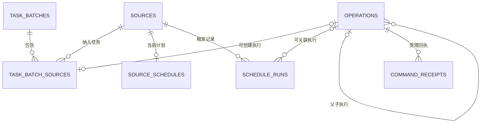
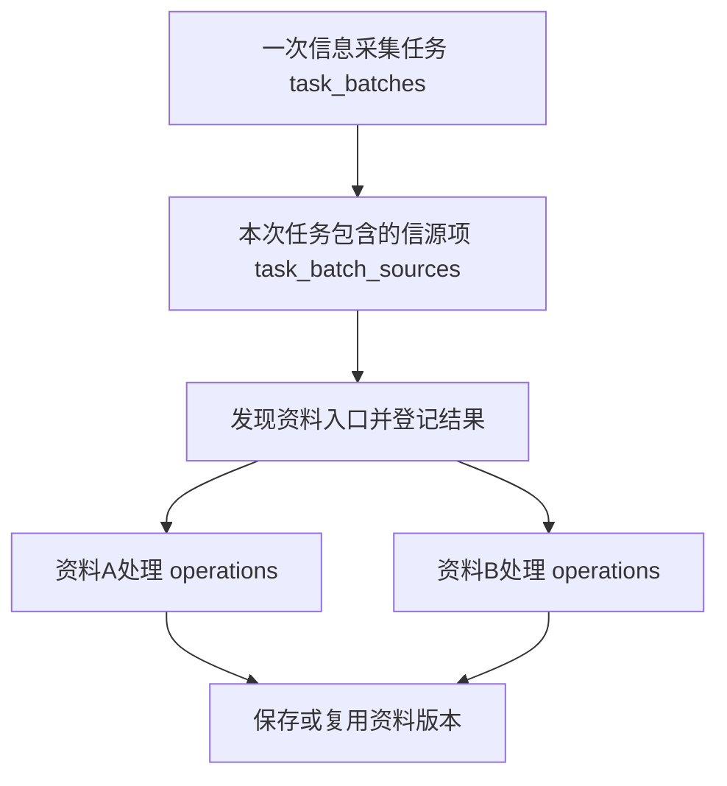

# F01信息接入模块数据模型与存储设计

> V1.1 · 2026-10-27 · 第2～8章保留现行实现快照；第9章按用户要求调整为“以资料为最小处理单位”的目标模型。目标模型尚未迁移到代码和运行库；后续结构改造以第9章为准，不能把现状中的信源根执行继续当作目标设计。

## 1. 文档范围与依据

本文覆盖任务受理、自动计划、执行记录、检查点、暂停恢复、可靠投递、幂等、异常提醒与审计。表分布在platform与information两个schema，本文件按F01使用场景组织，不改变M1、F01、F02与公共运行能力的数据主责。

本版不是F01全部存储的完整清单。信源档案、资料与版本、正文、工件、交付以及Fact/Event仅说明必要关联，不在本次重复展开其全部结构。

依据：

- [[tools/RiskHot/src/db/001-init.sql|建表SQL]]：本文11张表的字段、默认值、键、约束与索引；包含operations.paused的后续ALTER结果。
- [[tools/RiskHot/src/information-ingestion/processing/tasks.ts|任务管理实现]]：整轮受理、控制、计划维护、授权查询和状态汇总。
- [[tools/RiskHot/src/information-ingestion/processing/repository.ts|执行受理与幂等]]、[[tools/RiskHot/src/runtime/scheduler.ts|自动调度]]和[[tools/RiskHot/src/runtime/relay.ts|可靠投递]]：实际写入及恢复规则。
- [[tools/RiskHot/docs/system-design/03-系统功能架构/F01 信息接入与标准化模块功能设计 V2.1|F01功能设计]]、[[tools/RiskHot/docs/system-design/03-系统功能架构/M1 信源管理中心功能设计|M1功能设计]]及[[tools/RiskHot/docs/system-design/04-系统架构设计/02-专题技术架构/T03-任务编排与可靠性架构|任务编排与可靠性架构]]：职责与业务流程。
- [[tools/RiskHot/docs/system-design/04-系统架构设计/01-数据模型与存储设计/F02事件管理模块数据模型与存储设计|F02数据模型与存储设计]]：候选事实、正式事件与处理结果边界。

第2～8章的类型使用PostgreSQL实际类型。“无默认值”不等于可以省略必填列；主键列隐含非空。TIMESTAMPTZ保存时点，页面和日期筛选按Asia/Shanghai解释。第9章单独说明目标调整，不把目标约束或页面计算属性写成已有字段。

## 2. 表清单与关系

| 分组 | 表 | 存储粒度 |
| --- | --- | --- |
| 整轮任务 | platform.task_batches | 手动开启的一整轮任务 |
| 信源关联 | platform.task_batch_sources | 一轮任务中的一个信源及采集执行 |
| 实际执行 | information.operations | 一次单源采集或一份资料处理 |
| 自动计划 | platform.source_schedules | 每个信源当前的一份计划配置 |
| 计划触发 | platform.schedule_runs | 每个信源某个计划时点的触发 |
| 运行支撑 | platform.execution_intents | 某运行对象某代次的工作流投递意图 |
| 运行支撑 | platform.command_receipts、platform.action_receipts | 账号、动作类型与幂等键对应的确认结果 |
| 运行支撑 | platform.automatic_recoveries | 某抽取处理某恢复代次的登记 |
| 运行支撑 | platform.runtime_alerts、platform.audit_log | 运行异常、通知状态与管理审计 |



图表示数据库外键允许的关系上界。程序要求手动任务至少选择一个信源，但数据库没有约束每条task_batches必须已有子关联。source_schedules和schedule_runs通过同一source_id归属来源，没有两表之间的直接外键。

身份区别：

1. task_batches.id是整轮任务ID；operations.id是具体执行ID，不能互换。
2. operations.kind=batch表示单信源发现/采集，不是全部信源整轮；kind=material表示资料处理。
3. schedule_runs.id是计划触发ID；operation_id可空，尚未采集也要保留触发记录。
4. source_schedules以source_id为主键，没有独立plan_id。
5. generation是执行代次，task_batches.version是控制并发版本，source_version是配置版本，均不是Event版本。

## 3. 核心任务表

### 3.1 platform.task_batches：整轮手动任务

| 字段 | 类型 | 可空 | 默认值 | 含义及约束 |
| --- | --- | --- | --- | --- |
| id | UUID | 否 | gen_random_uuid() | 主键，整轮任务身份 |
| actor | TEXT | 否 | 无 | 发起账号；外键platform.actors(subject) |
| scheduled_at | TIMESTAMPTZ | 否 | now() | 本轮计划执行时点，当前手动受理默认当前时点 |
| paused | BOOLEAN | 否 | false | 整轮暂停标记 |
| version | INTEGER | 否 | 1 | 暂停/继续的乐观锁版本 |
| created_at | TIMESTAMPTZ | 否 | now() | 本轮创建时刻 |

没有status、完成信源数、资料数、Fact数或Event数字段；这些由查询汇总。控制成功后version递增，暂停/继续不改写scheduled_at。

### 3.2 platform.task_batch_sources：整轮任务与信源关联

| 字段 | 类型 | 可空 | 默认值 | 含义及约束 |
| --- | --- | --- | --- | --- |
| batch_id | UUID | 否 | 无 | 联合主键组成列；外键task_batches(id) |
| source_id | UUID | 否 | 无 | 联合主键组成列；外键m1.sources(id) |
| source_version | INTEGER | 否 | 无 | 固定受理时的配置版本 |
| operation_id | UUID | 是 | 无 | UNIQUE；外键information.operations(id) |
| status | TEXT | 否 | 'queued' | 信源项受理状态；受阻时可为blocked |
| reason_code | TEXT | 是 | 无 | 尚未创建采集执行等受阻原因 |

联合主键为(batch_id,source_id)，同一轮同一信源只出现一次。另有(source_id,source_version)到m1.source_versions(source_id,version)的联合外键。

operation_id非空时，一个执行最多关联一个手动任务信源项；允许多条NULL。资格或连接条件受阻时保留关联、状态和原因，不要求伪造operation。正常推进后界面优先读实际执行，不把本表初始queued当作永久实时状态。

### 3.3 information.operations：实际采集与资料处理

本节为当前运行库的混合执行结构。目标设计仅保留资料级处理记录，取消kind=batch与parent_id父子层级，具体变更及信源发现状态的归属见第9章。

| 字段 | 类型 | 可空 | 默认值 | 含义及约束 |
| --- | --- | --- | --- | --- |
| id | UUID | 否 | gen_random_uuid() | 主键，实际执行身份 |
| parent_id | UUID | 是 | 无 | 自引用外键operations(id)，资料子执行的上级 |
| kind | TEXT | 否 | 无 | CHECK仅允许batch、material |
| source_id | UUID | 否 | 无 | 外键m1.sources(id) |
| source_version | INTEGER | 否 | 无 | 受理时固定的配置版本 |
| actor | TEXT | 否 | 无 | 外键platform.actors(subject) |
| command_artifact_id | UUID | 否 | 无 | 固定命令；外键platform.artifact_objects(id) |
| url | TEXT | 是 | 无 | 资料URL；根采集执行可空 |
| status | TEXT | 否 | 'queued' | 本层执行状态 |
| stage | TEXT | 否 | 'source' | 本层执行检查点 |
| reason_code | TEXT | 是 | 无 | 受阻或失败原因编码 |
| generation | BIGINT | 否 | 1 | 执行代次，隔离旧工作流和迟到结果 |
| raw_artifact_id | UUID | 是 | 无 | 原件工件；外键platform.artifact_objects(id) |
| normalized_artifact_id | UUID | 是 | 无 | 标准化工件；外键platform.artifact_objects(id) |
| version_id | UUID | 是 | 无 | 保存或复用的资料版本；外键information.material_versions(id) |
| processing_id | UUID | 是 | 无 | 抽取处理的程序关联；当前DDL未声明物理外键 |
| created_at | TIMESTAMPTZ | 否 | now() | 执行创建时刻 |
| scheduled_at | TIMESTAMPTZ | 否 | now() | 执行计划时点；自动计划显示时优先使用触发时点 |
| updated_at | TIMESTAMPTZ | 否 | now() | 最近受控更新时间 |
| paused | BOOLEAN | 否 | false | 显式暂停标记；通过后续ALTER加入 |

除表内外键，还有(source_id,source_version)到m1.source_versions的联合外键。UNIQUE(parent_id,url)抑制同父执行同URL重复；默认NULL语义意味着它不保证根执行去重，也不保证跨父执行语义去重。

根执行通常parent_id为空，资料子执行指向单源根执行；数据库没有强制父节点kind的CHECK。status和stage没有数据库枚举约束。processing_id不能文档化成已经存在的物理外键。

### 3.4 platform.source_schedules：自动接入计划

| 字段 | 类型 | 可空 | 默认值 | 含义及约束 |
| --- | --- | --- | --- | --- |
| source_id | UUID | 否 | 无 | 主键；外键m1.sources(id)，每源最多一份当前计划 |
| enabled | BOOLEAN | 否 | true | 计划启停，与来源业务启停独立 |
| interval_seconds | INTEGER | 否 | 3600 | CHECK介于60与86400秒，包含边界 |
| next_run_at | TIMESTAMPTZ | 否 | 无 | 下一次计划触发时点 |
| updated_at | TIMESTAMPTZ | 否 | now() | 并发校验及最近推进时间 |

页面分钟/小时/天只做单位换算，落库统一为整数秒。计划更新以expected_updated_at校验；保存后重新计算周期，暂停计划只控制后续触发，不等于暂停已启动任务。

### 3.5 platform.schedule_runs：自动计划触发记录

| 字段 | 类型 | 可空 | 默认值 | 含义及约束 |
| --- | --- | --- | --- | --- |
| id | UUID | 否 | gen_random_uuid() | 主键，本次触发身份 |
| source_id | UUID | 否 | 无 | 外键m1.sources(id) |
| scheduled_at | TIMESTAMPTZ | 否 | 无 | 本次计划时点，也是自动执行的日期归属依据 |
| operation_id | UUID | 是 | 无 | 外键information.operations(id)，未开始采集时可空 |
| status | TEXT | 否 | 'pending' | 调度状态，后续由监测同步实际处理结果 |
| error_code | TEXT | 是 | 无 | 调度或处理异常原因 |
| created_at | TIMESTAMPTZ | 否 | now() | 触发记录创建时刻 |

UNIQUE(source_id,scheduled_at)保证同源同计划时点至多一条记录。operation_id没有UNIQUE，数据库允许多条触发记录引用同一执行；当前提交使用schedule/触发ID作为幂等键。不存在plan_id或到source_schedules的外键；尚无operation的排队、失败记录仍需保留。

## 4. 共享运行支撑表

### 4.1 platform.execution_intents：持久执行投递意图

| 字段 | 类型 | 可空 | 默认值 | 含义及约束 |
| --- | --- | --- | --- | --- |
| id | UUID | 否 | gen_random_uuid() | 主键 |
| kind | TEXT | 否 | 无 | 意图类型，决定运行对象和工作流 |
| owner_id | UUID | 否 | 无 | 多态运行对象标识，无物理外键 |
| generation | BIGINT | 否 | 无 | 固定投递代次 |
| workflow_id | TEXT | 否 | 无 | UNIQUE，稳定工作流标识 |
| state | TEXT | 否 | 'pending' | 投递状态，不代表业务执行成功 |
| lease_token | UUID | 是 | 无 | 本次领取的租约标识 |
| lease_until | TIMESTAMPTZ | 是 | 无 | 租约到期时刻 |
| next_attempt_at | TIMESTAMPTZ | 否 | now() | 最早允许再次投递的时刻 |
| attempts | INTEGER | 否 | 0 | 投递尝试次数 |

另有UNIQUE(kind,owner_id,generation)，同类同对象同代次只建一条意图。F01的discovery、material指向operations，extract指向processing_runs；共享运行层还承载F02的event-extract、candidate，不在本文重新定义F02业务对象。kind和state均没有数据库枚举CHECK。

### 4.2 platform.command_receipts：采集提交幂等回执

| 字段 | 类型 | 可空 | 默认值 | 含义及约束 |
| --- | --- | --- | --- | --- |
| actor | TEXT | 否 | 无 | 联合主键组成列；外键platform.actors(subject) |
| kind | TEXT | 否 | 无 | 联合主键组成列；采集受理当前使用source-fetch |
| key | TEXT | 否 | 无 | 联合主键组成列，调用方幂等键 |
| digest | TEXT | 否 | 无 | 请求内容摘要 |
| operation_id | UUID | 否 | 无 | 外键information.operations(id)，原受理执行 |
| created_at | TIMESTAMPTZ | 否 | now() | 回执确认时间 |

主键为(actor,kind,key)。同键同摘要返回原执行，同键不同内容拒绝；回执与采集受理及投递意图在同一受理事务写入。

### 4.3 platform.action_receipts：管理命令幂等回执

| 字段 | 类型 | 可空 | 默认值 | 含义及约束 |
| --- | --- | --- | --- | --- |
| actor | TEXT | 否 | 无 | 联合主键组成列；当前DDL无外键 |
| kind | TEXT | 否 | 无 | 联合主键组成列，管理操作类型 |
| key | TEXT | 否 | 无 | 联合主键组成列，调用方幂等键 |
| digest | TEXT | 否 | 无 | 原请求摘要 |
| result | JSONB | 否 | 无 | 已确认的操作结果，供未知回执重试恢复 |
| created_at | TIMESTAMPTZ | 否 | now() | 操作确认时间 |

主键为(actor,kind,key)。任务当前使用task-batch-create、task-batch-control、schedule-edit等动作。result是原确认结果，不是实时状态快照；重放前仍检查权限。该表没有operation_id列，与command_receipts用途不同。

### 4.4 platform.automatic_recoveries：自动抽取恢复登记

| 字段 | 类型 | 可空 | 默认值 | 含义及约束 |
| --- | --- | --- | --- | --- |
| processing_id | UUID | 否 | 无 | 联合主键组成列；外键information.processing_runs(id) |
| generation | BIGINT | 否 | 无 | 联合主键组成列，已登记恢复代次 |
| created_at | TIMESTAMPTZ | 否 | now() | 自动恢复登记时间 |

主键为(processing_id,generation)。调度器用created_at检查该处理最近24小时内是否已有自动恢复。它不代表每次手动重试；可恢复错误、预算、代次和复核限制由程序校验，不允许靠自动恢复越过输出复核。

### 4.5 platform.runtime_alerts：运行异常和通知状态

| 字段 | 类型 | 可空 | 默认值 | 含义及约束 |
| --- | --- | --- | --- | --- |
| id | UUID | 否 | gen_random_uuid() | 主键 |
| issue_key | TEXT | 否 | 无 | 稳定问题键；未解除记录按此去重 |
| code | TEXT | 否 | 无 | 异常编码 |
| owner_id | UUID | 是 | 无 | 多态运行对象标识，无物理外键 |
| opened_at | TIMESTAMPTZ | 否 | now() | 本轮问题首次发现时间 |
| last_seen_at | TIMESTAMPTZ | 否 | now() | 最近一次仍观察到问题的时间 |
| resolved_at | TIMESTAMPTZ | 是 | 无 | 解除时间；NULL表示尚未解除 |
| delivery_status | TEXT | 否 | 'pending' | 提醒投递状态，与任务状态分开 |
| delivery_attempts | INTEGER | 否 | 0 | 提醒投递尝试次数 |
| next_delivery_at | TIMESTAMPTZ | 否 | now() | 下次允许提醒的时间 |
| delivered_at | TIMESTAMPTZ | 是 | 无 | 提醒实际送达时间 |

active_alert_key是issue_key上的部分唯一索引，条件resolved_at IS NULL：同一问题最多一条未解除记录，历史已解除记录不互相排斥。owner_id结合问题类型及来源权限解析，不能直接作为跨模块任意对象读取许可。提醒失败不删除任务结果。

### 4.6 platform.audit_log：配置和任务控制审计

| 字段 | 类型 | 可空 | 默认值 | 含义及约束 |
| --- | --- | --- | --- | --- |
| id | UUID | 否 | gen_random_uuid() | 主键 |
| actor | TEXT | 否 | 无 | 操作账号；当前DDL无外键 |
| action | TEXT | 否 | 无 | 动作，例如task-batch-create、task-batch-control、schedule-edit |
| owner_id | UUID | 是 | 无 | 受操作对象标识，按action解释，无物理外键 |
| detail | JSONB | 否 | '{}' | 原因、版本、参数或前后状态等审计内容 |
| created_at | TIMESTAMPTZ | 否 | now() | 审计发生时间 |

这是共享管理审计表，不是F02已取消的事件版本表，也不是保存每个任务瞬时状态的专用状态流水表。没有独立的任务状态变更历史表时，不能宣称审计可重放所有瞬间状态。

## 5. 状态、代次与恢复规则

### 5.1 持久状态与查询状态

| 层次 | 保存位置或来源 | 含义 |
| --- | --- | --- |
| 投递状态 | execution_intents.state | 程序使用pending、leased、started、recoverable；started只表示工作流启动已受理 |
| 实际执行 | operations.status、stage、paused | 状态、检查点、暂停分别保存，查询结合资料子执行和抽取/交付结果 |
| 计划触发 | schedule_runs.status、error_code | 初始pending，受理后running，受阻或后续结果由调度监测更新 |
| 整轮任务 | 查询计算 | task_batches没有status列；按信源结果聚合，暂停标记可覆盖未完成态 |
| 候选抽取 | processing_runs最新处理记录 | 抽取pending、completed、review、recoverable等，不等于Event.event_status |

以上程序取值不是数据库CHECK清单。除了operations.kind，本文任务状态列均为未限制枚举的TEXT；界面可展示历史或未知值，不意味着当前调度器必定写入每个值。

当前聚合以tasks.ts的stateOf为准：全部completed则completed；有running则running；存在queued/pending时，有completed/partial则running，否则queued；无这些活动项但有completed/partial则partial；其余依次取review、recoverable、waiting_config、blocked、failed、paused、skipped；无子项时采用回退值。整轮paused且聚合不是completed时显示paused。

活动手动任务判定还检查是否仍有排队、运行或暂停来源，不能仅凭聚合partial就解锁重复开启。error_sources按来源状态计异常数，has_error还检查资料子执行原因，二者不完全等价。自动执行已恢复成功时，不继续用旧调度错误强制标成待处理。

### 5.2 幂等、事务和检查点

- 手动受理在同一事务创建task_batches与来源关联；可采集项建立根operations、命令回执及discovery意图，受阻项保留关联及原因。
- 同一actor/kind/key且摘要相同复用原结果，内容不同拒绝。未知回执重试原请求；UUID唯一不替代命令幂等。
- 暂停/继续校验整轮version或单源generation，保留资料和工件，通过代次及暂停栅栏拒绝旧任务迟到结果；恢复仍核对当前业务资格。
- 投递器用FOR UPDATE SKIP LOCKED领取pending/leased。当前策略为60秒租约、失败30秒后重投、最多10次尝试；这些是程序策略，不是字段默认值或数据库CHECK。
- workflow_id重复启动按工作流已存在处理；投递started不代表资料、抽取或正式Event成功。
- 自动恢复保留固定处理身份、输入和历史尝试，不能自动越过待复核状态。

### 5.3 时间和周期

手动整轮与执行的scheduled_at当前默认受理时点。自动触发的schedule_runs.scheduled_at记录计划时点，可能与采集执行创建跨日；统一列表按计划时点归上海日期，无自动触发关联才回退到执行时点。

计划更新按updated_at校验，从保存后计算新周期。调度器记录到期计划时点再推进下次触发，休眠恢复不等于把每个漏掉的周期都补采。来源业务启停、自动计划启停和本轮暂停分别生效。

## 6. 页面执行记录和结果存储

### 6.1 统一列表不是独立数据表

列表由task_batches、task_batch_sources、operations和schedule_runs组装，结合processing_runs和material_deliveries读取最新处理状态。正常查询中的手动任务以整轮汇总，其单源根执行不重复作为普通行；自动计划有operation时按同一执行去重，没有operation时保留触发记录。

页面任务批次记录始终按任务身份展示一行，batch筛选限定整轮而不拆成信源行。独立批次详情读取整轮sources及资料子执行，界面将资料子执行平铺为“任务实际采集记录”，一行一份资料；信源发现状态与异常作为补充展示；旧单源根执行ID先经task_batch_sources解析到所属手动任务。没有operation的受阻关联保留在任务详情中，不创建伪执行或组合主键。

| 返回属性 | 存储或计算来源 |
| --- | --- |
| id | 整轮用task_batches.id，单源用operations.id，未启动自动触发用schedule_runs.id |
| trigger | 按整轮、自动触发关联或单次执行推导，不是任务表列 |
| scope_complete | 当前账号是否覆盖整轮来源，按权限查询，不是永久授权快照 |
| status、completed_sources、error_sources、has_error | 当前可见来源、资料子执行与抽取/交付结果聚合 |
| saved_count | 关联资料子执行version_id去重，不是抓取尝试数或新增数 |
| schedule_run_id、unstarted、controllable | 按触发身份及是否已有实际执行推导 |

日期按上海时区转换为包含开始、排除结束次日的时点范围。source限定有关来源，batch限定该轮任务；概览按日期/来源范围统计，编号和状态再过滤列表。当前最多返回100行，超出需缩小范围。筛选条件不能代替后端来源授权。

### 6.2 资料与抽取关联

```text
手动整轮task_batches
  → task_batch_sources.operation_id
  → operations（kind=batch，单源采集）
  → operations.parent_id（kind=material，资料子执行）
       ├─ version_id → material_versions → materials
       └─ processing_id → processing_runs → 候选事实及正式事件关联
```

后两条为资料子执行的并行关联。一个采集执行可发现多份资料，一份已保存版本也可被多个执行复用；不能把每次任务都解释为创建新资料版本。资料版本、Fact及Event的技术身份彼此独立。

本轮统计是该轮保存或复用版本的当前处理结果，累计统计是全部可读资料结果。二者由[[tools/RiskHot/src/information-ingestion/processing/task-results.ts|结果统计实现]]读取持久资料、处理和候选/事件关系，不在task_batches冗余维护七组计数；各轮结果存在重叠，不能简单相加代替累计。

### 6.3 数据库与文件分工

数据库保存任务身份、状态、代次、工件引用及关联。命令、发现快照、原件和标准化正文由[[tools/RiskHot/src/platform/artifacts.ts|工件存储实现]]落盘到ARTIFACT_ROOT；工件内容按SHA-256地址存储，operations保存的是artifact_objects的UUID，不是直接文件路径。

资料交付文件、接收回执、候选结果文件归交付机制维护；正文不放进任务状态字段。任务、工件、资料、候选事实和正式事件不是同一对象。

## 7. 索引、权限及维护

### 7.1 已实现的键和索引

| 对象 | 已实现约束或索引 | 用途 |
| --- | --- | --- |
| task_batches | id主键；task_batches_time_idx(scheduled_at DESC,id) | 整轮身份及时间检索 |
| task_batch_sources | PRIMARY KEY(batch_id,source_id)；operation_id唯一 | 同轮来源去重、非空执行唯一关联 |
| operations | id主键；UNIQUE(parent_id,url)；operations_time_idx(scheduled_at DESC,id) | 执行身份、同父URL去重、时间检索 |
| source_schedules | source_id主键；interval_seconds范围CHECK | 每源一份当前计划、有效周期 |
| schedule_runs | id主键；UNIQUE(source_id,scheduled_at) | 同源同计划时点去重 |
| execution_intents | id主键；workflow_id唯一；UNIQUE(kind,owner_id,generation) | 固定代次可靠投递 |
| execution_intents | pending_intents_idx(next_attempt_at,id) WHERE state<>'started' | 待投递扫描 |
| command_receipts、action_receipts | 各自PRIMARY KEY(actor,kind,key) | 幂等按账号和动作隔离 |
| automatic_recoveries | PRIMARY KEY(processing_id,generation) | 自动恢复代次登记 |
| runtime_alerts | id主键；active_alert_key(issue_key) WHERE resolved_at IS NULL | 同问题未解除记录去重 |
| audit_log | id主键 | 审计身份 |

这里只列现有DDL，不把外键默认解释为拥有单列索引。PostgreSQL为主键和UNIQUE建立支撑索引，其他查询列并非默认有索引；任务量增长后的执行计划和索引优化另行评估，本次不新增索引。

### 7.2 权限、删除与保留

服务端校验账号权限及来源范围，数据库运行角色见[[tools/RiskHot/src/platform/grants.ts|运行角色授权]]。当前未据本文新增任务级RLS；没有物理外键的owner_id、processing_id、部分actor列需按其操作语义检查，不能当作已由外键保证。

这些表的外键均未声明ON DELETE CASCADE；本次不扩大级联、不清理历史、不修改保留期。审计、幂等回执、任务和资料有不同职责，删除或归档需单独设计。

updated_at的DEFAULT只管插入默认值，更新依赖程序写入，不能当作已有自动更新时间触发器。控制版本及执行代次不是保存所有历史状态的业务版本机制。

## 8. 一致性与变更要求

本版逐列核对11张表、86个字段的名称、类型、可空与默认值，包含operations.paused的ALTER结果，区分物理外键、程序关联、数据库约束和应用校验。主键、默认值、可空、唯一性及显式索引以SQL为准，状态汇总和恢复口径以实际读写实现为准。

资料及AI处理表经过后续迁移，引用其完整结构时必须叠加相关迁移，不能直接将001-init.sql中早期processing_runs、event_candidates定义当作当前完整模型。

后续修改这些表时，同时更新建表/迁移SQL、读写与查询、本文及验证记录。现有实现证据见[[tools/RiskHot/docs/verification/m1-navigation|M1任务与页面验证]]；本次仅整理文档，不把历史测试通过记录说成重新执行了数据库验收。

## 9. 资料作为最小处理单位的目标模型

### 9.1 决策记录：取消混合执行粒度

- 状态：用户已明确要求“直接以资料为最小单位”；本节记录目标决策，代码、迁移SQL和运行库尚未改造。
- 背景：当前operations混合单源扫描与单份资料处理，kind=batch又与整体任务批次重名，造成身份和状态歧义。
- 决策：operations一条记录只表示“一份资料在一次任务中的处理”。不再创建信源级operations，不另拆一张信源执行表；信源发现过程记在任务的信源项中。
- 取舍：资料可独立追踪与恢复；代价是信源发现与资料处理改用各自的检查点和投递对象，旧引用及聚合查询需要同步迁移。
- 未采用：继续用kind区分两类执行；将混合表拆成两个独立执行表。前者保留粒度歧义，后者增加用户本次不需要的独立执行层。

### 9.2 任务、信源项和资料处理的关系



信源项是任务范围和发现进度的记录，不作为另一种operations。每个信源项可对应零至多条资料处理记录；已知URL的采集可直接创建资料处理记录。尚未发现资料时没有资料处理记录，但任务与信源项已经存在。

| 对象 | 目标粒度及职责 |
| --- | --- |
| platform.task_batches | 一次完整信息采集任务；手动与自动触发统一形成任务身份 |
| platform.task_batch_sources | 本任务中的一个信源；固定配置，记录入口发现状态、检查点、原因及发现快照 |
| information.operations | 本任务中一份待采集资料的处理；独立获取、解析、标准化、保存及恢复 |
| information.materials、material_versions | 已保存的资料身份与版本；可以被不同轮次处理记录复用 |
| platform.schedule_runs | 自动触发记录，关联其创建的整体任务；不再用单源operations充当任务身份 |

自动计划当前按信源触发；统一身份后，每次触发可以创建只包含一个信源的任务。此调整不把历史上不同任务按时间强行合并。

### 9.3 表结构调整范围

下表是待实施的结构要求，不是已发布DDL。资料一行指处理对象粒度，不表示全库一份资料永远只能有一次处理记录。

| 表或关系 | 目标调整 |
| --- | --- |
| task_batches | 承载手动与自动任务；记录触发来源，控制版本仍用于暂停/继续的并发校验 |
| task_batch_sources | 取消指向单个operations的operation_id；增加信源发现的状态、检查点、原因、快照引用、恢复代次及时间记录 |
| operations | 取消kind、parent_id；增加所属任务关联，与source_id共同指向本任务的信源项；保留资料入口、处理状态、检查点、工件及资料版本/抽取结果关联 |
| operations与信源项的约束 | 通过任务与信源的联合外键保证归属；受理配置必须与信源项固定配置一致，不允许跨任务挂接 |
| schedule_runs | 原单源operation_id关联改为整体任务关联；未能受理时仍保留触发失败原因 |
| command_receipts | URL资料提交的回执指向资料处理记录；信源入口或整轮提交返回任务身份，不再返回信源根operations |
| execution_intents | 资料处理投递指向operations；发现投递指向任务信源项，并携带任务/信源身份和恢复代次，不能只用source_id定位 |

原件尚未取得时，资料处理记录也必须能创建：已知URL、文件引用或来源资料标识即为待处理入口，version_id允许为空，成功保存后关联具体版本。URL不是全库资料主键；附件是否独立成资料沿用现有资料边界，不因本次调整自动拆分。

### 9.4 重复、重试及恢复

1. 同一任务同一信源重复发现同一个规范化入口，只创建一条资料处理记录；使用任务、信源和稳定入口标识约束幂等，不再依赖UNIQUE(parent_id,url)。无URL的文件或结构化输入使用相应稳定入口标识。
2. 不同任务再次取得同一资料，可以各有处理记录；保存时仍按现有资料去重与版本规则复用资料或建立修订版本。处理记录数不等于新增资料数。
3. 同一资料失败重试复用该处理记录，通过generation、检查点及已有工件恢复；迟到结果受代次栅栏限制，不因重试生成新的资料身份。
4. 信源发现失败只更新对应信源项，保留发现快照和已登记资料。恢复发现时幂等补登记缺失入口，不重新创建已存在的资料处理记录。
5. 已发现的资料允许独立继续或恢复；发现过程尚未结束时，不因当前资料都完成就把整个任务判为完成。整轮暂停仍覆盖发现与资料处理。
6. 发现完成且没有资料时明确展示“未发现资料”；发现失败且零资料时展示失败原因。不能把两者都解释为任务成功。
7. 聚合及详情仍按当前账号可读信源过滤，暂停/恢复前重新检查授权和信源资格；不会因关联到整轮任务而扩大资料访问范围。

### 9.5 页面与统计口径

- 列表“任务批次记录”仍一行一次信息采集任务；批次详情的“任务实际采集记录”一行一份资料，标明所属信源，信源发现状态与异常另行补充，不另造信源级operations。
- 每份资料展示自身状态、阶段、原因及保存/抽取结果。信源区展示发现状态和资料汇总，避免把“入口扫描结束”解释为“资料全部处理结束”。
- 资料保存统计继续按关联版本去重，Fact及Event从正式关联读取；各轮复用同一版本时，不能相加得到累计新增数。
- 当前页面已将资料子执行展示为逐份采集记录，仍按第6章旧物理结构读取；这不代表本章数据库和接口迁移已完成。

### 9.6 迁移与验收边界

实施时先建立任务/信源项与资料记录的新关联，迁移现有material行，保留其ID、工件、版本、处理结果、恢复代次及审计。现有batch行的发现状态和快照转入对应信源项；只有旧根执行的自动或独立采集须补建任务及信源项。无法确定归属的历史行先登记异常，不猜测合并。

旧根执行ID的链接、幂等回执和工作流引用须有可追溯的映射。先处理在途工作流、投递和恢复引用，再切换查询与控制；不直接删除仍被外键或审计引用的历史行。回滚边界和具体SQL在实施迁移时补齐。

| 验收场景 | 目标结果 |
| --- | --- |
| 一个任务扫描两个信源，各发现三份资料 | 一条任务、两个信源项、六条资料处理；无信源级operations |
| 某信源未发现资料或入口扫描失败 | 信源项分别保留空结果或失败原因；不创建伪资料记录 |
| 重复发现同一入口、重试同一资料 | 本轮资料处理不重复，恢复可使用已有工件 |
| 下一轮再次采集同一资料 | 保留独立任务处理轨迹，资料版本可复用 |
| 自动触发与旧链接访问 | 自动任务具有整体任务身份，旧根执行链接可定位迁移后的任务 |
| 暂停恢复与迟到结果 | 发现和资料处理均受整轮控制，旧代次写入被拒绝 |
| 历史迁移及结果核对 | 原资料处理ID、工件、版本、Fact/Event关联和统计可核对，无丢失或越权 |

本次仅更新设计文档，不执行上述迁移，不改动实际任务、资料、Fact或Event。


## 10. 独立计划执行概览的查询投影

保留source_schedules每源独立配置。新增只读GET /api/v1/l0/task-overview，将可读的计划与该源的手动/自动批次关联，按信源返回当前执行及最近结果；不新增持久状态或统计表，不迁移第9章目标结构。

概览复用与批次查询一致的授权和状态聚合，但读取完整候选执行集合，不能先截取批次历史的100条再做信源去重。当前批次从运行、排队和暂停记录中选取最近触发的一条；最近结果优先选择最近触发且已结束的记录，无已结束记录时回退到当前已知记录。当前状态与最近结果可以指向不同批次。概览未配置计划的信源不生成计划行。

只在可核对完成状态时提供完成时间：有资料时取本次资料执行的末次状态更新时间，无资料且发现已完成时取发现执行更新时间；不复用历史抽取结果的完成时间冒充本轮完成时间；否则为空，页面展示触发时间。保存数量按版本去重，未发现资料根据实际资料处理记录为空且执行已完成判断，不能根据保存数为零推断成功。

历史仍使用原GET /api/v1/l0/task-batches及其筛选和上限；概览中的批次ID沿用现有手动批次、单源执行或未受理触发的稳定身份，详情读取和旧链接解析不变。目录自动接入仍负责配置，默认执行概览负责监测，批次记录负责追溯。


## 11. 手动任务独立页面与历史过滤

2026-10-28页面调整：/m1#manual-tasks集中手动开启、最新手动批次状态、暂停/继续和手动历史；原信源目录、执行概览、普通历史及通用详情不挂载手动状态栏，不提供开启入口。该调整不新增表，不改变任务身份或运行中的暂停状态。

GET /api/v1/l0/task-batches新增trigger筛选，允许manual、automatic、direct；来源授权及触发方式过滤在总数计算和100条截断之前应用。手动页固定trigger=manual，使用独立的历史响应缓存，避免普通历史的自动记录暂时混入手动页。活动状态仍独立于历史筛选读取，筛选为空也不能解锁进行中的手动任务。

详情复用现有接口；从手动页进入后返回该页，保留筛选和原批次入口焦点。控制仍使用原批次版本和权限检查，不因页面迁移创建新批次或恢复真实暂停任务。
