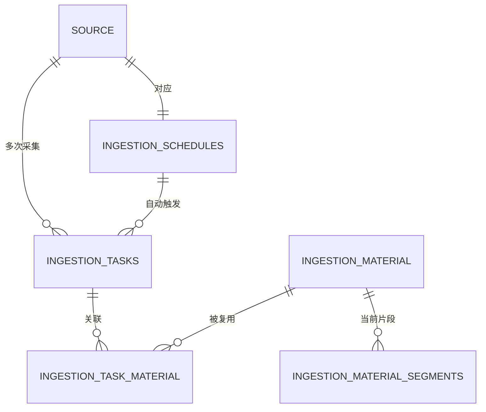

# F01信息接入模块数据模型与存储设计

> 2026-10-30执行架构覆盖：本文涉及Temporal、Workflow/Activity、三类Worker、启动意图与signal的时序属于旧执行基线；新目标采用 [[tools/RiskHot/docs/system-design/04-系统架构设计/02-专题技术架构/T03-任务编排与可靠性架构|T03 V1.0]] 的业务Job交接，数据使用 [[tools/RiskHot/docs/system-design/04-系统架构设计/01-数据模型与存储设计/S01任务执行数据契约|S01契约]]。本轮未重写领域算法；业务含义按最新F01/F02功能设计，旧同号AI任务不能自动沿用。

> V2.2 · 2026-10-31 · 依据 L0 material/InformationSource 领域属性补齐 metadata 的资料引用、覆盖与采用配置依据契约，新增契约待工程实施。此前 V2.1 已按用户授权完成schema5重建与代码切换，40条信源原字段及ID保留。实施与验证见[[tools/RiskHot/docs/verification/ingestion-migration|迁移验证记录]]。旧实现及已废止提案保存在[[tools/RiskHot/docs/system-design/04-系统架构设计/01-数据模型与存储设计/F01现行存储快照-2026-10-29|旧存储快照]]。

## 1. 文档范围与依据

定义F01业务存储的唯一目标：采集计划、单信源任务、material及必要内容／身份关联。业务依据为[[tools/RiskHot/docs/system-design/03-系统功能架构/F01 信息接入与标准化模块功能设计 V2.1|F01功能设计]]和[[tools/RiskHot/docs/system-design/03-系统功能架构/F01修改清单-2026-10-29|确认清单]]。schema按用户指定拼写为infomation；通用运行表由公共技术设计维护，F01只声明依赖。

## 2. 目标表清单与关系

| 目标表 | 粒度 | 主键与关系 |
| --- | --- | --- |
| infomation.ingestion_schedules | 一个信源一份计划 | source_id UUID主键，外键M1当前信源id |
| infomation.ingestion_tasks | 一个信源一次任务 | id UUID主键；source_id关联M1；自动任务关联计划 |
| infomation.ingestion_material | 一份资料的当前内容 | id UUID主键；source_id关联M1；来源身份与内容属性 |
| infomation.ingestion_task_material | 任务与资料的身份关联 | (task_id,material_id)联合主键及外键；不存处理状态、阶段、次数或重试，非处理明细记录 |
| infomation.ingestion_material_segments | material可选正文片段 | (material_id,id)联合主键；仅存当前正文位置，不维护版本行或独立执行状态 |

任务资料关系仅用于查询本次取得哪些已有资料，不能升级为被取消的“任务资料明细”状态机。片段为可选内容组成；正文内已有稳定定位时不强制拆分。一个计划对应一个信源的完整性由信源创建／迁移补齐事务保证，source_id唯一键防重复；计划暂停仍保留。

### 2.1 信源金融属性关联字段

信源身份继续由M1的m1.sources维护。2026-10-29增加独立金融属性列，F01按source_id引用信源，不另建分类表。

| 字段 | 类型 | 可空 | 规则 |
| --- | --- | --- | --- |
| financial_attributes | TEXT[] | 否 | 默认空数组表示未分类；支持多值，常用钱的数量、钱的价格、钱的流向；不允许NULL元素 |

新列为金融属性的唯一正式存储。006增量迁移首次从已有metadata.dims回填（去除空白项并裁剪前后空格），重复执行不覆盖新值或清空结果；保留旧metadata原字段作兼容过渡。当前接口仍接受profile.dims，查询将新列投影到financial_attributes、metadata.dims及profile.dims，避免旧值复活。档案写入时剔除metadata中的dims，不维护两份分类；省略dims保留原值，传空数组清空，不自动推断分类。

实施与验证见[[tools/RiskHot/docs/verification/source-financial-attributes|信源金融属性字段验证]]。

## 3. 业务表字段与约束

### 3.1 采集计划 ingestion_schedules

| 字段 | 类型 | 可空 | 规则 |
| --- | --- | --- | --- |
| source_id | UUID | 否 | 主键与M1当前信源外键 |
| enabled | BOOLEAN | 否 | 计划启停；补建不得自动启用 |
| interval_seconds | INTEGER | 否 | CHECK 60～86400；新建默认值沿现行3600，存量改一天为独立运行变更 |
| next_run_at | TIMESTAMPTZ | 否 | 下一计划时点；推进不等于已创建任务 |
| updated_at | TIMESTAMPTZ | 否 | 并发保存校验，程序受控更新 |

### 3.2 信息采集任务 ingestion_tasks

| 字段 | 类型 | 可空 | 规则 |
| --- | --- | --- | --- |
| id | UUID | 否 | 主键，自动与手动统一身份 |
| source_id | UUID | 否 | 仅一个信源，外键M1当前信源 |
| trigger_type | TEXT | 否 | CHECK automatic／manual |
| schedule_source_id | UUID | 是 | 自动任务非空，外键采集计划且等于source_id；手动为空 |
| scheduled_at | TIMESTAMPTZ | 否 | 计划时点；上海日期归属，存储统一时点 |
| actor | TEXT | 否 | 发起身份，按统一身份契约授权 |
| status | TEXT | 否 | queued、running、completed、partial、review、recoverable、blocked、failed |
| stage | TEXT | 否 | discover、read、normalize、compare、save、provide；描述任务当前阶段 |
| paused | BOOLEAN | 否 | 业务暂停；完成态不再切回暂停 |
| reason_code | TEXT | 是 | 最近影响任务的具体原因 |
| result_summary | JSONB | 否 | 默认空对象；计数、冻结发现入口、已保存资料依据及失败摘要；入口集合按单任务最多5条受控，不创建逐资料处理状态机 |
| control_revision | BIGINT | 否 | 默认1，任务控制并发条件，不是信源配置或资料版本 |
| created_at、updated_at | TIMESTAMPTZ | 否 | 创建和受控更新时间 |

部分唯一索引(source_id,scheduled_at) WHERE trigger_type='automatic'防止同计划时点重复自动任务；计划每源唯一。手动提交幂等由公共受理能力保证。事务内先建立任务，再委托公共执行；未建成任务的技术故障记公共日志并按原身份重试。状态转换和计数为F01业务逻辑，不从被取消的处理表查询。

### 3.3 资料 ingestion_material

| 字段 | 类型 | 可空 | 规则 |
| --- | --- | --- | --- |
| id | UUID | 否 | 稳定主键 |
| source_id | UUID | 否 | M1当前信源外键 |
| identity | TEXT | 否 | 同来源稳定身份；UNIQUE(source_id,identity) |
| external_id、canonical_url | TEXT | 是 | 来源侧标识及详情链接，未知留空 |
| title | TEXT | 是 | 来源标题，未知不伪造 |
| content | JSONB | 否 | 正文、表格及结构化内容；不得只保存摘要 |
| metadata | JSONB | 否 | 必要来源元信息、缺项及标准化说明；附件、内容覆盖及采用配置依据见§3.3.1；不作为可编辑信源config |
| version | INTEGER | 否 | 默认1、CHECK大于0；内容变化原子递增，无独立版本表 |
| content_digest | TEXT | 否 | 当前有效内容摘要；校验算法由公共内容契约明确 |
| normalizer_rule | TEXT | 否 | 标准化规则标识 |
| published_at_text | TEXT | 是 | 来源发布时间及精度，不确定留空 |
| collected_at、updated_at | TIMESTAMPTZ | 否 | 实际取得及当前内容更新时间 |
| availability_state、availability_error | TEXT | 是 | 最小下游可读确认结果，错误可空；不代表F02分析完成，不建交付表 |
| extraction_result | JSONB | 是 | 当前版本、摘要及抽取数量／零候选原因／错误的最小结果，不保存分析过程或独立状态记录 |

正文与版本值、摘要、内容片段在同一事务中更新。同内容重复不递增；标准化规则版本、片段ID或定位变化不改变内容版本。并发更新复查摘要与版本，可读确认与抽取意图必须指向同一依据。取消current_version_id、raw_artifact_id等旧版本／原件外键。旧内容不在版本表或原件存储中回放，旧依据版本不匹配时明确失效并重新核验。

### 3.3.1 领域属性在 metadata 中的承载

依据[[tools/RiskHot/docs/system-design/02-业务架构与领域设计/RiskHot_L0_信息处理层_业务架构与领域设计V1.0#4.3.2 material（资料）|material 核心属性]]及[[tools/RiskHot/docs/system-design/02-业务架构与领域设计/RiskHot_L0_信息处理层_业务架构与领域设计V1.0#4.3.1 InformationSource（信源）|信源采用口径]]，现有 metadata JSONB 增加以下受控内容契约。它们记录当前资料实际使用的来源上下文，不新增原件表、资料版本表或信源版本表。

| metadata 键 | 结构 | 业务规则 |
| --- | --- | --- |
| attachments | 数组或 null；每项为 uri、title、required、read_state、material_id | uri为非空来源定位；title可空；required为布尔或null；read_state为available/unavailable/unknown；material_id为已保存资料UUID或null。null表示未记录，空数组仅表示已确认无附件，不用空数组冒充未读取 |
| content_coverage | 对象或 null；status、missing_parts、reason | status为complete/partial/unknown；missing_parts为字符串数组，reason为文字或null。部分覆盖须列缺项及原因；未知覆盖不得按完整交付；正文已保存不证明必要附件已读取 |
| source_config_basis | 对象或 null；source_id、version_ref、config_digest、selected_fields、captured_at | 固定本次实际采用的M1配置依据；source_id与资料一致；version_ref仅在上游确实提供版本时填写，否则null；selected_fields为实际采用的配置项，config_digest为其规范化摘要，captured_at为采集依据时点 |

上述 JSON 结构由写入契约与程序验证，未知键不得混入这些对象；metadata 的其他既有键继续兼容。attachments 各项身份须可读且对应所引用内容，read_state=available 须有已读取依据，不能只凭 URL 存在推定。complete 要求正文及已核定为必要的附件均可读，必要性或读取覆盖未知时保留 unknown；不能只凭 missing_parts 为空判定完整。正文及必要附件覆盖共同决定资料能否满足本次 F02 输入要求；资料部分保存可留存，但缺失范围须向下游显式传递。source_config_basis.selected_fields 只保存实际采用的非敏感业务配置，不包含令牌、凭据或认证信息。

M1 不提供配置版本时，以已读取配置项及摘要保留采用口径，不能编造版本号；未留存的历史依据保持 null/unknown。source_config_basis 是资料取得时的只读依据，不允许 F01 修改 M1 配置，也不恢复 source_versions 或 source_version 列。补充当前元信息不单独递增正文 version；涉及当前内容变化仍按既有版本规则，依据变更保留操作审计。

迁移兼容：已有 metadata 不含这些键时按未记录处理，不能批量填 complete 或用最新信源档案回填旧采用依据。新读写适配须覆盖必要附件缺失、无附件、未知覆盖、跨信源配置引用、无配置版本、错误摘要及重复读取。实施前固定 selected_fields 清单与规范化摘要算法，不能把本次文档定义当作运行已支持。

### 3.4 关系与片段

ingestion_task_material仅存task_id与material_id，校验两端来源一致，不引入代次、状态、结果和尝试字段。关联插入幂等，权限取两端共同可读范围。material_segments保存id、material_id、ordinal、text、locator；按material当前内容重建，外部定位必须同时核对material版本值和摘要。

## 4. 取消与外部归属

| 旧表／旧方案 | 目标处理 |
| --- | --- |
| platform.task_batches | 本次旧数据按授权清空，新提交逐源创建ingestion_tasks；旧ID入口明确返回410，不做身份混用 |
| platform.task_batch_sources／ingestion_task_sources | 取消；发现状态进入单信源任务 |
| platform.schedule_runs／ingestion_schedule_trigger_records | 取消；触发方式、计划时间及失败原因进入任务 |
| information.operations／ingestion_records | 取消；不得改名为另一资料处理记录表 |
| information.acquisitions／ingestion_acquisition_records | 取消；必要取得信息归material或任务 |
| information.processing_runs／event_analysis_records | 取消；F02按已有Fact/Event等业务结果承接结果，不以跨模块迁移保留同义分析记录 |
| information.material_deliveries／ingestion_delivery_records | 取消；最小交接结果归保留对象，通用可靠投递机制由S01提供 |
| information.material_versions／ingestion_material_versions | 取消；版本为material.version字段 |
| m1.source_versions、sources.version | 取消目标依赖；M1保留当前档案字段，F01不存source_version列；实际采用口径由material.metadata.source_config_basis引用或固定 |
| 通用投递、幂等、运行告警、审计表 | 不列F01业务表，不迁入infomation；定义由公共技术设计维护 |

分析自动恢复登记的旧processing_id引用必须退出，不能借共享表保留被取消的分析模型。通用审计与命令结果可记录不透明业务引用，但不能承载伪装的资料处理状态表。

## 5. 状态、代次与恢复规则

### 5.1 持久状态与查询状态

本节是目标状态口径。任务status存业务结果，paused独立控制，技术运行状态引用公共执行事实。queued→running；运行可转completed、partial、review、recoverable、blocked或failed；授权恢复重新校验后转queued／running，终态重启使用明确新任务或经确认的恢复规则。完成且无资料为completed并注明零发现；失败不得用零资料成功替代。

完成条件覆盖本次发现、解析、保存和所需下游可用性；partial表示存在有效结果但尚有失败。任务摘要不新增独立逐资料记录表。material已保存、下游业务未完成可并存；页面清楚标注对象和阶段，不将F02结果回写成原文丢失。现行旧汇总实现只见历史快照，不是新查询依据。

### 5.2 幂等、事务和恢复

自动触发同源同计划时点唯一，手动命令重放复用原任务集合。多信源选择分别创建任务并逐任务反馈受理结果；不创建父业务任务。计划及任务控制使用条件更新，权限每次重查。重复material按来源身份与内容比较处理，F02按material_id、version、digest幂等消费。旧消息遇当前内容变化时拒绝把新内容当旧版，要求重新获取当前值或提示重新分析。

### 5.3 时间和周期

数据库用TIMESTAMPTZ，页面及日期筛选按Asia/Shanghai。86400秒为24小时周期，不隐含每日固定钟点。单独调整周期时保留原启停，不触发采集；本次用户另行授权删除除信源外全部应用表，新补40份计划均为86400秒且停用，next_run_at为重建后一日。未来新建默认3600秒且停用。

## 6. 查询、权限与接口

任务列表一行一个单信源任务，自动／手动由字段筛选；计划一源一行，material按稳定身份查询。历史任务引用material当前内容时标注版本可能已更新，不冒充当次正文。读取失败、无权限、空结果分别表达。接口逻辑输入输出不再带source_version、version_id、operation_id、acquisition_id或processing_id；改用task_id、material_id及版本值。通知成功和F02业务成功分别返回。

## 7. 迁移与验收

用户2026-10-29授权删除除信源表外全部应用表。本次采用显式重建，不迁移旧资料、Fact/Event、审批、任务或消息；该授权覆盖原保留旧业务数据方案。切换前导出信源与计数，静默应用并确认Temporal应用命名空间无活动工作流，再以单事务重建应用schema，核对每条信源原字段和ID。仅新增updated_at用于当前档案并发校验；保留旧信源物理version列但新接口不使用。

重建SQL见[[tools/RiskHot/src/db/005-ingestion.sql|schema5建表]]，受控入口见[[tools/RiskHot/src/platform/ingestion-migration.ts|迁移实现]]。普通setup只初始化空库或已是schema5的库，不重置已有新数据；旧库必须显式重建。重建事务失败整体回滚，不操作Temporal自身数据库、其他数据库或共享文件。旧业务数据不具备本次迁移后的恢复承诺；旧链接不得解析为新对象。

验收覆盖一源一计划、手动两源两任务、自动重触发不重复、无资料／部分失败、内容修订版本字段、旧依据失效、四类记录退出、F01无公共对象及权限隔离。旧表数量不直接等于新业务对象数量，必须按身份和关联核对。

## 8. 实施状态

V2.2 新增的附件引用、覆盖与采用配置依据 JSON 契约尚未适配、回填或验证；以下 schema5 结果只对应此前实现，不代表新增领域属性已落地。

本机已运行schema5：40条信源逐原字段核对、40份一天停用计划、五张F01业务表；旧四类记录、版本和中间信源项均退出。SQL、接口、权限、工作流、页面、命令及新模型验证已切换，见迁移验证记录。关联专题技术文档仍须按适用版本继续整理；CHG-03历史个案根因未由本次重建证明。

## 9. 资料作为最小处理单位的目标模型

### 9.1 决策记录：取消混合执行粒度

本版决定：采集计划与单信源任务承接业务控制，material承接当前资料内容，任务资料纯关联仅表达身份关系。版本改字段、无原件、四类记录与中间信源项取消，计划触发并入任务；公共机制只在主责文档定义。字段与约束以第2～7章为唯一目标，不再保留旧命名提案。
