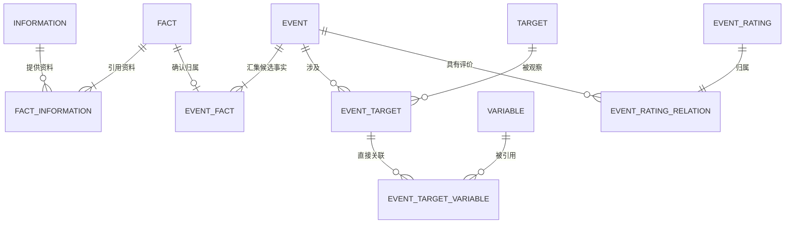

# F02事件管理模块数据模型与存储设计

> V1.0 · 2026-10-27 · 数据模型 V1.0；本机 schema4 已迁移，核心存储与接口已实现，具体覆盖和剩余能力见实施验收。
>
> 用户确认：Fact 为从 Information 提取的候选事件；Fact 与 Information 多对多；Event 为去重确认后的唯一入库事件，Event 与 Fact 一对多。业务关联使用关系表。仅取消 F02 事件版本和更新历史模型，保留资料版本、定义版本和运行审计。

## 1. 文档职责与设计依据

本文件是 F02 表结构、类型、主外键、唯一约束、索引和存储规则的唯一目标定义。业务对象与业务关系见[[tools/RiskHot/docs/system-design/02-业务架构与领域设计/RiskHot_L0_信息处理层_业务架构与领域设计V1.0|L0 领域设计]]；业务流程见[[tools/RiskHot/docs/system-design/03-系统功能架构/F02 事件管理模块功能设计 V1.0|F02 功能设计]]；执行与恢复见[[tools/RiskHot/docs/system-design/04-系统架构设计/03-模块技术详细设计/L0-信息处理层/F02-事件管理/事件数据与状态设计|F02 执行与状态设计]]。

当前业务存储采用 fact、event 及关系表；event_candidates 仅保留运行输出和审核身份，通过 candidate_fact 连接 Fact。旧业务表迁入 f02_legacy，运行应用不读取。实现和真实迁移证据见[[tools/RiskHot/docs/verification/fact-model|Fact 模型验收]]。

## 2. 对象和关系

- 一条 Information 可支持 0～N 个 Fact；一个已保存 Fact 至少关联一条 Information，可关联多条。
- 一个正式 Event 至少关联一个 Fact；一个 Fact 未归组时没有 Event，归组后最多属于一个 Event。
- 同一公告的7天期逆回购与隔夜逆回购可产生两个 Fact，均关联原 Information，不拆分或复制原始资料。
- Event 不存 information_id、fact_id 或 ID 数组；Fact 不存 event_id、information_id 或 ID 数组。
- Event 的来源由 event_fact → fact_information 推导，不再另建可独立编辑的 event_information/event_sources 关系。
- 关系表中的外键列用于表达关系；“不用字段表示关系”指对象表不嵌入其他业务对象的关联字段，不是取消关系表的外键。
- Subject 是用户指定保留的文字属性，不增加 Subject 对象或偷偷改成 subject_id。

## 3. 核心对象表

目标表统一置于 information schema，采用单数表名 fact 和 event（fact 为用户指定，event 为本轮命名统一方案）。业务外键默认禁止级联删除原件、Fact、Event 和定义依据；关系移除须走受控操作。主键采用程序生成的 UUID；不根据标题或 Subject + Action + Time 拼接主键。

### 3.1 fact：候选事件

定位：从一份或多份已保存 Information 中提取、具有独立语义和原文依据的候选事件。Fact 不是“相对前版变化日志”，也不代表已经确认唯一事件身份。

| 字段 | 类型 | 可空 | 业务含义与约束 |
| --- | --- | --- | --- |
| id | UUID | 否 | 主键；恢复、重复读取及后续归组沿用 |
| title | TEXT | 否 | 候选事件标题；非空白 |
| description | TEXT | 否 | 原资料表达的事实、数字、范围和条件；非空白 |
| subject | TEXT | 是 | 行为主体；资料不足保持空，不编造 |
| action | TEXT | 是 | 具体行动文字；不是分类编码 |
| event_status | TEXT | 否 | 资料所描述的业务阶段；七种值见下文 |
| event_time | TEXT | 是 | 事件发生时间；口径见第 4 章 |
| created_at | TIMESTAMPTZ | 否 | 候选首次保存时间，由程序生成 |
| updated_at | TIMESTAMPTZ | 否 | 候选受控维护时间；重试不刷新 |

Fact 的匹配、复核、失败、恢复和排除状态放在运行处理记录中，不复用 event_status。候选可以保留缺失主体或行动，但不得据此直接创建正式 Event。

抽取输出通过结构与证据校验后保存 Fact。已保存的原始候选事实不被后续来源静默覆盖：新的有差异陈述保存为新 Fact；同义且实质相同的候选经明确核对可复用 Fact 并增加资料关系；未完成该核对时可保留独立 Fact，后续归入同一 Event，不自动合并或删除已保存 Fact。处理修复须有审计。

### 3.2 event：唯一正式事件

定位：候选完成身份核对、去重和授权确认后建立的唯一事件，维护当前有效事实。多条 Fact 可共同支撑同一 Event。

| 字段 | 类型 | 可空 | 业务含义与约束 |
| --- | --- | --- | --- |
| id | UUID | 否 | 稳定主键；后续补充同一事件沿用 |
| title | TEXT | 否 | 当前有效事件标题；非空白 |
| description | TEXT | 否 | 当前有效事实、数字、范围及必要限制；非空白 |
| subject | TEXT | 否 | 行为主体；非空白 |
| action | TEXT | 否 | 具体行动文字；非空白 |
| event_status | TEXT | 否 | 当前业务阶段；七种值见下文 |
| event_time | TEXT | 是 | 事件发生时间；未知为空 |
| created_at | TIMESTAMPTZ | 否 | 正式建档时间，由程序生成 |
| updated_at | TIMESTAMPTZ | 否 | 最近有效业务修改时间；纯重试不刷新 |

不设置 event_type、subject_type、subject_name、action_code、first_seen_at、event_time_kind、event_time_precision、event_time_text、event_time_start、event_time_end、event_time_value、revision_no。

event_status 的允许值：expected、announced、in_progress、effective、completed、cancelled、unknown。数据库 CHECK 限制取值；业务阶段与运行状态分开。

唯一性保证分两层：主键保证技术身份唯一；检索、语义比较、授权复核和提交时并发复查共同控制业务重复。不能对 title 或 subject/action/event_time 建自动合并唯一键，也不能宣称 UUID 本身实现语义去重。

## 4. 单一 event_time 的存储口径

event_time 只表示本条 Fact/Event 所描述行动的发生时间，不用发布时间、采集时间、计划实施日或入库时间代填。宣布本身是事件行动时，宣布实际发生的时间可以是该事件的发生时间；不能由此推断另一项计划行动已经发生。

为只保留一个字段又不伪造时刻，本版技术设计选择 TEXT 保存 ISO 8601 的确定精度表达：YYYY、YYYY-MM、YYYY-MM-DD，或带时区的完整时刻（入库统一为 UTC）。例如只知道2026年10月26日，就保存 `2026-10-26`，不补成午夜。

- 未知或仅有预计时间：为空；预计安排保留在 description 及原文中。
- 只有季度、模糊期间或范围：本版为空，原表达保留在 description 和原文；不另外增加时间语义、精度或起止字段。
- 程序验证真实日历日期及格式；数据库约束基本格式，不能只用正则认定日期有效。
- created_at、updated_at 是系统记录时间，不属于额外的事件时间字段。
- 日期范围检索须解释部分日期为范围进行比较，不能对混合精度文本直接排序后宣称是精确时间序。
- 该类型已实现，年月日、闰日、时区和空值均有测试覆盖；原时间为宣布时仅在行动明确是宣布/发布等行为时转换。

## 5. 核心关系表

### 5.1 fact_information：候选—资料，多对多

| 字段 | 类型 | 可空 | 约束与含义 |
| --- | --- | --- | --- |
| fact_id | UUID | 否 | 外键 → fact.id |
| information_id | UUID | 否 | 外键 → F01 Information 稳定身份；现行物理表为 materials.id |
| relation_role | TEXT | 否 | supporting / conflicting；表示该资料支持或质疑候选 |
| created_at | TIMESTAMPTZ | 否 | 首次建立关系的时间 |

联合主键 (fact_id, information_id)。反向索引 (information_id, fact_id)。重投复用关系；原文有变化时证据引用固定相应 F01 资料版本，不用更新关系来覆盖旧证据。

### 5.2 event_fact：正式事件—候选，一对多

| 字段 | 类型 | 可空 | 约束与含义 |
| --- | --- | --- | --- |
| event_id | UUID | 否 | 外键 → event.id |
| fact_id | UUID | 否 | 外键 → fact.id |
| relation_role | TEXT | 否 | initial / progress / supplement / correction / corroboration |
| relation_note | TEXT | 否 | 归属、补充、纠正或佐证理由；不得为空白 |
| created_at | TIMESTAMPTZ | 否 | 归组正式提交时间 |

联合主键 (event_id, fact_id)，另设 UNIQUE(fact_id)，保证一个 Fact 不挂到两个 Event。正式 Event 至少一条 event_fact 的要求在提交时校验，并由延迟约束触发器覆盖直接写入与关联移除。单个 Event 可关联任意多个 Fact；未归组 Fact 没有关联行，不创建空 Event 占位。

归错组的受控调整在同一事务内变更关系、重算受影响 Event 当前事实并写审计。新 Event 至少有一个有效 Fact；若调整导致旧 Event 无支持事实，应阻断并转事件维护处理，不留下无依据的正式事件。

### 5.3 fact_evidence：候选—资料证据关系

| 字段 | 类型 | 可空 | 约束与含义 |
| --- | --- | --- | --- |
| id | UUID | 否 | 证据关系主键 |
| fact_id | UUID | 否 | 与 information_id 复合引用 fact_information |
| information_id | UUID | 否 | 固定资料身份 |
| information_version_id | UUID | 否 | 引用 F01 已保存版本 |
| segment_id | UUID | 否 | 引用该版本中的正文分段 |
| start_cp | INTEGER | 否 | Unicode 码点起点，含起点 |
| end_cp | INTEGER | 否 | Unicode 码点终点，不含终点 |
| quote | TEXT | 否 | 原文精确引文 |
| evidence_role | TEXT | 否 | supporting / conflicting |
| created_at | TIMESTAMPTZ | 否 | 证据登记时间 |

约束：

1. FK(fact_id, information_id) → fact_information。
2. FK(information_id, information_version_id) → F01 同资料版本复合键；FK(information_version_id, segment_id) → F01 同版本分段复合键。实施时按 F01 实际列名映射并补所需唯一键。
3. UNIQUE(fact_id, information_version_id, segment_id, start_cp, end_cp, evidence_role)。
4. CHECK(0 ≤ start_cp < end_cp)；程序校验 end_cp 不越界且 quote 与原文一致。
5. 每个 fact_information 关系至少一条合格证据；在提交事务内检查，实施时用延迟约束触发器补强。
6. 保留 F01 版本外键是原文追溯要求，不重建 Event 版本模型。

## 6. 其他业务对象与关系

Target、Variable 的正式定义及版本继续由对应治理方维护。F02 不因取消事件版本而删除字典版本或模型运行依据。

| 表 | 内容及键 | 规则 |
| --- | --- | --- |
| event_target | event_id、target_id 联合主键；relation_note、created_at、updated_at | 事件—观测主体关系；外键指向 Event 与正式主体 |
| event_target_definition | event_id、target_id 联合主键；definition_snapshot_id | 关系使用的主体定义快照；引用 event_target 与有效快照 |
| event_target_variable | event_id、target_id、variable_id 联合主键；relation_type、change_direction、impact_status、description、created_at、updated_at | 三元关系；复合外键引用 event_target，variable_id 引用正式变量 |
| event_variable_definition | event_id、target_id、variable_id 联合主键；definition_snapshot_id | 对应三元关系实际采用的变量定义快照 |
| event_target_fact | event_id、target_id、fact_id 联合主键 | 复合外键分别引用 event_target 与 event_fact，避免串用其他事件的候选 |
| event_variable_fact | event_id、target_id、variable_id、fact_id 联合主键 | 复合外键引用三元关系与 event_fact |
| event_rating | id 主键；assessment_scope、research_horizon、method_version、m、dimension_scores、financial_usages、reasoning_summary、limitations、rating_status、evaluated_at | 评价自身属性；不放 event_id、basis_revision_no、supersedes_rating_id |
| event_rating_relation | rating_id 主键、event_id；UNIQUE(event_id, rating_id) | 两列外键分别指向评价与事件；一条评价只属于一个事件，一个事件可有多次评价 |
| event_rating_fact | event_id、rating_id、fact_id 联合主键 | 复合外键分别引用 event_rating_relation 与 event_fact，固定评价依据 |
| definition_snapshots | 沿用既有定义快照及不可变约束 | 是主体/变量定义版本，不是 Event 版本；保留 |

本节所列字段除 m 可空外均为必填；JSONB 内部维度分数可按有效方法契约为空。上述关系表不使用对象表内的 ID 数组代替。event_target_variable 必须保存 description，避免丢失范围和限制。关系撤销需要明确决定与审计；本次候选没有提到某关系，不等于应删除旧关系。

补充类型与约束：

- 所有对象标识列为 UUID，关系文字为 TEXT，系统时间为 TIMESTAMPTZ；定义快照引用为 UUID。
- relation_type：direct_change / direct_involvement / observed_change。
- change_direction：increase / decrease / unchanged / unknown。
- impact_status：expected / announced / effective / unknown。
- assessment_scope、research_horizon、dimension_scores、financial_usages、limitations 用 JSONB，按有效方法契约校验；method_version、reasoning_summary、rating_status 用 TEXT。
- m 为 NUMERIC(5,2)，可空，CHECK(m IS NULL OR m BETWEEN 0 AND 100)；rating_status 为 draft / confirmed / needs_reassessment。没有已批准量化方法时保持空分和 draft。
- 一条评价至少一条本事件 Fact 依据；同一评价操作重复提交复用原记录。评价为独立业务判断，不保存 Event 的版本快照或前后版本链。
- 可选定义缺口留在治理候选与运行记录，不造正式 Target/Variable。

## 7. 取消、保留与替代

本章集中维护字段删改和旧模型替代说明；功能设计仅描述调整后的业务行为。

### 7.1 Event 字段变更对照

| 原字段 | 目标处理 | 转换要求 |
| --- | --- | --- |
| event_type | 删除 | 不迁入目标 Event；保留在迁移备份中 |
| subject_type | 删除 | 不再作为 Event 属性；不影响 Target 的正式类型定义 |
| subject_name | 改为 subject | 迁移行为主体文字，不改为主体外键 |
| action_code | 改为 action | 目标保存具体行动文字；旧值若为编码，须结合原文核对含义，不能仅改列名 |
| event_time | 保留 | 只表示实际发生时间，按第 4 章统一精度表达 |
| event_time_kind、event_time_precision、event_time_text、event_time_start、event_time_end、event_time_value | 删除 | 核对原语义后转换确定发生时间，不能拼出未经证实的时刻；无法转换的表达保留在描述和证据中 |
| first_seen_at | 删除 | 不再作为事件属性；保留既有运行审计和迁移备份 |
| revision_no | 删除 | 不建立 F02 事件版本序号或版本链 |
| id、title、description、event_status、created_at、updated_at | 保留 | 按第 3 章的目标约束转换；原正式事件身份保持不变 |

### 7.2 表结构及引用替代

| 原模型或字段 | 目标处理 | 替代方式 |
| --- | --- | --- |
| EventUpdate / event_updates | 取消“增量历史实体”定位 | 改为 Fact 候选模型；按原始候选重建，不能直接改名 |
| event_update_supersedes | 取消事件更新前后链 | 关联到同一 Event 的 Fact、纠正理由及运行审计 |
| event_revisions | 取消 | Event 当前事实 + Fact/资料证据 + 运行审计 |
| event_update_evidence | 随旧更新模型退出 | 转为 Fact 与资料的证据关系，核对实际归属 |
| event_sources / EventInformation | 不再独立维护事件—资料关系 | 由 event_fact 和 fact_information 查询推导 |
| event_evidence 及旧证据连接表 | 按事实归属迁移 | fact_evidence 及事件关系—Fact 连接表 |
| event_candidates 的业务 payload | 迁移为 fact | 原运行状态、步骤、预算、尝试保留在运行记录 |
| event_ratings 的事件修订引用 | 去掉 | event_rating_relation + event_rating_fact |
| Event revision_no 及消息 revision_no | F02 新契约不再使用 | 固定提交身份、内容摘要与消息去重 |
| F01 原件/资料版本、定义版本 | 保留 | 不属于此次删除范围 |
| 模型工件、复核、操作审计、提交/交付回执 | 保留 | 运行可追溯与恢复；不作为隐形事件版本表 |

旧“查看历史版本”能力不再是目标业务能力；事件详情展示当前 Event、关联 Fact 和原文证据，授权操作审计单独查询。不能继续承诺按 revision_no 回放事件快照。

### 7.3 查询与页面切换要求

查询与页面读取目标 Event 当前内容，并通过关系表读取 Fact、来源、主体/变量及评价。退出 event_type 筛选和基于 EventRevision 的“查看历史版本”入口；候选事实、资料版本和操作审计作为独立追溯内容呈现。旧页面和接口切换须与第 9 章迁移一并验证，不能只删除界面入口而保留对旧修订表的隐式依赖。

## 8. 保存、去重与交付约束

1. **候选保存**：校验抽取响应、原文定位后，原子保存 Fact、fact_information、fact_evidence 及运行关联；同一处理的已接纳候选重试不得再生成新 Fact。运行与 Fact 的对应采用独立连接记录，不把 processing_id 塞进 Fact。
2. **候选复用**：同一实际陈述、数字、范围和阶段经核对一致，可复用 Fact 并补资料；有实质差异或纠正保留新 Fact。来源相同不等于 Fact 相同，一份资料可包含多个候选。
3. **事件归组**：先匹配现有 Event，返回 NEW / REUSE / UNRESOLVED；只有完整检索和有效复核支持时才创建新 Event。
4. **正式提交**：锁定有效运行与候选，检查新建检索上下文或已有 Event 的批准时内容摘要；将 Event 当前事实、event_fact、适用关系/评价、审计、提交回执和交付意图同事务保存。
5. **当前事实更新**：纠正、补充或进展必须明确列出需更新字段及 Fact 依据；标题、描述、主体、行动、阶段和发生时间都可受控更新。保留旧 Fact 和审计，不只增加关联却留下错误的当前描述。
6. **并发**：短事务内按统一锁序核对集合变化及 Event 内容摘要，过期批准回到相应比较步骤；不可直接替换摘要后提交。集合协调是共享执行控制，不建立事件历史版本链。
7. **交付**：新契约以 commit_key/message_id 标识一次已提交变化，持久保存当次交付内容与摘要；重试读取原交付内容，不能重新读取已改变的当前 Event。交付文件是消息工件，不恢复 revision_no 或 EventRevision 表。
8. **乱序**：同事件消息通过共享交付的前序消息依赖连接记录表达顺序；消费者先登记接收，再按依赖应用。依赖未满足显示待应用，不能旧消息覆盖新状态。接收状态与应用状态分开。
9. **审计**：保留操作者、理由、前后值、Fact 依据及操作时间，关联通过运行连接记录表达。无变化提交不刷新 Event，不产生重复业务通知。
10. **索引**：event(updated_at,id)、event(event_status,updated_at,id)、event(subject,action)；fact(created_at,id)；关系表联合主键和反向查询索引；不建立被取消字段的索引。

交付通知类型保留 event_created、event_updated、event_rating_updated、event_source_attached，分别对应新事件、事实变化、评价变化和来源增加。消息标识、固定提交内容及前序依赖用于可靠交付，不充当 Event 的版本模型。

## 9. 旧数据迁移与验收设计

下列步骤已在本机切换中执行；更换环境仍须重新备份并验证。详细记录见实施验收，不能以本机成功代替其他环境检查。

### 9.1 迁移与回退

1. 备份旧库、原件、审批、修订及交付文件，记录数量和摘要；保留历史验收证据，不改写旧 schema3 文件来伪装新建成功。
2. 从已接纳的候选 payload 与原始输入恢复 Fact；旧 Update 只能帮助核对语义，不是一条 Update 自动等于一个 Fact。无法还原的记录列入迁移问题，不编造候选。
3. 按已保存归组结果建立 event_fact，保留原正式 event ID；建立 fact_information 与对应版本证据。多来源、同文多候选均须逐条核对。
4. subject_name → subject，action_code → action；只迁移确实发生的 event_time。旧时间为 announced 时核对 action 是否为宣布行为；expected/unknown 不转成已发生时间，原语义保留在 Fact 描述及审计。取消的字段先存备份，不凭空回填。
5. 迁移评级和主体/变量关系，补齐 Fact 依据；无法证明原归属时转人工核对。运行记录的 candidate_id 用独立映射连接 Fact，保持原尝试、预算、审核可查。
6. 新旧交付协议分开识别；旧消息按旧协议读完或冻结归档，历史回执保留。下游不得把旧 event_update_id 自动当作 fact_id。
7. 在隔离数据库验证数量、关联、证据、去重、错误回滚和恢复；应用读写及页面全部切换后，再退出旧事件版本表。删表不得级联删除 F01 资料、定义版本或共享审计。
8. 验收失败回滚应用和数据库切换，保留迁移映射与问题清单；不以清空业务库作为迁移策略。

### 9.2 数据与存储验收

| 验收场景 | 目标结果 |
| --- | --- |
| 同一公告含7天期和隔夜逆回购 | 一条 Information，两个 Fact，经归组形成两个独立 Event |
| 两份资料支持同一候选事实 | 一个 Fact 通过关系表关联两条 Information |
| 不同阶段的 Fact 指向同一行动 | 多个 Fact 关联一个 Event，当前阶段按证据更新 |
| 同一 Fact 被提交到两个 Event | UNIQUE(fact_id) 拒绝；不产生部分关系 |
| 官方纠正金额 | 新 Fact 保留原依据，Event 当前标题/描述同步改正，审计可查 |
| 重复抓取、模型重试、提交响应丢失 | 不重复 Fact、Event、关系或评价；回原操作结果 |
| 时间仅到日或未知 | 保留日值或空，不伪造午夜或采集日期 |
| 非事件、未归组或冲突 | 可查运行结果；不创建空 Event |
| 删除事件版本模型 | 新接口不依赖修订表，原文/定义版本及审计仍可读 |
| 新协议交付失败、重复或乱序 | 固定文件可重读、消息不重复应用、先后依赖可恢复 |

### 9.3 功能验收对应的技术检查

以下检查承接功能验收中的业务要求；技术实现方式集中在本文件维护。

| 功能验收 | 技术检查 |
| --- | --- |
| AC-F02-17、35：历史依据可追溯 | Fact、F01 资料版本和审计可读取；查询不依赖 EventRevision 快照 |
| AC-F02-27、34：恢复不重复处理 | 按原提交身份查回执；已接纳候选使用稳定运行关联，恢复不重新分配 Fact 身份 |
| AC-F02-28、40：多资料、多版本证据可核对 | fact_information 维护资料身份关系，fact_evidence 固定版本、位置及作用；同一 Fact 可关联两份资料 |
| AC-F02-33：依据变化后重新核对 | 提交时检查批准上下文和内容摘要，拒绝过期批准；不借助事件修订表实现该检查 |
| AC-F02-41：唯一候选归属 | UNIQUE(fact_id) 与提交校验拒绝第二个归属，失败时不留下部分关系 |
| AC-F02-42：不伪造发生时间 | 校验部分日期和空值，不用预计日期、采集时间或补造午夜替代 |
| AC-F02-43：当前事件及依据可读取 | 新接口采用第 3 章字段，取消字段及修订表依赖全部退出，追溯关系完整 |
| AC-F02-44：乱序不覆盖有效结果 | 接收与应用分别记录，前序依赖未满足时不应用，重投不重复生效 |

## 10. 设计决定与实现边界

本轮决定记录见[[tools/RiskHot/docs/system-design/04-系统架构设计/05-架构治理与验证/架构决策记录/ADR-L0-003-Fact与唯一事件模型|Fact 与唯一事件模型决策]]。

收益是候选事实与唯一事件分离，资料证据可复用，取消额外的事件版本链。代价是当前状态更新、并发和交付恢复必须改造；业务页面不再提供 Event 历史版本回放。本机页面和运行库已切到新模型；业务能力覆盖以验收报告为准，跨来源 Fact 人工合并等未完成能力不能因表已建立而标为完成。

历史实现及验收见[[tools/RiskHot/docs/verification/f02-events|旧模型实施与验收记录]]。旧模型的 186 项测试通过结果仅能证明当时实现；本目标模型的代码、数据库迁移、页面、真实任务和自动化回归须分别重新验证，不能沿用旧结果宣称已完成。

### 10.1 schema4 实现映射

Information 及其版本对应既有 materials/material_versions。candidate_fact 连接运行候选与业务 Fact；definition_snapshots 保留定义版本，event_target_definition/event_variable_definition 表达有效定义关系。数据库用延迟约束检查 Event、Fact、资料关系及评价的必要依据。

消息公共表增加 created_at 用于显示顺序，event_message_dependencies 存放前序关系；消费进度以 last_message_id 记录应用位置，不包含 revision_no。新候选与交付文件采用 v2，历史文件保持原字节。旧资料回填仅处理 version_id 非空的资料消息。

当前候选精确复用要求同资料、核心内容及证据集合一致；跨来源语义复用不得通过字符串猜测自动完成，现行处理可将其作为佐证 Fact 归入原 Event。跨来源人工合并入口尚未实现，见验收边界。
