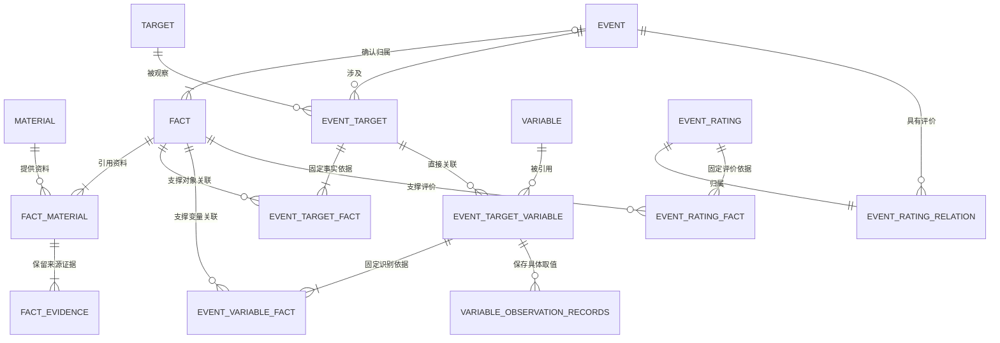
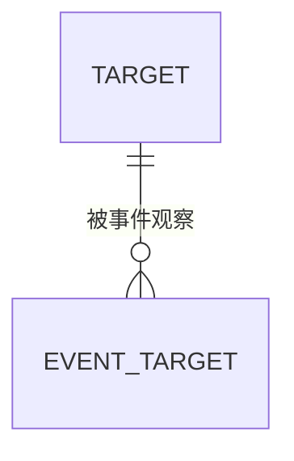

# F02事件管理模块数据模型与存储设计

> V1.11 · 2026-10-31 · 以 L0 当前领域对象与关联规则为基准，补齐 fact.object，分离变量关联与变化结果、评价与金融用途；本版修订待实施。 来源关联表改为 fact_material，Event—Fact 归属由 fact.event_id 承载，取消独立 event_fact 表；本次结构调整尚待工程实施。变量观测记录保留单一主表设计，尚待工程实施。新增 Event.object 事件客体字段目标设计，运行字段迁移与读写适配待实施。Target 采用单一主表，分类、别名、范围分别由 categories、aliases、scope_definition 表达，不再建立范围细分关系表；既有 Event—Target 关系保留。Target 主表及 AI-07 运行表已实现并在隔离数据库验证；正式运行库尚未应用新增迁移。
>
> 用户确认：Fact 为可跨报道复用的统一事实单元，Event 归组前承担候选事件角色；Fact 与 material 通过 fact_material 多对多关联；Event 为去重确认后的唯一入库事件，Event 与 Fact 一对多，以 Fact 上的可空外键表达归属。其他业务关系沿用各自设计。F02事件版本仍取消；F01资料版本改为material字段，独立原件及资料分析记录取消，定义版本和通用运行审计保留。

> **F01依赖边界**：不再依赖operation_id、acquisition_id、processing_runs或独立material交付表。Fact/Event及其既有关系承接业务结果，公共执行只承接运行设施。涉及旧输入Schema与运行恢复的技术文档必须随后同步，不能将本次文档修改标成工程完成。

> **2026-10-31 多来源 Fact 与表结构确认**：描述同一次具体发生的多份资料，经核定复用一个 Fact，通过 fact_material 关联并分别保留来源依据。V1.9 先确认多来源语义；本版进一步将 fact_information 改名为 fact_material、其 information_id 改为 material_id，并取消独立 event_fact（本次请求中的 fact_event 指此表）。归属及角色、理由、时间迁入 fact，业务基数不变；不包含证据存储简化，也不表示数据库已迁移。

## 1. 文档职责与设计依据

本文件是 F02 表结构、类型、主外键、唯一约束、索引和存储规则的唯一目标定义。业务对象与业务关系见[[tools/RiskHot/docs/system-design/02-业务架构与领域设计/RiskHot_L0_信息处理层_业务架构与领域设计V1.0|L0 领域设计]]；业务流程见[[tools/RiskHot/docs/system-design/03-系统功能架构/F02 事件管理模块功能设计 V1.0|F02 功能设计]]；执行与恢复见[[tools/RiskHot/docs/system-design/04-系统架构设计/03-模块技术详细设计/L0-信息处理层/F02-事件管理/事件数据与状态设计|F02 执行与状态设计]]。

现行运行存储已采用 fact、event 及旧命名关系表；event_candidates 仅保留运行输出和审核身份，通过 candidate_fact 连接 Fact。旧业务表迁入 f02_legacy，运行应用不读取。实现和真实迁移证据见[[tools/RiskHot/docs/verification/fact-model|Fact 模型验收]]。本版 fact_material 与 fact.event_id 属于后续目标结构，须按 §9.4 另行迁移和验证，不能沿用此前验收证明本次调整已实施。

### 1.1 业务基准与覆盖边界

以 L0 §3.4、§4.1～§4.3 的现行对象、属性与关联为业务基准；历史 AI 字段、旧实施快照及本文件早期表结构不能反向改变领域职责。关系依据、定义快照、操作回执和证据定位属于存储支撑，不因业务清单没有同名对象而删除。十一类对象的逐项核对及未定项见[[tools/RiskHot/docs/audit/数据模型与领域对象一致性检查-2026-10-31|数据模型与领域对象一致性检查]]。

本文件覆盖 F02 对象及关系；InformationSource、material 和 Variable 分别引用 M1、F01、M2 的权威定义，不在 F02 重复建表。L1～L3 的风险、快照和报告不是此处遗漏的 F02 表，需由相应模块另行维护存储设计。

## 2. 对象和关系



- 一条 material 可支持 0～N 个 Fact；一个已保存 Fact 至少关联一条 material，可关联多条。
- 一个正式 Event 至少关联一个 Fact；一个 Fact 未归组时没有 Event，归组后最多属于一个 Event。
- 同一公告的7天期逆回购与隔夜逆回购可产生两个 Fact，均关联原 material，不拆分或复制原始资料。
- Event 不存 material_id、fact_id 或 ID 数组；Fact 用可空 event_id 表达当前唯一归属，不存单一 material_id 或来源 ID 数组。
- Event 的来源由 fact.event_id → fact_material → material 推导，不再另建可独立编辑的 event_information/event_sources 关系。
- Event—Fact 一对多归属直接使用 Fact 外键；Fact—material 多对多保留关系表。取消独立归属表不改变业务关系，也不将来源压缩为一对一。
- 领域关联对象 FactMaterial 对应 fact_material；原 EventMaterial 退出独立对象清单，仅保留派生的事件来源查询。Event—Fact 是由 Fact 承载的归属关系，不再命名为独立 EventFact 对象。领域名与表名不能机械一一对应，证据等存储辅助结构沿用各自设计。
- Subject 是用户指定保留的文字属性，不增加 Subject 对象或偷偷改成 subject_id。

## 3. 核心对象表

目标表统一置于 information schema；Fact、Event 与新增 Target 主表分别采用 fact、event、target（fact 为用户指定，event 为本轮命名统一方案）。业务外键默认禁止级联删除material、Fact、Event 和定义依据；关系移除须走受控操作。主键采用程序生成的 UUID；不根据标题或 Subject + Action + Time 拼接主键。

### 3.1 fact：候选事件

定位：从一份或多份已保存 material 中识别、统一表征同一次具体发生的事实单元；不同来源经核对可复用同一 Fact。Event 归组前承担候选事件角色，Fact 不是“相对前版变化日志”，也不代表已经确认唯一 Event 身份。

| 字段 | 类型 | 可空 | 业务含义与约束 |
| --- | --- | --- | --- |
| id | UUID | 否 | 主键；恢复、重复读取及后续归组沿用 |
| title | TEXT | 否 | 候选事件标题；非空白 |
| description | TEXT | 否 | 原资料表达的事实、数字、范围和条件；非空白 |
| subject | TEXT | 是 | 行为主体；资料不足保持空，不编造 |
| action | TEXT | 是 | 具体行动文字；不是分类编码 |
| object | TEXT | 是 | 事实中行为作用或涉及的客体原文表达，保留称谓、范围与限制；未知为空，非空不得为空白，不保存 Target ID |
| event_status | TEXT | 否 | 资料所描述的业务阶段；七种值见下文 |
| event_time | TEXT | 是 | 事件发生时间；口径见第 4 章 |
| event_id | UUID | 是 | 外键 → event.id；未归组为空，归组后指向唯一 Event；禁止级联删除 |
| event_relation_role | TEXT | 是 | 本 Fact 对 Event 的作用：initial / progress / supplement / correction / corroboration；与 event_id 同空或同有值 |
| event_relation_note | TEXT | 是 | 归属、补充、纠正或佐证理由；已归组时必填且非空白 |
| event_assigned_at | TIMESTAMPTZ | 是 | 当前归属正式提交时间；与 event_id 同空或同有值，重试不刷新 |
| created_at | TIMESTAMPTZ | 否 | 候选首次保存时间，由程序生成 |
| updated_at | TIMESTAMPTZ | 否 | 候选受控维护时间；重试不刷新 |

**客体承载**：object 落实 L0 Fact 的客体属性，按原文保留并列对象及必要限定；逐项线索对应的证据沿用 fact_evidence，尚未设计的 AI-08 候选载体不塞进此字段。Fact → Event 映射复制有依据的客体文字，不能在正式 Target 匹配后反向改写原始事实。旧数据仅在已保存抽取结果与原文可核验时补齐；无法确认则留空并记录补证缺口，禁止用 Event 或 Target 名称猜填。

Fact 的匹配、复核、失败、恢复和排除状态放在运行处理记录中，不复用 event_status。候选可以保留缺失主体或行动，但不得据此直接创建正式 Event。

抽取输出通过结构与证据校验后，按同次发生核定结果保存或复用 Fact。跨来源复用依据主体、行动、对象、时间、行动标识、阶段及范围，不要求报道原文完全相同；新增来源写入 fact_material 及对应证据，不静默覆盖已有内容。另一具体发生另建 Fact；单纯补充、纠正或数值冲突不直接证明是另一发生，须分别保留依据并核定。未完成核对可保留独立候选及待核对记录，后续归入同一 Event 不等于已完成 Fact 去重；已有 Fact 的合并、修订和引用迁移须受控并有审计。

### 3.2 event：唯一正式事件

定位：候选完成身份核对、去重和授权确认后建立的唯一事件，维护当前有效事实。多条 Fact 可共同支撑同一 Event。

| 字段 | 类型 | 可空 | 业务含义与约束 |
| --- | --- | --- | --- |
| id | UUID | 否 | 稳定主键；后续补充同一事件沿用 |
| title | TEXT | 否 | 当前有效事件标题；非空白 |
| description | TEXT | 否 | 对事件核心事实及必要背景、关键数值、适用范围、条件和限制的规范化描述；非空白 |
| subject | TEXT | 否 | 行为主体；非空白 |
| action | TEXT | 否 | 具体行动文字；非空白 |
| object | TEXT | 是 | 事件行为作用或涉及的客体名称；保留原文语义，未知或无可识别客体时为空 |
| event_status | TEXT | 否 | 当前业务阶段；七种值见下文 |
| event_time | TEXT | 是 | 事件发生时间；未知为空 |
| created_at | TIMESTAMPTZ | 否 | 正式建档时间，由程序生成 |
| updated_at | TIMESTAMPTZ | 否 | 最近有效业务修改时间；纯重试不刷新 |

**事件事实描述 description**：统一承载事件事实及理解该事实所需的语义上下文，用于事件展示、持续追踪和 Target、Variable 识别；不再单列“事件语义信息”业务属性。

**事件客体 object**：保存事件事实中的客体文字，为后续 Target 识别提供输入。多个对象按原文并列表达，逐项对象线索及正式 Target 关系由对应处理与关联结果承接；本字段不存 Target ID，也不以标准化 Target 名称覆盖原文客体。非空时应有本事件 Fact 与原文依据，不保存空白字符串；未知或未识别时保留 NULL，不影响已有明确事实的事件身份。

不设置 event_type、subject_type、subject_name、action_code、first_seen_at、event_time_kind、event_time_precision、event_time_text、event_time_start、event_time_end、event_time_value、revision_no。

event_status 的允许值：expected、announced、in_progress、effective、completed、cancelled、unknown。数据库 CHECK 限制取值；业务阶段与运行状态分开。

唯一性保证分两层：主键保证技术身份唯一；检索、语义比较、授权复核和提交时并发复查共同控制业务重复。不能对 title 或 subject/action/event_time 建自动合并唯一键，也不能宣称 UUID 本身实现语义去重。

### 3.3 Target：分类目录与已收集观测对象

依据[[tools/RiskHot/docs/references/金融风险研究对象分类索引 V1.0|金融风险研究对象分类索引 V1.0]]重新设计。该索引提供六大类、二级分类与对象示例，允许跨类；它是研究分类法，不是对象唯一身份字典，也不表示每个示例已建立对象记录。

**本次决定**：取消 `target_code`。`target` 只保存经过收集、范围定义和身份核定的观测对象，UUID 为稳定技术身份；一级/二级分类直接存入主表 categories 字段，每项保留完整配对，支持一个对象多个分类。不用“名称相同”或“分类相同”直接合并对象。

方案取舍与迁移风险见[[tools/RiskHot/docs/system-design/04-系统架构设计/05-架构治理与验证/架构决策记录/ADR-Target-001-分类目录与观测对象分离|Target 分类字段存储决策]]。

本节为物理表、字段与约束的权威目标设计。领域文档保留业务属性；已有运行中的 JSON 定义集合按本节末尾迁移，不将目标设计写成已经实现。

#### 3.3.1 表的分工

| 表（information schema） | 保存内容 | 关系 |
| --- | --- | --- |
| target | 具体观测对象的名称、别名、分类、辖区、范围、状态和版本 | 可被多个 Event 引用 |



#### 3.3.2 target：观测对象主表

| 字段 | 类型 | 可空 | 含义与约束 |
| --- | --- | --- | --- |
| id | UUID | 否 | 主键，由程序生成；原 target_id 引用映射到本列 |
| target_name | TEXT | 否 | 正式名称，去除首尾空白后非空；不全局唯一 |
| aliases | TEXT[] | 否 | 已核定的别名、简称和历史名称；默认空数组，校验规则见 §3.3.5 |
| categories | JSONB | 否 | 非空分类数组；每项包含一级分类 primary_category 与二级分类 secondary_category，结构及取值见 §3.3.3～3.3.4 |
| jurisdiction | TEXT | 是 | 国家、地区、跨境或全球范围；未知为空，不靠默认国家填充 |
| scope_definition | TEXT | 否 | 范围说明：对象是什么、包含与排除什么，以及必要身份限定；非空白，示例见 §3.3.6 |
| is_active | BOOLEAN | 否 | 默认 true；停用后禁止新的业务引用，保留历史 |
| definition_version | INTEGER | 否 | 默认1且大于0；定义发生有效变化时递增，不能由 AI 指定 |
| created_at | TIMESTAMPTZ | 否 | 程序首次保存时间，默认 now() |
| updated_at | TIMESTAMPTZ | 否 | 最近受控修改时间；无变化重试不刷新 |

不设业务编码、分类外键、单值 target_type、parent_target_id、变量 ID 数组、风险类型或实时指标字段。分类是 Target 自身的描述属性，不是需独立建档的业务对象。对象身份不随分类目录调整而重新分配。

`scope_definition` 承载与对象身份相关的币种、发行主体、期限、条款、覆盖范围等已知限定。首版不为六类对象扩张成大量可空专属列，除结构明确的 categories 外，不设置无约束属性 JSON；若后续需要按期限等进行结构化查询，再设计有明确类型的扩展表。

“美国国债”“某一发行批次国债”和“美国10年期名义固定利率国债”可以是不同粒度的研究对象，须明确其范围。持有人视角、评价期限和当次风险判断属于研究记录；只有用于区分某个具体持仓/组合身份的限定才进入对象定义。

#### 3.3.3 categories：直接保存一级和二级分类

不设置 target_category 或 target_category_relation 表，不分配分类 ID，也不通过外键查询分类。使用一个结构明确的 JSONB 字段保存配对，避免把两个独立数组的一级和二级分类错配。

```json
[
  {
    "primary_category": "金融资产与金融合约",
    "secondary_category": "主权债务工具"
  }
]
```

| 数组项字段 | 类型 | 可空 | 含义 |
| --- | --- | --- | --- |
| primary_category | 字符串 | 否 | 一级分类名称，例如“金融资产与金融合约” |
| secondary_category | 字符串 | 否 | 与该一级分类配套的二级分类，例如“主权债务工具” |

每个对象至少有一项分类；交叉分类通过增加配对项表示，不重复创建 Target，不设置强制主分类。每项只能包含上述两个键，值须为非空白字符串，同一配对不能重复。

初始字段取值按项目内参考文档第2节约定，以下 A～F 仅为原文展示序号，不增加编码字段：

| 一级分类 | 二级分类 |
| --- | --- |
| 货币与货币形态 | 货币单位、中央银行货币、商业银行存款货币、其他货币性工具 |
| 金融资产与金融合约 | 主权债务工具、企业债务工具、信贷资产、证券化产品、权益资产、集合投资产品、衍生金融工具、其他金融合约 |
| 金融主体与机构 | 主权及公共部门、货币当局、存款类金融机构、非银行金融机构、非金融部门、机构投资者 |
| 金融市场与基础设施 | 货币市场、债券市场、股票市场、外汇市场、衍生品市场、金融基础设施 |
| 金融体系与宏观制度 | 国家金融体系、货币与汇率制度、金融部门体系、跨境金融网络、全球金融体系 |
| 投资组合与交易策略 | 单一资产持仓、多资产组合、杠杆与融资策略、风险对冲策略 |

共6个一级分类、33个二级分类。它们是字段取值约定，不是待初始化的数据库记录。可受控扩展，不将 A～F 或旧宏观五类写成封闭 CHECK 枚举。原文第4节的三级具体对象、四级具体品种作为不同范围的 target，以 scope_definition 说明差异，不新增为分类字段或自动建档。

#### 3.3.4 分类字段校验与维护

数据库检查 categories 为非空数组；写入适配器逐项校验两个必需键、字符串类型、非空值、无额外键和配对不重复。正式写入前按当前有效的分类规则核对一级/二级对应关系，例如“货币与货币形态＋主权债务工具”不是合法配对。

分类规则由项目内参考约定发布为程序可校验的配置，不新增分类管理表，也不要求运行时读取另一个项目或动态解析 Markdown。规则版本随任务输入和定义快照保留，具体配置载体在实现时确定。

无法确定分类或当前规则未覆盖时保留对象候选与缺口，不能随意猜填。分类变化经受控修改写回本对象 categories，递增对象定义版本并保留审计；不能因一次事件未提及而移除分类。分类本身没有独立身份或定义快照。

#### 3.3.5 aliases：直接保存名称列表

不单独建立 target_alias 表。别名直接保存到 target.aliases，类型为一维 TEXT[]，NOT NULL，默认 ARRAY[]::TEXT[]。没有已核定别名时保持空数组，不补猜名称。

例如正式名称“美国联邦储备系统”，aliases 可保存：

```json
["美联储", "Federal Reserve", "Fed"]
```

- 每项为去除首尾空白后的非空文字，不允许 NULL 元素或多维数组。
- 同一对象内按去除首尾空白、忽略大小写后的结果去重；展示保留名称原有大小写，不重复保存与正式名称等价的别名。
- 不同对象可以拥有相同别名。别名仅用于召回，不构成自动复用依据。
- 增删别名须有核定依据并保留审计，按对象定义变更递增 definition_version；历史定义快照保留当时的 aliases。
- 历史名称的适用时间或辖区限定保留在 scope_definition 和版本依据中，不凭更名自动认定同一身份。事件中的临时称谓保留在 Fact/证据上下文，不自动加入 aliases。

数组结构由数据库与写入适配器共同检查；归一化去重、正式名称重复检查和依据核验在写入前执行，不把 TEXT[] 类型本身当作完整校验。

#### 3.3.6 scope_definition：直接说明对象范围

使用 Target 主表已有的 scope_definition 字段，类型为 TEXT、不可为空或空白。不建立对象范围层级表，也不增加父对象 ID。该字段写清对象是什么、包含什么、不包含什么，以及决定身份的币种、期限、条款或辖区等已知限定。

| 对象名称 | scope_definition 示例 |
| --- | --- |
| 美国国债 | 美国财政部发行的国债，包括短期国库券、中长期国债等；不包括美国地方政府债和企业债。 |
| 美国10年期名义固定利率国债 | 美国财政部发行、原始期限为10年的名义固定利率国债；不包括通胀保值国债，也不特指某一期债券。 |
| 美国国债市场 | 美国国债的发行与交易市场，关注交易、定价和流动性；不表示某一只国债或某个投资者的持仓。 |

示例用于解释字段，不自动生成对象。AI-07（Target 同一性判断）结合名称、分类、辖区及范围说明判断身份；名称接近或范围有包含关系，不能直接判为同一对象。

已知限定如实写入，未知项不补猜；不足以确定对象身份时保留候选待核定。文字提到更广或更细的对象不自动建立结构化关联，也不据此推断发行、持有或因果关系。当前不支持按对象范围树递归查询。

修改 scope_definition 时保留依据和审计，按对象定义变更递增 definition_version；历史事件仍引用当时的定义快照。

#### 3.3.7 实例示意与去重

下列是逻辑示意，不生成真实对象、UUID 或初始入库数据：

| Target 名称 | 分类路径 | 范围说明 |
| --- | --- | --- |
| 美元 | 货币与货币形态 / 货币单位 | 货币计价单位，与美元外汇市场区分 |
| 美国国债 | 金融资产与金融合约 / 主权债务工具 | 美国财政部发行的国债工具范围，不等同于市场或发行机构 |
| 美国10年期名义固定利率国债 | 金融资产与金融合约 / 主权债务工具 | 美国国债的细分研究对象，不自动等于某一期具体证券 |
| 美国财政部 | 金融主体与机构 / 主权及公共部门 | 机构对象，与其发行的国债分别建档 |
| 美国国债市场 | 金融市场与基础设施 / 债券市场 | 国债交易和定价的市场范围 |
| 美国金融体系 | 金融体系与宏观制度 / 国家金融体系 | 系统层对象，不与单一市场或机构合并 |
| 美债基差交易 | 投资组合与交易策略 / 杠杆与融资策略 | 策略对象，不等于某个投资者的具体头寸 |

交叉分类示例：同一项银行存款若同时具备支付货币与信贷资产研究属性，按其已核定定义在 categories 中保存相应配对，仍保留一个 Target ID。不把所有“银行存款”一律双归类，也不因目录出现两次而创建两个对象。

去重综合名称/别名、辖区、分类含义及范围，由 AI-07（Target 同一性判断）给出建议、程序和治理方核定。名称、分类、范围文本的拼接唯一键不能证明业务同一性；UUID 也只保证技术身份。

#### 3.3.8 索引、版本与一致性

- 正式名称建立 lower(btrim(target_name)) 检索索引；别名首版由程序读取 aliases 数组按同一归一化口径匹配，不另设别名表或别名索引；另建 target(is_active, jurisdiction)及 target.categories 的 GIN 索引。分类查询按同一个数组项中的一级/二级配对过滤，避免跨项误匹配。首版不引入新的搜索服务。
- 对象相关外键使用禁止级联删除的策略；停用保留已有 Event 引用。分类、别名和范围都是主表属性，不存在分类外键或对象层级的循环校验。
- 首版新增 Target 经治理提交队列串行核定；提交前重查已存在对象并记录复用/新建理由。语义不明继续复核，不声称名称索引能防止所有业务重复。
- target 的名称、范围、辖区、状态、别名、分类归属受控改变时递增 definition_version；受影响对象定义与审计在一个事务提交。分类规则变化时不静默覆盖既有对象；实际调整 categories 的 Target 才递增自身定义版本；仅更新时间或无变化重试不递增。
- 继续复用 definition_snapshots：kind='target'，definition_id 对应 target.id，definition_version 由正整数转成文本，payload 保存当时对象及 categories、aliases、scope_definition、分类规则版本；digest 按现有规则计算。同一对象同一版本只能有一个不可变快照。旧文本版本保留历史，不就地改号。
- event_target.target_id 增加到 target.id 的外键；event_target_definition 继续固定使用的快照。程序核验 snapshot.kind、definition_id 与所关联 target_id 一致，不能只凭快照存在就接受。
- 权限沿用现有读取与治理授权。AI 仅读取允许的候选和快照，不直接写库；AI-07 的类型输入由 categories 中的有效分类配对及对象范围提供，不能把分类路径当唯一身份。

#### 3.3.9 现有 JSON 定义迁移与验收

旧包继续从 definition_sets.payload.targets 读取，再保存 definition_snapshots；新包 f02-target-identity-v3 已改为从 target 主表召回，并仅向下游提供本次已核定的 Target。未自动迁移旧定义或切换旧运行。

实施时先枚举已有 Target 及全部历史关系引用，能确认同一身份的继续沿用 UUID；对缺名称、辖区、范围或分类的记录列出待核定清单，不根据旧代码猜填。停用但仍被历史引用的对象也须迁移为可追溯记录。未解析引用不得直接启用新外键，完成核对后才能切换。

保留旧定义集合、快照和版本；建立旧版本到新定义的迁移记录。已有快照版本与新整数版本冲突时选择未占用的新版本起点，不覆盖历史。发布新快照与读取适配后，再切换到主表字段查询；回退恢复旧读取入口，不删除新产生的业务结果。

待执行验收包括：6/33分类配对校验；categories 空数组/错类型/错配/重复项拦截；一对象多分类；同名异辖区；aliases 空数组、NULL/空白/重复项拦截及跨对象别名冲突；金融工具/市场/机构分离；scope_definition 必填及范围差异保留；停用保留历史；定义版本及快照归属；并发重复核定；旧引用迁移与回退。文档检查不等于数据库或真实 AI 验收。

#### 3.3.10 AI-07 实施存储与兼容边界

迁移 `src/db/007-target-identity.sql` 已实现 target 主表（§3.3 字段）以及下列运行存储；均已在隔离数据库验证重复执行。正式库未部署，不能据此认定已上线。运行流程见[[tools/RiskHot/docs/system-design/04-系统架构设计/03-模块技术详细设计/L0-信息处理层/F02-事件管理/AI任务技术详细设计/AI-07-Target同一性判断|AI-07 技术实现]]。

| 表 | 字段与类型 | 键及用途 |
| --- | --- | --- |
| information.target_object_sets | candidate_id UUID、generation BIGINT、payload JSONB、input_digest TEXT、actor TEXT、reason TEXT、created_at TIMESTAMPTZ | 主键(candidate_id,generation)，candidate_id外键；保存授权补证及明确无对象判断，payload内每个object_ref唯一 |
| information.target_identity_runs | id UUID、candidate_id UUID、generation BIGINT、object_ref TEXT、input_digest TEXT、input JSONB、task_version TEXT、result JSONB、state TEXT、target_id UUID、target_version INTEGER、approval_actor/reason/digest TEXT、created_at TIMESTAMPTZ | UUID主键；(candidate_id,generation,object_ref,input_digest)唯一；candidate和target外键；独立保存每对象比较、依据与批准 |
| platform.model_budget_windows / model_attempts | 新增 object_ref TEXT NOT NULL DEFAULT '' | 非AI-07仍为空；AI-07按对象隔离预算，触发器校验attempt与window归属一致 |

运行状态为 pending、review、approved、superseded。目标定义仍保存规范名称、aliases数组、categories配对数组、jurisdiction、scope_definition、is_active、definition_version及时间戳；没有业务编码、别名表或范围关系表。API/运行校验有效分类及原文证据；Target 的实际编辑入口不在本轮开放。

§3.3.8 的全局 event_target→target 外键仍属迁移目标：历史JSON定义缺少可靠分类/范围，尚未完成旧引用核定，不能强行添加。新版在批准、下游输入与最终提交处检查主表ID及版本，旧包保留原快照规则。新增运行表的target_id已建立外键。可执行迁移及应用角色权限分别集中于 `007-target-identity.sql` 和 `ingestion-grants.ts`，禁止直接重建业务库部署。

## 4. 单一 event_time 的存储口径

event_time 只表示本条 Fact/Event 所描述行动的发生时间，不用发布时间、采集时间、计划实施日或入库时间代填。宣布本身是事件行动时，宣布实际发生的时间可以是该事件的发生时间；不能由此推断另一项计划行动已经发生。

为只保留一个字段又不伪造时刻，本版技术设计选择 TEXT 保存 ISO 8601 的确定精度表达：YYYY、YYYY-MM、YYYY-MM-DD，或带时区的完整时刻（入库统一为 UTC）。例如只知道2026年10月26日，就保存 `2026-10-26`，不补成午夜。

- 未知或仅有预计时间：为空；预计安排保留在 description 及原文中。
- 只有季度、模糊期间或范围：本版为空，原表达保留在 description 和原文；不另外增加时间语义、精度或起止字段。
- 程序验证真实日历日期及格式；数据库约束基本格式，不能只用正则认定日期有效。
- created_at、updated_at 是系统记录时间，不属于额外的事件时间字段。
- 日期范围检索须解释部分日期为范围进行比较，不能对混合精度文本直接排序后宣称是精确时间序。
- 该类型已实现，年月日、闰日、时区和空值均有测试覆盖；原时间为宣布时仅在行动明确是宣布/发布等行为时转换。

## 5. 来源关系、事件归属与证据

### 5.1 fact_material：事实—资料，多对多

| 字段 | 类型 | 可空 | 约束与含义 |
| --- | --- | --- | --- |
| fact_id | UUID | 否 | 外键 → fact.id |
| material_id | UUID | 否 | 外键 → F01 material 稳定身份 infomation.ingestion_material(id)；旧materials已退出 |
| relation_role | TEXT | 否 | supporting / conflicting；表示该资料支持或质疑候选 |
| created_at | TIMESTAMPTZ | 否 | 首次建立关系的时间 |

联合主键 (fact_id, material_id)。反向索引 (material_id, fact_id)。不对 fact_id 或 material_id 单独加唯一约束：一条 Fact 可以来自多份资料，一份资料可以关联多个 Fact。重投复用关系；原文变化时保留证据的版本值和引文，读取当前内容发现不匹配则提示待核验，不伪造旧正文可回放。

每个已保存 Fact 至少有一项 fact_material，每项来源关系至少有一条接纳时合格的 fact_evidence。候选及来源/证据在同一事务保存；延迟约束覆盖 Fact 新增、来源关系及证据移除，禁止提交无来源 Fact。资料后续变化导致证据待核验时保留原关系，不等同于删除来源。

### 5.2 Event—Fact 归属约束（由 fact 承载）

不建立独立归属关系表。§3.1 的 event_id、event_relation_role、event_relation_note、event_assigned_at 保存当前归属，旧归属及变更理由由既有操作审计追溯，不增加事件版本表。

- CHECK 明确限定两种完整状态：四个归属字段全部 NULL，或四个字段全部非 NULL 且角色属于既定枚举、理由非空白。不得只校验枚举而漏掉 SQL NULL 的情况。
- fact.event_id 外键引用 event.id，使用 ON DELETE NO ACTION；不设置 UNIQUE(event_id)，一个 Event 可以关联多个 Fact。fact.id 主键及单值 event_id 表达一个 Fact 最多归属一个 Event。
- 增加非延迟的 UNIQUE(event_id, id)，供事件内的事实依据使用复合外键；该唯一索引同时支持按 Event 查 Fact，不再额外建立相同索引。
- 正式 Event 提交后至少有一个 Fact。程序提交校验与延迟约束触发器共同覆盖 Event 新建、Fact 删除及 event_id 变更；事务内可先建 Event 再挂 Fact，提交时不得留下无依据事件。修改归属前锁定受影响 Event，防止并发各自移走最后一条依据。
- 归组提交按统一顺序锁定受影响 Event，再锁定 Fact 并重新检查旧归属及批准依据；普通提交只允许未归组赋值或原归属幂等重试，不能覆盖另一 Event。需要改变锁定对象时回滚重试，避免锁序反转。
- 归错组只能通过受控调整，在同一事务内更新当前归属及归属时间、核对依赖关系、重算受影响 Event 并写审计。事件内事实依据不能串到其他事件；无法合法处理固定评价依据等引用时阻断。旧 Event 若因此没有 Fact，应阻断并转事件维护处理。

跨来源补充 fact_material 和证据不改变 fact.event_id；既有归属仍须按独立的归组规则处理。

### 5.3 fact_evidence：候选—资料证据关系

| 字段 | 类型 | 可空 | 约束与含义 |
| --- | --- | --- | --- |
| id | UUID | 否 | 证据关系主键 |
| fact_id | UUID | 否 | 与 material_id 复合引用 fact_material |
| information_id | UUID | 否 | 旧接口兼容列；必须等于 material_id，不再用作来源关系键 |
| material_id | UUID | 否 | 固定资料身份，与 fact_id 共同引用 fact_material |
| material_version | INTEGER | 否 | 本次依据的material版本值，不是版本表外键 |
| material_digest | TEXT | 否 | 本次依据的内容摘要，提交与读取时复核 |
| segment_id | UUID | 否 | material当前正文片段标识，读取前校验版本及摘要 |
| start_cp | INTEGER | 否 | Unicode 码点起点，含起点 |
| end_cp | INTEGER | 否 | Unicode 码点终点，不含终点 |
| quote | TEXT | 否 | 原文精确引文 |
| evidence_role | TEXT | 否 | supporting / conflicting |
| created_at | TIMESTAMPTZ | 否 | 证据登记时间 |

约束：

1. FK(fact_id, material_id) → fact_material(fact_id, material_id)。
2. material_id 经 fact_material 引用 infomation.ingestion_material(id)；information_id 仅为旧接口兼容，CHECK(information_id = material_id)，本次不删除该兼容列。segment_id作为正文逻辑位置引用，不对可重建的当前片段建立强制外键；读取定位前核对material身份、版本值和摘要。material_version为整数值，无资料版本表或版本复合外键。读取、提交及引用定位前核对当前版本与material_digest；不匹配时标待核验，不把旧位置套在新内容上。
3. UNIQUE(fact_id, material_id, material_version, segment_id, start_cp, end_cp, evidence_role)。
4. CHECK(0 ≤ start_cp < end_cp)；程序校验 end_cp 不越界且 quote 与原文一致。
5. 每个 fact_material 关系至少一条接纳时合格的证据，material后续变化只使其待核验，不删除已有Fact或证据关系；在提交事务内检查，实施时用延迟约束触发器补强。
6. 证据保留必要精确引文与依据版本值，不复制整份旧正文或重建资料版本表。旧依据无法与当前内容核对时明确提示变化，保留Fact／Event业务结果并要求重新核验。

## 6. 其他业务对象与关系

Target、Variable 的正式定义及版本继续由对应治理方维护。F02 不因取消事件版本而删除字典版本或模型运行依据。 Variable 正式表及版本引用遵循[[tools/RiskHot/docs/system-design/04-系统架构设计/01-数据模型与存储设计/M2风险变量数据模型与存储设计|M2 风险变量数据模型与存储设计]]，event_target_variable.variable_id 对应 risk_variable_definitions.variable_id；物理 schema 与外键实施位置仍待核定。

| 表 | 内容及键 | 规则 |
| --- | --- | --- |
| event_target | event_id、target_id 联合主键；relation_note、created_at、updated_at | 事件—观测主体关系；外键指向 Event 与正式主体 |
| event_target_definition | event_id、target_id 联合主键；definition_snapshot_id | 关系使用的主体定义快照；引用 event_target 与有效快照 |
| event_target_variable | event_id、target_id、variable_id 联合主键；relation_type、description、created_at、updated_at | 三元关系；复合外键引用 event_target，variable_id 引用正式变量 |
| event_variable_definition | event_id、target_id、variable_id 联合主键；definition_snapshot_id | 对应三元关系实际采用的变量定义快照 |
| event_target_fact | event_id、target_id、fact_id 联合主键 | 复合外键分别引用 event_target 与 fact(event_id, id)，避免串用其他事件的候选 |
| event_variable_fact | event_id、target_id、variable_id、fact_id 联合主键 | 复合外键引用三元关系与 fact(event_id, id) |
| event_rating | id 主键；assessment_scope、research_horizon、method_version、m、dimension_scores、reasoning_summary、limitations、rating_status、evaluated_at | 评价自身属性；不放 event_id、basis_revision_no、supersedes_rating_id |
| event_rating_relation | rating_id 主键、event_id；UNIQUE(event_id, rating_id) | 两列外键分别指向评价与事件；一条评价只属于一个事件，一个事件可有多次评价 |
| event_rating_fact | event_id、rating_id、fact_id 联合主键 | 复合外键分别引用 event_rating_relation 与 fact(event_id, id)，固定评价依据 |
| definition_snapshots | 沿用既有定义快照及不可变约束 | 是主体/变量定义版本，不是 Event 版本；保留 |
| variable_observation_records | id主键；复合引用event_target_variable；取值、业务时间、性质、方式、状态及更正依据 | [[tools/RiskHot/docs/system-design/04-系统架构设计/01-数据模型与存储设计/F02变量观测记录数据模型与存储设计\|观测主表权威定义]] |

本节既有关联表所列字段除 m 可空外均为必填；新增观测主表的可空性按§6.2引用的专门设计执行；Target 主表与辅助表按 §3.3 的可空约定执行；JSONB 内部维度分数可按有效方法契约为空。上述关系表不使用对象表内的 ID 数组代替。event_target_variable 必须保存 description，避免丢失范围和限制。关系撤销需要明确决定与审计；本次候选没有提到某关系，不等于应删除旧关系。

补充类型与约束：

- 所有对象标识列为 UUID，关系文字为 TEXT，系统时间为 TIMESTAMPTZ；定义快照引用为 UUID。
- 上述三张事实依据表的 (event_id, fact_id) 均为非空，复合外键引用 fact(event_id, id)，使用 ON UPDATE NO ACTION、ON DELETE NO ACTION、DEFERRABLE INITIALLY DEFERRED；允许同事务受控维护，提交后不得引用未归组或其他事件的 Fact，不用级联更新悄悄搬移业务关系。
- relation_type：direct_change / direct_involvement / observed_change。
- assessment_scope、research_horizon、dimension_scores、limitations 用 JSONB，按有效方法契约校验；method_version、reasoning_summary、rating_status 用 TEXT。
- m 为 NUMERIC(5,2)，可空，CHECK(m IS NULL OR m BETWEEN 0 AND 100)；rating_status 为 draft / confirmed / needs_reassessment。没有已批准量化方法时保持空分和 draft。
- relation_note、description、method_version、reasoning_summary 为非空白文字；已确认无缺口时 limitations 用空数组，不以空白文本代替有效内容。dimension_scores 按有效方法保存各维度结论、依据及可空分数，不因列名含 scores 就强制量化。
- 一条评价至少一条本事件 Fact 依据；同一评价操作重复提交复用原记录。评价为独立业务判断，不保存 Event 的版本快照或前后版本链。
- 可选定义缺口留在治理候选与运行记录，不造正式 Target/Variable。

**关联对象的职责边界**：event_target_variable 只表达三元关系、关联说明、识别事实及采用定义；原 change_direction、impact_status 不再是该关系的目标字段。具体数值、性质、时间及核验状态由 variable_observation_records 承载；方向、幅度等变化分析留在对应处理结果，不能在未知比较口径时凭一个关联行代替多条观测。迁移时保留旧字段与使用位置供核对，不机械生成观测。

**评价与用途分开**：event_rating 不再将 financial_usages 列为目标必填字段。L0 §4.3.10 将金融用途交独立功能管理，已有评价中的用途仅作兼容历史读取，不以空数组假装已完成用途分类。新的用途结果载体及与 Event、Fact、方法和证据的关联仍须专门设计，本次不新增未经定义的用途表。

### 6.1 本次事件的变量提取结果（逻辑字段约定）

本节按 L0 §3.4 区分共享定义、本次发现来源、具体取值与对象关联，替代早期五字段草案；字段包装与结果保存契约尚未发布，不据下表创建新的共享业务对象。

| 逻辑业务项 | 当前约定 | 存储与引用边界 |
| --- | --- | --- |
| 标准变量身份与定义 | 正式 variable_id、name、definition、semantic_category、data_type、unit 采用 M2 有效定义；未匹配则保留候选及缺口 | 不以临时候选引用冒充正式 ID，不将本次对象或数值写回共享定义 |
| 实际发现来源 | Subject、Action、Object、Semantic Information，允许同时有多项；逐项保留片段及本事件 Fact 依据 | 旧 extraction_source 的 subject/action/target 单选约定退出；target 不是新的来源编码，不能机械替换为 Object |
| 取值类型 | numeric、categorical、state、temporal、boolean | 与 M2 当前五类及观测契约一致，不保留缺少 boolean 的旧四类约定 |
| 本次具体取值 | 值、单位、业务时间、取值性质、获取方式、状态及依据 | 正式对象与变量确定后由 variable_observation_records 承载；未知值不建空观测 |
| 本次对象关联 | Target 及匹配依据、EventTarget、EventTargetVariable、识别 Fact 与定义快照 | Target 未确认不阻断识别；待关联结果保留为处理结果，不写入要求非空正式身份的三元表 |

M2 discovery_sources 是共享定义的发现来源标签，不代替本次实际来源列表、原文片段或证据；本次结果不能自动覆盖共享标签。名称与来源的对齐是业务语义修订，旧 variable_name/extraction_source 包装的迁移须随正式机器契约逐项核对。

本次提取及待关联结果的持久化主键、幂等范围、来源证据结构及采用版本尚待技术设计；不得声称现有三元关系已保存全部 AI 输出。观测已定义的正式主表与尚未完成的提取结果载体分别验收。

### 6.2 变量观测记录

领域对象VariableObservationrRecord的完整表结构、DDL、取值与时间契约、快照及更正历史统一见[[tools/RiskHot/docs/system-design/04-系统架构设计/01-数据模型与存储设计/F02变量观测记录数据模型与存储设计|F02变量观测记录数据模型与存储设计]]。本文件只登记依赖关系，不复制第二份字段定义。

观测主表归属information schema。沿用三元变量关系和采用定义快照，实施时核对时间与变量口径；本轮不为观测记录扩展fact_evidence的唯一约束。来源和原文证据的精确观测级映射保持待定。

### 6.3 关联基数与依据完整性

| 对象或关系 | 提交后必须满足 | 存储检查 |
| --- | --- | --- |
| EventTarget | 一个 Event、一个正式 Target；至少一条本事件 Fact 依据及一项采用定义 | event_target 的联合主键；event_target_fact 与 fact 的事件上下文复合外键；每项关联必须有 event_target_definition |
| EventTargetVariable | 一个有效 EventTarget、一个正式 Variable；至少一条识别 Fact 依据及一项采用定义 | 复合引用 event_target；variable_id 引用正式变量；event_variable_fact 及 event_variable_definition 不得缺失 |
| EventRating | 属于唯一 Event，至少一条本事件 Fact 依据；允许同 Event 多次评价 | event_rating_relation.rating_id 主键及 event_rating_fact；评级对象不得成为无归属或无依据的孤立行 |
| VariableObservationrRecord | 属于唯一 EventTargetVariable；每项三元关系允许零到多条记录 | 观测复合外键保留；无具体值不建空记录，不按三元关系或时间单列唯一化；精确观测—Fact/证据映射仍未完成 |

前三行的“至少一条依据”与必需定义关联须由保存用例和延迟约束触发器共同保障，覆盖新建、直接写入、依据删除及归属调整；跨事件引用由复合外键拒绝。对依据集合的增删采用统一事件锁及提交复查，避免并发各自删除最后一条依据。定义快照除存在性外，还须匹配 kind、定义身份及所采用版本；引用外部 M2 表的物理 schema 仍待核定。

上述完整性目标不要求 Event 必须已有 Target、变量、观测或评价；只有建立了对应对象/关系，才校验其必需依据。证据表、快照表和依据连接表是领域规则的实现支撑，不属于多建业务对象。

## 7. 取消、保留与替代

本章集中维护字段删改和旧模型替代说明；功能设计仅描述调整后的业务行为。

### 7.1 Event 字段变更对照

| 原字段 | 目标处理 | 转换要求 |
| --- | --- | --- |
| event_type | 删除 | 不迁入目标 Event；保留在迁移备份中 |
| subject_type | 删除 | 不再作为 Event 属性；不影响 Target 的正式类型定义 |
| subject_name | 改为 subject | 迁移行为主体文字，不改为主体外键 |
| action_code | 改为 action | 目标保存具体行动文字；旧值若为编码，须结合原文核对含义，不能仅改列名 |
| object | 新增，可空 TEXT | 依据事件关联 Fact 与原文明确的客体文字补齐；既有资料不足时保持 NULL，不按 Target 关系或标题猜测回填 |
| event_time | 保留 | 只表示实际发生时间，按第 4 章统一精度表达 |
| event_time_kind、event_time_precision、event_time_text、event_time_start、event_time_end、event_time_value | 删除 | 核对原语义后转换确定发生时间，不能拼出未经证实的时刻；无法转换的表达保留在描述和证据中 |
| first_seen_at | 删除 | 不再作为事件属性；保留既有运行审计和迁移备份 |
| revision_no | 删除 | 不建立 F02 事件版本序号或版本链 |
| id、title、description、event_status、created_at、updated_at | 保留 | 按第 3 章的目标约束转换；原正式事件身份保持不变 |

### 7.2 表结构及引用替代

| 原模型或字段 | 目标处理 | 替代方式 |
| --- | --- | --- |
| fact.object | 新增，可空 TEXT | 按 Fact 客体业务属性保存原始表达；旧值只凭可核验抽取结果及原文回填 |
| event_target_variable.change_direction / impact_status | 退出关联表目标字段 | 区分具体取值和变化分析；旧数据保留核对，不直接转换成观测 |
| event_rating.financial_usages | 退出新评价的目标字段 | 既有值保持兼容读取；新用途结果单独设计，不再是评级完成的必填条件 |
| EventUpdate / event_updates | 取消“增量历史实体”定位 | 改为 Fact 候选模型；按原始候选重建，不能直接改名 |
| fact_information | 改名为 fact_material | information_id 改为 material_id；保留多对多基数、关系角色及首次关联时间 |
| event_fact（请求中称 fact_event） | 取消独立表 | event_id、relation_role、relation_note、created_at 分别迁入 fact.event_id、event_relation_role、event_relation_note、event_assigned_at；依赖外键改指 Fact |
| event_update_supersedes | 取消事件更新前后链 | 关联到同一 Event 的 Fact、纠正理由及运行审计 |
| event_revisions | 取消 | Event 当前事实 + Fact/资料证据 + 运行审计 |
| event_update_evidence | 随旧更新模型退出 | 转为 Fact 与资料的证据关系，核对实际归属 |
| event_sources / EventInformation / EventMaterial | 不再独立维护事件—资料关系 | 由 fact.event_id → fact_material → material 查询推导 |
| event_evidence 及旧证据连接表 | 按事实归属迁移 | fact_evidence 及事件关系—Fact 连接表 |
| event_candidates 的业务 payload | 迁移为 fact | 原运行状态、步骤、预算、尝试保留在运行记录 |
| event_ratings 的事件修订引用 | 去掉 | event_rating_relation + event_rating_fact |
| Event revision_no 及消息 revision_no | F02 新契约不再使用 | 固定提交身份、内容摘要与消息去重 |
| F01原件／资料版本表／资料分析记录 | 按最新F01目标取消 | 来源引用material身份及版本字段，不另建替代表 |
| Target／Variable定义版本 | 保留 | 属于定义治理，与资料存储分开 |
| 模型工件、复核、操作审计、提交/交付回执 | 保留 | 运行可追溯与恢复；不作为隐形事件版本表 |

旧“查看历史版本”能力不再是目标业务能力；事件详情展示当前 Event、关联 Fact 和原文证据，授权操作审计单独查询。不能继续承诺按 revision_no 回放事件快照。

### 7.3 查询与页面切换要求

查询与页面读取目标 Event 当前内容，通过 fact.event_id 读取 Fact，再由 fact_material 读取并去重来源资料；主体/变量及评价沿用各自关系表。退出 event_type 筛选和基于 EventRevision 的“查看历史版本”入口；候选事实、material版本字段及必要引文与操作审计作为追溯内容呈现。旧页面和接口切换须与第 9 章迁移一并验证，不能只删除界面入口而保留对旧修订表的隐式依赖。


## 8. 保存、去重与交付约束

1. **候选保存**：校验抽取响应、原文定位后，原子保存 Fact、fact_material、fact_evidence 及运行关联；新 Fact 的四个归属字段全空，复用 Fact 不清除已有归属；同一处理的已接纳候选重试不得再生成新 Fact。运行与 Fact 的对应采用独立连接记录，不把 processing_id 塞进 Fact。
2. **候选复用**：确认同一次具体发生则复用 Fact 并补资料及各来源证据，不以文字相同作为必要条件。另一具体发生或独立阶段进展保留新 Fact；同次发生的补充、纠正或冲突须核定后处理有效内容及审计，不机械生成新身份。来源相同不等于 Fact 相同，一份资料可包含多个候选。
3. **事件归组**：先匹配现有 Event，返回 NEW / REUSE / UNRESOLVED；只有完整检索和有效复核支持时才创建新 Event。
4. **正式提交**：锁定有效运行与候选，检查新建检索上下文或已有 Event 的批准时内容摘要，并按 §5.2 的顺序锁定 Event 与 Fact；将 Event 当前事实、Fact 的当前归属字段、适用关系/评价、审计、提交回执和交付意图同事务保存。
5. **当前事实更新**：纠正、补充或进展必须明确列出需更新字段及 Fact 依据；标题、描述、主体、行动、阶段和发生时间都可受控更新。保留旧 Fact 和审计，不只增加关联却留下错误的当前描述。
6. **并发**：短事务内按统一锁序核对集合变化及 Event 内容摘要，过期批准回到相应比较步骤；不可直接替换摘要后提交。集合协调是共享执行控制，不建立事件历史版本链。
7. **交付**：新契约以 commit_key/message_id 标识一次已提交变化，持久保存当次交付内容与摘要；重试读取原交付内容，不能重新读取已改变的当前 Event。交付文件是消息工件，不恢复 revision_no 或 EventRevision 表。
8. **乱序**：同事件消息通过共享交付的前序消息依赖连接记录表达顺序；消费者先登记接收，再按依赖应用。依赖未满足显示待应用，不能旧消息覆盖新状态。接收状态与应用状态分开。
9. **审计**：保留操作者、理由、前后值、Fact 依据及操作时间，关联通过运行连接记录表达。无变化提交不刷新 Event，不产生重复业务通知。
10. **索引**：event(updated_at,id)、event(event_status,updated_at,id)、event(subject,action)；fact(created_at,id) 及 UNIQUE(event_id,id) 的索引；fact_material 联合主键和反向索引、其他关系表既有索引；不建立被取消字段或表的索引。

交付通知类型保留 event_created、event_updated、event_rating_updated、event_source_attached，分别对应新事件、事实变化、评价变化和来源增加。消息标识、固定提交内容及前序依赖用于可靠交付，不充当 Event 的版本模型。

## 9. 旧数据迁移与验收设计

2026-10-27的schema4迁移曾按下列步骤保留旧数据，作为历史方案。2026-10-29用户另行授权除信源外全部应用表可删除，本机已采用schema5显式重建；旧Fact/Event等不再迁移。当前约束及证据见[[tools/RiskHot/docs/verification/ingestion-migration|schema5迁移验收]]，不得将以下旧保留方案用于本次已清空的数据。

### 9.1 迁移与回退

1. 按迁移保留策略核对旧库及审批、修订与交付依据，原件按F01取消要求处理，记录数量和摘要；保留历史验收证据，不改写旧 schema3 文件来伪装新建成功。
2. 从已接纳的候选 payload 与原始输入恢复 Fact；旧 Update 只能帮助核对语义，不是一条 Update 自动等于一个 Fact。无法还原的记录列入迁移问题，不编造候选。
3. 按已保存归组结果建立 event_fact，保留原正式 event ID；建立 fact_information 与对应资料版本值及引文证据。多来源、同文多候选均须逐条核对。
4. subject_name → subject，action_code → action；只迁移确实发生的 event_time。旧时间为 announced 时核对 action 是否为宣布行为；expected/unknown 不转成已发生时间，原语义保留在 Fact 描述及审计。取消的字段先存备份，不凭空回填。
5. 迁移评级和主体/变量关系，补齐 Fact 依据；无法证明原归属时转人工核对。运行记录的 candidate_id 用独立映射连接 Fact，保持原尝试、预算、审核可查。
6. 新旧交付协议分开识别；旧消息按旧协议读完或冻结归档，历史回执保留。下游不得把旧 event_update_id 自动当作 fact_id。
7. 在隔离数据库验证数量、关联、证据、去重、错误回滚和恢复；应用读写及页面全部切换后，再退出旧事件版本表。删表不得级联删除 F01 资料、定义版本或共享审计。
8. 验收失败回滚应用和数据库切换，保留迁移映射与问题清单；不以清空业务库作为迁移策略。

### 9.2 数据与存储验收

| 验收场景 | 目标结果 |
| --- | --- |
| 同一公告含7天期和隔夜逆回购 | 一条 material，两个 Fact，经归组形成两个独立 Event |
| 两份资料措辞不同但描述同一次发生 | 经核定复用一个 Fact，通过关系表关联两条 material，各来源依据可分别查询 |
| 不同阶段的 Fact 指向同一行动 | 多个 Fact 关联一个 Event，当前阶段按证据更新 |
| 同一 Fact 被并发提交到两个 Event | 单值 event_id 及行锁、旧归属校验使第二个普通提交失败；不覆盖已确认归属，不产生部分关系 |
| Fact 尚未归组或归组字段不完整 | 未归组四字段全空；部分为空、无效角色或空白理由被 CHECK 拒绝 |
| 移走或删除正式 Event 的最后一个 Fact | 提交校验及延迟约束触发器拒绝；并发移除同样不能留下空 Event |
| Target、变量或评价引用其他 Event 的 Fact | (event_id, fact_id) 复合外键拒绝；受控归属调整须同事务核对依赖 |
| 官方纠正同一次发生的金额；对照为更正公告本身构成独立发生 | 前者核定后受控修订 Fact 与 Event 有效表达，旧依据和审计可查；后者按独立发生保留新 Fact 并核对 Event 归属 |
| 同次发生的两篇报道数值冲突 | 保留两方来源和冲突，不仅凭差异新建 Fact，不自动覆盖有效内容；身份不明先待核对 |
| 重复抓取、模型重试、提交响应丢失 | 不重复 Fact、Event、关系或评价；回原操作结果 |
| 时间仅到日或未知 | 保留日值或空，不伪造午夜或采集日期 |
| 非事件、未归组或冲突 | 可查运行结果；不创建空 Event |
| 删除事件版本模型 | 新接口不依赖修订表，material当前内容、定义版本及审计可读，旧资料正文不承诺回放 |
| 新协议交付失败、重复或乱序 | 固定文件可重读、消息不重复应用、先后依赖可恢复 |

### 9.3 功能验收对应的技术检查

以下检查承接功能验收中的业务要求；技术实现方式集中在本文件维护。

| 功能验收 | 技术检查 |
| --- | --- |
| AC-F02-17、35：历史依据可追溯 | Fact、F01 material当前内容与版本字段及审计可读取；查询不依赖 EventRevision 快照 |
| AC-F02-27、34：恢复不重复处理 | 按原提交身份查回执；已接纳候选使用稳定运行关联，恢复不重新分配 Fact 身份 |
| AC-F02-28、40：多资料、多版本证据可核对 | fact_material 维护资料身份关系，fact_evidence 固定版本、位置及作用；同一 Fact 可关联两份资料 |
| AC-F02-33：依据变化后重新核对 | 提交时检查批准上下文和内容摘要，拒绝过期批准；不借助事件修订表实现该检查 |
| AC-F02-41：唯一候选归属 | fact.event_id 保存单一归属；行锁及旧归属检查拒绝普通提交覆盖，复合外键拒绝跨事件依据，失败时不留下部分关系 |
| AC-F02-42：不伪造发生时间 | 校验部分日期和空值，不用预计日期、采集时间或补造午夜替代 |
| AC-F02-43：当前事件及依据可读取 | 新接口采用第 3 章字段，取消字段及修订表依赖全部退出，追溯关系完整 |
| AC-F02-44：乱序不覆盖有效结果 | 接收与应用分别记录，前序依赖未满足时不应用，重投不重复生效 |

### 9.4 V1.10 来源表改名与归属字段迁移（待实施）

本节针对现行 fact_information、event_fact 存储，独立于 §9.1 的历史迁移方案。不自动沿用此前清空应用表的授权，也不重新编号或合并 Fact/Event 身份。

1. 备份当前结构、数据及权限；统计 Fact、Event、来源关系、归属关系与证据数量，检查孤立引用、同 Fact 多归属、空角色/理由及证据的 information_id/material_id 不一致。发现问题停止迁移并核对，不自行丢弃数据。
2. 在隔离数据库先演练；正式切换窗口暂停相关写入。将 fact_information 改名为 fact_material、information_id 改为 material_id，保留来源角色、时间、联合主键与反向检索能力，同步约束及索引命名。
3. 给 fact 增加 §3.1 四个可空归属字段；按旧 event_fact 的 fact_id 一一回填 event_id、relation_role、relation_note、created_at，分别对应新归属字段。原本未归组的 Fact 四字段保持 NULL；保留 Fact 自身 created_at/updated_at，不以迁移时间冒充归组时间。
4. 建立 Fact 归属完整性检查、event_id 外键及 UNIQUE(event_id,id)；将三类事实依据复合外键改指 fact，将证据来源复合外键及唯一约束改为 material_id。替换依赖旧表的必要依据触发器、查询、权限及读写适配，不使用 CASCADE 删除依赖。
5. 逐条核对归属四字段与原关系、来源对与证据引用；确认关联数、角色和时间保持一致，并验证 §9.2 的并发归组、最后依据移除、受控改组、重试、多源查询及错误回滚。既有一资料多 Fact、一 Fact 多资料关系不得丢失；Fact 跨来源语义核定能力仍须单独验收。
6. 应用、查询、约束和权限全部切换且验收通过后，方可删除 event_fact；不保留同义 fact_event 表，不以另一张可写归属表代替。重跑迁移须识别已完成状态；不能重复回填覆盖上线后的归属调整。
7. 切换失败时同步回退应用与匹配的数据库结构。切换前可事务回滚；切换后已有新写入时，先暂停写入并保存变更，按 fact 当前四字段重建旧归属数据、恢复旧名称及依赖后核对，不直接恢复过期备份丢失新记录。

### 9.5 V1.11 领域属性对齐（待实施）

1. fact 增加可空 object；新写入按事实原文保存，历史抽取结果及原文能够核对才回填，其他记录保持 NULL。验证多客体、无客体、未知、重复抽取与 Fact → Event 传递，不用 Target 名称倒推。
2. 枚举 event_target_variable 中旧变化字段、event_rating 中历史用途，以及接口、页面、模型输入输出和查询依赖。先提供兼容读与匹配的新结果契约，再退出旧字段的新写入；新载体未定时不得破坏旧值、伪造新记录或直接删列。
3. 核对每个对象/变量关联及评价的事实依据、定义快照和事件上下文。补证或复核缺项后才能启用必要依据检查，不能因新增约束丢弃孤立历史结果。证据/定义移除、并发清空及受控改组应在隔离数据库验证回滚。
4. 变量提取验证四类来源单选/多选、实际来源与共享标签分离、boolean、Target 未定和无具体值分支。旧 target 来源必须结合原文重新判断；未发布的结果保存契约不算实施完成。
5. 变更以新增迁移及对应应用版本一起发布，禁止改写已执行 SQL；备份字段原值、来源及审计。回退同时恢复匹配的读写版本，已有新业务结果保留并核对。此次仅修订文档，未执行上述迁移。

## 10. 设计决定与实现边界

本轮决定记录见[[tools/RiskHot/docs/system-design/04-系统架构设计/05-架构治理与验证/架构决策记录/ADR-L0-003-Fact与唯一事件模型|Fact 与唯一事件模型决策]]。

收益是候选事实与唯一事件分离，资料证据可复用，取消额外的事件版本链。代价是当前状态更新、并发和交付恢复必须改造；业务页面不再提供 Event 历史版本回放。本机页面和运行库此前已切到 Fact/Event 模型，但仍使用旧命名关系表；V1.10 的 fact_material 与 Fact 归属字段，以及 V1.11 的领域属性对齐均尚未迁移。业务能力覆盖以验收报告为准，跨来源 Fact 人工合并等未完成能力不能因表已建立而标为完成。


历史实现及验收见[[tools/RiskHot/docs/verification/f02-events|旧模型实施与验收记录]]。旧模型的 186 项测试通过结果仅能证明当时实现；本目标模型的代码、数据库迁移、页面、真实任务和自动化回归须分别重新验证，不能沿用旧结果宣称已完成。


### 10.1 schema4 实现映射

material目标为infomation.ingestion_material，版本为字段；既有materials/material_versions已在schema5退出。candidate_fact 连接运行候选与业务 Fact；definition_snapshots 保留定义版本，event_target_definition/event_variable_definition 表达有效定义关系。数据库用延迟约束检查 Event、Fact、资料关系及评价的必要依据。

消息公共表增加 created_at 用于显示顺序，event_message_dependencies 存放前序关系；消费进度以 last_message_id 记录应用位置，不包含 revision_no。新候选与交付文件采用 v2，历史文件保持原字节。旧资料回填仅处理 version_id 非空的资料消息。

当前候选精确复用要求同资料、核心内容及证据集合一致；跨来源语义复用不得通过字符串猜测自动完成，现行处理可将其作为佐证 Fact 归入原 Event。跨来源人工合并入口尚未实现，见验收边界。
