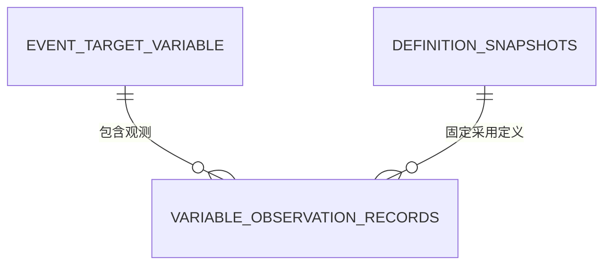

# F02 变量观测记录数据模型与存储设计

> **版本**：V1.2 · 2026-10-31
> **状态**：目标表结构设计，待工程实施及数据库验收  
> **领域对象**：VariableObservationrRecord（按用户指定拼写）  
> **存储归属**：information schema，L0/F02 维护。

## 1. 业务依据与设计范围

本设计落实[[tools/RiskHot/docs/system-design/02-业务架构与领域设计/RiskHot_L0_信息处理层_业务架构与领域设计V1.0#4.3.9 VariableObservationrRecord（事件变量观测记录）|变量观测记录领域定义]]的十项核心属性及七项规则；其中取值来源、原文证据的精确观测级映射仍缺失，属于部分覆盖，不能宣称十项均已完成。已明确部分采用[[tools/RiskHot/docs/system-design/04-系统架构设计/01-数据模型与存储设计/F02事件管理模块数据模型与存储设计#6. 其他业务对象与关系|既有 EventTargetVariable、定义快照及事实关联]]和[[tools/RiskHot/docs/system-design/04-系统架构设计/01-数据模型与存储设计/M2风险变量数据模型与存储设计|标准变量定义]]。

| 表 | 职责 |
| --- | --- |
| information.variable_observation_records | 单次具体观测的值、时间、性质、采用定义、获取方式及核验状态；保留更正链 |

名称变更保留 Event 聚合归属：一条记录对应一个 EventTargetVariable，一项三元关联允许0..N条观测。Event、Target、Variable三列是同一复合关系的引用键，不承担三个对象自身身份的管理。

### 1.1 本次一致性核对结论

已覆盖：观测身份、三元归属、具体值、单位、性质、独立业务时间、获取方式和核验状态；定义快照、更正自引用及系统时间属于已确认追溯规则的存储支撑。主表保持16列，本次不恢复已取消的独立观测证据表。

未覆盖：L0 要求每条观测对应实际采用的 Fact 及原文，当前 event_variable_fact 只给出同一变量关联的事实集合，不能区分两条观测分别用了哪些 Fact、资料及证据位置。尤其同一财报的第二季度68%与第三季度75%，共享上下文不能代替各自取值依据。

因此，精确来源/证据映射、取值输入引用及更正时的旧证据保留属于实施前必须补全的契约。其承载在领域定义中仍待定，本次只明确缺口，不新增未经确认的字段或表；§7中的缺证据、跨事件Fact及逐条核验场景必须在该契约落实后验证。不能只检查三元关联存在或 facts 集合非空，就将记录认定为已满足 confirmed 的证据要求。

## 2. variable_observation_records 主表

| 字段 | 中文名称 | 类型 | 可空 | 默认值 | 含义与约束 |
| --- | --- | --- | --- | --- | --- |
| id | 观测记录身份 | UUID | 否 | gen_random_uuid() | 主键；程序在首次提交前固定并在重试时复用 |
| event_id | 所属事件引用 | UUID | 否 | | 与target_id、variable_id共同引用一项event_target_variable |
| target_id | 所属对象引用 | UUID | 否 | | 同一三元关联中的Target |
| variable_id | 标准变量引用 | UUID | 否 | | 同一三元关联中的Variable |
| definition_snapshot_id | 采用定义快照 | UUID | 否 | | 引用definition_snapshots；固定本次取值采用的变量定义版本 |
| value | 变量取值 | JSONB | 否 | | 单个数值、字符串或布尔值；禁止JSON null、数组及对象 |
| unit | 取值单位 | TEXT | 是 | NULL | 与采用定义及数值口径一致；无单位时为空，禁止空白 |
| value_nature | 取值性质 | VARCHAR(16) | 是 | NULL | actual / historical / planned / expected / predicted；未能确定时留空 |
| value_time | 取值对应时间 | JSONB | 否 | | 按§3保存业务时间及精度；不能用事件时间或系统时间代填 |
| acquisition_method | 取值获取方式 | VARCHAR(16) | 否 | | extracted / calculated / inferred |
| derivation_basis | 计算或推断依据 | JSONB | 是 | NULL | 计算、推断时必填，结构见§4；直接提取可空 |
| status | 核验状态 | VARCHAR(16) | 否 | pending | pending / confirmed / disputed / invalidated |
| supersedes_id | 被更正观测 | UUID | 是 | NULL | 仅数据更正时指向同一三元关联下的旧观测，不用于正常期间变化 |
| correction_reason | 更正依据说明 | TEXT | 是 | NULL | supersedes_id非空时必填；解释错误及采用依据 |
| created_at | 创建时间 | TIMESTAMPTZ | 否 | now() | 首次保存时间 |
| updated_at | 更新时间 | TIMESTAMPTZ | 否 | now() | 最近受控核验或状态修改时间，无变化重试不刷新 |

### 2.1 取值与定义一致性

- numeric使用JSON数值，boolean使用JSON布尔值；categorical、state、temporal使用非空字符串，时间型变量的值按标准定义约定为日期、时刻或持续时间表达。
- 百分数不在JSON值中附加符号：例如value=75、unit=%。采用0～1还是0～100的比例口径须与定义一致，不能默默换算。
- value_nature描述事实或时间性质；acquisition_method描述值如何获得。predicted不能替代获取方式，两列分别填写。
- 没有具体值时保留三元关联，不创建value为空的观测。尚未明确性质时可保存pending记录，confirmed要求性质已明确。
- 提交时读取固定的变量快照校验类型、单位及业务口径；定义版本与当前采用引用变化时重新核验。核验快照kind=variable、definition_id=variable_id及有效内容，禁止仅因快照ID存在就接受。
- 主表通过EventTargetVariable读取既有event_variable_fact、Fact与资料上下文。取值来源和原文证据的精确观测级字段映射留空；上下文读取不等于已建立每条观测与某段原文的一对一或多对多约束。

## 3. value_time 时间结构

value_time固定包含kind、precision、start、end、raw_text五项，不能添加未定义键：

| 属性 | 类型与取值 | 规则 |
| --- | --- | --- |
| kind | point / period / range / unknown | 时间点、统计期间、有效范围或未知 |
| precision | second / day / month / quarter / year / unknown | 保存已知精度，不能补造更精确时刻 |
| start | string或null | point的时间值；period/range的起点 |
| end | string或null | period/range的终点，point为空 |
| raw_text | string或null | 原文时间表达，保留模糊时间及核验依据 |

- point：start必填，end为空；年份用YYYY，月份用YYYY-MM，日期用YYYY-MM-DD，完整时刻用带明确时区的ISO 8601文本，入库规范化为UTC。point不使用quarter精度。
- period：start、end均必填，按已明确统计期间保存边界。例如2026年第二季度为2026-04-01至2026-06-30、precision=quarter；边界表示统计期间，不表示每日都有观测值。
- range：至少一个边界可确定；允许开放起点或终点，保留原文限定。日期边界按该日包含解释，时刻边界按明确的原文包含/排除条件核验；无法确定边界口径时保持pending并在raw_text及依据中说明。
- unknown：start、end均为null，precision=unknown；原文有模糊表达时保留raw_text。时间未知不能借用event_time、created_at或材料发布时间。
- 程序校验真实日历、起止顺序、时区、精度及季度/年度期间边界。DDL只校验JSON形状和分支，不宣称正则或JSON类型检查已完成日历验证。

```json
{"kind":"period","precision":"quarter","start":"2026-04-01","end":"2026-06-30","raw_text":"第二季度"}
```

时间型变量本身的value与value_time分开：前者可以是“债务剩余期限P3M”，后者说明该期限在哪个业务时间被观测。

## 4. 获取方式、核验与更正

| 字段值 | 含义 | 必要依据 |
| --- | --- | --- |
| extracted | 从原文直接提取 | 直接支持取值的Fact及精确原文证据 |
| calculated | 由明确输入计算 | 计算方法、输入及引用证据 |
| inferred | 按规则推断 | 规则或推断方法、输入及核验状态；推断结果不可伪装为原文原句 |

计算或推断时，derivation_basis为非空对象，固定结构为method（非空文字）、rule_ref（string或null）、inputs（非空数组）。每项inputs包含value（单个JSON值）、unit（string或null）及输入信息说明；程序结合本事件变量事实上下文核对输入。直接提取可不填本字段。规则尚未明确或无法核验时保留pending，不自动确认。

| status | 使用规则 |
| --- | --- |
| pending | 已保存但等待核验，不作为已确认分析依据 |
| confirmed | 值、性质、定义、时间精度、获取依据及证据已按权限核定 |
| disputed | 存在来源或事实争议，保留各来源并分别展示 |
| invalidated | 已失效或被有据更正，历史及引用仍可追溯 |

正常季度变化形成两条独立观测，supersedes_id均为空；修正提取错误或来源更正时，新记录指向旧记录并填写correction_reason，保留新旧取值及证据。在同一受控提交中核定新记录并将旧记录标为invalidated；未核定更正前不得静默替换当前可信值。

更正只能在同一Event、Target、Variable上下文内进行，不能更正自身；程序锁定相关记录、沿更正链检查循环与重复更正，冲突时转复核。恢复时先查原观测ID及命令回执，内容一致则复用，不为相同重试生成新记录。

## 5. 关系与索引



| 索引或约束 | 用途 |
| --- | --- |
| 主表PRIMARY KEY(id) | 记录身份、幂等恢复及按ID读取 |
| 主表UNIQUE(id,event_id,target_id,variable_id) | 给更正关系提供上下文复合引用 |
| 主表(event_id,target_id,variable_id,created_at,id) | 事件内同一变量的多次观测读取 |
| 主表(target_id,variable_id,status,created_at,id) | 跨事件按对象和变量检索；不按created_at冒充业务时间排序 |
| 主表supersedes_id部分索引 | 更正链及受影响记录检索，不自动解决并发业务冲突 |

不对Event+Target+Variable+时间建唯一键：同期间的来源冲突、计划与实际值等需要分别保留。精确时间排序及统一序列归并须先解释value_time语义，不直接按JSON或系统记录时间当作业务时间轴。

## 6. DDL 设计稿

前置依赖：已有information.event_target_variable、definition_snapshots，字段与键按F02数据模型；pgcrypto沿用项目基线。以下为迁移编写依据，尚未执行。

```sql
CREATE TABLE information.variable_observation_records (
    id UUID PRIMARY KEY DEFAULT gen_random_uuid(),
    event_id UUID NOT NULL,
    target_id UUID NOT NULL,
    variable_id UUID NOT NULL,
    definition_snapshot_id UUID NOT NULL
        REFERENCES information.definition_snapshots(id),
    value JSONB NOT NULL,
    unit TEXT,
    value_nature VARCHAR(16),
    value_time JSONB NOT NULL,
    acquisition_method VARCHAR(16) NOT NULL,
    derivation_basis JSONB,
    status VARCHAR(16) NOT NULL DEFAULT 'pending',
    supersedes_id UUID,
    correction_reason TEXT,
    created_at TIMESTAMPTZ NOT NULL DEFAULT now(),
    updated_at TIMESTAMPTZ NOT NULL DEFAULT now(),
    CONSTRAINT vor_context_unique UNIQUE (id, event_id, target_id, variable_id),
    CONSTRAINT vor_variable_relation_fk FOREIGN KEY (event_id, target_id, variable_id)
        REFERENCES information.event_target_variable(event_id, target_id, variable_id),
    CONSTRAINT vor_correction_context_fk
        FOREIGN KEY (supersedes_id, event_id, target_id, variable_id)
        REFERENCES information.variable_observation_records(id, event_id, target_id, variable_id),
    CONSTRAINT vor_scalar_value CHECK (
        jsonb_typeof(value) IN ('number', 'string', 'boolean')
        AND (jsonb_typeof(value) <> 'string' OR length(btrim(value #>> '{}')) > 0)
    ),
    CONSTRAINT vor_unit_nonblank CHECK (unit IS NULL OR length(btrim(unit)) > 0),
    CONSTRAINT vor_nature_valid CHECK (
        value_nature IS NULL OR value_nature IN ('actual','historical','planned','expected','predicted')
    ),
    CONSTRAINT vor_method_valid CHECK (acquisition_method IN ('extracted','calculated','inferred')),
    CONSTRAINT vor_basis_shape CHECK (
        derivation_basis IS NULL OR
        (jsonb_typeof(derivation_basis) = 'object' AND derivation_basis <> '{}'::JSONB)
    ),
    CONSTRAINT vor_derived_basis_required CHECK (
        acquisition_method = 'extracted' OR derivation_basis IS NOT NULL
    ),
    CONSTRAINT vor_status_valid CHECK (status IN ('pending','confirmed','disputed','invalidated')),
    CONSTRAINT vor_confirmed_nature CHECK (status <> 'confirmed' OR value_nature IS NOT NULL),
    CONSTRAINT vor_no_self_correction CHECK (supersedes_id IS NULL OR supersedes_id <> id),
    CONSTRAINT vor_correction_reason CHECK (
        (correction_reason IS NULL OR length(btrim(correction_reason)) > 0)
        AND (supersedes_id IS NULL OR correction_reason IS NOT NULL)
    ),
    CONSTRAINT vor_time_order CHECK (updated_at >= created_at),
    CONSTRAINT vor_business_time_shape CHECK (
        jsonb_typeof(value_time) = 'object'
        AND value_time ?& ARRAY['kind','precision','start','end','raw_text']
        AND (value_time - ARRAY['kind','precision','start','end','raw_text']) = '{}'::JSONB
        AND jsonb_typeof(value_time->'kind') = 'string'
        AND jsonb_typeof(value_time->'precision') = 'string'
        AND jsonb_typeof(value_time->'start') IN ('string','null')
        AND jsonb_typeof(value_time->'end') IN ('string','null')
        AND jsonb_typeof(value_time->'raw_text') IN ('string','null')
        AND value_time->>'precision' IN ('second','day','month','quarter','year','unknown')
        AND CASE value_time->>'kind'
            WHEN 'unknown' THEN value_time->>'precision' = 'unknown'
                AND value_time->'start' = 'null'::JSONB AND value_time->'end' = 'null'::JSONB
            WHEN 'point' THEN value_time->>'precision' IN ('second','day','month','year')
                AND jsonb_typeof(value_time->'start') = 'string' AND value_time->'end' = 'null'::JSONB
            WHEN 'period' THEN value_time->>'precision' <> 'unknown'
                AND jsonb_typeof(value_time->'start') = 'string'
                AND jsonb_typeof(value_time->'end') = 'string'
            WHEN 'range' THEN value_time->>'precision' <> 'unknown'
                AND (jsonb_typeof(value_time->'start') = 'string'
                     OR jsonb_typeof(value_time->'end') = 'string')
            ELSE FALSE
        END
    )
);

CREATE INDEX vor_event_variable_idx ON information.variable_observation_records
    (event_id, target_id, variable_id, created_at, id);
CREATE INDEX vor_target_variable_status_idx ON information.variable_observation_records
    (target_id, variable_id, status, created_at, id);
CREATE INDEX vor_supersedes_idx ON information.variable_observation_records(supersedes_id)
    WHERE supersedes_id IS NOT NULL;
```

DDL覆盖主表结构和局部约束；变量快照种类及口径、确认权限、计算输入核验、时间日历与更正链无环由§7的事务与程序要求共同落实。实施前须检查既有约束是否已存在，不能将本DDL原样重复执行视为幂等迁移。

## 7. 提交、恢复与验收

1. 新增时读取并核对三元关联、采用定义快照和权限。程序固定观测ID，在一个事务写入主表和命令回执；提交前核对本事件变量上下文及采用依据。
2. 直接提取核对value与引文，计算或推断核对method、rule_ref、全部inputs及本事件变量事实上下文。来源矛盾保留不同记录或disputed状态，不无依据覆盖。
3. confirmed须经适用核验或授权规则，不能用数据库默认值自动确认。时间unknown可保留且必须按限制使用；已确认表示核验了已知范围，不补造缺失时间。
4. 无取值不建空记录；季度、历史、计划等并存时分别保存。财报示例两条记录可基于同一事件变量事实上下文形成，value为68、75，unit为%，对应2026Q2和2026Q3，不建立正常变化的更正链。
5. 更正时锁定受影响记录、核对上下文及无环，原子保存新记录、计算或推断依据、更正理由并处理旧状态；正常值变化与数据修复分别记录。已失效证据不删除，核验受影响记录并阻止冒充最新可信结果。
6. 修改核验状态时锁定观测并检查更新依据；陈旧请求拒绝覆盖新状态。保存响应未知先查原记录及回执，交付失败只恢复已保存结果的交付。
7. 负向验收覆盖：跨事件Fact、错误变量快照、JSON null/对象取值、非法类型与单位、错误时间结构及无效日历、缺证据、确认时缺性质、无计算依据、跨上下文更正、自环与多节点循环、来源更正及重复重试。
8. 正向验收覆盖：数值/类别/状态/布尔/时间型值，单点/季度/范围/未知时间，不同来源上下文核验，不同性质并存，有据更正与历史读取，复用固定ID及失败事务回滚。

本节为待执行验收要求。本次完成领域命名和表结构设计；未部署表、迁移运行数据或宣称实际查询已可用。

## 8. 设计取舍

| 取舍 | 采用方案 | 影响 |
| --- | --- | --- |
| 多类型取值 | JSONB单值并结合定义快照校验 | 保持一条记录一个取值，具体类型需跨表核验 |
| 多种业务时间 | 受限JSON时间结构，显式语义与精度 | 支持季度和未知时间，日历验证和跨事件排序由程序承担 |
| 数据更正 | 新记录及同上下文自引用 | 保留旧值，需事务和循环检查 |
| 聚合归属 | 继续引用EventTargetVariable | 事件来源上下文明确；独立于事件的统一变量时间序列另行设计 |
