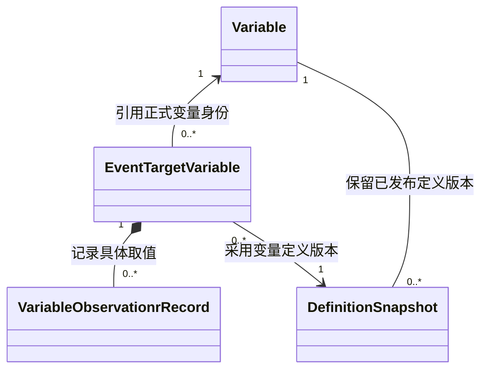

# M2 风险变量数据模型与存储设计

> **版本**：V1.6 · 2026-10-31  
> **状态**：表结构设计草案，待工程实施  
> **范围**：Variable 共享定义表及其引用、版本与迁移约束；不代表完整 M2 模型已设计完成。

## 1. 设计依据与职责

业务属性以[[tools/RiskHot/docs/system-design/02-业务架构与领域设计/RiskHot_L0_信息处理层_业务架构与领域设计V1.0#4.3.5 Variable（风险变量）|Variable 领域对象详细定义]]为准，概念边界遵循[[tools/RiskHot/docs/system-design/02-业务架构与领域设计/RiskHot_L0_信息处理层_业务架构与领域设计V1.0#3.4 风险变量（Risk Variable）的定义|风险变量业务定义]]。正式变量的匹配、候选审核、生效、废弃与恢复规则由[[tools/RiskHot/docs/system-design/03-系统功能架构/M2风险源管理中心功能设计#4.2 M2-C02 全局变量管理（M2-F04～F06）|M2 全局变量管理]]及[[tools/RiskHot/docs/system-design/03-系统功能架构/M2风险源管理中心功能设计#4.6.2 M2-F17 使用状态与变量生命周期|变量生命周期]]规定。

本文维护 Variable 的具体表、字段、类型、约束、索引及版本引用规则。L0 业务架构只保留业务属性与字段映射；F02 引用正式定义并保存事件关联，M2 是正式变量定义的治理方。

本次采用项目既有 PostgreSQL 技术基线。设计以单表保存当前变量定义、复用既有不可变定义快照保留历史，满足稳定身份、语义匹配、并发修订及历史追溯要求。

## 2. 表的定位与分工

| 对象或承载 | 保存内容 | 管理边界 |
| --- | --- | --- |
| risk_variable_definitions | 候选、有效、废弃和停用变量的当前定义、状态及版本 | M2 统一维护；共享的风险变量标准定义 |
| definition_snapshots | 已发布变量定义的不可变版本依据 | 复用[[tools/RiskHot/docs/system-design/04-系统架构设计/01-数据模型与存储设计/F02事件管理模块数据模型与存储设计#6. 其他业务对象与关系\|既有定义快照设计]]，不另建第二套变量历史表 |
| EventTargetVariable | 事件、Target 和标准变量之间的具体关联 | 由 F02 管理，引用正式变量身份及采用的定义快照 |
| VariableObservationrRecord | 特定事件、对象和时间下的具体取值 | 与变量定义分开，结构见[[tools/RiskHot/docs/system-design/04-系统架构设计/01-数据模型与存储设计/F02变量观测记录数据模型与存储设计\|观测记录存储设计]] |
| 候选材料、审核、别名、分类及替代关系 | | 专门结构留待对应治理设计；本表不以空字段预设其完整模型 |

**物理 schema**：

表名及以下建议字段均不带 schema 前缀；物理 schema 的归属和跨 schema 引用在实施前确定，不能依赖未核定的默认搜索路径上线。

## 3. risk_variable_definitions：风险变量定义表

### 3.1 字段结构

| 字段 | 中文名称 | 类型 | 可空 | 默认值 | 业务含义与约束 |
| --- | --- | --- | --- | --- | --- |
| variable_id | 变量身份 | UUID | 否 | gen_random_uuid() | 主键；候选阶段为内部记录身份，审核生效后作为稳定正式变量身份引用 |
| name | 变量名称 | TEXT | 否 | | 标准业务名称；去除首尾空白且非空，不设名称全局唯一 |
| definition | 业务定义 | TEXT | 否 | | 变量的稳定含义、内容及语义边界；非空白 |
| semantic_category | 语义类别 | TEXT | 是 | NULL | 单选 attribute / state / quantity / change / relationship；未分类留空，含义与示例见 §3.6 |
| discovery_sources | 变量发现来源 | TEXT[] | 否 | '{}' | 变量从事件中被识别出的要素类别，可多选；Subject / Action / Object / Semantic Information；空数组表示尚未登记，规则见 §3.5 |
| data_type | 取值类型 | TEXT | 否 | | numeric / categorical / state / temporal / boolean，见 §3.2 |
| unit | 计量单位 | TEXT | 是 | NULL | 有量纲时填写规范单位；无计量单位时为空，禁止空白字符串 |
| status | 变量状态 | VARCHAR(16) | 否 | | candidate / active / deprecated / disabled；显式提供状态，仅active允许新增正式引用 |
| definition_version | 定义版本 | INTEGER | 否 | 1 | 大于0；变量定义或状态发生受控变更时递增 |
| created_at | 创建时间 | TIMESTAMPTZ | 否 | now() | 变量记录首次创建时间，由程序生成 |
| updated_at | 更新时间 | TIMESTAMPTZ | 否 | now() | 最近受控修改时间，由程序维护，无变化重试不刷新 |

**十一项业务属性的覆盖**：变量身份、名称、定义、语义类别、发现来源、取值类型、单位、变量状态、定义版本、创建时间和更新时间分别对应独立字段；不再保留解释口径或状态与版本合并属性。

### 3.2 取值类型与单位

| data_type | 业务含义 | 单位与口径要求 |
| --- | --- | --- |
| numeric | 数值型，包括比例、金额、数量等 | 单位及比例口径须在定义中明确；无量纲可为空，不能把未填写单位冒充已确认无量纲 |
| categorical | 类别型，如信用评级 BBB | 类别含义及允许表达在业务定义中说明 |
| state | 状态型，如正常、逾期、违约 | 状态含义及判断口径在业务定义中说明 |
| temporal | 时间型，如期限或持续时间 | 明确其表达的时间概念及所用单位 |
| boolean | 布尔型，如是否发生债务违约 | 明确真、假的业务判定含义，不用 false 代替未知 |

boolean 承接[[tools/RiskHot/docs/system-design/02-业务架构与领域设计/RiskHot_L0_信息处理层_业务架构与领域设计V1.0#4.3.9 VariableObservationrRecord（事件变量观测记录）|观测记录定义]]已包含的布尔取值。既有 AI-05 字段草案只列四类，后续须同步机器契约；本次不据此宣称运行已支持第五类。

取值范围、状态表达及单位换算等必要说明在业务定义中维护。具体观测的类型校验、单位规范化和类别合法性由采用该定义的观测契约承接。

### 3.3 身份、名称与语义查重

- variable_id 保证技术身份唯一；普通改名或定义修订保留该身份。
- name 不设 UNIQUE：同名但定义、适用范围或粒度不同的提议须保留语义核对空间。
- 创建正式变量前，按名称、定义、适用范围、取值类型、单位及业务定义中的取值要求比较既有定义。同义变量复用已有身份；存在实质差异时由治理流程核定，不由数据库名称比较自动合并。
- 并发新建须在治理提交时串行核对同批候选及最新正式定义，不能将本表 UUID 主键视为业务去重保证。具体治理命令、锁范围及候选载体留待相应技术设计。
- 本轮不增加格式尚未确认的 variable_code；M2 原“建议保留编码”的要求仍为待定项。

### 3.4 状态、定义版本与系统时间

| status | 业务含义 | 新增正式引用 |
| --- | --- | --- |
| candidate | 尚待审核确认的变量定义 | 不允许 |
| active | 已审核生效的变量定义 | 校验适用范围、版本及权限后允许 |
| deprecated | 已废弃的定义 | 不允许；历史记录及引用保留 |
| disabled | 暂停使用的定义 | 不允许；保留定义及历史，恢复须重新审核 |

status 为必填 VARCHAR(16)，不设置默认状态。程序须按明确的创建或治理操作提供合法值，不能通过数据库默认值绕过审核。

| 场景 | 当前表处理 | 版本与历史 |
| --- | --- | --- |
| 建立候选定义记录 | 信息满足本表必填要求后，显式写入candidate | 初始definition_version=1；候选材料不完整时仍在候选治理环节保留 |
| 候选审核接受 | candidate变为active，保留同一记录身份 | 版本加1并创建生效定义快照；审核前不能提供为正式引用 |
| 已审核的新变量直接登记 | 具备有效审核依据后显式写入active | 初始版本为1，创建不可变定义快照 |
| 定义内容、语义类别、发现来源等受控修订 | 审核后更新相应字段 | 版本加1；保留已发布旧版本及审计 |
| 废弃或停用 | 显式设为deprecated或disabled | 版本加1；阻止新增正式引用，保留已有依据 |
| 重新审核后恢复 | 设为active | 版本加1，核对定义、适用范围与影响 |
| 相同输入重试或无实际变化 | 复用原结果 | 不递增版本，不重复创建记录或快照 |

candidate记录中的variable_id用于内部识别；取得active状态及有效审核依据后才可作为正式变量引用。对外候选材料中“正式variable_id留空”的约定继续适用，不向下游把候选主键当作生效身份发布。

更新按variable_id与调用方持有的definition_version做并发比较，版本过期时拒绝静默覆盖。当前记录更新、版本递增和审计保持一致；涉及已发布定义及其状态变化时同步固定不可变快照，候选未发布版本不冒充生效快照。

created_at和updated_at均为必填TIMESTAMPTZ，由程序生成；created_at在首次创建后保持，updated_at只在实际受控变更时刷新，且不得早于created_at。它们属于系统记录时间，不作为事件发生时间或变量取值时间。

### 3.5 变量发现来源 discovery_sources

该字段记录变量是从事件中的哪些要素被识别出来，单个变量可具有一个或多个发现来源。四个合法取值按以下拼写保存：

| 来源值 | 中文含义 | 发现依据 |
| --- | --- | --- |
| Subject | 事件主体 | 主体自身的属性、能力、状态等信息 |
| Action | 事件行为 | 行为、决定或变化的规模、强度、性质等信息 |
| Object | 事件客体 | 行为作用对象的属性、状态、数量等信息 |
| Semantic Information | 事件语义信息 | 结合完整事实描述及必要上下文识别出的变量线索 |

- 使用一维、以1为下标起点的文本数组，最多四项；不允许重复值、NULL元素或枚举外文本，不对数组顺序赋予业务意义。
- 默认空数组表示尚未登记发现来源，不能将其解释为变量没有来源；新识别结果已有明确来源时应提供相应标签。原有变量缺少可追溯依据时保留空数组，不按名称猜测回填。
- 同一变量在不同事件中可以从不同要素被发现。共享定义表记录已确认来源类别；补充来源标签须核对实际依据并受控更新，不能用一次事件的来源覆盖其他有效来源，也不能将其视为后续识别的固定入口限制。
- 该数组不保存 Event ID、证据位置或当次提取结果。具体发现过程的事件与证据仍由候选材料、事件关联及采用记录追溯；标签本身不能替代证据。
- discovery_sources 不作为变量同一性的唯一键。来源不同不代表必须新建变量，来源相同也不能证明变量含义相同。
- Semantic Information 对应事件事实描述及上下文，在 Event 中由 description 等既有内容提供，不要求恢复独立的“事件语义信息”字段。
- 既有 extraction_source 使用 subject / action / target 描述本次实际提取来源，与本字段的四类事件发现要素不是同一口径；本次不自动转换或替换该字段。
- 发现来源变更按 §3.4 的受控修订规则维护定义版本和快照；无变化重试复用原结果。

示例：`['Object', 'Action']` 表示该变量曾从事件客体及行为中被识别。数据库保存的是数组元素，不能将该示例字符串整体写入单个元素。

### 3.6 语义类别 semantic_category

semantic_category 按变量所描述的业务内容进行单选分类，编码、类别、含义和示例依据用户提供的分类表：

| 编码 | 类别 | 含义 | 示例 |
| --- | --- | --- | --- |
| attribute | 属性 | 描述对象具有的特征 | 企业信用评级、所属行业 |
| state | 状态 | 描述对象当前所处状态 | 正常经营、债务违约 |
| quantity | 数量 | 描述对象的数量或规模 | 债务金额、裁员人数 |
| change | 变化 | 描述某项属性或状态的变化 | 营收下降幅度、利率变化 |
| relationship | 关联关系 | 描述对象之间的业务联系 | 供应链依赖关系、股权关系 |

- 每个变量保存一个已确认的主要语义类别；未分类或类别尚未明确时保存 NULL，不使用空字符串、unknown 或未提供的类别，不设置默认类别。
- 分类依据变量的标准定义，而非某次事件的临时表述。类别修正按 §3.4 的治理及版本快照规则处理，不因观察值更新自动改类。
- semantic_category 表达“变量描述什么”；data_type 表达“值以什么形式表达”；discovery_sources 表达“从事件哪个要素发现”。三者分别管理，不能互相推导或替代。
- 例如，企业信用评级可以属于 attribute，取值类型为 categorical；债务金额属于 quantity，取值类型为 numeric；营收下降幅度属于 change，也可使用 numeric。
- relationship 是变量定义的语义类别，不据此自动创建具体对象关系；具体 Event、Target、Variable 及取值证据仍由相应关联与观测记录管理。

## 4. 关系、快照与写入边界



- F02 的 event_target_variable.variable_id 对应 risk_variable_definitions.variable_id；新增正式引用须核对该定义为active，候选主键不等于生效资格。外键在物理 schema 核定后建立；变量废弃不级联删除事件关系。
- 复用现有 definition_snapshots：kind=variable，definition_id 为 variable_id，definition_version 采用当前版本的规范十进制字符串，与现有快照文本版本字段适配；payload 固定本表的业务字段与版本，沿用既有摘要校验和不可变规则。
- event_variable_definition.definition_snapshot_id 指向实际采用的变量快照；提交时同时核对快照种类、变量身份、版本及内容，不能只检查快照记录存在。
- 变量定义修订不批量替换既有 EventTargetVariable 的采用版本。重新分析或受控修正时显式选择新定义，保留旧依据与变更原因。
- 本表不保存 event_id、target_id、具体观测值、当期方向、取值时间或固定风险角色；这些内容由事件关联、观测记录及具体风险场景管理。
- 正式定义写入遵循 M2 治理权限，F02 和 AI 使用候选或正式定义引用，不直接修改主表。权限与快照写入适配须在工程实施时落实。

## 5. 主键、检查约束与索引

| 设计项 | 结构 | 用途 |
| --- | --- | --- |
| 主键 | PRIMARY KEY(variable_id) | 稳定身份引用与精确读取 |
| 必填文字 | name、definition 非空白 | 防止发布缺少核心定义的正式变量 |
| 可选文字 | unit 为 NULL 或非空白 | 保留“没有该项说明”与实际文字值的区别 |
| 类型约束 | data_type 为 §3.2 的五种值 | 限制定义声明的取值类型 |
| 发现来源约束 | discovery_sources 为四类来源的无重复一维数组，允许空数组 | 记录已确认发现来源，拒绝NULL元素、越界值及重复项 |
| 语义类别约束 | semantic_category 为 NULL 或 §3.6 的五类编码之一 | 单选业务语义分类，拒绝空字符串或其他类别 |
| 状态约束 | status为VARCHAR(16)，IN ('candidate','active','deprecated','disabled')且无默认值 | 定义状态与正式引用资格分别校验 |
| 版本约束 | definition_version > 0 | 有效定义版本 |
| 更新时间约束 | updated_at >= created_at | 系统审计时间基本一致性 |
| 名称检索索引 | lower(btrim(name)) | 支持规范化名称等值召回，不承担语义唯一性 |

首版不为低选择性的 status 单独建索引，也不默认引入模糊检索扩展。全文、别名或复杂范围查询在实际查询契约和规模明确后补充设计。

## 6. DDL 设计稿

以下 DDL 未指定物理 schema，供后续迁移编写采用；实施前须限定执行位置。UUID 生成沿用项目已启用的 pgcrypto 基线。

```sql
CREATE TABLE risk_variable_definitions (
    variable_id UUID PRIMARY KEY DEFAULT gen_random_uuid(),
    name TEXT NOT NULL,
    definition TEXT NOT NULL,
    semantic_category TEXT,
    discovery_sources TEXT[] NOT NULL DEFAULT '{}'::TEXT[],
    data_type TEXT NOT NULL,
    unit TEXT,
    status VARCHAR(16) NOT NULL,
    definition_version INTEGER NOT NULL DEFAULT 1,
    created_at TIMESTAMPTZ NOT NULL DEFAULT now(),
    updated_at TIMESTAMPTZ NOT NULL DEFAULT now(),
    CONSTRAINT risk_variable_definitions_name_nonblank
        CHECK (name = btrim(name) AND length(name) > 0),
    CONSTRAINT risk_variable_definitions_definition_nonblank
        CHECK (length(btrim(definition)) > 0),
    CONSTRAINT risk_variable_definitions_semantic_category_valid
        CHECK (semantic_category IS NULL OR semantic_category IN (
            'attribute', 'state', 'quantity', 'change', 'relationship'
        )),
    CONSTRAINT risk_variable_definitions_discovery_sources_valid
        CHECK (
            CASE
                WHEN cardinality(discovery_sources) = 0 THEN TRUE
                WHEN array_ndims(discovery_sources) = 1
                     AND array_lower(discovery_sources, 1) = 1 THEN
                    array_position(discovery_sources, NULL) IS NULL
                    AND discovery_sources <@ ARRAY[
                        'Subject', 'Action', 'Object', 'Semantic Information'
                    ]::TEXT[]
                    AND cardinality(discovery_sources) =
                        ('Subject' = ANY(discovery_sources))::INTEGER
                        + ('Action' = ANY(discovery_sources))::INTEGER
                        + ('Object' = ANY(discovery_sources))::INTEGER
                        + ('Semantic Information' = ANY(discovery_sources))::INTEGER
                ELSE FALSE
            END
        ),
    CONSTRAINT risk_variable_definitions_type_valid
        CHECK (data_type IN ('numeric', 'categorical', 'state', 'temporal', 'boolean')),
    CONSTRAINT risk_variable_definitions_unit_nonblank
        CHECK (unit IS NULL OR length(btrim(unit)) > 0),
    CONSTRAINT risk_variable_definitions_status_valid
        CHECK (status IN ('candidate', 'active', 'deprecated', 'disabled')),
    CONSTRAINT risk_variable_definitions_version_positive
        CHECK (definition_version > 0),
    CONSTRAINT risk_variable_definitions_time_order
        CHECK (updated_at >= created_at)
);

CREATE INDEX risk_variable_definitions_name_lookup_idx
    ON risk_variable_definitions (lower(btrim(name)));
```

DDL 只表达结构约束。审核生效、语义查重、版本递增、快照一致性及 updated_at 更新仍须由治理用例实现，不能仅凭默认值或 CHECK 认定完整流程已落实。

## 7. 关键取舍

| 决策 | 采用方案与理由 | 代价及后续要求 |
| --- | --- | --- |
| 定义与实例分开 | 单表保存可复用定义，具体值在观测记录 | 使用时须正确连接事件及对象上下文 |
| 不做名称唯一 | 保留同名但不同范围的合法定义，不误合并 | 业务查重和并发治理必须落实 |
| 复用定义快照 | 与 F02 既有引用契约保持一致，历史采用版本可追溯 | 跨模块发布、快照序列化及版本比较需适配 |

## 8. 实施前核对与验收要求

以下均为待执行要求，不作为已通过的数据库验收：

1. 十一项核心业务属性逐项覆盖，Variable 与具体观测值没有混存。
2. 必填文字空白、非法类型、非法状态、非正版本及无效时间顺序被拒绝；合法空单位可保存。
3. 候选记录在审核前仅具备内部身份，首次批准后才能作为正式变量引用并形成生效版本快照；同义候选不能因并发建立重复正式变量。
4. 同名异义定义可区分；名称索引命中不直接认定同一性。
5. candidate、deprecated及disabled不能新增正式事件引用；只有active通过其他资格校验后允许。历史及已有依据仍可读取。
6. 修订时版本过期被拒绝；失败回滚当前定义和快照，不产生部分发布。
7. 历史事件继续引用旧定义快照；后续重新分析采用新版本并保留原因。
8. 新 data_type 的 boolean 与 AI-05、观测记录、运行适配及公共 Schema 一并核对；未知值不得被误当成 false。
9. 既有运行定义集合与快照的变量ID、版本、名称及状态映射逐项核验。不得将当前局部空变量集解释为 M2 全局没有变量。 现有运行定义采用active/disabled，分别核验实际生效或停用含义；不得将disabled直接改为deprecated。
10. discovery_sources允许四种来源单选或多选；空数组按未登记处理，重复项、NULL元素、非法来源和多维数组须被拒绝；补充标签保留依据及版本，现有extraction_source不得直接机械转换。
11. semantic_category五类合法值和NULL可保存，空字符串、大小写不匹配或未列举类别被拒绝；类别、data_type和discovery_sources分别核验，修正类别保留原版本依据。
12. status缺失、空白、非法枚举被拒绝，四类合法状态可保存；数据库状态字段合法不等于已经通过正式引用审核。created_at保持首次创建时间，无变化重试不得刷新updated_at。
13. 物理 schema、候选治理结构、审核审计载体、别名分类及替代关系专门结构：

## 9. 变更记录

- 2026-10-31 · V1.0：依据 Variable 八项核心业务属性建立正式定义表设计、状态与版本、快照引用、约束、索引和 DDL；同步业务字段映射。尚未执行建表或运行迁移。

- 2026-10-31 · V1.1：按用户要求，正式定义表统一命名为 risk_variable_definitions，同步DDL、约束、索引和相关字段引用；字段与业务规则保持不变。

- 2026-10-31 · V1.2：变量名称字段由 variable_name 改为 name，同步名称校验、检索索引及业务映射；名称业务含义与非唯一规则不变。

- 2026-10-31 · V1.3：新增 discovery_sources TEXT[]，限定四种事件要素来源，可多选，补齐数组约束、共享标签与事件证据边界，以及业务属性映射。

- 2026-10-31 · V1.4：按用户图片增加 semantic_category 单选语义类别，采用五种指定编码；补充含义、示例、可空规则、DDL检查约束及业务属性映射。

- 2026-10-31 · V1.5：删除interpretation及合并的状态/版本业务属性，按用户图片分别定义status、definition_version、created_at、updated_at；status改为VARCHAR(16)并支持四类状态，不设置默认值，同步候选记录与正式引用边界。

- 2026-10-31 · V1.6：删除适用对象applicable_scope字段及其非空白检查，移除独立业务属性和字段设计取舍；定义表及业务属性均为11项。
