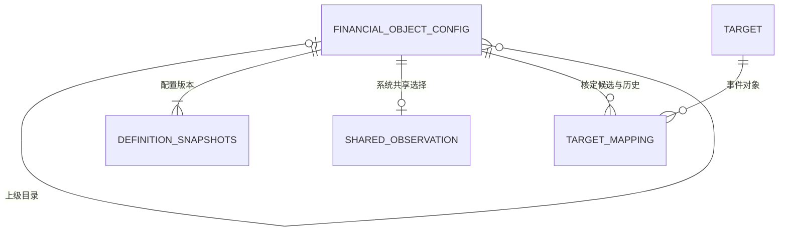

# 全局配置表数据模型与存储设计

V0.2实施状态：第1～11节继承配置主表设计，观察/映射物理模型和工程约束集中在第12节；隔离验证后，已按用户后续授权完成本机运行库迁移，见[[tools/RiskHot/docs/verification/m4-live|M4实际部署验收]]。

## 1. 文档职责与设计依据

本文集中维护全系统共享配置的物理表结构、字段、约束、索引、版本引用与迁移要求。本版先设计 **M4金融对象全局配置表**；其他全局配置按后续需求逐章纳入，不把不同业务对象塞进一张通用键值表，也不迁移已有M1/M2定义。

“全局”指系统共用一套配置，不代表每个账号拥有写权限，不代表该配置对象已经被观察或已经出现在事件中。

| 依据 | 本文继承的内容 |
| --- | --- |
| [[tools/RiskHot/docs/system-design/03-系统功能架构/M4 金融对象配置中心与观察管理功能设计\|M4功能设计V0.1]] | 目录与对象、系统共享观察、身份范围、状态、版本、同一性核定及31项场景 |
| [[tools/RiskHot/docs/system-design/04-系统架构设计/01-数据模型与存储设计/F02事件管理模块数据模型与存储设计#3.3 Target：分类目录与已收集观测对象\|F02 Target存储设计]] | UUID身份、成对分类JSONB、别名数组、辖区与范围；不增加对象业务编码 |
| [[tools/RiskHot/docs/system-design/04-系统架构设计/02-专题技术架构/T01-数据与存储架构\|T01数据与存储架构]] | PostgreSQL、显式事务、业务与运行数据分工、不可变依据及受控更新 |
| [[tools/RiskHot/docs/system-design/06产品UI原型设计/06-6-M4金融对象配置中心UI设计/02. 交互原型说明\|M4页面原型]] | 配置中心维护对象；观测对象页选择配置建立共享观察；原型数据仅供演示 |

核对的工程基线为 `src/db/005-ingestion.sql`、`src/db/007-target-identity.sql`、`src/db/008-f02.sql` 与 `src/event-management/target-catalog.ts`、`target-identity-contracts.ts`。现有库已经定义 `information.target`、`information.definition_snapshots`、`platform.actors`、`platform.audit_log` 和 `platform.action_receipts`，本次配置主表为新增目标，不能视为已经存在。

V0.1仅完成数据模型设计。用户随后授权按功能设计、原型及模型实施，V0.2落实系统共享观察、人工核定、一对一有效映射及定义口径变化暂停待确认；工程验证与实际部署分别记录，不以隔离库验证代替正式切换。

## 2. 存储归属与表的分工

采用现有 PostgreSQL 实例及 `information` 业务 schema，新表由M4配置维护命令唯一写入；不因“全局配置”另建数据库或恢复历史方案中的 `reference` schema。schema是存储命名空间，M4治理职责与F02事件事实职责仍分开。

| 表或关系 | 本次处理 | 保存内容 |
| --- | --- | --- |
| information.financial_object_config | 已实现增量迁移 | 一份目录与具体金融对象的当前配置；通过entry_kind区分两种条目 |
| information.definition_snapshots | 复用，扩展一种快照kind | 每个配置版本的完整不可变内容；kind使用financial_object_config，与target、variable隔离 |
| platform.audit_log | 复用 | 配置新建、编辑、移动、排序、启停的操作人、说明、前后版本和影响对象 |
| platform.action_receipts | 复用 | 配置写命令的幂等键、输入摘要及成功结果；不同操作者仍需业务查重 |
| information.target | 保留现有职责 | 从事件链路识别和核定的金融对象，UUID与配置UUID分别管理 |
| information.shared_observation | 已补齐，见§12.1 | 所选配置对象、采用配置快照、观察状态及其状态历史 |
| information.target_config_mapping | 已补齐，见§12.2 | 双方稳定身份、采用版本、同一性依据、核定/冲突状态 |

选择“一张当前配置表＋既有不可变快照”，便于混合树排序和稳定引用，并复用现有版本基础设施；代价是必须增加条目类型、树合法性和快照归属校验，不能只靠一个自引用外键。别名与金融分类不另建子表，目录也不是金融分类字典。



图中共享观察与映射对应§12的物理表；当前已在隔离库及本机运行库建立，部署证据见M4实际验收。快照与配置的身份关系需按§5校验，不由现有通用快照表的definition_id自动形成外键。

## 3. financial_object_config：金融对象全局配置表

### 3.1 字段结构

| 字段 | 中文名称 | 类型 | 可空 | 默认值 | 含义与约束 |
| --- | --- | --- | --- | --- | --- |
| id | 配置条目身份 | UUID | 否 | gen_random_uuid() | 主键；程序在写快照前分配并显式传入；改名、移动、排序不变 |
| entry_kind | 条目类型 | TEXT | 否 | 无 | directory / object；首版建立后不转换类型 |
| parent_id | 上级目录身份 | UUID | 是 | NULL | 自引用本表id；根目录可空，金融对象必填；父项必须为directory |
| name | 显示名称 | TEXT | 否 | 无 | 去除首尾空白、非空，首版最多200字符；对象名称不设全局唯一 |
| sort_order | 同级排序 | BIGINT | 否 | 0 | 非负；同值允许，以id作稳定次序，不承载身份含义 |
| aliases | 金融对象别名 | TEXT[] | 否 | '{}' | 对象别名、简称；目录必须为空数组；不允许空项、NULL或重复项 |
| categories | 金融分类配对 | JSONB | 否 | '[]' | 对象分类数组，每项保留一级/二级配对；目录为空数组 |
| category_version | 分类规则版本 | TEXT | 是 | NULL | 使用的分类配对规则版本；有分类时必须登记；不是对象业务编码 |
| jurisdiction_mode | 辖区确定方式 | TEXT | 否 | unknown | unknown / specified / unrestricted；空值不得冒充全球范围 |
| jurisdiction | 国家或辖区 | TEXT | 是 | NULL | specified时必填非空文本，首版最多200字符；其余两种模式必须为NULL |
| scope_definition | 对象范围或目录说明 | TEXT | 是 | NULL | 对象启用前必须明确身份、纳入和排除范围；目录可填组织用途；首版最多8000字符 |
| status | 配置状态 | TEXT | 否 | draft | draft / active / disabled；新建默认草稿，启用必须走校验命令 |
| config_version | 完整配置版本 | BIGINT | 否 | 1 | 大于0；任何实际配置变更递增，同时用作乐观并发比较值 |
| identity_version | 身份口径版本 | BIGINT | 否 | 1 | 大于0且不大于config_version；对象范围、辖区、分类等影响口径的变更递增 |
| current_snapshot_id | 当前完整快照 | UUID | 否 | 无 | 引用information.definition_snapshots.id；归属、版本及内容须与当前行一致 |
| created_by | 首次维护者 | TEXT | 否 | 无 | 引用platform.actors.subject；只用于审计，不决定私有归属 |
| updated_by | 最近维护者 | TEXT | 否 | 无 | 引用platform.actors.subject；由认证上下文取得，不能相信客户端自报 |
| created_at | 创建时间 | TIMESTAMPTZ | 否 | now() | 首次写入时间，后续保持不变 |
| updated_at | 修改时间 | TIMESTAMPTZ | 否 | now() | 实际变更时更新，不早于created_at；无变化重试不刷新 |

`config_version`是页面所称配置版本；`identity_version`是新增的内部技术标记，区分“目录排序改变了”与“观察口径改变了”，不等同于事件Target的definition_version。BIGINT经JSON传输时采用十进制字符串，避免JavaScript安全整数范围问题。

不在本表保存 `target_id`、是否观察、观察人数组、风险等级、事件数量、采集任务ID或变量ID列表。观察状态、映射状态及可读动态数量由各自关系派生，不能缓存成配置身份属性。

### 3.2 两类条目的字段规则

| 规则 | directory | object |
| --- | --- | --- |
| parent_id | 根目录可空；非根必须指向目录 | 必须指向目录，首版没有根级金融对象 |
| 子节点 | 可有目录或对象 | 不允许有子节点 |
| aliases / categories / category_version | 空数组、空数组、NULL；分类只用于对象定义 | 草稿可不完整，有值时仍必须符合字段结构与配对规则 |
| jurisdiction_mode / jurisdiction | 可留unknown；明确说明时按同一组合规则校验 | active时不得为unknown；可明确specified或unrestricted |
| scope_definition | 可空，用于目录说明 | active时必填；草稿可空；已有定义停用后保留原内容 |
| 是否可建立观察 | 永远不可 | 自身active且全部祖先active时才可新增或恢复 |

目录名称“法定货币”“货币性资产”不是新的金融分类值；对象继续使用已发布的六大类及33个二级分类配对。研究主题与研究入口不自动导入成目录中的可观察对象。

### 3.3 金融分类与别名

categories沿用Target的结构，例如：

```json
[
  {"primary_category": "货币与货币形态", "secondary_category": "货币单位"}
]
```

每项恰有上述两个非空字符串键，不允许额外键、重复配对或非法跨类配对；数组顺序无业务含义。分类规则复用现有程序规则，当前代码版本为 `financial-target-categories-v1`，定义已提取至 `src/financial-objects/categories.ts`，`src/event-management/target-identity-contracts.ts`保留兼容导出。M4与F02共用这份规则，不另建分类表或运行时解析Markdown。

规则版本变更时，历史快照继续按原规则解释，不能用新字典重写旧配对。仅规则载体版本变更且语义不变，可只推进config_version；分类含义或实际分类改变则推进identity_version并核对下游影响。

aliases使用一维、下标从1开始的数组，最多200项，单项最多200字符；写入前去除首尾空白、拒绝空项、去重，统一排序用于无变化比较。别名、名称相似只能用于召回和查重，不能自动建立Target映射。

### 3.4 名称、同一性与查重

- 同级目录的规范化名称必须唯一，比较口径为lower(btrim(name))；根目录同样检查。对象不受目录名称唯一约束。
- 金融对象按规范化名称、辖区模式/文本、范围比较精确重复，跨目录、跨状态核对；已有停用对象不得通过另建同名同范围对象绕过恢复流程。
- 不完整草稿可保留待补信息，不将NULL范围或unknown辖区当作已确定身份；补齐/启用时重新查重。
- 同名但范围、辖区或粒度不同可以分别建档；不同名字也可能指同一身份，须语义核对。UUID和名称索引都不能保证语义唯一。
- 新建与修订在目录写锁内复查最新对象集合；首版不将长范围文本拼成B-tree唯一键，也不靠哈希碰撞概率代替原文比较。

## 4. 树结构、状态与写入约束

### 4.1 约束分层

| 层级 | 必须保证 |
| --- | --- |
| 普通数据库约束 | 主键、自引用外键、状态/类型枚举、基础字段形状、直接自引用禁止、同级目录名称唯一、快照及维护者引用 |
| 约束触发器与受控写入 | 父项必须为目录、对象不能有子项、entry_kind不可转换、祖先无循环、历史快照不可改、当前快照归属和内容一致 |
| M4维护命令 | 分类规则、数组元素与去重、同一性核对、状态转换、版本递增、权限、影响预览及确认、观察/映射联动、同事务审计和回执 |

自引用外键不能检查祖先循环，CHECK也不能替代跨行状态检查。基础DDL之外的这些规则属于必须实施项，不是可选优化；未完成前不得将配置写入口作为可用功能发布。

### 4.2 树更新与并发顺序

首版目录规模按人工配置场景处理，复用现有Target人工维护的保守串行写法：配置写事务先取得 `financial_object_config` 的 `SHARE ROW EXCLUSIVE` 表锁，再按UUID顺序锁定所需行、遍历祖先/后代并重新校验。不要只锁当前节点后执行相互移动，否则两个并发事务可能共同形成环。

新增/恢复观察和核定映射的事务统一先对配置表取得 `SHARE ROW EXCLUSIVE` 表锁（V0.2采用保守串行写），再读取条目、全祖先和采用版本；随后按统一顺序处理Target及观察/映射记录。所有M4相关写路径遵循“权限校验 → 配置表锁 → 配置行 → Target行（需要时）→ 下游记录”，避免各入口使用相反锁序。配置修改不能在锁外先判断影响、锁内直接沿用旧结果。

读页面不持有长事务锁；选择器打开时的状态仅供展示，提交必须再次核对。该粗粒度方案优先保证正确性；未来数据量增大后再评估闭包表或更细锁，不提前新增树索引表。

### 4.3 状态及联动

- draft允许字段不完整，但不允许已有正式观察/有效映射后再退回draft。active需要对象定义完整；disabled保留历史和稳定身份。
- 有效可选性实时由自身与祖先状态计算，不另存容易失真的effective_status列。祖先停用不改子项自己的status。
- 停用目录/对象、移入不可用分支时，在锁内计算影响并核对确认依据；相关活跃观察暂停，原来手工暂停或结束的状态保留。配置、观察变化及审计同事务提交。
- 重新启用不自动恢复任何观察；恢复时再次确认定义版本和可选性。
- 首版不提供物理删除。禁止级联删除目录、快照、观察、Target或Event；清理未采用草稿也需后续单独设计。
- 定义修订如实际变成另一身份，必须新建对象；不能把旧UUID用于另一个对象。

## 5. 完整版本、不可变快照与审计

### 5.1 两种版本的推进

| 操作 | config_version | identity_version | 观察与映射 |
| --- | --- | --- | --- |
| 新建目录/对象 | 1 | 1 | 不自动建立观察或映射 |
| 同一身份改名、别名修订 | +1 | 不变 | 可显示当前名称，原采用快照保留 |
| 排序、目录说明、可用分支间移动 | +1 | 不变 | 对象身份及观察状态不变 |
| 配置启停、移入不可用分支 | +1 | 不变 | 按可选性规则暂停活跃观察，不改变Target身份 |
| 对象范围、辖区模式/内容、分类含义变化 | +1 | +1 | 按功能草案建议暂停活跃观察、将有效映射置为待重新核定 |
| 同输入重试、规范化后无变化 | 不变 | 不变 | 返回既有结果，不制造版本或审计重复 |

身份口径是否受影响由服务端根据字段差异和治理依据判断，不能接受客户端传入false绕过处置。名称更换如反映身份改变，不属于“同一身份改名”。目录自身identity_version首版维持1；目录停用/移动对后代的可用性影响仍必须单独处理。

更新命令携带expected_config_version。锁内版本不匹配时返回冲突，保留用户输入供核对，不静默覆盖，也不自动换新身份重试。

### 5.2 复用definition_snapshots

每个实际配置版本，包括草稿、移动、排序和启停，都写一条不可变快照：

| 既有字段 | M4写入规则 |
| --- | --- |
| id | 本次配置快照UUID |
| kind | 固定为financial_object_config；不冒用target |
| definition_id | financial_object_config.id |
| definition_version | config_version的十进制字符串，与既有TEXT类型一致，不加V前缀 |
| payload | 固定结构：schema_version、config、change；不作为任意业务字段袋 |
| digest | 复用现有代码digest计算和TEXT摘要存储方式，服务端对规范化完整payload重算 |

payload.schema_version首版为1；config完整保存§3.1除current_snapshot_id外的所有列，不丢失NULL、空数组、两种版本和维护时间；两个BIGINT版本及sort_order在JSON中采用十进制字符串。change保存action、reason、前一快照身份（首版NULL）、本次actor。reason非空；涉及联动的影响对象与结果同时写审计。快照记录当时的parent_id，不把一份对象快照宣称为整棵目录树的冻结副本。

复用既有 `UNIQUE(kind,definition_id,definition_version)`，同版本同内容重试回原快照；相同版本不同摘要或内容必须报冲突，不覆盖旧值。实施需确认既有快照不可变保护覆盖新增kind，并禁止常规业务账号直接修改/删除快照。

current_snapshot_id的外键只证明“快照存在”。新增延迟约束触发器必须在提交时检查：kind正确、definition_id正确、版本字符串正确、payload.config各字段与当前行相符、摘要与规范化内容相符；不得把另一个对象或旧版本的快照挂到当前行。写入顺序为预分配配置UUID → 构造新快照 → 写/更新当前行 → 联动下游 → 审计与回执 → 提交；任一步失败整体回滚。

观察采用历史快照后不能随当前配置更新而覆盖该依据。恢复并采用新版本时应追加采用历史，保留旧快照引用；仅有一个可变“当前采用版本”字段不足以实现历史追溯。

既有快照表的digest实际为TEXT，T01通用目标存在BYTEA表述；本版明确复用实际既有TEXT格式，不在此任务中顺带迁移历史摘要类型。

### 5.3 审计和幂等

复用platform.audit_log，action使用明确的M4命令名称，owner_id为配置UUID；detail至少记录原因、前后config_version/identity_version、前后快照ID、受影响观察/映射及处理结果。创建者不是配置所有者，不增加user_id或owner_id字段来形成个人配置副本。

复用platform.action_receipts的(actor,kind,key)唯一键及输入digest，kind为M4命令作用域。相同键不同输入拒绝，相同键同输入重放既有结果；权限必须在返回回执前重新校验。回执不能替代跨账号精确查重或观察记录的全局唯一约束。

## 6. 索引与查询口径

| 索引 | 目的 | 注意事项 |
| --- | --- | --- |
| id主键 | 稳定引用、详情及并发更新 | 名称不是主键 |
| (parent_id,sort_order,id) | 同级树节点分页和有序读取 | 并列排序值允许，返回结果稳定 |
| 同级目录(parent_id,lower(btrim(name)))部分唯一索引 | 禁止同一父目录中的目录重名 | 根目录另设部分唯一索引处理NULL父项 |
| lower(btrim(name)) | 规范化名称等值查找 | 普通B-tree不能加速任意包含匹配 |
| (entry_kind,status,jurisdiction_mode,jurisdiction,id) | 对象、状态与辖区过滤 | 后续按真实查询计划调整，不预设每种组合都高效 |
| categories GIN | 金融分类配对包含查询 | 使用完整一级/二级对象匹配，不拆成互不相关条件 |
| aliases GIN | 别名数组精确成员匹配 | 不保证ILIKE子串检索加速 |
| current_snapshot_id | 当前快照引用检查和关联 | 历史定位复用快照既有(kind,definition_id,definition_version)唯一索引 |

树查询采用递归CTE。首版名称/别名包含搜索可在受控规模下扫描；需要大规模模糊检索时再评估扩展索引。分页与观察选择按配置UUID去重，不能因多个分类或多条事件证据重复返回同一对象。动态数量不能写在本表，应在确认映射、事件去重和全部来源权限校验后计算。

## 7. PostgreSQL基础DDL草案

以下定义仅供工程实施时转换成正式迁移；**没有执行，也不是完整可上线脚本**。依赖现有actors、definition_snapshots及UUID生成能力。§4～5规定的触发器、写命令、授权、联动和回执仍须一并实现；未擅自占用下一迁移编号。

```sql
CREATE TABLE information.financial_object_config (
    id UUID PRIMARY KEY DEFAULT gen_random_uuid(),
    entry_kind TEXT NOT NULL CHECK (entry_kind IN ('directory', 'object')),
    parent_id UUID REFERENCES information.financial_object_config(id) ON DELETE RESTRICT,
    name TEXT NOT NULL CHECK (name = btrim(name) AND char_length(name) BETWEEN 1 AND 200),
    sort_order BIGINT NOT NULL DEFAULT 0 CHECK (sort_order >= 0),
    aliases TEXT[] NOT NULL DEFAULT '{}',
    categories JSONB NOT NULL DEFAULT '[]',
    category_version TEXT CHECK (category_version IS NULL OR btrim(category_version) <> ''),
    jurisdiction_mode TEXT NOT NULL DEFAULT 'unknown'
        CHECK (jurisdiction_mode IN ('unknown', 'specified', 'unrestricted')),
    jurisdiction TEXT CHECK (jurisdiction IS NULL OR char_length(jurisdiction) <= 200),
    scope_definition TEXT CHECK (
        scope_definition IS NULL OR
        (scope_definition = btrim(scope_definition) AND char_length(scope_definition) BETWEEN 1 AND 8000)
    ),
    status TEXT NOT NULL DEFAULT 'draft' CHECK (status IN ('draft', 'active', 'disabled')),
    config_version BIGINT NOT NULL DEFAULT 1 CHECK (config_version > 0),
    identity_version BIGINT NOT NULL DEFAULT 1
        CHECK (identity_version > 0 AND identity_version <= config_version),
    current_snapshot_id UUID NOT NULL REFERENCES information.definition_snapshots(id) ON DELETE RESTRICT,
    created_by TEXT NOT NULL REFERENCES platform.actors(subject) ON DELETE RESTRICT,
    updated_by TEXT NOT NULL REFERENCES platform.actors(subject) ON DELETE RESTRICT,
    created_at TIMESTAMPTZ NOT NULL DEFAULT now(),
    updated_at TIMESTAMPTZ NOT NULL DEFAULT now(),
    CHECK (updated_at >= created_at),
    CHECK (parent_id IS NULL OR parent_id <> id),
    CHECK (entry_kind = 'directory' OR parent_id IS NOT NULL),
    CHECK (cardinality(aliases) <= 200),
    CHECK (cardinality(aliases) = 0 OR (array_ndims(aliases) = 1 AND array_lower(aliases, 1) = 1)),
    CHECK (array_position(aliases, NULL) IS NULL),
    CHECK (jsonb_typeof(categories) = 'array'),
    CHECK ((jsonb_array_length(categories) = 0 AND category_version IS NULL)
        OR (jsonb_array_length(categories) > 0 AND category_version IS NOT NULL)),
    CHECK (entry_kind <> 'directory'
        OR (cardinality(aliases) = 0 AND categories = '[]'::jsonb AND category_version IS NULL)),
    CHECK ((jurisdiction_mode = 'specified' AND jurisdiction IS NOT NULL
            AND jurisdiction = btrim(jurisdiction) AND jurisdiction <> '')
        OR (jurisdiction_mode IN ('unknown', 'unrestricted') AND jurisdiction IS NULL)),
    CHECK (entry_kind <> 'object' OR status <> 'active'
        OR (scope_definition IS NOT NULL AND jsonb_array_length(categories) > 0
            AND jurisdiction_mode <> 'unknown'))
);

CREATE INDEX financial_object_config_parent_order
    ON information.financial_object_config(parent_id, sort_order, id);
CREATE UNIQUE INDEX financial_object_config_directory_name
    ON information.financial_object_config(parent_id, lower(btrim(name)))
    WHERE entry_kind = 'directory' AND parent_id IS NOT NULL;
CREATE UNIQUE INDEX financial_object_config_root_name
    ON information.financial_object_config(lower(btrim(name)))
    WHERE entry_kind = 'directory' AND parent_id IS NULL;
CREATE INDEX financial_object_config_name
    ON information.financial_object_config(lower(btrim(name)));
CREATE INDEX financial_object_config_filter
    ON information.financial_object_config(entry_kind, status, jurisdiction_mode, jurisdiction, id);
CREATE INDEX financial_object_config_categories
    ON information.financial_object_config USING gin(categories);
CREATE INDEX financial_object_config_aliases
    ON information.financial_object_config USING gin(aliases);
CREATE INDEX financial_object_config_snapshot
    ON information.financial_object_config(current_snapshot_id);
```

jurisdiction在数据库与写命令中均限制长度（首版200字符），以免长文本进入过滤索引；分类元素、别名元素、父节点类型、祖先循环等校验不由上述基础DDL完整覆盖。常规账号只通过受控命令写入，不授予任意DML权限；数据库部署角色与应用角色须分离。

## 8. 与共享观察、事件Target的引用契约

1. 共享观察引用本表object的稳定id，并以外键引用采用的definition_snapshots.id；同时校验快照kind、definition_id、采用配置版本及identity_version。建议观察表对config_id建立覆盖全部状态的唯一约束，结束后恢复原记录；不以created_by区分多份共享观察。
2. 有效映射分别引用配置id/配置快照、information.target.id/Target定义快照。两方UUID不同，不因名称相同而复用主键。每一方采用依据必须与其实体一致，候选、冲突和历史映射不能当成已核定映射。
3. 纯改名、排序或移动导致config_version改变，但identity_version未变时，可以保留此前核定的身份依据；仍检查本次操作所需的可用性。identity_version改变时，旧有效映射不得继续提供动态，须重新核定。Target侧版本变化也需独立重新验证。
4. 首版有效映射采用一对一，在映射表分别对有效config_id和有效target_id建立部分唯一约束；本表不预先塞入UNIQUE(target_id)限制待核定多候选。
5. 保存配置不新建Target、Event或观察；F02保存事件也不自动新增配置。缺少配置/映射不阻断事件保存。观察暂停、结束不停止F01/F02采集与入库。
6. 配置定义与历史快照可以共享阅读；关联事件、映射证据涉及来源内容时仍须按账号校验全部采用来源。配置共享不使事件证据自动公开。

观察/映射的具体表结构、状态历史和采用记录见§12，正式接口见M4模块技术设计。配置写入与观察/映射联动同事务提交；只有schema10迁移生效后才开放新入口。

## 9. 迁移与切换顺序

1. 先完成分类规则共享、快照payload校验和类型保护、配置写命令、授权、幂等及审计设计，再将本DDL和必要触发器整理为独立迁移。
2. 核对现有快照不可变机制、actor保留策略及digest兼容性，创建配置表与索引；初始为空，不将全部事件Target或原型种子批量导入。
3. 由维护者确认目录与对象清单，先父后子写入；每行建立初始快照。指定导入操作固定输入和回执，失败后可恢复，重试不制造新UUID副本。
4. 对现有手工Target逐条判断用途：事件身份继续保留；确需进入配置目录的，经过范围核对创建/复用配置，再另行核定映射。不能以名称联表自动合并，也不能一律转为正在观察。
5. 完成共享观察与映射存储和事务后，接入配置维护及“添加观察”；最后受控切换旧Target手工写入口，保留历史查询和兼容处理。新写入不能在两个入口之间无规则双写。
6. 迁移前备份并记录旧入口状态。首次创建的空表可在正式采用前按回滚方案撤销；一旦有配置快照或观察引用，应关闭新写入口并前向修复，不删除已采用配置或伪造历史映射。

## 10. 验收检查与未完成项

| 检查 | 预期结果 |
| --- | --- |
| 目录与对象字段校验 | 对象必须有目录；目录不能成为可观察对象；非法分类/辖区组合拒绝 |
| 父节点类型与并发循环 | 对象作父项、自身/后代移动、两个并发相互移动均拒绝，原树合法 |
| 名称与同一性 | 同级目录重名拒绝；同名不同范围对象可区分；精确重复并发提交不产生两份正式对象 |
| 草稿与启用 | 缺范围、分类或明确辖区时可保留草稿但不可启用；在用对象不能退回草稿 |
| 乐观并发与无变化重试 | 旧config_version不覆盖新值；同命令同输入复用结果且版本不递增 |
| 当前快照及不可变历史 | 错kind、错对象、错版本、错内容均不能提交；旧快照不能更新/删除 |
| 版本分类 | 排序/改名不改变身份口径；语义修订推进两种版本，旧采用依据仍可读取 |
| 原子联动 | 停用/移动导致观察不可用时，暂停与配置同事务；中途失败全部回滚；启用不自动恢复 |
| 权限与回执 | 只读不可写，观察管理不等于配置维护；失去权限后不能借旧回执绕过校验 |
| 事实边界与切换 | 创建配置不产生事件；既有Target与事件引用不被迁移删除；旧入口按切换方案受控处理 |

V0.1完成表结构文档与引用规则。观察/映射物理模型、权限、接口、影响确认及触发器已在第12节与对应技术设计中落实；本轮采用前向修复，不提供删除已采用数据的down迁移。

## 11. 版本记录

| 版本 | 日期 | 变化 | 实施状态 |
| --- | --- | --- | --- |
| V0.1 | 2026-11-05 | 新增全局配置存储设计入口，纳入M4金融对象配置主表、复用快照/审计/回执、树约束、双版本、DDL、引用契约和迁移检查 | 仅文档；待评审、未迁移 |
| V0.2 | 2026-11-05 | 补齐共享观察、映射、历史、受控写入和隔离验证入口 | 工程已实现；本机运行库已部署 |

## 12. M4工程补充：观察与映射物理模型（2026-11-05）

本节落实[[tools/RiskHot/docs/superpowers/plans/2026-11-05-M4金融对象配置与共享观察实施|已授权实施计划]]。前文V0.1是设计基线，新增迁移现为src/db/010-m4.sql；隔离库及本机运行库均已执行；实际部署与验收见[[tools/RiskHot/docs/verification/m4-live|部署记录]]。服务、接口、权限和回退详见[[tools/RiskHot/docs/system-design/04-系统架构设计/03-模块技术详细设计/M4-金融对象配置与共享观察技术设计|M4技术设计]]。

### 12.1 information.shared_observation

| 字段 | 类型与约束 | 用途 |
| --- | --- | --- |
| id | UUID主键 | 共享观察稳定身份 |
| config_id | UUID非空、外键、全状态唯一 | 只能引用object，结束后恢复原记录 |
| adopted_snapshot_id | UUID非空、定义快照外键 | 建立或恢复时采用的完整配置版本 |
| adopted_identity_version | BIGINT正数 | 对照所采用配置快照的身份口径版本 |
| state | TEXT，active / paused / ended | 共享关注状态 |
| state_reason | TEXT，manual / config_unavailable / definition_changed | 保留暂停或结束的原因类别 |
| note | TEXT非空，默认空，最多8000字符 | 关注目的，不改变配置定义 |
| version | BIGINT正数，默认1 | 乐观并发控制，状态或备注实际变化递增 |
| created_by、updated_by | TEXT非空、actors外键 | 首次与最近操作者 |
| created_at、updated_at | TIMESTAMPTZ非空 | 首次与最近维护时间 |

每次新增、状态变化、备注变化均由数据库入口追加m4_history。恢复更新当前采用指针，同时历史保留前后采用快照，不能以覆盖当前指针代替历史。新增/恢复须当前配置及所有祖先启用；目录不可观察。

### 12.2 information.target_config_mapping

| 字段 | 类型与约束 | 用途 |
| --- | --- | --- |
| id | UUID主键 | 单次核定记录身份 |
| config_id、target_id | UUID非空，分别引用配置与Target | 两方身份独立 |
| config_snapshot_id | UUID非空、定义快照外键 | 核定采用的配置完整版本 |
| config_identity_version | BIGINT正数 | 有效性检查所用配置口径 |
| target_snapshot_id | UUID非空、定义快照外键 | 核定采用的Target定义 |
| target_version | TEXT非空 | 与Target definition_version一致 |
| state | TEXT，approved / conflict / pending / revoked | 候选冲突、待核定与历史不得充当有效映射 |
| reason | TEXT非空，1～2000字符 | 人工比较与处置理由 |
| version | BIGINT正数，默认1 | 记录状态变更版本 |
| reviewed_by、reviewed_at | actors外键、TIMESTAMPTZ非空 | 核定操作者和时间 |

approved分别对config_id、target_id建立部分唯一索引。重新核定新增记录，旧记录保留；失效旧approved先改pending释放有效约束。Target变更不回写配置，但读时即时判定旧映射stale。配置口径变更与相关approved转pending、活跃观察暂停在同一事务。

### 12.3 information.m4_history及快照保护

| 字段 | 类型与约束 | 用途 |
| --- | --- | --- |
| id | UUID主键 | 不可变历史项 |
| entity_kind | observation / mapping | 历史归属类型 |
| observation_id、mapping_id | UUID外键；按类型恰好一个非空 | 引用具体业务记录 |
| actor、action、reason | TEXT非空；actor外键 | 谁、为何、做了什么 |
| before_value、after_value | JSONB；after非空 | 完整前后状态，含采用快照与版本 |
| created_at | TIMESTAMPTZ，默认now() | 数据库追加时间 |

历史仅由platform.m4_persist按实际前后行生成；即使调用者省略history，仍强制追加历史和audit_log。历史与definition_snapshots禁止UPDATE/DELETE。API返回历史BIGINT为字符串；普通运行角色不得直接修改M4当前表、历史或旧快照。

配置延迟约束额外核对合法父目录、循环、精确重复、在用草稿、当前快照内容/摘要。受控入口重新计算配置联动的精确集合，验证观察转换、恢复采用当前版本以及映射双方依据。应用层仍负责规范化分类/别名、影响摘要和同身份声明；不把合法数据库写入等同于金融语义自动判断。

### 12.4 实施差异与验证入口

写事务统一采用SHARE ROW EXCLUSIVE配置表锁，观察命令比V0.1的SHARE建议更保守。此调整使并发添加、相互移动与影响联动遵循单一顺序，首版人工规模优先正确性。初始目录为空，迁移前后Target/Event/Fact/关联/证据数量保持一致。实际检查及31项场景对应见[[tools/RiskHot/docs/verification/m4|M4验证记录]]。
