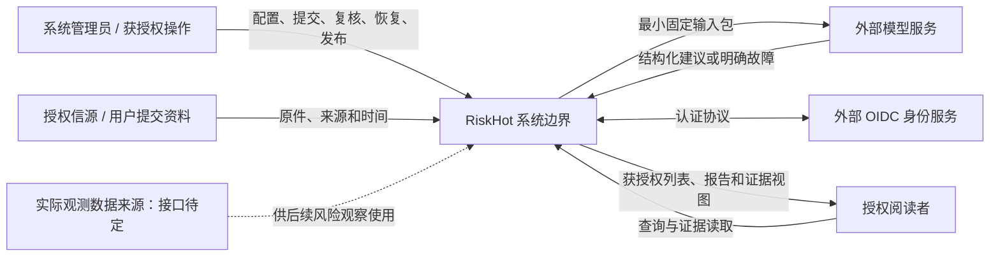
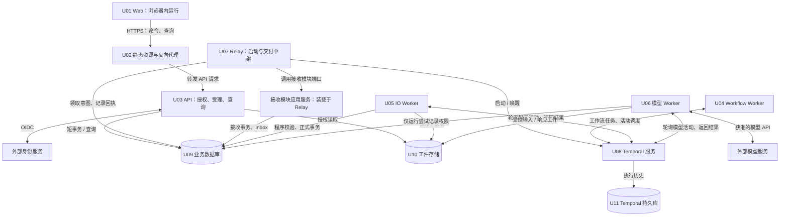
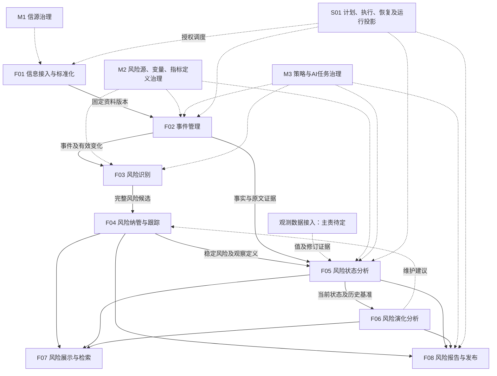
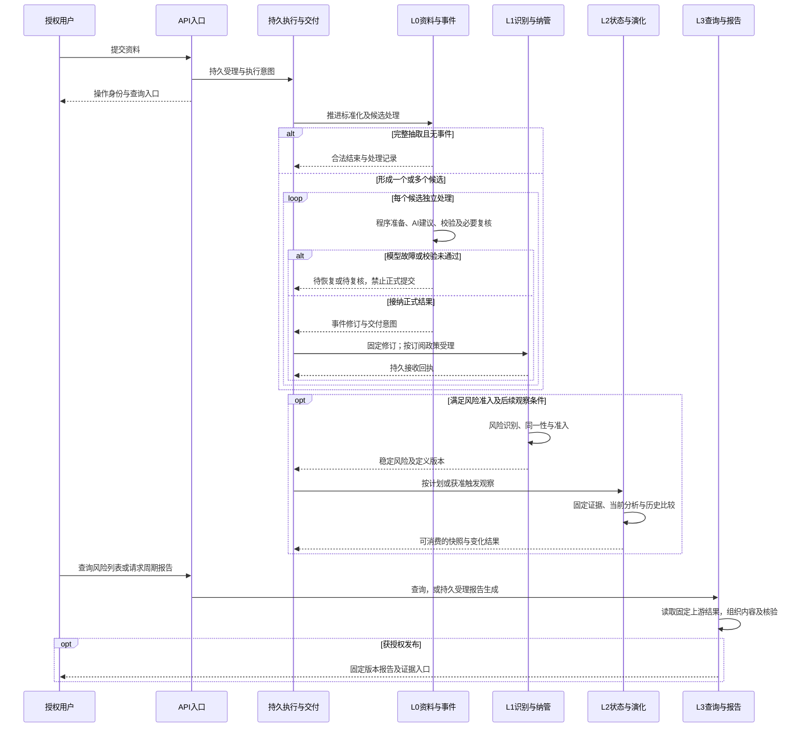
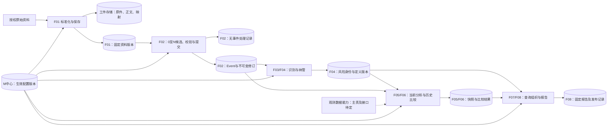
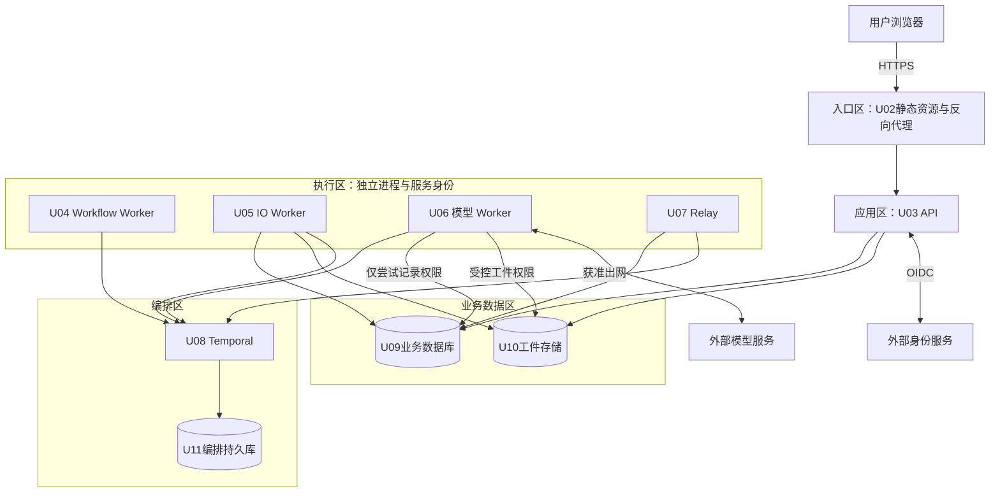

# RiskHot 系统总体技术架构

> 文档编号：RH-TA-001 · V0.7 · 2026-10-24 · 全系统目标技术架构评审稿。方案尚未实现和运行验收；L0已有详细设计，L1～L3及治理中心的精确契约待细化。

## 目录

1. [文档概述](#1-文档概述)
2. [系统背景与架构需求](#2-系统背景与架构需求)
3. [架构设计原则与技术策略](#3-架构设计原则与技术策略)
4. [系统上下文架构](#4-系统上下文架构)
5. [系统总体技术架构](#5-系统总体技术架构)
   - [5.1 系统总体技术架构图](#51-系统总体技术架构图)
   - [5.4 核心技术组件与职责（技术运行单元）](#54-核心技术组件与职责)
   - [5.6 业务能力与技术组件映射](#56-业务能力与技术组件映射)
6. [系统运行时架构](#6-系统运行时架构)
7. [系统数据架构](#7-系统数据架构)
8. [系统接口与集成架构](#8-系统接口与集成架构)
9. [关键技术能力与专题概览](#9-关键技术能力与专题概览)
10. [基础设施与部署架构](#10-基础设施与部署架构)
11. [系统横切技术架构](#11-系统横切技术架构)
12. [架构质量与技术验证](#12-架构质量与技术验证)
13. [架构决策、风险与演进](#13-架构决策风险与演进)
14. [关联技术设计文档](#14-关联技术设计文档)

## 1. 文档概述

### 1.1 文档目的与定位

本文是RiskHot全系统目标技术架构的主入口，说明技术组成、职责、数据与接口、运行协作、部署和质量保障。方案状态为设计评审稿，尚未实现和运行验收。

### 1.2 设计范围与边界

全系统包括 L0 信息处理、L1 风险识别与纳管、L2 风险态势与演化、L3 风险展示与报告，以及 M1/M2/M3 配置治理、S01 公共运行、身份权限和证据基础设施。

L0最小切片覆盖“提交文本 → 标准化资料 → 事件候选 → 正式事件或合法无事件 → 查询与持久交付回执”。允许使用隔离接收端验证L0交付；该接收端不是已经完成的L1业务。L1～L3在本文具有明确责任和接口语义，但物理表、完整Schema及全部业务状态机需要后续分层设计。

总体正文维护全局结构、边界、交互、不变量和关键权衡。复杂公共机制的算法、锁序、重试参数及协议细节由T01～T08专题维护；业务步骤、物理字段及局部状态机由模块分册维护。编制范围为架构设计与文档。

### 1.3 架构描述方法、视点与视图规范

一级目录按用户指定的system-architecture-design V2.0.0第6节十四章大纲组织。上下文、业务模块、技术运行单元、运行时、数据和部署采用不同视图：方框代表的抽象对象由各图说明；数据所有权不等于物理数据库数量，进程不等于业务模块。图与正文均描述目标方案。视图索引见第14.4节，变更一致性要求见第14.5节。

### 1.4 术语及参考文档

业务依据为 [业务架构总览](../02-%E4%B8%9A%E5%8A%A1%E6%9E%B6%E6%9E%84%E4%B8%8E%E9%A2%86%E5%9F%9F%E8%AE%BE%E8%AE%A1/%E4%B8%9A%E5%8A%A1%E6%9E%B6%E6%9E%84%E6%80%BB%E8%A7%88.md)、[L0 业务架构](../02-%E4%B8%9A%E5%8A%A1%E6%9E%B6%E6%9E%84%E4%B8%8E%E9%A2%86%E5%9F%9F%E8%AE%BE%E8%AE%A1/RiskHot_L0_%E4%BF%A1%E6%81%AF%E5%A4%84%E7%90%86%E5%B1%82_%E4%B8%9A%E5%8A%A1%E6%9E%B6%E6%9E%84%E4%B8%8E%E9%A2%86%E5%9F%9F%E8%AE%BE%E8%AE%A1V1.0.md)、[L1 业务架构](../02-%E4%B8%9A%E5%8A%A1%E6%9E%B6%E6%9E%84%E4%B8%8E%E9%A2%86%E5%9F%9F%E8%AE%BE%E8%AE%A1/RiskHot_L1_%E9%A3%8E%E9%99%A9%E8%AF%86%E5%88%AB%E4%B8%8E%E7%BA%B3%E7%AE%A1%E5%B1%82_%E4%B8%9A%E5%8A%A1%E6%9E%B6%E6%9E%84%E4%B8%8E%E9%A2%86%E5%9F%9F%E8%AE%BE%E8%AE%A1.md)、[L2 业务架构](../02-%E4%B8%9A%E5%8A%A1%E6%9E%B6%E6%9E%84%E4%B8%8E%E9%A2%86%E5%9F%9F%E8%AE%BE%E8%AE%A1/RiskHot_L2_%E9%A3%8E%E9%99%A9%E6%80%81%E5%8A%BF%E5%88%86%E6%9E%90%E5%B1%82_%E4%B8%9A%E5%8A%A1%E6%9E%B6%E6%9E%84%E4%B8%8E%E9%A2%86%E5%9F%9F%E8%AE%BE%E8%AE%A1V1.0.md)、[L3 业务架构](../02-%E4%B8%9A%E5%8A%A1%E6%9E%B6%E6%9E%84%E4%B8%8E%E9%A2%86%E5%9F%9F%E8%AE%BE%E8%AE%A1/RiskHot_L3_%E9%A3%8E%E9%99%A9%E4%BA%A7%E5%93%81%E4%B8%8E%E5%8F%91%E5%B8%83%E5%B1%82_%E4%B8%9A%E5%8A%A1%E6%9E%B6%E6%9E%84%E4%B8%8E%E9%A2%86%E5%9F%9F%E8%AE%BE%E8%AE%A1%20V1.0.md) 与 [系统功能架构总览](../03-%E7%B3%BB%E7%BB%9F%E5%8A%9F%E8%83%BD%E6%9E%B6%E6%9E%84/%E7%B3%BB%E7%BB%9F%E5%8A%9F%E8%83%BD%E6%9E%B6%E6%9E%84%E6%80%BB%E8%A7%88.md)；模块边界以最新 [F01 功能设计 V2.1](../03-%E7%B3%BB%E7%BB%9F%E5%8A%9F%E8%83%BD%E6%9E%B6%E6%9E%84/F01%20%E4%BF%A1%E6%81%AF%E6%8E%A5%E5%85%A5%E4%B8%8E%E6%A0%87%E5%87%86%E5%8C%96%E6%A8%A1%E5%9D%97%E5%8A%9F%E8%83%BD%E8%AE%BE%E8%AE%A1%20V2.1.md)、[F02 功能设计](../03-%E7%B3%BB%E7%BB%9F%E5%8A%9F%E8%83%BD%E6%9E%B6%E6%9E%84/F02%20%E4%BA%8B%E4%BB%B6%E7%AE%A1%E7%90%86%E6%A8%A1%E5%9D%97%E5%8A%9F%E8%83%BD%E8%AE%BE%E8%AE%A1%20V1.0.md)、[M1 信源管理](../03-%E7%B3%BB%E7%BB%9F%E5%8A%9F%E8%83%BD%E6%9E%B6%E6%9E%84/M1%20%E4%BF%A1%E6%BA%90%E7%AE%A1%E7%90%86%E4%B8%AD%E5%BF%83%E5%8A%9F%E8%83%BD%E8%AE%BE%E8%AE%A1.md)、[M2 风险源管理](../03-%E7%B3%BB%E7%BB%9F%E5%8A%9F%E8%83%BD%E6%9E%B6%E6%9E%84/M2%E9%A3%8E%E9%99%A9%E6%BA%90%E7%AE%A1%E7%90%86%E4%B8%AD%E5%BF%83%E5%8A%9F%E8%83%BD%E8%AE%BE%E8%AE%A1.md)、[M3 策略管理](../03-%E7%B3%BB%E7%BB%9F%E5%8A%9F%E8%83%BD%E6%9E%B6%E6%9E%84/M3%E7%AD%96%E7%95%A5%E7%AE%A1%E7%90%86%E4%B8%AD%E5%BF%83%E5%8A%9F%E8%83%BD%E8%AE%BE%E8%AE%A1.md)、[S01 公共运行](../03-%E7%B3%BB%E7%BB%9F%E5%8A%9F%E8%83%BD%E6%9E%B6%E6%9E%84/%E5%85%AC%E5%85%B1%E8%BF%90%E8%A1%8C%E8%83%BD%E5%8A%9B%E5%8A%9F%E8%83%BD%E8%AE%BE%E8%AE%A1.md) 和 [风险产品与交付功能设计](../03-%E7%B3%BB%E7%BB%9F%E5%8A%9F%E8%83%BD%E6%9E%B6%E6%9E%84/%E9%A3%8E%E9%99%A9%E4%BA%A7%E5%93%81%E4%B8%8E%E4%BA%A4%E4%BB%98%E6%A8%A1%E5%9D%97%E5%8A%9F%E8%83%BD%E8%AE%BE%E8%AE%A1%20V1.0.md) 为依据。原型辅助说明交互，不拥有业务规则解释权。

| 术语 | 本文含义 |
| --- | --- |
| Information / 资料版本 | F01保存的可追溯资料及其不可变版本，不等于事件 |
| Candidate | 某次资料处理内的候选事件；正式提交前不持新建Event身份 |
| Event / EventRevision | F02正式事件身份 / 对该身份一次可追溯业务修订 |
| Target / Variable | 可复用观测主体 / M2治理的变量；事件三元关系有直接证据 |
| M / risk_level | 事件金融意义 / 风险当前程度，两者不能互相替代 |
| MonitoredRisk | L1正式纳管的稳定风险身份及观察定义 |
| RiskSnapshot / RiskAnalysisResult | L2当前状态快照 / 附属的历史比较结果 |
| RiskReport | L3独立版本和发布生命周期的周期报告 |
| manifest | 固定本次输入、策略、任务、Schema、方法和运行政策的版本清单 |
| attempt / execution_generation | 一次调用尝试 / 防旧执行提交的有效代次 |
| proposal_generation / commit_key | 建议变更代次 / 固定业务提交身份；技术重试不任意换键 |
| Outbox / Inbox | 发送方同事务交付意图 / 接收方持久去重与回执 |
| 受理 / 完成 / 交付 | 命令已持久接收 / 业务得到终态 / 接收方已持久接收；三者分开 |

- [arc42 官方模板](https://arc42.org/overview/)：本稿按十二类架构内容组织，并补入RiskHot的责任、视图及追踪；章节存在不等于内容已经验证。
- [ISO/IEC/IEEE 42010:2022 官方说明](https://www.iso.org/standard/74393.html)：用于理解架构描述及视图相关概念；标准不指定固定文档格式，本稿未做正式符合性认定。
- 具体组件机制的一手资料与选型依据集中在 [ADR-L0-002](05-%E6%9E%B6%E6%9E%84%E6%B2%BB%E7%90%86%E4%B8%8E%E9%AA%8C%E8%AF%81/%E6%9E%B6%E6%9E%84%E5%86%B3%E7%AD%96%E8%AE%B0%E5%BD%95/ADR-L0-002-%E7%8B%AC%E7%AB%8B%E6%8A%80%E6%9C%AF%E9%80%89%E5%9E%8B%E4%B8%8E%E8%AE%BE%E8%AE%A1%E5%9F%BA%E7%BA%BF.md)，避免总体与专项重复维护不同版本的技术事实。

## 2. 系统背景与架构需求

### 2.1 系统定位与建设目标

RiskHot 服务宏观经济金融风险研究，将授权资料转为可追溯事件，进一步识别和纳管稳定风险、分析当前状态与历史变化，最后交付风险列表和周期报告。系统输出研究信息产品；交易执行、自动投资决策和微观风险独立纳管不在首版范围。

### 2.2 业务能力与功能范围

| 场景 | 业务完成结果 | 当前设计深度 |
| --- | --- | --- |
| SC-A 资料形成事件 | 固定资料版本产生0～N候选，正式结果可追溯、可交付 | L0 已有模块/数据/AI详细设计评审稿 |
| SC-B 事件形成纳管风险 | 风险候选经身份和准入判断形成或关联稳定风险 | 本文定义跨层边界；L1详细技术方案待编写 |
| SC-C 风险周期观察 | 固定截止时点形成当前状态、变量分析及可比历史变化 | 本文定义数据及运行依赖；L2详细技术方案待编写 |
| SC-D 查询与报告发布 | 展示已有结论，形成固定版本报告并受控发布/撤回 | 本文定义消费和发布边界；L3详细技术方案待编写 |
| SC-E 配置变更与故障恢复 | 新运行用已生效版本，在途有依据地恢复，已完成效果不重复 | 共享机制已有设计；全系统场景待验证 |

### 2.3 利益相关者与架构关注点

以下是架构阅读与维护职责，不新增产品角色；产品角色仍为系统管理员、授权阅读者。提交、复核、维护和运行操作通过权限细分，不能仅凭职责名称获得授权。

| 编号 | 利益相关者 / 工作职责 | 主要关注点 | 对应视图与判据 |
| --- | --- | --- | --- |
| ST-01 | 业务负责人 / 研究负责人 | 事件、风险、状态与产品的含义正确；空结果合法；不混淆 M 与风险等级 | 第4～7章；Q-01～05、Q-10 |
| ST-02 | 授权阅读者 | 结果可理解、可查证、时点和缺口清楚；只能读取授权信息 | 第6～8、11章；Q-04、Q-06、Q-08 |
| ST-03 | 系统管理员及获授权复核者 | 配置版本生效、待办依据、失败恢复和发布动作有明确边界 | 第6、8～11章；Q-05～07、Q-09 |
| ST-04 | 后续开发 / 集成维护者 | 模块唯一写入方、接口、事务、数据类型与依赖关系明确 | 第5～11章；分册契约与PoC |
| ST-05 | 后续测试 / 架构评审者 | 要求能追踪到机制、场景及执行证据；已验证与待验证分开 | 第12～14章；验证矩阵 |
| ST-06 | 后续运维 / 安全维护者 | 服务故障影响、容量、权限、备份与恢复路径可执行 | 第10～13章；Q-06～09 |

### 2.4 核心架构驱动因素

架构需同时支持：异构资料到可追溯事实的转换、程序与模型协作、各层独立业务身份、长时间异步执行、重复与中断恢复、历史结果固定版本以及受控发布。首个L0切片以多候选、无事件、幂等、原文引用和模型故障隔离检验这些能力。

### 2.5 非功能需求与质量属性目标

优先顺序为：正式结果正确且不被执行故障污染 → 原文可追溯与重复幂等 → 可恢复与可诊断 → 在容量边界内的响应效率。真实模型语义正确性必须单独评测，不能用Schema合法代替。

用户要求的五项硬性场景为：一份资料多个候选、无事件正常结束、重复提交幂等、引用回到原文、模型故障不造成错误正式事件。第12章将其落实为可检查条件。任何“已实现”“已通过”结论都需要新的执行证据。

### 2.6 技术约束与外部依赖

下列要求适用于资料、事件、风险、分析结果与报告的完整处理链。具体实现机制由技术专项和模块详细设计落实。

| 编号 | 约束及依据 | 对总体架构的要求 |
| --- | --- | --- |
| G-01 | 业务数据具有明确主责；依据各层业务对象及模块职责 | 每类正式对象由所属业务模块提交和修订；共享服务与下游模块通过公开契约协作，保持唯一写入职责 |
| G-02 | 模型输出必须经过业务接纳；依据程序与AI协作流程及模型故障隔离要求 | 模型建议、校验结果与正式业务数据分开管理；模型进程不能直接写入正式数据，故障不能被转换为正常业务结论 |
| G-03 | 结果必须能够追溯到依据；依据资料版本、原文引用和跨层结果引用要求 | 原始资料、业务修订和引用关系使用固定身份与版本；更新保留历史依据，清理策略必须检查引用及留存要求 |
| G-04 | 数据访问和业务操作受授权约束；依据现行角色与权限设计 | 对查询、证据读取、复核、提交、发布和恢复分别检查授权；后台执行与人工操作均应记录主体和操作依据 |
| G-05 | 重复请求和执行恢复不能重复产生业务效果；依据幂等与可靠交付要求 | 各模块建立稳定操作身份、提交回执和交付去重；区分受理、业务完成与下游接收状态 |
| G-06 | 历史结果所用规则与输入可解释；依据M3版本治理及S01恢复职责 | 执行绑定输入、策略、任务、模型和方法版本；恢复沿用原版本，重新计算须显式建立新执行记录。版本可追踪不代表模型再次调用必然逐字一致 |

**设计假设及失效影响**

下列前提支撑当前目标方案，均需在相应设计或验证阶段核实；前提失效时，应重新评估关联决策。

| 编号 | 当前假设及适用范围 | 验证方式与失效影响 |
| --- | --- | --- |
| A-01 | 业务模块可在同一受控运营域内协作，共用基础设施及发布治理 | 在部署和组织评审确认管理边界；若存在独立租户、跨组织运营或独立合规隔离，需重审身份范围、数据隔离、部署单元与交付信任边界 |
| A-02 | AI分析与跨层交付允许异步完成，使用者可以查询进度和处理结果 | 按各层业务时效要求确认最大等待时间与积压容限；若出现严格实时要求，应重审调度、资源预留、降级路径及服务拆分 |
| A-03 | 数据库、持久存储、工作流服务、身份服务与获准模型端点可在目标环境中运行或被授权访问 | 在环境与供应方评审确认可达性、许可和运行责任；若存在离线环境、外网禁用或指定基础设施要求，需调整适配器及部署方案 |

这些假设不构成单组织、单机部署或指定云平台的生产承诺。模块化单体、PostgreSQL、Temporal等为当前技术决策，其适用性需要结合以下条件验证。

**待确认的外部条件**

| 条件 | 待确认内容与确认职责 | 对设计的影响及确认时点 |
| --- | --- | --- |
| 部署与网络 | 本地/私有云/公有云、区域、网络出口及离线要求；由系统负责人和运维确认 | 决定模型调用方式、服务拓扑、存储访问和身份服务连接；部署方案定版前确认 |
| 数据保护与使用许可 | 资料使用范围、可外发内容、模型服务的数据留存条款、敏感信息处理规则；由数据与安全负责人确认 | 决定外发过滤、模型选择、加密和审计控制；接入真实资料及外部模型前确认，未获准的数据不外发 |
| 规模与服务时效 | 日资料量、峰值请求、平均候选数、历史数据增长、各层分析周期、并发读者及响应目标；由业务与运维确认 | 决定容量、队列优先级、背压和扩容条件；容量评审前确认，验证环境参数不作为生产指标 |
| 可用性与恢复 | 可用性目标、允许维护窗口、可接受数据丢失量（RPO）和恢复时间（RTO）；由业务与运维确认 | 决定冗余、副本、备份频率及恢复顺序；生产部署前确认并演练 |
| 保留与删除 | 原件、业务修订、审计和模型调用记录的保留期，删除与引用冲突处理；由数据与安全负责人确认 | 决定归档、清理、存储成本及删除权限；启用清理策略前确认，不预设永久保存或任意删除 |
| 外部系统契约 | 身份提供方、来源接口、模型供应方的协议、版本、配额、许可与服务承诺；由集成及安全负责人确认 | 决定认证适配、超时、重试和故障隔离；集成设计冻结前确认，供应商变化需重新验证 |
| 组织与成本 | 维护团队能力、运营职责、基础设施和模型预算、采购约束；由系统负责人确认 | 决定技术选型的可维护性、托管方式和成本上限；采购与生产资源配置前确认 |

生产规模、区域、许可、预算和服务目标需确认后定版；未确认条件进入第13章风险管理，不能用L0验证参数代替。

## 3. 架构设计原则与技术策略

### 3.1 总体架构设计原则

以业务所有权确定正式写入边界；程序负责规则、校验与提交，模型负责受约束的建议；持久业务状态先于运行投影；读取和交付均引用固定版本；失败按原身份恢复；复杂公共规则单点维护。

### 3.2 总体技术路线

采用模块化单体作为逻辑组织：业务模块各自拥有命令和数据写入权，在同一应用体系内通过显式端口协作。API、Workflow Worker、IO Worker、模型 Worker和Relay按执行性质分进程，不因进程分开就将F01/F02设计为微服务。这样可以把核心业务提交限制在明确的数据库事务内，并独立控制模型配额和故障影响。

### 3.3 关键架构模式与设计策略

采用模块化单体组织业务代码，按执行性质划分独立进程；模块内短事务保证正式提交一致性，跨模块采用持久交付与幂等接收；持久工作流承载等待和恢复，不替代业务数据库；不可变工件提供原文和模型依据。

### 3.4 技术选型原则

选择必须回应业务正确性、可恢复性、权限隔离和维护成本。优先使用足够简单且可验证的组件，精确版本、许可证和供应方在环境评审冻结；没有实测瓶颈或独立隔离需求时，不预设微服务、向量库或独立消息总线。

### 3.5 关键技术选型与决策依据

选择 PostgreSQL 保存关系约束和幂等事实，Temporal负责持久推进，Outbox/Inbox负责模块交接。事件语义识别仍由业务任务与复核完成，唯一键只解决已核定身份的重复效果。首切片不把向量库、独立消息总线、自主Agent或Kubernetes作为必备条件。

[ADR-L0-002](05-%E6%9E%B6%E6%9E%84%E6%B2%BB%E7%90%86%E4%B8%8E%E9%AA%8C%E8%AF%81/%E6%9E%B6%E6%9E%84%E5%86%B3%E7%AD%96%E8%AE%B0%E5%BD%95/ADR-L0-002-%E7%8B%AC%E7%AB%8B%E6%8A%80%E6%9C%AF%E9%80%89%E5%9E%8B%E4%B8%8E%E8%AE%BE%E8%AE%A1%E5%9F%BA%E7%BA%BF.md)比较模块化单体/微服务、TypeScript/Python/Java、关系/文档存储、自建调度/队列/Temporal等方案。当前选择来自业务约束；与旧实现使用相同的技术名称不意味着复用旧实现。

全局技术栈见第5.8节，备选方案、代价与决策状态见第13.1节及ADR。

## 4. 系统上下文架构

### 4.1 系统边界与外部环境

RiskHot包括L0～L3业务模块、M1～M3配置治理、S01运行治理及应用所需基础设施。模型服务、身份服务和资料来源是外部依赖；实际观测数据入口的业务主责和协议仍待确认。L0向L1交付属于系统内业务协作。

### 4.2 外部用户与角色

现行产品角色为系统管理员和授权阅读者。维护、复核、恢复与发布是按功能授予的操作权限；不能因拥有管理员页面或知道对象ID就推定具备所有业务权限。

### 4.3 外部系统及第三方服务

| 外部边界 | 交换内容 | 协议 / 失败处理 | 首切片状态 |
| --- | --- | --- | --- |
| 用户浏览器 | 命令、查询、复核、原文受控读取 | 同源HTTPS；受理和完成分开，重复命令返回回执 | 已设计HTTP契约 |
| 信源 / 资料提交 | 原件、来源身份、获取/发布时间 | 首切片为文本提交；以后连接器按来源授权及抓取协议适配 | 多站点采集不在切片内 |
| 模型服务 | 固定任务输入、响应、结束原因及用量 | 供应方适配；有界超时、预算、原始响应留存 | 型号与数据许可待冻结 |
| OIDC 服务 | 登录认证结果与签名信息 | 服务端认证、会话；身份不可用不绕过登录 | 身份域与兼容性待验证 |
| 实际观测数据来源 | 值、口径、时间、发布和修订依据 | 正式接口与业务接入主责待定 | 排除于F01及L0首切片 |

### 4.4 系统上下文架构图

视图V01，系统级边界；实线为已定义交互，虚线为待定输入依赖。

### 4.5 外部依赖与集成关系

外部数据输入先核验授权、格式和来源身份；模型调用由受限执行单元发起；身份结果还需结合应用对象权限。依赖失败的处理与业务受理状态分离，接口方式见第8章。

### 4.6 系统信任边界

浏览器仅访问受控应用入口；业务数据库、原件及工作流管理面不对用户直接公开。模型输出与原始资料均视作不可信输入，模型不能自行授权、选择交付地址或批准正式结果。基础设施即使由云平台托管，仍纳入系统运行保障与权限设计；供应方许可和资料外发范围是独立的审批条件。

## 5. 系统总体技术架构

### 5.1 系统总体技术架构图

视图V03，技术运行单元级。框为运行进程或基础服务，圆柱为持久存储；箭头标注请求、任务交接或读写；图不表示机器数量。

### 5.2 系统逻辑分层与职责划分

接口适配层处理身份、契约与传输；应用服务编排单个业务操作；领域组件核定规则与状态；存储和外部适配层实现数据库、工件及模型访问。Workflow只协调持久步骤，活动调用应用服务。

模块只调用公开应用端口；禁止跨模块直接写表。读取固定版本可通过受控查询端口或所有者发布的不可变快照。查询投影不是新事实来源，重建投影不能调用模型或重新执行成功业务。

事务范围以业务所有者为界：F01保存版本、F02提交事件、L1纳管风险、L2保存分析、L3发布报告各自负责原子一致性；跨层交付通过持久消息和回执衔接，不让一次数据库事务等待整个L0～L3链。后面三类事务的完整字段与状态机需在分层设计时确认。

正式关系的定义与运行状态分离：M不是风险等级；跟踪暂停不是风险下降；新快照不是新风险；新来源不是新事件进展；模型成功不是业务已保存。

### 5.3 功能模块、服务与组件划分

视图V02，业务模块级。实线表示业务交接，虚线表示配置或待定依赖；模块不等于独立服务或数据库。

| 业务范围 | 逻辑技术模块 | 唯一写入主责 | 可读取的外部内容 |
| --- | --- | --- | --- |
| L0：F01/F02 | information | 资料、版本、候选、Event及关系/增量/评级/修订 | 信源、Target字典、正式变量、任务与方法快照 |
| L1：F03/F04 | registry | 风险识别结果、MonitoredRisk、长期变量与事件关系 | L0修订、M2定义、M3规则 |
| L2：F05/F06 | analysis | 当前RiskSnapshot、变量明细、附属RiskAnalysisResult | 固定风险定义、事件、观测值、历史基准及方法 |
| L3：F07/F08 | publication | 报告内容/版本/发布事实；列表为派生查询 | L1身份与L2可消费结果 |
| M1 | reference/source | 信源身份、启停和版本 | F01业务接入质量、S01运行投影 |
| M2 | reference/definition | 风险源、变量、指标定义及映射、风险类型 | 各层提交的候选与维护依据 |
| M3 | strategy | 策略、AI任务、Prompt/Schema版本、评测定义与结果引用 | 领域规则及历史运行证据 |
| S01 | operations + platform | 计划与运行控制、尝试、执行/交付投影 | 领域回执与允许的恢复能力 |
| 身份权限 | identity | 主体、会话、授权与权限代次 | OIDC认证结果 |
| Target字典 | 受控主体治理端口 | 正式建档授权与治理主责待确认 | F02只匹配/提议，不自行扩权建档 |

逻辑模块名用于说明依赖与所有权，不是现存目录或已建立数据库。L0的物理表已在分册明确；L1～L3和M中心的完整物理模型仍需分别设计。共享定义的治理不等于把所有中心合成一个可任意写入的“公共表”。

### 5.4 核心技术组件与职责

**系统组成：技术运行单元。** U01～U11是技术组成清单，U03～U07为独立运行进程；校验器、Repository和模型适配器是进程内组件，隔离接收端仅用于L0交付验证。

| 单元 | 运行职责与技术承载 | 状态、权限及故障影响 |
| --- | --- | --- |
| U01 Web | 浏览器内React应用，提交、查询、复核与证据展示 | 仅持用户会话上下文；页面关闭不取消后台业务；Vite用于构建，不是生产业务服务 |
| U02 静态资源与反向代理 | 交付Web制品、TLS入口及API转发；具体代理产品待选 | 不持业务事实；失败影响用户入口，后台执行可继续 |
| U03 API | Fastify承载身份会话、命令持久受理、授权查询及复核入口 | 业务状态在数据库；不在请求中等待模型；失败后客户端使用原请求键重试 |
| U04 Workflow Worker | Temporal SDK执行确定性流程，调度活动及等待恢复 | 仅处理ID、摘要与小状态；不直接访问业务数据库、工件或模型；停机时由持久历史支持续接 |
| U05 IO Worker | 执行模块应用服务：资料标准化、规则计算、建议验证、正式提交 | 使用按模块限定的数据权限；网络及模型等待不持数据库事务；故障按回执恢复 |
| U06 模型 Worker | 加载固定任务包、调用供应方、保存响应和结束原因 | 无正式表写权限；模型失败形成可恢复记录，程序校验在IO Worker完成 |
| U07 Relay | 租约领取启动/交付意图，唤醒工作流、调用接收端口并保存回执 | 同一进程可装载多个受控接收适配器；失败导致积压，不撤销已提交业务 |
| U08 Temporal 服务 | 持久调度、计时、活动分发和工作流历史管理 | 调度事实由其持久库承载；停机影响推进，不改变业务库中的完成事实 |
| U09 业务数据库 | PostgreSQL保存模块数据、受理、复核、回执、Outbox/Inbox | 按业务所有权分权限；不可用时停止需要持久化的新受理及提交 |
| U10 工件存储 | ArtifactStore保存不可变原件、正文、映射与模型工件 | 验证阶段为独立持久卷；不可用时阻断依赖其证据的提交；跨主机扩展前启用共享存储适配 |
| U11 Temporal 持久库 | 保存编排历史和运行服务自身状态 | 与业务库分库分账号；验证环境可共用PG实例，生产故障域另行评审 |

### 5.5 组件依赖与交互关系

接收模块应用服务是Relay装载的模块代码，不是额外部署的服务。以F01交付为例，Relay调用F02接收端口，由F02拥有的接收事务写Inbox和处理记录；数据库角色只授予这条接收路径需要的权限，不授予Relay任意修改正式事件的权限。之后的业务分析由Worker执行。

Workflow Worker通过Temporal调度IO和模型活动；IO执行业务校验和正式事务；模型Worker只保存尝试及响应。API持久受理后返回，Relay把业务意图连接到执行和交付。数据写权限沿模块公开端口授予，不随共享代码或共处进程扩大。具体通信见第8章。

### 5.6 业务能力与技术组件映射

| 业务能力 | 用户入口 | 编排与执行 | 数据与交付边界 |
| --- | --- | --- | --- |
| F01 接入与标准化 | U01/U03持久受理和查询 | U04资料工作流；U05六步程序处理；无模型抽取 | U09资料版本、U10原件与映射；U07交付固定版本 |
| F02 事件管理 | U03接收、查询与复核 | U04抽取及逐候选流程；U05准备/验证/正式提交；U06执行AI-01～05 | U09候选与事件修订；U10证据工件；U07交付实际变化 |
| F03～F06 风险识别、纳管与分析 | U03命令和查询端口，具体契约待细化 | 沿用U04调度、U05业务决策、U06建议生成；任务队列及事务详设待补 | 正式对象由各模块负责；跨层通过U07可靠交接 |
| F07/F08 查询与报告 | U01/U03读取已有结果、发起报告与发布命令 | 查询不触发模型；报告生成需要时由U04/U05/U06异步执行，发布由业务规则接纳 | 固定上游版本、报告版本和发布记录；精确契约待L3详设 |
| M1/M2/M3 配置治理 | U03授权维护与版本查询 | 程序发布和兼容检查；只有获准的异步任务才进入Worker | 配置版本由所属中心拥有；不会因配置更新自动重算历史结果 |
| S01 运行治理 | U03查询与恢复入口 | U04/U07推进计划、恢复和交付；U08承载时钟与执行历史 | 业务完成以所属模块回执为准；S01不批准事件、风险或报告 |

共享执行进程不意味着共享业务写入权。跨模块调用使用公开应用端口；扩容和服务拆分必须保留上述所有权、授权、版本及幂等语义。

### 5.7 公共技术能力与基础服务

共享能力包括身份授权、契约校验、持久编排、可靠交付、证据解析、版本治理和运行观测。它们提供技术能力，业务接纳和正式数据所有权仍属于相应模块。专题定位见第9章，权威定义见第14.3节。

### 5.8 总体技术栈与选型

| 组件 | 目标技术 / 机制 | 职责 | 选型限制 |
| --- | --- | --- | --- |
| Web | React、TypeScript、Vite | 查询、提交、复核及原文展示 | 不直接访问模型、数据库和编排管理端 |
| API | Node.js、TypeScript、Fastify | 身份、契约、授权、持久受理、查询 | 不等待长模型调用 |
| 契约 | JSON Schema 2020-12、Ajv2020 | API和任务结构验证、版本治理 | 关闭强转/补值/删字段；语义另行校验 |
| 数据访问 | pg、显式参数化SQL | 可评审锁序、唯一键、事务及查询 | 同一事务使用同一连接；不绕过统一提交入口 |
| 业务存储 | PostgreSQL专用关系表 | 身份、版本、状态、审批、回执与消息 | JSONB存建议/快照，不替代身份与外键 |
| 执行 | Temporal TypeScript SDK | 持久工作流、计时、活动恢复 | 不替代业务状态与永久幂等记录 |
| 工件保存 | 不可变ArtifactStore | 原件、标准化正文、定位、模型工件 | 单机持久卷验证；多主机必须共享存储 |
| 模型 | 固定任务包及供应方适配器 | 受控生成建议、记录故障与用量 | 固定真实型号后评测；不授予正式写入权限 |
| 身份 | 服务端OIDC、服务端会话 | 登录、会话和可追溯主体 | 应用另行控制对象权限和撤销 |

基础组件精确版本和模型型号在PoC环境清单冻结；需通过兼容性和许可验证。

## 6. 系统运行时架构

### 6.1 系统运行时总体架构

全系统采用“持久受理 → 程序准备 → 按需AI建议 → 程序校验与业务接纳 → 正式提交 → 持久交付”。各层独立完成自己的业务事务；计划、任务和交付的运行状态不能替代业务完成状态。

### 6.2 端到端核心业务执行流程

视图V04，全系统运行协作。参与方按业务层聚合，技术运行单元映射见第5.6节；跨层箭头表达固定版本交接，触发政策与精确协议由对应详设确定。

报告生成通过持久执行异步完成；图中的发布箭头表示产品交付，不表示绕过API或授权。无风险、无历史和无评级按各层业务规则表达；不得把数据缺失推成风险稳定或模型故障推成合法空结果。

### 6.3 核心组件运行时交互与时序

| 场景 | 程序与AI的执行顺序 | 保存、交付及失败边界 |
| --- | --- | --- |
| 事件进入L1 | 接收固定修订 → AI-L1-01完整风险候选 → 程序召回 → AI-L1-02同一性 → 程序准入/复核 | 无风险正常结束；正式风险身份及初始关系一致保存后再交L2；触发条件待定 |
| L2一次观察 | 固定risk定义/截止时间/证据 → 来源、应对、损害分析 → 力量比较 → 当前状态 → 历史方向/持续性/减弱节点 | 当前状态与比较结果分清；无历史不能默认stable；保存与部分发布政策待详细设计 |
| L3列表查询 | 读L1目录与L2可消费快照 → 按明确口径选择、排序、授权输出 | 无快照保留未知；不在查询时调用模型补风险结论 |
| L3周期报告 | 固定周期、截止时间和输入快照集合 → AI-L3-01组织内容 → 程序核对引用和结论 → 授权发布 | 报告版本独立；生成成功不自动发布；撤回及上游纠正需可追踪处理 |

L2的AI-L2-01、02、04在输入齐备时可并行；03依赖01/02，05依赖前序当前分析，06～08消费当前与可比历史。技术编排必须表达这些依赖，不能仅按AI编号机械串行或无条件全并行。L3引用已有结论，不能重新评级或编造缺失趋势。

L0逐候选时序及事务清单见[L0技术架构](03-%E6%A8%A1%E5%9D%97%E6%8A%80%E6%9C%AF%E8%AF%A6%E7%BB%86%E8%AE%BE%E8%AE%A1/L0-%E4%BF%A1%E6%81%AF%E5%A4%84%E7%90%86%E5%B1%82/L0-%E4%BF%A1%E6%81%AF%E5%A4%84%E7%90%86%E5%B1%82%E6%8A%80%E6%9C%AF%E6%9E%B6%E6%9E%84.md)；公共工作流、活动、复核唤醒及对账机制见[T03-任务编排与可靠性架构](02-%E4%B8%93%E9%A2%98%E6%8A%80%E6%9C%AF%E6%9E%B6%E6%9E%84/T03-%E4%BB%BB%E5%8A%A1%E7%BC%96%E6%8E%92%E4%B8%8E%E5%8F%AF%E9%9D%A0%E6%80%A7%E6%9E%B6%E6%9E%84.md)。

### 6.4 同步与异步执行模式

查询、鉴权、格式校验和持久受理采用短请求；模型分析、资料处理、周期观察、报告生成与跨模块交付采用持久异步执行。用户可以查询进度，关闭页面不取消后台任务；报告和分析结果只在明确业务状态下对外消费。

### 6.5 后台任务与执行模型概览

S01维护计划与运行控制，Temporal承载调度时钟、等待及活动分发。工作流执行、程序活动、模型活动和交付中继分工明确；运行引用固定任务包及输入版本。多候选按独立业务身份执行，并发上限来自统一运行政策，不能依靠进程内队列承担持久受理。

### 6.6 运行状态与生命周期管理

资料已保存、F02已接收、候选已完成、下游已接收是不同状态。L0业务闭环要求合法无事件结束，或全部候选得到正式结果、明确无变化结果或经授权的非事件处置回执；对外交付闭环另要求应交付消息取得持久回执。待复核或partial不算全资料完成。

配置生效只影响后续按规则受理的新运行。在途固定定义和任务包仍可追溯；当前权限、来源资格及取消状态在适用提交边界重检。是否因某类业务配置撤销而阻断在途任务，由对应政策明确，不靠切换latest实现。技术重试保留业务身份；授权重算生成新analysis_key并关联父处理。

### 6.7 数据一致性与事务边界

每个业务所有者负责本地正式结果、完成回执与交付意图的原子提交；跨层一致性通过持久接收、幂等和回执衔接。数据库、工件和外部服务没有跨系统原子事务：先保存可验证工件再提交引用；网络或模型调用不占用业务事务。具体提交与恢复协议见[T01-数据与存储架构](02-%E4%B8%93%E9%A2%98%E6%8A%80%E6%9C%AF%E6%9E%B6%E6%9E%84/T01-%E6%95%B0%E6%8D%AE%E4%B8%8E%E5%AD%98%E5%82%A8%E6%9E%B6%E6%9E%84.md)和[T03-任务编排与可靠性架构](02-%E4%B8%93%E9%A2%98%E6%8A%80%E6%9C%AF%E6%9E%B6%E6%9E%84/T03-%E4%BB%BB%E5%8A%A1%E7%BC%96%E6%8E%92%E4%B8%8E%E5%8F%AF%E9%9D%A0%E6%80%A7%E6%9E%B6%E6%9E%84.md)。

### 6.8 并发控制与重复执行处理

幂等分别覆盖请求、资料身份/版本、INITIAL处理、候选提交、实际变化/评级和消息接收。不同层的键不能互相代替：相同资料用新请求键提交仍须收敛到同一INITIAL；新模型版本不自动触发重算；同一实际变化的多个来源不能重复制造更新。

同对象并发操作以业务身份、修订和有效执行代次协调；过期上下文重新准备。授权、取消与提交在同一正式边界确定先后；精确锁顺序、条件写入及冲突处理由[T01-数据与存储架构](02-%E4%B8%93%E9%A2%98%E6%8A%80%E6%9C%AF%E6%9E%B6%E6%9E%84/T01-%E6%95%B0%E6%8D%AE%E4%B8%8E%E5%AD%98%E5%82%A8%E6%9E%B6%E6%9E%84.md)和[T03-任务编排与可靠性架构](02-%E4%B8%93%E9%A2%98%E6%8A%80%E6%9C%AF%E6%9E%B6%E6%9E%84/T03-%E4%BB%BB%E5%8A%A1%E7%BC%96%E6%8E%92%E4%B8%8E%E5%8F%AF%E9%9D%A0%E6%80%A7%E6%9E%B6%E6%9E%84.md)维护。

### 6.9 异常处理、故障恢复与降级策略

| 情况 | 系统响应 | 保留的业务不变量 |
| --- | --- | --- |
| AI-01超时/截断/格式失败 | count保持未知，当前抽取待恢复 | 不写0候选，不制造NO_EVENT |
| 多候选中的一个故障 | 成功候选保留，批次partial，恢复失败项 | 不回滚独立成功，也不重抽已固定集合 |
| 相同请求或资料重交 | 查回执及INITIAL，返回已有状态 | 允许获取/尝试记录增加，正式效果不增加 |
| 同事件两个候选并发 | 提交时校验修订；冲突者重新准备受影响建议 | 不通过替换修订号盲目重放旧审批 |
| 提交回应丢失 | 查提交回执确认效果后续接 | 不随机换键再次提交 |
| 下游不通 | 已保存结果保持，原消息有界重投，超预算待恢复 | 不返回AI步骤重新分析 |
| 撤权或取消与提交竞争 | 在正式提交边界核定先后；失效执行拒绝 | 已提交结果不被取消无痕删除 |
| 原件损坏/丢失 | 明示证据不可用，阻断依赖它的新提交，按摘要恢复 | 不用模型重建相似原文冒充证据 |

依赖故障可暂停新执行、保留排队或停止超预算受理，同时维持获授权的历史查询。降级不通过默认分数、替代模型或伪造正文生成正式结论；具体超时、重试、租约和对账参数见[T03-任务编排与可靠性架构](02-%E4%B8%93%E9%A2%98%E6%8A%80%E6%9C%AF%E6%9E%B6%E6%9E%84/T03-%E4%BB%BB%E5%8A%A1%E7%BC%96%E6%8E%92%E4%B8%8E%E5%8F%AF%E9%9D%A0%E6%80%A7%E6%9E%B6%E6%9E%84.md)。

## 7. 系统数据架构

### 7.1 数据架构总体设计

业务数据库保存正式对象及关系、身份版本、操作回执和交付事实；工件存储保存原件、正文、映射及模型证据；Temporal持久库保存执行历史；查询投影可重建。各数据域可以共享物理基础设施，必须保留所有权与访问边界。

### 7.2 核心数据域与数据对象

| 数据类别 | 权威所有者 | 保存方式与消费约束 |
| --- | --- | --- |
| 信源、变量/指标/风险源与类型定义、策略任务 | 对应M中心；Target治理另待确认 | 稳定身份+不可变生效版本；运行固定快照；候选不直接成为正式定义 |
| 原始资料及标准化产物 | F01 | Information及版本清单关联不可覆盖工件；事件修订引用固定版本 |
| 候选、建议、运行尝试 | 所属业务模块；S01提供运行投影 | 与正式表区分；保留输入/响应/校验/代次，不以模型自报成功推进 |
| Event、增量、金融意义与关系 | F02 | 关系表与复合外键；正式修订快照不可变 |
| 风险身份与长期观察关系 | F04 | L1主数据；L2/L3固定引用，不反写身份 |
| 当前状态、变量明细和历史变化 | F05/F06 | 按风险、观察时点和版本保存；当前状态与比较结果分开表达 |
| 列表/Timeline及查询投影 | F07消费 | 由上游派生，可重建；不制造独立风险事实 |
| 周期报告与发布记录 | F08 | 固定输入集合、正文版本、发布/撤回事实；旧报告不随latest漂移 |
| 执行意图、回执、审计 | platform及业务所有者 | 去重依据独立于工作流历史；清理前检查恢复和追溯义务 |

### 7.3 数据流转与处理链路

视图V05：全系统数据流，表达对象变换、归属和固定版本引用；方框标明处理模块，圆柱标明持久产物，虚线为待定义的外部接入。数据域可共用物理数据库，图中不隐含“一域一库”。L1～L3为目标逻辑流，精确契约尚待详细设计。

F02的无事件分支只在完整成功的抽取结果为空时成立；模型故障保留未完成处理状态，不产生“无事件”事实。每层正式结果固定上游对象版本和证据引用，读者可沿“报告 → 快照/风险 → 事件修订 → 资料版本 → 原件”回溯。业务库保存关联和清单，工件存储保存大正文，两者联合恢复；Temporal历史及查询缓存均不作为正式业务事实来源。

### 7.4 数据归属与权威数据源

原始资料和版本由F01管理，事件由F02管理，风险身份由F04管理，状态与变化由F05/F06管理，报告和发布由F08管理。配置由对应M中心治理；S01仅提供运行控制和投影。任何模型响应、缓存或工作流终态都不能取代正式业务数据。Target治理及实际观测数据主责仍待确认。

### 7.5 数据存储架构与存储选型

PostgreSQL承载关系、唯一性和事务；ArtifactStore承载不可变大工件；Temporal持久库与业务库分库分账号。验证环境可共用PG实例，生产是否分离须依据故障域和容量评审。存储类型和物理约束见[T01-数据与存储架构](02-%E4%B8%93%E9%A2%98%E6%8A%80%E6%9C%AF%E6%9E%B6%E6%9E%84/T01-%E6%95%B0%E6%8D%AE%E4%B8%8E%E5%AD%98%E5%82%A8%E6%9E%B6%E6%9E%84.md)；工件持久化、摘要与定位协议见[T05-信息与知识工程架构](02-%E4%B8%93%E9%A2%98%E6%8A%80%E6%9C%AF%E6%9E%B6%E6%9E%84/T05-%E4%BF%A1%E6%81%AF%E4%B8%8E%E7%9F%A5%E8%AF%86%E5%B7%A5%E7%A8%8B%E6%9E%B6%E6%9E%84.md)。

### 7.6 数据标识、关联与版本管理

业务对象身份、修订身份、操作身份和消息身份分别管理；稳定身份不能由模型分配或由正文哈希代替语义判断。正式结果引用固定资料、定义、任务及方法版本；记录时间与业务发生时间分别表达。跨JSON类型和标识格式统一由T01/T02维护。

### 7.7 数据一致性与生命周期

主数据经候选/草稿、受控确认形成生效版本，停用不删除历史引用。业务修订追加保存；暂存工件只有在没有在途、待复核及正式引用并满足保留政策时才可清理。删除、归档和恢复均需要联合检查数据库关系和工件；保留期限待业务与安全确认。

### 7.8 数据质量与可追溯性

质量检查分别覆盖来源准入、正文完整性、结构合法性、引用定位、业务语义及历史可比性。引用位置准确不代表结论语义正确；语义质量另行评测。每层结果保留输入版本和接纳依据，追溯算法由T05、模型校验由T04维护。

### 7.9 数据安全与治理原则

查询、原文读取和导出按当前对象权限授权；日志与模型外发遵循最小必要数据原则。正式记录、原始工件、审计和备份分别制定访问及留存政策；治理变更留下审计，不能借清理或投影重建改写历史业务事实。

## 8. 系统接口与集成架构

### 8.1 接口架构总体设计

接口分为用户入口、模块应用端口、执行平台协议和外部适配器。每种接口定义提供方、使用方、授权主体、受理/完成语义和失败处理；精确载荷不在总体重复维护。

### 8.2 内部模块或服务通信

同一应用体系内通过模块公开端口协作，Relay可装载接收模块代码；持久异步交付仍须受理事务和回执。跨进程由Temporal任务协议及受控存储连接支撑；未来改为远程接收服务时保持相同身份和幂等语义，并记录新决策。

### 8.3 外部系统集成方式

| 提供方与使用方 | 交互方式与载荷 | 权限、错误和可靠性 |
| --- | --- | --- |
| Web → API | 同源HTTPS/JSON；短命令、查询及固定对象引用 | 会话及对象授权；错误分类、幂等和分页由T02定义；后台进度从持久状态读取 |
| Relay → 接收模块 | 同进程应用端口；固定消息信封及修订引用 | 接收模块事务写Inbox和处理身份；返回持久回执；失败只重投该消费者 |
| Relay/Worker ↔ Temporal | SDK连接；启动/唤醒、任务轮询、活动结果 | 服务身份和私网访问；任务包兼容检查；正文不进入工作流历史 |
| API/IO/Relay → 业务库 | 按职责授权的数据库连接；查询及短事务 | 接口身份与服务身份均检查；超时后先查回执；连接池受总预算限制 |
| API/Worker → 工件存储 | 受控ArtifactStore端口；对象键、摘要、正文或映射 | 固定版本与读取权限；缺失或摘要不符阻断依赖提交；禁止公开目录链接 |
| 模型Worker → 模型服务 | 供应方适配器；最小任务输入和固定Schema | 凭据隔离；超时、拒答、截断和格式失败保留不同原因；调用预算由T03控制 |
| API ↔ 身份服务 | 服务端OIDC认证与令牌校验 | T06定义认证和会话协议；供应方不可用不绕过认证 |

### 8.4 同步接口与协议

浏览器通过同源HTTPS/JSON访问API；身份服务使用服务端OIDC流程；模型使用供应方适配器。API对短命令持久受理后返回操作身份，对查询返回持久业务状态；响应成功不等于后台业务完成。具体路由、响应与错误见[T02-接口与集成架构](02-%E4%B8%93%E9%A2%98%E6%8A%80%E6%9C%AF%E6%9E%B6%E6%9E%84/T02-%E6%8E%A5%E5%8F%A3%E4%B8%8E%E9%9B%86%E6%88%90%E6%9E%B6%E6%9E%84.md)。

### 8.5 异步消息与事件机制

正式变化与Outbox同事务保存，Relay逐消费者交付，接收方持久保存Inbox及业务受理后回执。传输允许重复，业务效果必须幂等；乱序按对象修订识别。L0已有资料版本就绪、事件修订变化两类消息草案；L1～L3触发条件与消息契约待详细设计。

### 8.6 核心数据契约与 Schema 规范

公共Schema使用受控方言和版本，严格验证结构，不隐式改类型、填业务默认值或丢弃未声明字段。程序生成可信信封，模型只返回任务载荷；业务语义及证据校验独立于结构校验。权威定义与发布状态见第14.3节，当前尚无正式发布的可执行公共Schema/OpenAPI。

### 8.7 接口版本与兼容策略

接口、消息、模型任务、业务方法及数据库结构独立版本化。优先兼容增补，在途执行绑定原契约；不兼容版本需明确接收范围、迁移或排空方案及回退条件。未知消息或任务版本明确拒绝，不能自动猜测字段含义。

### 8.8 接口安全、异常和幂等约束

服务端从认证上下文取得主体和权限，对象ID及幂等键不授予访问权。对外错误区分输入、授权、依赖、证据、冲突和已完成重复；返回可公开原因及关联身份。超时后依据回执确定结果，使用原身份重试；超预算转可恢复状态。传输错误码、重试预算和鉴权协议分别以T02/T03/T06为准。

## 9. 关键技术能力与专题概览

### 9.1 关键技术能力清单及适用范围

本系统需要数据一致性、可靠编排、模型执行、证据工程、安全和可观测性等共享能力。它们跨业务模块复用，机制复杂度由专题集中承担；总体仅维护能力边界、集成关系和设计选择。

### 9.2 专项能力在系统中的定位

T01/T02保证数据与契约一致，T03连接持久业务意图与执行恢复，T04隔离模型建议与正式写入，T05保证引用回到原件，T06控制身份与信任边界，T07/T08保证运行可诊断、可部署与可恢复。

### 9.3 专项能力的总体组件架构

执行平台由Workflow、IO、模型Worker、Relay与Temporal协作；数据平台由业务库、工件存储和编排持久库组成；入口由Web、代理及API组成。各能力通过这些既有运行单元承载，不为每项专题另设服务。技术关系图见第5.1节。

### 9.4 专项能力与业务模块的集成关系

M3发布不可变策略/任务包，引用程序处理器标识、任务版本、Schema和规则；运行受理时解析为固定manifest。S01接受带manifest和业务身份的执行意图，执行器只支持已登记的程序节点、AI节点和受控分支，不能执行画布中的任意脚本。

首切片以三类L0工作流模板承载已确认六步/七步流程。策略包必须声明与模板兼容的执行版本；未知节点、未支持分支或不兼容输入输出在受理前阻断，不能忽略策略图中的变化继续执行旧流程。任意DAG编译器和全策略动态执行能力属于需独立论证的后续能力。程序校验和正式提交门槛不能被M3配置关闭。

### 9.5 关键运行机制及技术边界概览

全系统逻辑任务按业务定义为 L0五项、L1两项、L2八项、L3一项；数量不等于进程或模型调用次数。执行统一经过程序准备、固定输入、预算预留、模型调用、响应留存、结构/引用/业务校验和有效代次接纳。模型供应方响应不能直接成为正式业务命令。

AI-01完整有效空集合才产生NO_EVENT；未知、拒答、截断、伪引用和超时均保留失败原因。模型输出只使用允许的ID与证据集合，不能自造event_id、risk_id、审批或发布状态。任何自动通过政策都需领域确认和真实语义评测。

证据链为“正式结果 → 证据引用 → 固定资料版本和segment → 映射 → 原件摘要”。首切片文本规则只进行明确的BOM/换行处理，保留数字、单位、空格和条件；坐标采用Unicode码点，不混用UTF-16索引或原文件字节。原件中的指令被视为资料内容，不扩大模型工具权限。详情见 [T04-AI与Agent架构](02-%E4%B8%93%E9%A2%98%E6%8A%80%E6%9C%AF%E6%9E%B6%E6%9E%84/T04-AI%E4%B8%8EAgent%E6%9E%B6%E6%9E%84.md)、[T05-信息与知识工程架构](02-%E4%B8%93%E9%A2%98%E6%8A%80%E6%9C%AF%E6%9E%B6%E6%9E%84/T05-%E4%BF%A1%E6%81%AF%E4%B8%8E%E7%9F%A5%E8%AF%86%E5%B7%A5%E7%A8%8B%E6%9E%B6%E6%9E%84.md)。

### 9.6 质量、可靠性与安全要求

共享机制需满足正式结果不被执行故障污染、业务效果不重复、证据可追溯、版本不漂移及最小授权。模型质量需使用标注数据评测；可靠性需通过并发和故障窗口验证；执行日志不替代数据库、原件及回执证据。

### 9.7 对应专题文档及契约索引

专题入口见第14.1节，公共契约权威定义见第14.3节。总体不重复维护精确锁序、字段枚举、证据偏移算法、重试退避、租约参数和密钥协议。

## 10. 基础设施与部署架构

### 10.1 系统总体部署架构图

视图V06，全系统部署职责与网络分区。框内为部署区域而非固定机器数；箭头为允许的访问路径。各区的主机、副本及托管方式依第2.6节条件冻结；图不构成已部署或高可用声明。

### 10.2 部署单元与服务拓扑

Web制品由入口服务交付，API、Workflow、IO、模型和Relay各自为进程单元；数据库、工件存储及Temporal为状态基础设施。多个业务模块可由同一组进程承载；是否分离部署由容量、权限和故障域决定。单机L0验证的端口、卷和队列配置统一见[T08-部署与工程交付架构](02-%E4%B8%93%E9%A2%98%E6%8A%80%E6%9C%AF%E6%9E%B6%E6%9E%84/T08-%E9%83%A8%E7%BD%B2%E4%B8%8E%E5%B7%A5%E7%A8%8B%E4%BA%A4%E4%BB%98%E6%9E%B6%E6%9E%84.md)。

### 10.3 运行环境与环境隔离

设计验证、集成验证及生产使用独立数据、服务身份、凭据和任务配置；测试替身响应不得进入生产验收。环境清单固定制品摘要、契约与数据结构版本、运行政策及模型绑定，生产制品不得读取历史验证环境的隐含配置。

### 10.4 网络架构与安全分区

浏览器只接入入口区；API、Worker与Relay在授权私网内连接必要服务；数据库、编排管理面和工件目录不公开。模型出网与身份服务访问分别按目的控制。服务角色、私网与运行进程隔离须共同验证，单主机分进程不等于故障域隔离。

### 10.5 计算、存储与网络资源规划

依据峰值到达率、候选数、实际模型调用量、执行时长和人工等待估计并发与积压；存储预算同时包含原件、版本、响应、审计和备份；网络预算考虑原件传输与模型输入输出。业务规模和单次成本未确认前只给计算方法，实测后再冻结资源清单。

### 10.6 服务部署与扩容策略

API可按请求压力扩副本；IO按程序处理与存储瓶颈扩展；模型Worker受共享供应配额与总预算约束；Relay依靠持久租约分担交付。跨主机前启用共享工件适配；扩容不能放大幂等效果或调用预算。具体限额和对账机制见T03/T08。

### 10.7 构建、发布与回滚策略

各运行进程可独立发布但共用经过兼容验证的应用核心。发布清单固定代码、契约、数据结构、任务与方法版本；在途旧任务由兼容Worker完成或排空后切换。应用回退不删除已提交业务、审批或交付事实；数据库及任务包不兼容时暂停相应新执行并保留查询和恢复路径。

### 10.8 高可用与故障切换

生产副本、主备或托管方案在可用性目标确认后选定。API/Worker等可替换进程依赖业务库、工件与编排存储的持久保障；数据层恢复和运行对账完成前不能直接恢复全部写入。模型不可用时暂停相关执行、保留合法历史查询，不以自动替换模型维持假成功。

### 10.9 数据备份与灾难恢复

备份覆盖业务库、被引用工件、任务方法包及必要身份配置；Temporal历史另行保存。恢复先限制写入，核对业务记录、工件摘要与提交回执，再恢复编排和交付。RPO/RTO、保留期、异地策略及演练频率待确认；具体恢复步骤和证据由T08/T03维护。

## 11. 系统横切技术架构

### 11.1 身份认证与权限控制

服务端OIDC认证建立真实主体，本地会话及授权决定可执行操作和可读取资料。Cookie为Secure/HttpOnly，写请求校验Origin及CSRF；模型、数据库、编排凭据由环境密钥机制注入，正文和密钥不进入普通日志。

API、IO Worker、模型Worker、Relay和迁移账号分别授权；模型进程无正式写入权限。每次证据读取检查对象授权，持有UUID不代表可以访问原文。复核绑定建议摘要和版本，撤权/取消在正式提交时按统一锁序重检。外部身份停用到本地撤销的时效必须实测，不能声称即时同步。详情见 [T06-系统安全架构](02-%E4%B8%93%E9%A2%98%E6%8A%80%E6%9C%AF%E6%9E%B6%E6%9E%84/T06-%E7%B3%BB%E7%BB%9F%E5%AE%89%E5%85%A8%E6%9E%B6%E6%9E%84.md)。

### 11.2 系统安全与审计

原始内容和模型响应是数据，不得提升成执行指令或权限声明。正式提交检查当前授权及有效复核决定；审计记录主体、对象、动作、版本与结果，避免复制原文或密钥。安全边界、会话协议和最小角色权限由[T06-系统安全架构](02-%E4%B8%93%E9%A2%98%E6%8A%80%E6%9C%AF%E6%9E%B6%E6%9E%84/T06-%E7%B3%BB%E7%BB%9F%E5%AE%89%E5%85%A8%E6%9E%B6%E6%9E%84.md)维护。

### 11.3 日志、指标与链路追踪

正式计划及其版本由 S01 保存，Temporal 作为调度时钟执行；API 或 Worker 不另建进程内定时器作为第二套计划事实。计划发布需记录期望版本、生效回执和同步失败，周期重复触发须返回同一周期的受理记录。计划暂停、来源停用、运行取消分别表达；漏期/补执行、时区和重叠策略需按计划政策确认。

关联链使用 correlation_id、operation_id、processing_id、candidate_id、attempt_id、commit_key、revision_ref和message_id。分别显示执行、业务结果、复核与交付状态；count未知不显示0，partial不能隐藏已完成候选。

监测至少覆盖启动积压年龄、模型故障分类/预算、引用失败、待复核年龄、提交冲突、Outbox积压、不可用工件、业务完成与执行投影差异。告警链接到可授权恢复的对象；运维通过原身份重试、补交付或重建投影，不直接改completed或插正式事件。指标与日志接入产品、阈值、留存和通知渠道在部署评审确定。详情见 [T07-可观测性与运维架构](02-%E4%B8%93%E9%A2%98%E6%8A%80%E6%9C%AF%E6%9E%B6%E6%9E%84/T07-%E5%8F%AF%E8%A7%82%E6%B5%8B%E6%80%A7%E4%B8%8E%E8%BF%90%E7%BB%B4%E6%9E%B6%E6%9E%84.md)。

### 11.4 配置与密钥管理

环境连接配置、业务定义、任务包和运行政策分别治理；manifest记录版本和摘要，不记录密钥值。凭据只注入获授权进程，不进入前端、业务载荷和日志；轮换或撤销留审计，失效转依赖故障。密钥托管方式与轮换实施方案见T06/T08，产品选择待生产条件确认。

### 11.5 性能优化与缓存策略

优先使用关系索引、游标分页、轻量工作流输入和队列隔离；在测量后决定额外检索或缓存服务。允许缓存不可变版本及编译Schema，键包含版本与摘要；权限仍按当前状态检查。缓存丢失可由权威数据重建，不调用模型，不改变正式效果。

### 11.6 超时、重试、限流与降级

技术超时与业务截止时间分别配置；重试在统一总预算内执行，避免多层叠加。限流及背压按环境、队列和供应配额控制，超限明确排队或拒绝新受理；已持久受理的操作保持可恢复。具体分类、预算预留、退避和租约协议由T03维护。

### 11.7 可扩展性与可维护性设计

模块公开端口和所有者数据访问隔离业务变化；外部供应方由适配器隔离。共享规则和契约各有唯一主维护位置；修改需检查调用者兼容、在途任务及历史读取。新拆服务或新基础设施须记录驱动因素和权衡，不能仅因业务模块数量增加而拆分。

### 11.8 资源与运行成本治理

模型调用、重试、数据库连接、工件增长和人工复核均纳入运行预算。记录每次尝试的用量与结果类别，按业务批次和任务版本汇总；供应价格和预算上限待确认。扩副本前重新核算共享配额；不在预算不足时静默降低模型或校验标准。成本指标与告警在T07维护，执行限额在T03维护。

## 12. 架构质量与技术验证

### 12.1 质量属性与评价指标

质量优先级为正确性与故障安全、可追溯与幂等、可靠恢复与授权，再到响应效率及运行成本。指标必须绑定环境、工作负载、测量方式和通过门槛；当前没有运行实测。

### 12.2 性能与容量目标

全系统需分别明确接入峰值、各层分析周期、报告生成期限、查询响应、积压上限和预算。实际目标由业务规模与平台能力共同确认；L0验证分册保存候选基准，不能作为全系统生产承诺。

### 12.3 可用性与可靠性目标

受理成功的操作必须可恢复；已正式提交的业务不能因网络重试重复；跨层接收回执可追踪；证据不可用时禁止依赖它的新提交。生产SLO、RPO/RTO及恢复演练门槛见第2.6节待确认条件和T08。

### 12.4 安全性与可维护性目标

目标包括越权访问及写入被拒绝、模型执行无正式写权限、撤权及时作用于未提交操作、旧任务版本可续接、回退不破坏历史事实。对应Q-06、Q-09及Q-11～14，通过受控身份、并发和版本回归验证。

### 12.5 关键架构验证场景

| 编号 / 质量属性 | 刺激与环境 | 期望系统响应及可测判据 | 验证入口 |
| --- | --- | --- | --- |
| Q-01 多候选正确性 | 标注为两项独立新事件的资料，第二候选故障 | 固定两候选；第一结果保留；恢复后各产生一份适用正式结果，无重复候选/修订 | L0-AC-01、AC-06；[L0 最小闭环验证方案](05-%E6%9E%B6%E6%9E%84%E6%B2%BB%E7%90%86%E4%B8%8E%E9%AA%8C%E8%AF%81/%E6%9E%B6%E6%9E%84%E9%AA%8C%E8%AF%81/L0%E6%9C%80%E5%B0%8F%E4%B8%9A%E5%8A%A1%E9%97%AD%E7%8E%AF%E9%AA%8C%E8%AF%81%E6%96%B9%E6%A1%88.md) |
| Q-02 合法空结果 | 完整有效AI-01返回空集合 | count=0、NO_EVENT且完成；正式Event/Update/Rating和事件变化消息增量均为0 | L0-AC-02 |
| Q-03 幂等性 | 同键、不同键同版、并发、提交后丢回应再试 | 同键回同operation，同版普通重交回同INITIAL；正式效果及下游接收效果不重复 | L0-AC-03；[契约与集成验证](05-%E6%9E%B6%E6%9E%84%E6%B2%BB%E7%90%86%E4%B8%8E%E9%AA%8C%E8%AF%81/%E6%9E%B6%E6%9E%84%E9%AA%8C%E8%AF%81/%E5%A5%91%E7%BA%A6%E4%B8%8E%E9%9B%86%E6%88%90%E6%B5%8B%E8%AF%95/L0%E5%A5%91%E7%BA%A6%E4%B8%8E%E9%9B%86%E6%88%90%E9%AA%8C%E8%AF%81%E8%AE%BE%E8%AE%A1.md) |
| Q-04 可追溯性 | 中文、非BMP、重复段落及原文新修订 | 每条接纳证据定位同一固定原件并逐字匹配；伪ID/错版本/错偏移用例全部拒绝 | L0-AC-04、POC-07；[AI 质量评测](05-%E6%9E%B6%E6%9E%84%E6%B2%BB%E7%90%86%E4%B8%8E%E9%AA%8C%E8%AF%81/%E6%9E%B6%E6%9E%84%E9%AA%8C%E8%AF%81/AI%E8%B4%A8%E9%87%8F%E8%AF%84%E6%B5%8B/L0%E6%A8%A1%E5%9E%8B%E4%B8%8E%E8%AF%81%E6%8D%AE%E8%B4%A8%E9%87%8F%E8%AF%84%E6%B5%8B%E8%AE%BE%E8%AE%A1.md) |
| Q-05 故障安全 | 各AI节点超时、拒答、截断、格式/证据失败 | 故障候选不新增正式事件效果；失败原因和恢复点可查；成功独立候选不受回滚 | L0-AC-05；[故障恢复验证](05-%E6%9E%B6%E6%9E%84%E6%B2%BB%E7%90%86%E4%B8%8E%E9%AA%8C%E8%AF%81/%E6%9E%B6%E6%9E%84%E9%AA%8C%E8%AF%81/%E6%95%85%E9%9A%9C%E6%81%A2%E5%A4%8D%E9%AA%8C%E8%AF%81/L0%E6%95%85%E9%9A%9C%E6%B3%A8%E5%85%A5%E4%B8%8E%E6%81%A2%E5%A4%8D%E9%AA%8C%E8%AF%81%E8%AE%BE%E8%AE%A1.md) |
| Q-06 权限隔离 | 越权读取、模型进程直写、撤权与提交并发 | 未授权读取/写入全部拒绝；撤权先提交则正式提交阻断，反向顺序有审计 | POC-09/10、T06验证 |
| Q-07 可恢复性 | 执行或交付进程中断后依赖恢复 | 已受理操作可续接，已提交效果不重复；恢复时效按批准目标测量 | POC-01/04/05、故障恢复；L0基准见验证分册 |
| Q-08 响应效率 | 获批容量基准下的查询、提交及后台积压 | 测量响应分位、错误率、吞吐及排队时长；API时延与模型/人工时延分开 | 负载与生产目标待确认；L0候选基准见验证分册 |
| Q-09 版本可复现 | 新任务包发布后恢复旧任务及重建投影 | 使用原manifest及有效代次；原结果摘要不变；投影重建模型调用数=0 | POC-05、版本回归 |
| Q-10 跨层语义和发布 | 无历史快照、无评级、报告发布/撤回、上游纠正 | 不造stable或等级；报告固定原输入；未获授权不可发布；旧版本不被静默覆盖 | L1～L3未来验收；正式规则待定 |

| 编号 | 场景与检查方式 | 通过条件 |
| --- | --- | --- |
| Q-11 运行权限隔离 | 分别以Workflow、IO、模型、Relay的服务身份尝试读取/写入不属于本职责的对象 | Workflow不能直读业务库/工件；模型不能写正式表；Relay只可调用获授权接收路径；拒绝有审计，合法交接仍可完成 |
| Q-12 缓存与撤权 | 缓存固定版本后撤销读取权限，再访问该对象；清空缓存并重新查询 | 撤权后拒绝读取；清缓存不丢业务结果、不调用模型，不改变原对象版本和摘要 |
| Q-13 预算与背压 | 任务接近总预算时并发执行重试，并注入模型凭据失效 | 预算预留不超限；失败保留原恢复身份，不静默更换模型；超积压政策的新请求明确拒绝，已受理请求不丢失 |
| Q-14 发布兼容与恢复 | 新任务包发布时保留旧在途处理，验证兼容Worker或排空切换，再回退应用 | 旧处理继续固定原manifest；不兼容包不执行；回退不删除提交回执或正式事实 |

Q-01～05是L0硬性要求；其余为全系统机制及后续跨层验证场景。精确引文匹配不证明语义支持，模型语义质量需另设标注集与获批阈值。所有运行项仍未执行。

### 12.6 技术可行性验证与 PoC

先验证事务、租约、权限、引用、严格校验和任务版本兼容，再验证完整切片。机制PoC和替身故障用例不替代真实模型质量评测；完整契约发布前须冻结字段、版本、兼容矩阵和样例。

### 12.7 架构验收原则与标准

| 阶段 | 必须回答的问题 | 证据与放行条件 |
| --- | --- | --- |
| 文档静态评审 | 章节、对象主责、视图、链接、契约与待决项是否一致 | 静态设计评审，不据此填写运行通过 |
| 机制PoC | 事务、租约、恢复、引用、严格校验和权限隔离是否成立 | [技术选型 PoC](05-%E6%9E%B6%E6%9E%84%E6%B2%BB%E7%90%86%E4%B8%8E%E9%AA%8C%E8%AF%81/%E6%9E%B6%E6%9E%84%E9%AA%8C%E8%AF%81/%E6%8A%80%E6%9C%AF%E9%80%89%E5%9E%8BPoC/L0%E5%85%B3%E9%94%AE%E6%9C%BA%E5%88%B6%E9%AA%8C%E8%AF%81%E8%AE%BE%E8%AE%A1.md) 的 POC-01～10，记录实际版本与故障重现结果 |
| 受控契约/集成 | 重复、空结果、多候选与故障效果是否符合预期 | [契约与集成验证](05-%E6%9E%B6%E6%9E%84%E6%B2%BB%E7%90%86%E4%B8%8E%E9%AA%8C%E8%AF%81/%E6%9E%B6%E6%9E%84%E9%AA%8C%E8%AF%81/%E5%A5%91%E7%BA%A6%E4%B8%8E%E9%9B%86%E6%88%90%E6%B5%8B%E8%AF%95/L0%E5%A5%91%E7%BA%A6%E4%B8%8E%E9%9B%86%E6%88%90%E9%AA%8C%E8%AF%81%E8%AE%BE%E8%AE%A1.md)、[故障恢复验证](05-%E6%9E%B6%E6%9E%84%E6%B2%BB%E7%90%86%E4%B8%8E%E9%AA%8C%E8%AF%81/%E6%9E%B6%E6%9E%84%E9%AA%8C%E8%AF%81/%E6%95%85%E9%9A%9C%E6%81%A2%E5%A4%8D%E9%AA%8C%E8%AF%81/L0%E6%95%85%E9%9A%9C%E6%B3%A8%E5%85%A5%E4%B8%8E%E6%81%A2%E5%A4%8D%E9%AA%8C%E8%AF%81%E8%AE%BE%E8%AE%A1.md)；数据库计数、修订及回执 |
| 真实模型评测 | 任务语义与证据支持是否达到批准门槛 | [AI 质量评测](05-%E6%9E%B6%E6%9E%84%E6%B2%BB%E7%90%86%E4%B8%8E%E9%AA%8C%E8%AF%81/%E6%9E%B6%E6%9E%84%E9%AA%8C%E8%AF%81/AI%E8%B4%A8%E9%87%8F%E8%AF%84%E6%B5%8B/L0%E6%A8%A1%E5%9E%8B%E4%B8%8E%E8%AF%81%E6%8D%AE%E8%B4%A8%E9%87%8F%E8%AF%84%E6%B5%8B%E8%AE%BE%E8%AE%A1.md)；固定模型/Prompt/数据集、逐案例结果 |
| L0切片验收 | 五项硬性要求及适用补充场景是否全部通过 | [L0 最小闭环验证方案](05-%E6%9E%B6%E6%9E%84%E6%B2%BB%E7%90%86%E4%B8%8E%E9%AA%8C%E8%AF%81/%E6%9E%B6%E6%9E%84%E9%AA%8C%E8%AF%81/L0%E6%9C%80%E5%B0%8F%E4%B8%9A%E5%8A%A1%E9%97%AD%E7%8E%AF%E9%AA%8C%E8%AF%81%E6%96%B9%E6%A1%88.md)；阻断缺陷关闭，填写[待执行验收报告](05-%E6%9E%B6%E6%9E%84%E6%B2%BB%E7%90%86%E4%B8%8E%E9%AA%8C%E8%AF%81/%E6%9E%B6%E6%9E%84%E9%AA%8C%E8%AF%81/%E6%9E%B6%E6%9E%84%E9%AA%8C%E6%94%B6%E6%8A%A5%E5%91%8A/L0%E6%9C%80%E5%B0%8F%E9%97%AD%E7%8E%AF%E9%AA%8C%E6%94%B6%E6%8A%A5%E5%91%8A_%E5%BE%85%E6%89%A7%E8%A1%8C.md) |
| 生产准入 | 容量、备份恢复、权限和运维保障是否满足使用条件 | 冻结SLO/RPO/RTO与运行政策后另行验证；尚未验证 |

每条执行证据须包含环境/版本、输入摘要、状态转移、模型attempt、校验/复核、正式对象差量、消息与接收回执。截图可作辅助，不能单独证明事务或幂等。

## 13. 架构决策、风险与演进

### 13.1 关键架构决策汇总

| 决策 | 选择与理由 | 主要代价 / 替代方案 | 状态与依据 |
| --- | --- | --- | --- |
| D-01 模块组织 | 模块化单体、执行分进程；明确事务和主责 | 共享部署治理；独立扩容需求出现后再评估微服务 | 目标设计，[ADR-L0-002](05-%E6%9E%B6%E6%9E%84%E6%B2%BB%E7%90%86%E4%B8%8E%E9%AA%8C%E8%AF%81/%E6%9E%B6%E6%9E%84%E5%86%B3%E7%AD%96%E8%AE%B0%E5%BD%95/ADR-L0-002-%E7%8B%AC%E7%AB%8B%E6%8A%80%E6%9C%AF%E9%80%89%E5%9E%8B%E4%B8%8E%E8%AE%BE%E8%AE%A1%E5%9F%BA%E7%BA%BF.md) |
| D-02 业务存储 | PostgreSQL显式关系表和参数化SQL | 维护表/约束/查询；不以文档存储替代一致性约束 | 目标设计，[ADR-L0-002](05-%E6%9E%B6%E6%9E%84%E6%B2%BB%E7%90%86%E4%B8%8E%E9%AA%8C%E8%AF%81/%E6%9E%B6%E6%9E%84%E5%86%B3%E7%AD%96%E8%AE%B0%E5%BD%95/ADR-L0-002-%E7%8B%AC%E7%AB%8B%E6%8A%80%E6%9C%AF%E9%80%89%E5%9E%8B%E4%B8%8E%E8%AE%BE%E8%AE%A1%E5%9F%BA%E7%BA%BF.md)、T01 |
| D-03 执行恢复 | Temporal持久推进、PG业务真相与回执 | 多一套运行服务；自建调度必须承担等价恢复设计 | 目标设计，[ADR-L0-002](05-%E6%9E%B6%E6%9E%84%E6%B2%BB%E7%90%86%E4%B8%8E%E9%AA%8C%E8%AF%81/%E6%9E%B6%E6%9E%84%E5%86%B3%E7%AD%96%E8%AE%B0%E5%BD%95/ADR-L0-002-%E7%8B%AC%E7%AB%8B%E6%8A%80%E6%9C%AF%E9%80%89%E5%9E%8B%E4%B8%8E%E8%AE%BE%E8%AE%A1%E5%9F%BA%E7%BA%BF.md)、T03 |
| D-04 交付 | 同事务Outbox、Inbox和原消息重投 | 积压与对账成本；独立总线暂不必要 | 目标设计，[ADR-L0-001](05-%E6%9E%B6%E6%9E%84%E6%B2%BB%E7%90%86%E4%B8%8E%E9%AA%8C%E8%AF%81/%E6%9E%B6%E6%9E%84%E5%86%B3%E7%AD%96%E8%AE%B0%E5%BD%95/ADR-L0-001-%E6%9C%80%E5%B0%8F%E9%97%AD%E7%8E%AF%E4%B8%8E%E6%AD%A3%E5%BC%8F%E6%8F%90%E4%BA%A4%E8%BE%B9%E7%95%8C.md)、T02/T03 |
| D-05 模型边界 | 固定任务、建议隔离、业务程序正式提交 | 自主性受限；真实语义质量仍须评测 | 目标设计，[ADR-L0-001](05-%E6%9E%B6%E6%9E%84%E6%B2%BB%E7%90%86%E4%B8%8E%E9%AA%8C%E8%AF%81/%E6%9E%B6%E6%9E%84%E5%86%B3%E7%AD%96%E8%AE%B0%E5%BD%95/ADR-L0-001-%E6%9C%80%E5%B0%8F%E9%97%AD%E7%8E%AF%E4%B8%8E%E6%AD%A3%E5%BC%8F%E6%8F%90%E4%BA%A4%E8%BE%B9%E7%95%8C.md)、T04 |
| D-06 证据 | 不可变原件、版本清单和确定性映射 | 存储/备份成本；不允许仅保存URL或AI摘要 | 目标设计，T05 |
| D-07 首切片复核 | 无批准自动规则时采用显式授权复核 | 增加人工时延；自动阈值不能自行填造 | 待业务批准，[ADR-L0-001](05-%E6%9E%B6%E6%9E%84%E6%B2%BB%E7%90%86%E4%B8%8E%E9%AA%8C%E8%AF%81/%E6%9E%B6%E6%9E%84%E5%86%B3%E7%AD%96%E8%AE%B0%E5%BD%95/ADR-L0-001-%E6%9C%80%E5%B0%8F%E9%97%AD%E7%8E%AF%E4%B8%8E%E6%AD%A3%E5%BC%8F%E6%8F%90%E4%BA%A4%E8%BE%B9%E7%95%8C.md) |
| D-08 初期部署 | 单机验证和独立工件卷，从空环境建立 | 单机故障域；生产须重新确认容量和保障 | 目标设计，[ADR-L0-002](05-%E6%9E%B6%E6%9E%84%E6%B2%BB%E7%90%86%E4%B8%8E%E9%AA%8C%E8%AF%81/%E6%9E%B6%E6%9E%84%E5%86%B3%E7%AD%96%E8%AE%B0%E5%BD%95/ADR-L0-002-%E7%8B%AC%E7%AB%8B%E6%8A%80%E6%9C%AF%E9%80%89%E5%9E%8B%E4%B8%8E%E8%AE%BE%E8%AE%A1%E5%9F%BA%E7%BA%BF.md)、T08 |
| D-09 M3执行连接 | 固定工作流模板校验策略包兼容 | 不能任意执行画布DAG；后续动态编排另设计 | 本版技术建议，需执行契约评审 |

“目标设计”表示文档作出了技术选择，尚未完成机制PoC；“待业务批准”表示不能直接成为有效运行政策。重大替换应新增ADR记录原因、影响与验证证据，保留被替代决策历史。

### 13.2 技术方案权衡与限制

模块化单体降低跨服务一致性成本，同时要求明确模块边界与发布兼容；持久工作流提高恢复能力，同时增加运行服务；不可变工件增强追溯，同时增加存储和保留治理成本。生产容量、供应方和组织边界变化时重新评估这些选择。

### 13.3 架构风险及应对策略

| 编号 | 问题 / 风险 | 当前处理 | 责任及完成门槛 |
| --- | --- | --- | --- |
| O-01 | 旧业务总览仍把指标实际值归F01 | 以最新用户要求/F01边界排除；仅为L2保留观测输入依赖 | 业务负责人确认独立主责并修订相关总览；扩展L2前完成 |
| O-02 | Target正式建档授权与治理主责未定 | F02只读正式字典或提出候选；合法空关系可继续 | 业务/主数据治理确认；开放新建主体前完成 |
| O-03 | 事件粒度与跨来源语义歧义 | 候选独立、身份复核；不以标题唯一键代替判断 | 业务负责人冻结标注与身份规则；L0语义验收前完成 |
| O-04 | 自动通过、M方法及评分锚点未批准 | 使用授权复核和有效文字空分路径；失败不能伪装草稿 | 对应方法所有者批准后才能启用自动/量化分支 |
| O-05 | 新任务Schema、M3策略与工作流模板的兼容版本未发布 | 草案不替换AI@1.0；未知节点/不兼容包阻断 | 任务治理与架构评审；进入实现/启用前冻结 |
| O-06 | L0变化何时触发L1完整识别 | 持久交付不等于触发所有分析；切片使用隔离接收端 | L1业务/接口评审确定订阅和触发矩阵 |
| O-07 | L2部分成功发布、最新有效快照及等级可比口径 | 保存建议与正式可消费结果分开；不默认部分发布 | L2/L3业务负责人及模块详细设计确定 |
| O-08 | 模型许可、隐私、上下文、供应故障与语义质量 | 未批准资料不外发；固定能力预算；失败可恢复 | 模型/安全负责人冻结供应方与标注评测门槛 |
| O-09 | 单机故障、备份与工件一致恢复 | 明确非高可用；恢复先核对证据及业务回执 | 运维/安全确认RPO/RTO/保留期并演练，生产前阻断 |
| O-10 | 吞吐、时延、成本和人工复核积压未测 | 初始有界并发、预算、积压可见；Q-08仅建议目标 | 验证负责人冻结负载和资源，记录实测后再给容量承诺 |
| O-11 | 新旧文档及旧工程清单可能混用 | 旧应用已清除；旧报告、manifest/work packages为历史资料 | 设计维护者检查引用；新实现仅使用评审后的新基线 |

### 13.4 已知技术债与待解决问题

候选提交锁同一processing会短暂串行化同批次提交，这是L0可审计一致性的取舍；若实测成为瓶颈，应先优化汇总更新并验证取消竞态，不能直接取消锁。关系过滤的语义召回可能漏召回，需以标注集发现问题，再评估向量或搜索引擎；检索方案变化不能改变正式身份批准规则。

当前存在设计未决项和验证债务，不能称为已运行代码的技术债。新增复杂中间件、自主Agent或分布式服务必须针对经测量的瓶颈或明确隔离需求，不以“面向未来”为由一次性引入。

### 13.5 架构演进路线

| 阶段 | 交付范围 | 退出条件 |
| --- | --- | --- |
| A 当前设计 | 全系统十四章架构、专项、L0/F01/F02/AI分册和验证方案 | 文档静态一致，关键未决项有责任与阻断点；当前处于此阶段 |
| B L0工程验证 | 文本资料到事件闭环工程验证 | Q-01～07适用场景、真实模型评测与L0验收通过 |
| C L1/L2技术细化与验证 | 风险纳管、观测数据主责、观察快照及变化 | 跨层固定版本、准入/部分结果政策和质量门槛明确 |
| D L3技术细化与验证 | 可消费列表、报告版本、发布及撤回 | 上游口径与权限一致、可追溯发布并验证Q-10 |
| E 生产保障 | 容量、备份/恢复、隔离、告警和运行手册 | 生产目标经确认并有执行证据 |

阶段C/D的详细设计可以先于工程推进，但不能把本总体文档替代为已完成的L1～L3模块详细设计。

### 13.6 架构决策记录（ADR）索引

正式提交与最小闭环边界见 [ADR-L0-001](05-%E6%9E%B6%E6%9E%84%E6%B2%BB%E7%90%86%E4%B8%8E%E9%AA%8C%E8%AF%81/%E6%9E%B6%E6%9E%84%E5%86%B3%E7%AD%96%E8%AE%B0%E5%BD%95/ADR-L0-001-%E6%9C%80%E5%B0%8F%E9%97%AD%E7%8E%AF%E4%B8%8E%E6%AD%A3%E5%BC%8F%E6%8F%90%E4%BA%A4%E8%BE%B9%E7%95%8C.md)；独立技术选型及候选权衡见 [ADR-L0-002](05-%E6%9E%B6%E6%9E%84%E6%B2%BB%E7%90%86%E4%B8%8E%E9%AA%8C%E8%AF%81/%E6%9E%B6%E6%9E%84%E5%86%B3%E7%AD%96%E8%AE%B0%E5%BD%95/ADR-L0-002-%E7%8B%AC%E7%AB%8B%E6%8A%80%E6%9C%AF%E9%80%89%E5%9E%8B%E4%B8%8E%E8%AE%BE%E8%AE%A1%E5%9F%BA%E7%BA%BF.md)。重大替换保留旧决策及被替代状态，新决策关联需求、影响分册与验证证据。

## 14. 关联技术设计文档

### 14.1 技术专题架构文档索引

| 阶段 | 文档入口 | 主定义内容 |
| --- | --- | --- |
| 技术专项 | [T01-数据与存储架构](02-%E4%B8%93%E9%A2%98%E6%8A%80%E6%9C%AF%E6%9E%B6%E6%9E%84/T01-%E6%95%B0%E6%8D%AE%E4%B8%8E%E5%AD%98%E5%82%A8%E6%9E%B6%E6%9E%84.md)、[T02-接口与集成架构](02-%E4%B8%93%E9%A2%98%E6%8A%80%E6%9C%AF%E6%9E%B6%E6%9E%84/T02-%E6%8E%A5%E5%8F%A3%E4%B8%8E%E9%9B%86%E6%88%90%E6%9E%B6%E6%9E%84.md)、[T03-任务编排与可靠性架构](02-%E4%B8%93%E9%A2%98%E6%8A%80%E6%9C%AF%E6%9E%B6%E6%9E%84/T03-%E4%BB%BB%E5%8A%A1%E7%BC%96%E6%8E%92%E4%B8%8E%E5%8F%AF%E9%9D%A0%E6%80%A7%E6%9E%B6%E6%9E%84.md)、[T04-AI与Agent架构](02-%E4%B8%93%E9%A2%98%E6%8A%80%E6%9C%AF%E6%9E%B6%E6%9E%84/T04-AI%E4%B8%8EAgent%E6%9E%B6%E6%9E%84.md) | 数据、接口、可靠性、AI |
| 技术专项 | [T05-信息与知识工程架构](02-%E4%B8%93%E9%A2%98%E6%8A%80%E6%9C%AF%E6%9E%B6%E6%9E%84/T05-%E4%BF%A1%E6%81%AF%E4%B8%8E%E7%9F%A5%E8%AF%86%E5%B7%A5%E7%A8%8B%E6%9E%B6%E6%9E%84.md)、[T06-系统安全架构](02-%E4%B8%93%E9%A2%98%E6%8A%80%E6%9C%AF%E6%9E%B6%E6%9E%84/T06-%E7%B3%BB%E7%BB%9F%E5%AE%89%E5%85%A8%E6%9E%B6%E6%9E%84.md)、[T07-可观测性与运维架构](02-%E4%B8%93%E9%A2%98%E6%8A%80%E6%9C%AF%E6%9E%B6%E6%9E%84/T07-%E5%8F%AF%E8%A7%82%E6%B5%8B%E6%80%A7%E4%B8%8E%E8%BF%90%E7%BB%B4%E6%9E%B6%E6%9E%84.md)、[T08-部署与工程交付架构](02-%E4%B8%93%E9%A2%98%E6%8A%80%E6%9C%AF%E6%9E%B6%E6%9E%84/T08-%E9%83%A8%E7%BD%B2%E4%B8%8E%E5%B7%A5%E7%A8%8B%E4%BA%A4%E4%BB%98%E6%9E%B6%E6%9E%84.md) | 证据、安全、运行、部署 |

复杂公共机制以专题为主维护位置；总体提供全局作用及边界。

### 14.2 模块技术详细设计文档索引

| 阶段 | 文档入口 | 主定义内容 |
| --- | --- | --- |
| 总体依据 | [架构分册目录](%E5%A4%A7%E7%BA%B2.md)；[业务架构总览](../02-%E4%B8%9A%E5%8A%A1%E6%9E%B6%E6%9E%84%E4%B8%8E%E9%A2%86%E5%9F%9F%E8%AE%BE%E8%AE%A1/%E4%B8%9A%E5%8A%A1%E6%9E%B6%E6%9E%84%E6%80%BB%E8%A7%88.md)、[系统功能架构总览](../03-%E7%B3%BB%E7%BB%9F%E5%8A%9F%E8%83%BD%E6%9E%B6%E6%9E%84/%E7%B3%BB%E7%BB%9F%E5%8A%9F%E8%83%BD%E6%9E%B6%E6%9E%84%E6%80%BB%E8%A7%88.md) | 文档组织及业务/功能来源 |
| L0分层 | [L0 技术架构](03-%E6%A8%A1%E5%9D%97%E6%8A%80%E6%9C%AF%E8%AF%A6%E7%BB%86%E8%AE%BE%E8%AE%A1/L0-%E4%BF%A1%E6%81%AF%E5%A4%84%E7%90%86%E5%B1%82/L0-%E4%BF%A1%E6%81%AF%E5%A4%84%E7%90%86%E5%B1%82%E6%8A%80%E6%9C%AF%E6%9E%B6%E6%9E%84.md) | 六步/七步贯通及闭环 |
| F01 | [F01 模块技术详细设计](03-%E6%A8%A1%E5%9D%97%E6%8A%80%E6%9C%AF%E8%AF%A6%E7%BB%86%E8%AE%BE%E8%AE%A1/L0-%E4%BF%A1%E6%81%AF%E5%A4%84%E7%90%86%E5%B1%82/F01-%E4%BF%A1%E6%81%AF%E6%8E%A5%E5%85%A5%E4%B8%8E%E6%A0%87%E5%87%86%E5%8C%96/%E6%A8%A1%E5%9D%97%E6%8A%80%E6%9C%AF%E8%AF%A6%E7%BB%86%E8%AE%BE%E8%AE%A1.md)、[F01 接口与数据设计](03-%E6%A8%A1%E5%9D%97%E6%8A%80%E6%9C%AF%E8%AF%A6%E7%BB%86%E8%AE%BE%E8%AE%A1/L0-%E4%BF%A1%E6%81%AF%E5%A4%84%E7%90%86%E5%B1%82/F01-%E4%BF%A1%E6%81%AF%E6%8E%A5%E5%85%A5%E4%B8%8E%E6%A0%87%E5%87%86%E5%8C%96/%E5%85%B3%E9%94%AE%E6%8E%A5%E5%8F%A3%E4%B8%8E%E6%95%B0%E6%8D%AE%E8%AE%BE%E8%AE%A1.md) | 标准化、身份/版本、物理表和保存协议 |
| F02 | [F02 模块技术详细设计](03-%E6%A8%A1%E5%9D%97%E6%8A%80%E6%9C%AF%E8%AF%A6%E7%BB%86%E8%AE%BE%E8%AE%A1/L0-%E4%BF%A1%E6%81%AF%E5%A4%84%E7%90%86%E5%B1%82/F02-%E4%BA%8B%E4%BB%B6%E7%AE%A1%E7%90%86/%E6%A8%A1%E5%9D%97%E6%8A%80%E6%9C%AF%E8%AF%A6%E7%BB%86%E8%AE%BE%E8%AE%A1.md)、[F02 数据与状态设计](03-%E6%A8%A1%E5%9D%97%E6%8A%80%E6%9C%AF%E8%AF%A6%E7%BB%86%E8%AE%BE%E8%AE%A1/L0-%E4%BF%A1%E6%81%AF%E5%A4%84%E7%90%86%E5%B1%82/F02-%E4%BA%8B%E4%BB%B6%E7%AE%A1%E7%90%86/%E4%BA%8B%E4%BB%B6%E6%95%B0%E6%8D%AE%E4%B8%8E%E7%8A%B6%E6%80%81%E8%AE%BE%E8%AE%A1.md) | 程序/AI交接、候选状态和正式事务 |
| AI任务 | [AI-01](03-%E6%A8%A1%E5%9D%97%E6%8A%80%E6%9C%AF%E8%AF%A6%E7%BB%86%E8%AE%BE%E8%AE%A1/L0-%E4%BF%A1%E6%81%AF%E5%A4%84%E7%90%86%E5%B1%82/F02-%E4%BA%8B%E4%BB%B6%E7%AE%A1%E7%90%86/AI%E4%BB%BB%E5%8A%A1%E6%8A%80%E6%9C%AF%E8%AF%A6%E7%BB%86%E8%AE%BE%E8%AE%A1/AI-01-%E4%BA%8B%E4%BB%B6%E5%80%99%E9%80%89%E6%8A%BD%E5%8F%96.md)、[AI-02](03-%E6%A8%A1%E5%9D%97%E6%8A%80%E6%9C%AF%E8%AF%A6%E7%BB%86%E8%AE%BE%E8%AE%A1/L0-%E4%BF%A1%E6%81%AF%E5%A4%84%E7%90%86%E5%B1%82/F02-%E4%BA%8B%E4%BB%B6%E7%AE%A1%E7%90%86/AI%E4%BB%BB%E5%8A%A1%E6%8A%80%E6%9C%AF%E8%AF%A6%E7%BB%86%E8%AE%BE%E8%AE%A1/AI-02-%E4%BA%8B%E4%BB%B6%E8%BA%AB%E4%BB%BD%E5%88%A4%E6%96%AD.md)、[AI-03](03-%E6%A8%A1%E5%9D%97%E6%8A%80%E6%9C%AF%E8%AF%A6%E7%BB%86%E8%AE%BE%E8%AE%A1/L0-%E4%BF%A1%E6%81%AF%E5%A4%84%E7%90%86%E5%B1%82/F02-%E4%BA%8B%E4%BB%B6%E7%AE%A1%E7%90%86/AI%E4%BB%BB%E5%8A%A1%E6%8A%80%E6%9C%AF%E8%AF%A6%E7%BB%86%E8%AE%BE%E8%AE%A1/AI-03-%E8%A7%82%E6%B5%8B%E4%B8%BB%E4%BD%93%E4%B8%8E%E5%8F%98%E9%87%8F%E8%AF%86%E5%88%AB.md)、[AI-04](03-%E6%A8%A1%E5%9D%97%E6%8A%80%E6%9C%AF%E8%AF%A6%E7%BB%86%E8%AE%BE%E8%AE%A1/L0-%E4%BF%A1%E6%81%AF%E5%A4%84%E7%90%86%E5%B1%82/F02-%E4%BA%8B%E4%BB%B6%E7%AE%A1%E7%90%86/AI%E4%BB%BB%E5%8A%A1%E6%8A%80%E6%9C%AF%E8%AF%A6%E7%BB%86%E8%AE%BE%E8%AE%A1/AI-04-%E4%BA%8B%E4%BB%B6%E5%A2%9E%E9%87%8F%E5%88%A4%E5%AE%9A.md)、[AI-05](03-%E6%A8%A1%E5%9D%97%E6%8A%80%E6%9C%AF%E8%AF%A6%E7%BB%86%E8%AE%BE%E8%AE%A1/L0-%E4%BF%A1%E6%81%AF%E5%A4%84%E7%90%86%E5%B1%82/F02-%E4%BA%8B%E4%BB%B6%E7%AE%A1%E7%90%86/AI%E4%BB%BB%E5%8A%A1%E6%8A%80%E6%9C%AF%E8%AF%A6%E7%BB%86%E8%AE%BE%E8%AE%A1/AI-05-%E9%87%91%E8%9E%8D%E6%84%8F%E4%B9%89%E8%AF%84%E4%BB%B7.md) | 五任务输入、建议、校验及异常 |
| 验证 | [L0 最小闭环验证方案](05-%E6%9E%B6%E6%9E%84%E6%B2%BB%E7%90%86%E4%B8%8E%E9%AA%8C%E8%AF%81/%E6%9E%B6%E6%9E%84%E9%AA%8C%E8%AF%81/L0%E6%9C%80%E5%B0%8F%E4%B8%9A%E5%8A%A1%E9%97%AD%E7%8E%AF%E9%AA%8C%E8%AF%81%E6%96%B9%E6%A1%88.md)、[技术选型 PoC](05-%E6%9E%B6%E6%9E%84%E6%B2%BB%E7%90%86%E4%B8%8E%E9%AA%8C%E8%AF%81/%E6%9E%B6%E6%9E%84%E9%AA%8C%E8%AF%81/%E6%8A%80%E6%9C%AF%E9%80%89%E5%9E%8BPoC/L0%E5%85%B3%E9%94%AE%E6%9C%BA%E5%88%B6%E9%AA%8C%E8%AF%81%E8%AE%BE%E8%AE%A1.md)、[契约与集成验证](05-%E6%9E%B6%E6%9E%84%E6%B2%BB%E7%90%86%E4%B8%8E%E9%AA%8C%E8%AF%81/%E6%9E%B6%E6%9E%84%E9%AA%8C%E8%AF%81/%E5%A5%91%E7%BA%A6%E4%B8%8E%E9%9B%86%E6%88%90%E6%B5%8B%E8%AF%95/L0%E5%A5%91%E7%BA%A6%E4%B8%8E%E9%9B%86%E6%88%90%E9%AA%8C%E8%AF%81%E8%AE%BE%E8%AE%A1.md)、[AI 质量评测](05-%E6%9E%B6%E6%9E%84%E6%B2%BB%E7%90%86%E4%B8%8E%E9%AA%8C%E8%AF%81/%E6%9E%B6%E6%9E%84%E9%AA%8C%E8%AF%81/AI%E8%B4%A8%E9%87%8F%E8%AF%84%E6%B5%8B/L0%E6%A8%A1%E5%9E%8B%E4%B8%8E%E8%AF%81%E6%8D%AE%E8%B4%A8%E9%87%8F%E8%AF%84%E6%B5%8B%E8%AE%BE%E8%AE%A1.md)、[故障恢复验证](05-%E6%9E%B6%E6%9E%84%E6%B2%BB%E7%90%86%E4%B8%8E%E9%AA%8C%E8%AF%81/%E6%9E%B6%E6%9E%84%E9%AA%8C%E8%AF%81/%E6%95%85%E9%9A%9C%E6%81%A2%E5%A4%8D%E9%AA%8C%E8%AF%81/L0%E6%95%85%E9%9A%9C%E6%B3%A8%E5%85%A5%E4%B8%8E%E6%81%A2%E5%A4%8D%E9%AA%8C%E8%AF%81%E8%AE%BE%E8%AE%A1.md) | 五项硬性要求、机制与质量证据 |
| 决策与状态 | [ADR-L0-001](05-%E6%9E%B6%E6%9E%84%E6%B2%BB%E7%90%86%E4%B8%8E%E9%AA%8C%E8%AF%81/%E6%9E%B6%E6%9E%84%E5%86%B3%E7%AD%96%E8%AE%B0%E5%BD%95/ADR-L0-001-%E6%9C%80%E5%B0%8F%E9%97%AD%E7%8E%AF%E4%B8%8E%E6%AD%A3%E5%BC%8F%E6%8F%90%E4%BA%A4%E8%BE%B9%E7%95%8C.md)、[ADR-L0-002](05-%E6%9E%B6%E6%9E%84%E6%B2%BB%E7%90%86%E4%B8%8E%E9%AA%8C%E8%AF%81/%E6%9E%B6%E6%9E%84%E5%86%B3%E7%AD%96%E8%AE%B0%E5%BD%95/ADR-L0-002-%E7%8B%AC%E7%AB%8B%E6%8A%80%E6%9C%AF%E9%80%89%E5%9E%8B%E4%B8%8E%E8%AE%BE%E8%AE%A1%E5%9F%BA%E7%BA%BF.md)、[待执行验收报告](05-%E6%9E%B6%E6%9E%84%E6%B2%BB%E7%90%86%E4%B8%8E%E9%AA%8C%E8%AF%81/%E6%9E%B6%E6%9E%84%E9%AA%8C%E8%AF%81/%E6%9E%B6%E6%9E%84%E9%AA%8C%E6%94%B6%E6%8A%A5%E5%91%8A/L0%E6%9C%80%E5%B0%8F%E9%97%AD%E7%8E%AF%E9%AA%8C%E6%94%B6%E6%8A%A5%E5%91%8A_%E5%BE%85%E6%89%A7%E8%A1%8C.md) | 选择理由、未决条件和未执行验收 |
| 历史资料 | [旧设计归档](../../../aihot/%E5%BD%92%E6%A1%A3/%E6%97%A7%E7%89%88%E7%B3%BB%E7%BB%9F%E6%9E%B6%E6%9E%84%E8%AE%BE%E8%AE%A1/%E5%BD%92%E6%A1%A3%E8%AF%B4%E6%98%8E.md) | 仅作历史参考，旧工程清单不驱动新开发 |

L0分层文档为F01/F02协作和验证索引，不代表独立部署子系统。L1～L3及M中心仍需在全局约束下完成模块详细设计。

### 14.3 数据模型与接口契约索引

公共契约导航：[数据模型与 Schema](04-%E5%85%AC%E5%85%B1%E6%8A%80%E6%9C%AF%E5%A5%91%E7%BA%A6/%E6%95%B0%E6%8D%AE%E6%A8%A1%E5%9E%8B%E4%B8%8ESchema.md)、[接口与事件契约](04-%E5%85%AC%E5%85%B1%E6%8A%80%E6%9C%AF%E5%A5%91%E7%BA%A6/%E6%8E%A5%E5%8F%A3%E4%B8%8E%E4%BA%8B%E4%BB%B6%E5%A5%91%E7%BA%A6.md)。下表继续列出精确定义的权威位置。

保留既有文件组织，不新建重复Schema副本。下表指定设计阶段的主维护位置；引用方仅维护自己的使用方式和验证要求。未来若改为可执行Schema/OpenAPI，须通过决策记录切换权威源，并将本文改为引用，不能双轨维护。

| 契约范围 | 唯一主维护位置 | 使用方与当前状态 |
| --- | --- | --- |
| 公共标识、类型、执行/回执/审核/交付表及锁序 | [T01](02-%E4%B8%93%E9%A2%98%E6%8A%80%E6%9C%AF%E6%9E%B6%E6%9E%84/T01-%E6%95%B0%E6%8D%AE%E4%B8%8E%E5%AD%98%E5%82%A8%E6%9E%B6%E6%9E%84.md) 第6～9章 | 各业务模块、API与执行进程；物理模型草案 |
| HTTP路由、请求/响应/错误、消息信封与载荷、请求幂等 | [T02](02-%E4%B8%93%E9%A2%98%E6%8A%80%E6%9C%AF%E6%9E%B6%E6%9E%84/T02-%E6%8E%A5%E5%8F%A3%E4%B8%8E%E9%9B%86%E6%88%90%E6%9E%B6%E6%9E%84.md) 第2～8章 | Web、API、Relay与接收模块；待冻结完整传输Schema |
| Workflow/Activity与队列、预算、租约、恢复协议 | [T03](02-%E4%B8%93%E9%A2%98%E6%8A%80%E6%9C%AF%E6%9E%B6%E6%9E%84/T03-%E4%BB%BB%E5%8A%A1%E7%BC%96%E6%8E%92%E4%B8%8E%E5%8F%AF%E9%9D%A0%E6%80%A7%E6%9E%B6%E6%9E%84.md) 第6～10章 | S01与运行单元；目标执行契约 |
| AI信封、EvidenceRef结构及任务payload | [T04](02-%E4%B8%93%E9%A2%98%E6%8A%80%E6%9C%AF%E6%9E%B6%E6%9E%84/T04-AI%E4%B8%8EAgent%E6%9E%B6%E6%9E%84.md) 第7～10章 | AI-01～05分册引用；待发布，不替换现行AI@1.0 |
| 工件键、不可变保存、证据坐标和回溯算法 | [T05](02-%E4%B8%93%E9%A2%98%E6%8A%80%E6%9C%AF%E6%9E%B6%E6%9E%84/T05-%E4%BF%A1%E6%81%AF%E4%B8%8E%E7%9F%A5%E8%AF%86%E5%B7%A5%E7%A8%8B%E6%9E%B6%E6%9E%84.md) 第2～6章 | F01保存、F02引用、证据查询；定位机制草案 |
| 资料对象、版本判据、标准化与保存协议 | [F01关键接口与数据设计](03-%E6%A8%A1%E5%9D%97%E6%8A%80%E6%9C%AF%E8%AF%A6%E7%BB%86%E8%AE%BE%E8%AE%A1/L0-%E4%BF%A1%E6%81%AF%E5%A4%84%E7%90%86%E5%B1%82/F01-%E4%BF%A1%E6%81%AF%E6%8E%A5%E5%85%A5%E4%B8%8E%E6%A0%87%E5%87%86%E5%8C%96/%E5%85%B3%E9%94%AE%E6%8E%A5%E5%8F%A3%E4%B8%8E%E6%95%B0%E6%8D%AE%E8%AE%BE%E8%AE%A1.md) | F01及资料接收者；模块数据详设 |
| 候选状态、事件聚合、修订及正式提交 | [F02事件数据与状态设计](03-%E6%A8%A1%E5%9D%97%E6%8A%80%E6%9C%AF%E8%AF%A6%E7%BB%86%E8%AE%BE%E8%AE%A1/L0-%E4%BF%A1%E6%81%AF%E5%A4%84%E7%90%86%E5%B1%82/F02-%E4%BA%8B%E4%BB%B6%E7%AE%A1%E7%90%86/%E4%BA%8B%E4%BB%B6%E6%95%B0%E6%8D%AE%E4%B8%8E%E7%8A%B6%E6%80%81%E8%AE%BE%E8%AE%A1.md) | F02及事件消费者；模块数据详设 |

L1～L3、M中心的完整数据和接口契约仍待冻结，总体不以L0契约替代下游接口。

### 14.4 架构视图与模型索引

| 视图 | 位置 | 范围与抽象层级 |
| --- | --- | --- |
| V01 系统上下文 | 第4.4节 | 全系统与外部参与方，系统级 |
| V02 核心模块关系 | 第5.3节 | L0～L3及治理模块，业务模块级 |
| V03 总体技术组成 | 第5.1节；职责见第5.4节 | 运行单元、基础设施及依赖，技术单元级 |
| V04 端到端运行时序 | 第6.2节 | 全系统异步协作、空结果及失败边界，业务层级 |
| V05 数据流转 | 第7.3节 | 对象变换、存储归属及版本追溯，数据域级 |
| V06 部署架构 | 第10.1节 | 入口、应用、执行、编排及数据区，部署级 |

全部视图为目标方案，图形和运行验证状态见审查记录。

### 14.5 需求追踪与架构一致性关系

| 要求 / 业务依据 | 对应架构机制 | 详细设计 | 验证与状态 |
| --- | --- | --- | --- |
| 用户多候选要求；F02 Step 1 | 一对多集合原子接纳、候选独立执行 | [F02 数据与状态设计](03-%E6%A8%A1%E5%9D%97%E6%8A%80%E6%9C%AF%E8%AF%A6%E7%BB%86%E8%AE%BE%E8%AE%A1/L0-%E4%BF%A1%E6%81%AF%E5%A4%84%E7%90%86%E5%B1%82/F02-%E4%BA%8B%E4%BB%B6%E7%AE%A1%E7%90%86/%E4%BA%8B%E4%BB%B6%E6%95%B0%E6%8D%AE%E4%B8%8E%E7%8A%B6%E6%80%81%E8%AE%BE%E8%AE%A1.md)、T03、AI-01 | Q-01 / L0-AC-01，未执行 |
| 用户无事件要求；F02 Step 1 | 完整空集合NO_EVENT与失败分开 | AI-01、T04 | Q-02 / L0-AC-02，未执行 |
| 用户重复幂等要求 | 请求/资料/INITIAL/提交/Inbox分层唯一键 | [T01-数据与存储架构](02-%E4%B8%93%E9%A2%98%E6%8A%80%E6%9C%AF%E6%9E%B6%E6%9E%84/T01-%E6%95%B0%E6%8D%AE%E4%B8%8E%E5%AD%98%E5%82%A8%E6%9E%B6%E6%9E%84.md)、[F01 接口与数据设计](03-%E6%A8%A1%E5%9D%97%E6%8A%80%E6%9C%AF%E8%AF%A6%E7%BB%86%E8%AE%BE%E8%AE%A1/L0-%E4%BF%A1%E6%81%AF%E5%A4%84%E7%90%86%E5%B1%82/F01-%E4%BF%A1%E6%81%AF%E6%8E%A5%E5%85%A5%E4%B8%8E%E6%A0%87%E5%87%86%E5%8C%96/%E5%85%B3%E9%94%AE%E6%8E%A5%E5%8F%A3%E4%B8%8E%E6%95%B0%E6%8D%AE%E8%AE%BE%E8%AE%A1.md)、[F02 数据与状态设计](03-%E6%A8%A1%E5%9D%97%E6%8A%80%E6%9C%AF%E8%AF%A6%E7%BB%86%E8%AE%BE%E8%AE%A1/L0-%E4%BF%A1%E6%81%AF%E5%A4%84%E7%90%86%E5%B1%82/F02-%E4%BA%8B%E4%BB%B6%E7%AE%A1%E7%90%86/%E4%BA%8B%E4%BB%B6%E6%95%B0%E6%8D%AE%E4%B8%8E%E7%8A%B6%E6%80%81%E8%AE%BE%E8%AE%A1.md) | Q-03 / L0-AC-03，未执行 |
| 用户原文追溯要求 | 固定版本、segment、码点与raw映射 | [T05-信息与知识工程架构](02-%E4%B8%93%E9%A2%98%E6%8A%80%E6%9C%AF%E6%9E%B6%E6%9E%84/T05-%E4%BF%A1%E6%81%AF%E4%B8%8E%E7%9F%A5%E8%AF%86%E5%B7%A5%E7%A8%8B%E6%9E%B6%E6%9E%84.md)、F01/AI分册 | Q-04 / L0-AC-04，未执行 |
| 用户模型故障隔离要求；F02 Step 6 | 建议隔离、代次、权限及统一提交事务 | [T04-AI与Agent架构](02-%E4%B8%93%E9%A2%98%E6%8A%80%E6%9C%AF%E6%9E%B6%E6%9E%84/T04-AI%E4%B8%8EAgent%E6%9E%B6%E6%9E%84.md)、[T06-系统安全架构](02-%E4%B8%93%E9%A2%98%E6%8A%80%E6%9C%AF%E6%9E%B6%E6%9E%84/T06-%E7%B3%BB%E7%BB%9F%E5%AE%89%E5%85%A8%E6%9E%B6%E6%9E%84.md)、[F02 数据与状态设计](03-%E6%A8%A1%E5%9D%97%E6%8A%80%E6%9C%AF%E8%AF%A6%E7%BB%86%E8%AE%BE%E8%AE%A1/L0-%E4%BF%A1%E6%81%AF%E5%A4%84%E7%90%86%E5%B1%82/F02-%E4%BA%8B%E4%BB%B6%E7%AE%A1%E7%90%86/%E4%BA%8B%E4%BB%B6%E6%95%B0%E6%8D%AE%E4%B8%8E%E7%8A%B6%E6%80%81%E8%AE%BE%E8%AE%A1.md) | Q-05 / L0-AC-05，未执行 |
| 最新F01边界 | 只做接入与标准化，指标路径排除 | [F01 模块技术详细设计](03-%E6%A8%A1%E5%9D%97%E6%8A%80%E6%9C%AF%E8%AF%A6%E7%BB%86%E8%AE%BE%E8%AE%A1/L0-%E4%BF%A1%E6%81%AF%E5%A4%84%E7%90%86%E5%B1%82/F01-%E4%BF%A1%E6%81%AF%E6%8E%A5%E5%85%A5%E4%B8%8E%E6%A0%87%E5%87%86%E5%8C%96/%E6%A8%A1%E5%9D%97%E6%8A%80%E6%9C%AF%E8%AF%A6%E7%BB%86%E8%AE%BE%E8%AE%A1.md)、本稿第5.3节/O-01 | 文档边界核对；运行未执行 |
| F02 Step 5程序+AI协作 | 程序判断触发、固定口径、校验/计算；AI分析维度 | [F02 模块技术详细设计](03-%E6%A8%A1%E5%9D%97%E6%8A%80%E6%9C%AF%E8%AF%A6%E7%BB%86%E8%AE%BE%E8%AE%A1/L0-%E4%BF%A1%E6%81%AF%E5%A4%84%E7%90%86%E5%B1%82/F02-%E4%BA%8B%E4%BB%B6%E7%AE%A1%E7%90%86/%E6%A8%A1%E5%9D%97%E6%8A%80%E6%9C%AF%E8%AF%A6%E7%BB%86%E8%AE%BE%E8%AE%A1.md)、AI-05 | 适用F02验收映射见[L0 最小闭环验证方案](05-%E6%9E%B6%E6%9E%84%E6%B2%BB%E7%90%86%E4%B8%8E%E9%AA%8C%E8%AF%81/%E6%9E%B6%E6%9E%84%E9%AA%8C%E8%AF%81/L0%E6%9C%80%E5%B0%8F%E4%B8%9A%E5%8A%A1%E9%97%AD%E7%8E%AF%E9%AA%8C%E8%AF%81%E6%96%B9%E6%A1%88.md) |
| M3版本治理 / S01恢复 | manifest固定、兼容执行模板、原身份续接 | 第9.4、6.6、8.7节、T03 | Q-09 / POC-05，待执行 |
| L1稳定风险身份 | 风险候选→同一性→准入，事实所有权分离 | 第5、6章、[L1 业务架构](../02-%E4%B8%9A%E5%8A%A1%E6%9E%B6%E6%9E%84%E4%B8%8E%E9%A2%86%E5%9F%9F%E8%AE%BE%E8%AE%A1/RiskHot_L1_%E9%A3%8E%E9%99%A9%E8%AF%86%E5%88%AB%E4%B8%8E%E7%BA%B3%E7%AE%A1%E5%B1%82_%E4%B8%9A%E5%8A%A1%E6%9E%B6%E6%9E%84%E4%B8%8E%E9%A2%86%E5%9F%9F%E8%AE%BE%E8%AE%A1.md) | L1详细设计及验收待补 |
| L2状态与变化区分 | 截止时间、定义版本、历史基准固定 | 第6、7章、[L2 业务架构](../02-%E4%B8%9A%E5%8A%A1%E6%9E%B6%E6%9E%84%E4%B8%8E%E9%A2%86%E5%9F%9F%E8%AE%BE%E8%AE%A1/RiskHot_L2_%E9%A3%8E%E9%99%A9%E6%80%81%E5%8A%BF%E5%88%86%E6%9E%90%E5%B1%82_%E4%B8%9A%E5%8A%A1%E6%9E%B6%E6%9E%84%E4%B8%8E%E9%A2%86%E5%9F%9F%E8%AE%BE%E8%AE%A1V1.0.md) | Q-10相关部分待定 |
| L3只组织已有结论 | 派生列表、报告固定输入与发布权限 | 第6、7章、[L3 业务架构](../02-%E4%B8%9A%E5%8A%A1%E6%9E%B6%E6%9E%84%E4%B8%8E%E9%A2%86%E5%9F%9F%E8%AE%BE%E8%AE%A1/RiskHot_L3_%E9%A3%8E%E9%99%A9%E4%BA%A7%E5%93%81%E4%B8%8E%E5%8F%91%E5%B8%83%E5%B1%82_%E4%B8%9A%E5%8A%A1%E6%9E%B6%E6%9E%84%E4%B8%8E%E9%A2%86%E5%9F%9F%E8%AE%BE%E8%AE%A1%20V1.0.md) | Q-10相关部分待定 |

每次架构变更至少核对：业务模块是否仍有唯一写入方；运行步骤是否由部署图中具备适当权限的进程承担；消息是否携带数据视图定义的固定版本；事务和模型调用是否分开；完成/交付状态是否在接口与UI语义一致；每项硬性要求是否仍有验证场景；未决项是否被无依据地写成已确认规则。

文档静态检查包括UTF-8、表格列数、本地链接及章节锚点、示例结构和图中标识一致性；它不替代流程执行、数据库并发、浏览器、真实模型或生产恢复验证。

[系统架构文档完整性审查](05-%E6%9E%B6%E6%9E%84%E6%B2%BB%E7%90%86%E4%B8%8E%E9%AA%8C%E8%AF%81/%E6%9E%B6%E6%9E%84%E9%AA%8C%E8%AF%81/%E7%B3%BB%E7%BB%9F%E6%9E%B6%E6%9E%84%E6%96%87%E6%A1%A3%E5%AE%8C%E6%95%B4%E6%80%A7%E5%AE%A1%E6%9F%A5.md)记录技能覆盖、设计深度和验证限制。
