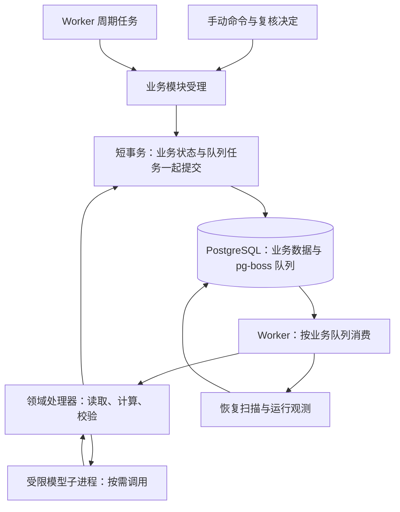

# T03 Worker 调度与任务执行架构

> V1.0 · 2026-10-30 · 目标模式已由用户确定：采用 AIHOT 式业务 Job 队列与任务交接。本文为技术设计，尚未实施、未运行验收。现行代码仍使用 Temporal。文件路径与 T03 编号保持稳定。

## 1. 决策、依据与范围

采用 PostgreSQL 上的 pg-boss 保存和分发任务。Worker 注册业务消费者；当前任务在保存结果的同一事务中提交下一任务。人工等待保存在领域状态中，批准后再入队续办，不维持等待中的工作流。目标架构退出 Temporal、Workflow/Activity 三队列和启动 Relay；对外业务交付仍保留 Outbox/Inbox 与原消息回执。

依据为 [[tools/RiskHot/aihot/AIHOT_Worker调度与任务执行技术架构设计_V1.0|AIHOT Worker 架构]]、[[tools/RiskHot/docs/system-design/03-系统功能架构/S01 公共运行能力功能设计|S01公共运行能力]]、[[tools/RiskHot/docs/system-design/03-系统功能架构/F01 信息接入与标准化模块功能设计 V2.1|F01现行功能设计]]和[[tools/RiskHot/docs/system-design/03-系统功能架构/F02 事件管理模块功能设计 V1.0|F02 V1.9功能设计]]。决策见 [[tools/RiskHot/docs/system-design/04-系统架构设计/05-架构治理与验证/架构决策记录/ADR-L0-003-业务任务队列替代Temporal|ADR-L0-003]]。

F01仍拥有一源一计划、单信源任务及 material；不恢复原件、独立资料版本表或资料交付记录。F02仍拥有 Fact、Event、复核、正式保存和交付。S01只提供通用运行设施，不解释业务成功。AI任务编号按现行功能版本绑定，不能沿用旧技术稿 AI-03～05 的同号旧含义。

## 2. 总体结构与职责

| 组件 | 主责 | 边界 |
| --- | --- | --- |
| API | 授权、参数校验、短事务受理、复核及查询 | 不等待采集或模型执行结束 |
| 周期任务注册器 | 周期、时区、重叠和漏期政策及扫描记录 | 不维护第二份信源计划 |
| pg-boss适配器 | 类型化入队、消费、延迟、重试、队列监测 | 不判断候选或事件是否业务完成 |
| 业务消费者 | 领域处理、持久结果、下一任务交接 | 不执行任意画布脚本或跨模块直接写表 |
| 模型调用子进程 | 最小输入、模型响应、受限运行环境 | 不持数据库凭据，不审批、接纳或正式提交 |
| 恢复扫描器 | 调用模块恢复端口，修复允许继续但缺有效任务的对象 | 不自动通过复核或清零调用预算 |

首版为一个常驻后台 Worker 进程，装载业务消费者及周期任务；API独立。模型子进程按调用创建并回收，通过受控输入输出通道与父进程协作，不另设模型队列。多队列不意味着多进程或微服务，后续可按队列拆Worker组。

## 3. 业务队列与交接

以下名称是新目标契约，不是现有接口。队列与载荷统一登记并做运行时Schema校验；业务模块拥有处理器。

| 队列 | 主责与最小输入 | 完成及后续交接 | 首版消费并发 |
| --- | --- | --- | --- |
| `sources.fetch` | F01；单信源任务ID、控制代次 | 保存material及本轮结果；需处理的资料调用F02受理端口并同事务入队 | 2 |
| `information.extract` | F02；material ID、版本值、摘要、任务包 | 接纳完整Fact集合，逐项提交events.process；合法零结果不提交后续 | 1 |
| `events.process` | F02；处理对象ID、代次、输入及建议摘要 | 完成未完成的建模、融合、增量等责任步骤；需复核则退出；满足条件提交events.commit | 1 |
| `events.commit` | F02；处理对象、提交身份、预期依据 | 重核权限、批准与并发上下文，保存正式结果及交付意图，同事务提交交付Job | 1 |
| `events.enrich` | F02；正式Event、固定事实集合、增强类别 | 执行适用变量/关联、评价或用途独立分支，按功能设计保存交付；不提前执行依赖正式身份的步骤 | 1 |
| `deliveries.send` | 发送模块；原message_id | 接收端口处理与回执；外部接收用Inbox去重，不重新分析 | 2 |
| `ops.recover` | S01；范围与游标 | 分页交各模块判断恢复，不直接修改业务完成状态 | 1 |
| `ops.alerts` | S01；检查窗口 | 记录故障及通知结果，不改变业务结果 | 1 |

并发值为单Worker验证初值，不是生产容量承诺。events.process按F02当前规则组织步骤，不按AI编号简单排序；未发布的任务包或业务政策阻断相关分支。某候选失败不回滚其他候选结果，聚合状态由F02汇总。

任务内部采用有限、显式的责任步骤和已保存结果。成功步骤仅在输入摘要和任务包相同时复用；恢复从最早失效步骤继续，不建设通用工作流解释器。events.enrich的类别、依赖及独立复核边界需逐项登记，不能用模糊的“继续”覆盖全部分支。

## 4. 任务身份与版本

统一信封包含task_type、payload_version、run_id、owner_ref、execution_generation、input_digest、manifest_ref、correlation_id、causation_id、trigger_kind。领域版本和提交身份等进入各任务的Schema载荷；无模型任务也固定程序处理器和政策版本。

run_id是逻辑运行身份，Job ID是投递身份，attempt ID是外部调用身份。技术重投保留run_id；控制恢复可增加执行代次，不能更换业务提交身份。授权重算创建新运行并关联原运行。

载荷不放密钥、大正文。资料只保留当前版本时，调用前核对版本值与摘要并形成受控输入快照；接纳时再次核对。资料变化返回领域重新准备，不声称可以回放不存在的旧正文。未知任务版本阻断并告警，不按最新版本猜测执行。

## 5. 原子受理与交接

1. API或前置消费者进入短事务，核对权限、资格与幂等键。
2. 锁定业务对象与运行身份，检查有效代次，保存业务变更、结果或复核决定。
3. 通过同一数据库连接、同一事务写运行登记和下一Job；失败则整个事务回滚。
4. 提交后返回受理回执或结束消费者，不在事务中等待网络或模型。
5. 返回与队列确认仍有故障窗口。重复消费先查业务回执，已完成则复用并修复必要投影，不重做副作用。

`enqueue(..., tx)`是应用封装设计名，不是pg-boss同名原生API。AIHOT快照通过send的数据库适配器把SQL交给已有事务；RiskHot必须验证所选版本与当前pg连接的接入。队列表位于同数据库独立pgboss schema，由库管理，业务代码不直接改其内部表。

队列去重返回空值不能直接视为交接成功，必须核实相同逻辑任务已经可靠登记、摘要相同且可执行或已有终态，否则回滚。永久业务幂等不依赖队列记录保留期。新架构不保留“启动意图→Relay→队列”的第二条内部投递链。

跨模块同库交接由接收模块公开端口在共享事务中受理，调用方不直接写对方表。不同数据库或外部交付保留Outbox/Inbox：正式结果和Outbox同事务，交付任务重投原消息，接收回执另行确认。

## 6. 定时任务与漏期

| 周期任务 | 验证初值 | 职责与漏期 |
| --- | --- | --- |
| sources.schedule | 每分钟，Asia/Shanghai | 查询F01到期计划，停机后检查一次，不逐次补齐所有漏期 |
| ops.recover | 每分钟 | 分页恢复，重启补一次扫描 |
| ops.alerts | 每5分钟 | 聚合异常，重启补一次检查 |

统一注册周期任务，每次扫描用调度项和计划时点身份去重，并避免同扫描重叠。具体Cron、singleton和漏期能力在所选版本验证；AIHOT的missed: once不能直接当成库原生参数。各扫描独立登记，不以单个大循环阻塞全部任务。

F01保存信源周期、启停和next_run_at。扫描在每计划短事务中锁计划，重核启停、到期及活动任务，原子创建单信源任务和Job，再推进下次时点。自动和手动共用来源重叠保护；多扫描器、API与计划修改并发须验证。

job_runs只记录周期扫描起止、状态、计数和错误，不替代F01采集任务，不是所有业务Job流水。暂停计划不取消已受理任务；停用Cron不清理业务任务。扫描间隔由现行30秒改为一分钟，信源自身周期不变；正常触发检测延迟最多约一分钟（不含积压），纳入验收。

## 7. 并发、锁与模型预算

按业务队列限制并发；所有模型业务共用模型调用许可，首版同时调用上限1。许可不构成模型队列，也不限制采集并发。单Worker共享进程内许可是首版部署约束；实现并验证数据库共享许可/租约前，不允许扩多个会调用模型的Worker。

对象正确性依靠数据库唯一键、控制代次和短事务锁，不能依赖某队列并发1。保存时先锁权限代次，再按领域数据设计的稳定锁序锁处理对象及正式对象，最后更新运行结果；恢复/取消/保存使用同一顺序，不在不同消费者反转。

调用前短事务预留attempt并检查预算和截止时间，调用在事务外执行，适配器不额外重试。返回后保存响应，重核输入、权限和代次再接纳。未知结果也消耗预算；供应方支持请求幂等/回执时先查询原请求，否则不保证外部调用恰好一次。

模型子进程仅收到允许输入和供应凭据，不继承数据库、审批或任意工具能力；父业务消费者负责预算、响应工件、校验和存储。子进程退出不等于业务完成。

## 8. 超时、重试与人工等待

| 情况 | 验证初始政策 | 处理 |
| --- | --- | --- |
| 抓取技术故障 | 单次15分钟；技术尝试总数3次，间隔30秒、120秒 | 从已保存资料/检查点恢复，不重复计数 |
| 模型超时、限流、可恢复服务故障 | 单次调用120秒；每节点最多3次调用、总预算10分钟 | 未知也计次，30秒、120秒后延迟续办 |
| 模型结构、证据、语义错误 | 不自动通过，不无限修正 | 待复核或显式修正后恢复 |
| 短数据库任务 | 单次60秒；尝试总数5次，2秒起退避，上限30秒 | 查回执再重试；上下文冲突返回准备步骤 |
| 交付失败 | 单次60秒；每恢复窗口最多10次尝试 | 保留消息，耗尽转可恢复，不退回分析 |
| 人工复核、缺配置、预算耗尽 | 持久等待/阻断原因后结束Job | 有效决定、配置修复或授权恢复后续办 |

尝试总数包含首次，不能直接填成库重试次数。队列管理一次投递的技术重试，领域模型预算跨全部投递累计，HTTP适配器不叠加。模型可重试结果由应用保存下一允许时点并同事务提交延迟Job，然后正常结束本次Job；同一失败不能既自行入队又抛错让库再重试。

进程崩溃由队列重投；恢复扫描仅在无有效投递/租约时补队。等模型许可时不预留调用次数；预算过期转待恢复。事件处理Job须有独立总时限，覆盖顺序步骤和等待，初值15分钟；到限保存恢复点并退出。队列租约过期应晚于受控处理截止与停止余量，精确参数、心跳及超时取消需版本PoC冻结。

暂停/取消先持久增加控制代次，再尽力停止外部调用；旧结果只能留审计，不能提交。已提交事实不因取消撤销。批准须绑定当前摘要、输入和权限，短事务保存批准及续办Job；重复批准不多投，查看页面不触发。

## 9. 恢复扫描与幂等

扫描每轮最多100项，稳定游标轮转，避免队首长期失败饿死后续对象；不同模块独立扫描预算。锁对象后核对终态、代次、有效投递/租约、下次时点和预算，通过统一入队端口修复。

| 故障窗口 | 恢复行为 |
| --- | --- |
| 业务变更后、下一任务提交前退出 | 同事务回滚，不留下已成功却漏交接的状态 |
| 已提交、队列确认前退出 | 重投查原回执，不重复模型或正式结果 |
| 模型响应收到、接纳前退出 | 复用已持久响应并重验；未持久化按未知调用处理 |
| 队列记录清理但业务未完成 | 独立运行登记与领域资格支持补投；永久幂等不随清理失效 |
| 人工等待 | 不补普通Job；仅修复有效批准后缺失的续办投递 |
| 多恢复器同时发现同一对象 | 锁与逻辑唯一身份保证一个有效续办登记 |
| 正式保存后交付回应丢失 | 原message_id重投，接收端回原回执 |
| 部分Fact完成、部分失败 | 保留成功项，只恢复未完成项 |

正常停止先停周期触发与新任务领取，发送取消信号并有限排空；到期结束子进程，保留未知尝试。重新投递不证明原外部调用已停止，仍检查预算、版本和代次。

## 10. 状态、观测与实施边界

四类记录分开：pg-boss保存队列状态；通用运行登记保存运行/代次/尝试关联；job_runs保存周期扫描；领域表保存计划、资料、Fact、Event、复核和交付。消费者因需复核正常返回时，队列可以完成而业务仍待复核，页面分别表达。

监测队列等待年龄、活动/失败任务、最后成功扫描、到期未受理计划、模型许可/预算、旧结果拒绝、待复核年龄、Outbox及缺失投递。不在日志输出正文或凭据。

| 旧机制 | 新承接 |
| --- | --- |
| Workflow/Activity、历史重放、Continue-As-New | 业务消费者、持久步骤结果、交接与扫描 |
| 启动意图与启动Relay | 同库事务入队；旧表仅用于迁移及审计 |
| 三类技术队列 | 业务任务队列；模型受限调用不独立排队 |
| signal与长等待 | 领域决定和续办Job同事务 |
| 执行/建议代次与commit_key | 保留原有控制和业务语义，不因换引擎清零 |
| 交付Outbox/Inbox | 保留，由deliveries.send执行 |

存储见 [[tools/RiskHot/docs/system-design/04-系统架构设计/01-数据模型与存储设计/S01任务执行数据契约|S01任务执行数据契约]]，切换验收见 [[tools/RiskHot/docs/system-design/04-系统架构设计/05-架构治理与验证/架构验证/Worker任务队列切换验证方案|Worker任务队列切换验证方案]]。关联旧分册中的Temporal时序仅用于现行代码追溯，目标执行以本稿为准；不把任务引擎更换当成业务版本或AI任务包发布。

官方参考：[任务与事务适配](https://github.com/timgit/pg-boss/blob/master/docs/api/jobs.md)、[消费者](https://github.com/timgit/pg-boss/blob/master/docs/api/workers.md)、[队列](https://github.com/timgit/pg-boss/blob/master/docs/api/queues.md)。2026-10-30核对公开文档索引；master会变化，具体版本、事务接入、权限、心跳与过期参数均需PoC冻结，本轮未安装依赖或生成执行配置。
