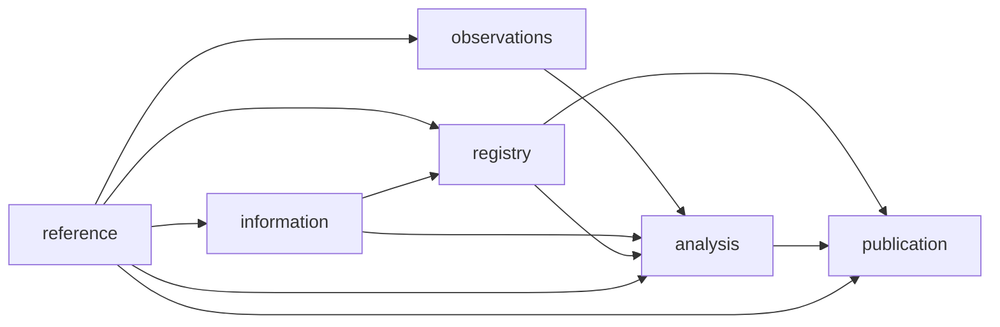

# RiskHot 系统架构设计 · 模块与代码组织

> 总览索引：[[RiskHot_系统架构设计_V1.0]]
> 覆盖章节：5. 领域模块及依赖规则 · 6. 仓库与代码组织 · 7. 完全分离的前端

## 5. 领域模块及依赖规则

### 5.1 唯一事实拥有者

| 模块 ID | 对应业务 | 拥有并写入的事实 | 允许消费的上游 |
| --- | --- | --- | --- |
| `reference` | 配置及基础定义（信源配置归此模块） | 信源身份、分类、准入及启停版本；对象、变量、风险源/类型、规则与发布版本、展示映射 | 无领域上游 |
| `observations` | 指标配置与数据 | 指标、变量映射、观测值、修订与可用时间 | reference |
| `information` | L0 | 资料版本、事件、增量、三元关系、M 评价；引用有效信源，不维护信源配置 | reference |
| `registry` | L1 | 风险候选、正式风险、定义版本、长期变量关系、风险—事件关联 | reference、information |
| `analysis` | L2 | 分析草稿、快照及修订、变量分析、附属变化结果、减弱节点记录 | reference、observations、information、registry |
| `publication` | 风险产品 | 报告、冻结引用、发布版本、撤回记录；列表读模型 | reference、registry、analysis |
| `operations` | 横向运行 | 任务登记、计划配置、技术恢复入口、复核待办投影、审计检索 | 无领域上游；通过注册端口调度 |
| `identity` | 身份权限 | 用户映射、角色、授权范围、服务身份 | 无领域上游 |

`operations` 展示复核中心，但**审批的业务决定归被审核领域模块**。例如发布报告由 publication 的命令校验并提交，不能让通用审批表直接改报告状态。operations 通过组合根注入的处理端口调用业务模块，不能导入各模块内部实现，避免形成依赖环。

### 5.1.1 信源配置的唯一写入方

依据[[tools/RiskHot/03-业务功能需求/02. RiskHot_配置模块功能需求规格说明书_V1.0#FR-L0-01 信源登记、准入与启停|配置模块 FR-L0-01]]，信源业务配置统一由 `reference` 承接，作为 `InformationSource` 的唯一写入方。沿用既有配置上游及 `reference → information` 数据流，可避免配置页面与 L0 各维护一份信源，也无需新增领域模块。FR-L0-01 保留历史编号，编号不代表仍归 L0。

| 责任 | 业务入口 | 技术主责与边界 |
| --- | --- | --- |
| 登记、身份与分类、业务范围、可选 S、启停及版本（启用即准入） | 配置模块→信源 | `reference` 校验既有启停权限并保存状态；不创建独立信源准入待办 |
| 有效信源读取与接入资格检查 | L0 信息工作台 | `information` 通过 `reference` 公共查询端口读取 `source_id`、固定版本及业务资格；不能修改准入 |
| 连接检测、样本预览、采集、补录及原文版本 | L0 信息工作台 | `information` 负责；启停状态与技术就绪分别检查 |
| 计划、凭据故障与执行恢复 | 运行中心 | `operations` 通过注册端口调度；技术故障不能自行撤销业务准入 |

**实施边界**：这是本轮对齐后的目标归属。当前开发代码仍以 `information.source`、`information.source_status` 写入 `information` 域，尚未迁移。本轮不改变运行契约或数据库；实施时由契约与迁移负责人统一切换到 `reference`，保留信源 ID、历史版本和原文引用，旧入口若保留兼容只转交同一个写入用例，不得形成双写。其他配置类别的拆分另按需求评审，不据此宣称配置模块全部迁移完成。

**信源状态契约（2026-10-13）**：业务准入等同启停，唯一业务字段 `admission_status` 使用 ACTIVE／PAUSED／DISABLED，新登记默认 DISABLED。API、页面和 L0 不再组合检查独立的“准入通过”标志，不再建立单独信源准入审批流程。按既有权限校验启用条件并直接变更状态；自动采集需同时满足 ACTIVE 和技术就绪，在途提交再次检查当前启停状态。技术失败不自动改变业务状态，历史版本保持可追溯。现有代码只支持 active／disabled，暂停、新登记默认状态与独立审批取消仍须实施并验证。

### 5.2 代码依赖规则

每个领域包内部采用 `domain → 无外部框架`、`application → domain + ports`、`adapters → application/ports` 的方向。箭头表示“依赖”；依赖注入在 `apps/api` 和 `apps/worker` 的组合根完成。

- 领域模块只导入上游的 `public` 契约，禁止跨模块导入 `internal`、repository 或实体 ORM 类型。
- 模块只写自己的数据库 schema；跨模块读取优先通过查询端口。需要组合查询时使用显式只读 view 或独立读模型，不复制写权限。
- 下游通过事件提出反馈。L2 请求修改风险定义时调用 L1 维护申请，不能自己修改 MonitoredRisk。
- HTTP、Temporal、模型 SDK 和对象存储类型不能进入纯 domain。
- 共享内核只含标识、时间、分页、结果类型等小型通用值对象，不含 `RiskService` 或大而全 `utils`。
- 浏览器不能导入任何 server、worker、数据库或供应商适配包；CI 同时检查导入图和打包产物。



本图箭头表示业务数据流；机器清单的 `depends_on` 反向列出消费方依赖的上游。反馈是申请或事件，不新增反向代码依赖。

### 5.3 数据库边界强度

首版共享数据库可提供跨域外键，禁止跨域级联删除。迁移由单一集成责任人按依赖顺序运行。每模块使用独立 repository 和数据库角色；API/Worker 的装配层分别注入相应连接，不给普通模块连接跨域写权限。迁移角色只在发布流水线使用。

共享进程仍不是敌对代码的强安全隔离。高风险网络抓取、任意代码工具放隔离进程；若未来领域团队需要强租户或权限隔离，应拆部署与数据权限域，不能仅依赖目录名。


## 6. 仓库与代码组织

### 6.1 拟建目录

以下为新实现的目标结构；本次不自动创建空源码文件，也不把现有业务文档迁走。

```text
RiskHot/
  02-业务架构与领域设计/         现有业务语义
  03-业务功能需求/               现有功能与验收
  04-系统架构设计/               本文及设计清单
  apps/
    web/                        独立 SPA 与浏览器特性
    api/                        HTTP 适配器和组合根
    worker/                     Workflow、Activity 装配
    outbox-relay/                可靠交接进程
  packages/
    contracts/
      schemas/                  手工维护的 JSON Schema 事实源
      openapi/                  API 路径、权限、响应与引用
      events/                   事件信封及 payload 契约
      fixtures/                 正常、未知、冲突、失败样本
    generated/                  生成的 DTO、SDK、mock；禁止手改
    domains/
      reference/
      observations/
      information/
      registry/
      analysis/
      publication/
      operations/
      identity/
    platform/
      database/                 连接、事务、Outbox/Inbox 原语
      workflow/                 确定性约束与版本策略
      agent-runtime/            路由、工具治理、结构与语义校验
      model-adapters/           供应商适配
      evidence/                 工件接口、哈希、出处
      observability/            日志、trace、指标脱敏
    ui/                         设计令牌与通用可访问组件
  database/migrations/          集中编号、按领域归属的 SQL 迁移
  tests/                        契约、集成、E2E、恢复与架构测试
  evals/                        数据集、标注、版本比较与报告
  tooling/                      生成器、边界与任务包检查器
  infra/                        环境、部署、备份、恢复配置
  docs/adr/                     后续增量 ADR
  agent-tasks/                   具体开发任务实例与交付证明
```

### 6.2 单领域包模板

`public/` 暴露用例端口和跨域 DTO；`domain/` 放值对象、聚合与纯规则；`application/` 放权限后业务用例、事务界限和端口；`adapters/` 放 PG、模型建议适配、查询实现；`tests/` 放该领域测试。目录命名只是起点，导出白名单、包标签和数据库角色才能使边界生效。

Schema、生成物、迁移、锁文件有明确所有者。生成物允许入库以便审阅，但 CI 必须再生成并比较零差异；所有源码只认同一 Schema 版本。不得同时手写 TypeScript DTO、Zod DTO 和 OpenAPI DTO 三套权威类型。


## 7. 完全分离的前端

### 7.1 交付与职责

前端构建为静态 SPA，可部署于独立对象存储/CDN。API 独立版本、独立容器、独立扩缩容。生产推荐网关把 `/` 路由到静态前端，`/api/` 路由到 API，便于 Cookie、CSRF 和 CORS 管理；同源入口不意味着前后端耦合部署。

浏览器只调用生成的 SDK；不引入服务端 ORM、密钥、供应商模型 SDK、服务端动作或前端框架专用业务 RPC。当前产品以认证后的交互工作台为主，首版不需要 SSR；以后若新增公开内容站，可作为另一客户端消费 API。

### 7.2 页面与特性边界

| 前端特性 | 页面 | 契约来源 | 必须可见的状态 |
| --- | --- | --- | --- |
| `information` | 信源引用与接入检查、资料、事件与原文定位 | information；信源只读契约来自 reference | 去重、待归组、待判断、处理失败、接入受限 |
| `registry` | 候选对照、纳管、长期配置 | registry | 新建/匹配建议、定义版本、跟踪状态 |
| `analysis` | 观察发起、证据、四维状态与变化 | analysis | 截止时间、基准、缺口、不可比、阶段失败 |
| `publication` | 总览、目录、详情、Timeline、报告 | publication | 最新有效版本、陈旧、撤回、未分类 |
| `operations` | 任务、复核、计划与运行中心 | operations + 对应业务命令 | 等待人工、失败可重试、取消中、终态 |
| `configuration` | 信源业务配置；对象、变量、规则、模型版本的入口归属待另行对齐 | 信源登记、准入、启停来自 reference；其他配置沿用 reference、observations | 信源仅启用/暂停/停用；其他配置沿用草稿/已批准等状态；技术就绪单独展示 |

按业务特性组织路由、页面与查询；通用表格、差异对比、证据引用、时间显示进入 ui，风险判断逻辑不放入 ui。权限能力由 API 返回，按钮状态只是提示，服务端始终重新授权。

### 7.3 状态与交互

URL 保存筛选、分页游标和选中的风险/报告版本。TanStack Query 管理服务器状态；组件状态只管展开、输入和临时选择。跨页草稿按显式保存接口处理，不把浏览器缓存当正式业务库。

普通表单可本地预览；纳管、批准、发布、撤回必须等待服务器结果，不能乐观显示成功。请求超时显示“结果待确认”，通过 operation/task 查询确认，不提示用户重新创建。任务使用 SSE 增量状态加查询补偿；断线重连以 revision/cursor 补齐，不能仅依赖易丢事件。

列表显示截至时间和投影更新时间。正式结果撤回时，前端响应撤回事件清理缓存，但后端读取与下载授权才是最终约束。空列表、首次分析、无可比基准、来源失效、技术错误各有独立组件状态与行动入口。
