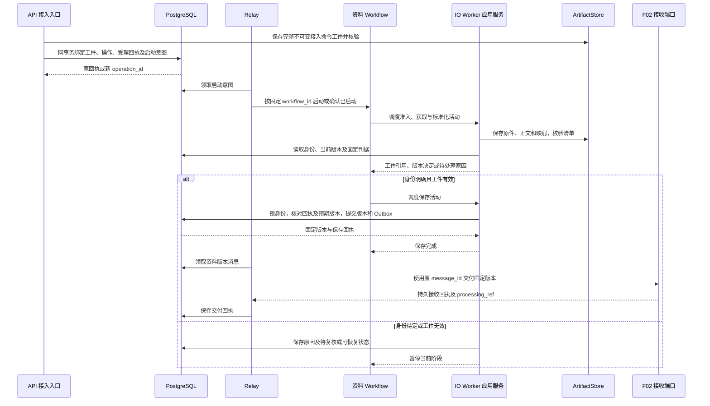

# F01 信息接入与标准化模块技术详细设计

> V0.5 · 2026-10-24 · 对应[F01功能设计V2.1](../../../../03-%E7%B3%BB%E7%BB%9F%E5%8A%9F%E8%83%BD%E6%9E%B6%E6%9E%84/F01%20%E4%BF%A1%E6%81%AF%E6%8E%A5%E5%85%A5%E4%B8%8E%E6%A0%87%E5%87%86%E5%8C%96%E6%A8%A1%E5%9D%97%E5%8A%9F%E8%83%BD%E8%AE%BE%E8%AE%A1%20V2.1.md)六步流程。本模块仅将原始输入转为已保存、标准化、可定位的资料，不包含指标业务、事件抽取或风险判断。

## 1. 模块边界

资料是可独立保存和引用的内容载体，具有来源身份、固定版本、正文及必要附件/元数据。资料可以包含多个事件，也可以没有事件；这些判断由F02承担。F01拥有Information、资料版本及获取记录；M1拥有信源资格与配置，F02只读资料版本并返回接收状态。

接入命令先按[T02](../../../02-%E4%B8%93%E9%A2%98%E6%8A%80%E6%9C%AF%E6%9E%B6%E6%9E%84/T02-%E6%8E%A5%E5%8F%A3%E4%B8%8E%E9%9B%86%E6%88%90%E6%9E%B6%E6%9E%84.md)持久受理，六步通过S01执行。首切片输入为已配置来源的文本或文本文件，来源标识和原件完整保存；不能把上传者的自由声明直接当作M1准入。

### 1.1 模块内部组件与运行归属

下表是模块内职责划分，组件以应用代码装载到指定运行进程，不各自拆成微服务。程序组件调用公开领域/仓储端口；共享契约遵循总体架构第14.3节。

| 内部组件 | 执行与交接职责 | 规则主维护位置 |
| --- | --- | --- |
| 接入与查询入口 | API校验身份和契约、持久受理；查询固定版本及交付状态 | T02路由及错误体，T06授权 |
| 资料流程协调 | Workflow Worker推进六步与恢复点；IO Worker执行程序活动 | T03资料工作流及租约/重试 |
| 读取与标准化组件 | IO Worker获取原件并执行确定性规则，生成正文、分段和定位映射 | 关键接口与数据设计第6.2节，T05工件协议 |
| 身份与版本判定组件 | IO Worker核对来源身份、摘要、判据版本及并发结果 | 关键接口与数据设计第3、6.3、6.5节 |
| 保存应用服务 | IO Worker调用资料仓储；校验工件后短事务提交版本、回执与Outbox | 关键接口与数据设计第6.3节，T01锁序 |
| 交付适配器 | Relay发送固定版本，接收回执；无回执使用原消息重投 | T02资料版本消息，T03中继协议 |

## 2. 六步技术设计

| 步骤 | 程序执行 | 持久结果及交接 | 失败处理 |
| --- | --- | --- | --- |
| Step 1 核对信源资格与接入条件 | 校验来源ACTIVE、访问许可、输入格式与资源预算，固定来源配置版本 | 准入决定、命令身份、来源快照 | 禁用/无权拒绝；配置缺失待处理 |
| Step 2 获取原件 | 从授权输入取得原始字节，校验类型、长度、完整性；保存暂存引用与获取时间 | 原件摘要、获取记录及获取结果 | 网络故障恢复本步；不以空正文继续 |
| Step 3 正文读取与资料标准化 | 确定性读取正文、标题、表格/附件关系；保留数值、单位、条件、脚注；生成分段与原件映射 | 标准化正文、字段、完整性报告、normalizer_version、映射清单 | 不支持格式或映射失效待处理；不把内容概括成事件 |
| Step 4 识别重复与资料版本 | 先判资料身份，再按原件、有效内容和标准化产物比较；检查并发保存和未完成记录 | 复用/来源修订/处理修订/待复核决定 | 身份冲突或不可比进入复核，不靠标题合并 |
| Step 5 保存资料 | 校验对象可读与摘要；短事务提交Information/版本清单/关系/保存回执和交付意图 | 可读、不可变的固定资料版本 | 失败按保存回执续接；不再次抽取或判断事件 |
| Step 6 交付标准化资料 | 以固定版本发送接收命令；处理F02回执和重投 | 接收者、processing_ref、回执及独立交付状态 | 原版本重投；不重复标准化、不新增版本 |

来源访问权限在实际获取时再确认，保存/交付时按当前授权检查；任务中不静默换来源配置版本。失效政策影响已保存资料的后续使用时应留下暂停理由，不删除历史。

## 3. Step 4 判据与并发

先使用同源稳定external_id及其作用域，缺少时使用经来源规则规范化的详情URL；指纹只能补充判断，不可覆盖强身份冲突。跨来源相同正文仍是两份资料，供F02区分来源增加与实际重复。

对同一身份：原件及标准化内容均相同只增加获取记录；广告/抓取时间等噪声变化但有效正文及标准化产物相同可复用；正文、标题、条件、数字、表格或有效附件变化且确认是来源新修订时，保存来源修订；基于当前版本原件，因读取规则变化而改变有效产物时形成处理修订。历史晚到与来源回滚须先按下述顺序判据区分，不能只比较正文变化。仅工具版本号变化且产物相同不新建资料版本。

版本判据固定规则版本。不同规则下摘要不可直接比较，必要时在同一规则下重算保存原件；不能重算或身份冲突转复核。保存按[数据设计第6.3.1节](关键接口与数据设计.md#631-保存分支与当前版本指针)区分分支：新来源修订、基于当前版本的处理修复才生成新版本并推进当前指针；REUSE及已确认历史晚到只关联获取记录，当前指针和row_version不变。来源新发布一次回滚属于新来源修订，例如current=v3时生成v4而不是指回v1；同文但顺序证据不足则待复核。并发在资料锁内重新校验比较版本、分配max(version_no)+1并提交，重复保存先查原回执；历史版本处理修复不自动覆盖当前版本。

## 4. 保存与交付的异常窗口

对象写入成功但数据库失败：对象标为暂存，查询不显示保存完成，恢复复用校验后的对象。数据库成功但响应丢失：按命令/版本回执返回已保存结果。F02接收成功而F01漏收回执：以同一消息重投，取回原processing_ref。F02后续分析失败不改变F01“已可靠交付”，但查询可展示独立处理状态。

保存完成后发生对象损坏：暂停依赖该版本的新处理，显示证据不可用并执行修复；不得重新生成正文覆盖历史版本。来源/内容修订需要新版本，原Event引用继续指向旧版本。

## 5. 数据、查询与验收

字段、版本决策和接口详见[关键接口与数据设计](%E5%85%B3%E9%94%AE%E6%8E%A5%E5%8F%A3%E4%B8%8E%E6%95%B0%E6%8D%AE%E8%AE%BE%E8%AE%A1.md)。查询最少可定位Information、版本清单、原件、标准化正文、获取记录、版本判定理由及F02接收回执。验收关注重复并发、正文数字变更、噪声变更、处理规则变更、跨来源同文和对象故障；切片级验证见[总方案](../../../05-%E6%9E%B6%E6%9E%84%E6%B2%BB%E7%90%86%E4%B8%8E%E9%AA%8C%E8%AF%81/%E6%9E%B6%E6%9E%84%E9%AA%8C%E8%AF%81/L0%E6%9C%80%E5%B0%8F%E4%B8%9A%E5%8A%A1%E9%97%AD%E7%8E%AF%E9%AA%8C%E8%AF%81%E6%96%B9%E6%A1%88.md)。

## 6. 内部调用与实现时序

入口调用接入应用服务完成持久受理；Relay 根据启动意图启动资料工作流。Workflow 只安排活动，读取、标准化、身份判定和保存应用服务运行在 IO Worker。下图的活动调用均经 Temporal 调度，不表示 Workflow 直接访问数据库或工件。

标准化组件的输入是原始字节及固定规则，输出是正文、分段和映射清单；身份组件消费该清单与已有资料版本，输出版本决定。保存应用服务仅接受固定决定和可读工件，遇到当前版本变化返回重新比较路径。交付适配器消费已提交消息，不能自行创建资料版本。

## 7. 数据访问与异常恢复入口

| 调用方 | 允许的数据访问 | 一致性边界 |
| --- | --- | --- |
| 接入入口 | 读取 M1 资格；写受理回执和启动意图 | 完整输入工件、material_operations、命令回执及启动意图持久绑定；同键异摘要拒绝，受理不代表保存成功 |
| 标准化与版本判定组件 | 读取固定原件、资料身份及历史版本；保存获取记录、工件与版本决定 | 外部读取和对象写入在保存事务之外；保留判据版本 |
| 保存应用服务 | 通过资料仓储写资料、版本、分段、回执和交付意图 | 一个短事务；同一版本决定重试沿用保存键；锁序见 T01 |
| 交付适配器 | 读取已保存版本的消息，更新发送状态与回执 | F02 接收端通过其受限连接完成 Inbox 与处理受理；发送连接不写 F02 业务表 |
| 查询入口 | 按权限读取指定资料版本、原件定位及交付回执 | 不以当前版本替代历史版本；权限校验先于返回正文 |

| 异常窗口 | 状态与保存证据 | 恢复入口及续接位置 |
| --- | --- | --- |
| 来源禁用或无权 | rejected，保存拒绝原因 | 修正资格后按新授权请求受理；不能对拒绝命令无限重试 |
| 获取中断、暂存对象不可读 | recoverable，保留获取记录及已完成工件引用 | information-operations/{id}/retry，scope=processing；检查执行代次及工件，从Step 2/3续接 |
| 资料身份冲突、版本不可比 | review，保留比较依据与版本决定 | 按operation_id查询案件并提交reviews；批准固定计划后回Step 4；依据过期使旧批准失效并重建案件 |
| 工件已写、保存事务失败 | 不标 saved；记录原 version_commit_key | 先查回执，未提交才以原键重试 Step 5；暂存对象不冒充正式版本 |
| 数据库已提交、响应丢失 | 原保存回执有效 | 读取原回执返回固定版本，不再分配新版本 |
| F02 接收回执丢失 | saved；交付单独 pending 或 recoverable | retry，scope=delivery；核对版本/consumer及交付恢复代次，重投原message_id，从Step 6续接 |
| 已保存证据损坏 | 保留 saved 历史事实，单独标记证据不可用 | 工件修复并校验原摘要后恢复使用；不覆盖原版本正文 |

状态名称及保存协议以配套数据设计为准；恢复须使用 T02 授权命令并遵循 T03 代次与预算规则，不能仅在页面上修改状态。

### 7.1 复核与恢复的模块内交接

F01自有material_operations、material_review_cases、material_review_decisions与material_save_receipts；定义见[数据设计第7章](关键接口与数据设计.md#7-f01-复核与恢复契约)。身份未确定时以operation_id建立案件，information_id及version_decision_id允许尚不存在，不借用F02候选审批。

API按information_review权限接收APPROVE_PLAN、RECOMPARE或REJECT_INTAKE，依据摘要和有效代次绑定比较对象及计划；批准只产生Step 4启动意图，IO Worker重检后才可保存。恢复入口使用information_retry权限，以期望执行代次或交付代次防重入。审批、拒绝、恢复及保存都先锁原接入操作，旧Activity不能越过拒绝或过期代次提交。

processing恢复只续接原输入及已验证检查点；delivery恢复只续接原版本、原消息，交付窗口和历史尝试均可审计。已saved返回原保存回执，已received返回原接收回执；rejected必须新受理，review未批准不能靠retry越过。新命令回执与原接入operation_id分开，状态查询始终能回到原操作。

## 8. 非功能约束与验证落点

首切片容量沿用 L0 总览第6.1节；标准化前检查字节、码点及格式限制，超限明确拒绝或待处理。日志记录 operation_id、固定版本及消息身份，正文与原件通过受控工件引用访问。来源访问、原件读取和保存/交付各阶段均执行对应权限检查。

验证按三个边界组织：标准化与映射验证原字节可回溯；资料仓储集成验证并发保存与回应丢失后仍是同一版本；交付契约验证 F02 已接收时重投返回原处理身份。断言包括资料数、版本数、获取记录数、处理数和回执身份，而非只检查 HTTP 成功。

## 设计依据定位

- [L0 归属与交接](../L0-%E4%BF%A1%E6%81%AF%E5%A4%84%E7%90%86%E5%B1%82%E6%8A%80%E6%9C%AF%E6%9E%B6%E6%9E%84.md)
- [公共数据契约索引](../../../04-%E5%85%AC%E5%85%B1%E6%8A%80%E6%9C%AF%E5%A5%91%E7%BA%A6/%E6%95%B0%E6%8D%AE%E6%A8%A1%E5%9E%8B%E4%B8%8ESchema.md)
- [公共接口契约索引](../../../04-%E5%85%AC%E5%85%B1%E6%8A%80%E6%9C%AF%E5%A5%91%E7%BA%A6/%E6%8E%A5%E5%8F%A3%E4%B8%8E%E4%BA%8B%E4%BB%B6%E5%A5%91%E7%BA%A6.md)
- [关键接口与数据设计 · 6.3 Step 4/5的可执行事务协议](%E5%85%B3%E9%94%AE%E6%8E%A5%E5%8F%A3%E4%B8%8E%E6%95%B0%E6%8D%AE%E8%AE%BE%E8%AE%A1.md#63-step-45%E7%9A%84%E5%8F%AF%E6%89%A7%E8%A1%8C%E4%BA%8B%E5%8A%A1%E5%8D%8F%E8%AE%AE)
- [T03-任务编排与可靠性架构 · 6. Workflow、Activity与队列的具体划分](../../../02-%E4%B8%93%E9%A2%98%E6%8A%80%E6%9C%AF%E6%9E%B6%E6%9E%84/T03-%E4%BB%BB%E5%8A%A1%E7%BC%96%E6%8E%92%E4%B8%8E%E5%8F%AF%E9%9D%A0%E6%80%A7%E6%9E%B6%E6%9E%84.md#6-workflowactivity%E4%B8%8E%E9%98%9F%E5%88%97%E7%9A%84%E5%85%B7%E4%BD%93%E5%88%92%E5%88%86)
- [T03-任务编排与可靠性架构 · 7. 单节点重试与恢复算法](../../../02-%E4%B8%93%E9%A2%98%E6%8A%80%E6%9C%AF%E6%9E%B6%E6%9E%84/T03-%E4%BB%BB%E5%8A%A1%E7%BC%96%E6%8E%92%E4%B8%8E%E5%8F%AF%E9%9D%A0%E6%80%A7%E6%9E%B6%E6%9E%84.md#7-%E5%8D%95%E8%8A%82%E7%82%B9%E9%87%8D%E8%AF%95%E4%B8%8E%E6%81%A2%E5%A4%8D%E7%AE%97%E6%B3%95)
- [T03-任务编排与可靠性架构 · 9. 取消与提交竞争的确定顺序](../../../02-%E4%B8%93%E9%A2%98%E6%8A%80%E6%9C%AF%E6%9E%B6%E6%9E%84/T03-%E4%BB%BB%E5%8A%A1%E7%BC%96%E6%8E%92%E4%B8%8E%E5%8F%AF%E9%9D%A0%E6%80%A7%E6%9E%B6%E6%9E%84.md#9-%E5%8F%96%E6%B6%88%E4%B8%8E%E6%8F%90%E4%BA%A4%E7%AB%9E%E4%BA%89%E7%9A%84%E7%A1%AE%E5%AE%9A%E9%A1%BA%E5%BA%8F)
- [T02-接口与集成架构 · 5. HTTP路由与请求契约（目标设计）](../../../02-%E4%B8%93%E9%A2%98%E6%8A%80%E6%9C%AF%E6%9E%B6%E6%9E%84/T02-%E6%8E%A5%E5%8F%A3%E4%B8%8E%E9%9B%86%E6%88%90%E6%9E%B6%E6%9E%84.md#5-http%E8%B7%AF%E7%94%B1%E4%B8%8E%E8%AF%B7%E6%B1%82%E5%A5%91%E7%BA%A6%E7%9B%AE%E6%A0%87%E8%AE%BE%E8%AE%A1)
- [T02-接口与集成架构 · 6. 模块内调用与消息载荷](../../../02-%E4%B8%93%E9%A2%98%E6%8A%80%E6%9C%AF%E6%9E%B6%E6%9E%84/T02-%E6%8E%A5%E5%8F%A3%E4%B8%8E%E9%9B%86%E6%88%90%E6%9E%B6%E6%9E%84.md#6-%E6%A8%A1%E5%9D%97%E5%86%85%E8%B0%83%E7%94%A8%E4%B8%8E%E6%B6%88%E6%81%AF%E8%BD%BD%E8%8D%B7)
