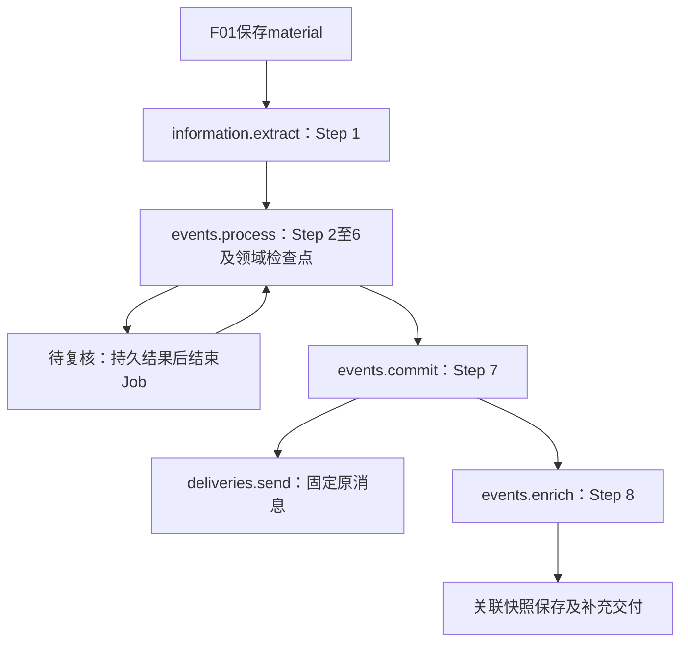

# F02 八步闭环实施补充设计

> V0.1 · 2026-11-01 · 技术提案，待评审、未实施。作为[[tools/RiskHot/docs/system-design/04-系统架构设计/03-模块技术详细设计/L0-信息处理层/F02-事件管理/模块技术详细设计|模块技术设计]]的目标补充；八步业务语义以[[tools/RiskHot/docs/system-design/03-系统功能架构/F02 事件管理模块功能设计 V1.0|功能 V1.14]]为准，物理结构以[[tools/RiskHot/docs/system-design/04-系统架构设计/01-数据模型与存储设计/F02事件管理模块数据模型与存储设计|存储权威定义]]为准。本文明确的新增载体提案在评审前不替代权威表结构。

## 1. 主责与现行入口

F01 对 material 及版本负责；F02 对 Fact/候选、事件身份、结果、复核和交付负责；S01 只管任务设施。现行 schema5 的 src/runtime/server.ts 注册 current-management/current-events；旧 processing_runs 路径仅作历史兼容，不作为新代码入口。

## 2. 显式语义节点与任务包

| 节点键（新目标） | 步骤 | 任务 | 依赖及输出 |
| --- | --- | --- | --- |
| extract_fact | 1 | AI-01 | 当前资料 → Fact、object、逐项线索及证据 |
| map_event | 2 | 程序 | Fact原字段 → Event建议；不创建正式Event |
| recognize_targets | 2 | AI-08 | Fact多来源语境 → 候选及覆盖结果 |
| resolve_event | 3 | AI-02 | Event建议与完整召回 → 身份方向 |
| resolve_target | 3 | AI-07 | 每个已接纳候选 → 对象核定；按object_ref独立预算 |
| establish_initial / identify_increment | 4 | 程序 / AI-03 | NEW初始确认；REUSE五类变化与独立待确认状态 |
| extract_variables | 5 | AI-05 | 识别、定义匹配、具体值及证据，不重算Step 4方向 |
| assess_meaning | 6 | 拟登记AI-09 | 独立五维评价；程序计算M；与用途分离 |
| classify_usage | 6或后续补充 | 拟登记AI-10 | 独立用途结果；待规则不阻断合法保存 |
| commit_event | 7 | 程序 | 校验全部适用批准、结果和证据，原子提交 |
| associate_events | 8 | AI-04 | 正式事件间比较，独立快照和交付 |

AI-09/10 是本轮技术编号建议，A0 必须检索所有登记并完成 M3 发布绑定后才可调用；不宣称现已分配。新 manifest 建议名 f02-eight-step-v1，冻结 prompt/schema/policy/model 的版本和摘要；旧 f02-fact-draft-v2、f02-target-identity-v3 不改语义、不用同一包名覆盖。

禁止通过 AI 编号算 step、用旧 step_no=3 自动认定新 Step 3、或沿用旧 AI-05 评价 Schema 调新 AI-05。旧成功结果只有通过逐节点语义、Schema、输入、规则和证据相容性检查才可复用；无适配证明则旧运行留只读，创建关联的新运行，旧批准不转换。

## 3. 编排及恢复契约

新协调器以语义节点推进，domain_state 与 S01 runtime_state 分开。节点至少区分 pending、running、succeeded、skipped、review、recoverable、superseded；skipped 必须有依据。用现有 candidate 作为运行分支引用、candidate_fact 指向业务 Fact，不增加资料分析主表。

检查点身份为(candidate_id, proposal_generation, node_key, object_ref)，无分对象时 object_ref 为空串；记录输入摘要、固定任务包、状态、输出工件、批准依据及失败原因。建议在 A0 扩展现有 candidate_step_results 以 node_key 为目标主键维度，旧 step_no 保留仅供历史；明确迁移映射后才实施。此设计不复制第二份 Fact 真值。

map_event 成功不因 AI-08 暂时失败被撤销；resolve_event 可独立完成，依赖 Target 的正式关系等待该对象身份。Step 5 可保留未关联变量建议；受限保存必须有明确范围的最终批准。Step 7 后 Event 已保存与关联/用途待恢复分别显示，不能将 material 标作所有增强已完成。

输入变动按依赖失效：Fact/资料变动从抽取核验起；对象识别变动失效对应 Target/关系及依赖评价；Event 身份变化失效增量及所有依赖结果；仅定义发布先恢复 Step 5；方向判断错误回 Step 4；已提交结果不被检查点失效直接撤销。关联依据变动标快照待重新分析，产生新结果后补充交付。

## 4. AI调用与多来源依据

AI-08详见[[tools/RiskHot/docs/system-design/04-系统架构设计/03-模块技术详细设计/L0-信息处理层/F02-事件管理/AI任务技术详细设计/AI-08-Target候选识别|技术契约]]。共用当前 MaterialEvidence 的 version/content_digest 名称，展示/业务文档 material_version/material_digest 在边界明确映射，禁止两套值不一致。

现有 reserveCurrentModel/readCurrentInput 以单份 MaterialBasis 为主，不能直接用于跨来源 Fact。新增输入引用版本保存 fact_id、fact_digest、material_refs[]、证据ID集合及任务包，不复制整份旧正文。读取时逐份检查版本、摘要及权限；用允许读取的当前正文构造临时模型输入，响应工件保留。输入摘要含排序后的依据集合，顺序不稳定不能触发额外调用。任一必需来源不可读则阻断，不静默删掉受限来源继续。

预算窗口沿用既有累计尝试；AI-08按 Fact 运行节点，AI-07按候选对象引用独立。模型成功但接纳前崩溃，先读已持久响应重验；未持久响应记未知消耗。空 Object 不跳过；截断/非法输出不是合法空候选。

## 5. 数据迁移与读写适配

1. 只读预检 schema5、006、007 应用状态、版本/摘要、重复归属、孤立证据、正式回执、未完成运行和角色权限，生成计数与异常清单；不把脚本存在当应用成功。
2. 在隔离副本按既有存储 §9.4 增量迁移：fact_information→fact_material，information_id→material_id；新增 Fact.event_id 及归属说明/时间，回填唯一 event_fact；新增 Fact/Event.object，可空旧值不凭标题猜填。
3. 迁移依据外键、延迟完整性触发器、索引与授权；fact_evidence.information_id 依权威设计保留兼容且等于 material_id。任何多重归属、缺依据、关系跨事件均停止，不自动择一。
4. 同步 current-facts、commit、snapshot、store权限、identity、relations、current-events、delivery 和测试；正向写入只走新结构。旧表只读归档、无双写真值，不删除历史消息/工件。
5. 比较迁移前后 Fact/Event/来源关系数、归属数、证据摘要、消息/批准/预算数量；迁移重跑无变化；失败事务回滚。禁止用重建式 005 或既有破坏性初始化替代增量迁移。

正式迁移前完成备份及隔离恢复演练。兼容代码与新结构一起发布；新写入前可退回原库/代码，新写入后停止消费并对账，采取前向修复或完整恢复再重放已确认命令，不能简单换回旧二进制丢弃新记录。

## 6. 队列适配与切换

沿用[[tools/RiskHot/docs/system-design/04-系统架构设计/02-专题技术架构/T03-任务编排与可靠性架构|T03]]和[[tools/RiskHot/docs/system-design/04-系统架构设计/01-数据模型与存储设计/S01任务执行数据契约|S01]]，不引入第二层内部Outbox/Relay。应用端口（拟新增，不是pg-boss API）：enqueueBusinessJob(tx: PoolClient, envelope: JobEnvelope): Promise<DispatchReceipt>。信封字段、运行表和投递表以 S01 为准；返回 run_id、dispatch_id、job_id，去重时查可靠登记，同键不同摘要拒绝。

开发先做事务回滚、提交后确认丢失、清理后恢复、权限/租约/取消 PoC；记录确切包版本及参数，再锁依赖。其后隔离接入 F01采集/计划、抽取、F02处理/保存/增强和交付消费者；保持采集2、抽取/处理/提交/增强各1、交付2、模型全局1，周期时区 Asia/Shanghai。

切换顺序：停新手动受理和计划扫描 → 排空或登记待迁移运行 → 停旧Worker/Relay并核实无旧执行 → 备份 → 迁移及对象代次/engine归属登记 → 启新API与单Worker → 只读核验/一条受控任务 → 恢复计划。未决人工复核不自动批准；旧同号任务结果不能直接装入新节点。两引擎不能拥有同对象同代次。

取消/恢复先增加领域代次；旧消费者写入必须核对代次和engine。每节点错误只选择一种重试途径；模型技术错误显式延迟续办，不同时抛错触发库重投。交付只重投原message_id。

## 7. 尚缺存储契约的具体建议与进入条件

以下是设计候选，A0评审并回写相应权威存储文件后才编码；不得在不同文档维护第二套生效DDL。

| 缺口 | 本轮建议 | 必须冻结的约束 |
| --- | --- | --- |
| 逐条观测证据 | 在现有观测主表新增 basis JSONB，不恢复独立观测证据表；会由16列变17列，须评审 | basis含fact_id、fact_evidence_id、material_id/version/digest、输入引用；同事件与精确引文校验；calculated/inferred每个输入均可追溯；旧证据不可随更正覆盖；若不批准此扩展则该观测任务阻断 |
| 未关联变量结果 | 新建事件变量提取结果载体，保存固定输入及逐项结果，不强制 Target/Variable ID | UUID主键；运行/代次/输入/任务包联合幂等；候选local_ref、四类实际来源、定义匹配、取值、Step 4变化引用、证据及未关联原因；与正式三元关系分开 |
| 事件关联快照 | 新建独立不可变快照及成员引用；local_ref仅在快照内有效 | 保存分析范围/窗口、成员及依据摘要、五维理由/连续性、替代快照引用与权限；保存回执幂等；不改变Fact归属 |
| 用途结果 | 独立结果载体和Event引用，不写入Rating维度 | 固定规则版本、依据、标签、适用范围、状态、回执；无适用用途与待规则区分；补充消息引用正式Event |
| M2正式变量引用 | 从已发布定义端口取得ID及不可变快照，F02不自建正式变量目录 | A0核定M2物理schema与跨模块访问/外键安排；无正式定义保留候选；夹具不能发布到真实目录 |

不因这些缺口暂存JSON就宣称已完成正式存储。字段、键、索引和JSON结构候选已补入[[tools/RiskHot/docs/system-design/04-系统架构设计/01-数据模型与存储设计/F02事件管理模块数据模型与存储设计.md#11. 八步结果存储补充提案（V1.12 草案，2026-11-01）|存储补充提案]]及[[tools/RiskHot/docs/system-design/04-系统架构设计/01-数据模型与存储设计/F02变量观测记录数据模型与存储设计|观测依据提案]]。A0评审后合并到权威正文/DDL，并冻结读取接口；批准后的定义是后续 A6/A7 开发进入条件。其余不依赖这些载体的队列PoC、AI-08纯契约可以先执行。

## 8. 查询、复核与交付

保持当前 /api/v1/events 列表/详情的分页外层及已有字段；新增字段先做可空扩展。旧 /api/v1/l0/candidates/:id 查询用于兼容和只读跳转；复核动作保持独立命令鉴权，GET不执行续办。

按[[tools/RiskHot/docs/system-design/06产品UI原型设计/F02事件管理页面设计与交互|页面设计]]第9章实现任务、身份复核、最终保存及新增结果查询；页面阶段使用 Impeccable。本轮不制作界面。

Step 7事务保存核心结果、回执、固定消息和下一Job；Step 8/用途独立保存并产生补充消息，不修改原payload。消息必须声明结果类型/schema及前序依赖；接收方未支持返回待接入，逐接收方分别记录接收和采用，F02不推断下游风险分析完成。

## 9. 验证及发布门禁

除新事件正常链路，必须验证：语义同号旧包拒绝、跨源撤权、版本变化、重复回执、合法零候选、未知模型调用耗预算、批准过期、关联失败独立恢复、队列清理后恢复、双引擎栅栏。运行完整[[tools/RiskHot/docs/system-design/04-系统架构设计/05-架构治理与验证/架构验证/Worker任务队列切换验证方案|队列切换验证方案]]阻断项，并回归 F01。旧历史文档与工件保留，不作为新目标验收替身。
