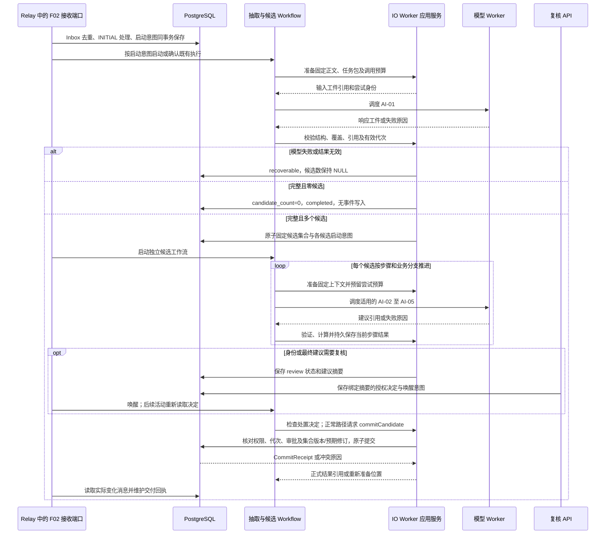

# F02 事件管理模块技术详细设计

> V0.5 · 2026-10-24 · 对齐[F02功能设计第4章七步流程](../../../../03-%E7%B3%BB%E7%BB%9F%E5%8A%9F%E8%83%BD%E6%9E%B6%E6%9E%84/F02%20%E4%BA%8B%E4%BB%B6%E7%AE%A1%E7%90%86%E6%A8%A1%E5%9D%97%E5%8A%9F%E8%83%BD%E8%AE%BE%E8%AE%A1%20V1.0.md)与[L0业务职责](../../../../02-%E4%B8%9A%E5%8A%A1%E6%9E%B6%E6%9E%84%E4%B8%8E%E9%A2%86%E5%9F%9F%E8%AE%BE%E8%AE%A1/RiskHot_L0_%E4%BF%A1%E6%81%AF%E5%A4%84%E7%90%86%E5%B1%82_%E4%B8%9A%E5%8A%A1%E6%9E%B6%E6%9E%84%E4%B8%8E%E9%A2%86%E5%9F%9F%E8%AE%BE%E8%AE%A1V1.0.md)。技术接口均为待发布设计，不修改现行任务包。

## 1. 受理和候选隔离

F02只接收F01已保存的固定资料版本。按资料身份、版本和analysis_key找到处理记录；普通重复始终复用INITIAL，无论当前模型/Prompt是否升级。授权重算另建analysis_key和父处理关联，并仍执行正式对象的业务去重。

Step 1成功后一次固定0～N候选。N=0记录无事件，结束；N>0为每个候选建立独立身份、恢复点、建议及提交回执。授权确认非事件的候选以dismissed及NOT_EVENT回执正常终结，不删除集合成员。某候选失败不阻止独立候选推进；同一正式事件的并发提交仍需修订号一致性检查。

### 1.1 模块内部组件与运行归属

下表是模块内职责划分，组件以应用代码装载到指定运行进程，不各自拆成微服务。程序组件调用公开领域/仓储端口；共享契约遵循总体架构第14.3节。

| 内部组件 | 执行与交接职责 | 规则主维护位置 |
| --- | --- | --- |
| 接收与查询入口 | Relay内接收端口持久接收固定资料版本；API查询、复核和恢复入口 | T02接收事务与HTTP契约 |
| 抽取与候选流程协调 | Workflow Worker推进抽取与独立候选流程，IO Worker原子接纳集合并建立启动意图 | T03三类工作流；事件数据与状态设计第1、3章 |
| 上下文准备与模型调用 | IO Worker准备固定输入和预算；模型Worker调用AI-01～05并留存响应 | T04公共信封与五任务分册 |
| 业务校验与复核组件 | IO Worker验证结构、引用、身份、增量及M方法，消费绑定建议摘要的复核决定 | 本模块第3～4章，T04/T06 |
| 正式提交应用服务 | IO Worker汇总建议、检查代次与权限，执行统一提交事务 | 事件数据与状态设计第7章；T01锁序 |
| 交付与恢复适配器 | Relay按实际变化交付；程序按回执恢复而非重新生成已提交结果 | T02事件修订消息，T03恢复对账 |

## 2. 七步执行与交接

| 步骤 | 程序准备 | AI职责 | 程序检查及下一步 |
| --- | --- | --- | --- |
| Step 1 提取候选事件 | 读取固定正文、分段、来源和任务包，检查覆盖 | AI-01识别具体行为、决定或状态变化，返回0～N候选 | 检查完整性、时间语义及证据，固定集合；0结束，其他分发 |
| Step 2 匹配事件与归组 | 按集合版本冻结实际Event、修订及检索范围，准备比较证据 | AI-02建议新建、复用或待定 | 检查身份、允许ID、歧义及复核决定；产生EventContextRef |
| Step 3 关联观测主体及直接变量 | 准备事件上下文、有效定义和原文依据 | AI-03给出直接关系、定义候选及合法空结果 | 验证正式ID/版本、类型及直接依据；定义候选不变正式关系 |
| Step 4 判定增量与更新 | 读取当前资料、历史证据/更新、身份版本 | AI-04比较实际变化，给出七类增量建议 | 核定增量与变化身份；冲突回Step 2，待定复核，来源/重复直达Step 6 |
| Step 5 评价金融意义M | 判断初评/复评，固定范围、期限、方法和依据 | AI-05分析维度、用途、限制与证据 | 验证、必要时确定性计算，整理评级建议；合法无需评价则记录原因 |
| Step 6 校验并保存 | 汇总全部有效建议、审批、版本与证据 | 无AI调用 | 统一门槛检查；事务保存适用正式结果、候选完成与交付意图 |
| Step 7 交付事件变化 | 读取已提交变化和固定修订 | 无AI调用 | Outbox发送、Inbox接收、记录回执；失败仅恢复交付 |

## 3. Step 5 的程序与AI协作

1. **程序决定是否评价**：新事件初评；进展、实质补充或纠正只有改变评价依据才复评。纯来源增加或纯重复不触发AI-05。无须评价必须有原因和沿用引用。
2. **程序准备上下文**：固定assessment_scope、research_horizon、方法、已有评级及本次变化，防止AI悄悄更改口径。
3. **AI分析**：按已提供规则生成维度解释、用途、证据；有批准锚点才提出相应分值建议，不分配rating_id或批准状态。
4. **程序校验**：逐维校验范围、值域、依据、版本和缺失项；拒绝模型编造的规则、总分或状态。
5. **程序计算**：仅在方法已批准且输入充分时按固定方法独立计算M；模型总分不作为计算依据。方法未确认时合法文字评价的M为空，保持draft。
6. **程序整理待保存记录**：生成稳定assessment_key、依据修订和历史关联，交Step 6。模型超时/失败是待恢复，不能按“方法未定”生成默认草稿跳过。

## 4. Step 6 正式提交门槛

| 检查组 | 必须满足 |
| --- | --- |
| 执行与建议 | 必需节点成功或有业务允许的跳过决定；输入/方法/代次与建议一致；未取消 |
| 事件身份 | 新建/复用决定明确；已有event_id存在且修订未过期；NEW绑定有效召回快照并通过集合版本校验；新事件仅程序分配正式ID |
| 证据与引用 | 资料固定版本可读；引文位置与原文相符；正式定义有效；三元关系具有对应EventTarget |
| 增量与评级 | 分类对应实际写入动作；变化键与评价键有效；范围、期限、方法、依据一致 |
| 授权与复核 | 当前政策允许该操作；复核决定绑定最终建议摘要；旧审批或模型自批无效 |
| 幂等与并发 | 已提交则返回原回执；未提交则检查候选代次；NEW核对catalog_epoch，REUSE核对expected_revision |

事务保存Event及适用关系/证据/更新/评级、不可变EventRevision、CommitReceipt、候选完成记录、批次汇总和Outbox。纯重复只写无变化处理回执，不生成空修订或事件通知。新事件至少有一项资料关联与有效证据，初始更新及首版修订一并保存；外部调用不能夹在事务中。

初始切片采用[ADR的人工复核建议](../../../05-%E6%9E%B6%E6%9E%84%E6%B2%BB%E7%90%86%E4%B8%8E%E9%AA%8C%E8%AF%81/%E6%9E%B6%E6%9E%84%E5%86%B3%E7%AD%96%E8%AE%B0%E5%BD%95/ADR-L0-001-%E6%9C%80%E5%B0%8F%E9%97%AD%E7%8E%AF%E4%B8%8E%E6%AD%A3%E5%BC%8F%E6%8F%90%E4%BA%A4%E8%BE%B9%E7%95%8C.md)：没有正式自动通过政策时，授权复核者确认最终建议及证据后才提交有业务变化的结果。此为技术安全门槛设计，不擅自把模型置信度阈值写成已批准业务规则。

确认非事件走[数据设计第3.1节](事件数据与状态设计.md#31-授权确认非事件与正常结束)的独立处置分支：授权复核后由IO Worker核对依据并原子写dismissed、NOT_EVENT回执、审计和批次汇总，不要求AI-02～05完成，不创建事件及交付消息。正常Step 6在候选锁内检查有效disposition决定，待处置时不得继续事件提交；已dismissed只回原处置结果。

## 5. 增量对应写入与交付

| 分类 | 适用持久效果 | 评价与交付 |
| --- | --- | --- |
| NEW_EVENT | 新Event、来源/证据、初始更新及适用关系/评级、首版修订 | 初评；发送事件创建修订 |
| EVENT_PROGRESS / MATERIAL_ADDITION | 有实际变化的更新、证据及必要关系修订 | 依据改变才复评；发送变化 |
| CORRECTION | 新纠正记录及被纠正引用，历史保留 | 按依据变化复评；发送纠正修订 |
| SOURCE_ADDITION | 来源关系/新增版本证据、必要修订；不造EventUpdate | 不默认复评；按功能设计交付来源变化 |
| DUPLICATE | 处理回执；既有业务对象保持 | 无新增评级、修订或事件通知 |
| UNRESOLVED | 候选建议与待复核事项 | 不正式提交；不能算完成 |

## 6. 恢复、查询和验证

模型失败恢复当前节点，不得转为非事件；已dismissed的普通重试返回原处置回执，改判须授权新处理；身份改变使Step 3～5依赖结果失效；事件历史变化重新准备受影响步骤；数据库提交回应丢失先查回执；交付失败不重跑分析。已提交业务不能由“重试”覆盖，需受控纠正或重算。

查询提供资料级进度、候选清单、逐步校验/复核、正式结果引用、证据、恢复位置与交付回执。字段/状态见[事件数据与状态设计](%E4%BA%8B%E4%BB%B6%E6%95%B0%E6%8D%AE%E4%B8%8E%E7%8A%B6%E6%80%81%E8%AE%BE%E8%AE%A1.md)，任务细节见[AI-01](AI%E4%BB%BB%E5%8A%A1%E6%8A%80%E6%9C%AF%E8%AF%A6%E7%BB%86%E8%AE%BE%E8%AE%A1/AI-01-%E4%BA%8B%E4%BB%B6%E5%80%99%E9%80%89%E6%8A%BD%E5%8F%96.md)、[AI-02](AI%E4%BB%BB%E5%8A%A1%E6%8A%80%E6%9C%AF%E8%AF%A6%E7%BB%86%E8%AE%BE%E8%AE%A1/AI-02-%E4%BA%8B%E4%BB%B6%E8%BA%AB%E4%BB%BD%E5%88%A4%E6%96%AD.md)、[AI-03](AI%E4%BB%BB%E5%8A%A1%E6%8A%80%E6%9C%AF%E8%AF%A6%E7%BB%86%E8%AE%BE%E8%AE%A1/AI-03-%E8%A7%82%E6%B5%8B%E4%B8%BB%E4%BD%93%E4%B8%8E%E5%8F%98%E9%87%8F%E8%AF%86%E5%88%AB.md)、[AI-04](AI%E4%BB%BB%E5%8A%A1%E6%8A%80%E6%9C%AF%E8%AF%A6%E7%BB%86%E8%AE%BE%E8%AE%A1/AI-04-%E4%BA%8B%E4%BB%B6%E5%A2%9E%E9%87%8F%E5%88%A4%E5%AE%9A.md)、[AI-05](AI%E4%BB%BB%E5%8A%A1%E6%8A%80%E6%9C%AF%E8%AF%A6%E7%BB%86%E8%AE%BE%E8%AE%A1/AI-05-%E9%87%91%E8%9E%8D%E6%84%8F%E4%B9%89%E8%AF%84%E4%BB%B7.md)。架构验收映射见[验证方案](../../../05-%E6%9E%B6%E6%9E%84%E6%B2%BB%E7%90%86%E4%B8%8E%E9%AA%8C%E8%AF%81/%E6%9E%B6%E6%9E%84%E9%AA%8C%E8%AF%81/L0%E6%9C%80%E5%B0%8F%E4%B8%9A%E5%8A%A1%E9%97%AD%E7%8E%AF%E9%AA%8C%E8%AF%81%E6%96%B9%E6%A1%88.md)。

## 7. 内部调用与实现时序

接收应用服务负责固定资料版本的持久受理；抽取协调与候选协调分别维护不同工作流。上下文准备、后置校验和正式提交由 IO Worker 执行，模型 Worker 只运行受限模型调用及记录尝试。下图中 Workflow 到 Worker 的调用均经 Temporal 活动调度。

图中循环表达通用调用模式：AI-02 的身份复核必须在 Step 3 前完成；身份不明确则暂停该候选。Step 4 决定是否进入 Step 5，来源增加和纯重复按业务分支跳过评价。最终提交复核在完整 CommitProposal 形成后执行。每个阶段先持久化有效结果，再推进下一阶段；模型失败不会被解释成合法空结果。

上图表示正常事件路径；在任一候选阶段收到有效非事件决定时，普通路径停止，由IO Worker按数据设计第3.1节完成处置事务并结束该候选。无需执行余下AI任务，也不进入事件交付分支；模型迟到结果不得覆盖处置。

## 8. 数据访问与异常恢复入口

| 调用方 | 允许的数据访问 | 一致性边界 |
| --- | --- | --- |
| 接收应用服务 | 读取 F01 固定资料版本，写 Inbox、processing_runs 和启动意图 | 同资料版本 INITIAL 处理唯一；同消息返回原回执 |
| 上下文准备组件 | 读取资料、事件历史、定义与策略快照；写输入工件引用和预算预留 | 读取权限及版本必须可证明；历史、输入摘要与尝试身份固定 |
| 模型适配组件 | 读取授权输入工件；写模型尝试、响应工件 | 无正式事件写权限；不核准自身结果 |
| 业务校验与复核组件 | 写逐步建议、证据校验、复核关联及失效信息 | 结果绑定候选代次与输入摘要；失效后下游结果不可提交 |
| 正式提交应用服务 | 通过事件仓储写正式聚合、修订、候选完成、回执及 Outbox | 单连接单事务，遵循配套数据设计第7章；不跨事务分开写结果与消息 |
| 查询与交付组件 | 查询固定修订和证据；消费已提交的实际变化消息 | 查询权限过滤及分页在数据库执行；交付失败不回退已完成事件 |

| 异常窗口 | 状态与影响范围 | 恢复入口及续接位置 |
| --- | --- | --- |
| AI-01 超时、覆盖不完整或引用无效 | 抽取 recoverable，candidate_count=NULL，不建立正式候选集合 | 恢复该 processing 的抽取节点；同输入与任务包，受原预算约束 |
| 候选某个 AI 节点失败 | 当前候选 recoverable，记录 reason 与 resume_step | 恢复该候选当前步骤；其他独立候选可继续 |
| 身份歧义或业务依据不足 | 当前候选 review | 授权决定绑定建议摘要；身份改变则使 Step 3～5 结果失效并重新准备 |
| NEW提交前事件集合变化 | IDENTITY_SNAPSHOT_STALE，零正式写入，旧建议与审批失效 | 持久保存resume_step=2；保留原候选，重新召回、归组及复核，详见配套数据设计第7.2节 |
| 授权确认非事件 | review等待处置；事务完成后dismissed，NOT_EVENT回执 | IO处置分支及复核对账；只恢复未完成处置，已终态不重跑AI或事件提交 |
| 提交前事件修订变化 | REVISION_CONFLICT，整笔提交退出 | 回到受影响的身份/增量/评价步骤，重新生成建议及必要审批；不只替换预期版本号 |
| 代次失效、取消或无权 | 拒绝接纳迟到结果或正式提交，保留原因 | 经授权核对运行政策；恢复时遵循 T03 新代次规则，不能原样重放失效提交 |
| 数据库回应丢失 | 提交是否成功暂不确定 | 先查询原 commit_key 的回执；已成功返回原结果，未成功才重试原提交 |
| 交付超时或预算耗尽 | 候选 completed，delivery 单独 pending/recoverable | 恢复原 message_id 的交付，禁止重跑 AI 或新增修订 |

资料级状态按候选状态汇总：completed和dismissed均计为已处置；部分处置且仍有未完成项为partial，全部处置或合法零候选才为completed。全部否决仍保留原候选数及dismissed_count，交付不适用时为not_required。业务完成与对外交付分别查询。状态精确定义、汇总顺序及恢复约束以配套数据设计第3章为准。

## 9. 非功能约束与验证落点

模型调用前由程序检查上下文容量并原子预留预算；并发和重试策略引用 T03，不在模块另设倍增重试。任务记录使用 processing_id、candidate_id、attempt、proposal_digest、commit_key 关联；完整正文和模型响应通过受控工件读取。复核与提交均校验当前权限，历史建议摘要和权限决定保留审计记录。

验证覆盖五项 L0 必需条件：多候选独立完成、完整零候选正常结束、重复资料复用 INITIAL、逐条引文回溯原件、模型失败时正式表零新增。另注入同事件并发、复核后建议变化、提交回应丢失及交付失败；分别断言状态、正式修订、回执和恢复节点，不以工作流结束代替业务验收。

## 设计依据定位

- [L0 归属与交接](../L0-%E4%BF%A1%E6%81%AF%E5%A4%84%E7%90%86%E5%B1%82%E6%8A%80%E6%9C%AF%E6%9E%B6%E6%9E%84.md)
- [公共数据契约索引](../../../04-%E5%85%AC%E5%85%B1%E6%8A%80%E6%9C%AF%E5%A5%91%E7%BA%A6/%E6%95%B0%E6%8D%AE%E6%A8%A1%E5%9E%8B%E4%B8%8ESchema.md)
- [公共接口契约索引](../../../04-%E5%85%AC%E5%85%B1%E6%8A%80%E6%9C%AF%E5%A5%91%E7%BA%A6/%E6%8E%A5%E5%8F%A3%E4%B8%8E%E4%BA%8B%E4%BB%B6%E5%A5%91%E7%BA%A6.md)
- [事件数据与状态设计 · 3. 状态转移](%E4%BA%8B%E4%BB%B6%E6%95%B0%E6%8D%AE%E4%B8%8E%E7%8A%B6%E6%80%81%E8%AE%BE%E8%AE%A1.md#3-%E7%8A%B6%E6%80%81%E8%BD%AC%E7%A7%BB)
- [事件数据与状态设计 · 7. commitCandidate事务步骤与并发结果](%E4%BA%8B%E4%BB%B6%E6%95%B0%E6%8D%AE%E4%B8%8E%E7%8A%B6%E6%80%81%E8%AE%BE%E8%AE%A1.md#7-commitcandidate%E4%BA%8B%E5%8A%A1%E6%AD%A5%E9%AA%A4%E4%B8%8E%E5%B9%B6%E5%8F%91%E7%BB%93%E6%9E%9C)
- [事件数据与状态设计 · 8. 召回、历史读取与查询设计](%E4%BA%8B%E4%BB%B6%E6%95%B0%E6%8D%AE%E4%B8%8E%E7%8A%B6%E6%80%81%E8%AE%BE%E8%AE%A1.md#8-%E5%8F%AC%E5%9B%9E%E5%8E%86%E5%8F%B2%E8%AF%BB%E5%8F%96%E4%B8%8E%E6%9F%A5%E8%AF%A2%E8%AE%BE%E8%AE%A1)
- [T03-任务编排与可靠性架构 · 6. Workflow、Activity与队列的具体划分](../../../02-%E4%B8%93%E9%A2%98%E6%8A%80%E6%9C%AF%E6%9E%B6%E6%9E%84/T03-%E4%BB%BB%E5%8A%A1%E7%BC%96%E6%8E%92%E4%B8%8E%E5%8F%AF%E9%9D%A0%E6%80%A7%E6%9E%B6%E6%9E%84.md#6-workflowactivity%E4%B8%8E%E9%98%9F%E5%88%97%E7%9A%84%E5%85%B7%E4%BD%93%E5%88%92%E5%88%86)
- [T03-任务编排与可靠性架构 · 7. 单节点重试与恢复算法](../../../02-%E4%B8%93%E9%A2%98%E6%8A%80%E6%9C%AF%E6%9E%B6%E6%9E%84/T03-%E4%BB%BB%E5%8A%A1%E7%BC%96%E6%8E%92%E4%B8%8E%E5%8F%AF%E9%9D%A0%E6%80%A7%E6%9E%B6%E6%9E%84.md#7-%E5%8D%95%E8%8A%82%E7%82%B9%E9%87%8D%E8%AF%95%E4%B8%8E%E6%81%A2%E5%A4%8D%E7%AE%97%E6%B3%95)
- [T03-任务编排与可靠性架构 · 9. 取消与提交竞争的确定顺序](../../../02-%E4%B8%93%E9%A2%98%E6%8A%80%E6%9C%AF%E6%9E%B6%E6%9E%84/T03-%E4%BB%BB%E5%8A%A1%E7%BC%96%E6%8E%92%E4%B8%8E%E5%8F%AF%E9%9D%A0%E6%80%A7%E6%9E%B6%E6%9E%84.md#9-%E5%8F%96%E6%B6%88%E4%B8%8E%E6%8F%90%E4%BA%A4%E7%AB%9E%E4%BA%89%E7%9A%84%E7%A1%AE%E5%AE%9A%E9%A1%BA%E5%BA%8F)
- [T02-接口与集成架构 · 5. HTTP路由与请求契约（目标设计）](../../../02-%E4%B8%93%E9%A2%98%E6%8A%80%E6%9C%AF%E6%9E%B6%E6%9E%84/T02-%E6%8E%A5%E5%8F%A3%E4%B8%8E%E9%9B%86%E6%88%90%E6%9E%B6%E6%9E%84.md#5-http%E8%B7%AF%E7%94%B1%E4%B8%8E%E8%AF%B7%E6%B1%82%E5%A5%91%E7%BA%A6%E7%9B%AE%E6%A0%87%E8%AE%BE%E8%AE%A1)
- [T02-接口与集成架构 · 6. 模块内调用与消息载荷](../../../02-%E4%B8%93%E9%A2%98%E6%8A%80%E6%9C%AF%E6%9E%B6%E6%9E%84/T02-%E6%8E%A5%E5%8F%A3%E4%B8%8E%E9%9B%86%E6%88%90%E6%9E%B6%E6%9E%84.md#6-%E6%A8%A1%E5%9D%97%E5%86%85%E8%B0%83%E7%94%A8%E4%B8%8E%E6%B6%88%E6%81%AF%E8%BD%BD%E8%8D%B7)
