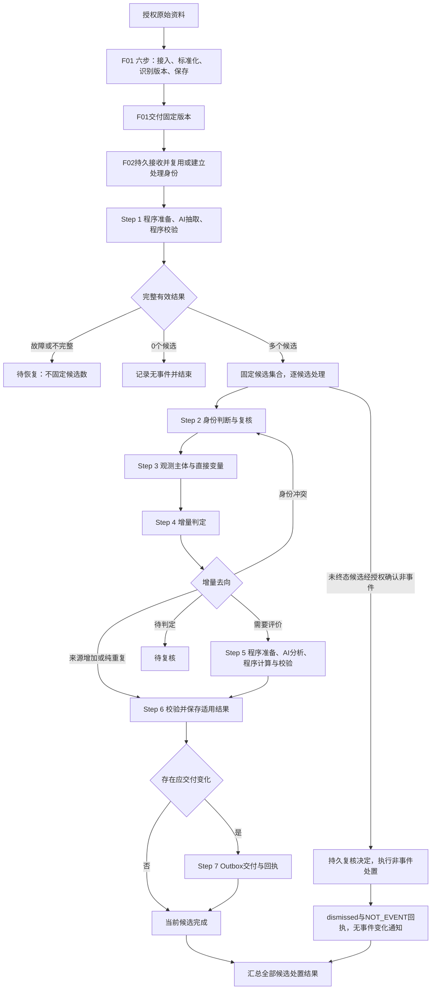
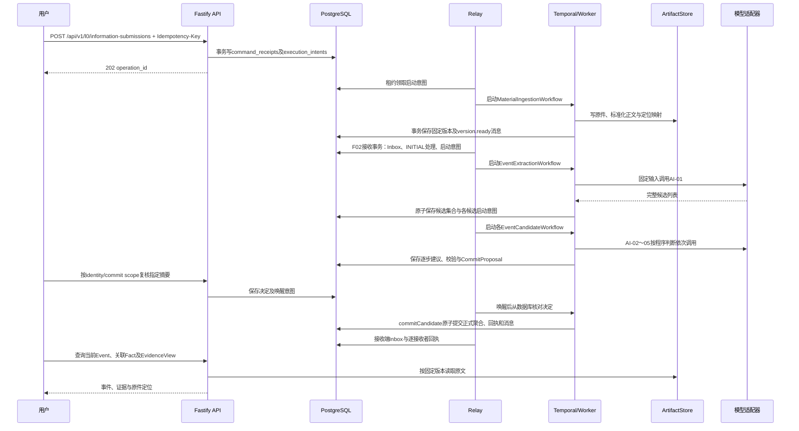

# L0 信息处理层技术架构

> 2026-10-30执行架构覆盖：本文涉及Temporal、Workflow/Activity、三类Worker、启动意图与signal的时序属于旧执行基线；新目标采用 [[tools/RiskHot/docs/system-design/04-系统架构设计/02-专题技术架构/T03-任务编排与可靠性架构|T03 V1.0]] 的业务Job交接，数据使用 [[tools/RiskHot/docs/system-design/04-系统架构设计/01-数据模型与存储设计/S01任务执行数据契约|S01契约]]。本轮未重写领域算法；业务含义按最新F01/F02功能设计，旧同号AI任务不能自动沿用。

> 2026-10-27 模型调整：F02 表结构以 [[tools/RiskHot/docs/system-design/04-系统架构设计/01-数据模型与存储设计/F02事件管理模块数据模型与存储设计|F02 数据模型与存储设计]] 为准；Fact保存候选，Event保存去重后的当前事实，不再依赖事件修订。

> V0.4 · 2026-10-24 · 设计评审稿。业务依据为[L0领域设计](../../../02-%E4%B8%9A%E5%8A%A1%E6%9E%B6%E6%9E%84%E4%B8%8E%E9%A2%86%E5%9F%9F%E8%AE%BE%E8%AE%A1/RiskHot_L0_%E4%BF%A1%E6%81%AF%E5%A4%84%E7%90%86%E5%B1%82_%E4%B8%9A%E5%8A%A1%E6%9E%B6%E6%9E%84%E4%B8%8E%E9%A2%86%E5%9F%9F%E8%AE%BE%E8%AE%A1V1.0.md)、[F01六步](../../../03-%E7%B3%BB%E7%BB%9F%E5%8A%9F%E8%83%BD%E6%9E%B6%E6%9E%84/F01%20%E4%BF%A1%E6%81%AF%E6%8E%A5%E5%85%A5%E4%B8%8E%E6%A0%87%E5%87%86%E5%8C%96%E6%A8%A1%E5%9D%97%E5%8A%9F%E8%83%BD%E8%AE%BE%E8%AE%A1%20V2.1.md)和[F02七步](../../../03-%E7%B3%BB%E7%BB%9F%E5%8A%9F%E8%83%BD%E6%9E%B6%E6%9E%84/F02%20%E4%BA%8B%E4%BB%B6%E7%AE%A1%E7%90%86%E6%A8%A1%E5%9D%97%E5%8A%9F%E8%83%BD%E8%AE%BE%E8%AE%A1%20V1.0.md)；共享机制遵循[T01～T08](../../01-%E7%B3%BB%E7%BB%9F%E6%80%BB%E4%BD%93%E6%8A%80%E6%9C%AF%E6%9E%B6%E6%9E%84%E8%AE%BE%E8%AE%A1.md)。

本文件是 L0 业务分组的技术总览。F01、F02 是本层所属模块；M1～M3 和 S01 是外部协作能力。本文集中说明层内协作、交接与闭环验证，模块内部调用、数据访问和恢复细节由各模块分册维护。

## 1. 输入、输出和闭环范围

输入是授权来源的一份原始资料；首切片使用可完整读取的UTF-8文本，保留来源身份、原件和获取时间。F01交付标准化资料的固定版本，F02输出0～N个候选的处理结果、适用正式 Event 与关联 Fact以及交付状态。普通评论或概念介绍可能没有可抽取事件，应正常结束。

业务闭环要求保存后的资料可查、候选处理可查、正式事件及原文可回溯；无事件有明确处理记录；固定候选经授权确认非事件时，以dismissed及NOT_EVENT回执终结，计入批次已处置数量。对外交付闭环另要求接收回执。验证接收端仅证明F02交付契约，不代表L1风险分析已实现。部分候选完成是可恢复的中间状态，不能算全资料完成。

## 2. L0 所属模块与协作组件

| 组件 | 所有者 | 职责与限制 |
| --- | --- | --- |
| 资料接入应用服务 | F01 | 准入、原件获取、标准化、版本识别、保存、交付 |
| 事件处理应用服务 | F02 | 资料受理、候选集合、逐候选交接、提交及查询 |
| 身份/增量/评级决策组件 | F02 | 应用规则、校验建议、消费复核决定，不直接依赖模型厂商 |
| 任务输入与模型适配器 | F02 + 共享执行 | 固定上下文、调用、保存尝试；不直接写正式业务 |
| 证据解析器 | F01提供资料定位，F02建立业务引用 | 固定版本、权限与位置校验、原件导航 |
| 持久编排与中继 | S01 | 启动、重试、恢复、交付，不决定候选是否是事件 |
| 定义与策略读取 | M1/M2/M3 | 返回有效版本；本次处理固定版本，不取可变最新值 |

## 3. 端到端处理

图中Step 2～5不是独立的AI黑箱：程序负责输入、引用、流程决定和后置校验。每次失败归属当前候选；独立候选继续。Step 6统一保存适用对象，不要求每次都创建关系、更新和评级。

## 4. 交接清单

| 边界 | 必须交付 | 接收条件 |
| --- | --- | --- |
| F01 → F02 | 资料身份/版本、原件与正文清单、定位映射、来源版本 | 已保存、可读、完整、授权有效 |
| Step 1 → 各候选 | 固定candidate_id、要素、时间语义、原文证据 | 完整抽取已接纳，候选数固定 |
| Step 2 → Step 3 | 经核定的EventContextRef、身份决定、匹配快照 | 非UNRESOLVED，既有事件当前内容摘要有效 |
| Step 3 → Step 4 | 正式定义引用的关系建议或合法空关系、定义候选 | ID/版本/直接依据通过检查 |
| Step 4 → Step 5/6 | 增量分类、变化身份、更新/来源建议、是否需评价 | 分类与动作一致，身份和历史未失效 |
| Step 5 → Step 6 | 带范围、期限、依据的评级建议或合法跳过决定 | 程序验证；必要计算完成；无模型失败冒充草稿 |
| Step 6 → Step 7 | CommitReceipt、固定提交内容、实际变化清单 | 正式事务已成功 |
| Step 7 → 下游 | 固定提交消息与读取授权 | 接收方持久接收、去重并回执 |

## 5. 五项要求的设计落点

| 用户要求 | 设计保证 | 验证编号 |
| --- | --- | --- |
| 一份资料多个候选 | 集合一次固定、逐候选独立执行及提交 | L0-AC-01 |
| 无事件正常结束 | 完整成功的0候选有业务记录，无Event副作用 | L0-AC-02 |
| 重复提交幂等 | 请求、资料版本、处理、候选、增量、评级、消息分层去重 | L0-AC-03 |
| 引用回溯原文 | 固定原件/正文/定位映射，逐条引用验证 | L0-AC-04 |
| 模型故障不造成错误正式事件 | 建议隔离、失败状态、程序提交门槛与代次控制 | L0-AC-05 |

“保证”指架构不变量与未来必须满足的验收条件，尚无运行证据。模型返回结构合法但语义错误仍是独立质量风险，需复核及真实模型评测，不能由Schema校验消除。

## 6. 最小可验证切片的边界

必须具备：受控来源、文本保存及定位、五任务调用契约、复核入口契约、正式事件事务、结果查询、持久交付接收端、故障和重复场景。可不具备：多站点抓取、OCR、向量检索、自动定义治理、正式量化M规则、L1～L3业务处理。

缺少正式Target/Variable时可为空或形成定义候选；缺少M量化政策时允许正常完成的文字评价和空分值草稿。缺少模型调用结果、完整原文或有效证据不能靠这些可选项规则绕过。

具体操作与状态见[F01详细设计](F01-%E4%BF%A1%E6%81%AF%E6%8E%A5%E5%85%A5%E4%B8%8E%E6%A0%87%E5%87%86%E5%8C%96/%E6%A8%A1%E5%9D%97%E6%8A%80%E6%9C%AF%E8%AF%A6%E7%BB%86%E8%AE%BE%E8%AE%A1.md)、[F02详细设计](F02-%E4%BA%8B%E4%BB%B6%E7%AE%A1%E7%90%86/%E6%A8%A1%E5%9D%97%E6%8A%80%E6%9C%AF%E8%AF%A6%E7%BB%86%E8%AE%BE%E8%AE%A1.md)。下一阶段的验证入口是[最小闭环验证方案](../../05-%E6%9E%B6%E6%9E%84%E6%B2%BB%E7%90%86%E4%B8%8E%E9%AA%8C%E8%AF%81/%E6%9E%B6%E6%9E%84%E9%AA%8C%E8%AF%81/L0%E6%9C%80%E5%B0%8F%E4%B8%9A%E5%8A%A1%E9%97%AD%E7%8E%AF%E9%AA%8C%E8%AF%81%E6%96%B9%E6%A1%88.md)，当前不开展实现。

### 6.1 验证环境假设与容量边界

下表用于L0最小闭环的隔离验证，不是全系统生产限制或实测容量。输入限制由T02维护、执行预算由T03维护、环境拓扑由T08维护；调整参数须同步更新这些定义及相应验证场景。

| 假设 | 验证设计值 | 超出假设时的处理与设计变化 |
| --- | --- | --- |
| 组织与环境 | 单组织、隔离验证环境 | 多租户须增加租户身份、复合唯一键、隔离及越权验证 |
| 输入格式 | 受控 UTF-8 文本；正文≤20,000码点、原件≤1MiB、请求≤2MiB | HTML/PDF/OCR等需独立读取规则和坐标映射，不能仅放宽大小 |
| 一次抽取 | 全文可完整进入固定模型上下文，候选≤50 | 超限待处理；分块方案需覆盖清单与集合合并验证，不能静默截断 |
| 模型和程序并发 | 单验证环境模型并发2、IO并发8 | 多模型副本须共享预算和配额，不能按副本翻倍 |
| 原件部署 | 单主机独立持久卷 | 多主机先切换共享对象存储，不把同名本地目录当共享 |

参数与实现机制见 [T02-接口与集成架构](../../02-%E4%B8%93%E9%A2%98%E6%8A%80%E6%9C%AF%E6%9E%B6%E6%9E%84/T02-%E6%8E%A5%E5%8F%A3%E4%B8%8E%E9%9B%86%E6%88%90%E6%9E%B6%E6%9E%84.md)、[T03-任务编排与可靠性架构](../../02-%E4%B8%93%E9%A2%98%E6%8A%80%E6%9C%AF%E6%9E%B6%E6%9E%84/T03-%E4%BB%BB%E5%8A%A1%E7%BC%96%E6%8E%92%E4%B8%8E%E5%8F%AF%E9%9D%A0%E6%80%A7%E6%9E%B6%E6%9E%84.md)、[T08-部署与工程交付架构](../../02-%E4%B8%93%E9%A2%98%E6%8A%80%E6%9C%AF%E6%9E%B6%E6%9E%84/T08-%E9%83%A8%E7%BD%B2%E4%B8%8E%E5%B7%A5%E7%A8%8B%E4%BA%A4%E4%BB%98%E6%9E%B6%E6%9E%84.md)。

### 6.2 复核与评价政策前提

以下政策适用于F02事件处理，启用条件由业务规则及任务治理决定；技术参数调整不能替代业务批准。

| 政策 | 当前处理 | 启用其他路径的条件 |
| --- | --- | --- |
| 复核政策 | 无批准自动通过政策时采用授权复核 | 自动化需业务政策、阈值与真实语义质量证据 |
| 评分方法 | 未批准量化方法时允许有依据的文字评价、空M草稿 | 方法批准后增加规则、计算和评级回归；模型故障仍须阻断 |

## 7. 一次提交的实际技术时序

图中的AI-02～05是一段简写：身份需要复核时先停在identity scope，身份决定有效后才执行后续任务；最终commit scope批准完整提交建议。复核HTTP响应只表示决定已保存，不表示事件已经提交。

## 8. 用具体对象证明五项要求

一份资料I1/V1的INITIAL处理P1接受两个候选C1、C2，分别有独立Workflow和CommitProposal。C1成功产生E1与Fact关系；C2在AI-04故障，P1显示partial，C1的正式结果保留。恢复C2仅从Step 4续接，成功后产生E2与Fact关系；P1变completed。若同版补发，资料版本/INITIAL唯一约束定位P1，不能重新产生C3、C4。

若完整AI-01返回空candidates，P1保存candidate_count=0并completed，不创建候选工作流或Event。若超时，candidate_count保持NULL且recoverable。每个正式EventEvidence带version_id与segment_id，查询沿固定mapping回到I1/V1的raw对象；后来出现V2也不改变旧证据。

这些标识是说明用别名，实际ID为UUID。对应的专用表、接口和时序分别由T01/T02/T03及模块数据设计定义；此例不是系统已运行的记录。
