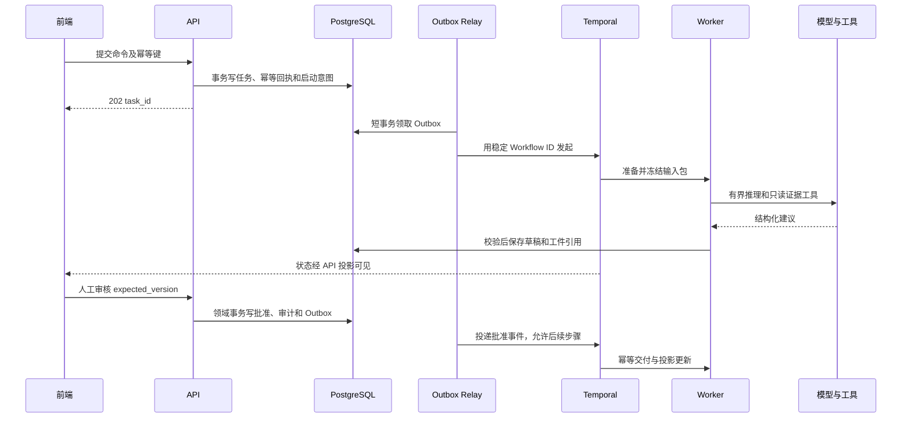

# RiskHot 系统架构设计 · 执行与恢复

> 总览索引：[[RiskHot_系统架构设计_V1.0]]
> 覆盖章节：10. 持久执行、事务与恢复

## 10. 持久执行、事务与恢复

### 10.1 单一编排权威

Temporal 是跨故障业务执行的唯一编排器。Workflow 只组织确定性的步骤、Timer、等待与分支；抓取、LLM、数据库和对象存储均在 Activity。不能在 Workflow 重放时调用模型。该边界来自 [Temporal Workflow 定义](https://docs.temporal.io/workflow-definition)。

Agent SDK 可提供单次有界调用中的规划/工具循环，但不能再持有同一任务的独立恢复检查点；不能在 Temporal 外另建一套 LangGraph checkpoint、BullMQ 重试和自写调度器共同决定任务状态。Agent 内部超过单步预算时，把阶段工件交还 Workflow，由其决定后续步骤。

### 10.2 从受理到正式保存

数据库业务变更、审计记录与 Outbox 同事务提交，跨数据库、Temporal 和对象存储没有统一事务。事务保证限定于同一 PostgreSQL 事务，参见 [官方事务说明](https://www.postgresql.org/docs/18/tutorial-transactions.html)。任何 LLM 或网络等待期间不得持有长数据库事务或行锁。

Outbox relay 用短事务和租约领取，网络调用在事务外；成功后标记交付。租约过期可重领，发送成功但确认失败允许重投。`SKIP LOCKED` 仅用于此类并发领取，不用于一般业务查询，参见 [PostgreSQL SELECT](https://www.postgresql.org/docs/18/sql-select.html)。

启动意图以长期唯一 operation_id 登记，保存 Workflow 关联及业务终态回执。必须显式配置运行中 ID 冲突策略与已关闭实例的 ID 复用策略：普通重投返回原关联，不能把已完成业务重新启动；人工重算分配新的业务运行身份。Temporal 历史已超过保留期且启动结果不明确时进入对账恢复，不因“查不到 Workflow”盲目再启动。长期去重以 PG 账本为准，不依赖执行历史永久保留。

### 10.3 幂等与并发控制

| 操作 | 稳定身份或唯一性 | 崩溃后行为 |
| --- | --- | --- |
| 采集与原文保存 | source + 外部定位 + 内容版本摘要 | 返回既有资料版本；变化产生新版本 |
| 事件增量 | 规范化输入版本 + 处理规则版本 + 已确认事件身份 | 重试沿用处理操作；有意重归组新运行 |
| 纳管 | 已批准候选操作 + 同一性串行复核 | 事务重查匹配结果；冲突待复核，不靠语义哈希直接等同风险 |
| 风险—事件关联 | risk_id + event_id 的候选唯一约束 | 复用关系身份，保留首次依据 |
| 观察结果 | run_id + step_id + 结果修订身份 | 相同运行不重复快照；重新分析产生新 run |
| 报告发布 | report_version_id + 发布操作 | 返回原发布结果，不重复生成报告 |
| 下游消费 | consumer + integration_event_id | Inbox 去重，投影按版本检查 |

同风险多次观察可以并行计算，但批准提交时校验定义版本、基准和当前结果版本。若期间定义被修改或已有较新批准结果，应标记过期并要求重审/重算；不得由最后完成的较早任务无条件覆盖最新状态。

Activity 可能重复执行；外部动作成功而完成通知丢失是正常故障模型。正式业务效果依靠数据库约束和 OperationReceipt 去重。没有供应商幂等支持的 LLM 请求仍可能重复计费，不能承诺端到端 exactly-once。[Temporal Activity 语义](https://docs.temporal.io/activity-definition)

### 10.4 重试、暂停、取消与人工等待

默认建议继承 BR：阶段超时 180 秒、最多两次技术重试、等待 30/120 秒，具体按抓取、模型、导出分别定版；这些为配置建议而非所有任务硬编码。限流遵守供应商 Retry-After 并受总预算约束；参数错误、缺权限、证据不合法不做技术盲重试。

人工等待保存草稿和复核引用，不占用 Worker 线程。审核决定先在领域库提交，再通过 Outbox 信号唤醒 Workflow；重复信号无副作用。待办投影丢失可从领域审核状态重建。等待期限到达只提醒或挂起，不默认批准。

取消以请求和确认分开。Activity 检查取消/心跳；不能强制撤销已完成外部调用。正式写入前检查执行资格与取消状态：若写入事务先成功，任务返回已完成并记录取消未生效；若取消先生效，不得再提交结果。已发布结果撤回是独立业务操作，取消任务不能偷偷删除它。

为消除“检查后、提交前”的竞态，领域技术侧车保存提交资格和执行代次。取消请求先在领域事务中关闭提交资格并增加代次，再经 Outbox 请求 Temporal 取消实际执行；正式提交在同一事务内用行锁或 CAS 检查资格、代次、审批修订与预期结果版本。批准信号仅唤醒流程，不构成批准真值；迟到信号必须回查领域状态并拒绝失效代次。PG 裁决是否允许业务提交，Temporal 管理执行如何停止，两者职责不重复。

### 10.5 发布兼容与恢复

短研究批次默认 Pinned Worker 版本；长期监测由计划发起独立批次，避免一个永不结束的巨大 Workflow。版本固定清单同时约束 Activity 实现版本和 Prompt/工具版本；独立 Activity 队列不能假设自动继承所有版本固定保证。[Worker Versioning](https://docs.temporal.io/worker-versioning)

发布前对历史样本 replay，保留旧 Worker 直到在途任务完成或受控迁移。数据库按 expand → migrate → contract 保留旧任务兼容，不能因 Worker 固定就立即删除旧列。Workflow 命令序列变化需 patch/version 策略。[TypeScript 版本治理](https://docs.temporal.io/develop/typescript/workflows/versioning)、[安全部署](https://docs.temporal.io/develop/safe-deployments)

必须区分：**执行 replay** 复用历史 Activity 结果；**审计查看** 展示保存的证据/输出；**业务重算** 调用当前或指定模型产生新运行。三者都有入口与权限，但重算不保证逐字复现旧答案。
