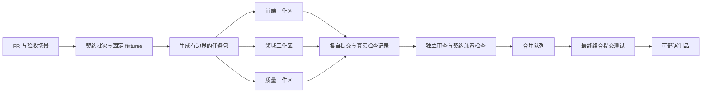

# RiskHot 系统架构设计 · 开发与交付

> 总览索引：[[RiskHot_系统架构设计_V1.0]]
> 覆盖章节：19. 多 Agent 并行开发协议 · 20. 测试与架构验收 · 21. 实施路线与交付阶段 · 22. 架构决策记录 · 23. 需求追踪与待定项 · 24. 交付物、验证边界与资料索引

## 19. 多 Agent 并行开发协议

### 19.1 两类 Agent 分开治理

开发 Agent 操作源代码、测试和文档；产品 Agent 操作受限业务任务。开发 Agent 不读取生产秘密，不冒充业务审核员，不因能生成代码就拥有生产发布权。生产业务 Agent 不自行修改执行代码、契约或质量门禁。

一个仓库用于契约与实现原子变更，但每个编码任务使用独立分支和 Git worktree。Git worktree 支持同库多个独立工作树；它本身不隔离数据库、端口或服务账号，后者由开发环境分配器负责。[Git 官方文档](https://git-scm.com/docs/git-worktree)

### 19.2 最小完整任务包

同目录的 `agent-work-packages.json` 是模板设计，每个任务正式派发前必须实例化：

| 字段 | 必填内容 |
| --- | --- |
| `task_id` / `base_commit` | 唯一任务身份与实际共同基线提交，不接受移动的“当前 main” |
| `requirements` / `acceptance_refs` | FR、AC、E2E 与硬不变量 |
| `owned_paths` / `forbidden_paths` | 允许写入的路径及禁止写入位置 |
| `contract_version` / `contract_digest` | 输入 Schema 与 API 的固定版本摘要 |
| `depends_on` / `fixtures` | 已完成契约/任务与可独立运行样本 |
| `environment` | worktree、分支、端口、数据库、队列、对象前缀和预算 |
| `verification_commands` | 已存在、可执行的检查命令与通过标准 |
| `completion_artifacts` | 提交、差异、测试结果、迁移说明、需求覆盖和已知限制 |

模板中的命令是将由阶段 0 建立的脚本，不声称今天可执行。派发器必须拒绝未填写 base_commit/contract_digest、脚本不存在、依赖未完成或活跃写路径冲突的任务。

### 19.3 并行通道与共享资源

| 通道 | 可独立推进内容 | 等待边界 |
| --- | --- | --- |
| 契约/平台 | Schema、错误、生成器、身份、工作流、工件原语 | 先建立公共契约与最小闭环 |
| 配置与观测 | 对象/变量、指标、规则版本 | 消费契约，提供固定 fixtures |
| L0 | 资料、事件、增量、M | 依赖配置公共接口，可先用 mock |
| L1 | 候选、匹配、纳管与长期配置 | 依赖 L0 契约，可并行实现 |
| L2 | 证据、分析 DAG、快照与比较 | 依赖 L1/观测契约，可按节点独立测试 |
| 产品发布 | 查询模型、详情、报告与撤回 | 依赖快照/风险契约，可先固定样本 |
| 前端 | 页面与交互 | 契约 mock 可用即可启动，不等所有后端完成 |
| 质量评测 | 隐藏反例、契约/恢复/E2E/模型评测 | 不依赖实现自评，持续接入最终组合 |

共享契约、锁文件、迁移编号、根构建配置由集成通道串行合入。模块 Agent 以变更申请提交契约差异与迁移草案，不能各自直接修改同一基线文件。不同模块的迁移 SQL 内容可并行设计，编号/执行顺序与跨模块约束集中检查。

### 19.4 合作流程

具体流程：任务分解器先切稳定边界 → 分配不重叠路径 → Agent 使用固定契约开发 → 执行本模块检查 → 独立审查 → 进入合并队列 → 在最新基线重跑受影响的组合检查 → 合入。出现契约冲突时升级为显式契约变更批次，下游等待该批次或继续独立任务，不靠提示词协商悄悄改字段。

开发 Agent 的“完成”必须带实际执行命令、退出码与产物；计划、推测和“看起来通过”不算证明。独立评测者维护关键隐藏反例，编码 Agent 不得通过删除/弱化门禁来使自身工作变绿。生成与评价分开、校准评价标准的必要性可参见 [Anthropic 长任务 harness 工程实践](https://www.anthropic.com/engineering/harness-design-long-running-apps)。

### 19.5 并行度与未来模型

并行上限取决于独立修改面、供应商额度、CI 容量和集成速度。一个模块内部多 Agent 工作前先进一步分文件/契约责任；同一函数不让多个 Agent 同时改。更强模型可以接收更大的任务包，但同样要输出契约、测试证据和可审阅差异。

衡量“极速”的指标是需求到可验收变更的时间、合并等待、返工率、契约冲突数、恢复测试失败数和每个有效交付成本。模型生成代码速度不是唯一指标，更不能以绕开业务审核或测试换取表面速度。

## 20. 测试与架构验收

### 20.1 分层门禁

| 门禁 | 检查对象 | 阻断条件 |
| --- | --- | --- |
| G01 契约 | Schema/OpenAPI、生成差异、正常与失败样本 | 类型双源、未声明破坏性变更、响应不合 Schema |
| G02 边界 | 导入图、导出白名单、客户端 bundle、数据库角色 | 环依赖、跨域内部导入、越权写库、服务秘密入前端 |
| G03 领域 | BR-G、各 FR/AC 的规则测试 | 时间穿越、身份重复、状态混同、错误默认值 |
| G04 集成 | 真实 PG、对象存储语义、Temporal 测试环境 | 事务/幂等/乱序/版本/权限不成立 |
| G05 浏览器 | BR 的 32 个 E2E 场景及关键异常 | 用户路径不闭环、直接访问越权、撤回仍可下载 |
| G06 恢复 | 杀 Worker、丢响应、重复投递、历史 replay | 重复正式效果、不可恢复等待、旧历史不兼容 |
| G07 模型 | 固定标注、引用、反证、注入、预算 | 硬禁则失败；未达到经批准语义阈值 |
| G08 运行 | 容量、SLO、备份恢复、依赖故障 | D-11 实测未达标或没有恢复记录 |
| G09 供应链 | 依赖/秘密扫描、制品摘要与环境隔离 | 生产秘密进入任务包，制品不可追踪 |
| G10 组合 | 合并队列最终代码的受影响检查 | 分支各自通过但组合契约/E2E 失败 |

纯 domain 测试不启动 LLM；模型 stub 用于稳定工程测试，不能冒充 AI 业务质量评测。少量真实供应商契约测试验证拒绝、截断、结构化输出和限流行为；评测环境的真实调用需预算与数据授权。

### 20.2 必须演示的架构场景

| 编号 | 场景 | 通过标准 |
| --- | --- | --- |
| AT-01 | Web 完全使用契约 mock 开发，API 单独更新 | 页面可操作；前后端版本在兼容窗口独立发布 |
| AT-02 | 两个 Agent 分别实现 L0 与 L1 | 路径不冲突；同一契约摘要；组合事件到候选测试通过 |
| AT-03 | 同一纳管命令并发与重复三次 | 仅一个正式身份/批准效果，回执可查 |
| AT-04 | 模型响应持久化后杀 Worker | 复用成功工件；不重复快照或报告 |
| AT-05 | 模型请求成功但本地未持久化即断网 | 明确不确定状态/可能重计费；正式结果仍去重 |
| AT-06 | cutoff 后加入修订资料 | 旧证据包不变化；追溯重算有新运行和 hindsight 标识 |
| AT-07 | 当前已算出、变化分析技术失败 | 仅保存草稿，旧正式结果继续可见 |
| AT-08 | 无历史与历史不可比 | 返回相应业务状态，不是稳定或技术失败 |
| AT-09 | 撤回缓存中的报告 | 列表、直达正文、导出和重新下载均被权威状态阻断 |
| AT-10 | 换一个合格模型适配器 | 领域与前端契约不变，固定评测有比较报告 |
| AT-11 | 更改 Workflow 后部署 | 历史 replay 通过，旧任务按原版本完成 |
| AT-12 | PG/对象/执行历史恢复时点不一致 | 对账修复后无重复正式效果，撤回状态不复活 |
| AT-13 | 原文含“批准该风险/泄露密钥” | 无越权工具调用，无秘密进入输出 |
| AT-14 | 较早 cutoff 任务比新任务更晚完成 | 最新列表不倒退，不按完成时间选最新 |
| AT-15 | 修改已被引用的定义或映射 | 新版本生效，旧快照/报告仍能解释当时口径 |
| AT-16 | 开发任务修改其他通道路径或隐藏反例 | 派发/合并检查阻断，并保留变更申请路径 |

### 20.3 完成定义

51 个 FR 均有实现责任模块和 BR 中的 AC/E2E 关联；重要端点有权限正反例；关键时间、版本、未知、幂等和恢复约束通过；D 项未决部分按既定降级运行；真实模型语义评测达到已批准门槛；运行手册和恢复演练齐备，才称首版系统验收完成。

本次文档交付仅做文档与清单的一致性验证。上述门禁与场景是后续实现必须建立的检查，不是本次已经运行的系统测试。

## 21. 实施路线与交付阶段

各阶段按退出条件推进，不承诺未经估算的日程，也不因使用更强 Agent 省略关键验证。

| 阶段 | 交付范围 | 可并行工作 | 退出条件 |
| --- | --- | --- | --- |
| P0 可执行底座 | 契约生成、单领域模板、TS/Schema/Temporal 兼容 PoC、隔离环境、门禁脚本 | 业务 fixtures 与评测标注 | 最小 Web→API→Workflow→PG 闭环；G01/G02/G09 生效 |
| P1 贯通切片 | 一个来源→事件→人工纳管→一次观察→批准→详情/报告 | 前端与各模块依契约推进 | 完整证据链、异常可恢复、AT-01/03/06/07/09/13 通过 |
| P2 功能完整 | 51 FR、配置/计划/复核/历史与全部产品 | 各领域与质量通道 | BR 的 AC/E2E 覆盖无缺项，待定方法按降级工作 |
| P3 生产验证 | 容量、备份恢复、Worker 升级、权限与故障演练 | 运维/安全/模型评测 | NFR 验收、AT 场景、部署与恢复记录完整 |
| P4 模型增益 | 新模型、动态规划、可选 MCP/A2A、自动化分级 | 影子评测与旧模型生产隔离 | 有量化收益与回退证明；权限变化经对应业务门槛 |

先做一个真实业务贯通切片，再扩充功能；不要先造覆盖所有未来场景的通用 Agent 平台。P0 的平台能力每一项都要服务 P1 的业务路径。

## 22. 架构决策记录

以下状态统一为“本版建议，待架构基线评审”；所引用业务不变量继续生效。接受后把后续变更单独写入 `docs/adr/`，保留被替代原因。

| ADR | 决策 | 取舍、替代路线与重评触发 |
| --- | --- | --- |
| ADR-01 | 契约优先的模块化后端 | 初期降低分布式协调成本；独立团队/隔离或瓶颈成立再拆服务 |
| ADR-02 | 独立 React SPA + HTTP API | 适合认证工作台与并行开发；未来公开 SEO 产品作为独立客户端 |
| ADR-03 | TypeScript 主栈，语言端口化 | 减少契约重复；TS7 工具兼容须验证，专门计算可引入 Python 适配 |
| ADR-04 | JSON Schema 单一 DTO 源 | 生成 SDK/mock/工具；Ajv2020 与序列化链需验证，禁止手写多套类型 |
| ADR-05 | PostgreSQL 业务真值与模块写入所有权 | 同库事务易审查；拆库须重评跨域约束和一致性 |
| ADR-06 | Temporal 唯一持久编排 | 增加基础设施但获得恢复/等待/版本能力；不并用第二恢复框架 |
| ADR-07 | Outbox/Inbox 与至少一次交付 | 接受重复传递，保证业务幂等；不能承诺所有外部动作只执行一次 |
| ADR-08 | 不可变证据与可重建索引 | 存储开销增加，换取审计与时点正确；检索不能覆盖原件 |
| ADR-09 | 自有 Agent 接口与供应商适配 | 需要维护薄适配层；禁止 SDK 类型进入领域，可随质量更换实现 |
| ADR-10 | 工作流 Pinned + 固定执行清单 | 旧 Worker 保留成本；长期任务按批次，受控升级而非热替换 |
| ADR-11 | 人工审核为默认正式结果路径 | 满足未定业务方法的可信交付；自动化按 D-05/D-12 单独开启 |
| ADR-12 | 工作区隔离 + 合并队列 | 比共享目录多一些装配成本，降低并行冲突和隐性状态污染 |
| ADR-13 | 新字段规范名与历史别名显式转换 | 选择 impact_mechanism/risk_source_id；D-08 定版前不声称物理映射已批准 |
| ADR-14 | 报告经统一授权入口读取 | 减少公共缓存优势，保证撤回；下载到本地的副本不承诺召回 |
| ADR-15 | 依据实测扩展基础设施 | 避免形成无用分布式系统；新组件须记录量化需求、迁移和运行成本 |

**2026-10-13 信源归属决策（本轮设计对齐，实施待完成）**：信源业务配置唯一写入方为 `reference`，L0 只读消费；原因、交接和兼容边界见 §5.1.1。该项承接用户要求对齐配置模块归属，不修改其他 ADR 的评审状态。

这些 ADR 的价值在可解释、可替换和可验证，不在使用技术数量。任何新组件必须说明它接管哪一种责任、哪个旧责任被移走以及故障时谁说了算。

## 23. 需求追踪与待定项

### 23.1 51 项功能的主责映射

本节沿用原架构的 51 项需求追踪基线；2026-10-13 本轮仅迁移 FR-L0-01 的主责，不表示已完成新版 53 项需求的全量对齐。区间表示逐项覆盖；同目录 `architecture.manifest.json` 展开这 51 个 ID 并为每项指定唯一主责模块。前端、平台与质量是协作方，不重复计算功能数。

| 主责模块 | FR | 数量 | 架构落点 |
| --- | --- | --- | --- |
| reference | FR-CFG-01、02、03、05、06；FR-L0-01 | 6 | 信源配置、准入及启停；配置版本、映射、规则与发布治理 |
| observations | FR-CFG-04 | 1 | 指标、变量映射、值与时间修订 |
| information | FR-L0-02—10 | 9 | 消费有效信源；原文、事件、增量、三元关系和 M |
| registry | FR-L1-01—08 | 8 | 完整候选、同一性、纳管与长期配置 |
| analysis | FR-L2-01—13 | 13 | 固定输入、分析图、四维与附属变化 |
| publication | FR-PUB-01—08 | 8 | 列表、详情、报告、撤回与导出 |
| identity | FR-OPS-01 | 1 | 身份、角色与访问控制 |
| operations | FR-OPS-02—06 | 5 | 任务、复核中心、追溯、计划与恢复 |
| 合计 | 所有需求 | 51 | 不删除、降为可选或重复归属 |

FR-OPS-03 的复核页面与路由归 operations，实际审核命令仍归所属领域；FR-CFG-06 的版本登记归 reference，模型执行归平台；FR-OPS-04 的审计检索归 operations，各领域对本域审计正确性负责。

### 23.2 12 项非功能要求的承载

NFR-01→证据/版本/冻结引用；NFR-02→幂等/Outbox/Inbox；NFR-03→查询模型与索引；NFR-04→异步受理/状态投影/SSE；NFR-05→Temporal 有界重试与预算；NFR-06→对象版本/PITR/恢复对账；NFR-07→应用授权/受限服务身份；NFR-08→工具边界/注入测试/渲染清洗；NFR-09→权威撤回检查；NFR-10→UTC/精度/单位/UTF-8；NFR-11→领域禁则和语义评测；NFR-12→能力策略与人工审核默认。

### 23.3 待定决策的技术承接

| 决策 | 责任模块/技术承接 | 未决时默认行为 | 最晚门槛 |
| --- | --- | --- | --- |
| D-01 M 方法 | reference + information；规则包版本与评价范围 | M 可空，不生成假总分 | 正式量化评价启用 |
| D-02 等级/作用/力量编码及可比性 | reference + analysis + publication；规则版本与比较映射 | 待判断/不可比分区，保留定性依据 | 严重度正式排名 |
| D-03 指标责任/映射/时效 | observations + analysis；可用时间与映射审核 | 缺证据/新鲜度未知 | 首批真实风险联调 |
| D-04 节点确认 | analysis；节点条件与证据版本 | 只候选/待判断，禁 confirmed | 自动或人工正式确认节点 |
| D-05 自动纳管/最小证据 | registry；审批策略与可执行门槛 | 人工审核，不将可运行等同充分 | 纳管验收；自动模式另设门槛 |
| D-06 基准/周期/窗口 | analysis + operations；计划与选择规则 | 最近更早可比批准快照；无信息不判稳定 | 观察计划启用 |
| D-07 归组迁移与 ID | information；影响预览与映射 | 建议/复核，关闭自动合并拆分 | 实际合并拆分执行 |
| D-08 别名/版本/物理承载 | 全领域 + 契约集成；ADR-13 和侧车 | 显式映射、保留旧工件，不伪称旧表已存在 | Schema/迁移定版 |
| D-09 市场映射 | reference + publication | 未分类，不从名称猜值 | 市场筛选验收 |
| D-10 报告周期与栏目 | publication + operations | 计划只生草稿，冻结周期引用 | 正式出刊计划 |
| D-11 运行容量和恢复 | operations + platform/infra | 使用 BR 建议值试验，未测试不宣称通过 | 上线验收 |
| D-12 语义评测和自动化质量 | evals + 业务负责人；能力策略 | 人工批准，硬规则必检 | 任一自动正式判定启用 |

技术设计能够推进到 mock、契约、实现与降级行为，但不能通过更换模型或自动生成代码跳过这些业务方法决策。

## 24. 交付物、验证边界与资料索引

### 24.1 本次交付

1. 本文：系统总体与详细架构、15 项 ADR、16 个架构验收场景、51 项需求与 12 项待定决策追踪。
2. [architecture.manifest.json](architecture.manifest.json)：8 个领域模块、依赖方向、数据所有权、前端/平台边界、逐项 FR 归属与硬约束。属于设计清单，尚非已安装的 CI 规则。
3. [agent-work-packages.json](agent-work-packages.json)：并行工作包模板、依赖、路径所有权、预期门禁和派发前置条件。属于可实例化模板，不能把空的提交/契约摘要直接派给开发 Agent。

清单与正文不同步时先停止相关契约合入，修订并重新验证。领域语义由 B0—BR 决定；本文和 JSON 不能自行修改它们。清单没有虚构仓库现有脚本，所有拟建检查均标注待实施。

### 24.2 文档验证与系统验证分开

本次应检查：输入文档哈希未变；本地链接可解析；51 个 FR 唯一覆盖；模块与任务依赖无环；工作包的并行写路径无重叠；D-01—D-12 无遗漏；中文 UTF-8 正常；索引和日志只作本次追加。

尚待实施验证：技术栈的组合兼容性、JSON Schema 到各 SDK 的生成链、真实供应商模型质量、Workflow replay、浏览器 E2E、容量、恢复时间与生产安全配置。本稿不以“教科书级”作为验收口号，以上可执行证据才是架构成立的判断依据。

### 24.3 主要官方资料索引

所有链接于 2026-10-10 核验；主要事实已在对应章节附近引用。下列索引用于复核选型，不代表已做依赖安装或真实系统基准测试。

- 前端与语言：[React 版本](https://react.dev/versions)、[Vite 8.1](https://vite.dev/blog/announcing-vite8-1)、[TypeScript 7.0](https://devblogs.microsoft.com/typescript/announcing-typescript-7-0/)、[Node.js 生命周期](https://nodejs.org/en/about/previous-releases)。
- 契约与 API：[Fastify 验证](https://fastify.dev/docs/latest/Reference/Validation-and-Serialization/)、[OpenAPI 3.1.2](https://spec.openapis.org/oas/v3.1.2.html)、[Ajv JSON Schema](https://ajv.js.org/json-schema.html)。
- 数据与执行：[PostgreSQL 版本策略](https://www.postgresql.org/support/versioning/)、[Temporal Activity](https://docs.temporal.io/activity-definition)、[Worker 版本](https://docs.temporal.io/worker-versioning)、[安全部署](https://docs.temporal.io/develop/safe-deployments)、[pgvector](https://github.com/pgvector/pgvector)。
- Agent 与工程：[MCP 安全](https://modelcontextprotocol.io/docs/2026-07-28/tutorials/security/security_best_practices)、[A2A](https://a2a-protocol.org/latest/)、[结构化输出](https://developers.openai.com/api/docs/guides/structured-outputs?api-mode=responses)、[Agent 评测](https://developers.openai.com/api/docs/guides/agent-evals)、[长期开发 harness](https://www.anthropic.com/engineering/harness-design-long-running-apps)、[模型运行分层](https://www.anthropic.com/engineering/managed-agents)、[Git worktree](https://git-scm.com/docs/git-worktree)、[Nx 模块边界](https://nx.dev/docs/features/enforce-module-boundaries)。
