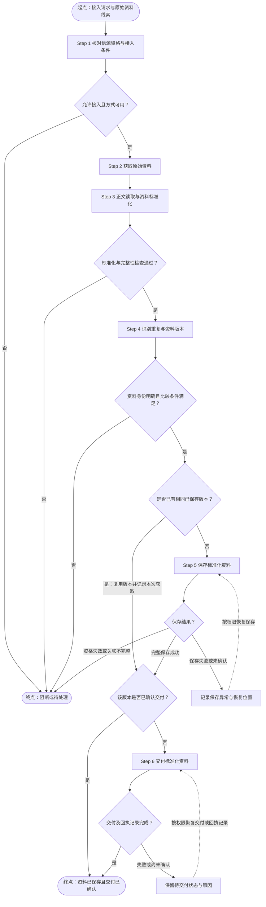

# RiskHot 流水线节点视觉与编号规范 V1.0

> **文档状态：建议稿。** 本文基于 RiskHot 已有 M3 流水线全景与 UI 规范整理，供产品评审及后续原型调整。本文作为原型调整依据；具体实施范围以验证记录为准，不表示全系统已完成同步。

## 1. 设计目标

统一 RiskHot 业务层、功能模块、业务步骤、条件路径的视觉与编号方式，使用户能够准确识别：

1. 流程从哪里开始，输入是什么；
2. 哪些节点需要实际执行业务动作；
3. 哪些节点负责条件判断，判断后进入哪条路径；
4. 哪些内容只是路径分组，不形成额外业务步骤；
5. 流程在哪里结束、暂停或移交；
6. 不同业务层及模块之间的引用关系。

### 1.1 核心原则

| 编号 | 原则 | 约束 |
| --- | --- | --- |
| P-01 | 起点、终点独立标识 | 起点和终点不占用 `Step` 编号 |
| P-02 | 业务动作才参与步骤编号 | 处理、采集、分析、校验、保存和实际条件判定属于步骤 |
| P-03 | 分支容器不占步骤编号 | 分支容器用于组织路径，真实的判定动作单独编号 |
| P-04 | 保留分支层级 | 条件/并行路径使用 A/B/C，连续子步骤使用 `.1`、`.2` |
| P-05 | 按业务层编号 | L0、L1、L2、L3 分别从 `Step 1` 开始 |
| P-06 | 明确编号作用域 | F01/F02按模块独立从Step 1计数，其他模块保留既有层内序列；跨模块定位携带模块编号 |
| P-07 | 横向治理独立 | M1、M2、M3 作为横向支撑单独展示 |
| P-08 | 编号仅用于显示 | 内部业务节点身份、依赖和引用使用稳定节点 ID |
| P-09 | 视觉编码有明确语义 | 结构类型与执行角色两套维度分别表达 |
| P-10 | 尊重业务流程拓扑 | 分流、并行、汇合、独立触发及条件出口按真实流向绘制 |
| P-11 | 业务层高于功能模块 | L0～L3 是一级业务层容器，F01～F08 为内部模块卡片 |
| P-12 | 横向治理不是后续阶段 | M1/M2/M3 作为跨层支撑独立展示，业务引用按真实依赖连接 |

## 2. 节点结构类型与视觉规范

| 结构类型 | 推荐标题写法 | 视觉表现 | 基础配色 | 是否占用 Step |
| --- | --- | --- | --- | --- |
| 流程起点（START） | `起点 · 外部资料 / 统计指标` | 浅绿色圆角卡片、播放/起点图标 | 背景 `#EDF4EC`，文字 `#285B42` | 否 |
| 业务步骤（STEP） | `Step 2 · 采集、补录与版本保存` | 常规圆角卡片、动作标题、输入输出摘要 | 按执行角色着色 | 是 |
| 条件判断（DECISION） | `Step 3 · 按输入类型分流` | 蓝灰色圆角卡片、判断图标、明确条件 | 背景 `#EDF0F4`，文字 `#526078` | 是 |
| 分支容器（BRANCH） | `路径 A · 资讯类` | 白底、虚线边框、路径名称及分支内容 | 背景 `#FFFFFF`，边框 `#CAD7C8` | 否 |
| 流程终点/出口（END） | `结束 · 无具体风险`、`待处理出口 · 接入条件未满足` | 中性卡片或按语义着色的结果卡片 | 中性 `#F7F8F5`；待处理 `#FCF4E4` | 否 |

**重要约束：**

- `START` 和 `END` 在流程图中代表边界及结果；在特定业务流程中，如果一个节点同时执行了明确的处理动作，应将该处理拆分为独立业务步骤。
- `DECISION` 是一种需要执行业务判断的步骤，因此参与编号。
- `BRANCH` 是展示容器，内部可以包含一个或多个真实业务节点；容器自身不增加步骤数量。
- 终点可以有多种业务结果，如正常完成、无具体风险、待复核、暂不纳管、接入条件不满足。不得将这些结果统一表现为成功。

## 3. 执行角色与步骤配色

节点结构与执行角色是两个独立维度。所有实际处理步骤都遵循相同的编号规则，同时根据执行角色区分视觉色彩。

| 执行角色 | 推荐色彩 | 语义 |
| --- | --- | --- |
| 程序处理（PROGRAM） | 背景 `#E8F0F7`，文字 `#365F7C` | 确定性处理、校验、保存、计算 |
| AI 分析（AI） | 背景 `#EEE8FF`，文字 `#624392` | 需要调用 AI 的分析任务 |
| 人工处理（HUMAN） | 背景 `#FFF0D9`，文字 `#805B22` | 人工复核、处理及授权动作 |
| 条件判断（CONDITION） | 背景 `#EDF0F4`，文字 `#526078` | 依据业务条件确定后继流向 |

示例：

- `Step 5 · 提取事件要素`：若由 AI 执行，使用 AI 浅紫色。
- `Step 6 · 校验事件结构`：若由程序执行，使用程序浅蓝色。
- `Step 7 · 判断是否存在有效增量`：使用条件蓝灰色。

所有角色均需同时提供可读的文字标识，不能单凭背景颜色区分。

## 4. 编号规则

### 4.1 基本规则

| 情况 | 显示编号 | 示例 |
| --- | --- | --- |
| 流程起点 | 无 Step 编号 | `起点 · 外部资料 / 统计指标` |
| 主线业务步骤 | `Step N` | `Step 1 · 核对信源资格与接入条件` |
| 条件判断步骤 | `Step N` | `Step 3 · 按输入类型分流` |
| 条件分支路径 | A、B、C | `路径 A · 资讯类` |
| 分支中实际处理节点 | `Step NA.1` | `Step 3B.1 · 核对资料完整性` |
| 同一路径后续节点 | `Step NA.2` | `Step 3B.2 · 保存校验结果` |
| 分支汇合后的主线步骤 | 下一主线编号 | `Step 4 · 整理处理结果` |
| 结束、暂停、待处理出口 | 无 Step 编号 | `待处理出口 · 保留原因` |

`N` 表示当前业务层中的主线序号，`A/B/C` 表示路径标识，`.1/.2` 表示同一路径下业务节点的阅读顺序。

### 4.2 分支规则

1. **必须有明确的分支依据。** 例如根据输入类型、准入条件、事件有效性等选择路径。
2. **判断步骤参与编号。** 如 `Step 3 · 按输入类型分流`。
3. **承载路径的容器不再编号为 Step 4。** 使用 `路径 A`、`路径 B` 标记。
4. **分支内实际动作使用分支子编号。** 如 `Step 3B.1`、`Step 3B.2`。
5. **纯交接节点只标明目标流程。** 如“进入 F02 事件管理”，不为描述性的跳转单独制造步骤。
6. **分支可独立结束、跨模块交付或重新汇合。** 仅在确实存在汇合关系时才绘制汇合点。
7. **并行路径沿用 A/B/C 标识。** 需要注明“并行”，并明确哪些下游步骤依赖全部并行结果。

单一侧分支在所属业务步骤未展开连续子步骤时，可采用 `Step N.1`、`Step N.2`。若业务步骤本身已按下述规则展开，侧分支须使用 `Step NA.1` 等分支编号，避免与主线子步骤重号；分支触发条件由连线文字说明。

**复合业务步骤（2026-10-23）**：功能文档的一个 Step 若由程序与 AI 共同完成，保留 `Step N · 业务名称` 作为分组标题，内部真实执行动作按 `Step N.1、N.2…` 编号并使用各自执行角色。分组标题不是可执行节点，不重复计入动作数。F02 Step 1～4 各展开3项动作，Step 5 展开6项，Step 6～7各1项；无事件侧分支使用 `Step 1A.1`。F02仍为七个业务步骤、21个实际动作。各动作的输入准备、AI分析、程序校验与交接分别可点击，原有固定AI任务身份不变。

### 4.3 业务层与模块的作用域

| 作用域 | 编号方式 |
| --- | --- |
| L0 信息处理层 | 从 `Step 1` 开始 |
| L1 风险识别与纳管层 | 从 `Step 1` 开始 |
| L2 风险态势分析层 | 从 `Step 1` 开始 |
| L3 风险产品与发布层 | 从 `Step 1` 开始 |
| F01～F08 模块 | F01/F02各自从Step 1计数，其他模块保留既有层内编号；显示模块自身Step范围 |
| M1/M2/M3 横向治理 | 以独立模块身份显示；若内部展开流程，可采用独立局部编号 |

跨层引用必须带有业务层限定，例如 `L0 · Step 3B.1`，避免不同层级出现同号步骤时产生混淆。

### 4.4 编号稳定性与变更处理

- `Step` 是展示顺序标识；稳定节点 ID 应保持独立。
- 新增、移除或重新组织展示步骤时，允许相应 Step 编号重新计算。
- 历史规则、已保存策略版本、任务引用、审计记录应继续使用各自稳定标识，避免因为视觉重排而产生业务身份变化。
- 阶段和模块的“Step 范围”应按可显示的真实业务步骤计算，不将起点、终点及纯分支容器计入。
- 对无法用简单线性顺序表达的并行流程，应优先展示依赖和路径条件，Step 编号仅辅助定位。

## 5. F01 信息接入与标准化模块流程示例

### 5.1 现行文案

以[[tools/RiskHot/docs/system-design/03-系统功能架构/F01 信息接入与标准化模块功能设计 V2.1|F01 六步功能设计]]为业务依据，模块内采用六步主线。该示例替代旧输入类型分支。

| UI位置 | 标题 |
|---|---|
| 起点 | 起点 · 接入请求与原始资料线索 |
| Step 1 | 核对信源资格与接入条件 |
| Step 2 | 获取原始资料 |
| Step 3 | 正文读取与资料标准化 |
| Step 4 | 识别重复与资料版本 |
| Step 5 | 保存标准化资料 |
| Step 6 | 交付标准化资料 |
| 完成出口 | 结束 · 资料已保存且交付已确认 |
| 待处理/恢复出口 | 阻断或待处理、保存待恢复、交付待恢复 |

### 5.2 Mermaid 流程示例



### 5.3 原型表达

六个实际处理步骤保留Step编号；步骤内条件检查合并在对应动作中，不另增Step。判断型节点使用既有条件色与图标；起点、完成及待处理出口保持独立视觉。主线纵向排列，条件分支横向展开，恢复路径以虚线箭头回连原步骤，具体遵循6.3。保存与交付回执作为各自步骤的完成条件。

F01主线在左侧，条件出口在对应步骤右侧。Step 1～3的异常分别从各自节点引出；Step 4将新增/修订/未完整保存送往Step 5，将已保存待交付直接连接Step 6，将已交付直接连接完成出口，身份或比较条件不明确直接连接待处理。Step 5分别显示继续交付、并发同版已完成、资格/关联待处理和保存待恢复；Step 6显示完成与交付待恢复。保存待恢复回连Step 5，交付待恢复回连Step 6。共享待处理节点首次在Step 1侧方呈现，其余异常连线直接汇入该节点，不在底部串接异常节点。跨模块交付保留“进入F02”入口。

## 6. UI 组件级规范

| 属性 | 建议值或要求 |
| --- | --- |
| 普通节点圆角 | 8px |
| 起点/终点圆角 | 可采用 12px 或胶囊形，增强边界辨识度 |
| 节点内边距 | 12px |
| 标题 | 14px / 600 |
| Step 编号 | 12px / 600 |
| 说明文字 | 12～13px；信息量大时须保持可读性 |
| 主线节点间距 | 12～16px |
| 默认边框 | 1px 细边框 |
| 选中态 | 2px `#295C47` 轮廓，同时保留文字可读性 |
| 分支容器 | 白色背景、1px 虚线边框、12px 圆角 |
| 流程连接 | 实线箭头；分支线上标注明确条件 |
| 画布底色 | 沿用统一 UI 规范 `#F5F5EF` |
| 普通正文 | `#22352E` |
| 次要文字 | `#58675E` |
| 手机适配 | 保留主线与侧向分支关系，文字换行；复杂画布局部横向滚动，触控目标至少 44px |
| 可访问性 | 色彩配文字或图标；聚焦态可见；不得只靠颜色表达状态 |

### 6.1 命名规则

- 起点：`起点 · 输入来源或触发条件`
- 业务步骤：`Step N · 动词 + 业务对象`
- 条件判断：`Step N · 判断/核对/校验 + 条件或对象`
- 分支路径：`路径 A/B/C · 分支语义`
- 分支子步骤：`Step NA.1 · 动词 + 业务对象`
- 终点/出口：`结束/待处理出口 · 业务结果`

### 6.2 连接线语义

- 顺序执行：普通实线箭头。
- 条件分流：从判断步骤出线，并标注满足/不满足等具体条件。
- 并行执行：明确标记并行路径，按必要依赖汇合。
- 跨模块交接：显示目标模块或业务层，如 `交付 F02`、`交付 L2`。
- 独立触发：明确写出请求、查询或其他触发来源，避免误读成主流程必经动作。
- 待处理/异常出口：从对应判断或处理节点直接连出，保留业务原因及结果。

### 6.3 主线、分支与恢复路径布局

1. **主流程纵向，条件分支横向。** 连续处理步骤沿主干向下排列；每条条件出口从所属节点侧边引出，带方向箭头和完整条件文字。不得仅将出口链接堆叠在节点下方，或把异常结果放在主线末尾造成串行误读。
2. **侧向路径是分流，不等于并行。** 同一判断下的多个条件在侧方分组展示；分组内部可分行，但每项均从共同分支干线引出，不在分支结果之间画顺序箭头。只有业务确实并行时才标注“并行”。
3. **同模块共享目标直接连线。** 完成、待处理或后续步骤被多条路径引用时，只保留一个带完整详情的实体节点，每条条件路径的箭头直接到达该节点边缘，不使用“转至”卡片、虚拟节点或仅靠点击定位替代连线。相同目标可共用汇入线段，不同目标的跨步连线使用可区分的侧边通道；条件文字保留在对应出线处，可点击辅助定位，但不作为连线终点。跨模块交付保留“进入目标模块”的入口与定位操作，避免跨越整个页面拉线。
4. **恢复路径明确回连。** 保存、交付等失败结果紧邻发生步骤的侧向分支；用带箭头的虚线回到对应恢复步骤，并标明恢复条件或动作。不得只写“重试”却不标目标，也不得把恢复画成正常主线的下一步；存在权限/资格约束时仍以节点详情为准，点击仅用于阅读定位。
5. **编号不因摆放改变。** 已有主线步骤被跳过、复用或回连时继续使用原Step编号；只有分支中新增的实际业务动作才使用4.2规定的子编号。连接条件及跨模块交付入口不占Step。
6. **窄屏保留拓扑。** 主线与侧向分支维持两列，条件和名称可换行，不截断关键语义、不缩小到不可读字号。复杂图无法合理容纳时，仅画布局部滚动并提供说明，页面整体不得横向溢出；不可将互斥分支摊平成单列连续步骤。
7. **连线与交互同步。** 实线表示顺序/条件流向，虚线表示恢复回路；同模块箭头终点落在真实节点，跨模块箭头落在交付入口。节点、每条业务关系只呈现一次，线条不得穿过正文或按钮标题。条件标签、跨模块交付和恢复入口支持键盘，触控目标至少44px；折叠、窗口缩放和文字换行后连线仍准确。

验收时应同时确认桌面与手机的左右分流、主线顺序、共享目标直接汇入、恢复箭头方向和无溢出，不以“链接可点击”替代分支拓扑检查。此规则为全系统通用规范，已应用于F01与F02，其他模块按后续任务逐项同步。

### 6.4 F02七步应用

F02主线独立从Step 1计数至Step 7，与功能设计第1～7步逐项对应。0候选的“记录无事件结果及资料引用”是实际程序动作，位于抽取节点侧方，采用Step 1.1；不增加主线第8步。重复、无待交付变化与异常分别直连完成或待处理；统一保存、交付失败以虚线回到对应阶段。跨模块F03/F05保留阅读入口，不将无事件或纯重复自动交给风险识别。

## 7. 业务层级（L0～L3 / M）视觉与编号规范

本章补充**业务层级**的视觉结构，与第 2～6 章中的功能模块、步骤和分支规范共同构成全景设计体系。本章所列样式和交互为拟议调整；现有 RiskHot 原型仍以项目中的实现与交互契约为准。

### 7.1 四级信息层次

| 层次 | 业务对象 | 定位 | 页面表达 | 编号 |
| --- | --- | --- | --- | --- |
| 一级：业务层 | L0、L1、L2、L3 | 表达业务阶段、职责与交付边界 | 带标题区的一级容器 | 沿用 `L0～L3` |
| 二级：功能模块 | F01～F08 | 表达模块能力及具体责任 | 业务层容器内的模块卡片 | 沿用 `F01～F08` |
| 三级：业务步骤 | 处理/分析/判断节点 | 表达实际业务动作 | 模块展开后的节点卡片 | `Step N`，分支内 `Step NA.1` |
| 四级：条件路径 | A/B/C 路径及汇合 | 表达分流、并行或例外路径 | 步骤下的分支容器和有标注的连线 | `路径 A/B/C`，不占用 Step |

**M1/M2/M3 属于横向治理维度。** 在业务全景中以独立的横向支撑区域展示，与 L0～L3 存在资格、定义、方法和反馈依赖；不充当 L3 之后的第五个串行处理阶段。

层级关系采用统一的阅读定位：

`L0 / F01 / Step 1`

- `L0` 指定业务层；
- `F01` 指定功能模块；
- `Step 1` 指定该业务层的显示步骤；
- 跨层链接在显示编号之外，继续持有稳定节点 ID。

业务层和模块均**不再额外增加 `Stage 1`、`Module 1` 一类重复编号**；业务层代码和模块代码直接作为结构身份。

### 7.2 层级名称、职责与模块归属

| 业务层 | 层级标题 | 所属模块 | 主要职责与交付 |
| --- | --- | --- | --- |
| L0 | 信息接入与事件管理 | F01 信息接入与标准化模块；F02 事件管理 | 接入并交付标准化资料，形成事件及其更新 |
| L1 | 风险识别与纳管 | F03 风险识别；F04 风险纳管与跟踪 | 形成风险候选，确定正式风险身份及有效长期关系 |
| L2 | 风险态势分析 | F05 风险状态分析；F06 风险演化分析 | 形成 `RiskSnapshot` 及可比历史变化结果 |
| L3 | 风险产品与发布 | F07 风险展示与检索；F08 风险报告与发布 | 按授权阅读需求或报告请求组织查询与报告产品 |
| M | 横向治理与维护反馈 | M1 信源管理；M2 风险源管理；M3 策略管理 | 提供信源资格、观察定义、指标映射与分析方法版本，并接收维护反馈 |

> **层与层的上下排列表示产品信息架构与主要业务依赖。** L0～L3 的编号有业务组织含义，但不保证每个层级及模块都必须按排列顺序运行一次。系统还存在数据直达、按需查询、独立报告请求、并行分析和后续治理反馈。

### 7.3 层级视觉组件

层级采用“外层承载容器 + 内部模块卡片”的布局。业务层标题应成为一级视觉锚点，F 模块作为所属业务层的二级卡片，Step 节点仅在展开模块后展示。

| 组件 | 推荐视觉 | 样式参数 | 行为 |
| --- | --- | --- | --- |
| 顶部层级导航 | 当前项深绿底白字；其他项浅色文字 | 12～13px；主色 `#295C47` | 定位/同步当前阅读层，不重新加载流水线 |
| L 业务层容器 | 白底、中性细边框、大圆角 | 圆角 12px；边框 1px `#DFE5DF` | 包裹该层所有 F 模块 |
| 层级标题区 | 淡灰绿底、层代码 + 名称 + 箭头 | 建议高 56～64px；标题 16px / 600 | 展开或折叠该层 |
| 层级简介 | 单行说明，必要时换行 | 12～13px；文字 `#58675E` | 概述本层业务目标 |
| F 功能模块收起卡 | 内层浅灰工作面、单行标题 | 保留现有 48px 收起高度；圆角 8px | 单独展开所属模块 |
| Step 节点卡 | 按程序/AI/人工/条件语义色 | 沿用第 2～6 章 | 展示节点与执行详情 |
| 层间业务交付 | 箭头配简短条件/交付文案 | 连接线用中性绿色；文案 12px | 指明有效的层间流向 |
| M 横向治理区 | 中性底、虚线外边框、独立标题 | 圆角 12px；边框 `#A6B6A9` | 表达跨层能力引用和反馈 |
| 当前选中层 | 轻微背景差异和绿色细轮廓 | `#295C47` | 同步顶部导航与当前位置 |

推荐沿用 RiskHot M1/M2/M3 统一 UI 规范中的字体、暖灰背景、白色工作面与 8/12px 圆角体系。角色配色仍按第 3 章执行，不使用更多装饰性颜色区分各 L 业务层。

**视觉层次顺序：** 业务层标题 → F 模块名称 → Step 业务动作 → 分支路径说明。业务层标题 16px 属于本规范的建议改造值，实施后需同步项目 M3 UI 规范；当前原型的 12px 层级标签不能作为新视觉层次的上限。

### 7.4 层级页面示意

下列示意用于定义**页面容器与模块归属**，模块在同一层内的上下排列仅供浏览，具体交接关系见第 7.5 节。

```text
[顶部导航]  L0 信息处理  |  L1 风险识别  |  L2 态势分析  |  L3 产品发布  |  M 横向治理

┌─ L0 · 信息接入与事件管理 ──────────────────────────────────┐
│  接入并交付标准化资料，形成事件及其更新                    │
│  [F01 · 信息接入与标准化模块                 ›]           │
│  [F02 · 事件管理                             ›]           │
└───────────────────────────────────────────────────────────┘
                ↓ 有效事件 / 实质更新（符合条件时）
┌─ L1 · 风险识别与纳管 ──────────────────────────────────────┐
│  [F03 · 风险识别                             ›]           │
│  [F04 · 风险纳管与跟踪                       ›]           │
└───────────────────────────────────────────────────────────┘
                ↓ 正式风险身份及有效观察关系
┌─ L2 · 风险态势分析 ────────────────────────────────────────┐
│  [F05 · 风险状态分析                         ›]           │
│  [F06 · 风险演化分析                         ›]           │
└───────────────────────────────────────────────────────────┘
                ↓ 已保存结果供按需查询 / 报告引用
┌─ L3 · 风险产品与发布 ──────────────────────────────────────┐
│  [F07 · 风险展示与检索                       ›]           │
│  [F08 · 风险报告与发布                       ›]           │
└───────────────────────────────────────────────────────────┘

┌─ M · 横向治理与维护反馈 ─────────────────────────────┄┄┄─┐
│  [M1 信源管理]   [M2 风险源管理]   [M3 策略管理]          │
│  独立治理；向多个业务层提供资格、定义和方法并接收反馈      │
└───────────────────────────────────────────────────────────┘
```

**特别提示：** 上图的纵向主线用于说明主要阅读结构，属于抽象视图。业务运行时，F02资料处理结果可按条件供L1识别或L2引用；L3 查询与报告分别按需触发；M1/M2/M3 的横向依赖应在实际业务连接图或选中详情中展示。

### 7.5 跨层交付与非串行路径

| 来源 | 目标 | 连接语义 | UI 表达要求 |
| --- | --- | --- | --- |
| F01 → F02 | L0 层内交接 | 完整保存并确认交付的标准化资料 | 可定位F02资料接收环节 |
| F02 → F03 | L0 → L1 | 可触发风险识别的实质性事件变化 | 标注 `满足触发条件` |
| F02 → F05 | L0 → L2 | 已有正式风险可引用的事实与进展 | 建议使用引用/虚线，明确不是每条事件必然触发 |
| F03 → F04 | L1 层内交接 | 风险候选进入身份匹配、准入与关系维护 | 在模块详情中展示实际条件与待复核出口 |
| F04 → F05 | L1 → L2 | 有效风险身份、关系与观察定义供状态分析 | 标注 `已确认关系/观察定义` |
| F05 → F06 | L2 层内交接 | 当前快照进入历史可比性及变化分析 | 标注 `当前快照`；首次/不可比出口保留 |
| F05/F06 → F07 | L2 → L3 | 已保存结果按查询需求被读取 | 标注 `按需查询/引用` |
| F05/F06 → F08 | L2 → L3 | 已保存的状态和变化结果供报告请求使用 | 标注 `报告请求/引用` |
| M1/M2/M3 → 业务模块 | 横向依赖 | 来源资格、观察定义、方法版本 | 使用支撑/依赖连线，不纳入主线编号 |
| 业务模块 → M2/M3 等 | 治理反馈 | 维护建议、定义修订或方法反馈 | 使用反馈连线，保留触发条件与审批边界 |

**禁止的误读与展示：**

1. 不用连续无条件箭头暗示 `F01 → F02 → … → F08` 在每次运行中全部必经。
2. 不在F01标准化资料流程中增加未经定义的跨层交付。
3. 不让 `F07 → F08` 的视觉位置表达查询必定先于报告；二者可基于已保存业务结果按不同需求触发。
4. 不把 M 横向治理绘制成 L3 之后的第五个执行阶段。
5. 不将跨层依赖箭头解释为新的任务调度规则。连线只能表达已确认的交付、引用或条件关系。

### 7.6 业务层展开、折叠与定位规则

| 操作/状态 | 推荐行为 |
| --- | --- |
| 首次进入桌面全景 | L0～L3 层级容器展开，F01～F08 模块默认收起；M 区保持独立 |
| 点击顶部 `L0～L3` | 滚动到目标业务层，激活当前导航项；不改变流程数据 |
| 手动滚动页面 | 根据可见层级同步顶部导航当前项 |
| 点击层级标题 | 仅收起/展开本层的模块列表 |
| 点击 F 模块标题 | 展开/收起本模块的步骤与条件分支 |
| 点击 Step | 选中节点，并在右侧展示详情 |
| 点击跨层交付引用 | 定位目标业务层和模块；如目标被折叠，则自动展开并选中对应节点 |
| 从右侧详情跳至其他节点 | 保留上下文和稳定节点定位；避免将视觉重编号用于业务关系查询 |
| 移动端 | 层级采用可折叠列表，模块仍可独立展开；节点与详情纵向布局 |
| 无法确认交付条件 | 以“待确认/按条件”明确标识，不能擅自绘制无条件实线 |

现有项目中 F 模块默认收起、48px 卡头、桌面 6:4、移动端节点与详情互相定位等行为应继续保留。建议新增的**层级容器可折叠**功能需在原型实现前补齐状态管理与焦点/键盘交互。

### 7.7 层级组件与响应式参数

| 参数 | 建议值 | 说明 |
| --- | --- | --- |
| L 业务层容器圆角 | 12px | 与统一工作面圆角一致 |
| L 业务层标题区高度 | 56～64px | 保证一级标题和展开控件清晰 |
| L 业务层标题字号 | 16px / 600 | 优于 F 模块的 14px |
| L 业务层说明字号 | 12～13px | 简洁描述职责，内容溢出时换行 |
| F 模块收起高度 | 48px | 保留既有原型紧凑卡头 |
| F 模块标题字号 | 14px / 600 | 低于业务层标题 |
| Step 节点标题字号 | 13～14px | 与现有节点规则兼容 |
| 层级容器外间距 | 20～24px | 为业务层提供清晰分隔 |
| 层间连接说明 | 12px | 只写实际交付条件，避免重复大段说明 |
| 导航当前色 | `#295C47` | 同 RiskHot 主色 |
| 工作面背景 | `#FFFFFF` | 统一浅色主题 |
| 业务层边框 | `1px #DFE5DF` | 使用中性边界 |
| M 横向治理边框 | `1px dashed #A6B6A9` | 区别主业务层 |
| 手机触控目标 | 至少 44px | 层标题、模块标题、导航按钮均符合要求 |
| 桌面布局 | 保留左流程约 60% / 右详情约 40% | 不改变右侧节点详情定位职责 |

避免在容器上重复叠加深色背景、粗边框和阴影；业务层主要通过标题字级、外部边界和留白增强结构感。

### 7.8 当前截图的改造对照

| 当前界面表现 | 建议改造 | 预期效果 |
| --- | --- | --- |
| L0～L3 只显示小号行标题 | 改为带明显标题区的一级业务层容器 | 业务层成为全景主视觉层次 |
| F01～F08 卡片独立纵向排列 | 按归属放入 L0～L3 对应容器 | 清楚表达 `L → F` 关系 |
| 层间只有连续箭头 | 在确有业务依赖时显示交付条件/引用说明 | 减少全部串行的误读 |
| F02→L2事实引用路径 | 在实际节点提供准确跨层定位 | 保留已有正式风险对事实与进展的引用 |
| F07/F08 视觉上并列连续 | 使用按需查询和报告请求的不同触发语义 | 体现业务触发的独立性 |
| M 横向治理被误读为流程后续阶段 | 独立横向支撑区、虚线语义 | 提示这是贯穿各业务层的治理关系 |
| 展开后 Step 层次不够清晰 | 应用既有程序/AI/人工/条件角色配色及步骤编号 | 保证三级节点易于阅读 |

本改造只调整**阅读层级、容器归属、导航表达和连接注释**。F01～F08 的稳定编码与业务归属保持不变；真实节点身份、条件分支、上下游关系、AI Task 版本及权限边界均应继续保持。

## 8. 实现与验收要求

### 8.1 实现边界

本规范面向产品原型和可视化阅读体验。实施时优先调整：

1. 流程卡片标题、起点与终点标识；
2. 步骤编号生成算法；
3. 分支容器标题及子步骤编号；
4. 不同节点类型的配色与图标；
5. 跨层导航及“Step 范围”的计算；
6. L0～L3 一级容器及 M 横向支撑区的视觉层次；
7. 层间交付条件、独立触发和直达路径的展示。

保留既有业务节点 ID、输入输出契约、条件规则、真实连接关系、AI Task 固定版本及权限控制。

### 8.2 验收清单

- [ ] 起点和纯结束节点无 Step 编号。
- [ ] 每一个 Step 对应一个实际业务处理或判断动作。
- [ ] 每个条件分支都有明确分支依据和路径名称。
- [ ] 分支容器不额外占用 Step。
- [ ] 分支子步骤编号遵循 A/B/C + `.1/.2`。
- [ ] L0～L3 重新独立编号；模块间延续所在层序列。
- [ ] M1/M2/M3 横向治理与主流程清晰分离。
- [ ] 跨层引用包含层级限定或稳定节点定位。
- [ ] 程序、AI、人工、条件节点颜色与文字标签一致。
- [ ] 所有条件出口、独立触发、并行和汇合关系保留。
- [ ] 手机端无横向溢出，点击节点可到达对应详情。
- [ ] 重编号后稳定节点 ID、规则及历史引用没有改变。
- [ ] L0～L3 的一级容器明确包裹所属 F 模块；业务层标题高于模块标题。
- [ ] 顶部业务层导航可定位并同步当前阅读层，未改变业务数据与执行规则。
- [ ] F 模块保持默认收起及 48px 卡头，跨模块定位可自动展开。
- [ ] F01仅交付标准化资料，F02→L2既有事实引用路径保持。
- [ ] L3 的查询与报告按其真实触发条件展示。
- [ ] M1/M2/M3 显示为横向治理支撑，不排在主流程后作为串行执行阶段。
- [ ] 各层折叠、展开、键盘操作及移动端导航经过交互验证。

## 9. RiskHot 项目依据

本建议参考以下项目文件，实施前建议以最新版本复核：

1. `docs/system-design/06产品UI原型设计/06-4-M3策略管理中心UI设计/EXPERIENCE.md`：分层浏览、各层独立编号、A/B/C 与 `.1/.2` 的既有规定。
2. `docs/system-design/06产品UI原型设计/06-4-M3策略管理中心UI设计/DESIGN.md`：M3 节点配色、排版与组件规范。
3. `docs/system-design/06产品UI原型设计/DESIGN.md`：统一 UI 色彩、响应式与可访问性原则。
4. `docs/system-design/06产品UI原型设计/06-4-M3策略管理中心UI设计/原型资源/system-panorama.js`：F01 接入与输入分流在全景中的现行组织方式。
5. `docs/system-design/03-系统功能架构/系统功能架构总览.md`：F01～F08 业务模块的关系和处理边界。
6. `docs/system-design/06产品UI原型设计/06-4-M3策略管理中心UI设计/验证/模块卡头精简记录.md`：模块卡片 48px 收起高度、折叠与跨模块导航的既有验证依据。

---

**适用说明：** 本文用于统一 RiskHot 的业务层级、功能模块、步骤节点、条件路径及横向治理视觉表达。正式采纳时应先核对各层的真实业务依赖及节点类型，再以不改变业务逻辑为约束实施 UI 与编号重构。
