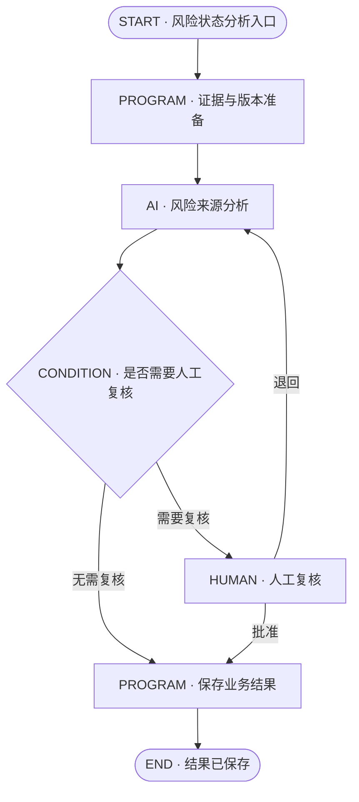

# RiskHot 六类节点详情 UI 设计规范 V1.0

> **文档定位：** 本文定义“点击流水线节点后，如何展示该节点内部业务逻辑”的产品界面规范，配套现有《RiskHot 流水线节点视觉与编号规范 V1.0》（画布、层级和编号）。现行原型中的业务节点 ID、规则、实际连线、权限及已锁定版本仍为业务事实来源。本文为 UI 设计建议稿；F01/F02已按本规范完成本地原型重构，范围见第10～11章，不表示全系统同步或产品评审完成。
>
> **当前版本提示：** 截图里曾显示为 `Step 2` 的“核对信源资格与接入条件”，按 2026-10-22 的 F01 V2.1 六步方案，在最新系统全景中为 **`L0 / F01 / Step 1`**。该变化属于全景展示层编号更新；C01 已保存策略仍按其现行契约展示。

## 1. 设计目标与适用边界

### 1.1 目标

用户选中一个节点后，应当在 5 秒内理解以下信息：

1. **是什么：** 业务步骤名称、节点类型与职责。
2. **从哪里来：** 触发条件或必要输入。
3. **做什么：** 程序处理、AI 分析、人工操作或条件判断的核心逻辑。
4. **形成什么：** 该节点的业务输出及其语义。
5. **往哪里去：** 明确的后继节点、分支条件、完成或待处理出口。
6. **凭什么：** 规则引用、文档依据、任务版本和未决事项。

### 1.2 两个 UI 层次

| 层次 | 作用 | 建议内容 | 约束 |
| --- | --- | --- | --- |
| 左侧流程画布 | 看全局结构与前后关系 | Step 编号、名称、角色色、条件出口、真实连接线 | 不在节点卡片中重复完整业务规则 |
| 右侧节点详情 | 看当前步骤的内部业务逻辑 | 摘要、输入、动作或判断、输出、后继、依据、配置 | 不把每个内部检查都自动拆为新的流水线节点 |

**设计边界：** 右侧的“业务逻辑卡”承担阅读与解释；真实的路由关系来自已配置的 `next` 连接。内部流程示意不能生成一套与策略图分离的业务逻辑。

### 1.3 节点与展示编号

- `START`、纯 `END` 不占 `Step` 编号。
- `PROGRAM`、`AI`、`HUMAN`、实际执行判断的 `CONDITION` 属于可编号步骤。
- 分支路径为 `路径 A/B/C`；分支内真实动作可显示 `Step NA.1`、`Step NA.2`。
- `Step` 是展示编号；稳定业务节点 ID 负责链接、存储、审计、版本关联。
- 全景跨模块或跨层定位显示层级上下文，例如 `L0 / F01 / Step 1`。
- C01 策略编辑视图保留原有版本图与节点标识，后续是否统一新展示编号需另行实施验证。

---

## 2. 通用节点详情结构

### 2.1 非 AI 节点推荐骨架

```text
┌───────────────────────────────────────────────────┐
│ [角色图标]  Step N · 节点名称             [节点类型]│
│             一句话业务说明                         │
├───────────────────────────────────────────────────┤
│ 输入 / 触发                                        │
│ 重要业务输入的可读摘要                             │
│                         ↓                         │
│ 核心业务逻辑                                      │
│  · PROGRAM：处理动作                             │
│  · CONDITION：判断条件                            │
│  · HUMAN：人工处理项                             │
│  · START：触发与上下文建立                        │
│  · END：终态与交付结果                            │
│                         ↓                         │
│ 产出 / 结果                                        │
│ 结构化结果的业务含义                               │
│                                                   │
│ 后继与处理出口                                    │
│ [条件标签] → [目标节点名称]（可点击定位）            │
├───────────────────────────────────────────────────┤
│ ▸ 规则与依据          默认可收起                   │
│ ▸ 节点配置            按权限/版本可读或可编辑        │
└───────────────────────────────────────────────────┘
```

推荐的详情信息层次：

| 区域 | 默认态 | 内容要求 |
| --- | --- | --- |
| 标题与摘要 | 展开 | 唯一标题、类型标签、1～2 行业务目标 |
| 核心业务逻辑 | 展开 | 按节点类型变化的内容组件；最多突出一组主要逻辑 |
| 输出与后继 | 展开 | 全部真实后继，条件与目标名称须成对展示 |
| 规则与文档依据 | 可折叠 | 规则引用、来源文件与章节、详细说明 |
| 节点配置 | 默认收起 | 输入输出映射、后继配置与权限允许的编辑入口 |
| 待确认 / 配置错误 | 直接可见 | 优先于折叠区，避免遮蔽阻断性问题 |

非 AI 节点可以将“输入、处理、输出、后继”设计成一组轻量纵向区块，尽量避免每行套一张带阴影的卡片。节点详情在信息量大时使用独立滚动。

### 2.2 AI 节点兼容现行五标签

AI 节点沿用 M3/C02 共享的固定任务版本及五标签，结构为：

```text
[Step N · AI 节点名] [AI]
[业务摘要]
[AI Task ID @固定版本] [只读引用]

[任务定义] [Prompt / Skill] [输入输出] [工具与约束] [引用与版本]
                    ↓
             当前标签的内容

▸ 节点配置与流向（默认收起）
```

- AI 任务的输入输出说明集中在 **“输入输出”** 标签。
- 上下游映射、`requiresAll` 汇合关系、后继、规则引用与草稿编辑集中在 **“节点配置与流向”**。
- 避免在标签上方重复完整输入输出字段和任务定义。
- C02 中的 Prompt / Skill / Schema 属于任务资产；策略节点只读引用固定版本。
- 如果固定任务版本缺失，显示明确的版本缺失提示，禁止自动使用其他版本替代。

### 2.3 通用内容写法

| 元素 | 推荐语法 | 示例 |
| --- | --- | --- |
| 标题 | `Step N · 动词 + 业务对象` | `Step 1 · 核对信源资格与接入条件` |
| 摘要 | “依据什么，对什么进行何种处理” | `依据接入资格与允许来源，判断本次接入能否继续。` |
| 输入 | 使用业务名称，必要时附字段编码 | `风险标识 risk_id、证据快照` |
| 条件 | 可执行的、可核对的判断问题 | `来源资格及接入方式是否满足要求？` |
| 结果 | 业务含义优先 | `准入检查结果` |
| 路由 | `条件 → 目标节点` | `满足 → 获取原始资料` |
| 规则 | `业务章节 / 规则标识` | `F01 V2.1 · 接入资格检查` |

---

## 3. 六类节点的视觉和内容要求

| 类型 | 推荐图标 | 角色色 / 基底 | 默认最重要的信息 | 主要呈现形式 |
| --- | --- | --- | --- | --- |
| `START` | Play | 浅绿 `#EDF4EC` / `#285B42` | 触发条件、初始上下文 | 入口卡 |
| `PROGRAM` | Workflow / Cog | 浅蓝 `#E8F0F7` / `#365F7C` | 确定性处理动作 | 处理链 |
| `AI` | BrainCircuit | 浅紫 `#EEE8FF` / `#624392` | 固定任务、分析目标、交付约束 | 任务详情 + 五标签 |
| `CONDITION` | GitBranch | 蓝灰 `#EDF0F4` / `#526078` | 判断依据、条件分流 | 条件分支卡 |
| `HUMAN` | UserCheck | 浅橙 `#FFF0D9` / `#805B22` | 人工介入理由、可用决策 | 审核/处理卡 |
| `END` | Flag / CheckCircle / PauseCircle | 中性 `#F7F8F5`；异常按状态着色 | 业务终态、交付或中止原因 | 结果卡 |

> 图标名称表示语义方向，实现时可用现有的线性 SVG 图标。颜色表达节点职责，**不得依靠颜色单独传达类型或执行结论**。表中的色值取自当前 RiskHot M3 视觉规范；起点/终点可沿用全景规范的边界色。

### 3.1 START：开始节点

**目标：** 清楚交代流程何时被触发、携带哪些初始业务上下文。无 Step 编号。

**示例：风险状态分析入口。** 该示意沿用 M3 的风险状态分析策略，实际触发方式取决于策略与运行上下文。

```text
┌──────────────────────────────────────────────┐
│ ▶ 起点 · 风险状态分析请求            [开始]   │
│ 接收一次风险状态分析运行请求                  │
├──────────────────────────────────────────────┤
│ 触发来源                                      │
│ 已受理的分析请求 / 运行上下文                  │
│                                              │
│ 初始输入                                      │
│ · 风险标识 risk_id                            │
│ · 证据快照、观察截止时间                       │
│ · 本次引用的策略版本                          │
│                                              │
│ 产出：运行上下文                              │
│                                              │
│ → 证据与版本准备                              │
├──────────────────────────────────────────────┤
│ ▸ 来源依据                                   │
└──────────────────────────────────────────────┘
```

- 必填展示：触发语义、必要输入、第一条有效后继。
- 对未确定的调度形式、外部事件来源，只呈现已确认的业务触发信息。
- 不在 START 内提供“开始运行”按钮，除非业务页面确实具备该授权动作。
- 起点的展示顺序与标识独立于后续 Step 编号。

### 3.2 PROGRAM：程序节点

**目标：** 展示输入、确定性动作和输出。重点在业务语义与规则，不展示技术实现细节。

**示例：证据与版本准备。**

```text
┌──────────────────────────────────────────────┐
│ ⚙ Step N · 证据与版本准备            [程序]    │
│ 为本次分析准备可信的证据与版本上下文            │
├──────────────────────────────────────────────┤
│ 输入                                          │
│ 风险标识、证据快照、策略版本、观察截止时间      │
│                      ↓                       │
│ 确定性处理                                    │
│ 1. 校验风险及引用对象的有效性                  │
│ 2. 组织本次可用证据，避免重复计入              │
│ 3. 固定后续分析所需的版本上下文                │
│                      ↓                       │
│ 输出                                          │
│ 可用于后续分析的证据集合与版本信息             │
│                                              │
│ → 风险来源分析                               │
├──────────────────────────────────────────────┤
│ ▸ 规则与依据     ▸ 节点配置                   │
└──────────────────────────────────────────────┘
```

- 必填展示：输入、主要动作、产出、实际后继、规则引用。
- 处理动作建议显示 2～5 条可读的业务操作；更多动作放入规则说明。
- 成功、失败、无结果等路径按真实 `next` 展示；若无配置，不虚构默认成功出口。
- 不在阅读卡中直接展示代码、事务、服务器、组件调用和部署方案。

### 3.3 AI：AI 分析节点

**目标：** 让用户看懂该 AI 在分析什么、依据什么、产生何种结构化结果，以及固定引用哪个任务资产。

**示例：风险来源分析。**

```text
┌──────────────────────────────────────────────┐
│ ◇ Step N · 风险来源分析                [AI]   │
│ 分析风险驱动来源与其可能的作用机制              │
├──────────────────────────────────────────────┤
│ AI-L2-01 @1.0                    [只读引用]    │
│                                              │
│ [任务定义] [Prompt / Skill] [输入输出]        │
│ [工具与约束] [引用与版本]                     │
│                                              │
│ 当前：任务定义                               │
│ · 分析目标：风险来源及作用机制                │
│ · 完成标准：形成有证据约束的分析结果           │
│ · 处理边界：保留不确定性，不擅自写入正式结果   │
│                                              │
├──────────────────────────────────────────────┤
│ ▸ 节点配置与流向（默认收起）                  │
│   展开后：                                   │
│   上游输入映射 / 下游输出映射                 │
│   → 风险应对分析                             │
│   规则引用、文档依据、配置权限                │
└──────────────────────────────────────────────┘
```

- 必填展示：AI Task ID、固定版本、分析职责、五标签、与上下游的映射。
- AI 内容始终只读；策略草稿允许编辑的是其已有节点配置和引用关系，且需符合当前权限。
- 切换标签仅更新标签内容，保留未应用的节点配置表单。
- 切换至另一 AI 节点或另一策略版本，标签默认回到“任务定义”，配置区默认收起。
- 原型中尚未定稿的 Schema、字段及工具约束应继续保留待定标记。

### 3.4 CONDITION：条件节点

**目标：** 一眼看清判断问题、判断依据和全部条件出口。

**示例：是否需要人工复核。** 为 M3 策略示例的 UI 表达；复核触发条件必须由真实领域规则及已配置策略确定。

```text
┌──────────────────────────────────────────────┐
│ ◇ Step N · 是否需要人工复核？         [条件]   │
│ 根据校验与歧义信息确定后续处理路径              │
├──────────────────────────────────────────────┤
│ 判断输入                                      │
│ 结构/引用/规则校验结果、待核问题                │
│                                              │
│ 判断依据                                      │
│ · 是否存在需要人工确认的业务歧义              │
│ · 校验结果是否要求进入人工处理                 │
│                                              │
│               判断结果                       │
│              ↙        ↘                     │
│  [无需复核]               [需要复核]         │
│   → 保存业务结果           → 人工复核         │
├──────────────────────────────────────────────┤
│ ▸ 规则与依据     ▸ 节点配置                   │
└──────────────────────────────────────────────┘
```

- 必填展示：判断问题、输入数据、判断依据、每一分支的条件及目标。
- 支持两个及以上真实出口；移动端纵向排列全部出口。
- 如果两条路线到达同一共享结果节点，只保留一条真实连接，其他位置使用可点击引用。
- 判定阈值、默认真假条件、隐含优先级均不得由 UI 自行补充。
- 与 `PROGRAM` 合并的内部校验项，可在程序节点中按业务逻辑展示；只有具有独立判断职责的节点才作为单独 `CONDITION` 步骤。

**F01 的当前业务应用：**

```text
L0 / F01 / Step 1 · 核对信源资格与接入条件
  输入：接入请求、M1 信源资格及接入条件
  判断：允许接入且方式可用？
  ├─ 满足 → Step 2 · 获取原始资料
  └─ 不满足 → 阻断或待处理出口（保留原因）
```

该节点的详细字段与失败分类以最新《F01 信息接入与标准化模块功能设计 V2.1》为准。旧输入类型 A/B 分流不再沿用。

### 3.5 HUMAN：人工节点

**目标：** 明确人工为什么参与、具备什么权限、需要审阅什么证据，以及每个已授权操作的去向。

**示例：人工复核。** 以下采用 M3 功能设计中的简化策略示意，实际业务复核门槛和出口以对应策略版本为准。

```text
┌──────────────────────────────────────────────┐
│ ♙ Step N · 人工复核                  [人工]    │
│ 处理无法直接进入后续保存的待核结果              │
├──────────────────────────────────────────────┤
│ 处理主体：具备相应授权的系统管理员             │
│                                              │
│ 待处理原因                                    │
│ 结构校验后的业务歧义或需要核实的分析事项       │
│                                              │
│ 需要查看                                      │
│ · 本次分析结果与关键证据                       │
│ · 规则依据、引用版本与待确认差异               │
│                                              │
│ 允许的处理出口                                │
│ · 批准  → 保存业务结果                        │
│ · 退回  → 风险来源分析                        │
│                                              │
│ [当前视图：只读，不显示操作按钮]               │
├──────────────────────────────────────────────┤
│ ▸ 规则与依据     ▸ 节点配置                   │
└──────────────────────────────────────────────┘
```

- 必填展示：介入原因、处理角色、必读材料、所有已配置且获授权的操作出口。
- “批准、退回、暂缓”等属于示例候选动作；只显示业务版本实际授权且已配置的操作。
- 在策略阅读详情中展示人工动作的**定义及流向**；只有真实待办/执行场景、身份授权和命令接口就绪时，才显示可提交的执行按钮。
- 人工处理的责任人、权限及需保留的审计记录由既有治理规则控制，不可由 UI 自行推断。
- 不使用危险色暗示正常“退回”一定是系统错误；应根据业务语义显示状态。

### 3.6 END：结束/出口节点

**目标：** 清楚表达当前路径为何结束，以及形成了什么结果。纯结束节点无 Step 编号。

**示例：分析结果保存完成。**

```text
┌──────────────────────────────────────────────┐
│ ◉ 结束 · 风险状态分析结果已保存      [结束]    │
│ 本次业务路径完成，结果可供后续授权使用          │
├──────────────────────────────────────────────┤
│ 结束类型：完成                                │
│                                              │
│ 本路径结果                                    │
│ · 经业务处理后保存的分析结果                  │
│ · 关联证据与引用版本                          │
│                                              │
│ 后续使用                                      │
│ 授权查询或实际已定义的后续流程                 │
│                                              │
│ 无后继节点                                    │
├──────────────────────────────────────────────┤
│ ▸ 规则与依据                                │
└──────────────────────────────────────────────┘
```

- 必填展示：结束类型、业务结果、必要的保存/交付信息；如果终点是待处理，展示原因及恢复位置。
- 终态样式至少区分：正常完成、无结果或不适用、待处理/暂缓、失败/异常（仅使用业务已定义的状态）。
- **禁止把所有 END 出口统一渲染成绿色完成。** 不同业务含义的结束出口要保留各自语义。
- 如果某个原有 END 节点实际执行“保存记录”等确定性动作，应在全景展示层拆出真实处理步骤，再显示纯结果出口；不得因内部类型标签而丢失业务动作。
- 不自动把“后续可查询”画成主流程必经的新连线；以实际业务触发和后继定义为准。

---

## 4. 推荐视觉 Token（对齐 RiskHot M3 V2.1）

### 4.1 页面与颜色

| Token | 值 | 使用场景 |
| --- | --- | --- |
| `canvas` | `#F5F5EF` | 流程画布背景 |
| `surface` | `#FFFFFF` | 右侧详情工作面 |
| `surfaceSubtle` | `#F7F8F5` | 输入/结果的弱化区域 |
| `ink` | `#22352E` | 主正文 |
| `muted` | `#58675E` | 标签、注释 |
| `line` | `#DFE5DF` | 分区线、卡片边界 |
| `brand` | `#295C47` | 当前选择轮廓、合法的主操作 |
| `program` | `#E8F0F7 / #365F7C` | 程序类型背景/文字 |
| `ai` | `#EEE8FF / #624392` | AI 类型背景/文字 |
| `human` | `#FFF0D9 / #805B22` | 人工类型背景/文字 |
| `condition` | `#EDF0F4 / #526078` | 条件类型背景/文字 |
| `start` | `#EDF4EC / #285B42` | 起点语义 |
| `pending` | `#FCF4E4 / #856019` | 待处理提示 |
| `error` | `#FBEFEA / #A1392C` | 校验异常、失败提示 |

颜色优先用于**类型标记、低饱和摘要或小面积结果标签**，完整详情主体沿用白色。运行中的成功、失败和待处理状态必须有真实业务数据支撑。

### 4.2 排版、间距与结构

| 元素 | 推荐值 | 说明 |
| --- | --- | --- |
| 详情主标题 | `20px / 600` | 一个节点只有一个可见主标题 |
| 画布节点标题 | `14px / 600` | 沿用全景与 M3 现行规范 |
| 正文与业务内容 | `14px / 400～500` | 行高约 `1.65～1.8` |
| 字段名与辅助信息 | `12px / 400～500` | 不承载主要判断条件 |
| 类型小标签 | `11～12px / 500` | 必须保留文字类型 |
| 详情内边距 | `16～20px`（建议） | 尊重现有面板的尺寸与滚动边界 |
| 逻辑区块间距 | `12～16px`（建议） | 用留白区分语义，不滥用卡片 |
| 区块内部间距 | `8～12px`（建议） | 适配中文标签与换行 |
| 画布节点圆角 | `8px` | 与上位规范一致 |
| 详情工作面圆角 | `12px` | 与现行 M3 工作面一致 |
| 默认边界 | `1px #DFE5DF` | 轻边框，无大面积重阴影 |
| 选中轮廓 | `2px` | 程序/人工/条件用品牌绿，AI 可用紫色 |
| 触控目标 | 最小 `44×44px` | 节点、折叠、后继定位、标签等 |

> 表中标注“建议”的数值为本规范新增的详情微布局设计值，应通过现有 CSS 与各宽度截图核对后实施；其余颜色及主要字体沿用 M3 V2.1。

### 4.3 视觉秩序

1. 标题强调当前业务对象；类型标签小而准确。
2. 摘要只讲一次，避免重复“执行职责”“说明”“分析目的”三段相同内容。
3. 核心动作/判断为视觉中心；规则编号和内部 ID 为辅助层级。
4. 后继使用明确箭头与目标文字，可点击；同一真实关系在画布中避免重复绘制。
5. 展示业务逻辑时，连接线只表达含义；不虚构额外的执行步骤。
6. 默认避免多层卡片嵌套、装饰性渐变、大色块背景与虚假的运行进度条。

---

## 5. 状态、权限和交互契约

### 5.1 阅读态与编辑态

| 场景 | 节点详情行为 | 权限要求 |
| --- | --- | --- |
| 系统流水线全景 | 只读查看；点击后继定位到真实节点 | 所有节点配置与任务资产只读 |
| C01 策略已生效 / 历史版本 | 只读查看该版本的定义 | 不编辑已保存版本 |
| C01 管理员查看草稿 | 可展开并编辑既有节点配置表单 | 沿用现行保存、校验和权限控制 |
| C01 非管理员查看草稿 | 按授权只读 | 不出现可提交的管理动作 |
| 真实人工业务待办 | 可以按授权呈现实际处理操作 | 以真实业务命令和权限为先决条件 |

**必要边界：** “查看人工节点的批准/退回出口”与“实际执行批准/退回业务命令”要分开呈现。

### 5.2 点击、折叠与定位

- 在左侧选择节点，仅替换右侧对应详情，保留左侧流程的展开、选中与滚动上下文。
- 点击后继节点名称：以稳定节点 ID 定位；跨模块/跨层时先展开目标区域，再滚动定位并恢复焦点。
- 非 AI 的“规则与依据”“节点配置”默认收起；待确认事项和配置错误不可被隐藏在默认收起内容内。
- AI 标签支持点击、方向键、`Home`、`End`；切换标签后保留独立折叠配置和未保存输入。
- 不通过切换标签、展开文档或阅读后继来隐式保存草稿。
- 节点类型不会因编辑后继而改变；类型更改和业务职责调整需经现有策略治理程序。

### 5.3 异常与边界状态

| 情况 | 展示方式 | 禁止行为 |
| --- | --- | --- |
| 缺失后继 | 直接显示 `未配置 · 将阻止审核` | 不绘制猜测连接线 |
| 分支目标缺失 | 在对应出口旁显示配置异常 | 不默认指向邻近节点 |
| 规则待确认 | 明确标识“待确认”和业务影响 | 不自行补齐阈值 |
| AI 固定版本缺失 | 显示任务引用缺失与版本号 | 不回退到其他版本 |
| 证据不足 / 无结果 | 沿用领域输出语义 | 不把缺失解释为低风险 |
| 未配置人工处理动作 | 显示无可用出口或待补配置 | 不默认生成“批准/退回/暂缓” |
| END 路径待处理 | 显示原因和恢复方向（若已有定义） | 不渲染为正常完成 |
| 当前仅业务设计，没有运行实例 | 只显示“定义中的条件/步骤” | 不显示真实“已通过”“运行中”等伪状态 |

### 5.4 响应式与可访问性

- **桌面：** 保留现行流程区域 60% / 详情区域 40%；详情顶端吸附，面板内部可滚动。
- **760px 及以下：** 左右双栏改纵向；点击左侧节点后可定位到详情；保留“返回当前步骤”。
- **320 / 390px：** 条件出口改纵向排列，长名称和版本号自动换行，页面整体无横向溢出。
- 节点选择、标签、后继按钮、折叠标题必须可键盘操作；键盘焦点有可见轮廓。
- 色彩、图标与文字同时表意；错误提示需有明确的文本，不使用孤立感叹号图标。
- 遵循减少动态效果偏好；不通过闪烁或自动播放表达判断成功。
- 内容变更应保持合理焦点；不能因切换右侧详情使左侧导航突然重置。

---

## 6. 与底层节点数据的映射

这是一份**界面映射表**，不构成新的运行时 API Schema。

| UI 字段 | 既有业务数据或关系 | 展示策略 |
| --- | --- | --- |
| 节点标题 | `name` 与全景展示名 | 展示当前视图对应的业务名称 |
| 节点类型 | `type` / 角色映射 | 配图标和类型文字 |
| 显示编号 | 全景生成的 `Step` 元数据 | 不用于替代稳定 ID |
| 一句话摘要 | `summary` | 不重复详情区的内容 |
| 输入/输出 | `inputDescription` / `outputDescription`；C01 映射字段 | 优先业务语义，技术键放折叠区 |
| 后继出口 | `next[]` 中的条件与目标 | 完整展示实际条件，目标可定位 |
| 前置汇合 | `requiresAll`（存在时） | 显示必须汇合的依赖 |
| 规则说明 | `ruleDetail`、`rule` | 简要说明默认可读，长依据按需展开 |
| 来源文档 | 源文档、章节及引用 | 展开后保留可访问来源 |
| AI 固定引用 | `task` / `taskVersion` | 精确匹配 C02 资产 |
| 待确认事项 | `pending` 等已有标记 | 在主要内容区明确提示 |
| 编辑能力 | 角色、当前策略版本状态及既有权限 | 决定只读 / 可编辑 |

**数据保护原则：** 视觉重排不应更改 `next`、`requiresAll`、稳定节点 ID、AI Task 固定版本、领域规则、策略审核状态和历史记录。全景的展示编号与 C01 内部版本图应分离维护。

---

## 7. 一条示范流程中的六类节点

以下用 M3 功能设计中**简化的风险状态分析策略**演示六种类型如何协作；该图用于 UI 组件对照，具体业务并行关系、复核门槛与保存条件应采用现行业务蓝图。



**组件检查点：** 起点与终点没有 Step 编号；AI 清楚显示固定任务引用；条件出口有标签；人工出口关联授权；程序保存后才展示完成出口。

---

## 8. 设计验收清单

### 信息完整性

- [ ] 六类节点均有专属的核心内容布局和文字角色标识。
- [ ] 标题唯一、摘要简洁、输入/处理/输出/后继关系清楚。
- [ ] 每个真实条件出口都有条件文字与后继目标。
- [ ] 结束、暂停、无结果、待处理等出口保留其业务语义。
- [ ] 全景编号、层/模块归属与稳定节点 ID 不混淆。
- [ ] 当前 F01 的 Step 1～6 与 F01 V2.1 保持一致。

### AI 与配置

- [ ] AI Task ID 与固定版本完全一致，五个标签正常工作。
- [ ] AI 输入输出不在节点摘要与五标签间重复展示。
- [ ] AI 上下游映射集中在独立的“节点配置与流向”。
- [ ] 未配置后继、缺失任务版本、待确认项均有明确提示。
- [ ] 只读版本无法通过节点详情意外修改。
- [ ] 草稿配置不会因切换标签而丢失未应用内容。

### 视觉与交互

- [ ] 六种类型的色彩、图标及文字一致，并且不依赖颜色单独表意。
- [ ] 画布到详情、后继到目标节点的定位正确；跨层/模块能自动展开。
- [ ] 桌面 6:4、平板紧凑布局、手机纵向布局均可用。
- [ ] 1440、1024、768、390、320px 下无整体横向溢出。
- [ ] 键盘焦点、折叠、标签导航、触控目标符合要求。
- [ ] 规则与文档引用可追溯，待确认问题在默认视图可见。
- [ ] 业务图真实连接、分支条件、权限及版本治理回归验证通过。

---

## 9. 与 RiskHot 现有文档的关系

本文件为**节点详情的配套规范**，与以下文档协同使用（均为 RiskHot 项目根目录相对路径）：

1. `docs/system-design/06产品UI原型设计/06-1-流水线全景ui设计/04.RiskHot 流水线节点视觉与编号规范.md`：业务层、模块、画布节点、分支及编号规则。
2. `docs/system-design/06产品UI原型设计/06-4-M3策略管理中心UI设计/DESIGN.md`：M3 配色、文字、布局、响应式及 AI 内嵌规则。
3. `docs/system-design/06产品UI原型设计/06-4-M3策略管理中心UI设计/02. 交互原型说明.md`：节点阅读、权限、五标签与折叠行为。
4. `docs/system-design/03-系统功能架构/M3策略管理中心功能设计.md`：六种业务节点类型、条件出口、配置及策略治理要求。
5. `docs/system-design/03-系统功能架构/F01 信息接入与标准化模块功能设计 V2.1.md`：F01 当前六步业务范围与判断依据。
6. `docs/system-design/06产品UI原型设计/06-1-流水线全景ui设计/EXPERIENCE.md`：全景当前 Step 编号、跨层定位与 F01 最新交付路径。

> **实施建议：** 将本规范作为 M3 节点详情组件的设计输入。先用既有 `nodeDetail` 与 AI 内嵌结构进行 UI 对照，再做桌面与手机的视觉验收、交互回归及业务路径校验。评审通过前，本文件中的新增布局细节仅作为建议值。


## 10. F01本地原型实施范围（2026-10-22）

本次覆盖F01全部11个节点：1个START、1个PROGRAM、5个CONDITION及4个END。按现有角色展示触发与初始上下文、确定性动作、判断问题与依据、结束类型与恢复方向；F01不存在AI/HUMAN节点，因此未新增这两类节点或修改其他模块的AI五标签。

节点详情的规则与依据、只读配置默认收起；待确认和配置异常直接可见。后继条件与目标严格来自现有next，点击只做阅读定位。完成、阻断、保存待恢复和交付待恢复分别呈现业务含义，不提供真实运行状态或执行按钮。

本次仅添加详情阅读元数据与F01专属展示，六步编号、实际连接、稳定节点身份、固定AI版本保持。第3.4节的详情分支排版不改变画布连线：F01画布继续按节点视觉规范6.3直接连接同模块真实目标，跨模块保留入口。

桌面/手机及五宽度交互检查通过；完整证据见[[tools/RiskHot/docs/system-design/06产品UI原型设计/06-1-流水线全景ui设计/验证/F01六步流程同步记录|F01验证记录]]。


## 11. F02本地原型实施范围（2026-10-22）

F02以七步功能设计重建为13节点：START 1个、AI 5个、CONDITION 2个、PROGRAM 1个、END 4个，不新增HUMAN执行命令。主线全景Step 1～7，无事件记录支路为Step 1.1。

非AI沿用F01详情组件；五个AI任务固定引用@1.0，保留五标签，只在标签内部展示职责和输入输出，实际后继、规则来源及只读映射集中于“节点配置与流向”。待定匹配阈值、Target身份授权及M量化方法直接提示；M方法未批准时保留草案及空分。待复核不等于现有界面已具备批准/退回命令。

固定任务资产与原C01策略图保持；新增版本化证据等精确Schema和交付协议仍按功能设计协作待办联合落实。完整证据见[[tools/RiskHot/docs/system-design/06产品UI原型设计/06-1-流水线全景ui设计/验证/F02七步流程重构记录|F02七步原型与详情重构记录]]。


## 12. F02 程序与 AI 协作同步（2026-10-23）

当前原型按 F02 功能设计修订展开为26个节点、21个实际动作，业务步骤仍为Step 1～7。复合步骤以内部分编号区分执行顺序，无事件记录改为Step 1A.1；第11章保留此前实施记录。

- 程序准备、确定性计算、记录整理、保存和交付使用PROGRAM详情，展示具体处理动作。
- 身份、关系、增量及评级校验使用CONDITION详情，展示判断依据与真实分支目标。
- AI-01～05分别保留一处固定任务引用，任务定义只展示L0对应章节的职责与步骤；程序动作不写入AI任务定义。
- Step 5包含程序判断、程序准备、AI分析、程序校验、程序计算或复算、程序整理评级记录。规则未批准允许草案空分，执行失败进入待恢复／复核。
- 模块内分流与返回连接对应节点，跨模块交付保留入口。原C01策略版本未因阅读原型同步而改变。
