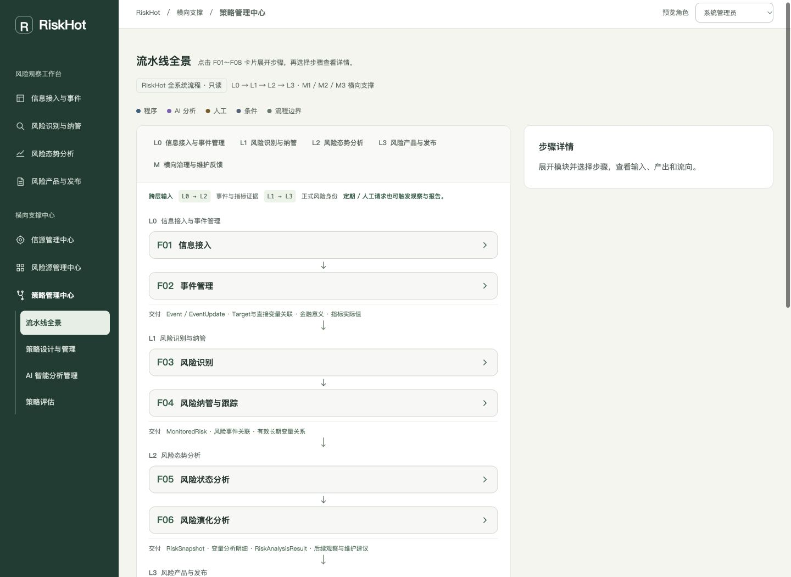
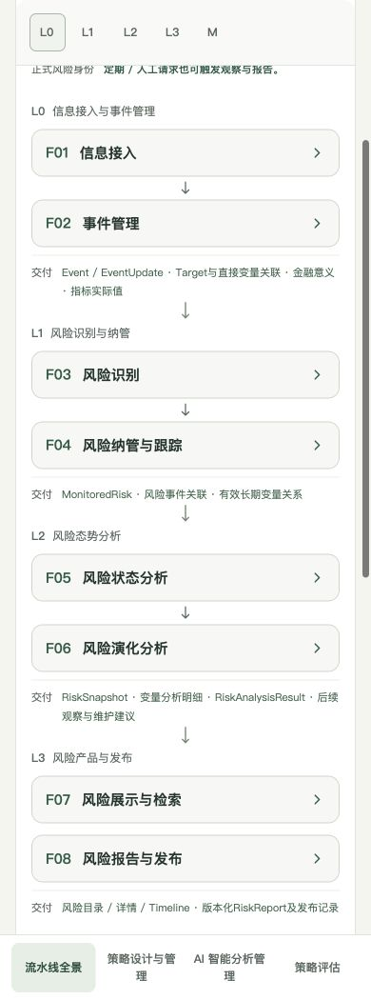
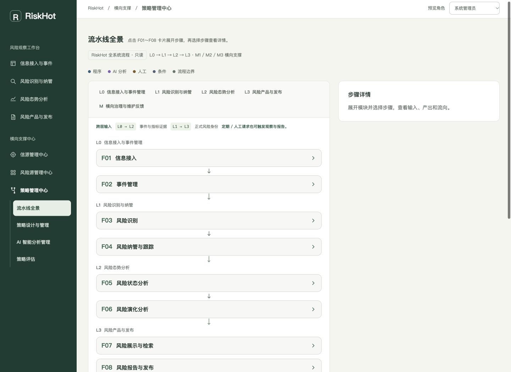
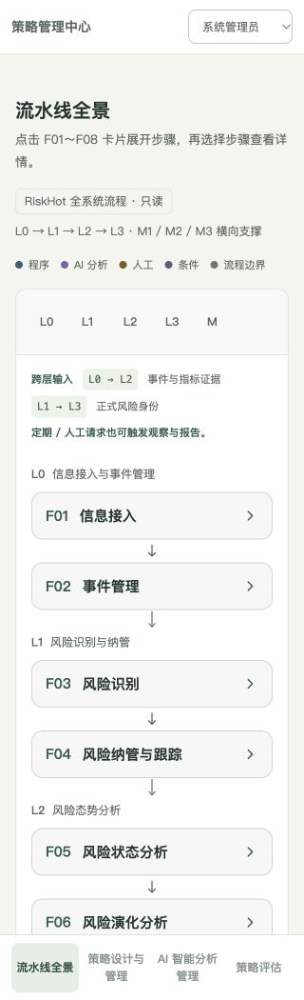

# 模块卡头精简记录

日期：2026-10-16。

## 调整结果

- F01～F08收起时，仅显示F编号、模块名称和方向箭头；隐藏说明、Step范围和“展开”文字。
- 收起卡头从至少76px压缩至48px；相邻收起卡片间距12px，卡间业务连接区高度从42px压缩至24px。
- 展开后的说明、步骤、桌面Step范围、键盘操作和跨模块自动展开保持原有交互。

## 修改文件

以下路径相对M3原型目录：

| 文件 | 修改 |
| --- | --- |
| 原型资源/styles.css | 增加四条仅在收起时生效的样式规则 |
| 02. 交互原型说明.md | 同步收起态和展开态的展示说明 |
| EXPERIENCE.md | 同步紧凑卡头的体验说明 |
| DESIGN.md | 记录48px卡头及卡片间距 |
| 验证/流水线全景验证.mjs | 将断言名称改为“保留展开时的步骤范围数据” |
| 验证/流水线全景验证结果.json | 更新本轮执行结果 |
| 验证/模块卡头精简记录.md | 本次修改与验证记录 |

另更新RiskHot项目根目录index.md和log.md中的索引与维护记录。

## 验证

- 全景结构与业务保护检查685项通过，节点仍为118个。
- 布局机械检测无问题；修改文件UTF-8检查通过。
- 实际浏览器核对8张卡片均默认收起，卡头仅有编号、名称及箭头，说明、Step范围及“展开”文字均为隐藏状态。
- 实际检查1920、1440、1024、768、390、320px六种宽度：卡头均为48px；页面和卡头无横向溢出，模块名称无截断。
- Enter展开、Space收起及鼠标收起正常；展开F01可见完整说明和6个节点，桌面可见Step范围。
- 从F01“输入类型分流”跳到EV-S时，F02自动展开并选中目标步骤。
- 浏览器控制台无error/warn。浏览器预览已目视检查；截图导出接口不可用，本次未保存新截图。
- app.js、flow-data.js、system-panorama.js与本轮修改前快照逐字节一致。

## 后续调整：连接箭头与层间留白

同日按用户要求，模块卡片之间删除“按业务条件交接”文字，仅保留原有连接箭头，并将该装饰性连接区从辅助阅读内容中隐藏。层间箭头区从26px缩至20px，下一层顶部间距从8px缩至4px；交付信息的顶部外边距从12px缩至8px、内边距从11px缩至8px，层标题到卡片的间距从10px缩至8px。相邻业务层之间合计减少19px留白，范围仅限系统全景。

本次修改文件：原型资源/app.js、原型资源/styles.css、02. 交互原型说明.md、DESIGN.md、验证/流水线全景验证结果.json、本记录、两张预览截图，以及RiskHot项目根目录log.md。

- app.js语法及685项全景检查通过，布局机械检测无问题。
- 实际浏览器中，3个模块连接区均无文字且各保留1个箭头；3个业务层间箭头区均为20px。
- 1920、1440、1024、768、390、320px六种宽度均无横向溢出；八张模块卡片默认收起、卡头仍为48px。
- 鼠标展开F01后说明和6个步骤节点正常显示，再次收起正常；层级导航定位后标题未被粘附导航遮挡。
- 浏览器控制台无error/warn。flow-data.js和system-panorama.js与本轮修改前快照逐字节一致。

## 后续调整：移除层底部交付说明

同日按用户要求，系统全景的L0～L3和横向支撑层不再渲染底部“交付”标题及整段产出汇总，包括Event / EventUpdate、Target与直接变量关联、金融意义和指标实际值等。卡间及层间连接箭头保留，层底部说明所占空间随内容一并移除。

本次修改文件：原型资源/app.js、原型资源/styles.css、02. 交互原型说明.md、DESIGN.md、本记录、去除交付说明-桌面.jpg、去除交付说明-手机.jpg，以及RiskHot项目根目录log.md。app.js仅对系统全景跳过层底部说明，清理两条对应的全景专用样式；节点详情和原策略编排的数据、处理逻辑保持原样。

- JavaScript语法、685项全景检查及布局检测通过。
- 浏览器核对5层均无stage-output区块，保留3个卡间箭头及3个业务层间箭头。
- 桌面1440px、手机390px和320px均无横向溢出；八张卡片默认收起且卡头仍为48px。
- F01展开后说明与6个节点正常显示，可再次收起；控制台无error/warn。

