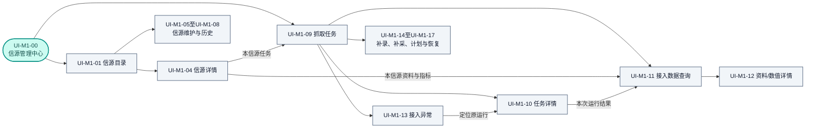

# M1 信源管理中心 · 页面与交互契约

## Foundation

本契约统一说明「信源管理中心」这个产品工作区如何承载 **M1 信源治理、F01 信息接入和 S01 公共运行**，集中维护页面结构、布局、返回上下文及跨模块交互。页面容器位于M1，不表示其中的接入与运行功能归M1业务用例维护。功能语义、字段校验和正式写入以各模块功能设计为准，反向追踪见 [[tools/RiskHot/docs/system-design/06产品UI原型设计/06-2-M1信源管理中心UI设计/reconcile-m1|页面与功能职责对照]]。

依据 [[tools/RiskHot/docs/system-design/03-系统功能架构/M1 信源管理中心功能设计|M1 功能设计]]、[[tools/RiskHot/docs/system-design/03-系统功能架构/F01 信息接入模块功能设计 V1.0|F01 功能设计]]及 [[tools/RiskHot/docs/system-design/03-系统功能架构/公共运行能力功能设计|S01 功能设计]]；视觉与tokens见 [[tools/RiskHot/docs/system-design/06产品UI原型设计/06-2-M1信源管理中心UI设计/DESIGN|M1 视觉规范]]。标题与操作位置以 [[tools/RiskHot/docs/system-design/06产品UI原型设计/标题区域设计规范|标题与操作区现行规范]] 为准，覆盖旧正文/底部主操作的描述。

用户于 2026-10-13 明确：所有在册信源均认作已登记，统一为“信源目录”，只以启用／停用管理使用状态。本决定覆盖此前两个分区、参考转正式以及暂停／恢复的设计；身份登记不再是独立页面阶段。桌面为主从浏览，手机可完成检索、详情与启停。

业务状态仅为 `ACTIVE / DISABLED`；技术就绪独立显示，自动接入仍要求启用且技术条件满足。新增保存直接纳入目录并默认停用；现有条目可直接维护和启停。保留资料校验、权限、版本、来源依据、关系及历史，不增加独立准入审批或评分。

[[tools/RiskHot/docs/system-design/06产品UI原型设计/06-2-M1信源管理中心UI设计/M1信源管理中心交互原型.html|现有原型]]仍以40个在册信源和目录维护为主，原验证范围见 [[tools/RiskHot/docs/system-design/06产品UI原型设计/06-2-M1信源管理中心UI设计/验证/原型验证记录|验证记录]]。新增跨模块页面和操作本轮仅完成文档设计，未修改原型或接口，不将原验证数量视为新增能力通过。[B]表示既有业务/架构约束，[P]表示页面设计建议，[D]表示待决。旧静态稿和页面号仅作历史参考；frontmatter路径相对于RiskHot根，`[ASSUMPTION]`为待评审交互默认。

| 正式角色 | 本中心中的权限 |
|---|---|
| 系统管理员 | 按对象和操作授权维护信源、配置任务、补录/补采及恢复；不能绕过领域校验 |
| 授权阅读者 | 只读查询授权信源、运行和结果；原件、错误工件与审计按具体资源权限过滤 |

历史流程中的“研究员”“管理员”“启停授权人员”及虚构姓名仅表示演示权限组合，不新增正式角色。信源编辑、启停和任务恢复分别授权；后台执行保留原发起者与限权服务身份。

## Information Architecture

### 编号命名与旧号迁移

模块使用`M1`、`F01`、`S01`；功能使用完整的`M1-Fxx`、`F01-SFxx.xx`、`S01-SFxx.xx`，不再把M1功能简写成F01、F02。页面统一使用 **UI-M1-xx**，表示信源管理中心这个界面容器中的页面/视图/表单，不代表业务主责，也不作为产品界面标题。

| 旧页面号（仅历史） | 当前页面编号 | 说明 |
|---|---|---|
| 旧 S01 | UI-M1-01 | 信源目录，与公共运行模块S01无关 |
| 旧 S02／S03 | UI-M1-02／UI-M1-03（退役） | 已并入统一目录/详情，不再作为入口 |
| 旧 S04 | UI-M1-04 | 信源详情 |
| 旧 S05 | UI-M1-05 | 新增/编辑信源 |
| 旧 S06 | UI-M1-06 | 信源查重 |
| 旧 S07 | UI-M1-07 | 信源启停确认 |
| 旧 S08 | UI-M1-08 | 信源历史版本 |

迁移只更新文档身份和功能映射，不更改原型DOM、脚本标识、历史图稿或业务验收编号。UI-M1-00为工作区容器；UI-M1-09～UI-M1-17为本轮补充的设计位置，尚未实现。

### 页面功能与操作主责映射

| 页面编号 | 页面/视图 | 内容与展示入口 | 功能/数据主责 | 操作与写入主责 |
|---|---|---|---|---|
| UI-M1-00 | 信源管理中心工作区 | 两个主视图及中心内导航 | M1页面容器，组合M1/F01/S01 | 各业务命令按下述归属分流 |
| UI-M1-01 | 信源目录 | 唯一在册列表、搜索/筛选、四种目录组织 | M1-F01～M1-F04 | 新增/档案/启停交M1 |
| UI-M1-04 | 信源详情 | 档案、技术接入、使用关系、变更记录 | M1-F05、M1-F07、M1-F09～M1-F11；检测结论来自F01 | M1维护档案/资格；F01受理技术检测；任务和数据只读关联 |
| UI-M1-05 | 新增/编辑信源 | 身份、范围、依据和版本表单 | M1-F06、M1-F07 | M1保存；不同于补录接入资料 |
| UI-M1-06 | 信源查重 | 身份重复、相似渠道与并发对照 | M1-F08 | M1裁决来源身份 |
| UI-M1-07 | 信源启停确认 | 启用/停用、影响与回执 | M1-F07 | M1维护资格，不暂停S01计划或代替F01在途检查 |
| UI-M1-08 | 信源历史版本 | 当时档案、范围、资格和操作 | M1-F11 | 只读M1历史；运行历史另在UI-M1-10 |
| UI-M1-09 | 抓取任务工作台 | 任务、计划摘要、运行/结果/异常 | S01提供任务/运行；F01汇聚业务监测 | 调度和触发交S01；接入参数/资格交F01 |
| UI-M1-10 | 任务详情 | 概览、历史、结果、配置 | S01维护运行/尝试；F01提供计数、业务异常及结果引用 | 配置转UI-M1-16；恢复转UI-M1-17 |
| UI-M1-11 | 接入数据查询 | 原始资料/指标观测值 | F01资料与数值查询；任务范围来自S01关联 | 只读；不修改M1信源或M2指标定义 |
| UI-M1-12 | 资料/数值详情 | 正文、附件、原值、定位、修订和引用 | F01-SF01～F01-SF03；F02/F05关系只读 | 原件/版本回源F01；下游只读跳转 |
| UI-M1-13 | 接入异常与待处理 | 业务异常、运行故障和处置历史 | F01解释业务异常；S01维护运行告警/恢复及待办投影 | 按原主责处理，不在页面直接改成功或批准 |
| UI-M1-14 | 补录资料表单 | 信源、出处/文件、发布时间和类型 | F01-SF01.03及证据规则 | F01校验/保存；异步任务由S01受理 |
| UI-M1-15 | 历史补采表单 | 资料时间或指标观测期、范围和缺口 | F01业务范围；S01-SF04.03运行交接 | F01裁决补采，S01建立显式运行 |
| UI-M1-16 | 采集任务/计划配置 | 接入参数、周期、时区、生效版本 | F01校验接入参数；S01-SF01、S01-SF02维护任务/计划 | 正式计划只写S01，M1不另存一份 |
| UI-M1-17 | 运行操作确认/反馈 | 重试、补交付、计划暂停、取消及回执 | S01-SF03、S01-SF04；F01提供资格/保存结果/恢复范围 | S01受理执行；领域批准回原业务命令 |

### 页面入口与去向

中心保留“信源目录、抓取任务”两个主视图；“全部／事实核验／日常监测／专题研究”仅是目录内组织方式。资料、指标、异常与表单在中心内下钻，不新增F01顶级导航。无运行上下文也可从任务顶栏查询全部授权资料/指标。

切换主视图分别保留条件与分页；从信源/运行下钻时显示可清除的范围条件，返回恢复原行、滚动与焦点。页面主操作位于应用顶栏，抽屉/表单操作位于各自标题行；字段、状态及写入主责不因承载位置改变。

### UI-M1-01：目录与发现

排列顺序为“检索／新增及筛选 → 视图／组织规则 → 去重总数与分组记录 → 详情”。正式信源的启停动作放在详情，避免在密集列表中误触 [ASSUMPTION]。不增加批量登记、批量启用或批量删除。

| 控件／区域 | 具体规则 |
|---|---|
| 搜索 | 提示“搜索名称、发布主体或稳定编码”；全部在册条目均有稳定编码。支持 Enter 提交与清空 [ASSUMPTION]。旧请求晚返回不得覆盖新关键词结果。 |
| 五维筛选 | 等级、金融属性、观察层级、关注优先级、监测频率；信息功能在详情／表单完整展示，本版不擅自增加第六个主筛选。目录同时提供启用／停用筛选。 |
| 组合语义 | [ASSUMPTION，D-M1-03] 不同维度取交集，同维度多选任一命中；控件旁写“同维度满足任一项”，暂不提供“全部匹配”切换。未选值等同不限制该维度。 |
| 结果反馈 | 展示当前去重总数、已选条件与“清空条件”；无数据与筛选无匹配使用不同提示。条目可能在多个分类重复出现，引用身份仍只有一份。 |
| 分类与计数 | 分组视图中每个分类可展开／收起；提供展开全部／收起全部。金融属性→观察层级→关注优先级逐层缩进，使用连接线和维度标签表达父子关系；未标注属性保留“待补充”分组，不伪造分类。所有在册总数按 `source_id` 去重；分组累计显示“分组计数可重叠”。 |
| 目录行 | 名称、发布主体、稳定编码、分类与启停状态；所有条目均在册，不展示未登记或映射状态。 |
| 目录状态 | 名称／稳定编码、信源等级、接入方式、业务状态、技术就绪辅助信息；完整名称和双状态在详情始终可见。 |
| 长列表 | [ASSUMPTION] 结果分段按需加载，明确“加载更多”而非无尽自动滚动；批次数量交由实现按数据量配置。总数未返回则写“总数暂不可用”，不由已加载条数冒充总量。 |

四视图按钮与组织规则说明位于搜索筛选面板底部，与搜索及过滤条件共用工具区。四视图、分类与启停状态筛选作用于同一信源目录。切换保留过滤条件与所选身份，仅改变展示、分组／排序，不改六维配置或启停状态。

| 视图 | 分组与可见排序说明 | 边界 |
|---|---|---|
| 全部 | 按来源清单稳定次序平铺 | 每个 `source_id` 只显示一条，包含辅助入口；保留搜索、分类和启停筛选及加载更多；隐藏树节点、展开／收起和分组重叠说明。 |
| 事实核验 | 信源等级 → 来源类别；显示“按等级与来源类别组织” | 等级展示顺序 T1、T1.5、T2；辅助入口单列。组内沿用来源清单稳定次序 [ASSUMPTION]。未接入F01资料时间前不提供“原始发布时间”伪排序（D-M1-02）。 |
| 日常监测 | 关注优先级 → 监测频率 → 信源等级 | 核心、重点、一般；频率展示实时、每日、每周、每月、不定期的稳定次序 [ASSUMPTION]，不代表重要性。注明“业务检查偏好，非采集时间表”。 |
| 专题研究（默认） | 金融属性 → 观察层级 → 关注优先级 | 默认按全部金融属性展示，无须先选择；筛选按需缩小范围；多选可重复分组，列明命中标签。不显示相关度百分比、综合分或推荐星级。 |

### UI-M1-04：统一详情

所有在册条目均显示身份、稳定编码、版本、启停和技术状态。档案按六段组织：身份、六维分类、监测配置、信息内容与范围、观察用途与口径、来源入口与依据。不得显示“尚未登记”或“登记为正式信源”。

四页签分别为档案、技术接入、使用关系、变更记录；各区独立加载。M1-F09继续只读展示技术结果，F01检测动作按跨模块命令受理；关系只读引用M2/F01，历史按当时版本展示。FRED 在同一目录，辅助查询是用途标签，需逐序列回源，不统一套用 T1；原型中的 `AUX` 仅为演示用途标识，不定义数据库新枚举。

### UI-M1-05：逐字段录入与必填时机

表单按身份与定位、六维分类、范围与资料、依据、内容与用途、本次理由组织。只有未在册的新来源需要新增；在册条目直接编辑，不能再要求预填确认或参考转正式。新增保存即生成在册身份，默认停用；已有记录保留长期 ID。

表中“建议字段”沿用上游字段建议，不宣称已有物理列。“保存必需”不等同“启用就绪”；保存后不提交审批、不自动启用。上游未给出的字符长度、最终枚举与严格格式不得在 UI 擅自定版。

| 字段／界面名称 | 控件／可编辑性 | 保存时 | 启用时与说明 |
|---|---|---|---|
| `source_id`／正式身份 | 系统生成，只读复制 | 新建成功后返回 | 必须为正式身份，目录中既有条目均已有正式身份 |
| `source_code`／稳定编码 | 单行文本；已有正式记录只读，沿用现有交互 | 必填且唯一；同代码冲突禁止保存 | 使用已保存值，不能在启停确认中改代码 |
| `source_name`／信源名称 | 单行文本 | 必填 | 当前值需有效 |
| `source_type`／来源类别 | 受控选择；最终枚举待 D-M1-05 | 必填 | 不把机构／站点类型与等级合并 |
| `publisher_name`／原始发布主体（建议字段） | 单行文本 | 必填 | 主体变化触发重新核验 |
| `reposter_name`／转载主体（建议字段） | 单行文本 | 非转载可空；确属转载时要求填写 [ASSUMPTION] | 保留原始发布主体与转载主体，不互相覆盖 |
| `channel_type`／渠道类型（建议字段） | 受控选择；枚举待定 | 建议填写；用于同主体不同渠道查重解释 | 官网与认证账号不得仅凭同名合并 |
| `official_url`／URL 或材料定位标识 | 单行文本，可打开／复制 | 必填；既支持网址也支持可核验材料编号 | 人工材料不得被 URL 格式校验误拦；具体校验规则随定位类型定版 |
| `source_tier`／信源等级 | 单选 T1／T1.5／T2；T1.5 对应内部 `T1_5` | 可暂缺，标“启用前补齐” | 普通来源维护有效等级，辅助查询用途不伪造 T1；不能由关注优先级推导 |
| `financial_dimensions`／金融属性 | 多选：钱的数量、钱的价格、钱的流向 | 分别维护；对应 `QUANTITY/PRICE/FLOW` | 上游未规定为独立启用门槛，不擅加阻断 |
| `observation_levels`／观察层级 | 多选：宏观／中观／微观 | 分别维护；对应 `MACRO/MESO/MICRO` | 多选不复制身份 |
| `attention_priority`／关注优先级 | 单选：核心／重点／一般 | 分别维护；对应 `CORE/HIGH/NORMAL` | 与等级分别保存，不是信用分 |
| `monitor_frequency`／监测频率 | 单选：实时／每日／每周／每月／不定期 | 分别维护；对应 `REALTIME/DAILY/WEEKLY/MONTHLY/IRREGULAR` | 业务偏好，不创建计划任务 |
| `information_functions`／信息功能 | 多选：原始数据／政策／事件／观点分析 | 分别维护；对应 `RAW_DATA/POLICY/EVENT/ANALYSIS` | 不替代资料类型或风险定义 |
| `business_scope`／允许业务范围（建议字段） | 多行文本 | 必填 | 范围变更触发重新核验 |
| `material_types`／可用资料类型（建议字段） | 受控多选／枚举待定 | 必填；具体单多选契约待 D-M1-05，多选为 [ASSUMPTION] | 不能把“重点数据”描述当指标准确口径 |
| `access_mode`／接入方式（建议字段） | 单选显示人工／自动；最终枚举待定 | 必填 | 人工没有连接器不阻断合法启用；方式改变提示技术结果需复检 |
| `source_basis`／来源身份依据（建议字段） | 多行文本 | 可暂缺，标“启用前补齐” | 必须可说明当前主体、渠道和允许范围依据 |
| `source_basis_ref`／核验材料定位（建议字段） | 引用／网址／材料标识输入 | 可暂缺 | 来源依据须能追溯；若主要定位已直接提供核验材料，可复用并明示 [ASSUMPTION]，不强制编造第二份材料 |
| `source_description`／主要信息内容（建议字段） | 多行文本 | 选填 | 写提供什么，不填实际指标数值 |
| `caliber_notes`／口径注意事项（建议字段） | 多行文本 | 选填 | 统计范围、期限或转载限制写此处 |
| `observation_purpose`／观察用途（建议字段） | 多行文本 | 选填 | 写用于观察什么，与主要内容分开 |
| `admission_status`／业务状态 | 只读展示，表单不可选 | 新建固定 `DISABLED` | 仅通过 UI-M1-07 状态操作修改 |
| `version`／配置版本（建议字段） | 保存后系统返回，只读 | 所读版本用于并发校验 | 用当前有效版本重新核验；不能把历史版本当当前版本启用 |
| `last_verified_at`／来源核验时间（建议字段） | 只读展示已记录结果 | 不凭打开详情自动更新 | 有值显示来源与时间；无值写“暂无核验记录”；独立字段存储待定 |
| `created_at`、`updated_at`／创建与修改时间 | 系统只读 | 后端返回 | 不由浏览器生成事实时间 |
| 本次变更理由／操作记录 | 多行文本，不作为新领域列定版 | 登记／编辑均必填，初次登记可写来源理由 | 启停理由选填；不填仍记录操作者、时间、版本和状态变化 |

保存检查在表单就地提示缺项及重复，失败保留所有已填写内容。新增信源保存成功后显示“已加入信源目录，当前停用”，进入该正式记录；不保留“已批准”等其他配置对象用语。编辑保存成功显示新版本；普通修订不自动更换长期 ID。

### UI-M1-06：重复、相似与并发

| 情况 | 呈现／动作 |
|---|---|
| 代码唯一冲突 | 显示已有记录名称、发布主体、代码、定位；本次保存不可继续，提供“打开已有信源”及“返回修改”。同代码异发布主体明确标冲突。 |
| 确认同一来源 | 提示复用正式记录；不提供“仍然创建同一来源”。打开已有记录前，未保存表单可取消离开并继续编辑。 |
| 主体／账号／定位相似 | 显示逐字段差异；可查看已有记录或说明不同渠道后继续 [ASSUMPTION]。名称相似本身不自动合并。 |
| 同机构官网与官方账号 | 允许按不同渠道核对登记，保留相同发布主体及渠道关系说明；不因官网为 T1 就将账号也认定为 T1。 |
| 提交时新出现重复 | 保留表单，显示“已有相同来源／编码冲突”，转已有记录或返回修改；不可静默创建第二份身份。 |
| 重试与响应未知 | 超时后展示“尚不能确认是否保存成功”，先查询已有提交结果／重新读取记录；不能用换请求直接重复创建。去重与提交结果识别交由后端契约保证。 |
| 编辑版本冲突 | 显示当前记录已更新；并排读出“本次编辑／最新版本”，保留本次内容，重新加载核对后再保存；不自动覆盖他人版本。 |

### UI-M1-07：两态启停

| 当前状态 | 操作／结果 | 规则 |
|---|---|---|
| 新增未保存 | 保存 → DISABLED | 保存成功即加入目录，不存在第二次登记 |
| DISABLED | 启用 → ACTIVE | 核对身份、依据、范围、资料、有效版本和权限；失败原状态不变 |
| ACTIVE | 停用 → DISABLED | 展示新采集与在途影响、可选填写理由，保留身份与历史 |
| 任一状态 | 普通编辑保持状态 | 保存新版本、长期 ID 不变 |
| 任一状态 | 实质资料变更 → DISABLED | 主体、范围或关键依据变化提示重新核验，完整字段清单仍待定 |
| 任一状态 | 接入／定位变化 → 技术待复检 | 技术变化不新增业务状态，不因连接失败自动停用 |

只有启用和停用两种业务状态，不提供暂停或恢复。再次启用不自动补采；补采交运行计划。人工来源无连接器仍可按业务依据启用，但不能自动采集。停用后的在途响应可保留待查，不继续自动分析，真实阻断须联调验证。

[ASSUMPTION] 影响明细未知时明示未知，理由选填，授权人员仍可停用；权限、版本失败则拒绝。写入不乐观改状态；失败保留原状态，响应未知先查询结果，禁止重复提交。

### 技术、关系与历史页签

| 区域 | 展示与操作规则 |
|---|---|
| 技术接入 | 展示“连接可达／接入未就绪／人工接入／未检测或未知”等业务可读结果及来源时间。这些是上游示例文字，不在此新增最终技术枚举。连接可达不自动等于完整技术就绪，是否可自动接入以F01检查结论为准。 |
| 自动接入提示 | ACTIVE 且技术条件明确满足：显示“具备自动接入条件”；ACTIVE 且未满足／未知：显示“业务已启用，自动接入尚未就绪”；DISABLED：显示“业务停用，禁止新自动接入”。 |
| 检测记录与授权检测 | 查看F01检查结论及时间；授权检测归F01-SF01.02，由S01承载运行，不扩入M1-F09。原型尚未接通时标明能力待接入，不造空链接；检测结果按真实回执更新。 |
| 使用关系 | 分“指标允许来源配置”“实际引用的原始资料”；记录可用的关联对象、来源版本和时间。指标定义目的地写清M2，资料/数值在本中心按F01契约只读查看；M1用例不修改指标或资料。 |
| 无引用与不可查 | 仅在查询成功且确为空时显示“暂无引用”；失败、权限不足、接口未接入分别说明，保留重试或返回入口。 |
| 变更记录 | 展示操作类型、操作者、时间、理由、前后版本、前后状态及必要来源依据。版本列表与历史详情只读，不提供未经需求定义的回滚／删除。 |
| 历史版本 UI-M1-08 | 顶部固定“历史版本 v…，只读”；引用按当时版本展示，不能套用当前配置。历史资料缺失时明确“该版本资料暂不可取得”，不以最新值补齐冒充历史。 |

### UI-M1-04：接入入口补充

保留M1原有“档案／技术接入／使用关系／变更记录”四页签，按上下文补充入口，不增加另一套信源档案。[P]

| 原有页签 | 接入功能的补充组织 |
|---|---|
| 档案 | 业务状态与允许范围保持 M1 主责；显示接入方式摘要，提供「查看本信源任务」入口 |
| 技术 | 展示 F01 最近检测结论、检测时间、连接限制及技术记录；授权用户可发起「检测连接」，受理后显示检测中及最终结果；人工来源显示人工接入，不因没有自动连接器判为业务停用 |
| 关系 | 保留原有指标引用和资料关系；提供「本信源资料」「本信源指标数据」及对应任务查询，带入信源条件 |
| 历史 | 继续展示 M1 档案及启停变更；采集执行历史通过任务链接查看，不混入信源配置版本时间线 |

技术检测与采集请求由 F01/S01 受理；连接失败不自动修改 M1 启停状态，重新启用信源也不自动补采。技术检查结果、正式资格及适用版本应可在执行详情核对。[B/P]

### UI-M1-09：抓取任务工作台

#### 页面布局与信息层级

正文依次为“主视图切换 → 紧凑运行摘要 → 搜索筛选 → 任务列表”。沿用现有 M1 直接进入工具区的组织方式，不重复放置大标题或整屏统计卡片。[P]

| 区域 | 展示与交互 |
|---|---|
| 应用顶栏 | 显示信源管理中心及当前上下文；有权限时提供「新增任务」「补录资料」，以及「接入资料」「指标数据」「接入异常」等次级入口；只保留一个主要操作，其余降为次操作或有文字标签的更多菜单 |
| 运行摘要 | 当前运行中数量、待处理异常数量、所选时间范围内新增资料数与新增观测值数；分别标明单位，不把资料数和指标值数相加；点击运行/异常数量设置相应筛选 |
| 搜索与筛选 | 搜索任务名或信源；筛选信源、任务类型、运行状态、异常类型、执行时间；显示已选条件和清空入口，高级条件折叠但不隐藏已选条件 |
| 任务列表 | 每行对应一个可重复执行的任务定义；展示最近一次运行摘要，不将阶段重试显示为独立任务 |
| 更新提示 | 显示状态更新时间；后台更新不重置筛选、分页、当前行及详情选择，历史运行详情保持所选运行 |

资料任务、指标任务以及两者兼有的任务使用文字类型标识；不要求用户了解 F01/S01 编号或执行引擎术语才能完成操作。[P]

#### 任务列表字段与操作

| 列或信息组 | 内容与展示规则 |
|---|---|
| 任务名称 | 主行任务名，次行任务类型；名称进入任务详情，完整身份按需在详情查看 |
| 所属信源 | 信源名与业务启停提示；点击查看信源详情；停用不隐藏任务历史 |
| 执行计划 | 周期/时区或按需执行、计划启停及待同步提示；无计划显示「手动执行」而非空白 |
| 最近执行 | 最近运行的实际开始时间；尚未运行显示「尚未执行」，排队未启动显示受理时间与排队状态 |
| 运行状态 | 运行中、排队、等待重试、成功、失败、业务阻断等文字；等待与取消请求不伪装为已完成 |
| 执行结果 | 资料/观测值新增数量分开，重复、修订和失败数量按需展开；正常零新增明确写「成功无新增」 |
| 异常提示 | 明确失败阶段、业务限制或交付问题，保留「业务已保存、交付失败」的组合语义 |
| 下次触发 | 已生效计划的下一次计划触发时间；不作为实际开始时间承诺，待同步时明确未确认 |
| 行操作 | 常用「查看结果」；授权的「立即执行」与其他操作按任务状态出现，重试/补采范围在详情核对后提交 |

列表中先保证任务、信源、运行状态、最近执行及异常可扫描，次级数量与配置收进详情。读取状态失败时保留已加载数据并标注过期，不把未知数量填为 0。[P]

### UI-M1-10：任务详情与执行历史

详情头部显示任务名称、信源、任务类型及当前所选运行；任务定义与单次运行分开组织。默认选中最近一次运行，用户查看历史后不自动跳回最新运行。页面及抽屉操作分别进入所属顶栏，避免操作作用于用户未查看的运行。[P]

| 页签 | 主要内容 | 关键交互 |
|---|---|---|
| 运行概览 | 所选运行的触发方式、起止时间、耗时、状态与异常摘要；业务启停、技术就绪、计划状态分别标注 | 展示 F01 报告的连接、抓取、解析、去重、保存、下游交付等适用阶段；阶段支持未开始、进行中、完成、失败、跳过，不制造无依据的百分比 |
| 执行历史 | 运行时间、触发方式、发起者、状态、耗时、结果摘要及恢复关联 | 选择某条历史运行后，其概览、结果和可操作范围同步切换；展开阶段尝试，不将技术重试重复计入采集批次 |
| 执行结果 | 获取、新增、重复、修订、失败数量，注明统计单位；资料/指标结果分别组织，保存及交付状态分列 | 点击数量或「查看结果」进入带运行范围的数据列表；失败数量进入异常列表；未知与 0 分开显示 |
| 任务配置 | 业务范围、接入方式、正式计划、时区、计划启停、重叠/重试策略摘要、计划保存与生效版本 | 授权编辑进入任务/计划表单；F01 校验业务参数，S01 保存正式配置与计划；不在详情直接覆盖运行状态 |

异常摘要先用业务语言说明原因与可恢复范围，再按需展开错误详情、阶段尝试和审计关联。凭据值、完整技术堆栈及内部调用信息不作为默认展示内容。[P]

### UI-M1-11与UI-M1-12：接入数据与证据阅读

#### 接入数据工作区

在信源管理中心内提供接入数据子页，内部以“原始资料／指标观测值”切换数据类型。页面顶部保留返回入口和来源范围；切换数据类型只保留兼容的信源/时间条件，清除不兼容条件时作明确提示。[P]

| 数据类型 | 检索与筛选 | 主列表字段 | 详情与证据 |
|---|---|---|---|
| 原始资料 | 标题/关键词、信源、资料类型、发布时间、取得时间、解析/修订状态、任务/运行范围 | 标题、信源、原始发布主体、发布时间、取得时间、版本/修订及处理状态 | 原始正文/附件、标准化内容、原发/转载链、来源地址、证据定位、版本和取得任务 |
| 指标观测值 | 指标、信源、观测对象/辖区、观测期、发布时间/取得时间、单位、质量状态、任务/运行范围 | 指标、对象范围、观测期、值/缺失、单位、信源、发布时间、取得时间、数据版本 | 原值与转换说明、适用指标定义版本、允许来源、修订链、口径限制、原始表格/文件定位及取得任务 |

资料以标题进入详情；指标以指标名称、范围和观测期定位具体观测记录。长正文、附件与多版本对照进入本中心详情子页，简要元信息可在抽屉查看，避免在窄抽屉中嵌套大型阅读器。[P]

#### 版本、时间与下游引用

1. 发布时间、取得时间、指标观测期和修订时间分别标注；发布时间未知显示「未知」，不以取得时间替代。[B]
2. 修订列表展示版本、发布时间、取得时间、差异摘要及替代关系；比较新旧正文/值时保留来源和定位，历史版本明确只读，不提供无痕覆盖或一键回滚。[B/P]
3. 数值 `0`、缺失、尚未公布、不适用、口径冲突分别表达；多来源差异并列保留，不自动平均或标成唯一正确值。[B]
4. 历史截止查询明确显示分析截止时间、所用版本和适用限制；发布与取得时间均可核对，不能把后来取得的修订伪装为当时可用。接口尚不支持时标为不可查询，不展示推测的历史结果。[B/P]
5. 原文、附件和指标值均可追溯至来源及取得任务；F02 事件或 F05 使用关系只读跳转，并提示目标模块。未接通或无权限时给出准确状态，不伪造引用数量。[B/P]

### UI-M1-13：接入异常与待处理

异常列表由工作台摘要、任务详情或接入数据中的失败记录进入。每行展示异常类型、所属信源/任务/运行、发生时间、失败阶段、影响范围、当前处置及建议动作；支持按类型、时间和处置状态筛选。[P]

| 异常类别 | 首先解释的信息 | 允许的下一步 |
|---|---|---|
| 信源资格阻断 | 当前启停、允许范围与被阻断阶段 | 查看来源依据，授权用户前往 M1 原维护入口；不提供绕过资格的重试 |
| 技术连接/超时/限流 | 最近检查、失败阶段、已尝试次数及是否等待重试 | 查看检测记录，满足条件时请求 S01 技术重试；自动重试中避免重复发起 |
| 解析或原件不完整 | 不可解析的原始版本、已保存范围和具体缺口 | 查看原件，按允许范围补录/补采或进入业务复核 |
| 指标定义/来源/口径问题 | 不符的定义版本、来源限制、单位或对象范围 | 查看差异并向 M2 发起维护反馈；不在本页改指标定义或强行写入有效值 |
| 保存成功、交付失败 | 已保存结果及版本、未确认的 F02/F05 交付范围 | 仅补交付，保留成功保存结果；不默认重新采集 |
| 计划漏执行或未生效 | 计划与生效版本、预期周期及受理记录 | 查看 S01 运行记录，按权限处理同步或显式补执行 |
| 持续空内容或预期数据未出现 | F01 发布预期、判断时间窗口及证据 | 查看影响对象并按规则补采或等待；正常零新增不自动列为失败 |

详情保留原始错误、历次处置、发起者、执行回执及恢复关联。告警已读、问题已解决和新一次执行成功分别记录；业务复核决定仍提交至原业务用例，不能由页面直接改为成功。[B/P]

### UI-M1-14至UI-M1-17：表单与运行操作

| 操作与入口 | 表单或影响摘要 | 提交后的反馈与主责 |
|---|---|---|
| 新增任务／编辑计划：抓取任务顶栏或配置页签 | 信源、资料/指标类型、目标范围与接入方式；周期、时区、计划状态及适用执行策略；既有身份/指标定义只读选择 | F01 校验接入参数；S01 登记任务和正式计划。区分保存成功、同步中、已生效及同步失败，不能把 M1 建议频率当作正式执行计划 |
| 立即执行：任务行或任务详情 | 明确任务、信源和当前执行范围；范围无变化的普通执行可直接受理，不重复弹确认 | S01 返回受理回执，F01 再检查业务资格和技术条件；界面进入已受理/排队，不提示完成 |
| 补录资料：顶栏或信源上下文 | 真实信源、原始出处/链接或文件、已知发布时间、资料类型；保留取得时间和补录者，检查文件及必需出处 | F01 执行资格、解析、重复和版本规则；重复资料显示复用结果，修订显示新版本；不要求逐篇额外审批 |
| 历史补采：任务/异常详情 | 信源、资料时间范围或指标观测期、目标范围、关联原缺口/运行及预计影响；资料时间与观测期使用对应标签 | F01 校验范围与业务资格，S01 建立显式补采运行；显示实际取得时间，幂等保存，返回任务跟踪 |
| 重试／补交付：失败运行详情 | 明确失败阶段、可重试范围、已保存结果和原运行；恢复范围变化或可能重做外部动作时确认影响 | S01 受控恢复，F01 复核资格；补交付不重新采集，不能将业务重算混为重试 |
| 暂停计划／取消运行：配置或运行详情 | 明确作用对象；暂停计划对在途运行的影响、取消不能撤销已保存事实等说明 | S01 返回请求与生效状态；取消以实际裁决为准，提交已成功时保留结果并说明取消未生效 |

表单按“对象与范围 → 必需输入 → 执行选项”组织，低频策略渐进展开。对象/版本冲突、缺权限和业务阻断均在提交前后明确反馈；前端隐藏或禁用操作不能替代后端授权。已填写内容在可恢复错误时保留，重复点击复用受理结果；结果不明确时先查询原回执，不盲目再次提交。[B/P]

### 新增页面的视觉与状态反馈

沿用 [[tools/RiskHot/docs/system-design/06产品UI原型设计/06-2-M1信源管理中心UI设计/DESIGN|M1 UI 规范]]及 [[tools/RiskHot/docs/system-design/06产品UI原型设计/标题区域设计规范|标题与操作区现行规范]]：深绿导航、白色工作面、14px 正文和既有控件层级。应用顶栏沿用 57px 位置栏；页面及页签动作进入应用顶栏，抽屉/表单动作进入其自身标题行，正文保留筛选和对象内操作。[P]

| 状态或场景 | 展示与恢复要求 |
|---|---|
| 加载中 | 保持列表表头和工具区稳定，使用内容骨架；不清空搜索条件，不在加载时显示 0 条 |
| 首次无任务／暂无接入数据 | 区分“没有任务”“尚未运行”“运行后没有新增”；授权用户看到相关创建/补录入口，阅读者只读说明 |
| 筛选无结果 | 显示当前条件和「清空条件」，不引导用户重复创建已有任务或资料 |
| 查询失败／状态延迟 | 保留可用数据及其更新时间，明确失败/过期并提供重试读取；不能显示为空列表或最新成功 |
| 无权限 | 告知资源不可见或操作无权限；导航和返回可用，不泄露受限正文、凭据或错误工件 |
| 部分成功／交付失败 | 同时展示成功保存范围、失败范围和交付状态；给出适用恢复动作，不以单个红点吞掉完整语义 |
| 操作受理／取消待确认 | 明确“已受理”“等待执行”“取消请求已提交”等实际进度；主按钮防重复，最终状态由回执更新 |
| 角色与状态限制 | 系统管理员按对象/动作授权维护和恢复；授权阅读者只读。禁用动作配原因，不能只靠颜色或悬浮提示解释 |

**窄屏与可访问性**：[P] 沿用 M1 既有侧栏及信源详情断点，任务列表在窄屏改为带字段名的记录卡，优先保留任务、信源、运行状态、最近执行、结果/异常；次级配置进入详情。任务详情与表单全屏，返回后恢复原条件；不把桌面多列整体缩成横向溢出的表格。

主视图、页签和行入口可键盘操作，焦点清晰；关闭弹层或返回后恢复触发点焦点。状态配文字与适当图标，表单错误与字段关联，长标题和来源自然换行；普通文字对比度至少 4.5:1、触摸目标按至少44px设计。仅操作栏在必要时按既有规范内部横向滚动，主内容保持完整可读。[P]

### 页面契约与功能模块的分工

整体导航、列表/详情布局、页签、表单承载和返回规则集中维护于本契约；F01第5章只规定接入业务的展示信息、输入、校验、结果和证据。S01功能设计维护计划、状态、幂等、重试、取消和恢复语义，本契约只明确这些命令在哪个页面触发，不另定义状态机、阈值或默认执行策略。

UI-M1-14为补录资料，UI-M1-15为补采，UI-M1-16为任务/计划配置，UI-M1-17为运行操作反馈。补录不是新增信源，计划暂停不是信源停用。复核必须回原领域提交决定，通用确认层不代替业务批准；数据未接通时展示未知/不可查询，不以演示值冒充真实结果。

## Voice and Tone

用事实与下一步表达反馈，不用“审批通过”“智能推荐最优来源”等未定义能力。

| 场景 | 推荐文案 |
|---|---|
| 在册身份 | “在册信源；按启用／停用管理使用状态。” |
| 新增信源成功 | “已保存为正式信源，当前停用。启用需由有权限的人员操作。” |
| 来源等级缺失 | “启用前请补齐信源等级，并核对来源依据。” |
| 技术未就绪 | “业务已启用，自动接入尚未就绪。查看F01技术检查记录。” |
| 停用确认 | “停用后禁止新采集及后续自动分析；历史资料与引用保留，可选填写操作理由。” |
| 再次启用成功 | “已启用。系统不会自动补采，需补采请前往运行计划。” |
| 提交未知 | “尚不能确认本次操作是否完成。请先查询结果，勿重复创建。” |
| 无查询结果 | “暂无符合条件的信源。”＋“清空条件”；不得写“暂无信源”掩盖仍有筛选 |
| 无权限 | “当前账号没有启停权限，可继续查看信源资料。” |
| FRED 提醒 | “辅助查询入口。请逐序列核对底层发布者与原始材料。” |

## Component Patterns

与 DESIGN 的组件名逐一对应。所有写入动作等待已确认响应；本版不采用乐观变更业务状态。

| 组件名 | 行为规则 |
|---|---|
| `workspace-nav` | M1 当前模块可识别；手机菜单可键盘打开、关闭并返回触发点；不为未接入模块创造可点击死链。 |
| `section-tabs` | 信源详情四页签保留；工作区主视图、任务详情、数据类型切换各自独立，不混作目录四视图；切换独立加载，键盘可操作。 |
| `search-filter-bar` | Enter 或搜索动作提交；清除单条件／全部条件；异步结果只接纳当前查询；条件可键盘操作，结果数作低打扰播报。 |
| `view-switcher` | 切换四视图保留过滤条件与所选身份 [ASSUMPTION]；若条目在当前结果外，详情提示已不在筛选结果中，不制造已删除含义。 |
| `group-list` | 展开状态可读且可键盘切换；展开全部只影响当前结果集；分组视图保留重叠计数说明，“全部”平铺视图隐藏该说明及树操作；数量不参与评分。 |
| `source-row` | 名称为明确详情入口；键盘 Enter 打开、返回恢复行焦点；链接复制与外链不触发整行跳转。 |
| `source-detail` | 统一六段档案与四页签；窄屏打开后聚焦详情标题，关闭回原行；不把失效链接或缺字段隐藏成完整档案。 |
| `classification-tags` | 只读标签不会改业务配置；编辑以表单控件承载；每个维度独立命名，多选可复用身份。 |
| `status-pair` | 两个带标签的独立读数；刷新技术结果不触发业务状态变化；未知／失败有来源解释。 |
| `source-form` | 统一新增／编辑，必要资料与启用时机明确；保存前检查版本与重复，错误保留输入；关闭脏表单先确认。 |
| `duplicate-comparison` | 对照代码、主体、渠道、定位；强重复只复用或改正；相似不能自动合并；移动按字段逐项比较。 |
| `action-button` | 可见性由角色决定；暂不可用的合法操作附原因；提交中锁定同一动作并播报进行中，其他查询仍可读。 |
| `operation-dialog` | 固定动作对象、版本及目标状态；启停理由选填；空白不阻断确认；提交后不得通过关闭弹层取消一个已送达的请求；查询结果完成后回详情。 |
| `feedback-panel` | 在失败发生区域显示；焦点转错误摘要或未知结果标题；重试不清空输入；后台刷新提示不抢焦点。 |
| `relation-list` | 只读；暂无引用、不可查询、无权限分别呈现；跳转前显示模块与对象，保留返回上下文。 |
| `version-timeline` | 选择历史版本进入 UI-M1-08；时间与版本不由相对时间单独表达；无记录只有在成功查询为空时显示。 |

## State Patterns

| 表面 | 加载／空状态 | 失败／离线／无权限 | 焦点与恢复 |
|---|---|---|---|
| UI-M1-01 目录 | 加载、目录空、筛选无匹配分别展示 | 失败保留条件；离线只读旧快照；无权限不显示资料 | 检索不跳焦点，关闭详情回原行 |
| UI-M1-04 档案 | 未选条目提示选择，缺字段明示 | 失效记录不得按旧快照操作；权限变化刷新动作 | 手机进入标题，页签切换保留焦点 |
| UI-M1-04 技术 | 未检测／未知与加载区分 | 失败不改变业务状态，离线不检测 | 重试只刷新技术区 |
| UI-M1-04 关系 | 查询成功为空才显示暂无引用 | 查询失败／无权限分别说明，不伪造 0 | 保留当前关系位置 |
| UI-M1-04 历史／UI-M1-08 | 加载指定版本，缺历史字段标缺 | 无权限／不存在／暂不可取得区分，不以最新资料替代 | 返回原时间线 |
| UI-M1-05 新增／编辑 | 读取版本，空表单可填 | 缺项／冲突保留输入；响应未知锁定表单后先查询；离线禁写 | 错误摘要定位字段，未保存关闭先确认 |
| UI-M1-06 查重 | 检查中；查空仍需提交再核对 | 失败不算无重复，强重复复用或修正，版本冲突展示最新资料 | 返回冲突字段 |
| UI-M1-07 启停 | 读取最新版本和影响 | 启用资料缺失不执行，理由为空不阻断；失败原状态不变；未知先查询 | 初始聚焦标题或取消，结果后回详情 |

[ASSUMPTION] 不缓存写入或离线排队；查询缓存必须标旧快照。会话失效停止写入，不自动将表单持久化到本地存储。

## Interaction Primitives

- 选择、筛选和展开均为本地阅读操作，不改信源。所有变更通过清楚的“保存资料”“启用”“停用”动作提交。
- [ASSUMPTION] 同一时刻仅一个可交互对话层；查重、未保存提醒和并发对照在当前表单层切换内容。Esc 关闭可关闭层，有未保存内容时进入放弃确认；焦点被约束在当前模态范围。
- 启停与正式保存均不乐观改状态；响应成功才展示新版本。重复点击锁定，刷新或超时后先查询结果。同一请求重试不重复创建身份的保证来自后端，不靠按钮禁用冒充完成。
- 外部来源链接标示目的地并在新页面打开 [ASSUMPTION]；资料编号仅复制或调用项目已有查看入口，无入口时说明，不拼造 URL。
- 列表／详情返回不重置上下文；读屏结果数低打扰播报，表单错误及状态变化及时播报。不依赖悬浮才出现核心动作，不使用拖拽作为唯一操作。

## Accessibility Floor

[ASSUMPTION] 本版以 WCAG 2.2 AA 为验收目标，尚未进行实现验收。颜色及实际计算组合见 DESIGN；状态需文字，标签与输入关联，必填时机与错误通过描述关联。所有按钮、分组与页签均暴露名称、角色、展开／选中状态。

焦点顺序按“导航 → 搜索筛选 → 视图 → 列表 → 详情 → 动作”；手机详情全屏时隔离背景焦点。提供跳到主内容入口，标签切换按相应语义支持键盘，错误摘要可定位字段；异步提示不反复播报完整列表。对话框名称包含操作与信源，关闭回原触发点。

关键业务文字不小于 `{typography.meta.fontSize}`，正文用 `{typography.body.fontSize}`；手机触控目标 44px [ASSUMPTION]，桌面按钮继承 40px。200% 缩放下不截断理由、状态和按钮，320px 窄视口可重排阅读，必要对照横向信息改纵向。尊重减少动态效果偏好；加载与状态变化不依赖动画。辅助文本不得仅以 placeholder 提供。

## Responsive & Platform

| 条件 | 页面变化与保证 |
|---|---|
| 大于 1180px | 常驻导航＋列表／详情；统一六段档案及四页签。 |
| 961～1180px | 保留主从结构，辅助列可合并到名称下；业务状态仍可见；低宽阈值按可读性提前转抽屉 [ASSUMPTION]。 |
| 641～960px | 详情抽屉覆盖内容区域，列表不与详情互挤；关闭恢复原滚动。 |
| 不超过 640px | 常驻侧栏转顶部菜单，视图可横向滚动；列表卡片纵向显示，详情／表单全屏；页面动作归应用顶栏，弹层动作归自身标题行；避让键盘并保持正文可读。 |
| 手机启停 | 身份、双状态、影响、理由和确认完整可达；不可只显示图标，不能省略启用核验或停用影响。 |
| 手机编辑／查重 | 可完成保存与查重；同一字段先本次值后已有值，差异用文字；长表单保留分段锚点 [ASSUMPTION]。 |

断点继承现有原型；新增 M1 页面映射及移动细节为 [ASSUMPTION]。所有尺寸使用 DESIGN tokens，页面缩窄只改排版，不改变权限、必填或状态机。

## Inspiration & Anti-patterns

沿用配置模块的浅色绿色、主从浏览、显式保存和详情页签。当前以单一目录和两态启停为准；旧在册分区和暂停／恢复图稿已归为历史。不得重新引入信用分、独立准入审批、由M1业务用例执行检测/采集或以最新档案覆盖历史。界面可以承载F01/S01授权请求，写入主责不转移。

## Key Flows

以下陈研（研究员）、林维（管理员）、周审（具备启停权限的业务人员）均为用于说明交互的虚构角色，不是访谈结论。每条流程的高潮是用户可观察的完成证据；编号与名称沿用上游。

### M1-F01 信源检索

1. 陈研进入 UI-M1-01，按名称、发布主体或稳定编码输入关键词并提交。
2. 结果展示匹配列表、原筛选及当前去重总数，陈研打开一条详情核对。
3. **高潮：** 详情身份与关键词意图一致，返回仍在原结果位置。

失败：无匹配提示清空条件；请求失败保留关键词并重试；旧响应不得覆盖新搜索。

### M1-F02 多维筛选

1. 陈研选择金融属性“钱的流向”和观察层级“宏观”，再按需要限定等级、优先级或频率。
2. 页面显示组合条件与“同维度任一匹配”说明，结果按跨维度交集更新。
3. **高潮：** 命中多属性的同一来源可在对应类别找到，去重总数不重复累计。

失败：筛选无结果可逐个撤销或清空；网络失败不偷偷取消筛选。组合语义为 D-M1-03 暂定方案。

### M1-F03 多视图排序

1. 陈研进入即按专题查看全部金融属性，按需切到全部平铺、事实核验或日常监测。
2. 转回专题研究直接查看层级及重点来源，金融属性筛选按需使用；每次页面写明分组次序。
3. **高潮：** 同一来源身份保持一致，组织方式已变化但分类配置、登记状态和启停状态不变。

失败：未选择主题筛选仍展示全部专题；FRED 标为辅助入口并提示逐序列回源，不能伪装统一 T1；无资料时间时不做发布时间排序。

### M1-F04 分类浏览

1. 陈研展开某分类查看条目，再使用展开全部／收起全部比较结构。
2. 多选来源在多个分组出现，面板同时展示去重总数及重叠计数说明。
3. **高潮：** 陈研从任一分组打开的都是同一身份资料，能解释组数合计与总数的差异。

失败：分类为空保留空组说明或从当前结果中省略 [ASSUMPTION]；展开加载失败就地重试，不改总数为零。

### M1-F05 信源详情

1. 陈研从目录打开任一在册信源，核对身份、分类、监测配置、内容、用途／口径与出处。
2. 查看业务／技术状态及版本，按需转技术、关系或变更记录页签；FRED 查看逐序列回源提示。
3. **高潮：** 全部在册条目使用同一详情，无未登记或转换标记。

失败：字段缺失、来源不可达、查询失败分别说明；链接失败不解释为停用。

### M1-F06 新增信源

1. 林维在统一目录查询是否已有同源记录。
2. 未在册时新增资料，填写必要身份、范围、定位与理由，通过查重和保存校验。
3. **高潮：** 保存即成为目录中的在册信源，状态为停用；不再执行登记转换。

失败：缺项／重复保留内容；响应未知先查询结果；同源只能复用或维护已有条目。

### M1-F07 在册信源管理

1. 林维在目录直接查看或编辑任一在册条目；保存前核对普通修订／实质变更的状态影响。
2. 周审对停用来源启用，或对启用来源停用，核对权限、版本、资料和影响，可选填写理由。
3. **高潮：** 目录和详情显示确认后的启用／停用，身份及历史持续保留，再次启用不补采。

失败：缺项、授权、版本或提交失败不执行；响应未知先查结果。真实在途阻断由F01/S01联调验证。

### M1-F08 重复登记检查

1. 林维登记时发现同代码、相同主体／账号／定位或相似名称提示。
2. 在 UI-M1-06 逐字段核对：强重复复用已有记录，名称相似但渠道不同则解释差异后继续。
3. **高潮：** 同一来源只有一个正式身份；真正不同渠道有清晰主体和渠道解释，未误合并。

失败：并发重复在提交时返回已有记录或明确冲突；同代码异主体拒绝；检查失败不可当“无重复”；重试不得重复创建。

### M1-F09 技术接入状态查询

1. 周审打开 UI-M1-04 技术接入页，查看业务状态、F01技术结果、结果时间和自动接入说明。
2. 自动接入未就绪时查看F01检查记录；授权检测按F01命令受理（待原型同步），M1-F09自身仍只读；人工来源按可核验出处处理业务启用，不补造连接器。
3. **高潮：** 周审知道“业务已启用但尚不能自动接入”或“人工接入”的真实边界，技术故障未被误记为停用。

失败：未检测／超时／未知明确展示；F01检查能力未接通时说明原因；返回 M1 后刷新结果，不能因跳转成功就显示就绪。

### M1-F10 使用关系

1. 陈研打开 UI-M1-04 使用关系，分别查看指标允许来源配置和原始资料实际引用。
2. 按关联对象与来源版本定位M2定义或本中心的F01资料/数值详情，只读查看后返回原记录。
3. **高潮：** 明确区分“允许使用”与“实际已引用”，且没有在 M1 改写指标或原始资料。

失败：成功查空显示暂无引用，失败／未接入显示暂不可查询，无权限单独提示；未知数不显示为零。

### M1-F11 变更与版本记录

1. 陈研从 UI-M1-04 时间线定位一次编辑或启停，读取操作人、时间、理由、前后版本和状态。
2. 进入 UI-M1-08 查看当时定义、范围、来源依据和历史引用，再返回该记录。
3. **高潮：** 历史引用能追到当时版本，当前修改没有无痕覆盖过去。

失败：指定版本暂不可取得时保留版本标识并重试；无权限不给当前资料替代历史；本版不提供回滚。

### 验收追踪

下表是设计覆盖映射，不表示已通过软件测试。正式验证还需真实权限、接口、数据库版本及F01启动/在途资格校验与S01执行联调。

| 上游验收项 | 设计位置／流程 | 可观察验收点 |
|---|---|---|
| AC-M1-01 | UI-M1-01；M1-F01 | 三种检索键、无结果清空入口 |
| AC-M1-02 | UI-M1-01；M1-F02 | 跨维度组合、多属性可被检索、语义说明 |
| AC-M1-03 | UI-M1-01；M1-F03 | 四视图与搜索共用工具区；全部平铺且每个身份只显示一条，其他视图保留分组；切换保留条件且不写配置 |
| AC-M1-04 | UI-M1-01；M1-F04 | 展开／收起、组数与去重总数分开 |
| AC-M1-05 | UI-M1-04；M1-F05 | 全部在册条目统一六段详情、状态、编码与版本 |
| AC-M1-06 | UI-M1-01/UI-M1-05→UI-M1-04；M1-F06 | 在册无再次登记；新增保存即入目录，默认停用 |
| AC-M1-07 | UI-M1-06；M1-F08 | 强重复拒绝／复用、并发冲突明确 |
| AC-M1-08 | UI-M1-07；M1-F07 | 仅授权启用／停用，缺项保留原状态，历史留存 |
| AC-M1-09 | UI-M1-07；M1-F07 | 停用阻断新采集／后续分析，再次启用不补采；需联调 |
| AC-M1-10 | UI-M1-04 技术；M1-F09 | 双状态同显，未就绪不允许自动接入 |
| AC-M1-11 | UI-M1-05/UI-M1-07/UI-M1-04 技术；M1-F09 | 人工有依据可启用，无连接器不自动采集 |
| AC-M1-12 | UI-M1-04 关系；M1-F10 | 无引用与不可查询分开，跨模块只读 |
| AC-M1-13 | UI-M1-04 历史/UI-M1-08；M1-F11 | 前后版本／状态、时间／人可查，启停理由选填且填写后可查 |
| AC-M1-14 | UI-M1-05/UI-M1-07；M1-F07 | 实质修改重核验，技术变化独立提示 |
| AC-M1-15 | UI-M1-01/UI-M1-04/UI-M1-05；M1-F03/M1-F05 | FRED 辅助入口、逐序列回源、不统一 T1 |

### 跨模块页面验收追踪

以下是新增文档契约的后续验证入口，不表示原型已经实现或通过。

| 检查范围 | 页面 | 功能与验收依据 | 可观察结果 |
|---|---|---|---|
| 页面/模块身份 | 全部UI-M1页面 | M1、F01、S01功能清单及本契约编号表 | 页面/功能完整限定，旧S号只在历史迁移表出现 |
| 采集业务监测 | UI-M1-09、UI-M1-10、UI-M1-13 | F01-SF03.03；S01-SF05；AC-S01-11、AC-S01-12、AC-S01-15、AC-S01-23 | 零新增、部分成功、执行故障、业务异常及交付失败分别表达 |
| 计划与资格 | UI-M1-04、UI-M1-07、UI-M1-16、UI-M1-17 | M1-F07、M1-F09；F01-SF01.01；S01-SF02、S01-SF03；AC-S01-08、AC-S01-09、AC-S01-18、AC-S01-19、AC-S01-27 | 计划只写S01，资格只写M1，F01独立检查接入与提交 |
| 接入证据 | UI-M1-11、UI-M1-12、UI-M1-14、UI-M1-15 | F01-SF01～F01-SF03；AC-F01-03～AC-F01-13 | 时间、零/缺失、来源、版本及原件真实可核对 |
| 恢复与复核 | UI-M1-10、UI-M1-13、UI-M1-17 | S01-SF04、S01-SF06；AC-S01-14、AC-S01-16、AC-S01-17、AC-S01-20～AC-S01-22 | 补交付不重采，批准回原领域，未知回执先查询 |
| 权限与窄屏 | 全部新增页面 | 本契约状态/可访问性/响应式规则；AC-S01-25、AC-S01-26 | 阅读者不能管理操作，返回焦点/范围保留，操作位于所属标题行 |

### 上游待定事项的 UI 落点

| 待定项 | 本版处理／不能误认为已定版的内容 |
|---|---|
| D-M1-01 | 单一在册目录已确认；无参考／正式映射或登记审批，新增／导入实现方式待技术设计。 |
| D-M1-02 | 无具体资料时间则不显示发布时间排序；待M1/F01查询契约。 |
| D-M1-03 | 任一匹配为标记清楚的交互假设，待 UI 评审确认。 |
| D-M1-04 | 仅落实已明确主体／范围与关键资料失效的重核验；完整实质字段清单待业务定版。 |
| D-M1-05 | 类别、渠道、接入方式和资料类型最终枚举／校验未定；UI 不写死额外枚举。 |
| D-M1-06 | 多选存储、版本存储未定；只约束可读、可追溯与并发行为，不指定表／数组。 |
| D-M1-07 | M1 V1 不显示或使用旧信用字段；物理迁移未包含在 UI 交付。 |
| D-M1-08 | M1-F01～M1-F11 全部设计；P0/P1、排序细则及新增信源验收仍待正式评审。 |
